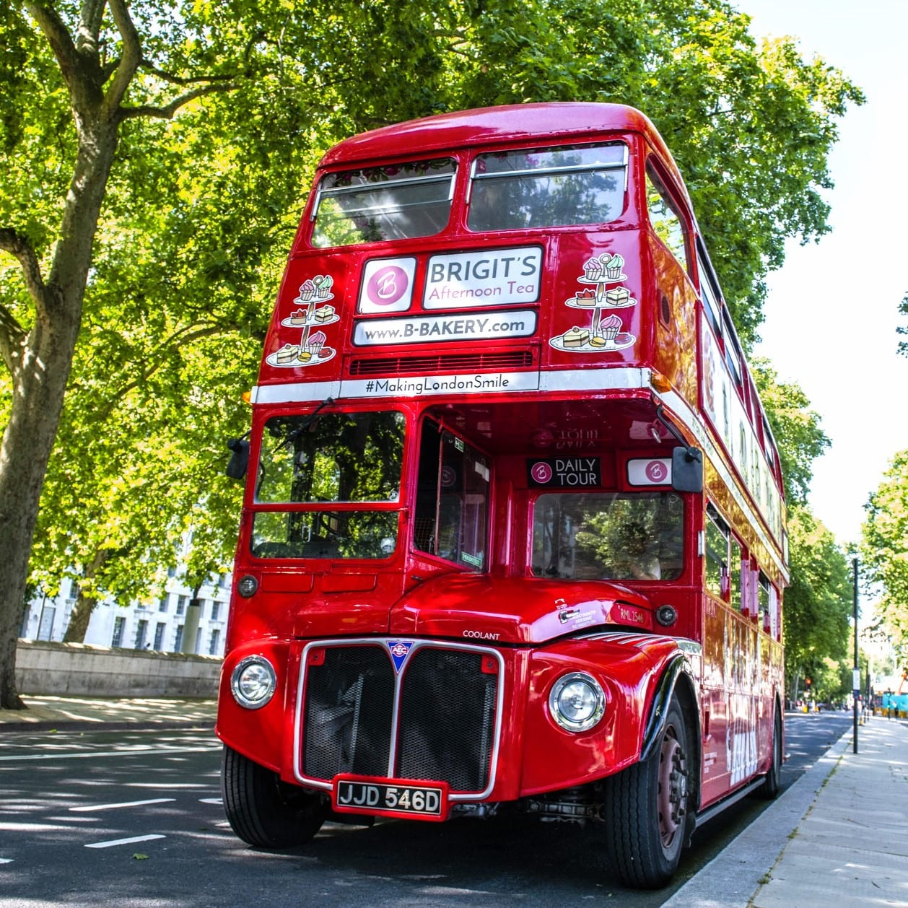
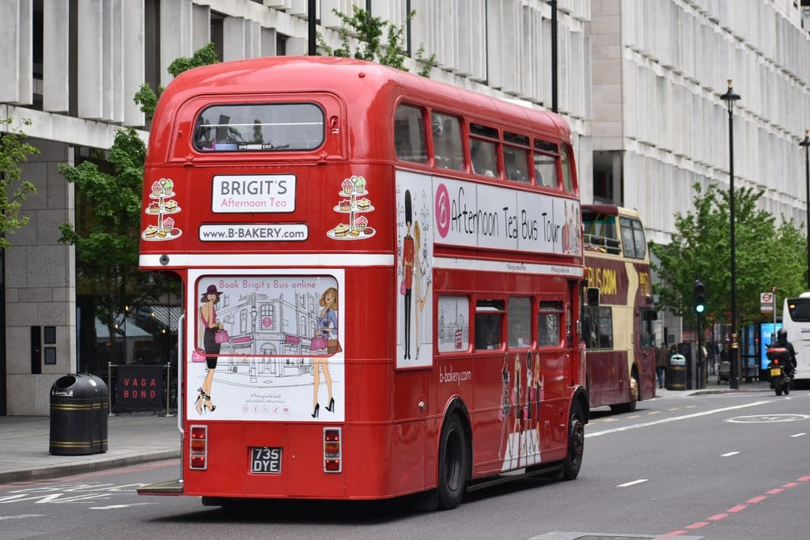
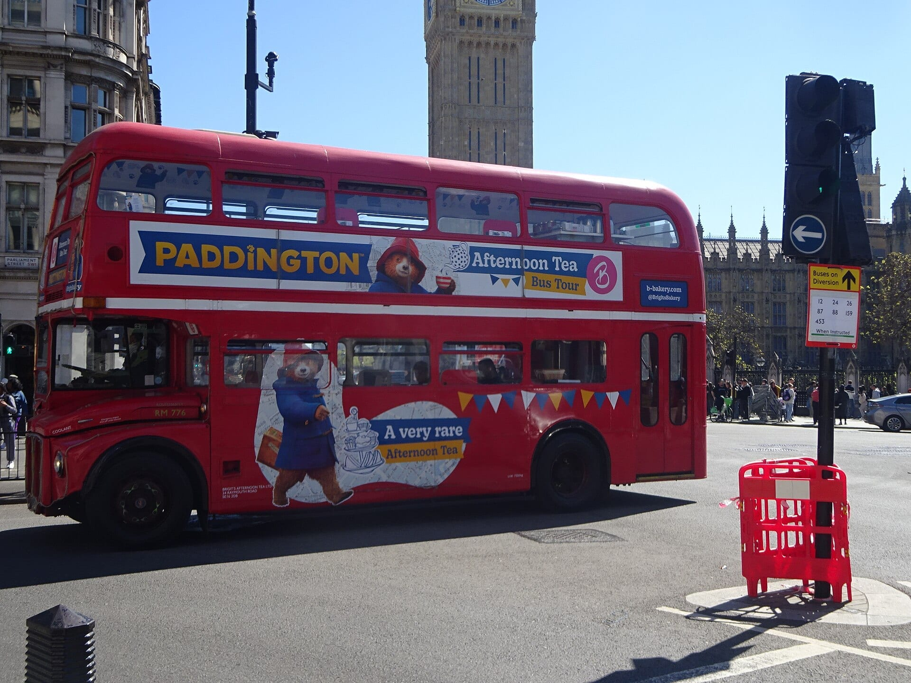
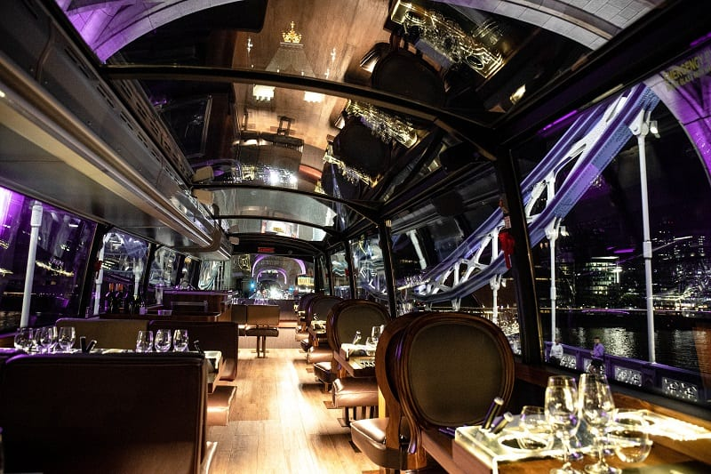

**Brigit's Bakery runs most of London's afternoon tea buses**, on vintage Routemasters, and GetYourGuide also sells a Prosecco bus, a Taylor Swift bus, a glass-roofed restaurant bus and several Christmas buses. They all circle the sights, and none lets you hop off.

> 💡 **The Short Version:** For the classic tour, book **Brigit's Bakery** direct (**from £45 adult, £37 child**, 90 minutes, Victoria Coach Station). For fizz in the price, take the **Prosecco bus** (**£49**, 4.4 from 2,156 reviews). For the highest rating among the buses with over 1,000 reviews, take the **Great British Afternoon Tea Bus Tour** (**£59**, 4.7 from 1,141 reviews). For children, take a Brigit's **Paddington**, **Peppa Pig** or **PAW Patrol** bus (**£48** on GetYourGuide). For a sit-down meal with a glass roof, **Bustronome** (**£75**) runs on Tuesdays, Wednesdays and Thursdays.

> 📘 **Booking and prices.** We earn a commission if you book through our GetYourGuide links; the price is the same either way. No operator paid to be included. GetYourGuide prices are the lowest adult price for the standard option and move with the date. Operator prices are from the operator's own site.

## The tours side by side

| Tour | Price | Fizz | Leaves from | Rating on GetYourGuide |
|---|---|---|---|---|
| Brigit's Bakery classic | from £45 adult, £37 child | Glass of Prosecco £9 extra | Victoria Coach Station | book with Brigit's |
| Great British Afternoon Tea Bus Tour | £47 | not listed | not listed | 4.7 from 1,141 |
| Afternoon Tea Bus with a Glass of Prosecco | £49 | Glass included | not listed | 4.4 from 2,156 |
| Taylor Swift-inspired bus | £49 | Prosecco or soft drink | not listed | 4.4 from 216 |
| Afternoon Tea Sightseeing Bus with PG Tips | £49 | not listed | not listed | 4.4 from 18 |
| Brigit's Paddington bus | £48 | not listed | Northumberland Avenue, Trafalgar Square | 4.6 from 212 |
| Brigit's Peppa Pig bus | £48 | not listed | Temple, Victoria Embankment | 4.4 from 249 |
| Brigit's PAW Patrol bus | £48 | not listed | Northumberland Avenue, Corinthia Hotel | 4.3 from 19 |
| Brigit's Christmas Lights bus | £59 | Bubbly option | Victoria Coach Station | 4.3 from 457 |
| Bustronome glass-roofed bus | £75, or £95 with bottomless Prosecco | £95 bottomless | Coach Bay 40B, Victoria Embankment | 4.6 from 36 |

Brigit's sells fizz by the glass or bottle on its own booking page, in advance only. Where the table says "not listed", the operator's page does not say.

## Brigit's Bakery: the classic bus and its themed versions

Brigit's Bakery says it invented the afternoon tea bus tour in 2013, and its buses are **1960s Routemasters** with tables for up to four. Every tour lasts 90 minutes, and every guest takes home a travel cup and a box for what they can't finish. The route and menu differ by bus.

### The classic tour from Victoria

*From £45 adult, £37 child · 90 minutes · daily at 12:00, 14:30 and 17:00 · age 5+ · <a href="https://b-bakery.com/london/bus-tours/afternoon-tea-bus-london" target="_blank" rel="noopener">Brigit's Bakery's tour page</a>*

The bus leaves from **Gate 0 inside Victoria Coach Station**, 164 Buckingham Palace Road, and returns there. The loop runs through Whitehall, Westminster, Buckingham Palace, Hyde Park Corner and Harrods, past the museums of South Kensington and the Royal Albert Hall, then Kensington Palace, Hyde Park, Marble Arch, Mayfair, Green Park, Piccadilly Circus and Trafalgar Square.

*A Brigit's Bakery Routemaster. Photo: [Brigit's Bakery](https://commons.wikimedia.org/wiki/File:Brigit%27s_Bakery_Afternoon_Tea_Sightseeing_tour_of_London_on_an_original_Routemaster_double_decker_London_red_bus_in_front_of_the_London_Eye._06.jpg), [CC BY-SA 4.0](https://creativecommons.org/licenses/by-sa/4.0/).*

**The menu** is five savouries, four cakes and a scone. In the current autumn menu the savouries include a chicken and sweetcorn mayo bun, cucumber and cream cheese on basil bread, an egg mayonnaise pretzel, a spinach crepe with smoked salmon and a sweet potato and blue cheese tart. The cakes are a pumpkin tart, a cherry ginger cupcake, a chocolate choux and a spiced orange macaron, and the scone is plain, with clotted cream and jam. Tea is Birchall's, with a list of ten, plus coffee, hot chocolate and juice. Brigit's says menus are seasonal and vary.

**Dietary options.** Vegetarian and halal teas cost the same as the traditional one. Vegan and gluten-free teas cost **£3 more** and need notice by email to bus@b-bakery.com at least **72 hours** ahead. Brigit's **cannot cater** for nut-free or peanut-free diets, coeliacs, or vegan and gluten-free together, and says the gluten-free menu may contain traces.

**Fizz.** No alcohol is sold on board, so it has to be booked in advance. Prosecco Zia is £9 a glass or £32 a bottle, Prosecco Rosé £11 a glass, and Nyetimber Classic Cuvée £65 a bottle; a sparkling tea is £9. A classic adult ticket with a glass of Zia comes to £54.

*A Brigit's Afternoon Tea Bus on a London street. Photo: [David Martin](https://commons.wikimedia.org/wiki/File:Afternoon_Tea_Bus_-_geograph.org.uk_-_7768985.jpg), [CC BY-SA 2.0](https://creativecommons.org/licenses/by-sa/2.0/).*

**Rules to know.** The bus has **no toilet**, children under 5 and babies are not allowed, nobody may stand while it moves, and the bus leaves on the minute, so arrive 15 to 20 minutes early. Bookings on Brigit's own site are **non-refundable**, though the date can be changed by phone. Commentary is recorded. One classic bus has a ramp for a wheelchair user at Table 4; the themed buses are not wheelchair accessible.

### The themed buses for children

Each themed bus has screens, an entertainer and a themed tea, and a travel cup for every guest. Brigit's lists them at **from £45 adult and £37 child** on its own site; GetYourGuide sells them at **£48**, with free cancellation and a 10-hour booking cut-off.

*Brigit's Bakery's Paddington afternoon tea bus in Westminster. Photo: [Vintage Fan 5678](https://commons.wikimedia.org/wiki/File:Paddington_Bear_Afternoon_Tea_London_Routemaster_Heritage_bus_in_Westminster,_London_(April_2026).jpg), [CC BY-SA 4.0](https://creativecommons.org/licenses/by-sa/4.0/).*

- **Paddington Bear** · *£48 · 4.6 from 212 reviews · <a href="https://www.getyourguide.com/activity/-t433305?partner_id=WWP7I0R&amp;cmp=afternoon-tea-bus-tours-london" target="_blank" rel="sponsored nofollow noopener" data-affiliate="gyg">Book on GetYourGuide</a>*. Daily at 12:30, 15:00 and 17:30 from Northumberland Avenue, outside the Grand Hotel by Trafalgar Square. For ages 5 and over, with Mrs Bird's and Paddington's voices on the audio guide. The savouries include "the best marmalade sandwich ever" and the cakes a pawprint cookie and an orange blondie. The route takes in Big Ben, Westminster Abbey, Hyde Park, St Paul's, Borough Market and Piccadilly Circus.
- **Peppa Pig** · *£48 · 4.4 from 249 reviews · <a href="https://www.getyourguide.com/activity/-t454309?partner_id=WWP7I0R&amp;cmp=afternoon-tea-bus-tours-london" target="_blank" rel="sponsored nofollow noopener" data-affiliate="gyg">Book on GetYourGuide</a>*. Daily at 12:15, 14:45 and 17:30 from Temple on the Embankment (bus stop N). From age 2, with sing-alongs and episode clips on screens and activity books. The route heads east first: Tower Bridge, the Tower of London, the Shard and Borough Market, then St Paul's, Theatreland, Trafalgar Square, Buckingham Palace and Westminster. Brigit's allows a toilet on board for children in an emergency.
- **PAW Patrol** · *£48 · 4.3 from 19 reviews · <a href="https://www.getyourguide.com/activity/-t1172454?partner_id=WWP7I0R&amp;cmp=afternoon-tea-bus-tours-london" target="_blank" rel="sponsored nofollow noopener" data-affiliate="gyg">Book on GetYourGuide</a>*. Daily at 12:30, 15:00 and 17:30 from Northumberland Avenue, outside the Corinthia Hotel. From age 2, with a mission to find Mayor Goodway and her chicken, puzzles on screens and an activity book. The route goes along the Thames to Battersea Power Station and King's Road.

All three offer traditional, vegetarian, vegan, gluten-free and halal teas, with the same exclusions as the classic bus.

### Christmas and seasonal buses

- **Christmas Lights Afternoon Tea** · *£59 · 4.3 from 457 reviews · <a href="https://www.getyourguide.com/activity/-t226702?partner_id=WWP7I0R&amp;cmp=afternoon-tea-bus-tours-london" target="_blank" rel="sponsored nofollow noopener" data-affiliate="gyg">Book on GetYourGuide</a>*. Runs from 11 November 2026 to 5 January 2027, with departures at 12:00, 12:30, 14:30, 15:00, 17:00 and 17:30 from Victoria Coach Station, from age 5. Brigit's own page asks from £45 adult and £37 child. The festive menu has a mini spinach quiche, a coconut and cardamom tart and a Christmas chocolate cupcake.
- **Grinchmas** · *£64 · no reviews yet · <a href="https://www.getyourguide.com/activity/-t1151764?partner_id=WWP7I0R&amp;cmp=afternoon-tea-bus-tours-london" target="_blank" rel="sponsored nofollow noopener" data-affiliate="gyg">Book on GetYourGuide</a>* and **The Cat in the Hat** · *£64 · no reviews yet · <a href="https://www.getyourguide.com/activity/-t1521468?partner_id=WWP7I0R&amp;cmp=afternoon-tea-bus-tours-london" target="_blank" rel="sponsored nofollow noopener" data-affiliate="gyg">Book on GetYourGuide</a>*. Brigit's runs the Cat in the Hat bus from 14 November to 31 December 2026, for ages 4 and over, and the Grinchmas bus from Northumberland Avenue for ages 5 and over.

Brigit's Monopoly tour is for private hire only in November and December 2026.

## The other GetYourGuide buses

These listings give the bus type, the route highlights and the price. They do not say where the bus leaves from or at what times, so check the booking page for the date you want.

### Great British Afternoon Tea Bus Tour

*£47 · 90 minutes · 4.7 from 1,141 reviews · <a href="https://www.getyourguide.com/activity/-t860156?partner_id=WWP7I0R&amp;cmp=afternoon-tea-bus-tours-london" target="_blank" rel="sponsored nofollow noopener" data-affiliate="gyg">Book on GetYourGuide</a>*

A specially converted **1960s Routemaster** on a round-London sightseeing route that takes in Tower Bridge and Big Ben, with a choice of tea, coffee or hot chocolate. It has the highest rating of the two buses with more than a thousand reviews, 4.7 against 4.4, and costs £10 more than the Prosecco bus. Free cancellation, and you must book 10 hours ahead.

Powered by <a target="_blank" rel="sponsored" href="https://www.getyourguide.com/london-l57/">GetYourGuide</a>

### Afternoon Tea Bus with a Glass of Prosecco

*£49 · 90 minutes · 4.4 from 2,156 reviews · <a href="https://www.getyourguide.com/activity/-t267952?partner_id=WWP7I0R&amp;cmp=afternoon-tea-bus-tours-london" target="_blank" rel="sponsored nofollow noopener" data-affiliate="gyg">Book on GetYourGuide</a>*

A classic **double-decker** with sweet and savoury treats, a cup of tea, and a **glass of Prosecco or a soft drink**. The route passes the Tower of London and St Paul's. It is the most reviewed tea bus on this page, and the cheapest of the buses with fizz in the price. Free cancellation.

### Taylor Swift-inspired afternoon tea bus

*£49 · 90 minutes · 4.4 from 216 reviews · <a href="https://www.getyourguide.com/activity/-t729925?partner_id=WWP7I0R&amp;cmp=afternoon-tea-bus-tours-london" target="_blank" rel="sponsored nofollow noopener" data-affiliate="gyg">Book on GetYourGuide</a>*

Taylor Swift's songs on the bus, a traditional afternoon tea, and Prosecco or soft drinks.

### Afternoon tea sightseeing bus with PG Tips

*£49 · 90 minutes · 4.4 from 18 reviews · <a href="https://www.getyourguide.com/activity/-t996265?partner_id=WWP7I0R&amp;cmp=afternoon-tea-bus-tours-london" target="_blank" rel="sponsored nofollow noopener" data-affiliate="gyg">Book on GetYourGuide</a>*

A fully guided 90-minute tour through central London with a freshly prepared afternoon tea.

### The Snowman afternoon tea bus

*£33 · 1 hour · 4.6 from 14 reviews · <a href="https://www.getyourguide.com/activity/-t1106330?partner_id=WWP7I0R&amp;cmp=afternoon-tea-bus-tours-london" target="_blank" rel="sponsored nofollow noopener" data-affiliate="gyg">Book on GetYourGuide</a>*

A Christmas tour with festive afternoon tea and a sing-along to music from *The Snowman* and carols. It is the cheapest and the shortest bus on this page.

## Bustronome: a sit-down tea under a glass roof

*£75, or £95 with bottomless Prosecco · 1 hour 45 minutes · Tuesday, Wednesday and Thursday at 12:30 · <a href="https://london.bustronome.com/reservation/en/site/index" target="_blank" rel="noopener">Book with Bustronome</a> · <a href="https://www.getyourguide.com/activity/-t203770?partner_id=WWP7I0R&amp;cmp=afternoon-tea-bus-tours-london" target="_blank" rel="sponsored nofollow noopener" data-affiliate="gyg">£75, 4.6 from 36 reviews on GetYourGuide</a>*

*The upper deck of a Bustronome bus. Photo: [Bustronome](https://commons.wikimedia.org/wiki/File:Bustronome_London.jpg), [CC BY-SA 4.0](https://creativecommons.org/licenses/by-sa/4.0/).*

This is a modern double-decker with a **fully glazed roof**. All **38 seats are on the upper deck**, and your party has its own table; Bustronome never seats different bookings together. Unlike Brigit's classic bus, it has **toilets on board**. Boarding is at **Coach Bay 40B, Victoria Embankment**, 15 minutes before departure.

The route goes east first: the Tower of London, Tower Bridge, City Hall, the Shard, Shakespeare's Globe and St Paul's, then the Royal Courts of Justice, the London Eye, Westminster and Big Ben, Westminster Abbey, Trafalgar Square, Piccadilly Circus, Hyde Park Corner, the Royal Albert Hall, the Natural History Museum, the V&A and Harrods. Commentary comes through an app in English and French.

**The tea** is sandwiches of smoked salmon with cream cheese, coronation chicken, egg mayonnaise with black truffle, and cucumber with cream cheese; pastries of a lemon meringue tartlet, a strawberry macaron, a salted caramel choux and a chocolate ganache tartlet; and plain and fruit scones with jam and cream. The £75 ticket includes water and hot drinks. A vegetarian tea and a children's tea (£45, ages 3 to 12) are available. **Bustronome cannot cater for vegan or dairy-free** at afternoon tea, Other allergies need notice at booking, and afternoon tea may carry extra limits, so phone 020 3744 5554 before you book.

Changes are subject to availability and carry a per-person fee, and guests stay on board throughout.

## Which one to book

- **First visit, sights first:** Brigit's classic from Victoria, or the Great British tour (£47), whose route includes Tower Bridge and Big Ben.
- **Fizz in the price:** the Prosecco bus (£49). On Brigit's you add a £9 glass.
- **Children under 5:** only Brigit's Peppa Pig and PAW Patrol buses take them, from age 2.
- **Vegetarian, vegan or gluten-free:** Brigit's, with the £3 supplement and 72 hours' notice for the last two. Bustronome for vegetarian only.
- **Christmas lights:** Brigit's Christmas Lights bus, 11 November to 5 January. The 17:00 and 17:30 departures run after dark.
- **A proper table and a loo:** Bustronome, midweek only.

Powered by <a target="_blank" rel="sponsored" href="https://www.getyourguide.com/london-l57/">GetYourGuide</a>

## Doing it yourself

**Tea at a hotel instead.** If you would rather sit still, our [best afternoon tea in London](/articles/best-afternoon-tea-london/) guide ranks the hotels and tea rooms by how many independent sources name them, and includes a Thames cruise with tea. For the sights without the tea, see how the [hop-on hop-off tour buses compare](/articles/london-tour-buses-compared/), which also covers the vintage Routemaster tours with a live guide. Other food and drink bookings are in our [food tours in London](/articles/london-food-tours/) guide.

