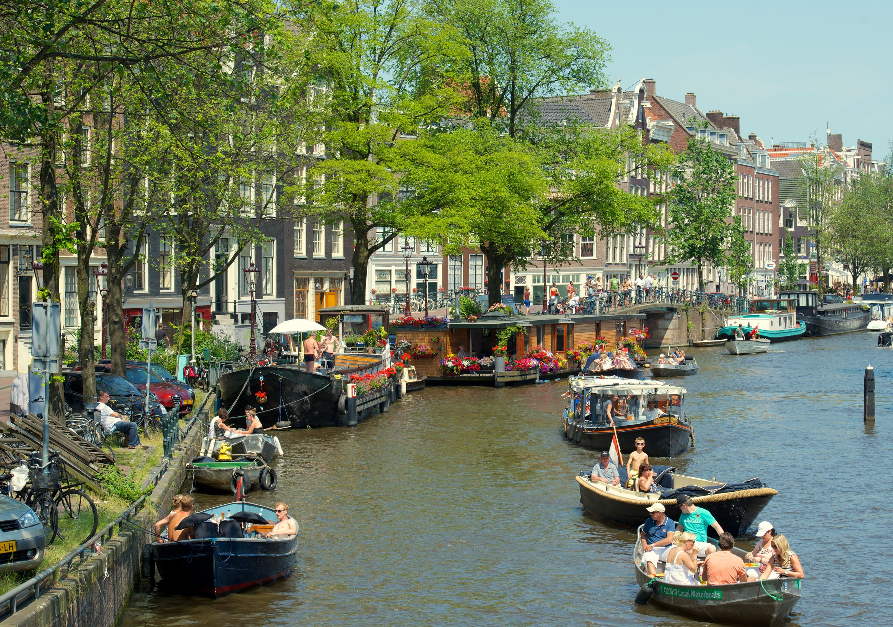
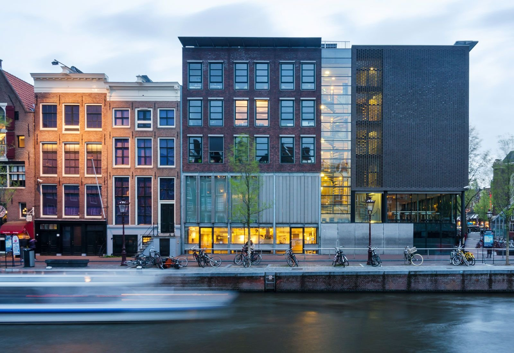
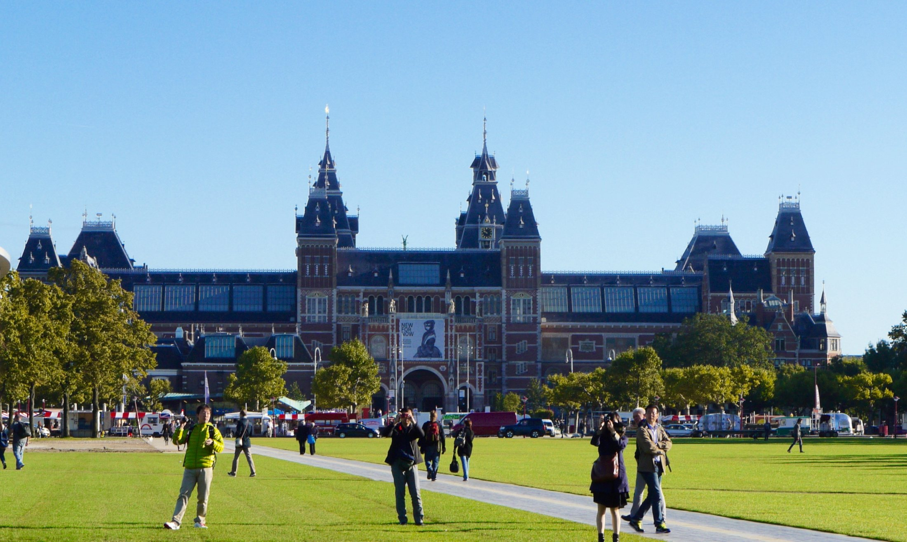

**A day trip to Amsterdam from London is possible but tight: St Pancras to Amsterdam Centraal is 4h19 direct on Eurostar (4h09 back), Standard fares start from £39 one-way, and the 75 to 90 minutes of border checks at each end leave under four hours in the city on the realistic train.** That's twice the journey time of the Eurostar to Paris, and border checks happen at both ends. A day trip works only for an early riser; one night in the city is easier.

> 💡 **The Short Version:** **St Pancras to Amsterdam Centraal, about 4 hours direct**, no change of train (it calls at Brussels-Midi and Rotterdam Centraal on the way). Eurostar Standard **from £39** one-way, booked 10–11 months ahead for the cheapest fares. **Arrive 75–90 minutes before departure at both ends** — Amsterdam's own "UK Terminal" opened February 2025 and runs full UK and Dutch border checks before you board, same as St Pancras. You need **a passport, not an ID card**, issued within **10 years** and valid **3 months** after you leave; **ETIAS isn't required yet**. **As a day trip**, the realistic 08:16 train gives you under four hours in the city before you need to be back at the station — **one or two nights suits Amsterdam far better**. **Staying over?** See Where to stay below for four hotels, from opposite Centraal Station to the canal ring. **Van Gogh Museum tickets sell out**; Anne Frank House releases tickets exactly **six weeks ahead**, every Tuesday at 10am. **Or book a canal cruise now** — <a href="https://www.getyourguide.com/activity/-t56671?partner_id=WWP7I0R&amp;cmp=amsterdam-from-london" target="_blank" rel="sponsored nofollow noopener" data-affiliate="gyg">from £11</a>, with daytime departures near Centraal Station.

**Book direct:**

- **From £11** — <a href="https://www.getyourguide.com/activity/-t56671?partner_id=WWP7I0R&amp;cmp=amsterdam-from-london" target="_blank" rel="sponsored nofollow noopener" data-affiliate="gyg">Canal Cruise from Anne Frank House, Rijksmuseum or Centraal Station</a> — 4.3 from 21,641 reviews, 1 hour, several daytime departure points so it fits around a day-tripper's schedule
- **From £23** — <a href="https://www.getyourguide.com/activity/-t56969?partner_id=WWP7I0R&amp;cmp=amsterdam-from-london" target="_blank" rel="sponsored nofollow noopener" data-affiliate="gyg">Van Gogh Museum entry ticket</a> — 4.7 from 57,513 reviews, and the one ticket in this guide worth buying well before you travel
- **From £23** — <a href="https://www.getyourguide.com/activity/-t7135?partner_id=WWP7I0R&amp;cmp=amsterdam-from-london" target="_blank" rel="sponsored nofollow noopener" data-affiliate="gyg">Rijksmuseum entry ticket</a> — 4.7 from 33,424 reviews, and the easier of the two big museums to get into at short notice

Powered by <a target="_blank" rel="sponsored" href="https://www.getyourguide.com/london-l57/">GetYourGuide</a>

## Getting there: the Eurostar

| | London St Pancras → Amsterdam Centraal |
| --- | --- |
| **Operator** | Eurostar, direct (calls at Brussels-Midi and Rotterdam Centraal) |
| **Journey time** | **4h19** outbound, **4h09** back |
| Eurostar Standard | **From £39** one-way, lead-in fare |
| Recommended arrival, St Pancras | **75 min** before (Standard/Plus), 45 min (Premier) |
| Booking window | Released **10–11 months** ahead |

Standard fares to Amsterdam start from £39 one-way. Like every Eurostar fare it's dynamically priced — the cheapest seat on the cheapest date, climbing the closer you book to travel — so treat it as a lead-in figure, not a quote for your date. Plus and Premier cost more for a wider seat, food service and lounge access; the [Paris day trip](/articles/paris-day-trip/) guide breaks down what each one adds.

"Direct" means no change of train, not nonstop: the Amsterdam service calls at Brussels-Midi and Rotterdam Centraal while you stay in your seat. There are five direct departures a day from St Pancras on a weekday (06:16, 08:16, 11:04, 15:04, 18:04), three on Saturday and four on Sunday, fewer than Paris, so check the timetable for your date.

### Booking ahead, and Eurostar Snap

Tickets are released **10 to 11 months ahead**, and the price only rises as the date gets closer. **Eurostar Snap** sells discounted last-minute Standard fares on this route too, bookable up to **10 days before travel**.

Powered by <a target="_blank" rel="sponsored" href="https://www.getyourguide.com/london-l57/">GetYourGuide</a>

## Check-in and the border

**Both ends of the journey run a full border process**, not just the outbound leg.

| Station | Class | Recommended arrival | Gate closes |
| --- | --- | --- | --- |
| **St Pancras** (outbound) | Standard / Plus | **75 min before** | 30 min before |
| St Pancras (outbound) | Premier | 45 min before | 15 min before |
| **Amsterdam Centraal** (return) | Standard / Plus | **75–90 min before** | 30 min before |
| Amsterdam Centraal (return) | Premier | 30 min before | 15 min before |

> ⚠️ **Don't use the 20-minute advice.** Journeys between Paris, Brussels, Amsterdam and Cologne that don't touch London recommend arriving 20 minutes ahead. Both ends of a London–Amsterdam trip need the longer time for passport checks.

Amsterdam Centraal's Eurostar "UK Terminal", open since **10 February 2025**, processes up to 650 passengers per departure. You go through a ticket check, security screening, then Dutch passport control followed by UK Border Force, before a departure lounge with seating, plug sockets and a café. Boarding starts around 20 minutes before departure.

**You need a passport, not an ID card.** Your passport must have been **issued less than 10 years before** the date you enter the Netherlands and stay **valid for at least 3 months after** the day you leave — a passport that fails either rule is turned away at the gate.

**EU Entry/Exit System (EES) registration** happens at the station before you board: a passport scan, a facial photo and, on your first crossing, fingerprints, at a self-service kiosk ahead of the ticket gates. It's free and needs no advance application.

**ETIAS, the EU's separate pre-travel authorisation scheme for visa-exempt visitors, is not required yet.** The EU had been targeting the last quarter of 2026 for launch, then dropped that date from its own site in August 2026 without setting a new one. No visa is needed for a UK citizen.

**Luggage:** one handbag or daypack plus two further items up to 85cm at their widest point for Standard and Plus, three bags plus the daypack for Premier. No weight limit, but you carry and store it yourself.

## Is Amsterdam actually doable as a day trip?

On a weekday, the **realistic option without checking in before dawn is the 08:16 from St Pancras**, which reaches Amsterdam Centraal at **13:20** local time. The **last train that gets you home the same night leaves Amsterdam at 18:40**, arriving St Pancras at 21:57. Work backwards from the 75–90 minute check-in at the UK Terminal and you need to be inside by around 17:10 — which leaves **well under four hours** in the city.

Take the very first departure instead — **06:16**, which means checking in at St Pancras by around 05:00 — and you land in Amsterdam at 11:20, which stretches the day to about **six hours**, the most a single day gives on this route.

> 💡 **Paris comparison.** The same early-start, late-return pattern on the Eurostar to Paris gives seven to eight hours in the city.

Weekends are tighter: **Saturday runs only three direct trains each way**, and the last one back leaves Amsterdam at 16:40, over two hours earlier than the weekday cut-off. For a day trip, go midweek.

**One night** gives a full evening for dinner and a first canal walk, then a full day with the shops open and the museums at a normal pace.

## Getting into the centre from Centraal Station

Most of what's in this guide is a walk or one tram ride from Centraal.

| From Centraal Station to | Getting there |
| --- | --- |
| **Dam Square** | 10-minute walk |
| **Anne Frank House / Jordaan** | 20-minute walk, or tram 13 or 17 to Westermarkt |
| **Museumplein** (Rijksmuseum, Van Gogh Museum) | Tram 2, 5 or 24 |

Trams accept contactless bank cards: tap in at the start of the journey and out at the end, as on London buses.

## The canal ring and the Jordaan

The Prinsengracht, Herengracht and Keizersgracht, the concentric canals around the old centre, are UNESCO World Heritage, listed in 2010 as the **"Seventeenth-Century Canal Ring Area of Amsterdam inside the Singelgracht."**

**The Jordaan**, just west of the canal ring, has narrow streets, houseboats moored along the smaller canals, and independent shops and cafés. Nothing here needs a ticket or a booking.

*A canal in the Jordaan.*

A **canal cruise** shows the ring from the water; book a time slot in advance. Cruises run from several points, including near Anne Frank House, the Rijksmuseum and Centraal Station, so one fits around a train time.

## The three tickets worth booking ahead

All three sights need a timed-entry ticket, but they sell out at different rates.

**Anne Frank House is the strictest.** Tickets go on sale **every Tuesday at 10am Amsterdam time, for a visit exactly six weeks later**, and only through the museum's own website — no reseller, including GetYourGuide, sells them. Adult admission is **€16.50** (including a €1 booking fee), €7.00 for ages 10–17, and €1.00 for under-10s. The museum is open daily, 9:00 to 22:00. If you miss a release, an Anne Frank–themed walking tour of the surrounding Jewish Quarter is the alternative.

*The Anne Frank House, on the Prinsengracht.*

**The Van Gogh Museum is also online-only, with no ticket sold at the door.** Adult admission is **€25** (€26 from 1 January 2027), students €16, under-18s free, and the museum runs no waiting list if your date shows as sold out. Tickets sell out days ahead, so book as soon as your dates are fixed.

**The Rijksmuseum is the easiest to get into at short notice.** Booking a start time is required for every visitor, including Museumkaart holders, but the museum still sells tickets at the entrance, subject to availability. Adult admission is **€25**, free for ages 18 and under, and it is open daily 9:00 to 17:00. The Rijksmuseum and the Van Gogh Museum are a few minutes' walk apart on Museumplein, so a booked Van Gogh slot and a same-day Rijksmuseum visit pair up easily.

*The Rijksmuseum, seen from Museumplein.*

Powered by <a target="_blank" rel="sponsored" href="https://www.getyourguide.com/london-l57/">GetYourGuide</a>

## Where to stay

Stay by Centraal Station if you have an early train home and want to be close to it; stay in the canal ring or the old centre if you'd rather have dinner and a first canal walk on your doorstep.

- **[ibis Styles Amsterdam Central Station](hotelscom:h1211201)** — directly across the square from Centraal Station, 5 minutes' walk from Dam Square; a straightforward 3-star with breakfast included, the simplest base for an early train home. £
- **[The Hoxton, Amsterdam](hotelscom:h8482)** — on the Herengracht, 5 minutes' walk from Dam Square and about 15 on foot from Centraal; its ground-floor restaurant and cocktail bar double as the evening out. ££
- **[The Toren Amsterdam](hotelscom:h20507)** — two 17th-century canal houses on the Keizersgracht, a few minutes from the Jordaan and Anne Frank House; quieter rooms, some over the canal or a private garden. £££
- **[Stayokay Amsterdam Stadsdoelen](hotelscom:h22415222)** — on the Kloveniersburgwal near Nieuwmarkt, a 10-minute walk from Dam Square; a hostel with private rooms as well as dorms, the cheapest base in the old centre. £

## What people get wrong

- **Assuming "direct" means nonstop.** The train calls at Brussels-Midi and Rotterdam Centraal; it's still one train with no change.
- **Budgeting border time for St Pancras only.** Amsterdam Centraal's UK Terminal runs the same 75–90 minute process on the way home, unlike Paris or Brussels, where only the outbound leg is longer.
- **Leaving Van Gogh Museum tickets until the day before.** There is no door sale and no waiting list.
- **Trying to book Anne Frank House more than six weeks out.** Tickets for a date are released on the Tuesday six weeks before it, at 10am Amsterdam time.
- **Assuming a UK driving licence works.** You need a passport.

## Continue planning your trip

- 🗺️ **[Day trips from London](/articles/day-trips-from-london/)** — how Amsterdam compares with Paris, Bruges and the rest for time and cost.
- 🇫🇷 **[Paris day trip](/articles/paris-day-trip/)** — the shorter Eurostar day trip, and how the border process and the hours compare.
- 🎢 **[Disneyland Paris from London](/articles/disneyland-paris-from-london/)** — another Eurostar destination, and whether a day or a night suits it.
- 🍫 **[Bruges from London](/articles/bruges-day-trip/)** — a Eurostar to Brussels plus a separate Belgian train, and how that maths compares.
- 🇧🇪 **[Brussels from London](/articles/brussels-day-trip/)** — the shortest of the Eurostar trips, if a full day abroad isn't what you're after.
- 🏴󠁧󠁢󠁳󠁣󠁴󠁿 **[Edinburgh from London](/articles/edinburgh-day-trip/)** — a different train, the same verdict: the round trip eats 8 to 9 hours, and a night in the Old Town beats a same-day return.
- 🚂 **[St Pancras hotels: where to stay in King's Cross](/articles/where-to-stay-kings-cross/)** — for the earliest trains, when checking in the night before beats a 5am alarm.
- 🗺️ **[King's Cross area guide](/articles/kings-cross-area-guide/)** — what's around St Pancras if you arrive back with the evening still ahead of you.
