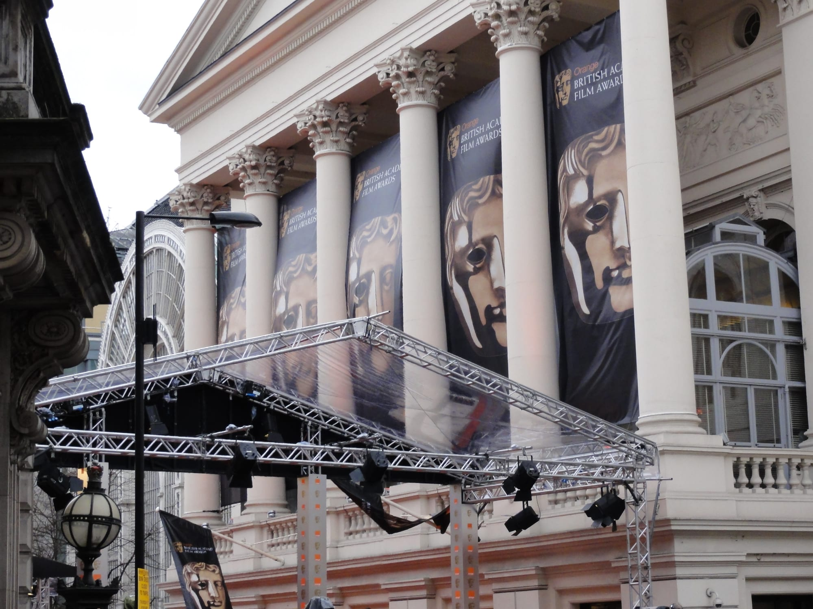

Most London award nights are invitation, industry or trade events, and the public watches the broadcast. A handful open the doors in four ways: **tickets on public sale**, **free fan pens outside the venue**, **a members' ballot**, and **standing on the street**. This guide gives each event's way in, its price at face value, and the one thing that stops a booking.

> 💡 **The Short Version:** Tickets are on public sale for the **National Television Awards** (from £25), the **Fashion Awards** (from £30), the **WhatsOnStage Awards** and the **UK Music Video Awards** (£250 plus VAT). The **Royal Variety Performance** sells to anyone, once a year, and the 2026 show is sold out. The **BAFTAs** and the **Olivier Awards** give out **free fan-pen places outside the venue**, through Applause Store, and not the ceremony itself. The **Festival of Remembrance** is a **Royal British Legion members' ballot**. The **BRIT Awards, MOBO Awards and Mercury Prize** have **left London**.

*Prices are face value, before the booking fees each seller adds. Dates are for the editions named.*

---

## Every event and how to get in

These are the events with a route for the public, in calendar order from November 2026. Two have their own page: the [National Television Awards](/articles/national-television-awards-tickets/) and the [Olivier Awards](/articles/olivier-awards-tickets/). The [BAFTA red carpet](/articles/bafta-red-carpet/), [film premieres](/articles/film-premieres-london/) and the [Last Night of the Proms](/articles/last-night-of-the-proms-tickets/) do too.

| Event | Month | Venue | Way in | Price | When to book, and restrictions |
| --- | --- | --- | --- | --- | --- |
| [Film premieres](/articles/film-premieres-london/) | Through the year | Leicester Square cinemas and others | Free fan-pen places through Applause Store | Free. Resellers quote £1,999 to £4,000 for a place, and are not an official route | Photo ID for every guest at most premieres. Places are over-allocated |
| UK Music Video Awards | Wed 4 Nov 2026 | Roundhouse, Chalk Farm | Tickets on public sale at [ukmva.com](https://www.ukmva.com/tickets) | £250 plus VAT a seat; tables of 10 £2,500, of 12 £3,000 | Includes supper and the afterparty. Doors 6.30pm, show 8pm |
| Booker Prize | Sun 8 and Mon 9 Nov 2026 | Queen Elizabeth Hall (readings); Old Billingsgate (ceremony) | Tickets for the shortlist readings through the Southbank Centre; the ceremony is private and livestreamed on YouTube | Livestream free; watch party at London Review Bookshop £7 | Readings 7.30pm on Sunday 8 November. The winner is announced on Monday 9 November, livestreamed from 9.45pm. The bookshop watch party runs 7.30pm to 10.30pm |
| Festival of Remembrance | Nov | Royal Albert Hall | Royal British Legion members' ballot | – | Members only, maximum two tickets. Tickets go to the public only if members do not use the ballot |
| Lord Mayor's Show | Sat 14 Nov 2026 | City of London, from Mansion House | Stand on the route | Free; programme £5, cash only | Sets off at 11am. Almost the whole City is closed to traffic |
| Royal Variety Performance | Fri 20 Nov 2026 | Royal Albert Hall | Public sale, through the charity's store only | From £75; with aftershow party from £310 | Show sold out; a few aftershow party tickets remain. Photo ID matched to the buyer, black tie, seated by 7pm |
| Fashion Awards | Mon 30 Nov 2026 | Royal Albert Hall | General admission on [Ticketmaster](https://www.ticketmaster.co.uk/the-fashion-awards-2026-london-30-11-2026/event/1F00647AABAF5B9F) | From £30 | Red-carpet access comes only with a hospitality package, by email |
| [EE BAFTA Film Awards](/articles/bafta-red-carpet/) | Feb 2027 | Royal Festival Hall in 2026 | Free fan-pen places by application through Applause Store | Free | Fan pens only, not the ceremony. Age 12 and over, under 18s with an adult |
| WhatsOnStage Awards | Sun 28 Feb 2027, 6.30pm | London Palladium | Tickets on public sale through LW Theatres | Seats priced on the LW Theatres page; Headliner Lounge £80 a person | Under 4s not admitted; 15 and under need an adult |
| [Olivier Awards](/articles/olivier-awards-tickets/) | Apr 2027 (2026: Sun 12 Apr) | Royal Albert Hall | Free green-carpet fan pens through Applause Store | Free | Pens are outside, with no shelter and no chairs. Age 5 and over |
| [BAFTA Television Awards](/articles/bafta-red-carpet/) | May 2027 (2026: Sun 10 May) | Royal Festival Hall in 2026 | Free fan-pen places through Applause Store | Free | Fan pens only, not the ceremony |
| [Last Night of the Proms](/articles/last-night-of-the-proms-tickets/) | Sep 2027 (2026: Sat 12 Sep) | Royal Albert Hall | Open ballot, five-concert ballot, leftover sale, Day Promming | Ballot £165.20 and £101.96; Day Prom £8 (2026 prices) | Two tickets a booker. Day Prom tickets go on sale at 9.30am on the day |
| [National Television Awards](/articles/national-television-awards-tickets/) | Wed 8 Sep 2027 | The O2 | Tickets on public sale through AXS and [Ticketmaster](https://www.ticketmaster.co.uk/national-television-awards-2027-london-08-09-2027/event/35006521445D08BE) | £25 to £105; red-carpet packages £150 and £270 | Every price carries a booking fee and a venue facility fee |
| Royal Film Performance | Sep (2026: Tue 22 Sep) | Central London | Tickets through Eventbrite | From £150 plus fees (2026) | Black tie, no photography inside, all sales final |
| [TV and radio studio audiences](/articles/free-tv-show-tickets-london/) | Through the year | Studios across London | Free tickets from audience agencies | Free | Over-issued on purpose, so a ticket is not a seat |

---

> ⚠️ **Moved out of London.** The **BRIT Awards** are at Co-op Live in Manchester in 2026 and 2027, and the 2027 ceremony is on Saturday 27 February. The 2026 **MOBO Awards** were in Manchester. The **Mercury Prize** was at the Utilita Arena Newcastle in 2025 and 2026. The **Turner Prize** exhibition is at MIMA in Middlesbrough in 2026, and **BBC Sports Personality of the Year** has been at dock10 in Salford since 2020. The **BAFTA Children's Awards** ended after the ceremony at Old Billingsgate on 27 November 2022.

---

## The calendar

Dates are the next confirmed ones. Where the 2027 date is not out, the 2026 date is shown as a guide.

- **November 2026:** the UK Music Video Awards are on Wednesday 4 November. The Booker shortlist readings are on Sunday 8 November and the winner is announced on Monday 9 November. The Lord Mayor's Show is on Saturday 14 November. The Royal Variety Performance is on Friday 20 November. The Fashion Awards are on Monday 30 November. The Festival of Remembrance is in November.
- **February 2027:** the BAFTA Film Awards, with a register-interest page for the 2027 fan pens on Applause Store (in 2026 applications closed on 8 February for the ceremony on 22 February). The BRITs are in Manchester on Saturday 27 February. The WhatsOnStage Awards are at the Palladium on Sunday 28 February.
- **April 2027:** the Olivier Awards. The 2026 ceremony was on Sunday 12 April.
- **May 2027:** the BAFTA Television Awards (2026: Sunday 10 May). The Ivor Novello Awards are on Thursday 20 May, an industry event. The Last Night of the Proms ballot opened on 16 May in 2026 and the Festival of Remembrance ballot on 27 May.
- **June to August 2027:** in 2026 the Last Night of the Proms open ballot closed on 9 July, and the Festival of Remembrance draws were on 8 and 9 July.
- **September 2027:** the National Television Awards are on 8 September. The Last Night of the Proms was on Saturday 12 September in 2026. The Royal Film Performance was on Tuesday 22 September in 2026.

---

## The free route: Applause Store fan pens

Several of the free ways in run through one agency, **Applause Store**, which issues free fan-pen places for the BAFTA Film Awards, the BAFTA Television Awards, the Olivier Awards and some film premieres. A fan pen is a standing area beside the red carpet, outside the venue, from which you watch the guests arrive.

- Register a free account, then use **Register Interest** on the event's page. It emails you when places are released.
- Places are **over-allocated**, so admission is not guaranteed, and entry is first come, first served.
- Photo ID rules are printed on the ticket, and a photo or scan of an ID is not accepted.
- Applause Store says anyone found selling a free place has it voided. Never pay for one.

*The red-carpet canopy for the BAFTA Film Awards at the Royal Opera House, Covent Garden, a former venue for the ceremony. Photo: [Tom Morris](https://commons.wikimedia.org/wiki/File:British_Academy_Film_Awards.jpg), [CC BY-SA 3.0](https://creativecommons.org/licenses/by-sa/3.0/).*

---

## The nights that sell tickets

### Royal Variety Performance

**Friday 20 November 2026, Royal Albert Hall.** A variety show in front of senior members of the Royal Family, filmed for broadcast over Christmas and New Year. The official aftershow party is at the Natural History Museum, behind the hall. Show tickets started at **£75**; show and aftershow packages started at £310, the party alone is £245, boxes started at £2,600 and access tickets were £325.

**Tickets go on sale once a year, through the Royal Variety Charity only.** The 2026 sale opened at 9am on Friday 27 February 2026, announced the day before, and the show is sold out; a few aftershow party tickets remain. The charity's [mailing list](https://www.royalvarietycharity.org/RVPtickets) gives advance notice of the next sale. At the door you need photo ID matched to the buyer, tickets are not transferable or resaleable, the dress code is black tie or evening dress, and doors open at 6pm with everyone seated by 7pm.

### Festival of Remembrance

**Royal Albert Hall, November, with an afternoon and an evening performance.** The Royal British Legion allocates tickets by ballot, for **members only**. In 2026 the ballot opened on 27 May for four weeks, entrants needed their membership number, winners could buy a maximum of two tickets, and the draws were on 8 July for the evening show and 9 July for the afternoon.

Some sites say the afternoon performance is open to any member of the public; the Legion's own [ballot page](https://www.britishlegion.org.uk/get-involved/events/remembrance-events/festival-of-remembrance) says members. If the ballot is not used up, tickets go on sale to the general public later in the year.

### The Fashion Awards

**Monday 30 November 2026, Royal Albert Hall.** General admission starts at **£30** on [Ticketmaster](https://www.ticketmaster.co.uk/the-fashion-awards-2026-london-30-11-2026/event/1F00647AABAF5B9F), linked from the [Fashion Awards tickets page](https://www.fashionawards.com/tickets), and gets you into the ceremony.

**The red carpet comes only with hospitality.** The British Fashion Council sells red-carpet access only with its hospitality packages, which are tables, club and boxes, by email to fashionawards@britishfashioncouncil.com.

### WhatsOnStage Awards

**Sunday 28 February 2027, 6.30pm, London Palladium.** The organiser calls them the only major UK theatre awards nominated and voted for by the public. Seats are sold by [LW Theatres](https://lwtheatres.co.uk/whats-on/27th-whatsonstage-awards/), with the booking fee and a £2 restoration levy included in the price shown. Two add-ons are sold with a seat: the **Headliner Lounge** at £80 a person and the **Star Suite** at £140, each with a VIP entrance and a reserved table up to 60 minutes before the show. The Supporter package is £1,600 plus VAT for two premium seats, two passes to the pre-show drinks and entry to the party for two.

**Age limits.** Under-4s, including babes in arms, are not admitted, and anyone aged 15 or under must be accompanied by an adult.

### UK Music Video Awards

**Wednesday 4 November 2026, Roundhouse, Chalk Farm Road, NW1 8EH.** A seat is **£250 plus VAT**, tables of 10 are £2,500 and tables of 12 are £3,000, and each price includes the show and the afterparty. Doors and a drinks reception are at 6.30pm, supper at 7.15pm, the show at 8pm and the afterparty at 10.30pm, with bars closing at 12.30am. The dress code is "anything goes". Chalk Farm on the Northern line is the nearest Tube. Tickets are sold at [ukmva.com](https://www.ukmva.com/tickets).

---

## The invitation-only and industry nights

These are industry, trade or private events.

| Event | Date and venue | What the public can do |
| --- | --- | --- |
| Ivor Novello Awards | Thu 20 May 2027, JW Marriott Grosvenor House, Park Lane | An industry event with press accreditation. Amazon Music livestreamed the red carpet and backstage in 2026 |
| Music Week Awards | May (2026: 7 May), JW Marriott Grosvenor House | A music-trade event whose 2026 tickets sold out. Register interest for 2027 on [musicweekawards.com](https://www.musicweekawards.com/) |
| Booker Prize ceremony | Mon 9 Nov 2026, Old Billingsgate | Private, with a free livestream and ticketed watch parties in bookshops |

---

## Continue planning your London trip

- 📺 **[National Television Awards Tickets](/articles/national-television-awards-tickets/)** — seats from £25 at The O2, and the red carpet
- 🎭 **[Olivier Awards Tickets](/articles/olivier-awards-tickets/)** — free green-carpet places and the prize draw
- 🎬 **[BAFTA Red Carpet](/articles/bafta-red-carpet/)** — free fan pens for the film and television ceremonies
- 🌟 **[Film Premieres in London](/articles/film-premieres-london/)** — how to watch the Leicester Square carpet
- 🎶 **[Last Night of the Proms Tickets](/articles/last-night-of-the-proms-tickets/)** — the ballots and the £8 Day Prom
- 🎞️ **[BFI London Film Festival](/articles/london-film-festival/)** — the galas and the cheap tickets
- 📺 **[Free TV Show Tickets in London](/articles/free-tv-show-tickets-london/)** — the free studio-audience route
- 🏟️ **[The O2 Travel Guide](/articles/the-o2-travel-guide/)** — getting to the National Television Awards
- 🏛️ **[South Kensington Area Guide](/articles/south-kensington-area-guide/)** — the Royal Albert Hall neighbourhood
