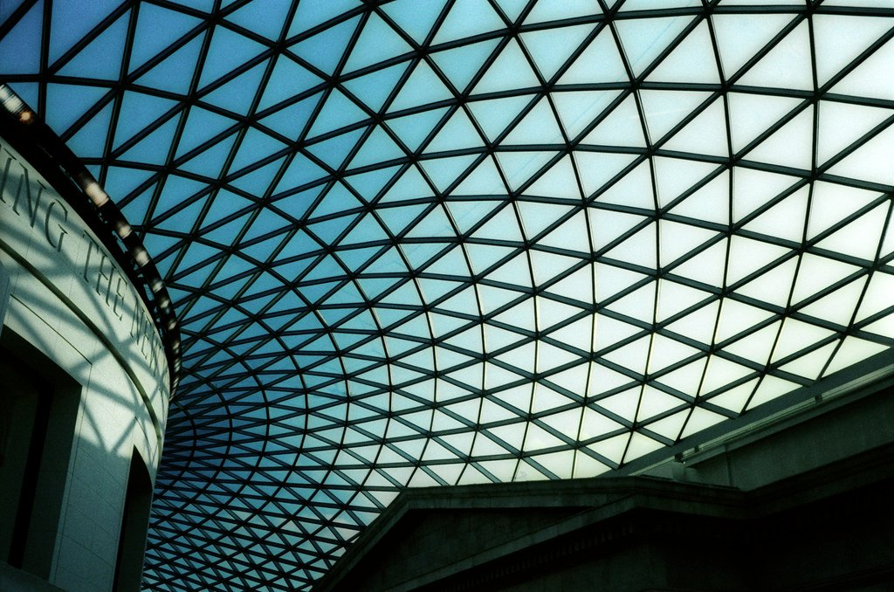
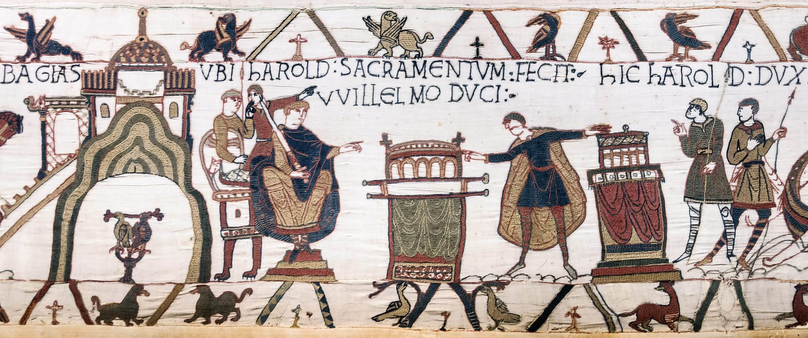
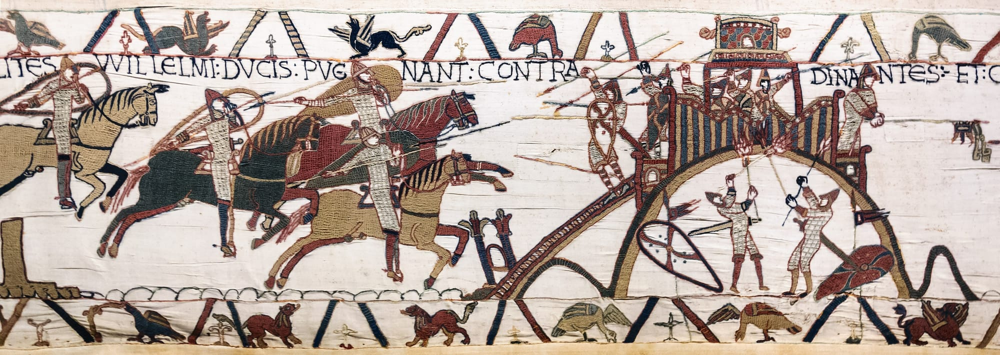
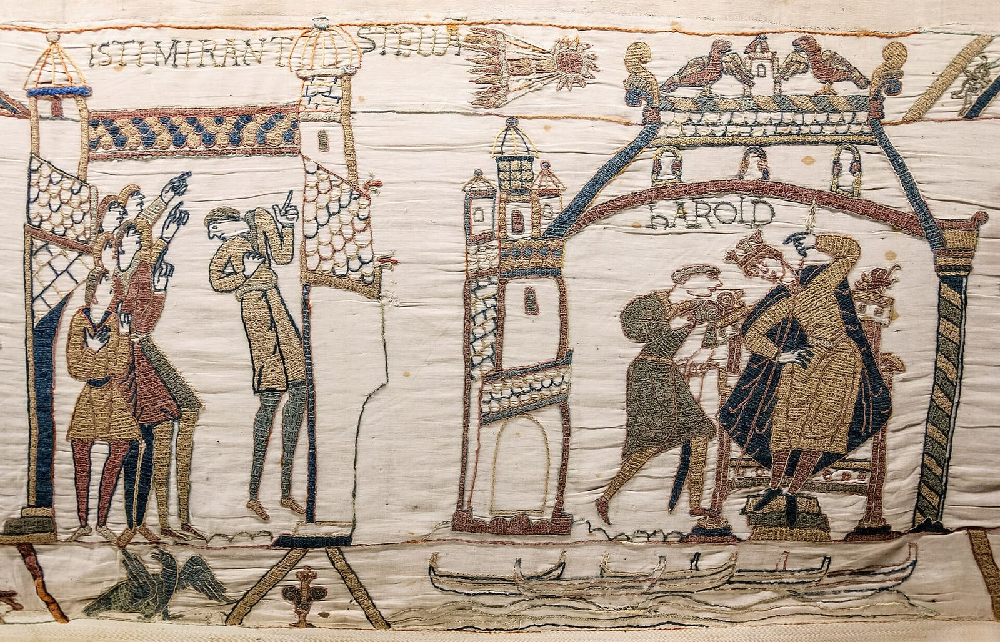
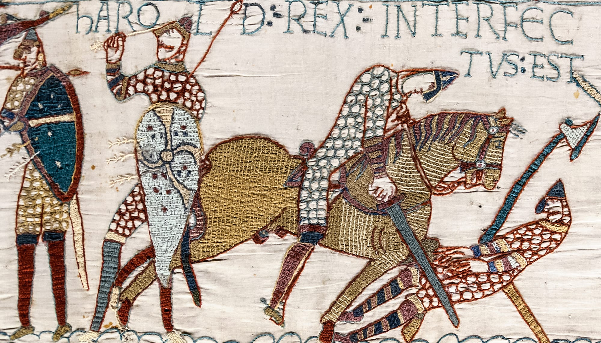

> 💡 **The Short Version:**
> - **Where and when:** Room 30 of the British Museum, from 10 September 2026 to **11 July 2027**, on loan from France. Open Sunday to Wednesday 10:00 to 18:00 and Thursday to Saturday 10:00 to 21:00.
> - **Tickets to 31 March 2027 are sold out.** April to July 2027 goes on sale in **early 2027**; members who joined by 16 September 2026 get a priority window in January. Sign up to the museum's newsletter to hear when.
> - **Adults £33**, £27 off-peak, £25 super off-peak. Under-16s are free with an adult, up to four per adult. A booking takes up to ten tickets and only the booker can use them.
> - **The visit takes about 40 minutes**, one way and timed, with no photos. Allow one to two hours for the queues.
> - **Can't get in?** The museum's [online experience](https://www.britishmuseum.org/bayeux-tapestry-online-experience) has every scene in zoomable high resolution, free. The rest of the museum is free too; our [British Museum guide](/articles/british-museum-guide/) covers it.

> ⚠️ **A free museum ticket does not get you into Room 30.** The Tapestry needs its own paid, timed ticket, and every slot to 31 March 2027 has gone.

*Dates, prices and rules are the British Museum's own, as at 19 November 2026.*

---

## Dates and opening hours

The Tapestry arrived at the museum on 10 July 2026 and went on display on 10 September. It stays until **11 July 2027**, then returns to a new museum being built for it in Bayeux, due to open in late 2027. The British Museum calls this the first time the Tapestry has been back in England since it was made, nearly 1,000 years ago. Its usual home, the Bayeux Tapestry Museum in Normandy, closed for refurbishment in September 2025, which is what freed it for the loan.

| Days | Tapestry (Room 30) | Rest of the museum |
| --- | --- | --- |
| Sunday to Wednesday | 10:00 to 18:00 | 10:00 to 17:00 |
| Thursday and Saturday | 10:00 to 21:00 | 10:00 to 17:00 |
| Friday | 10:00 to 21:00 | 10:00 to 20:30 |

Staff start clearing the room ten minutes before closing, and only bookable slots show on the calendar. The whole museum is closed on 24, 25 and 26 December.

---

## Tickets

### Where tickets stand

- **10 September 2026 to 31 March 2027:** sold out, including the members' allocations.
- **April to 11 July 2027:** members' final priority window in January 2027, then public sale in early 2027. The museum's [newsletter](https://www.britishmuseum.org/exhibitions/bayeux-tapestry#ticket-information) is where it announces releases first.

Tickets are sold through the [British Museum's Bayeux Tapestry page](https://www.britishmuseum.org/exhibitions/bayeux-tapestry). A booking takes up to ten tickets; several bookings from the same email address are cancelled. Tickets can only be used by the person who booked them, and ID may be checked.

### Prices

| Ticket | Standard | Off-peak | Super off-peak |
| --- | ---: | ---: | ---: |
| Adult | £33 | £27 | £25 |
| Adult with £3.50 donation | £36.50 | £30.50 | £28.50 |
| Students, 16 to 18s, jobseekers | £25 | £25 | £25 |
| Disabled visitors (assistant free) | £25 | £25 | £25 |
| National Art Pass | £16.50 | £13.50 | £12.50 |
| Under 16s, with an adult | Free | Free | Free |

Book under-16s alongside the adult ticket; each adult can bring up to four. A disabled visitor's assistant goes free but still needs booking. The museum notes that prices may vary. A Tapestry ticket also covers the permanent collection, which is free anyway.

### Rules that catch people out

- **No refunds or exchanges**, and the date and time cannot be changed once booked. If you add the donation, neither the ticket nor the donation can be refunded even if the museum cancels.
- **Resale is void.** A ticket resold for profit by anyone other than the museum or its authorised agents is void, and the holder can be refused entry. With tickets tied to the booker's name and ID, a ticket from a reseller is a risk.
- **Tickets arrive four days before your visit**, by email, to show on a phone or printed.
- **Concessions need proof** on the day: a student card with a photo, or a Jobcentre Plus proof-of-benefit letter.

### Members

Membership starts at £82 a year, but joining now will not jump the queue. Members who held a membership on 26 August 2026 get two free visits; those who joined between 27 August and 16 September get one; anyone who joined from 17 September gets a **10% discount on the next public sale**, with no free visit and no priority booking. Every member, guest and child has to book a timed ticket, and the membership must be valid on both the booking day and the visit day. Details are on the museum's [Visiting as a Member page](https://www.britishmuseum.org/membership/visiting-as-a-member#the-bayeux-tapestry). The museum says further members-only sessions outside public hours will be announced through the run.

### Other ways in

- **Evening talks in the Reading Room.** In-person tickets for the curator talks (£50, £42 concessions) have included a timed Tapestry visit straight after the talk. Both announced so far, *The women of the Bayeux Tapestry* on 20 November 2026 and *Arms, armour and warfare* on 29 January 2027, are sold out in person; the £6 Zoom tickets do not include the Tapestry. New talks are listed under Exhibition events on the [Tapestry page](https://www.britishmuseum.org/exhibitions/bayeux-tapestry).
- **ICOM, ICOMOS and NMDC passes** are accepted only on Tuesdays from 10:00 to 17:00 between 1 January and 31 March 2027, booked online with a promo code from the exhibition page, one pass ticket per transaction. They were not valid in 2026.
- **Groups and schools.** Group requests reopen in 2027; groups over 15 are split across two slots, up to 30 people. School bookings for 22 February to 11 July 2027 open on Tuesday 19 January 2027. No guided tours or talks can take place inside the exhibition, so a guided museum tour cannot include it.

---

## Getting to Room 30

The museum asks you to arrive **30 minutes before your slot** to get through the security and bag check, then be at the exhibition entrance five to ten minutes before your time. It does not guarantee entry at the exact time on the ticket when it is busy.

- **From the Main entrance on Great Russell Street:** go straight ahead into the Great Court, walk along its left-hand side to the far end, and go through Room 29b into Room 30.
- **From Montague Place (step-free):** take the North lift or stairs to Level 0, go through Room 24 into the Great Court, turn right, then right again into Room 29b.

The museum publishes a [Room 30 map](https://www.britishmuseum.org/sites/default/files/2026-09/Room_30_Map.pdf). Large bags are not allowed into the exhibition, and wheeled cases and anything over 40 x 40 x 50 cm or 8 kg are not allowed into the museum at all. The paid cloakroom by the Main entrance takes smaller bags but is subject to capacity. Our [British Museum guide](/articles/british-museum-guide/) has the cloakroom prices and the Tube stations.

*The Great Court, where the entrance to Room 30 is. Photo: [rbrwr](https://www.flickr.com/photos/38411862@N00/467099756), [CC BY-SA 2.0](https://creativecommons.org/licenses/by-sa/2.0/).*

---

## What the visit is like

The route is one way, and the cloth comes after an introduction and three short films.

1. **The battlefield.** Lightboxes set the scene at Hastings on 14 October 1066, with a nasal helmet from Central Europe, made between 1050 and 1200 and lent by the Kunsthistorisches Museum in Vienna, and iron swords, axes and spearheads found in London. An abstract soundscape of birdsong, waves, horses and clashing steel runs through the whole exhibition.
2. **Three short projected films** explain who commissioned it (most likely Odo, Bishop of Bayeux and William's half-brother), how it was made, and who the story is about. Each has a case beside it: a walrus-ivory crozier head found in a rectory garden in Warwickshire, the Caedmon manuscript (Junius 11) from the Bodleian Library, whose drawings fed the Tapestry's design, and a 1060 charter witnessed by King Edward, Earl Harold and Queen Edith.
3. **The Tapestry itself**, laid flat in a long case at 80 cm high, in low light, with an animation running behind it. Captions above it tell the story section by section. Staff ask you to keep moving, keep up with the people ahead, and not lean on the case.
4. **The aftermath.** After the cloth come 450 coins of Harold and William from a hoard of 2,584 silver pennies buried in Somerset around 1066 to 1068, and the charter William I gave the City of London in 1067, promising to keep its laws as they were under Edward.

The **free audio guide** is in the British Museum Audio app, and the museum asks everyone who can to use it. Download the app and the Bayeux Tapestry guide before you come; you get a code to start it as you reach the Tapestry. Bring your own headphones, or buy earbuds at the Guide Desk or the museum shop. Without a smartphone, the wall texts and films tell the same story.

Photography, drawing and sketching are not allowed.

---

## What's on the cloth

The Tapestry is an embroidery, not a woven tapestry: wool in four dyes, worked in five kinds of stitch onto nine joined panels of linen. Bayeux Museum gives its length as 68.3 metres; the linen is 50 cm high. It was probably made in England in the 1070s, most likely around Canterbury, by English needlewomen, and the curators count 627 people, 737 animals, 37 ships and 33 buildings on it. The end is damaged and almost certainly missing: some scholars think it finished with William's coronation at Westminster Abbey on Christmas Day 1066.

With only seconds at each stretch, it helps to know what is coming. In order:

*Harold swears an oath to William on two reliquaries, at Bayeux. Photo: [Myrabella](https://commons.wikimedia.org/wiki/File:Bayeux_Tapestry_scene23_Harold_oath_William.jpg) (public domain).*

- **Harold sets out, 1065.** After an audience with King Edward, Earl Harold sails for France, is blown off course and is seized by Guy, Count of Ponthieu. William sends riders to get him released.
- **Two peacocks.** As Harold and William talk in William's hall, two peacocks in the top border copy them: William's bird stands calm with folded wings, Harold's fans its tail.
- **Ælfgyva.** One of only three women in the main strip, shown in an arched frame with a cleric touching her face, under the words "where Ælfgyva and the cleric". Nobody knows who she is; a recent article co-written by the exhibition's lead curator argues she may be Emma of Normandy, Edward's mother.
- **Quicksand and Dinan.** On campaign in Brittany, Harold hauls William's soldiers out of quicksand. William's army traps Conan of Brittany in his castle at Dinan, and Conan hands over the keys on the tip of a spear.

*William's horsemen attack the castle at Dinan. Photo: [Myrabella](https://commons.wikimedia.org/wiki/File:Bayeux_Tapestry_scene19_Dinan.jpg) (public domain).*

- **The oath.** Rewarded with weapons and armour, Harold swears on holy relics at Bayeux to support William's claim to the English throne.
- **Edward dies, 5 January 1066.** Queen Edith weeps at the bedside, and Edward's last gesture, the two men's hands touching, seems to leave the kingdom in Harold's care. Westminster Abbey pushes up into the top border. Harold takes the crown.
- **The comet.** Halley's Comet appears at the top of the cloth, and a group of men point up at it. Beneath Harold, as he hears the news, a fleet of empty boats is stitched in outline only. The comet was actually seen in late April 1066, months after the coronation.

*Halley's Comet and King Harold. Photo: [Myrabella](https://commons.wikimedia.org/wiki/File:Bayeux_Tapestry_32-33_comet_Halley_Harold.jpg) (public domain).*

- **The invasion fleet.** Weapons, warhorses and wine are loaded onto William's ships, and the fleet crossing the Channel spreads up into the top border.
- **Pevensey, 28 September 1066.** The Normans land, seize supplies and hold a feast blessed by Bishop Odo, then build a castle. A woman leads a child by the hand out of a house Norman soldiers have set alight.
- **Hastings, 14 October 1066.** The Norman cavalry charges the English shield wall. When a rumour spreads that William is dead, he lifts his helmet to show his face, and Odo rallies the men. In the lower border the dead are stripped where they lie.
- **"Harold Rex interfectus est"** ("King Harold is killed"). One figure under Harold's name pulls at an arrow in his eye; another is cut down by a horseman. The curators note that the arrow is a later restoration, probably 19th century, and the figure first held a spear, so Harold may be either man, or both. The cloth ends with his army running.

*The death of Harold, under the words "Harold Rex interfectus est". Photo: [Myrabella](https://commons.wikimedia.org/wiki/File:Bayeux_Tapestry_scene57_Harold_death_(cropped).jpg) (public domain).*

The museum's [curators' Q&A](https://www.britishmuseum.org/blog/everything-you-need-know-about-bayeux-tapestry) goes further into Ælfgyva, the comet and the arrow.

---

## Access

- **The Tapestry lies flat at 80 cm high**, with seating along the route. Lifts are available for anyone who cannot use stairs, and Montague Place is the museum's step-free entrance.
- **Light and motion:** the exhibition has low light throughout and large projections with fast movement and changing images, which the museum flags for anyone sensitive to light or rapid motion. A [sensory map](https://www.britishmuseum.org/sites/default/files/2026-10/Bayeux-Tapestry-sensory-map.pdf) marks the sound, light, busy areas and seating.
- **Toilets:** there is one accessible toilet in the foyer once you have entered, and none inside the exhibition. If you leave to use the Great Court toilets, you cannot go back in. There is no Changing Places toilet in the museum.
- **Large print:** the [large print guide](https://www.britishmuseum.org/exhibitions/bayeux-tapestry/bayeux-tapestry-large-print-guide) carries every text in the exhibition and works in a phone browser.
- **At home:** the [online experience](https://www.britishmuseum.org/bayeux-tapestry-online-experience) is built to WCAG 2.2 AA, with keyboard and screen-reader zoom through all 13 sections and 58 scenes, a short guided tour and seven themed sets of notes.
- **Tickets:** disabled visitors pay £25 and an assistant goes free, booked together. Free wheelchair loans need booking two working days ahead; our [step-free London guide](/articles/step-free-london/) covers the rest of the museum.

---

## Free events around the Tapestry

None of these includes entry to Room 30.

- **Bayeux Late, Friday 4 December 2026, 17:30 to 20:30.** Digital art, poetry performances, live machine embroidery of Tapestry motifs onto your own clothes, and a filet crochet session. Free, over-18s, drop in; activities are first come, first served. [Event page](https://www.britishmuseum.org/events/bayeux-late-reimagining-bayeux-tapestry).
- **The Bayeux Tapestry: unravelled, Friday 12 February 2027, at 17:30 and 19:00.** A promenade performance by Teatro Vivo in which characters have "escaped" from the Tapestry into the galleries, starting outside the Reading Room. Free, ages 12 and up, 45 to 60 minutes, first come, first served, with very little seating. [Event page](https://www.britishmuseum.org/events/bayeux-tapestry-unravelled).

For either, the museum recommends a [free timed museum ticket](https://ticketing.britishmuseum.org/events?k=general%20admission) for priority entry on busy evenings.

---

## Food in and near the museum

- **Court Cafés,** on the ground floor of the Great Court: sandwiches, salads, cakes and hot drinks, 10:00 to 17:00, and until 20:00 on Fridays.
- **Great Court Restaurant,** under the Great Court roof, 11:30 to 17:00, last sitting 16:00. Booking is essential, though walk-ins are sometimes taken.
- **Pizzeria,** south-west corner of the ground floor, turn left after the Main entrance: hand-tossed pizza and gelato, 11:00 to 16:00, with gluten-free bases.
- **Coffee Lounge,** first floor, overlooking the Reading Room, 10:30 to 16:30.

None of these is open for a Thursday or Saturday evening slot, and only the Court Cafés are open late on Fridays. For dinner before or after, Charlotte Street in Fitzrovia is about eight minutes' walk west; see the [Fitzrovia guide](/articles/fitzrovia-area-guide/). The streets around the museum are in the [Bloomsbury guide](/articles/bloomsbury-area-guide/).

---

## What to see with it

The Tapestry ticket covers the day, and the galleries that fit with 1066 are upstairs.

- **Room 41, Sutton Hoo and Europe AD 300 to 1100:** the Anglo-Saxon England that 1066 brought to an end, with the Sutton Hoo helmet, the original beside a replica of how it looked whole, and Viking swords.
- **Room 40, Medieval Europe 1050 to 1500:** the century after the Conquest onwards, with the Lewis Chessmen and the Royal Gold Cup.
- **Korea**, in Room 35 off the Great Court, is the museum's other paid exhibition, until 31 January 2027; adults pay £20, or £18 off-peak.
- **Multiplied wonders: Italian Renaissance woodcuts** is free in Rooms 90 and 90a until 21 March 2027.

The galleries close at 17:00 (20:30 on Fridays), earlier than the Tapestry on late days, so on an evening slot see them first. Our [British Museum guide](/articles/british-museum-guide/) has a one- and two-hour route through the rest of the collection.

---

## Continue planning your London trip

- 🏛️ **[British Museum Guide](/articles/british-museum-guide/)** — free entry, the entrances, bag rules and what to see in one or two hours.
- 🏘️ **[Bloomsbury Area Guide](/articles/bloomsbury-area-guide/)** — the garden squares, bookshops and small museums around the British Museum.
- 🖼️ **[London Exhibitions 2027](/articles/london-exhibitions-2027/)** — every big show of the year, with prices and how each one books.
- 🏺 **[Best Museums in London](/articles/best-museums-london/)** — the other free national museums.
- 🏰 **[Tower of London Guide](/articles/tower-of-london-guide/)** — the White Tower, the Norman keep at its centre.
- ⛪ **[Westminster Abbey Guide](/articles/westminster-abbey-guide/)** — where Edward the Confessor is buried, and where William was crowned.
- 🛏️ **[Where to Stay in Bloomsbury](/articles/where-to-stay-bloomsbury/)** — hotels a few minutes from the museum.
- 🗓️ **[Things to Do in London in December](/articles/things-to-do-in-london-in-december/)** and **[in April](/articles/things-to-do-in-london-in-april/)** — Bayeux Late, and the month the last tickets cover.
