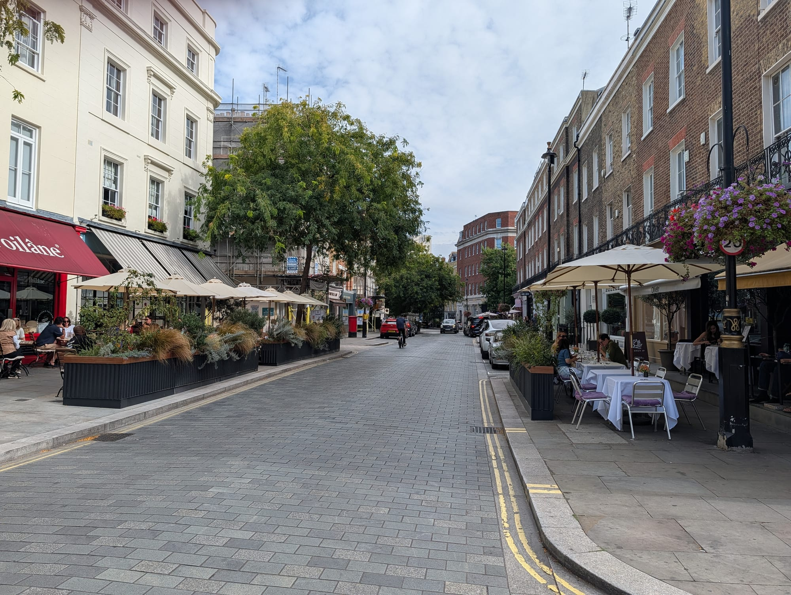
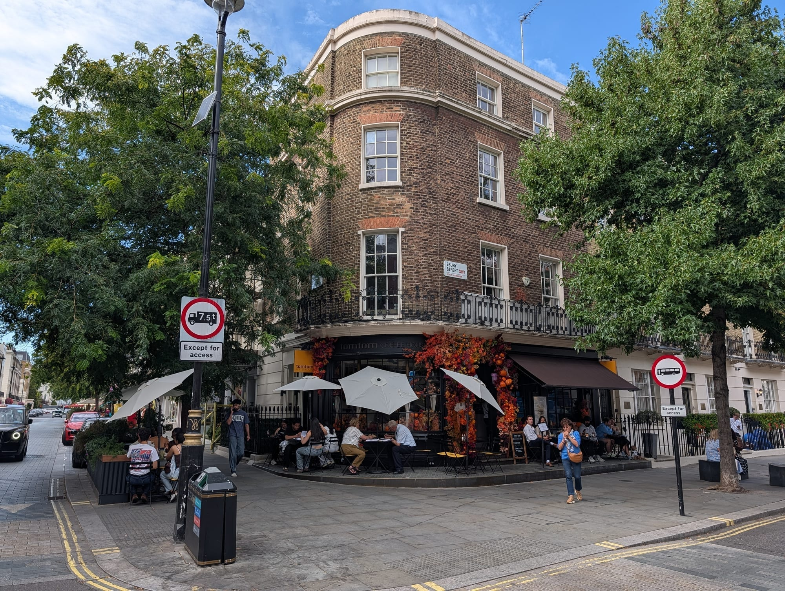
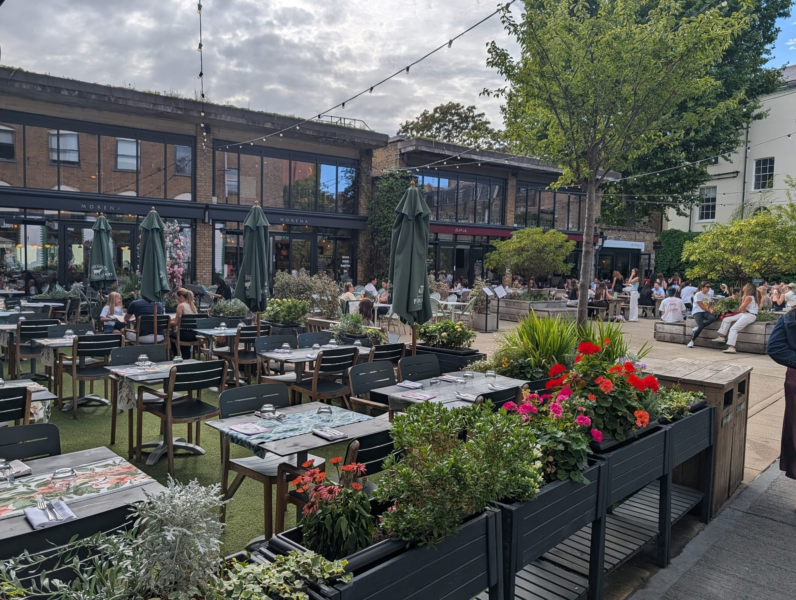
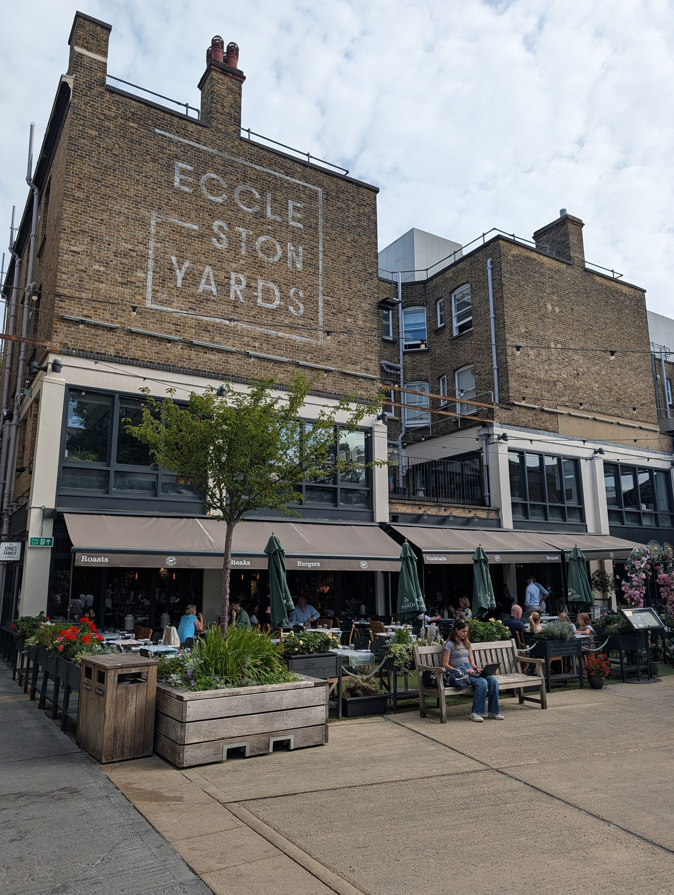

Belgravia has no museum, no landmark and no view. What it has is white stucco, embassy flags, garden squares you cannot get into, and streets so quiet on a weekday that the loudest thing is a delivery van.

That makes it a good walk and a poor destination. Two or three hours, on foot, ideally on the way somewhere else.

Belgravia has its own share of the commemorative plaques marking where notable people lived or worked - see them on our [interactive map](/plaques/?area=belgravia).

## Why visit — and who should skip it

**Come here if** you like walking and architecture, you want a fifteen-minute blue-plaque loop, or you are staying nearby and want somewhere civilised to eat that is not Victoria station.

**Skip it if** you are on a short trip. On a three-day first visit every hour spent here is an hour not spent at the [British Museum](/articles/british-museum-guide/). It is a return-trip area, or a detour on the way from Victoria to Sloane Square.

**A warning about Sundays.** Almost every shop is shut. Eccleston Yards keeps some life; Elizabeth Street largely does not.

## Top sights and activities

1. **Elizabeth Street** — A short shopping street of independents, walkable end to end in ten minutes, with no chains.
2. **Eccleston Yards** — A converted industrial courtyard of food, coffee and design, five minutes from Victoria and the one place here with a crowd.
3. **The blue-plaque loop** — Mozart, Mary Shelley, Ian Fleming and Tennyson, four plaques in fifteen minutes.
4. **Belgrave Square** — Ringed by embassies. The garden in the middle is private.
5. **Eaton Square** — Longer and thinner than Belgrave, and the better walk if you only do one.

## Key streets and micro-districts

### Elizabeth Street

**The reason to come.** A short run of independents between Eaton Square and Ebury Bridge Road — a milliner, a perfumer, bakeries, a butcher, florists spilling onto the pavement — with enough outdoor tables to sit down.

It is about ten minutes from Victoria station.

### Eccleston Yards

A pedestrianised courtyard of converted industrial buildings, five minutes from Victoria, with independent food, coffee, a gym, design studios and plenty of outdoor seating. It is the busiest corner of Belgravia.

### Belgrave Square and Eaton Square

Belgrave Square is almost entirely embassies, around twenty of them.

**The gardens in the middle are private.** They belong to keyholders among the surrounding houses and are locked. Eaton Square has more life at its Sloane Square end.

### Motcomb Street and the mews

Motcomb Street is the third shopping street, smaller than Elizabeth Street and more expensive. Around it are the mews — Kinnerton Street, Wilton Row, Ebury Mews — where Belgravia is at its prettiest and quietest.

**The Grenadier** is in Wilton Row, tucked so far into the mews that people who work in Belgravia walk past the entrance for years.

Powered by <a target="_blank" rel="sponsored" href="https://www.getyourguide.com/london-l57/">GetYourGuide</a>

## The blue-plaque walk

This takes about fifteen minutes and is free.

**Four plaques, close together**: Mozart, who composed his first symphony in Belgravia as a child; Mary Shelley; Ian Fleming; and Alfred, Lord Tennyson.

Our [blue plaques guide](/articles/london-blue-plaques/) has the addresses and the order to walk them in.

## Where to eat and drink

Belgravia eats expensively. Arrive fed if you are on a budget.

| Spot | Style | Price | Why go |
| --- | --- | --- | --- |
| **Weezie's** | Pizza | ££ | Thin crust, Guinness and a serious wine list, in the Eccleston Yards courtyard |
| **La Poule au Pot** | French bistro | £££ | Trading since the 1960s on coq au vin and candlelight |
| **[The Goring](hotel:the-goring)** | British, afternoon tea | ££££ | A family-owned grand hotel |
| **Brooklands** | French, rooftop | ££££ | Claude Bosi on the roof of The Peninsula, over Hyde Park Corner |
| **Canton Blue** | Cantonese | ££££ | Inside The Peninsula, themed on a 19th-century trading ship |

*Weezie's, Eccleston Yards.*

**For anything under £20**, walk to Eccleston Yards or back towards Victoria. The residential streets have nothing.

## Getting there

**By Tube.** **Victoria** (Victoria, District, Circle) is the practical entrance and puts you five minutes from Eccleston Yards and ten from Elizabeth Street. **Sloane Square** (District, Circle) is better for the western end and for combining with Chelsea. **Hyde Park Corner** (Piccadilly) is best for Belgrave Square and [The Peninsula](hotel:the-peninsula-london).

**On foot.** You can cross Belgravia in twenty minutes, and it is flat and almost entirely step-free.

**Combine it with something.** Belgravia works best as the middle of a walk: Victoria to Sloane Square, or Hyde Park Corner down to Chelsea.

## How long to spend, and when to go

| Time | What it gets you |
| --- | --- |
| **One hour** | Eccleston Yards and Elizabeth Street |
| **Two hours** | Add the blue-plaque loop and Belgrave Square |
| **Half a day** | Add the mews, Motcomb Street and lunch, then walk on to Chelsea |

**Weekdays are best.** Saturday is fine. **Sunday is the trap**: almost everything is closed.

Comparing neighbourhoods? [Best areas to visit in London](/articles/best-areas-to-visit-london/) sets them side by side by what each is best for, how long it takes and the best day to go.

Powered by <a target="_blank" rel="sponsored" href="https://www.getyourguide.com/london-l57/">GetYourGuide</a>

## Common mistakes to avoid

1. **Expecting the garden squares to be open.** They are private and for residents.
2. **Arriving on a Sunday for the shops.** Elizabeth Street is largely shut.
3. **Confusing it with Knightsbridge.** Harrods is a different area, north-west across Sloane Street.
4. **Coming hungry with a budget.** The cheap options are at Eccleston Yards or back at Victoria, and nowhere in between.
