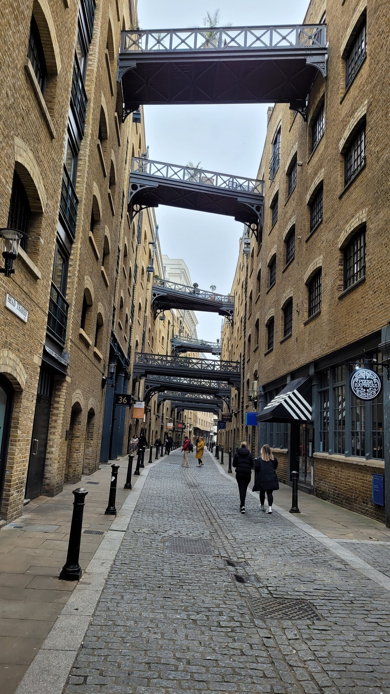
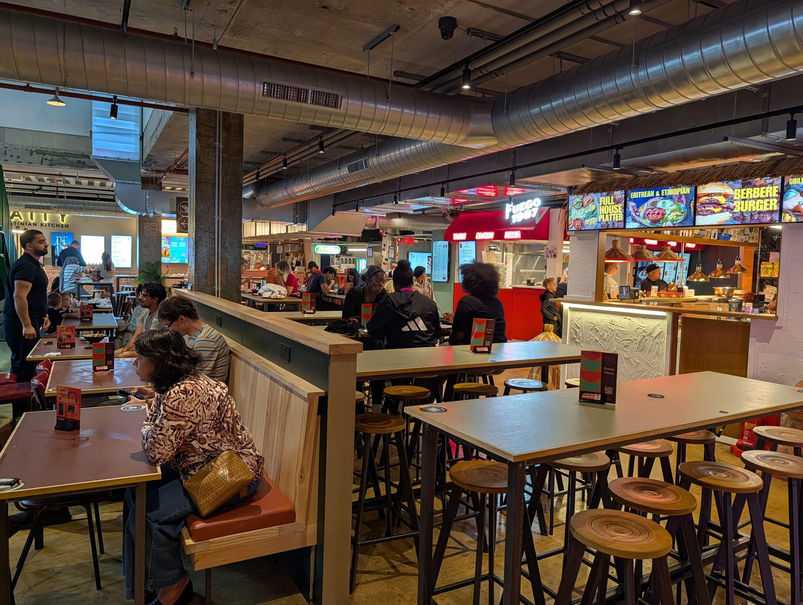
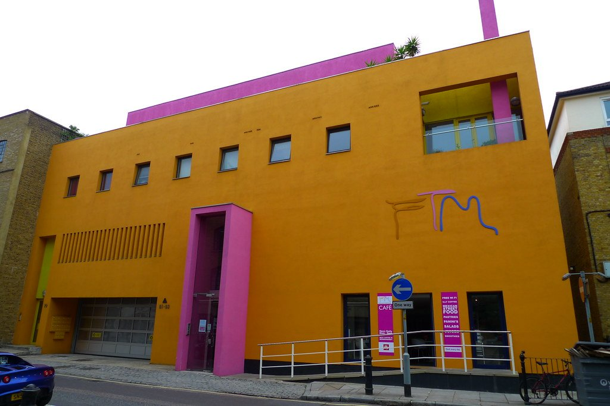

Bermondsey's railway viaducts now hold breweries, the leather warehouses are flats, and a narrow alley under the arches holds Maltby Street Market on Friday evenings and weekends.

It sits immediately east of Borough Market. Our [Bankside and Borough walk](/articles/bankside-borough-walk/) starts at London Bridge station and covers Borough's inn yards, the market and Shakespeare's Bankside.

Bermondsey has its own share of the commemorative plaques marking where notable people lived or worked - see them on our [interactive map](/plaques/?area=bermondsey).

## Why visit — and who should skip it

**Come here if** it is a weekend and you like eating and drinking. Maltby Street Market and the Beer Mile are both under railway arches, about fifteen minutes apart on foot; the market also opens on Friday evenings.

**Skip it if** you come Monday to Thursday. Maltby Street does not run and most of the breweries are shut. Friday evening is the earliest the weekend starts here.

## Top sights and activities

1. **Maltby Street Market** — Friday evenings and weekends along **Ropewalk**, a narrow alley beneath the arches. Go before midday at the weekend.
2. **The Bermondsey Beer Mile** — Breweries and taprooms in the arches between Bermondsey and South Bermondsey, mostly open at weekends. The line-up changes, so check before you go.
3. **White Cube Bermondsey** — Free, and described by White Cube as Europe's largest commercial gallery space, showing major contemporary work on Bermondsey Street.
4. **Shad Thames** — The warehouse canyon east of Tower Bridge, with the original iron gantries still spanning the street overhead.
5. **Bermondsey Antiques Market** — Fridays on Bermondsey Square, 6am to 2pm. A working trade market; the best finds go early.
6. **Fashion and Textile Museum** — Zandra Rhodes's orange and pink building on Bermondsey Street, ticketed, open Tuesday to Saturday 11am to 6pm, focused on textiles and design.
7. **The Thames Path and Bermondsey Beach** — East from Tower Bridge past Butler's Wharf. At low tide a shingle foreshore is exposed with views back to the bridge.

*Shad Thames. Photo: [Rob Oo](https://commons.wikimedia.org/w/index.php?curid=152631540), [CC BY 2.0](https://creativecommons.org/licenses/by/2.0/).*

## Key streets and micro-districts

### Bermondsey Street

The spine of the area, running south from London Bridge: Georgian houses, warehouse conversions, and about twenty places to eat in half a mile.

**White Cube at 144 is free.** It has more than 5,440 square metres of interior space behind a plain warehouse frontage, showing international artists with no ticket.

**The Fashion and Textile Museum at 83** is the orange and pink building, founded by Zandra Rhodes. It is ticketed (£12.65 for the current exhibition, which runs to 11 April 2027) and open Tuesday to Saturday, 11am to 6pm.

**Eat along it:** **Casse-Croûte at 109** is a twenty-seat French bistro with a menu of three starters, three mains and three puddings chalked up daily; **Flour & Grape at 214** does pasta and wine cheaply enough to be a weeknight option; **Hakata Ramen + Bar at 177** does tonkotsu ramen with no reservations ([the ramen guide](/articles/best-ramen-london/)).

**Casse-Croûte takes reservations by phone (020 7407 2140) or walk-ins**: lunch from noon daily, dinner from 6pm Monday to Saturday. London Bridge is five minutes from the northern end, Borough about the same.

### Maltby Street and Ropewalk

A run of railway arches under the Bermondsey viaduct, smaller and less polished than Borough Market ten minutes north.

> ⚠️ **Check the day before you travel.** The market runs **Friday 5.30pm to 9pm, Saturday 10am to 5pm and Sunday 11am to 4pm**. Monday to Thursday, Ropewalk is an alley with shuttered arches.

**A handful of arches trade through the week**: **40 Maltby Street** is a wine shop and restaurant, open for dinner Wednesday to Saturday and lunch Thursday to Saturday.

**Come on a Saturday morning**: by midday the arches are crowded and you are shuffling. Bermondsey station on the Jubilee line is about eight minutes' walk; London Bridge ten.

### Shad Thames and Butler's Wharf

East of Tower Bridge: high brick warehouses on both sides with **iron gantries crossing overhead at every floor**. They were working bridges, used to move tea, coffee and spices between the warehouses. The buildings are flats now and the ground floors are restaurants.

The riverside restaurants are expensive. **Tower Bridge Collective at 1 Shad Thames**, open since October 2025, is an indoor food hall of thirteen independent kitchens over two floors, open from 8am daily.

**Legare in the Cardamom Building at 31G Shad Thames** is a neighbourhood Italian.

**Walk it from the bridge**, two minutes away, and keep going east.

*Tower Bridge Collective, Horselydown Lane.*

*Shad Thames.*

### The Beer Mile arches

South-east along the viaduct towards South Bermondsey: a chain of working breweries with taprooms in the railway arches, and very little else — no shops, no restaurants, and long stretches of blank brick between stops.

**Go on a Saturday afternoon.** Most of the taprooms open on Saturdays and a few on Fridays and Sundays; midweek almost all of them are closed production sites.

**These are breweries first and bars second**: concrete floors, fermentation tanks in the same room, and rarely much food beyond a van parked outside.

**Do it in one direction.** The arches run roughly a mile and a half from Bermondsey towards South Bermondsey, so start at one end and finish at a station rather than doubling back.

### Bermondsey Square

A modern square at the southern end of Bermondsey Street, built on the site of Bermondsey Abbey, with a hotel, a cinema and a few places to eat.

**The antiques market runs on Fridays from 6am to 2pm.** Traders set up in the dark and the best stock goes in the first hours. It is a dealers' market, where the trade buys.

**The Arzner** on the square is an independent cinema and cocktail bar with a 50-seat screen. **M Manze at 87 Tower Bridge Road**, five minutes east, has served pie, mash and liquor under the Manze name since 1902. It is open Monday to Thursday 10.30am to 5.45pm, Friday 10am to 6.45pm, Saturday 10am to 7.45pm and Sunday 11am to 3.45pm.

*The Fashion and Textile Museum. Photo: [Ewan-M](https://www.flickr.com/photos/55935853@N00/3612012652), [CC BY-SA 2.0](https://creativecommons.org/licenses/by-sa/2.0/).*

Powered by <a target="_blank" rel="sponsored" href="https://www.getyourguide.com/london-l57/">GetYourGuide</a>

## Go deeper

- **[The best galleries in London](/articles/best-galleries-london/)** — White Cube Bermondsey, free.
- **[The best Spanish restaurants in London](/articles/best-spanish-restaurants-london/)** — the tapas bars of Bermondsey Street.

## Where to eat and drink

| Spot | Style | Price | Why go |
| --- | --- | --- | --- |
| **Maltby Street Market** | Street food | £ | Friday evening to Sunday |
| **St. John Bakery** | Bakery | £ | On Ropewalk; the custard doughnuts sell out |
| **Casse-Croûte** | French bistro | ££ | Tiny, chalkboard menu; reserve by phone or walk in |
| **José Tapas Bar** | Spanish | ££ | Bermondsey Street; standing room, no bookings |
| **The Woolpack** | Pub | £ | Proper local pub away from the market crowds |
| **Butler's Wharf Chop House** | British | £££ | Riverside with a Tower Bridge view |
| **Tower Bridge Collective** | Food hall | £ | Thirteen kitchens off Shad Thames; open from 8am daily |

Sollip on Melior Street, by London Bridge station, holds a Michelin star for Korean-European cooking. It is in our [fusion restaurants guide](/articles/best-fusion-restaurants-london/).

## Getting there

**By Tube.** **London Bridge** (Jubilee, Northern, National Rail) is the main gateway and puts you at the top of Bermondsey Street. **Bermondsey** on the Jubilee line is closer to the Beer Mile arches.

**Best exit.** From London Bridge, follow signs for **Tooley Street** and walk south-east — Bermondsey Street starts under the railway bridge.

**On foot.** Ten minutes west to Borough Market, fifteen north over Tower Bridge to the City. The Thames Path runs east past Butler's Wharf.

## How long to spend, and when to go

| If you have | Do this |
| --- | --- |
| **Two hours** | Maltby Street Market and Bermondsey Street |
| **Half a day** | Add White Cube, Shad Thames and Tower Bridge |
| **A full day** | Add the Beer Mile, or combine with Borough Market |

**Best time:** Saturday, before midday.

**Avoid:** Midweek if the market is your reason for coming. Friday very early is the exception, for the antiques market.

Comparing neighbourhoods? [Best areas to visit in London](/articles/best-areas-to-visit-london/) sets them side by side by what each is best for, how long it takes and the best day to go.

## Suggested half-day route

1. **Start:** London Bridge station, **Tooley Street** exit.
2. **Bermondsey Street:** South past **White Cube** and the Fashion and Textile Museum.
3. **Maltby Street:** East to **Ropewalk** for the market. Before midday.
4. **Shad Thames:** North to the warehouse canyon and the overhead gantries.
5. **Tower Bridge:** West along the river for the view back.
6. **Finish:** Borough Market ten minutes west, or the Beer Mile arches to the south-east.

Powered by <a target="_blank" rel="sponsored" href="https://www.getyourguide.com/london-l57/">GetYourGuide</a>

## Common mistakes to avoid

1. **Arriving at Ropewalk after midday on a Saturday.** It is one alley wide and it does not move.
2. **Treating the Beer Mile as a fixed route.** Breweries open and close; check current hours before setting out.
3. **Turning up to the antiques market at 1pm.** It closes at 2pm and the best stock has gone.

## Where to stay

- **Bermondsey Street** — Small hotels and rentals along the street, walkable to Borough and Tower Bridge.
- **London Bridge** — Larger hotels, excellent transport, direct Thameslink to Gatwick.
- **Shad Thames** — Warehouse conversions on the river, quiet and central.

Our [Bermondsey hotel guide](/articles/where-to-stay-bermondsey/) compares the hotels and aparthotels.
