Arranged by **what you are buying**: the historic claim, the room, the spectacle, or the tea itself.

> 💡 **The Short Version:** **The Langham** says it is where the ritual began, in 1865. **The Ritz** is named by the most sources (six) and is the most formal. **The Berkeley** serves Cédric Grolet's fruit pastries. **Sketch** is a working art installation. **The Wolseley** and **The Connaught** are the quieter, cheaper options. **One Aldwych** runs a Charlie and the Chocolate Factory tea for children.

> 📊 **The evidence behind this guide.**
> **16 sources carrying 142 citations** across **82 named tea rooms**. **31 tea rooms are named by two or more independent sources, and 22 carry a dated award.**
> **Built on:** La Liste and the Afternoon Tea Awards; Olive, Time Out and The Infatuation; blogs and YouTube.
> *Evidence rebuilt 21 September 2026 · [How we rank →](/how-we-rank/)*

## Where they are

  

    Map of the best afternoon tea in London
  

  

    
Loading the interactive map…

  

  <noscript>
    
The interactive map requires JavaScript. Every entry below lists its area.

  </noscript>

| If you are near… | Where to eat |
| --- | --- |
| **Mayfair & Piccadilly** | The Ritz, Claridge's, The Dorchester, Brown's, The Connaught, Sketch, Fortnum & Mason, The Wolseley, The Stafford |
| **Knightsbridge** | The Berkeley, The Lanesborough, Mandarin Oriental, Jumeirah Carlton Tower |
| **Marylebone** | The Langham, Winter Garden (The Landmark) |
| **Covent Garden & Strand** | The Savoy, One Aldwych |
| **Belgravia & Westminster** | The Goring, Corinthia |
| **Kensington** | The Milestone, The Ampersand |
| **Bloomsbury** | Rosewood London |

**Price guide:** **£££** £45–£65 · **££££** £70+.

---

## The world's best, officially

### Jacqueline at The Chancery Rosewood, Mayfair

*££££ · Cited by 3 sources · World's Best Afternoon Tea 2026*

**[The Chancery Rosewood](https://www.rosewoodhotels.com/en/the-chancery-rosewood/dining)** took **La Liste's World's Best Afternoon Tea Award in its 2026 Pastry Special Awards**. It is the only London tea room holding that title, and it also carries an Award of Excellence from the 2026 Afternoon Tea Awards — two separate panels in the same year.

The room, Jacqueline, sits inside the **former US Embassy on Grosvenor Square**, which reopened as a hotel in 2025. It keeps a **tea sommelier** and a separate preparation room for a list of **more than 120 teas**, each brewed at its own temperature. The stand runs from a caviar amuse-bouche through four sandwiches and a watermelon and elderflower palate cleanser to the scones.

---

## Where the ritual began

### The Langham, Marylebone

*££££ · 3 min from Oxford Circus · Cited by 4 sources*

The Palm Court is **where the ritual began**, by The Langham's account: the hotel opened in 1865 and says it was the first in the world to serve afternoon tea, moving it out of aristocratic drawing rooms and into a place anyone could book.

Sandwiches, scones and pastries built by **Michel Roux with pastry chef Andrew Gravett**, who changes the sweets seasonally. Vegan, gluten-free and children's versions are all full versions of the menu.

Sixty-five seats on the ground floor and a pianist from 1pm to 7pm. Smart casual — no sportswear or flip-flops, but no jacket-and-tie either. **Book weeks ahead for a weekend.**

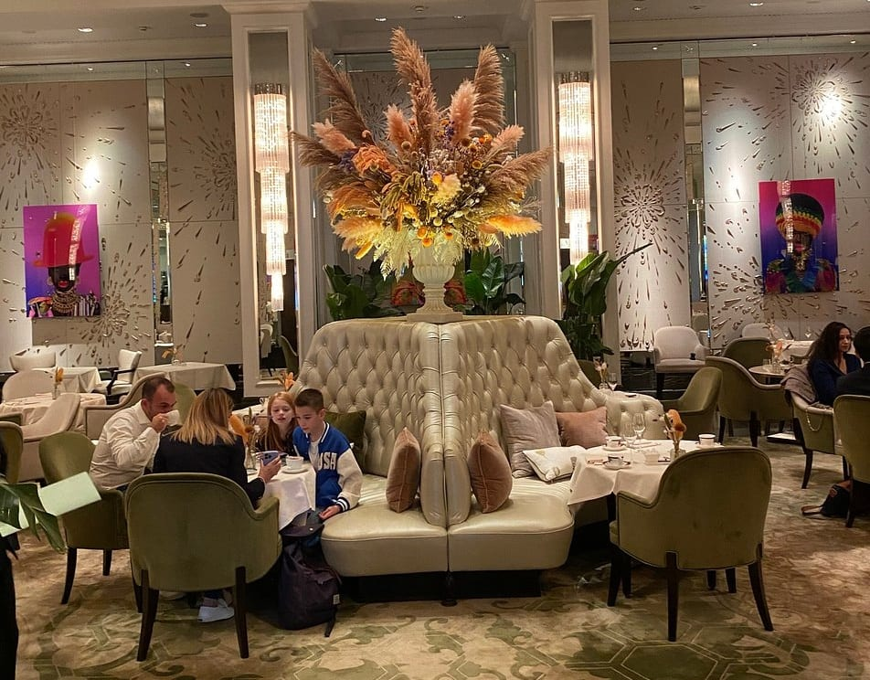

*The Palm Court at The Langham.*

### The Ritz, Piccadilly

*££££ · 2 min from Green Park · dress code enforced · Cited by 6 sources*

The most-cited tea room on this page, and the most formal. Served in the Palm Court of the **18th-century William Kent House** under gilt and mirrors, with a pianist or harpist through most sittings and a piano, cello and violin trio on weekday evenings.

Finely cut sandwiches, **scones with Cornish clotted cream and strawberry preserve**, and a cake trolley wheeled to the table so you choose by eye rather than off a menu. Twenty loose-leaf teas including the house Ritz Royal Blend.

**£95 a head, £73 for children**, champagne from £26 a glass. Five sittings a day, seven days a week — 11.30am, 1.30pm, 3.30pm, 5.30pm and 7.30pm.

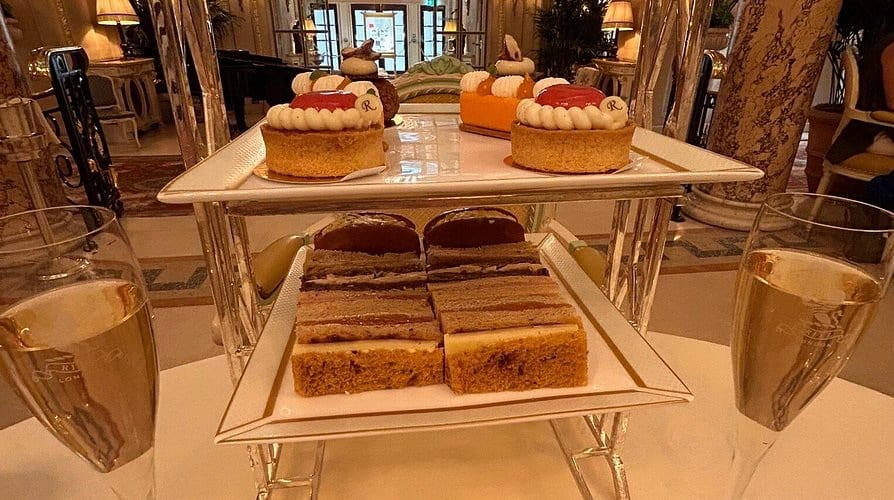

*Tea at The Ritz.*

> ⚠️ **The dress code is real and enforced.** Jacket and tie for men, no jeans or trainers — waived only for under-16s. Weekend sittings book months out.

### Claridge's, Mayfair

*££££ · 5 min from Bond Street · Cited by 4 sources*

Served in the **Foyer and Reading Room**, an ornate gilded space laid with the hotel's jade-and-white striped china.

Savouries lean British and specific: **smoked Scottish salmon**, seasonal pastries that change through the year, and a tea list running from a rich Oolong to the house Claridge's Blend, made for the room by a tea buyer.

**£95 a head, £110 with champagne, £125 with rosé.** From 3 November to 3 January (not 25 December) a festive menu replaces it, from £120 on weekdays and £130 at weekends.

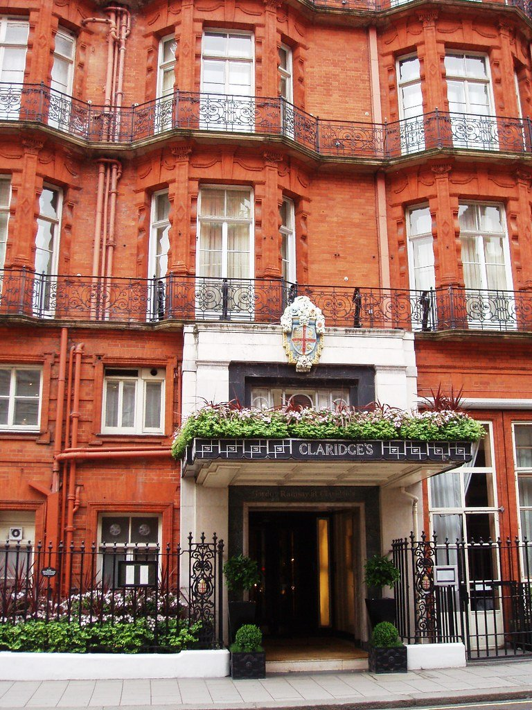
*The Foyer and Reading Room at Claridge's. Photo: [Ewan-M](https://www.flickr.com/photos/55935853@N00/2611316232), [CC BY-SA 2.0](https://creativecommons.org/licenses/by-sa/2.0/).*

### Fortnum & Mason, Piccadilly

*££££ · the tea merchant's own salon · Cited by 2 sources*

The **Diamond Jubilee Tea Salon**, opened by the Queen in 2012 on the fourth floor of the shop, where the tea list leads and the pastries follow. Fortnum's has been selling leaf since 1707.

Savouries are British and specific: **Suffolk cured ham with piccalilli**, rare breed hen egg with cress, soft smoked salmon. Plain and fruit scones arrive warm with clotted cream, lemon curd and preserves, and the patisserie changes with the season.

**£84 a head** with a pot of Fortnum's tea, and refills of both the stand and the pot come without asking.

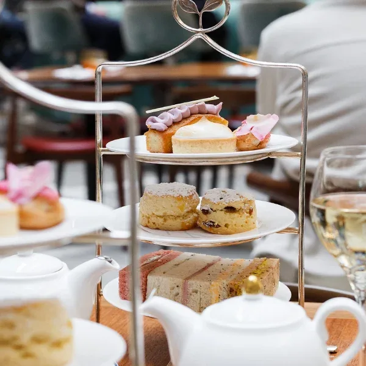

*The Diamond Jubilee Tea Salon.*

---

## The grand hotels

### The Dorchester, Mayfair

*££££ · the Promenade*

Taken the full length of **The Promenade** — a hundred-foot room running the spine of the hotel, in marble, mirrors and heavy silk. A pianist plays through the afternoon.

The stand opens with a glass of Veuve Clicquot poured tableside. Sandwiches run to **Dorrington ham with truffle**, and the pastries include a spiced apple choux among the seasonal ones. Warm scones with clotted cream throughout.

There are no fixed sittings: tea runs continuously through the afternoon.

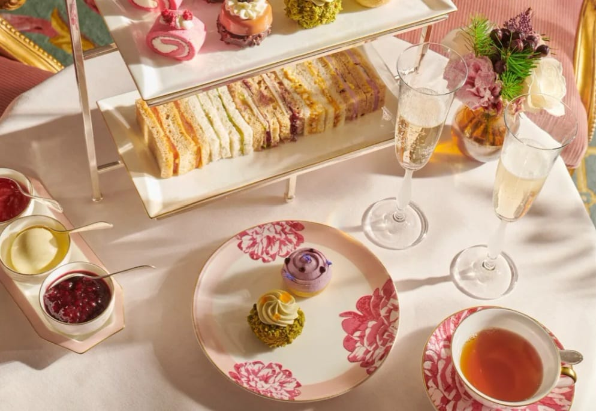

*The Promenade at The Dorchester.*

### The Savoy, Covent Garden

*££££ · the Thames Foyer · Cited by 3 sources*

London's first purpose-built luxury hotel, and the tea is now taken in **The Gallery** rather than the Thames Foyer — peach-lit, with sculpted palms, stained glass and a marble catwalk down the middle of the room.

A procession of finger sandwiches, the hotel's **signature scones**, and sweets brought in waves. The tea list runs to **over thirty leaves**.

Served daily from noon to 6.45pm, with a separate **Twilight Tea from 6pm to 9.30pm** for anyone who would rather have it as an evening. Dress elegantly; there is no jacket-and-tie rule.

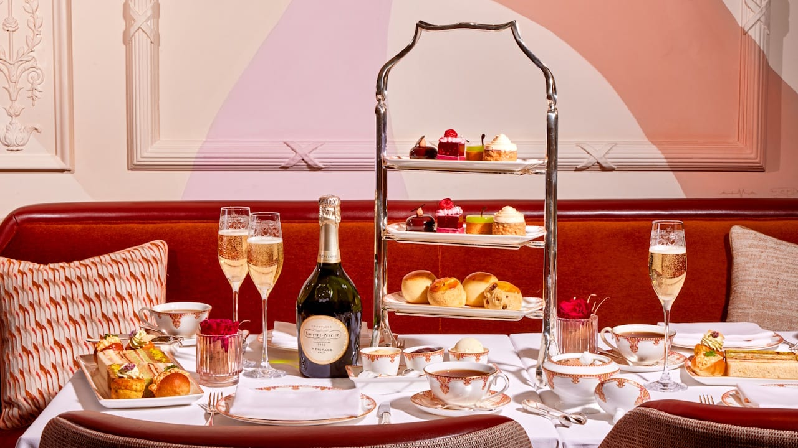

*The Gallery at The Savoy.*

### The Lanesborough, Knightsbridge

*££££ · under a glass dome*

Taken under the **glass dome of the Céleste dining room** at Hyde Park Corner — Regency plasterwork in Wedgwood blue and white, lit by daylight.

The stand is built by head pastry chef **Jolan Thiry** and runs as a **Bridgerton tea**, themed to the series. Conventional savouries, then technical pastry work.

**£92 a head, £102 with a cocktail, £110 with Laurent-Perrier La Cuvée.** Hyde Park Corner is the nearest tube.

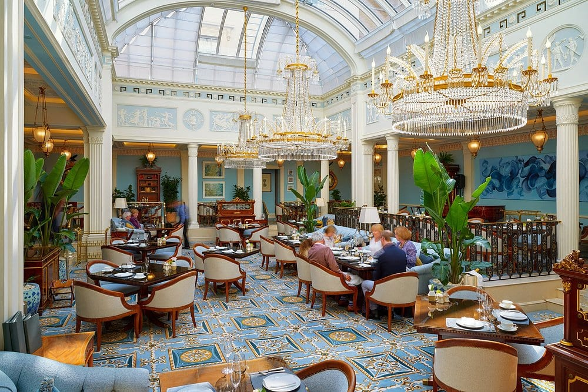

*The Céleste dining room.*

### Corinthia London, Westminster

*££££ · a tea master · Cited by 2 sources*

The **Crystal Moon Lounge**, under a Baccarat crystal chandelier with a Steinway playing — a low-lit room a few minutes from Trafalgar Square.

The distinguishing feature is the **tea master**, who weighs and infuses each blend to order rather than dropping in a bag: a curated leaf list, then delicate finger sandwiches, warm scones and pastries built to the season.

**£75 Monday to Thursday, £85 Friday to Sunday.**

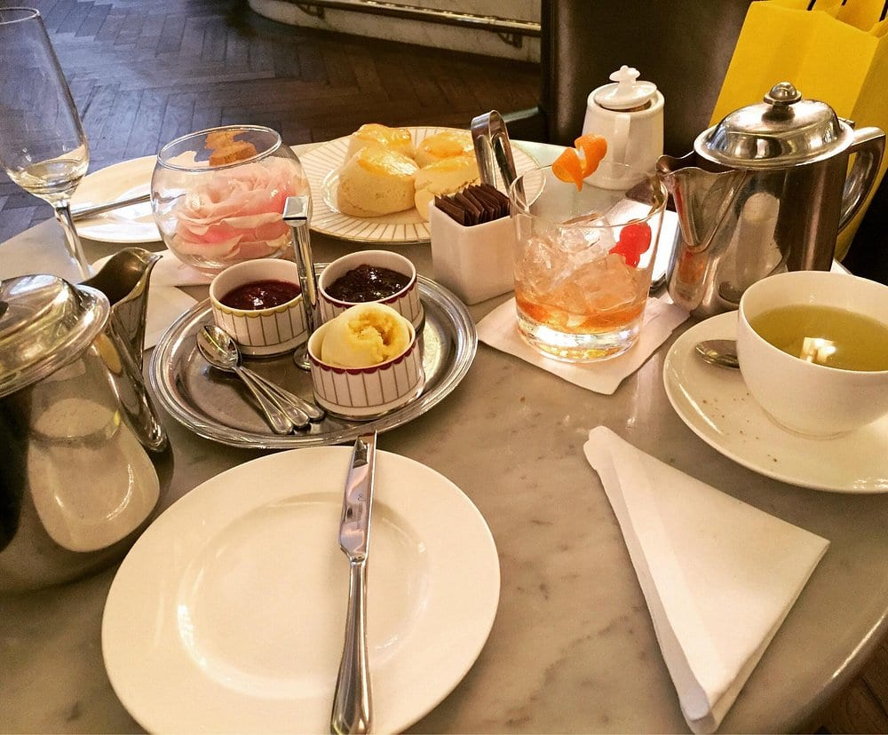

*The Crystal Moon Lounge.*

### Mandarin Oriental Hyde Park, Knightsbridge

*££££ · a garden view · Cited by 3 sources*

The **Rosebery Lounge** backs onto Hyde Park, a bright, high-ceilinged lounge with a park view.

Finger sandwiches, then **scones with Devonshire clotted cream** and a spread of preserves: Pembrokeshire strawberry jam, **rose petal jelly** and wild plum. The pastry course changes through the year.

**Twenty-nine loose-leaf teas** on the list, and the pairing option is the distinguishing feature — you can take the tea with Champagne, sake, Alsatian wine, beer or a **sparkling tea** flight.

**From around £85–£89 a head.** Knightsbridge tube is two minutes; ask for a table on the park side when booking.

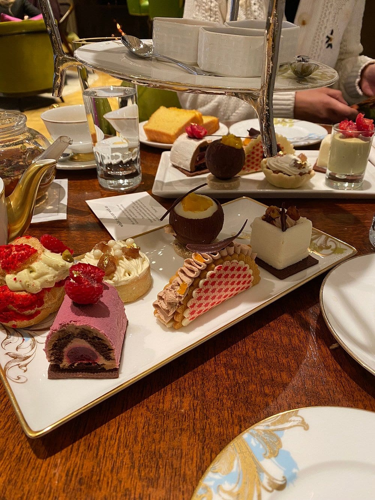

*The Rosebery Lounge.*

---

Powered by <a target="_blank" rel="sponsored" href="https://www.getyourguide.com/london-l57/">GetYourGuide</a>

## Easier to book

### Brown's Hotel, Mayfair

*££££ · 4 min from Green Park · Cited by 3 sources*

The **intimate, club-like** option, panelled and low-ceilinged. Brown's opened in 1837 and the tea is taken in **The Drawing Room**, rebranded from the English Tea Room, with a fire lit in winter and armchairs rather than dining chairs.

A traditional stand done straight: finger sandwiches, **warm scones with clotted cream and preserves**, and a patisserie course, with a full leaf list alongside. No theme, no trolley, no spectacle — the appeal is the room and the quiet.

**Around £140 for two including service.** It books less far ahead than The Ritz or Claridge's.

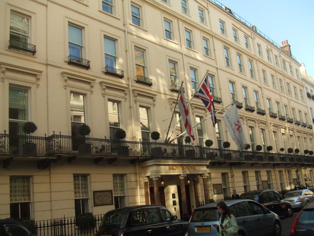
*Brown's Hotel, Albemarle Street. Photo: [Londonmatt](https://commons.wikimedia.org/w/index.php?curid=8743312), [CC BY 2.0](https://creativecommons.org/licenses/by/2.0/).*

### Rosewood London, Bloomsbury

*££££ · 4 min from Holborn · Cited by 4 sources*

Taken in the **Mirror Room** of a Belle Époque building off High Holborn — mirrored walls, plush banquettes, and the grand-hotel format outside the Mayfair cluster.

Savouries include **camembert custard tart with pear chutney**, a lobster and prawn profiterole, and **King’s imperial caviar on brioche**. Then freshly baked scones with English strawberry jam, clotted cream and homemade lemon curd.

**From £80.** Runs as an Art Afternoon Tea, with the pastry course themed to a current exhibition and changed through the year.

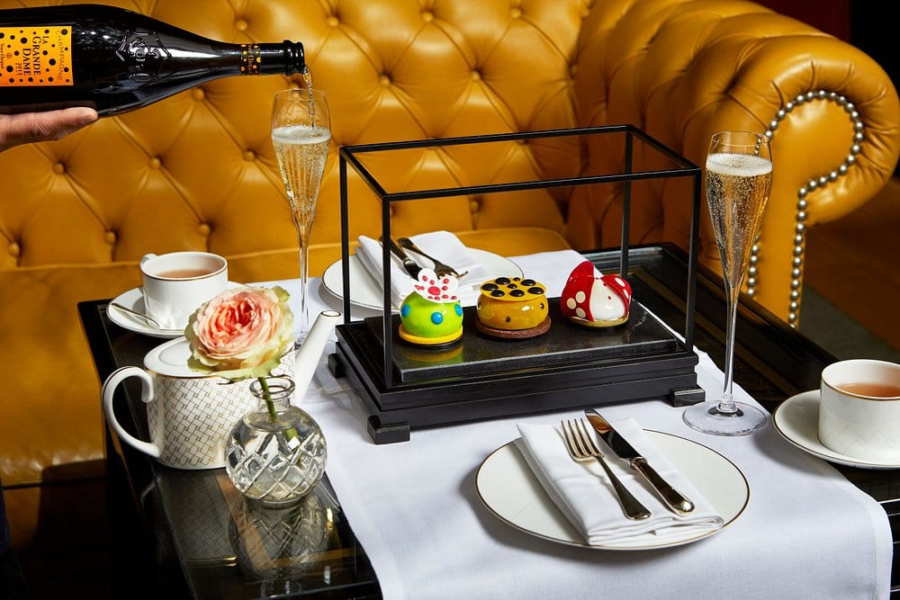

*The Art Afternoon Tea.*

### Jumeirah Carlton Tower, Knightsbridge

*££££ · 7 min from Knightsbridge*

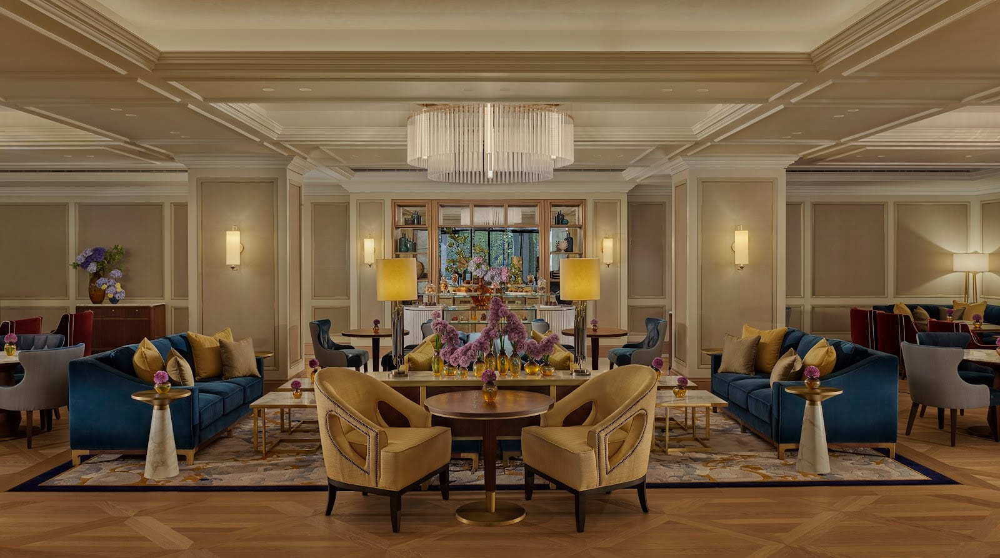

*The Chinoiserie lounge at Jumeirah Carlton Tower.*

The **Chinoiserie** is a wide, tranquil ground-floor lounge, and it **serves all afternoon rather than in fixed sittings** — which makes it easier to get into at short notice.

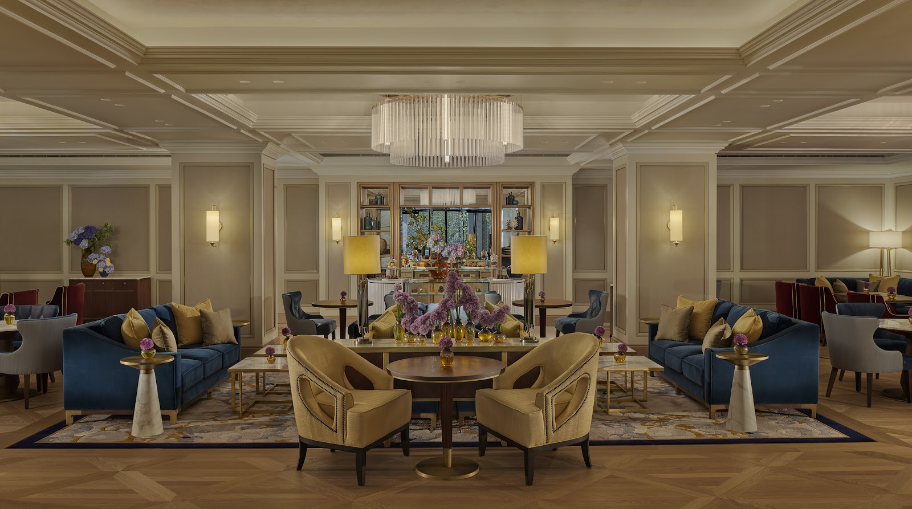

*The Chinoiserie lounge.*

The current stand is nature-themed and deliberately disrupts the classic order: unexpected pairings through the savouries and pastries, alongside a full leaf list and warm scones.

**From £85.** A live harpist most afternoons.

---

## The spectacle

### Winter Garden, Marylebone

*££££ · The Landmark London, 222 Marylebone Road*

Afternoon tea on the floor of an **eight-storey glass atrium among full-grown palm trees**, with a pianist and a harpist playing.

Served as **High Palms High Tea**: finger sandwiches, freshly baked scones with Cornish clotted cream and preserves, and pastries from the hotel’s pastry team. **£75 traditional, £85 with Nyetimber Classic Cuvée, £90 with Nyetimber Rosé** — English sparkling rather than champagne.

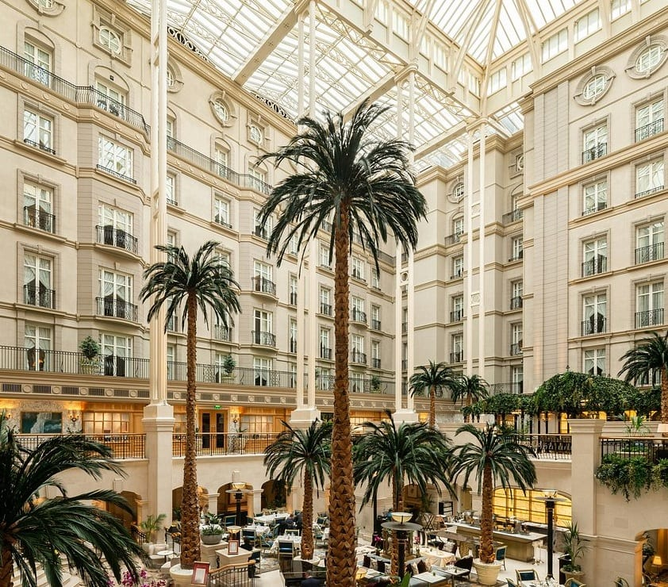

*The Winter Garden at The Landmark.*

> ⚠️ **Go for the room.** Reviews of the food itself are mixed for something over £70 a head. Ask for a table on the atrium floor rather than the gallery above.

### The Berkeley, Knightsbridge

*££££ · Goûtea by Cédric Grolet*

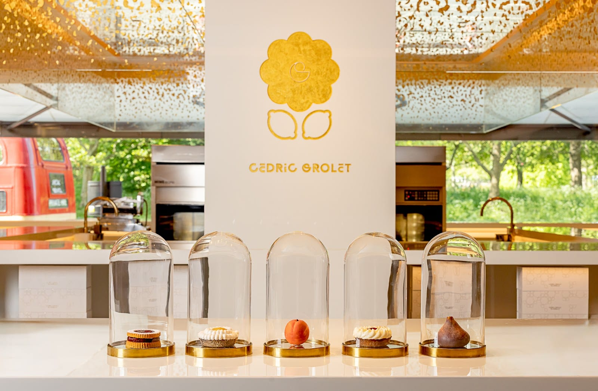

*Cédric Grolet's pastries under glass at The Berkeley.*

The Berkeley's fashion-themed Prêt-à-Portea ran for two decades and has been replaced by **Goûtea, built by Cédric Grolet** — the pastry chef known for trompe-l'œil fruit.

*Cédric Grolet's pastries at the Chef's Counter.*

The format is British and the sweets are emphatically not: finger sandwiches and warm scones arrive first, then **desserts sculpted to look like fruit and flowers**, cut open at the table to show what is inside. Pastries and cookies alongside.

Taken in the light-filled **Berkeley Café**, or at the **Chef's Counter** if you would rather watch it being finished than be brought it.

### Sketch, Mayfair

*££££ · the yellow room · Cited by 3 sources*

Afternoon tea inside a working art installation. **The room has not been pink since 2022** — David Shrigley's 245 drawings came down and **Yinka Shonibare and India Mahdavi** rebuilt The Gallery in sunshine yellow with diamond-quilted banquettes and copper. Since January 2026 it has hung **Jonathan Baldock's Mask series**, 84 works.

Savouries first, then sweets built by the pastry team to match the room's palette, with a full tea list. Around **£105 a head**.

The **egg-shaped lavatory pods** upstairs remain. Mon–Thu noon to 4pm; Fri–Sun 11am to 4.30pm.

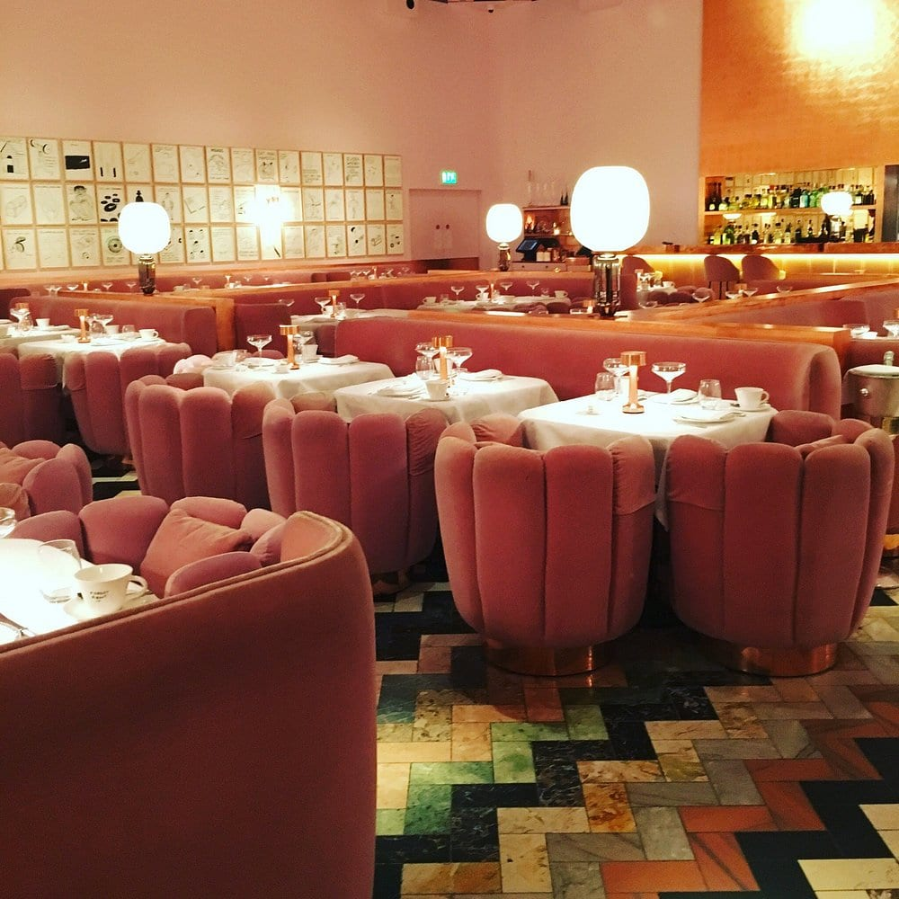

*The Gallery before its 2022 rebuild.*

### Hotel Café Royal, Regent Street

*££££ · the Grill Room · Cited by 5 sources · Award of Excellence 2026*

Tea is served in the **Grill Room**, the Louis XVI room the hotel has kept behind its Regent Street front.

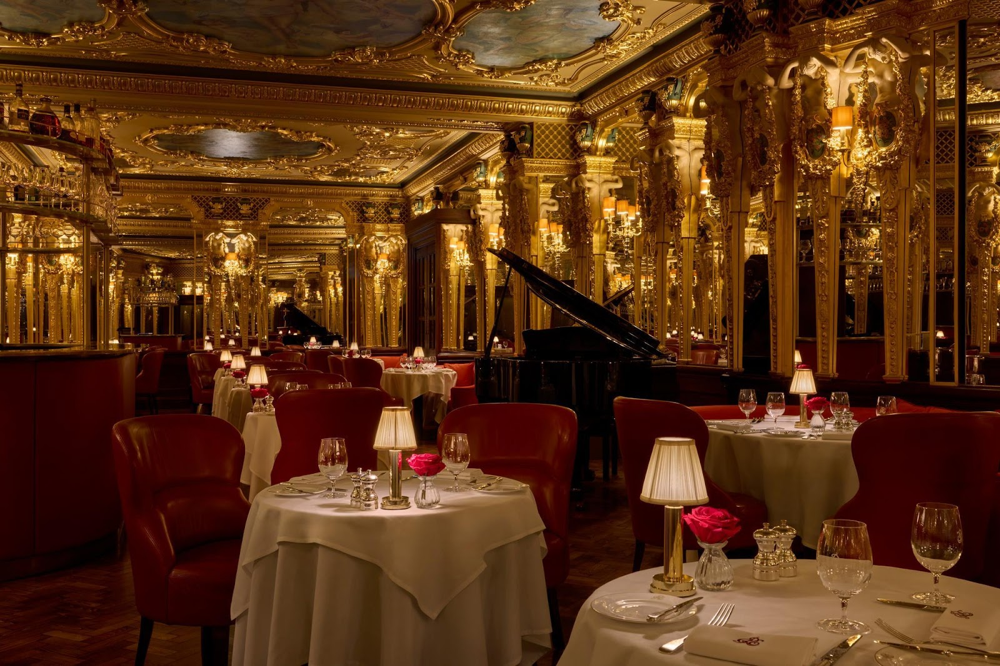

*The Grill Room at Hotel Café Royal.*

It holds an **Award of Excellence in the Afternoon Tea Awards 2026**, and two video reviewers featured it that year: Insider Food made it the first of three stops in a day spent looking for the best in the city, and Harrison Webb used it as the expensive half of a test against a £15 tea in Richmond.

**£85 a head**, **£95** with a glass of Veuve Clicquot, **£135** with Dom Pérignon 2013.

---

Powered by <a target="_blank" rel="sponsored" href="https://www.getyourguide.com/london-l57/">GetYourGuide</a>

## Themed, and different

Menus built around something other than a cake stand.

### Raffles London at The OWO, Whitehall

*££££ · the Drawing Room · Cited by 3 sources · Best Themed Afternoon Tea 2026*

**The winner of Best Themed Afternoon Tea at the 2026 Afternoon Tea Awards**, and the awards were held in the building. The theme is **Operation Mincemeat**, the 1943 deception that floated a corpse carrying false invasion plans off the Spanish coast, and every pastry is built around a part of the story. The judges said the concept was carried through from the menu design to the presentation.

The Old War Office was Britain's military headquarters for most of the twentieth century and opened as a hotel in 2023, so the theme happened in the building.

### Sanderson Hotel, Fitzrovia

*££££ · the courtyard and the Long Bar · Cited by 3 sources*

The **Mad Hatter's Afternoon Tea**: Alice in Wonderland played straight: **colour-changing drinks**, "eat me" cakes, teapots and crockery that do not match on purpose, and a menu bound inside a vintage book.

The Infatuation: "we were initially sceptical… but it's actually pretty fun." One warning from a reviewer who sat outside: **the courtyard pigeons are bold.** Ask for a table indoors.

### Theatre Royal Drury Lane, Covent Garden

*£££ · the Grand Saloon · Cited by 3 sources · Award of Excellence 2026 · #19 of 28, Time Out*

Tea in the Grand Saloon of a playhouse that has been **in constant use since the 1600s**. It holds an **Award of Excellence 2026** and Time Out ranks it 19th. Best paired with a matinée, not treated as a destination in itself — see our [London theatre guide](/articles/london-theatre-guide/) for what is on.

### Nobu Hotel London Portman Square, Marylebone

*£££ · The Lounge · from £78*

A Japanese-British hybrid. The savouries are **crispy rice**, a **smoked salmon shokupan club** on Japanese milk bread, and a **Nobu-style wagyu slider**, before a run of desserts.

There is also a **Matcha Masterclass** version, which opens with a guided introduction to matcha before the stand arrives.

**From £78 a head, £75 for the vegan version**, served **12.30pm to 5.30pm every day** in The Lounge on the ground floor. Marble Arch is the nearest station. Step-free, **dogs are welcome**, and vegetarian, vegan and halal versions are all made to order — say so when you book.

### And one that moves

The **Routemaster bus tea** and the **Thames cruise** are both further down, in [afternoon tea that moves](#afternoon-tea-that-moves) — they are the two themed teas where the theme is the view out of the window.

---

## Quieter, and better value

### The Wolseley, Piccadilly

*£££ · 3 min from Green Park · Cited by 5 sources*

The grand café on Piccadilly — a 1920s car showroom with vaulted ceilings and black lacquer.

Finger sandwiches, cakes, and **fruit scones with homemade jam and clotted cream**. Less elaborate than the hotels.

**£46.50 for afternoon tea, £19.50 for a cream tea**, champagne £13 a glass. Roughly half the Mayfair hotels' prices, and it takes walk-ins.

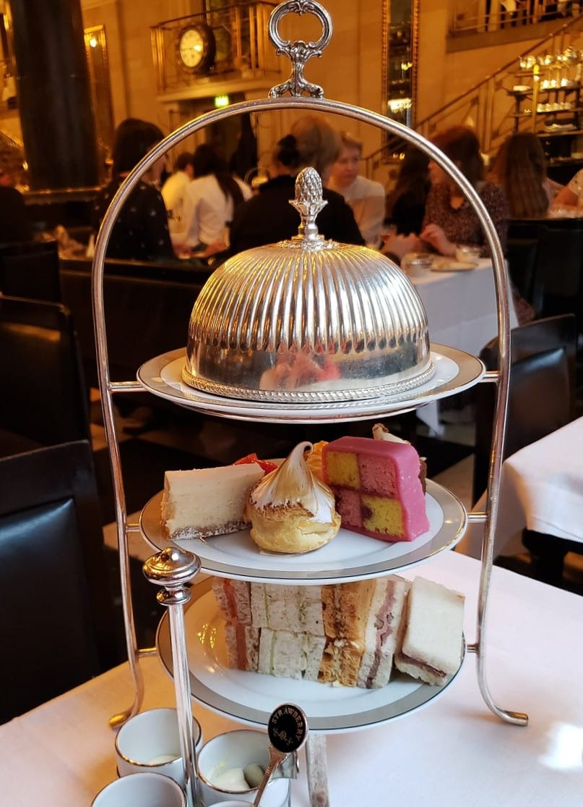

*The Wolseley's dining room.*

### The Connaught, Mayfair

*£££ · 8 min from Bond Street · Cited by 1 source*

Finger sandwiches blend **British classics with Southeast Asian flavours**.

English scones with **Cornish clotted cream and homemade strawberry jam**, then a pâtisserie run that changes constantly — hazelnut praliné rocher, matcha choux with cherry jam, a strawberry tart. The signature is the **Connaughty**, a sablé biscuit layered with jam and built as a straight homage to the jammy dodger.

Exotic teas or champagne alongside. Smaller than Claridge's or The Ritz.

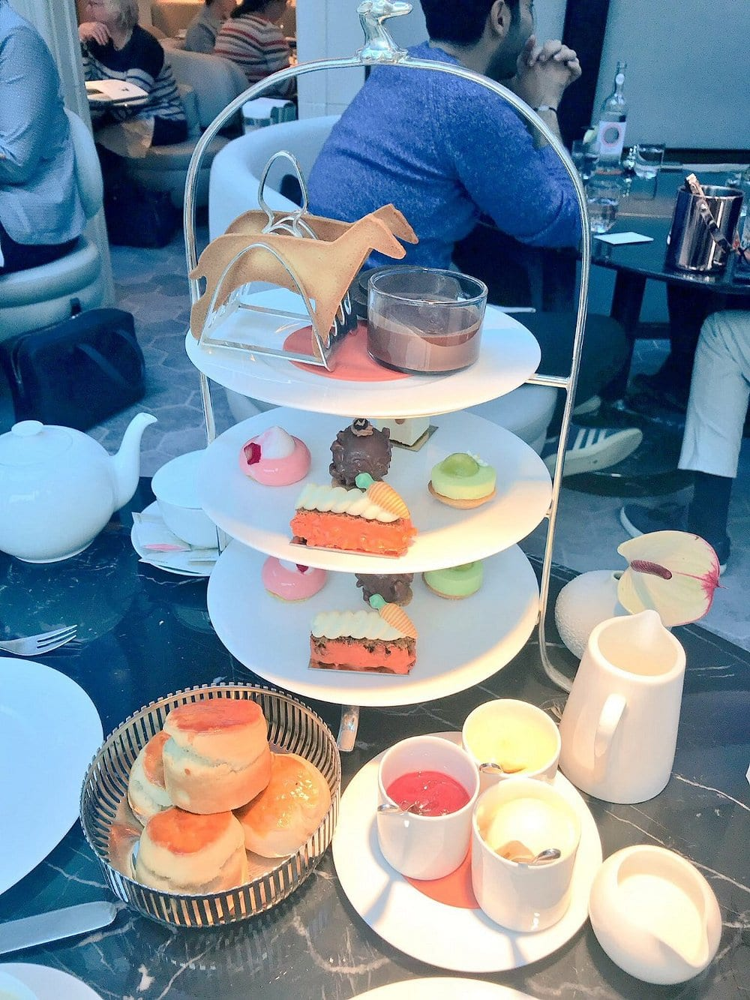

*The Connaught's tea stand.*

### The Stafford, Piccadilly

*£££ · a St James's cul-de-sac*

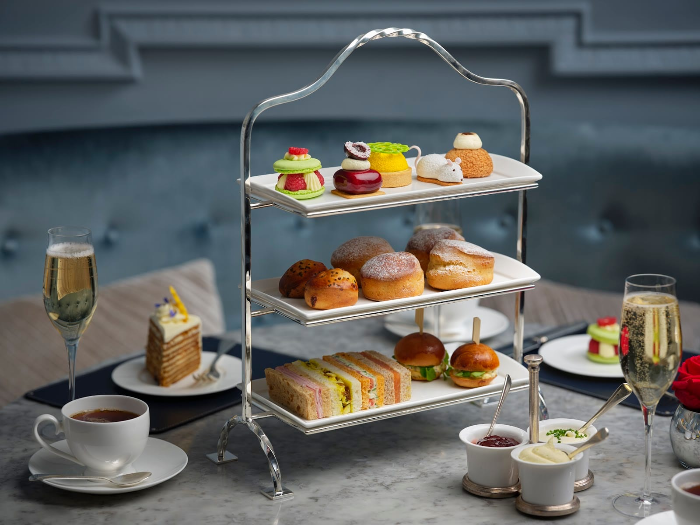

*Afternoon tea at The Stafford.*

Tucked down a cul-de-sac off St James's, in a hotel built around **17th-century wine cellars** that were used as an air-raid shelter during the Blitz.

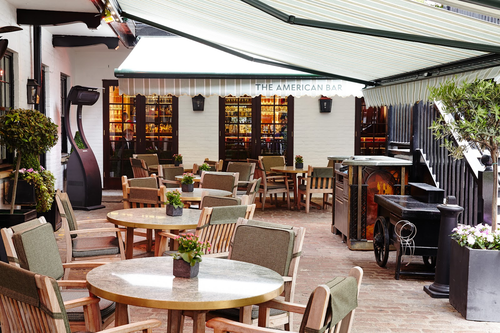

*The Stafford's courtyard.*

A straight, well-executed traditional stand: finger sandwiches, warm scones, patisserie, no theme and no gimmick.

**£70 a head, or £87 with a glass of Louis Roederer Collection 243.** Served daily from noon to 5.30pm.

### The Goring, Belgravia

*££££ · 2 min from Victoria · Cited by 2 sources*

Run by the Goring family since 1910; the Middletons stayed here the night before the 2011 royal wedding.

Delicate pastries, **freshly baked scones**, and finger sandwiches cut with the precision the format is supposed to have, alongside a tea list sourced widely rather than blended in-house. Taken in the Front of House lounge or, in summer, on the garden terrace — a private garden.

**From £85, or £90 with Bollinger.** Belgravia rather than Mayfair, so it books a little less far ahead than the Piccadilly names.

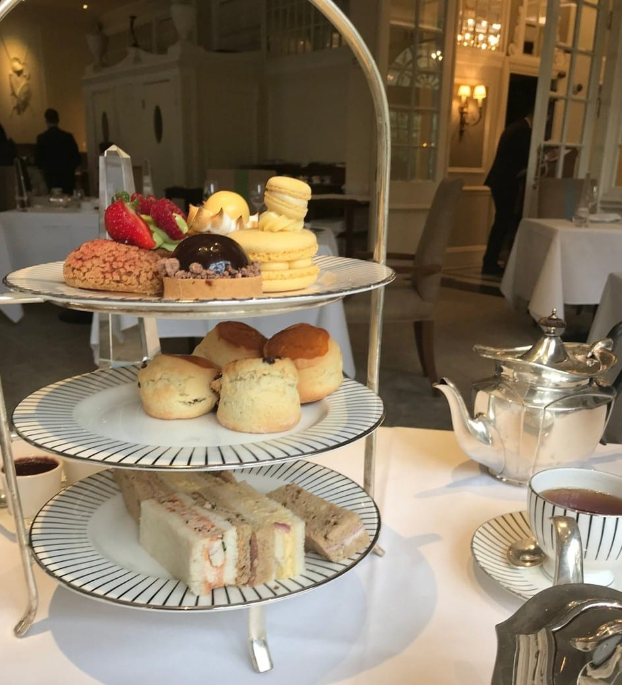

*The Goring's dining room.*

### The Milestone, Kensington

*£££ · opposite Kensington Palace*

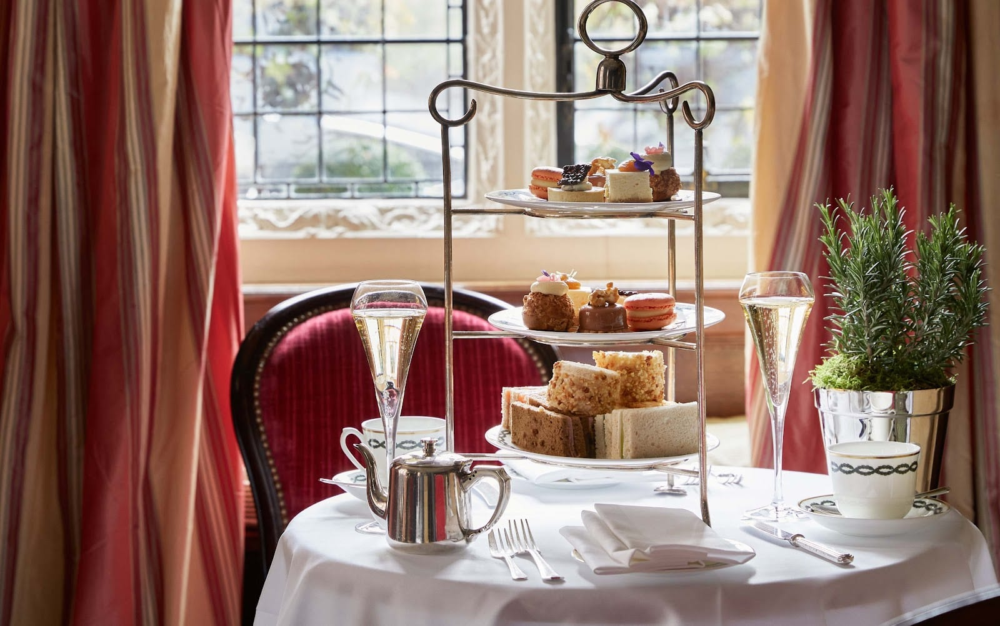

*Afternoon tea by the window at The Milestone.*

A Victorian townhouse hotel **facing Kensington Palace and Kensington Gardens** across the road, with tea taken in a panelled, fire-lit lounge that feels closer to a private house than a hotel, with forty-odd covers.

*The Milestone's tea lounge.*

Traditional finger sandwiches, freshly baked scones and pastries, with a children's version of its own rather than a smaller adult one. It won an **Award of Excellence at the 2026 Afternoon Tea Awards**.

**From £85.** It suits a day at Kensington Palace or the museums, and books less far ahead than the Mayfair rooms.

---

Powered by <a target="_blank" rel="sponsored" href="https://www.getyourguide.com/london-l57/">GetYourGuide</a>

## With children

### One Aldwych, Covent Garden

*£££ · 5 min from Temple*

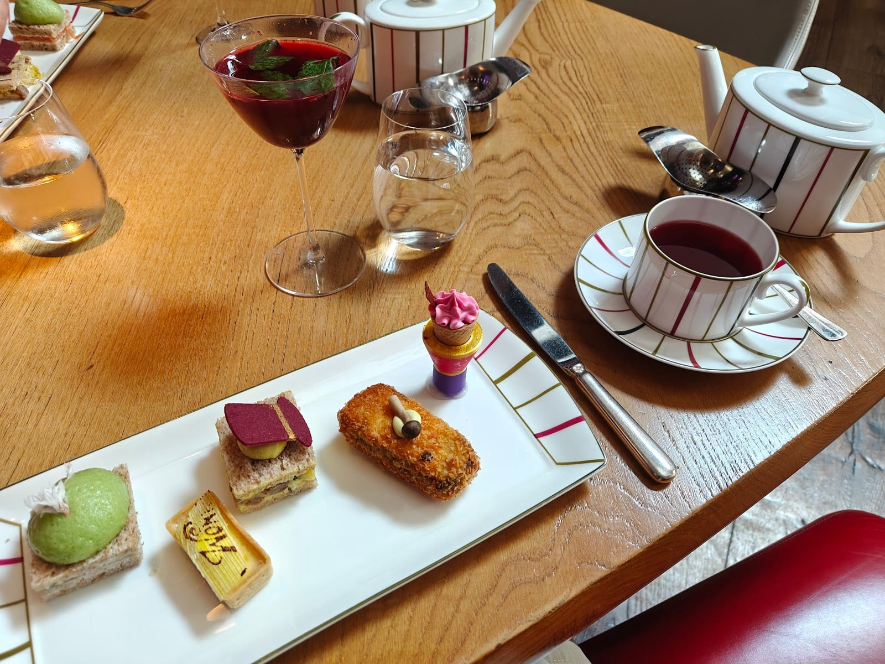

*The Charlie and the Chocolate Factory tea at One Aldwych.*

One Aldwych runs a licensed **Charlie and the Chocolate Factory** tea in its lobby restaurant. It is not a traditional tea.

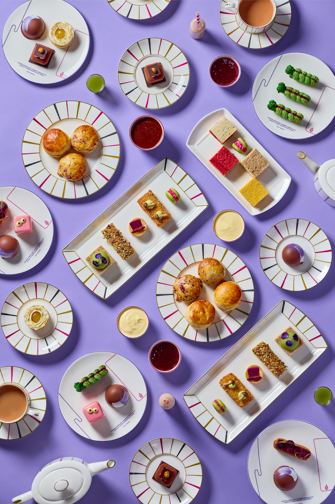

*The Charlie and the Chocolate Factory tea.*

**Cheesecake inside a golden egg**, cake pops, puffs of candy floss, and a Charlie Cocktail served from a teapot with dry ice pouring over the side. Savouries come first and are conventional; everything after is not.

**£95 for adults including a glass of champagne, £65 for under-12s.** Best with children old enough to know the book; it books up in school holidays.

### The Ampersand, South Kensington

*£££ · 1 min from South Kensington*

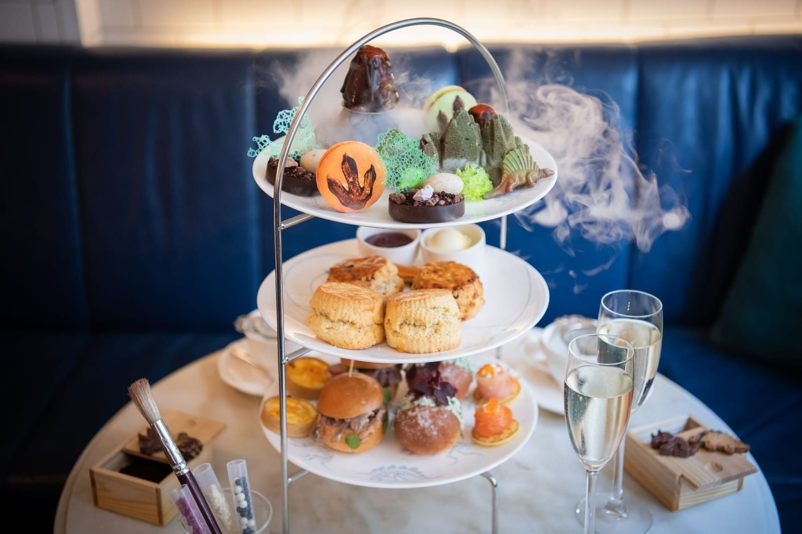

*The Jurassic afternoon tea at The Ampersand.*

A **Jurassic afternoon tea**, built to match the Natural History Museum two streets away.

*The Ampersand's Jurassic tea.*

The stand arrives **wreathed in dry ice**. **T-rex footprint macarons**, dark chocolate and caramel dinosaur egg nests, biscuit fossils, alongside a conventional savoury course. Taken in the Drawing Rooms, a bright basement space rather than a grand salon.

**£64.50 a head, £39.50 for children**, champagne £15 a glass, a short walk from the museum door.

---

## Afternoon tea on a budget

The grand hotels run from about £75 to well over £100 a head. These cost less.

#### The museums and galleries

* **The Wallace Collection**, Marylebone — tea in the glass-roofed courtyard of a Manchester Square townhouse full of Old Masters, and the museum itself is free.
* **The [British Museum](/articles/british-museum-guide/)** — around **£40**, in the Great Court under the Foster roof. <a href="https://www.getyourguide.com/activity/-t114220?partner_id=WWP7I0R&amp;cmp=best-afternoon-tea-london-museums" target="_blank" rel="sponsored nofollow noopener" data-affiliate="gyg">Book it on GetYourGuide</a>.
* **The National Gallery** — a guided tour of the gallery with afternoon tea. <a href="https://www.getyourguide.com/activity/-t436924?partner_id=WWP7I0R&amp;cmp=best-afternoon-tea-london-museums" target="_blank" rel="sponsored nofollow noopener" data-affiliate="gyg">Book it on GetYourGuide</a>.
* **Tate Modern** — around **£30**, with the river and St Paul's through the window.
* **The Royal Albert Hall** — tea inside the building rather than a hotel dining room, which is a different kind of occasion.

#### Under £30

* **Memoir Club**, Bloomsbury — a classic afternoon tea from about **£27.50**.
* **The Chocolate Cocktail Club** — **£27.50** with unlimited tea, coffee or hot chocolate, and a chocolate-led menu rather than the standard tiers.
* **Bishops Park Tea House**, Fulham — **£29** for finger sandwiches, scones with jam and clotted cream and mini cakes on a proper three-tier stand, in a park rather than a hotel.
* **Candella Tea Room**, Kensington — a small independent tea room a few minutes from the palace.

#### Different, and cheaper

* **Cinnamon Bazaar**, Covent Garden — an Indian-spiced afternoon tea rather than the English format.
* **Cutter & Squidge**, Soho — a pared-back signature tea with three sandwiches and two scones.
* **Dean Street Townhouse**, Soho — an English tea in a Georgian room.

#### How to spend less at the grand hotels

* **Go on a weekday.** Almost every hotel here charges less Monday to Thursday than at a weekend, for the identical menu.
* **Skip the champagne.** It adds £15–£25 and the tea is the same either way.
* **Ask for more sandwiches and scones.** They are refillable at most grand hotels.

> Prices move every season; confirm when you book.

---

## Afternoon tea that moves

Two go somewhere while you eat. Both take ninety minutes and cost less than the grand hotels.

### On a Routemaster: the Afternoon Tea Bus Tour

*From £45 adult, £37 child · 90 minutes · departs Victoria Coach Station · age 5+*

**B Bakery launched this in 2013**, on a 1960s Routemaster with tables laid upstairs and down. It leaves **daily at 12:00, 14:30 and 17:00**, and the route is a proper sightseeing lap: Whitehall, Big Ben, Parliament, Westminster Abbey, Buckingham Palace, Hyde Park Corner, Harrods, the V&A, the Royal Albert Hall, Kensington Palace, Marble Arch, Mayfair, the Ritz, Piccadilly Circus and Trafalgar Square.

The tea is a full one — finger sandwiches, pastries, cakes — with Birchall teas, coffee or hot chocolate, and bubbly as an upgrade. **Traditional, vegetarian, vegan, gluten-free and halal menus are all available**, though vegan and gluten-free carry a **£3 supplement** and every dietary requirement needs **72 hours' notice by email**. You get a souvenir cup, and a box for whatever you cannot finish.

**Three things to know before you book.** It is **age 5 and over**, with no exceptions and no babies. **There is no toilet on board** for the full ninety minutes. And **VIP seating means the front row of the upper deck**, the best view. There is a wheelchair-accessible bus; ask when booking.

B Bakery is Brigit's Bakery, which sells the same 90-minute Routemaster tour on GetYourGuide: <a href="https://www.getyourguide.com/activity/-t226702?partner_id=WWP7I0R&amp;cmp=best-afternoon-tea-london-tea-bus" target="_blank" rel="sponsored nofollow noopener" data-affiliate="gyg">book the Afternoon Tea Bus Tour on GetYourGuide</a>.

Powered by <a target="_blank" rel="sponsored" href="https://www.getyourguide.com/london-l57/">GetYourGuide</a>

### On the Thames: the Afternoon Tea Cruise

*From £50 · 90 minutes · Tower Millennium Pier · board 15:15, cruise 15:30–17:00*

**City Cruises runs one sailing a day**, downstream and back from **Tower Millennium Pier** on Lower Thames Street, a few minutes from Tower Hill. Sandwiches, mini pastries and scones with clotted cream and jam, and **unlimited tea and coffee** rather than the single pot you get on land.

The boats have a **heated indoor saloon and an open upper deck**, so you can eat downstairs and then go up for the view. There is a **family ticket: two adults and one child, with a second child free.**

**Seating.** Tables are **fixed to the floor and pre-allocated before boarding** — you cannot move or choose them on the day, and **window tables seat two people only**, so a group of four will not get one. If you want a window, book as a pair.

Vegetarian, vegan or gluten-free are all available, **but not vegan and gluten-free together**. Cancellation is free up to two hours before boarding.

City Cruises' sailing isn't sold on GetYourGuide. The afternoon tea cruise there is a different boat, **Tea on the Thames**: 90 minutes with sandwiches, warm scones, lemon tart and as much tea or coffee as you like, and free cancellation up to 24 hours before. <a href="https://www.getyourguide.com/activity/-t1397467?partner_id=WWP7I0R&amp;cmp=best-afternoon-tea-london-tea-cruise" target="_blank" rel="sponsored nofollow noopener" data-affiliate="gyg">Book Tea on the Thames on GetYourGuide</a>.

Powered by <a target="_blank" rel="sponsored" href="https://www.getyourguide.com/london-l57/">GetYourGuide</a>

### Which one

**The bus for the sightseeing**: it covers more landmarks in ninety minutes than a walk could, from the top deck of a Routemaster. **The boat for the tea**: the table is not moving through traffic, the tea is unlimited, and you can get up and walk about. Both cost far less than The Ritz or Claridge's and are easier to book.

There is also **afternoon tea on the London Eye**: <a href="https://www.getyourguide.com/activity/-t1108107?partner_id=WWP7I0R&amp;cmp=best-afternoon-tea-london-london-eye" target="_blank" rel="sponsored nofollow noopener" data-affiliate="gyg">book it on GetYourGuide</a>.

---

## Also named, briefly

Rooms the sources back that did not earn a full entry.

| Venue | Area | Price | Cited by | What it is |
| --- | --- | --- | --- | --- |
| **The NoMad London** | Covent Garden | ££££ | 3 sources · Award of Excellence 2026 | Tea under the glass atrium of the old Bow Street magistrates' court, across the road from the Royal Opera House |
| **[The Wallace Collection](https://www.wallacecollection.org/)** | Marylebone | £££ | 2 sources | In the glazed courtyard of a free national museum, so you can make an afternoon of it without a second ticket |
| **[Petersham Nurseries](https://petershamnurseries.com/)** | Richmond | £££ | 2 sources | A working plant nursery with a tea house in it, in Richmond |
| **[Aqua Shard](https://aquashard.co.uk/)** | London Bridge | ££££ | 2 sources | Level 31 of the Shard; you are buying the view |
| **[The Swan at the Globe](https://swanlondon.co.uk/)** | Bankside | £££ | 2 sources | Next door to Shakespeare's Globe and overlooking the river; the obvious pairing with a matinée |
| **[Dean Street Townhouse](https://www.deanstreettownhouse.com/)** | Soho | £££ | 2 sources | A Georgian dining room in the middle of Soho that serves tea all afternoon without ceremony |
| **[The Zetter](https://thezetter.com/)** | Clerkenwell | £££ | 2 sources | A Clerkenwell hotel serving afternoon tea |
| **[The Ivy Chelsea Garden](https://theivychelseagarden.com/)** | Chelsea | £££ | 2 sources | Tea in the garden room or outside under the awning, which is what you are booking |
| **[The British Museum](https://www.britishmuseum.org/)** | Bloomsbury | ££ | 2 sources | The Great Court Restaurant, under Foster's glass roof |
| **[Candella Tea Room](https://candellatearoom.com/)** | Kensington | ££ | 2 sources | A small independent tea room rather than a hotel lounge |
| **[The Melody](https://www.themelodyrestaurant.co.uk/)** | Victoria | £££ | 2 sources | Inside the St Ermin's Hotel, with the courtyard's bee hives supplying the honey |
| **Four Seasons Tower Bridge** | Tower Hill | ££££ | 2 sources | The Rotunda, a circular room in a 1920s building, with a Lily Vanilli collaboration on the stand |

---

## What to know

* **Book weeks ahead**, months for The Ritz at a weekend.
* **Check the dress code when booking.** Only The Ritz strictly enforces one, but several prefer smart-casual and it is awkward to discover at the door.
* **Sittings are timed**, usually 90 minutes to two hours. You will be asked to leave on time.
* **Dietary requirements need 24–48 hours' notice** at most of these — vegetarian and gluten-free versions are near-universal but rarely available on the day.

---

## Continue planning your London trip

- 🇬🇧 **[Classic British Food in London](/articles/classic-british-food-london/)** — Scotch eggs, pie and mash, sausage rolls and proper puddings, dish by dish.
- 🍽️ **[Eat in London: Restaurants, Food Markets & Quick Food Hub](/articles/eat-in-london-guide/)**
- 🏛️ **[Historic Pubs and Dining Rooms in London](/articles/historic-pubs-dining-rooms-london/)**
- 🥩 **[The Best Sunday Roast in London](/articles/best-sunday-roast-london/)**
- 🎭 **[Covent Garden Area Guide](/articles/covent-garden-area-guide/)**
- 👑 **[Westminster Area Guide](/articles/westminster-area-guide/)**
- 🛍️ **[Mayfair Area Guide](/articles/mayfair-area-guide/)**
