> 💡 **The Short Version:** The best area to stay in London depends on the trip.
> - **First visit:** [Covent Garden](/articles/where-to-stay-covent-garden/) or [the South Bank](/articles/where-to-stay-south-bank/). Both are Zone 1 with the theatres, the river and the free galleries on foot. [Bloomsbury](/articles/where-to-stay-bloomsbury/) is the quieter, cheaper alternative.
> - **Tight budget:** a smaller room in Zone 1, not a bigger one in Zone 3. A dorm bed is about £26 in [Bloomsbury](/articles/where-to-stay-bloomsbury/) and a capsule £33 to £68 at [Piccadilly Circus](/articles/where-to-stay-soho-west-end/).
> - **Families:** [South Kensington](/articles/where-to-stay-south-kensington/) for the three free museums and the subway to them, [Bermondsey](/articles/where-to-stay-bermondsey/) for a kitchen in the room, [Greenwich](/articles/where-to-stay-greenwich/) for a park.
> - **Nightlife:** [Soho](/articles/where-to-stay-soho-west-end/) if you want to be in it and can sleep through it; [Shoreditch](/articles/where-to-stay-shoreditch/) for the bars and design hotels, at £180 to £250 for most of them.
> - **Business, Eurostar and airports:** [King's Cross](/articles/where-to-stay-kings-cross/) for Eurostar, [Paddington](/articles/where-to-stay-paddington/) for Heathrow (15 minutes), [Victoria](/articles/where-to-stay-westminster/) for Gatwick, [Canary Wharf](/articles/where-to-stay-canary-wharf/) and the [City](/articles/where-to-stay-city-of-london/) for meetings.
> - **Quiet:** [Chelsea](/articles/where-to-stay-chelsea/), [Notting Hill](/articles/where-to-stay-notting-hill/) or [Marylebone](/articles/where-to-stay-marylebone/).
> - **A gig, match or trade show:** [Wembley](/articles/where-to-stay-near-wembley-stadium/), [The O2](/articles/where-to-stay-near-the-o2/) or [ExCeL](/articles/where-to-stay-near-excel/), each with a base that gets you home.

The area you most want to visit is often a poor place to sleep. What decides a base is what a room costs, how far you walk home, whether anything is open for breakfast and whether the streets empty at six. Our [guide to the best areas to visit](/articles/best-areas-to-visit-london/) sorts neighbourhoods on the opposite question, and the two lists differ more often than they agree.

## The areas compared

| Area | Best for | Prices in its hotel guide | Tube lines · minutes to Piccadilly Circus | What it is like |
| --- | --- | --- | --- | --- |
| [Covent Garden](/articles/where-to-stay-covent-garden/) | Theatre, a first visit | £70–£100 compact room; about £140–£700 | Piccadilly (Northern at Leicester Square) · 3 min | Crowded from ten to midnight; you walk home from the show |
| [Soho and the West End](/articles/where-to-stay-soho-west-end/) | Nightlife, windowless-room value | £33–£68 capsule; £97–£287 private room; about £450–£500 | Elizabeth, Central, Northern, Piccadilly, Bakerloo · on foot | Loud until the early hours; Chinatown serves past 1am |
| [Bloomsbury](/articles/where-to-stay-bloomsbury/) | Value in Zone 1, the British Museum | About £26 hostel bed; £81–£206 room; about £600 | Piccadilly · 6 min | Garden squares and quiet evenings |
| [King's Cross and St Pancras](/articles/where-to-stay-kings-cross/) | Eurostar, early trains | Pod from £50; about £95–£350 | Six lines, including Piccadilly · 8 min | Hotels face Euston Road; Granary Square is ten minutes north |
| [Marylebone](/articles/where-to-stay-marylebone/) | Quiet and central | £65–£75 Z Hotel; from £200; about £550 | Bakerloo · 6 min; the Elizabeth line is at Bond Street | A village high street and Regent's Park |
| [Mayfair](/articles/where-to-stay-mayfair/) | Grand hotels, one-train links | £90–£207 windowless room; grand hotels about £600–£850 | Piccadilly, Victoria, Jubilee · 2 min | The streets are empty by eleven |
| [Westminster, Victoria and Pimlico](/articles/where-to-stay-westminster/) | Gatwick, the coach station, the sights on foot | £18 dorm bed; about £140–£900 | Jubilee, District, Circle, Victoria · 10 min | Government offices; little open in the evening |
| [South Bank](/articles/where-to-stay-south-bank/) | Free galleries, the river walk | £53 double capsule; £92–£295 Premier Inn County Hall | Bakerloo, Jubilee, Northern · 4 min | Tate Modern and Borough Market at the door |
| [Bermondsey](/articles/where-to-stay-bermondsey/) | Families, kitchens | About £180–£550 | Jubilee · 16 min | Aparthotels, and a walk to the Tube |
| [City of London](/articles/where-to-stay-city-of-london/) | Business, weekend deals | £60–£75 Z Hotel; about £190–£400 | Central, Northern · 15 min | Priced for the offices; cheaper Friday and Saturday |
| [Shoreditch](/articles/where-to-stay-shoreditch/) | Bars, design hotels | About £110–£250 | Northern at Old Street · 16 min | Loud on a Saturday; no station called Shoreditch |
| [Kensington, Earl's Court and Olympia](/articles/where-to-stay-kensington/) | Kensington Gardens, Olympia events | About £119–£550 | District, Piccadilly · 12 min | Prices fall from the palace south to Earl's Court |
| [South Kensington](/articles/where-to-stay-south-kensington/) | Museums with children | £18 dorm bed; £99 private room; about £280 | Piccadilly · 9 min | A tunnel to the museums; dead by seven |
| [Chelsea and Knightsbridge](/articles/where-to-stay-chelsea/) | Quiet streets | £89–£257 windowless room; about £240–£450 | Piccadilly at Knightsbridge · 6 min | Low-rise and silent by ten |
| [Notting Hill and Bayswater](/articles/where-to-stay-notting-hill/) | Portobello, residential streets | Studios from £97; about £240–£700 | Central at Notting Hill Gate · 15 min | Pastel terraces; Portobello is a Saturday market |
| [Paddington](/articles/where-to-stay-paddington/) | Heathrow, early flights | Singles from £69; about £150–£200 | Bakerloo · 10 min | Transport and canal; no Night Tube |
| [Canary Wharf](/articles/where-to-stay-canary-wharf/) | Business, Sunday-night deals | £156–£229; about £200 | Elizabeth line · 13 min to Tottenham Court Road | Fills Monday to Thursday; quiet at weekends |
| [Greenwich](/articles/where-to-stay-greenwich/) | A park, a market, families | £66–£145; about £160 | DLR to Bank 21 min; train to London Bridge about 10 min | Awkward after midnight |
| [Near ExCeL](/articles/where-to-stay-near-excel/) | Trade shows | £76–£185; about £115 | Elizabeth line · 17 min to Tottenham Court Road | Hotels at both ends of the building |
| [Near The O2](/articles/where-to-stay-near-the-o2/) | Concerts | Typically £106; £261–£465 on the peninsula | Jubilee · 20 min | Dearest on a show night |
| [Near Wembley](/articles/where-to-stay-near-wembley-stadium/) | Matches, arena gigs | From £48; about £120 | Jubilee, Metropolitan · 17 min to Bond Street | Triple the price on an event night |
| [Fitzrovia](/articles/fitzrovia-area-guide/) | Eurostar, restaurants | About £150–£400 | Victoria at Warren Street · 5 min | Calm at night |
| [Hampstead](/articles/hampstead-area-guide/) | Longer stays, the Heath | About £130–£140 | Northern · 21 min with a change | Hilly, and outside Zone 1 |

*Prices are the figures in each area's hotel guide: sampled rates where we have them, otherwise the hotel's own "about" figure. Tube minutes are station to Piccadilly Circus on a weekday morning.*

## Getting home at night

**The Tube runs until about half past midnight, and night buses run everywhere, every night.** Night Tube is Friday and Saturday only, and Sundays finish earlier everywhere. Most trips never run into this. Three things catch people out on a late night, and none is a reason to book somewhere else.

| What people assume | What actually happens |
| --- | --- |
| The Elizabeth line runs late, so it runs all night | It does not run overnight on any night. It is the fastest thing in London by day and no use at 2am |
| The Northern line serves Old Street, so Shoreditch is covered | The Northern line's night service runs **via Charing Cross only**, so the Bank branch (Old Street, Angel, Moorgate, Borough) has none |
| Paddington is a huge interchange, so it must have one | **Paddington has no Night Tube line.** Bakerloo, Circle, District, Hammersmith & City and Elizabeth all stop overnight |

The DLR shuts overnight too, which affects Greenwich and Canary Wharf.

---

## First time in London

On a first trip you overestimate how much fits in a day and underestimate how tired you are by nine at night. Pick somewhere central enough that a theatre or a dinner is a walk, not a journey.

### Covent Garden: the walk home from the theatre

*£70 windowless, £100 with a window · Zone 1 · Covent Garden and Leicester Square · [hotel guide](/articles/where-to-stay-covent-garden/) · [area guide](/articles/covent-garden-area-guide/)*

The theatres, the river, Soho, Trafalgar Square and the [British Museum](/articles/british-museum-guide/) are all within a fifteen-minute walk, and more than twenty West End theatres are inside ten minutes. **Most evenings you do not need a train.** Do not plan around Covent Garden station itself, which has four lifts and a 193-step spiral staircase but no escalators. Leicester Square, 260 metres away, is quicker in both directions and adds the Northern line.

The trade is that it never quiets. The Piazza has street performers from mid-morning, the surrounding streets carry theatre crowds twice a night, and there is no quiet hour between about ten in the morning and midnight. It is also short of ordinary shops, and you will struggle to buy milk. The premium is measurable: Z Hotels sells the same 9 sq m double for £100 here and £70 at Holborn, a nine-minute walk east.

**[The Z Hotel Covent Garden](hotel:z-hotel-covent-garden)** is £70 for an "Inside" room with no window and £100 for the first room that has one, and people book the Inside grades by accident constantly.

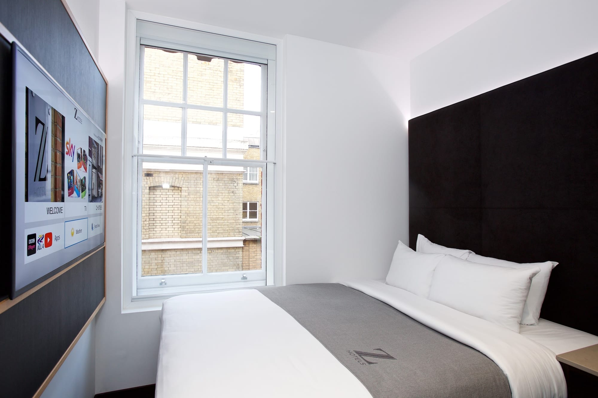

*A window room at the Z Hotel Covent Garden.*

**[Strand Palace](hotel:strand-palace)** is about £140, open since 1909 with 785 rooms, and the one with availability when the small hotels are full. **[The Savoy](hotel:the-savoy)** is about £700 on the same road.

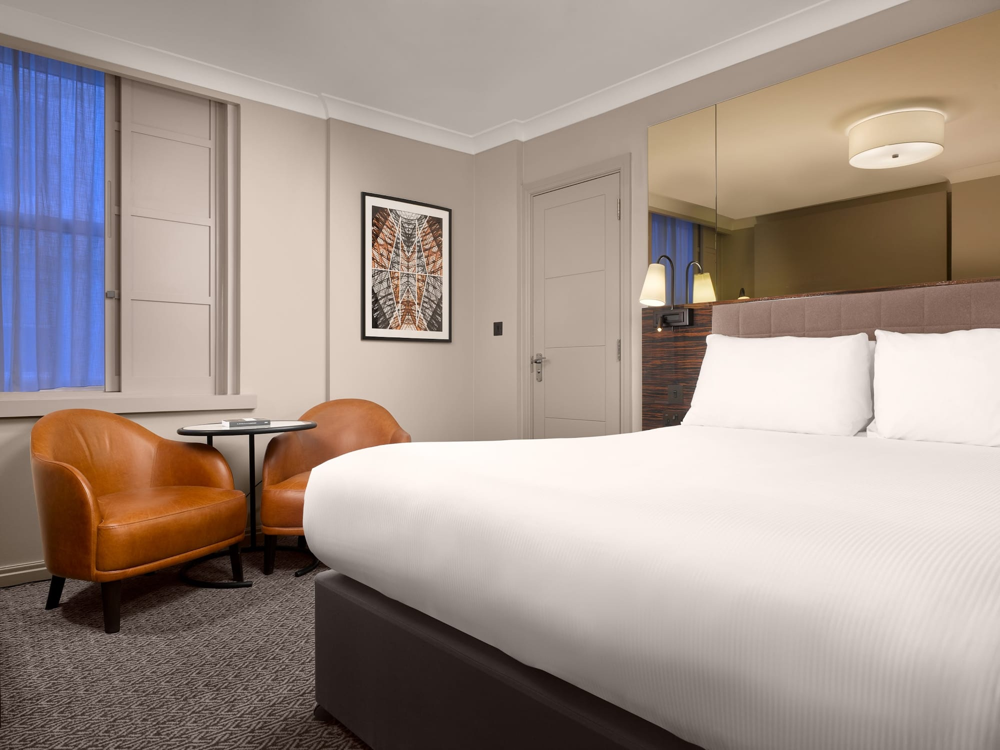

*A room at the Strand Palace.*

### South Bank: the river, the galleries and three stations

*£53 for a double capsule, £155–£251 at citizenM · Zone 1 · Waterloo, Southwark and London Bridge · [hotel guide](/articles/where-to-stay-south-bank/) · [area guide](/articles/south-bank-area-guide/)*

A river walk runs past your door and most of it is free: Tate Modern, the Southbank Centre foyers, the BFI and the covered halls of Borough Market. **Tate Modern is free and open until 9pm on Fridays and Saturdays.** Borough Market is closed on Mondays except in December, so don't count on it for food that day.

Three stations serve the strip: Waterloo has the Jubilee and the Northern, and Southwark and London Bridge have the Jubilee. For the Abbey and Parliament end of the river, see our [Westminster and Victoria hotel guide](/articles/where-to-stay-westminster/).

**[St Christopher's Village](hotel:st-christophers-village)** by Borough Market sells a double capsule from £53. **[citizenM Bankside](hotel:citizenm-bankside)** ran £155 to £251 on five sampled nights for one room type with a wall-to-wall window and a tablet that runs the blinds; the rooms are small, the bed filling the width.

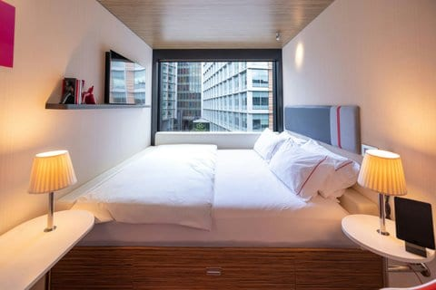

*A room at citizenM Bankside.*

**[Native Bankside](hotel:native-bankside)** is on a quiet cut-through behind Shakespeare's Globe and puts a kitchen in the room.

### Bloomsbury: a hostel bed to a grand hotel inside ten minutes

*From about £26 a hostel bed · Zone 1 · Russell Square and Holborn · [hotel guide](/articles/where-to-stay-bloomsbury/) · [area guide](/articles/bloomsbury-area-guide/)*

Garden squares, the British Museum, and prices that run from a dorm bed to a rebuilt grand hotel inside about ten minutes' walk. Russell Square is on the Piccadilly line, which runs to Heathrow without a change, so your arrival and your flight home are the same single train. St Pancras is ten minutes on foot.

Evenings are the thin part. Bloomsbury is academic and residential, so it goes quiet early and the restaurant choice is nothing like Soho's. Soho is ten minutes' walk west when you want it, and out of earshot when you do not, which is why people sleep well here.

**[Generator London](hotel:generator-london)** is about £26 a bed, with 750 beds across its dorms and private rooms, a bar built into a bus and a 24-hour reception. It is openly a party hostel, so it is the wrong call for an early start.

*A dorm room at Generator London.*

**[Zedwell Tottenham Court Road](hotel:zedwell-tottenham-court-road)** is £81 to £206 for a private windowless room two minutes from the British Museum, and it undercut the Piccadilly flagship on every date sampled.

*A windowless Cocoon room at Zedwell Tottenham Court Road.*

**[Rosewood London](hotel:rosewood-london)**, about £600, is entered through a carriageway into a Belle Époque courtyard on High Holborn. The Cartwright Gardens B&B strip and the rebuilt Imperial on Russell Square are in the hotel guide.

---

## Nightlife and going out

Stay where the night is, or stay ten minutes from it. The in-between gives you the noise without the short walk home, and the areas where people go out are hard to sleep in because they are the same streets.

### Soho: loud, central, and priced across the whole range

*£33 a capsule to about £500 a room · Zone 1 · Piccadilly Circus and Tottenham Court Road · [hotel guide](/articles/where-to-stay-soho-west-end/) · [area guide](/articles/soho-area-guide/)*

Bars, theatres, restaurants and late food on every street, and rooms priced from a £33 capsule to about £500. **Chinatown's noodle and roast-meat places run past 1am** and are priced for the people who work in them, so you can eat a full meal at an hour when most of London has stopped serving. The West End is cheaper than its reputation because of the windowless format, which stacks hundreds of rooms into buildings with no external walls to spare.

**It is very loud and it is not a place to sleep lightly.** Every one of Soho's streets carries people until the early hours, and a room facing one of them is a compromise you are making deliberately. Ask for a high floor and an internal room at booking, not at check-in. For an ordinary double with a window, look at Fitzrovia five minutes north or Covent Garden to the east.

At the bottom, **[Zedwell Capsule Piccadilly Circus](hotel:zedwell-piccadilly-capsule)** is £33 to £68 for a berth one minute from the Tube.

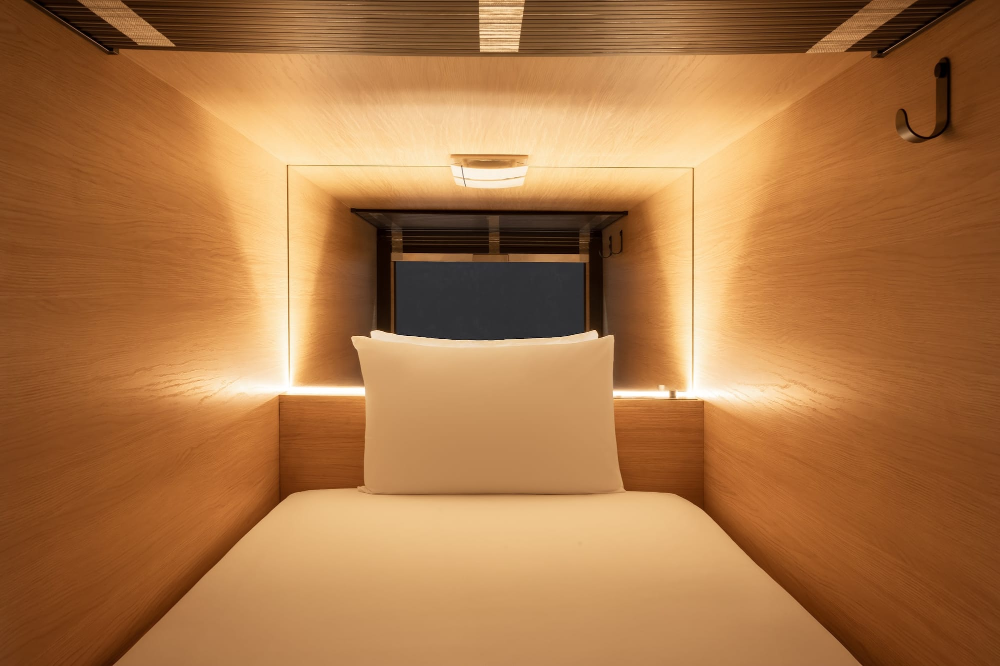

*A capsule at Zedwell Piccadilly Circus.*

**[Otherwander Soho](hotel:otherwander-soho)** is £62 to £119 on Dean Street.

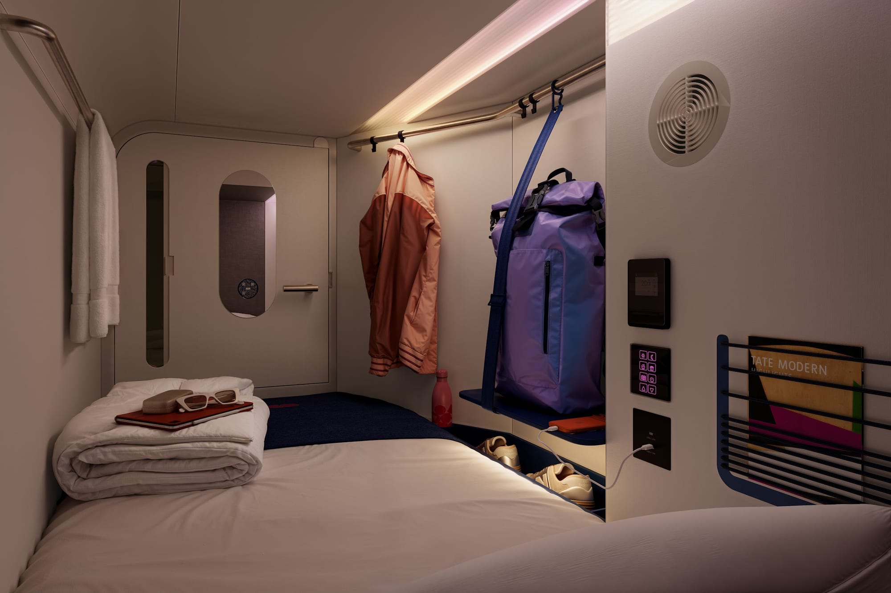

*A pod at Otherwander Soho.*

In the middle, **[Zedwell Piccadilly Circus](hotel:zedwell-piccadilly-circus)** does private windowless rooms at £97 to £287, where the second guest adds about £5.

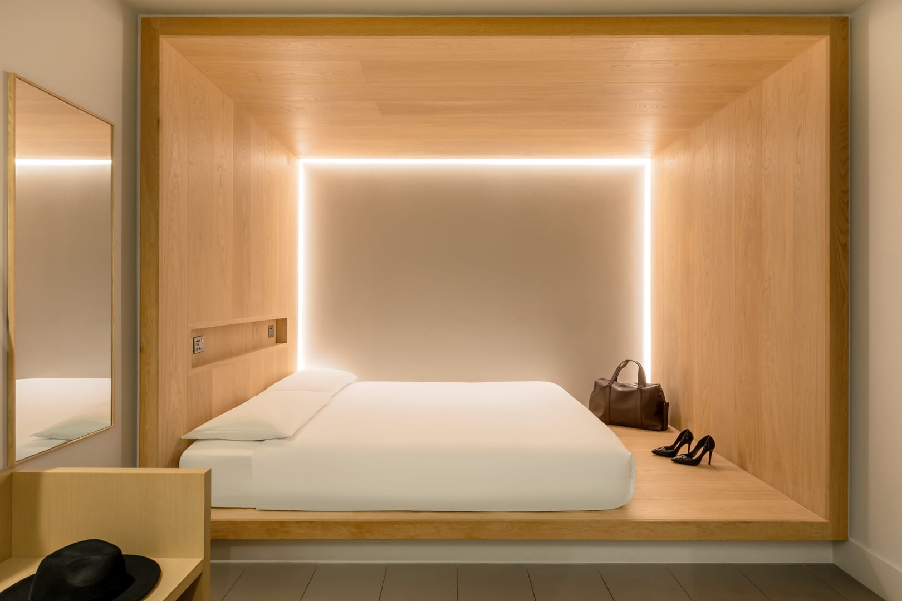

*A room at Zedwell Piccadilly Circus.*

At the top, **[Broadwick Soho](hotel:broadwick-soho)** is about £450 and was named the UK's best hotel at the 2026 Muddy Stilettos Awards.

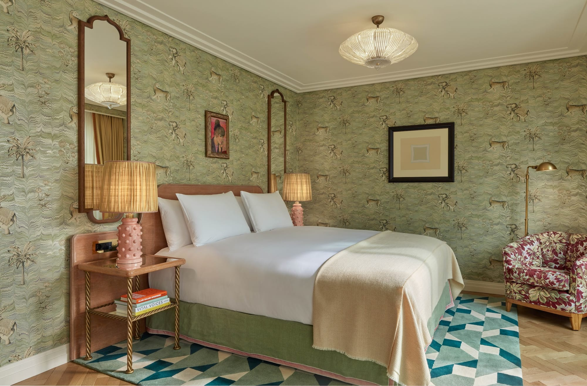

*A room at Broadwick Soho.*

**[Ham Yard Hotel](hotel:ham-yard-hotel)** is about £500 with a 1950s bowling alley in the basement.

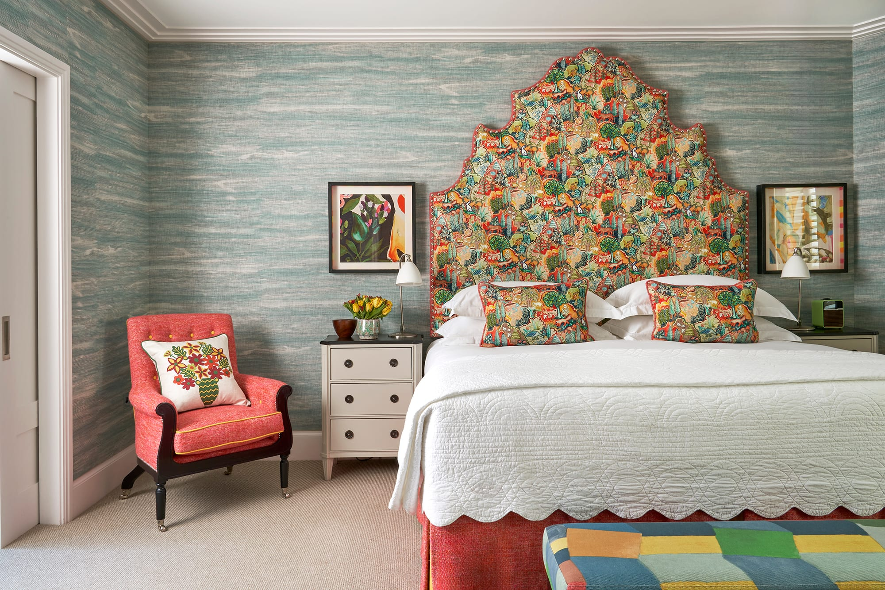

*A room at Ham Yard Hotel.*

### Shoreditch: design hotels, and not cheap

*About £110–£250 · Zone 1 · Old Street, Shoreditch High Street and Liverpool Street · [hotel guide](/articles/where-to-stay-shoreditch/) · [area guide](/articles/shoreditch-area-guide/)*

Shoreditch is not the bargain it is still sold as: **the cheapest room in our guide is about £110 and most sit between £180 and £250**, dearer than Bloomsbury or Covent Garden, both of which are more central.

**There is no Tube station called Shoreditch**, which catches people out at the booking page. Old Street is the Northern line, Shoreditch High Street is the Overground's Windrush line, and Liverpool Street ten minutes south is the useful one, with the Central line and the Elizabeth line under the same roof. Old Street has no night service; Shoreditch High Street and Liverpool Street both do.

**[The Hoxton](hotel:the-hoxton-shoreditch)** is about £200 with breakfast hung on your door in a bag, and its room grades are named by size, so a Shoebox is exactly that.

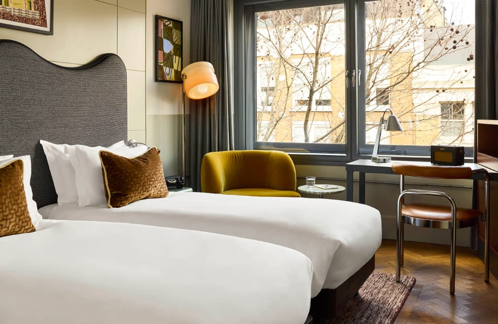

*A room at The Hoxton, Shoreditch.*

**[The Z Hotel Shoreditch](hotel:z-hotel-shoreditch)** is about £110 with the same windowless-cheapest-rate catch as the Covent Garden branch.

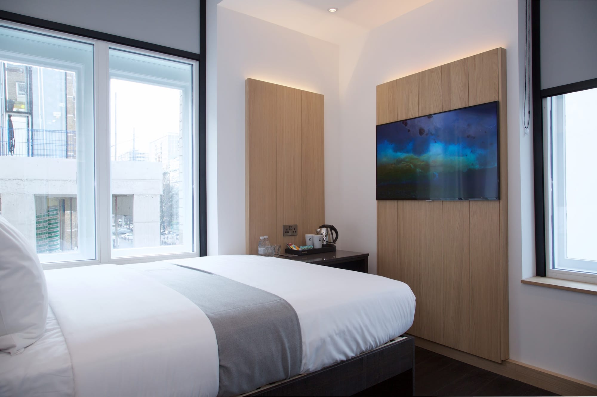

*A room at the Z Hotel Shoreditch.*

**[nhow London](hotel:nhow-london)** is about £150 with a Big Ben rocket in the lobby.

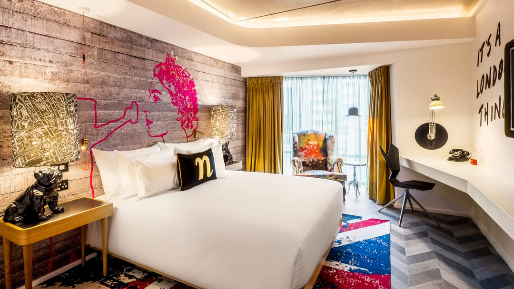

*A room at nhow London.*

### Spitalfields: Shoreditch's nightlife at sleeping distance

*Studios, and about £230 for the townhouse · Zone 1 · Liverpool Street and Aldgate East · [City of London hotel guide](/articles/where-to-stay-city-of-london/)*

The Georgian streets south of Shoreditch, and the compromise if you want the bars and also want to sleep: **a ten-minute walk from them and far enough that you cannot hear them.** Liverpool Street is seven minutes on foot, which means the Central line at night and the Elizabeth line to Bond Street in about twelve minutes by day. Aldgate East, the other station here, has no night train.

Food after midnight is easy. **Beigel Bake on Brick Lane is open twenty-four hours** and sells a salt beef beigel for £7.50, and the Polo Bar opposite Liverpool Street has traded around the clock since 1953.

**[Batty Langley's](hotel:batty-langleys)** is about £230 on cobbled Folgate Street, all dark walls, silk curtains and oil paintings, next door to Dennis Severs' House.

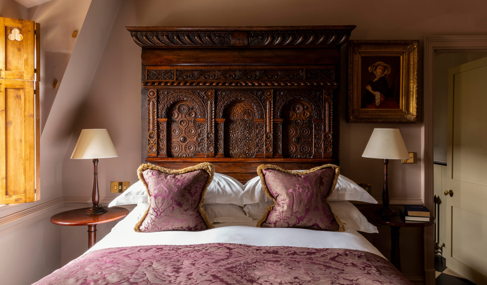

*A room at Batty Langley's.*

**It has no lift and no air conditioning**, a problem in July or with a heavy case, and the price of a real Georgian building. **[Leman Locke](hotel:leman-locke)** is the studio-with-a-kitchen option, a minute from Aldgate East, and the one that started the aparthotel format in London.

*A studio at Leman Locke.*

---

Powered by <a target="_blank" rel="sponsored" href="https://www.getyourguide.com/london-l57/">GetYourGuide</a>

## Museums, and going with children

A short walk to the front door of the thing, somewhere to make a sandwich, and a lift. For the room itself, [the best family hotels in London](/articles/best-family-hotels-london/) cross-checks 21 hotels against Mumsnet, family-travel blogs and the travel press for one that sleeps two adults and two children. For a pool and the hours children can use it, see [London hotels with a pool](/articles/hotels-with-pool-london/).

### South Kensington: three free museums and a tunnel most of the way to them

*From £18 a hostel bed · Zone 1 · South Kensington · [hotel guide](/articles/where-to-stay-south-kensington/) · [area guide](/articles/south-kensington-area-guide/)*

The Natural History Museum, the Science Museum and the V&A sit within 400 metres of each other and all three are free. What makes it worth sleeping here is the walk in: **a tiled Victorian pedestrian subway, opened in 1885 and free since 1908, runs from inside the ticket hall north under Exhibition Road.** The Natural History Museum has a gate directly off it, so you can walk in without going outside; for the Science Museum and the V&A you come up on the museums side of the road and walk the last stretch in the open.

South Kensington station is on the Piccadilly, District and Circle lines, with a direct train to Heathrow, and **it has no lifts to its platforms**: with a pram or a heavy case, stay within walking distance and never use the station for the museums. **The area is expensive and quiet in the evening.** The museums close between 17:45 and 18:00, dinner options thin out fast and the residential streets are dead by nine, so plan on eating early or eating elsewhere.

**[Astor Hyde Park](hotel:astor-hyde-park)** is £18 for a dorm bed and £99 for a private room, breakfast included, in a Victorian townhouse opposite the Royal Albert Hall with the cornicing and fireplaces intact. Its dorms are for guests aged 18 to 39, and it has townhouse stairs and no lift.

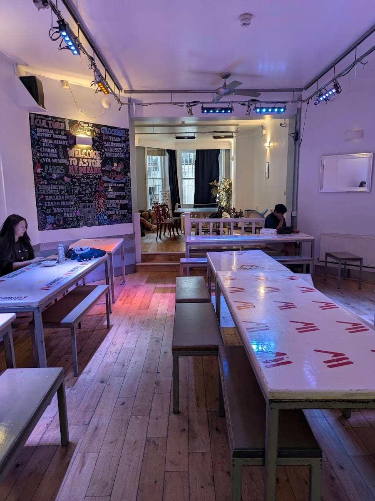

*The communal room at Astor Hyde Park.*

**[Nell Gwynn House](hotel:nell-gwynn-house-pods)** does serviced apartments with their own kitchens in a 1930s mansion block ten minutes east, the cheap way to cook for yourself in this postcode. **[The Ampersand](hotel:the-ampersand-hotel)** is about £280, with a Science Family Suite whose children's room is built around a rocket-shaped bunk bed.

### Kensington, Earl's Court and Olympia: palace, park and a trade-fair hotel

*About £119–£550 · Zones 1–2 · High Street Kensington, Earl's Court and Olympia · [hotel guide](/articles/where-to-stay-kensington/) · [area guide](/articles/kensington-area-guide/)*

West of the museums: Kensington Palace and the Gardens across the road from the high street, the Victorian terraces of Earl's Court to the south, and Olympia on the Hammersmith side. **Prices fall as you walk south**, from the palace to Earl's Court. High Street Kensington is on the District and Circle lines; Earl's Court has the District and Piccadilly. Cromwell Road is the A4 and loud, so ask for a room at the back.

**[Mowbray Court](hotelscom:608469)** in Earl's Court is about £119, with a lift and air conditioning. **[Hyatt Regency London Olympia](hotel:hyatt-regency-london-olympia)** is about £220, one minute from the station and the choice for a show at Olympia. **[The Milestone](hotel:the-milestone-hotel)** faces Kensington Palace at about £550, with a family suite built around bunk beds and a pool guests use free.

### Bermondsey: a kitchen, space and Tower Bridge

*About £180, or £550 in the Shard · Zones 1–2 · Bermondsey and London Bridge · [hotel guide](/articles/where-to-stay-bermondsey/) · [area guide](/articles/bermondsey-area-guide/)*

The family answer on this page. **Breakfast for four in central London runs £60 to £80 a day**, and Bermondsey's aparthotels put a hob and a fridge in the room, which over four mornings is most of a night's difference in the room rate. Tower Bridge is fifteen minutes' walk, Borough Market and the Shard are ten, and Bermondsey station is on the Jubilee.

**It is a walking area rather than a doorstep one.** Bermonds Locke is about eight minutes from the Tube, the furthest of the Locke sites from a station. It trades connectivity for space and quiet, and with children that is often the right trade.

**[Bermonds Locke](hotel:bermonds-locke)** does 143 desert-toned studios with kitchens and a washer-dryer on Tower Bridge Road.

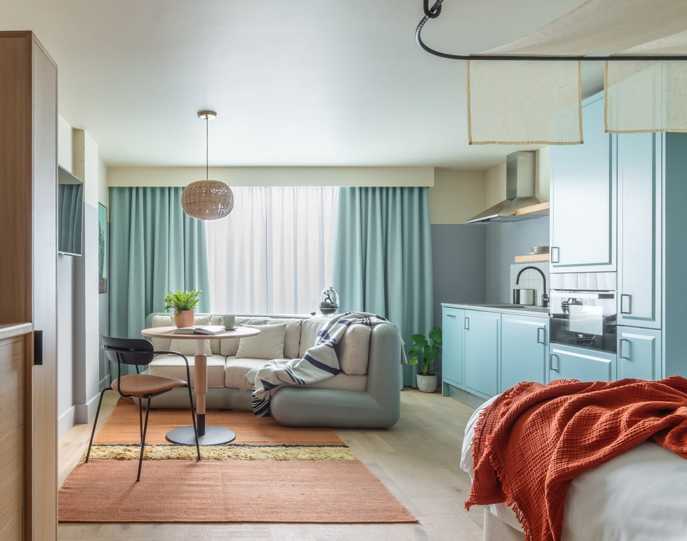

*A studio kitchenette at Bermonds Locke.*

**[Bermondsey Square Hotel](hotel:bermondsey-square-hotel)** is about £180 on the square that holds the Friday antiques market; ask for a room away from the square on market mornings.

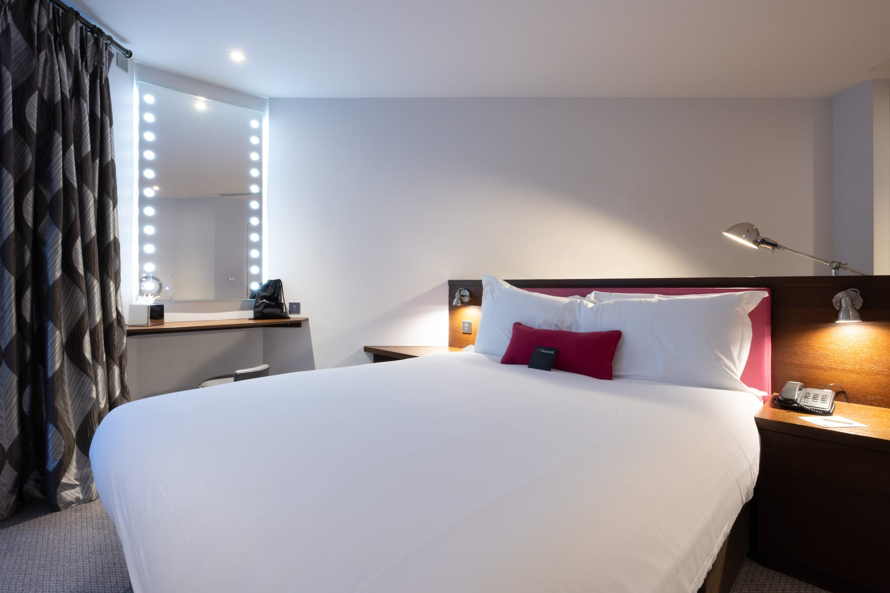

*A room at Bermondsey Square Hotel.*

And **[Shangri-La The Shard](hotel:shangri-la-the-shard)** occupies floors 34 to 52 with a 52nd-floor infinity pool, at about £550. The entry-level rooms face south, away from London, and a low-floor room defeats the purpose.

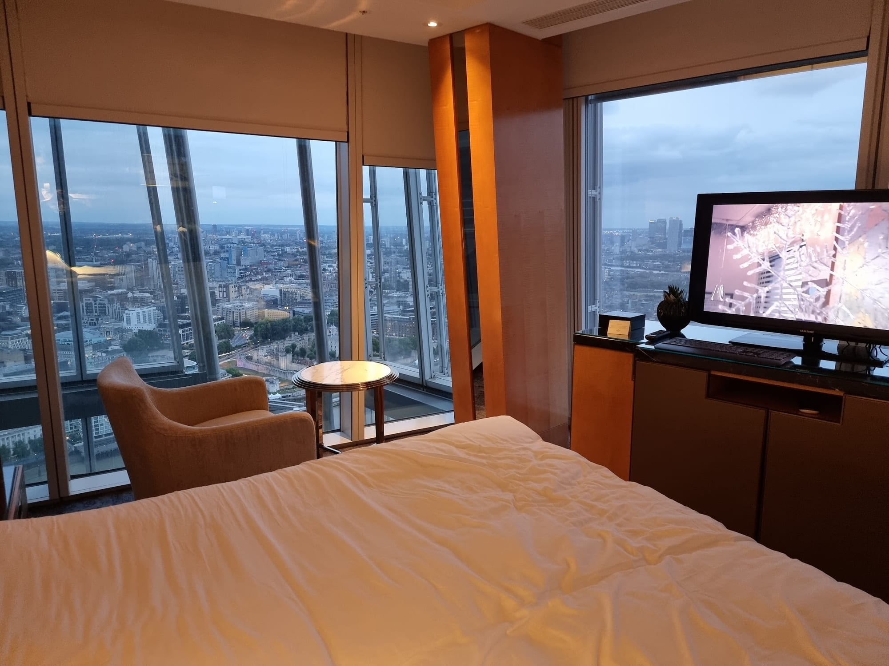

*The view from a room at Shangri-La The Shard.*

### Greenwich: a park, a market and a hill

*£66–£160 · Zones 2–3 · Cutty Sark DLR and Greenwich rail · [hotel guide](/articles/where-to-stay-greenwich/) · [area guide](/articles/greenwich-area-guide/)*

A maritime village with the Cutty Sark, the Old Royal Naval College, the National Maritime Museum, and a hill with the Royal Observatory (closed from 2 November 2026) on it. Most of it is free, all of it walkable, and there is a park for children to run in, which no Zone 1 base offers. The DLR reaches Bank in about 21 minutes, and trains from Greenwich station reach London Bridge in about ten.

**Evenings in town are the awkward part.** The last DLR from Bank to Cutty Sark leaves at 00:33 Monday to Saturday and 23:33 on Sunday, and Greenwich's mainline trains stop overnight, so a late night in the West End means a night bus back or a taxi. North Greenwich keeps a Jubilee night service, but that is the O2, a bus ride from the historic quarter. If your days are here that is a small cost. If your evenings are all in town, base yourself in town.

**[ibis London Greenwich](hotelscom:179227)** is on Stockwell Street, a few minutes from the park gates and the market. **[Zedwell Greenwich](hotel:zedwell-greenwich)** is £66 to £145 for a windowless Cocoon 2, and the steadiest-priced Zedwell: early check-in costs £25 here against £60 in the West End. **[DoubleTree Greenwich](hotel:doubletree-greenwich)** is about £160, in a former 1940s police section house, about 18 minutes' walk from the Cutty Sark.

---

Powered by <a target="_blank" rel="sponsored" href="https://www.getyourguide.com/london-l57/">GetYourGuide</a>

## On a budget, and the business districts

The cheapest beds in London are in Zone 1, and they are cheap because the room is small rather than because the postcode is bad. Moving outwards only pays when the saving survives the travelling. For a hotel room at £150 a night or less, our [budget hotels guide](/articles/best-budget-hotels-london/) priced 46 hotels on the same five nights. The City and Canary Wharf work the other way round: they are priced for the offices, so weekends are the bargain.

### Bethnal Green: cheap capsules and a two-Michelin-star town hall

*£42–£220 · Zone 2 · Bethnal Green*

East London on the Central line, which is fast into town and one of the six lines that keeps running on Friday and Saturday nights, unusual for a Zone 2 address at this price. Roman Road is a working market street rather than a tourist strip, Victoria Park is a short walk, and Brick Lane is about ten minutes away.

Do the arithmetic before booking the cheap one. **[The GreenHouse Capsules](hotel:greenhouse-capsules)** is £42 to £53 a capsule, and that price barely moves all year, which makes it *dearer* than a Zone 1 capsule on a quiet night (£42 against £33) and cheaper in December (£45 against £68). Its Zone 2 address buys you nothing most of the time. It is also tiny, at eight units, with no front desk and entry by code.

**[Town Hall Hotel](hotel:town-hall-hotel)** is the other end: about £220 for a 1910 town hall with the council chamber and marble staircases intact, a 14-metre pool and the two-Michelin-starred Da Terra in the building.

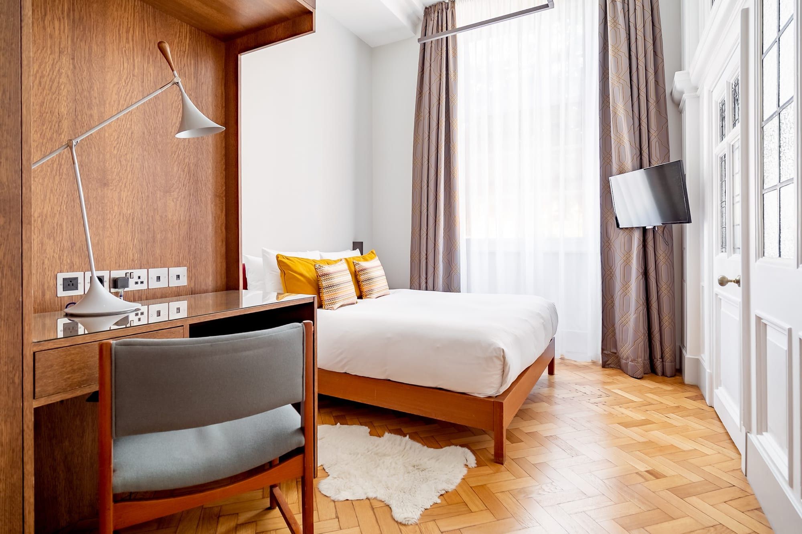

*A room at Town Hall Hotel.*

### City of London: priced for the offices, cheapest at weekends

*£60–£400 · Zone 1 · Bank, Liverpool Street and Tower Hill · [hotel guide](/articles/where-to-stay-city-of-london/) · [area guide](/articles/city-of-london-area-guide/)*

The Square Mile runs from St Paul's in the west to the Tower in the east, and its hotels are priced for business travellers from Monday to Thursday, so **a Friday or Saturday night is often cheaper than a Tuesday**. Price a weekend here against the West End for the same dates. The cost is that part of it shuts with the offices: the Bank of England Museum and the Jamaica Wine House open Monday to Friday only, and St Paul's is open for sightseeing Monday to Saturday. Tower Hill stays busy all weekend, Old Spitalfields Market trades daily, and Leadenhall Market's restaurants and pubs open through the weekend.

The nights are quiet, especially around St Paul's and the river. Liverpool Street has the Central and Elizabeth lines, and Bank the Central and Northern.

**[The Z Hotel City](hotelscom:h103089591)** on Fleet Street is £60 for a single and £75 for a double with a window. **[Locke at Broken Wharf](hotel:locke-at-broken-wharf)** is about £190, with studios and kitchens by the Millennium Bridge. **[The Ned](hotel:the-ned)** is about £400, a 1924 Lutyens bank with ten restaurants.

### Canary Wharf: the area that discounts when everywhere else does not

*£156–£229 · Zone 2 · Canary Wharf · [hotel guide](/articles/where-to-stay-canary-wharf/) · [area guide](/articles/canary-wharf-area-guide/)*

A business district, which means it fills Monday to Thursday and **is cheapest on a Sunday night**: a Novotel double was £165 on Sunday 11 October and £227 on Saturday 17 October. If your trip includes a Sunday night, check a Canary Wharf rate against a central one before assuming central is cheaper.

**Weekends are quiet rather than dead, and that changed around 2023.** The old malls still wind down on a Sunday, but Wood Wharf at the eastern end runs all week, with waterside restaurants, Mercato Metropolitano, a floating fifty-metre lido, and Fairgame serving until 1am on Saturdays. The Elizabeth line runs here direct from Heathrow in about 48 minutes, and the Jubilee goes straight to Bond Street and Green Park. Of the three lines here only the Jubilee runs through the night on Fridays and Saturdays; the DLR and the Elizabeth line stop, so check which entrance your hotel is nearest if you are out late.

**[Point A](hotelscom:h9080289)** is the budget booking, with breakfast included when you book direct. **[Novotel Canary Wharf](hotel:novotel-canary-wharf)** ran £156 to £229 on five sampled nights and has Bokan, a rooftop restaurant on floors 38 and 39 that is open to non-residents. **[London Marriott Canary Wharf](hotel:london-marriott-canary-wharf)** is about £200 on West India Quay, with floor-to-ceiling windows over the dock and a 24-hour gym and business centre. **[Locke Canary Wharf](hotel:locke-canary-wharf)** has 279 studios and suites with kitchens, five minutes from the Jubilee.

## Gigs, matches and trade shows

On an event night the argument stops being about price. The question is how you get home, and the answer is usually one train from the venue, not a room next to it: the hotels beside the stadium and the arena sell out and reprice.

### Wembley: only if the reason is Wembley

*Private rooms from £48 · about £120 beside the stadium · Zone 4 · Wembley Park · [hotel guide](/articles/where-to-stay-near-wembley-stadium/)*

For most people the base is **Baker Street or Marylebone**: 35 minutes door to door on the Metropolitan line, Chiltern trains from Marylebone in under ten minutes, and the Jubilee Night Tube on Fridays and Saturdays. Harrow-on-the-Hill is the cheaper base, 29 minutes door to door, with a last train back at 00:56. A hotel on Olympic Way is the exception to that: **you walk back instead of queueing for the Metropolitan line with the crowd**, but the Novotel was £426.60 on an England match night and £131.40 a week later.

**Book the Wembley Park side, not Wembley Central.** They are two different stations on different lines (Wembley Park is Jubilee and Metropolitan, Wembley Central is Bakerloo and Overground) and only Wembley Park stands at the top of Olympic Way.

The rest of the time, count the travel. It is Zone 4: the daily fare cap rises to £12.80 against £8.90 for Zones 1–2, and Wembley Park is ten Jubilee line stops from Bond Street. **[Novotel London Wembley](hotel:novotel-london-wembley)** is about £120 on Olympic Way, has parking, and sells out months ahead for the big events. **[Hilton London Wembley](hotel:hilton-london-wembley)** is about £130, beside the OVO Arena. **[Palmers Lodge Swiss Cottage](hotel:palmers-lodge-swiss-cottage)** has private rooms from £48, 29 minutes door to door.

### The O2: stay one stop away

*Typically £106 at ibis Canning Town · Zones 2–3 · North Greenwich · [hotel guide](/articles/where-to-stay-near-the-o2/) · [venue guide](/articles/the-o2-travel-guide/)*

**Canary Wharf and Canning Town** are the bases for most people, one stop either side of North Greenwich on the Jubilee line, two minutes on the train. The trap is sleeping on the peninsula on a show night: the InterContinental was £465 on a Sunday concert night and £261 a week later. On Fridays and Saturdays the Jubilee runs all night; on other nights the last train west leaves North Greenwich at 00:19, or 23:45 on a Sunday. London Bridge is the central base, nine minutes on the Jubilee.

**[ibis London Canning Town](hotelscom:h19692814)** is opposite the station at a typical £106. **[Novotel Canary Wharf](hotel:novotel-canary-wharf)** is from £156. **[InterContinental London – The O2](hotel:intercontinental-the-o2)** has a private walkway into the arena.

### ExCeL: by the entrance you need

*£76 to £185 at ibis ExCeL · Zone 3 · Custom House and Prince Regent · [hotel guide](/articles/where-to-stay-near-excel/)*

For the West Entrance, which includes MCM Comic Con, stay on Western Gateway by Custom House; for the East Entrance and the ICC, stay by Prince Regent. Canary Wharf is 3 minutes away on the Elizabeth line and Woolwich 4. After an evening event, the last Elizabeth line train west leaves Custom House at 00:05, or 22:35 on a Sunday. Neither the Elizabeth line nor the DLR runs all night, but the N551 night bus leaves Custom House every half hour.

**[ibis London ExCeL Docklands](hotelscom:215235)** is two minutes' walk from the venue and was £76 on a Sunday in October 2026 and £185 on the Saturday. **[Aloft London ExCeL](hotel:aloft-london-excel)** is about £115, a minute from the East Entrance, with an indoor pool. **[Sunborn London](hotelscom:463416)**, about £160, is a moored superyacht on the dock.

---

## Quiet and residential

Where to stay if the trip is a long one, if you are a light sleeper, or if you have done the sights and now want a neighbourhood rather than an attraction.

### Chelsea: low-rise and silent by ten

*£89–£450 · Zones 1–2 · Sloane Square and Knightsbridge · [hotel guide](/articles/where-to-stay-chelsea/) · [area guide](/articles/chelsea-area-guide/)*

Low-rise, affluent, residential, and about as far from a nightlife district as Zone 1 gets. The King's Road, the Physic Garden and the river walk are all here, and the streets behind them are silent by ten.

**Sloane Square is District and Circle**, quick and frequent all day and stopping overnight like most of the network. If a late Friday or Saturday is part of the plan, Knightsbridge on the Piccadilly is about twelve minutes' walk and Victoria about fifteen, and the N11 and N22 run along the King's Road through Sloane Square all night.

**[Zedwell Knightsbridge](hotel:zedwell-knightsbridge)** is £89 to £257 for a windowless room for two. **[San Domenico House](hotel:san-domenico-house)** is about £240, nineteen rooms in an Italian-furnished townhouse off Sloane Square, and it books out well ahead. **[The Cadogan](hotel:the-cadogan-belmond)** is about £450 on Sloane Street, and gives guests the key to Cadogan Place's private gardens and tennis courts. The Chelsea Townhouse, about £260, was the Draycott until 2022, so older reviews are about the same building.

### Notting Hill: pastel streets, five stops from Oxford Circus

*Studios from £97 · About £240–£260 · Zones 1–2 · Notting Hill Gate · [hotel guide](/articles/where-to-stay-notting-hill/) · [area guide](/articles/notting-hill-area-guide/)*

Residential in a way almost nothing else this central is: garden squares, pastel terraces, Portobello Road, and an evening that is pubs and neighbourhood restaurants rather than crowds. **Notting Hill Gate is five stops from Oxford Circus on the Central line**, without changing.

**Portobello is a Saturday proposition.** The market is quiet midweek and enormous on Saturday, which is either the reason you booked or the morning you will want to be somewhere else. The Carnival, on 29 and 30 August 2027, closes the area entirely for two days.

**[Vancouver Hotel and Studios](hotelscom:h520898)** on Prince's Square lists studios with kitchenettes from £97. **[The Laslett](hotel:the-laslett)** is about £240 on Pembridge Gardens, a minute from the station, with work by local artists in the rooms. **[The Portobello Hotel](hotel:the-portobello-hotel)** is about £260 with breakfast, 21 rooms on a quiet garden square: **no lift, and some rooms have round beds and baths in the bedroom**, so ask what you are getting. The hotel guide covers Bayswater's cheaper streets too.

### Marylebone: a village high street, Regent's Park and the Elizabeth line

*£65–£550 · Zone 1 · Baker Street, Bond Street and Marble Arch · [hotel guide](/articles/where-to-stay-marylebone/) · [area guide](/articles/marylebone-area-guide/)*

The Georgian grid north of Oxford Street, up to Regent's Park, with a village high street, the free Wallace Collection and a Sunday farmers' market. Where you sleep in it counts for more than which hotel. **The village** is the quiet middle, five to eight minutes from the Elizabeth line at Bond Street. **The Marble Arch corner** is for Hyde Park and the Central line, with heavy traffic where Oxford Street, Park Lane and Edgware Road meet. **Baker Street and Marylebone Road** are for Regent's Park, Wembley trains and the cheapest rooms. Langham Place is five minutes from Oxford Circus.

**[The Z Hotel Gloucester Place](hotelscom:h109287658)** is £65 for a windowless room and £75 with a window. **[The Mandeville](hotelscom:h6983)** starts at £200 booked direct, two minutes from the high street. **[The Langham](hotel:the-langham-london)** is about £550, with afternoon tea in the Palm Court.

### Hampstead: 800 acres of heath at half the price of Chelsea

*About £130–£140 · Zones 2–3 · Hampstead and Belsize Park · [area guide](/articles/hampstead-area-guide/)*

A hilltop village with the Heath attached, swimming ponds, Kenwood House and views over the whole city, at roughly half what Chelsea costs. **Hampstead and Belsize Park are both on the Northern line's Charing Cross branch**, so you are eight stops from Tottenham Court Road on one train, and that is the branch that keeps running on Friday and Saturday nights.

**It is a proper distance out and hilly with it.** You are outside Zone 1 and the walk from the station up to the Heath is uphill; this is a base for a longer stay or a return trip, not a first three days.

**[NOX Hotels Belsize Park](hotel:nox-belsize-park)** is about £130 in a converted pub, walkable to both the Heath and Primrose Hill. **[La Gaffe](hotel:la-gaffe)** is about £140 with breakfast, family-run for decades on Heath Street on the site of an 18th-century shepherd's cottage, five minutes from the Heath, and there is no lift.

---

Powered by <a target="_blank" rel="sponsored" href="https://www.getyourguide.com/london-l57/">GetYourGuide</a>

## Arriving late, or leaving early

If a flight, a train or a coach bookends the trip, choose the base around the station, at least for that night.

### Fitzrovia: a walk from Eurostar, and Charlotte Street's restaurants

*About £150–£400 · Zone 1 · Goodge Street, Warren Street and Oxford Circus · [area guide](/articles/fitzrovia-area-guide/)*

Immediately north of Oxford Street and west of Bloomsbury, which puts it about fifteen minutes' walk from St Pancras, or two stops on the Victoria line from Warren Street. **Eurostar asks standard-class passengers to be inside St Pancras 75 minutes before departure, and the ticket gates close 30 minutes before**, so from here it is a walk rather than a Tube journey with cases.

Charlotte Street is a run of restaurants, and the area is calm at night in a way Soho, five minutes south, is not. Warren Street and Goodge Street are on the Northern line and Oxford Circus adds the Central and the Victoria, so getting anywhere takes one train.

**[The Grafton Arms](hotel:the-grafton-arms)** is about £150 for eleven boutique rooms over a working pub with a roof terrace: **no lift, and some noise from downstairs at weekends**.

**[Sanderson London](hotel:sanderson-london)** is about £280, a Philippe Starck interior around an eighty-foot Long Bar that draws a non-resident crowd.

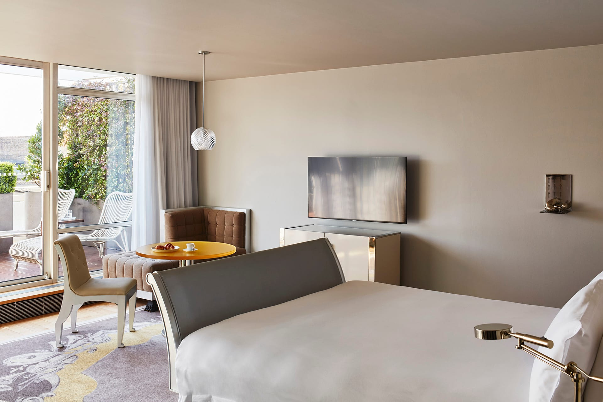

*A room at Sanderson London.*

**[Charlotte Street Hotel](hotel:charlotte-street-hotel)** is about £400 with a private screening room, on the restaurant street itself.

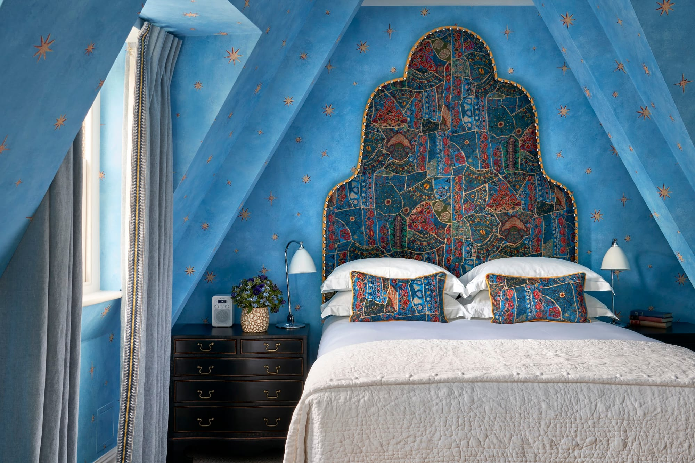

*A room at Charlotte Street Hotel.*

### King's Cross and St Pancras: for the train

*Pod from £50 · about £95–£350 · Zone 1 · King's Cross St Pancras · [hotel guide](/articles/where-to-stay-kings-cross/) · [area guide](/articles/kings-cross-area-guide/)*

Most people staying here are here for a train. The Eurostar leaves from St Pancras, six Tube lines meet beneath the two stations, and the East Coast Main Line, Thameslink to Gatwick and the Luton train all start here. For an early departure the Tube is no help: the first southbound Victoria line train from King's Cross is 05:29 on a weekday, and on a Sunday the first Northern line train is 07:23.

**The hotels are on the Euston Road side of the stations, and the part of King's Cross people visit is on the other side**: Granary Square, Coal Drops Yard and Gasholder Park, about ten minutes north of the concourse. Hotels on Euston Road face the busiest road in the area, so ask for a room at the back. **There is no Elizabeth line here**; Farringdon, one stop east, is the fix.

St Pancras London is the only hotel inside the terminus, at about £350. The Megaro is about £180, two minutes from the platform, and Point A is about £95. Kabannas, the former YHA St Pancras, starts at £50 for a pod. For cheaper rooms, Bloomsbury is ten minutes' walk south: **[Generator London](hotel:generator-london)** is about £26 a bed and **[Zedwell Tottenham Court Road](hotel:zedwell-tottenham-court-road)** is £81 to £206 for a windowless private room. **[Treehouse Hotel London](hotel:treehouse-hotel-london)**, about £250, has top-floor views and the Victoria line, three stops down.

### Paddington: 15 minutes from Heathrow

*Singles from £69 · about £150–£200 · Zone 1 · Paddington · [hotel guide](/articles/where-to-stay-paddington/) · [area guide](/articles/paddington-area-guide/)*

**Heathrow Express is 15 minutes non-stop to Paddington**, £26 walk-up or from £10 booked 30 or more days ahead, and the first one leaves at 04:34 Monday to Saturday. The Elizabeth line does the same trip in 28 minutes for £14.60, which counts towards your daily fare cap where the Express does not. Our [Heathrow transport guide](/articles/heathrow-airport-to-london/) has the full comparison.

**The area itself is transport and canal rather than a night out**, which is why it suits a first-night and last-night base, not a week-long one. A 2am return here is a night bus, or the Central line from Lancaster Gate, about nine minutes' walk south.

**[Norfolk Towers Paddington](hotelscom:h27024)** sells 4.5-square-metre singles from £69. **[The Pilgrm](hotel:the-pilgrm)** is about £150 and under three minutes' walk from the station, so a 6am departure starts with a short walk. **[Hilton London Paddington](hotel:hilton-london-paddington)** is about £200 and is the original Great Western Royal Hotel of 1854, built into the station: you walk from platform to lobby without going outside.

### Westminster and Victoria: Gatwick, the coach station and the sights

*Dorms from £18 · about £140–£900 · Zone 1 · Victoria, Westminster and St James's Park · [hotel guide](/articles/where-to-stay-westminster/) · [area guide](/articles/westminster-area-guide/)*

Four districts share the SW1 postcode: Westminster and Whitehall, with the Abbey, Parliament and the Churchill War Rooms on the doorstep; St James's, with the old-fashioned five-star hotels; Victoria, the railway and coach terminus; and Pimlico, south of Victoria, where the small cheaper hotels are, several with no lift. They share quiet evenings: Whitehall and the streets round St James's Park are government offices, empty after work and at weekends, which helps you sleep and doesn't help you find dinner.

Gatwick Express and Southern trains from Gatwick end at Victoria, Victoria Coach Station is about five minutes' walk down Buckingham Palace Road, and Buckingham Palace is about ten minutes north. **[The Clermont](hotelscom:h10939)** opened in 1862 beside the station, so the Gatwick train is a short walk from reception. **[Astor Victoria](hotel:astor-victoria)** has dorms from £18 for guests aged 18 to 39. **[St Ermin's](hotel:st-ermins-hotel)** is about £220 and 100 metres from St James's Park station, for the sights on foot.

### Mayfair: expensive, central, and one train from everywhere

*£90–£207 for the Zedwell · grand hotels about £600–£850 · Zone 1 · Green Park and Bond Street · [hotel guide](/articles/where-to-stay-mayfair/) · [area guide](/articles/mayfair-area-guide/)*

**Green Park is served by the Piccadilly, Victoria and Jubilee lines**, so Heathrow, Victoria, King's Cross and Canary Wharf are all one train. Bond Street adds the Central, the Jubilee and the Elizabeth line, which runs to Heathrow in about 35 minutes without a change. All three of Green Park's lines run on Friday and Saturday nights as well, so late evenings are easy from here.

**It is expensive and it does not really have an evening**: Mayfair's restaurants are destinations rather than a scene and the streets are empty by eleven. That is a virtue if you are here to sleep between a late arrival and an early flight.

**[Zedwell Park Lane](hotel:zedwell-park-lane)** is the anomaly: £90 to £207 for a windowless underground Cocoon 2 with a Park Lane address, seven minutes from Marble Arch, within a pound of Knightsbridge on a quiet night and about £50 under it on an October Saturday.

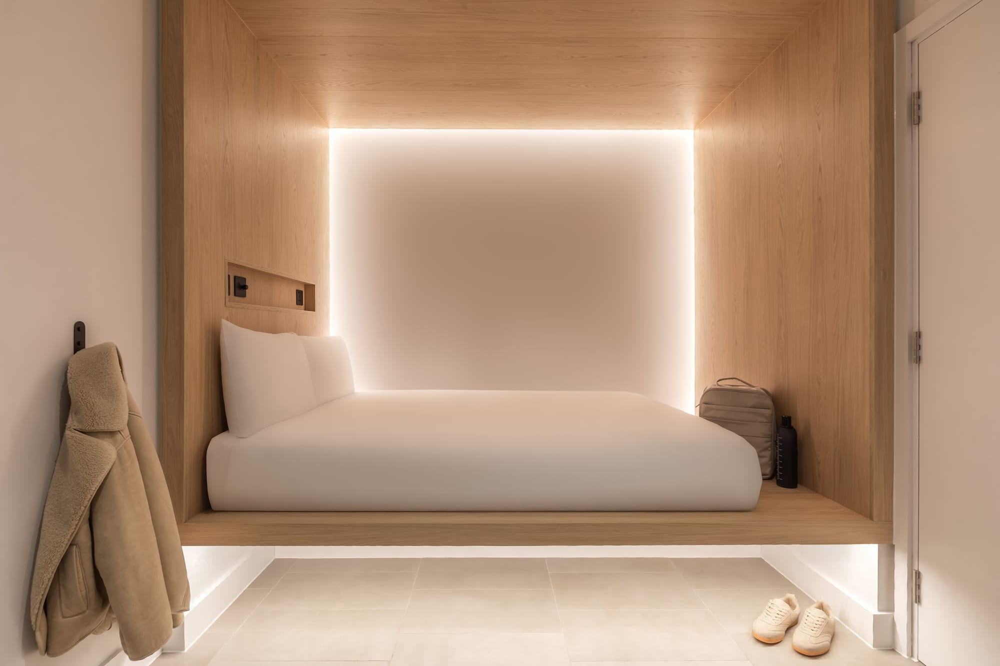

*A room at Zedwell Park Lane.*

**[Native Mayfair](hotel:native-mayfair)** does apartments with kitchens on a mews off Grosvenor Square, under ten minutes from Bond Street.

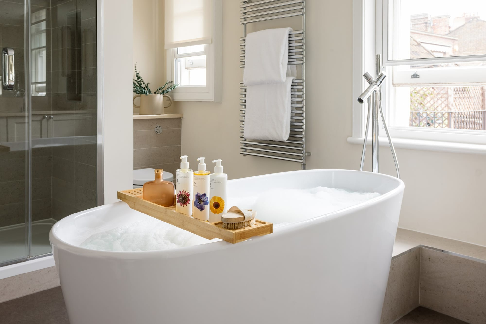

*A bathroom at Native Mayfair.*

At the top, a double at The Connaught, Claridge's, The Dorchester or Brown's runs about £650 to £850; **[The Dorchester](hotel:the-dorchester)** is on Park Lane, facing the park.

---

Powered by <a target="_blank" rel="sponsored" href="https://www.getyourguide.com/london-l57/">GetYourGuide</a>

## The mistakes people make choosing a base

**Booking Zone 3 to save £20 a night.** The daily fare cap is £10.50 for Zones 1–3 against £8.90 for Zones 1–2, a difference of £1.60 a person a day. What you are buying is twenty to twenty-five minutes each way, and on a sightseeing trip you make that journey two or three times a day because you come back to change or drop bags. Four days of that is most of a day underground. **Take a smaller room in Zone 1 instead**: a capsule, a windowless room or a compact-format hotel. Our [pod hotels guide](/articles/pod-hotels-london/) and [windowless rooms guide](/articles/windowless-hotel-rooms-london/) cover both, and both start under £70 a night in the West End.

**Booking where the sightseeing is.** Westminster has the Abbey and Parliament and almost nothing open in the evening. Soho is where London goes out, and one of the hardest places in it to sleep. Decide the two separately, then use [the visiting guide](/articles/best-areas-to-visit-london/) for the daytime half.

**Booking the cheapest room grade without reading what it is.** Both Z Hotels here lead with a windowless "Inside" rate. art'otel Hoxton charges about £56 for breakfast on top of a £230 room. Zedwell cleans every four days rather than daily and charges £15 a piece for luggage storage. All of them are decided at the booking page and none is in the headline.

## And if you are staying more than four nights

Beyond about the third or fourth night a kitchen starts to pay for itself, mostly through breakfast, and [London's aparthotels](/articles/aparthotels-london/) are the format for that. Locke, Native and Staycity all have addresses in the areas above, and **nobody cleans your room daily**; weekly is the standard across every operator.

If you are not staying the night at all (a long layover, an evening flight, a bag and a shower), a [day room](/articles/day-rooms-london/) is cheaper than any of this. If the dog is coming, [our dog-friendly hotels guide](/articles/dog-friendly-hotels-london/) compares hotels on the fee, the weight limit and the walk to the nearest park. If you want a swim, [London hotels with a pool](/articles/hotels-with-pool-london/) gives each pool's length, whether guests swim free and when children are allowed in; the rooftop ones are in Knightsbridge, Battersea and Shoreditch, and The Berkeley's opens in spring and summer only. For hostel beds, see [London hostels compared](/articles/best-hostels-london/).

*Room rates are from our own sampling on Hotels.com and each operator's own site, current at 7 September 2026; rates change nightly, so always check your own dates. Tube journey times are from Transport for London's Journey Planner for a weekday morning, 18 October 2026. First and last Tube times are from Transport for London's own working timetables, and the Night Tube lines, night bus fares and the Hopper fare from tfl.gov.uk, all checked on 9 September 2026. Eurostar check-in times from eurostar.com, 8 September 2026.*
