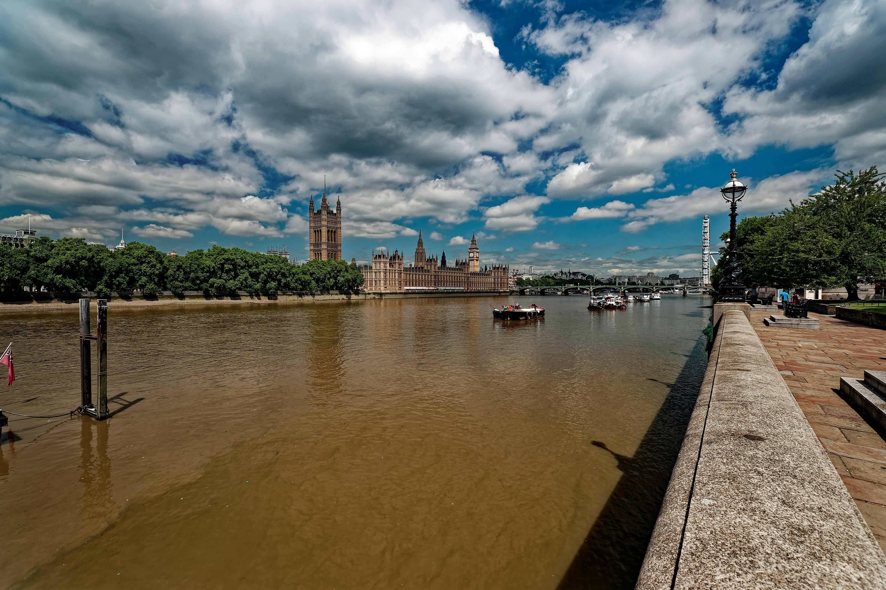
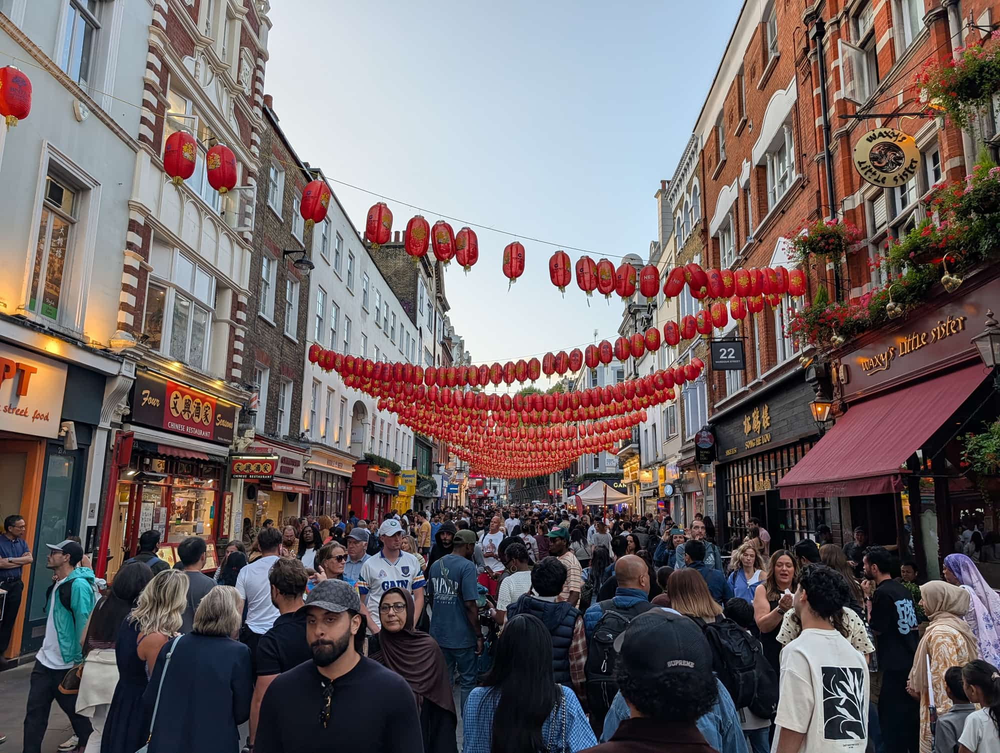
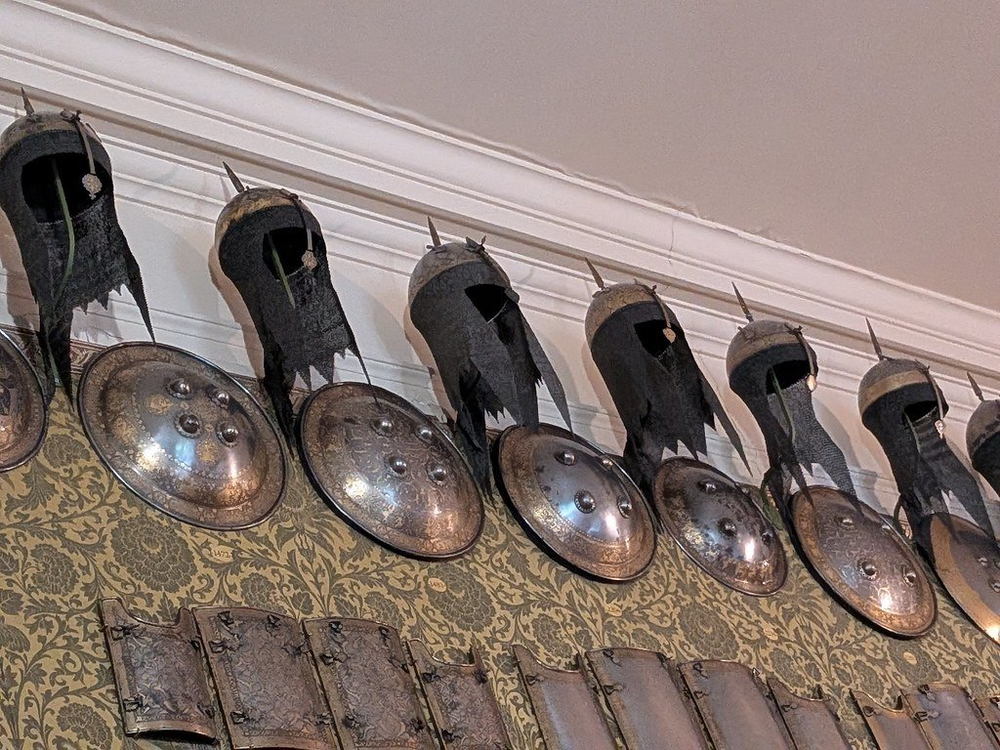
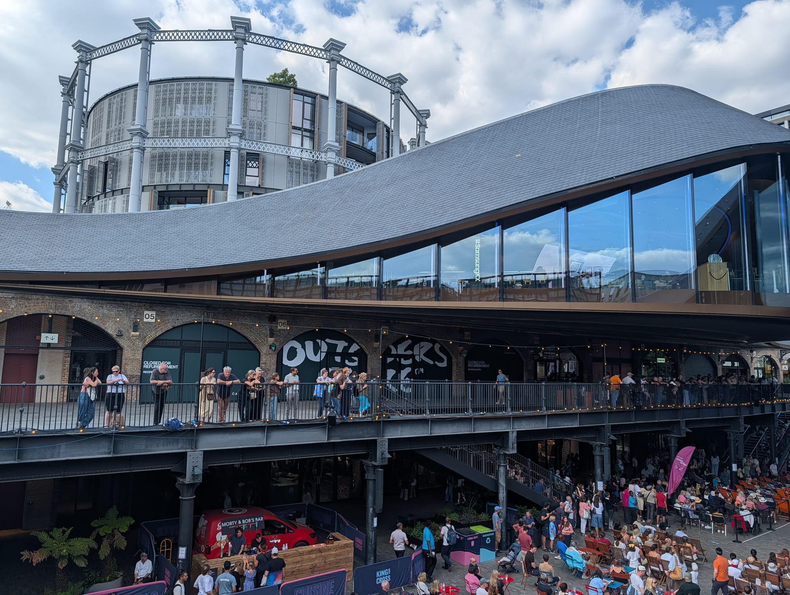
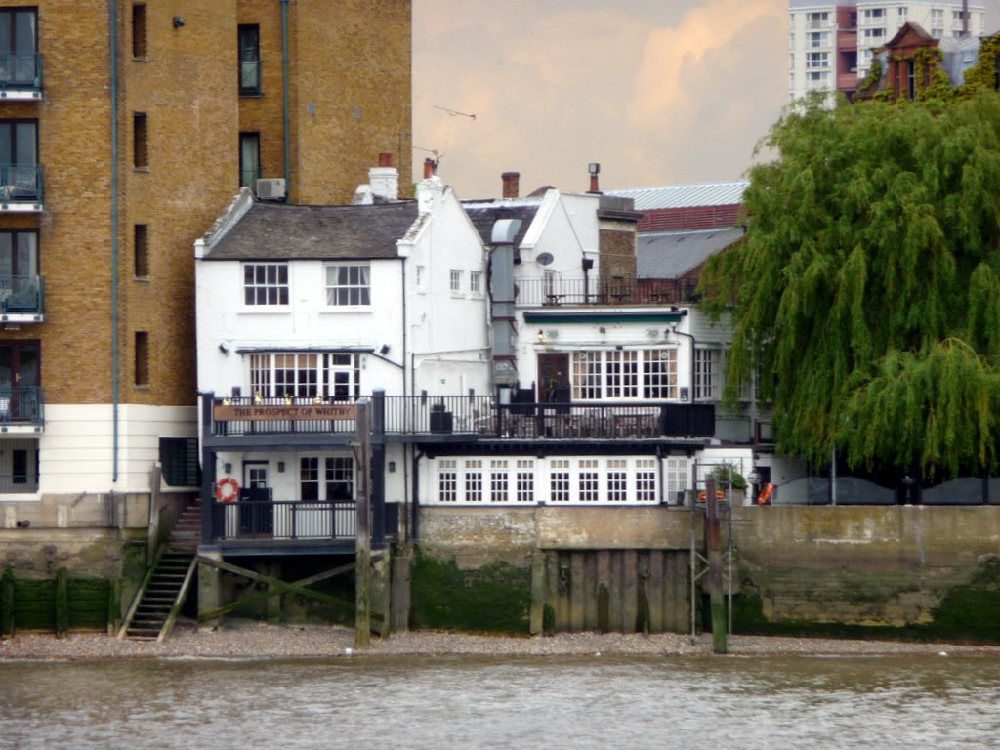
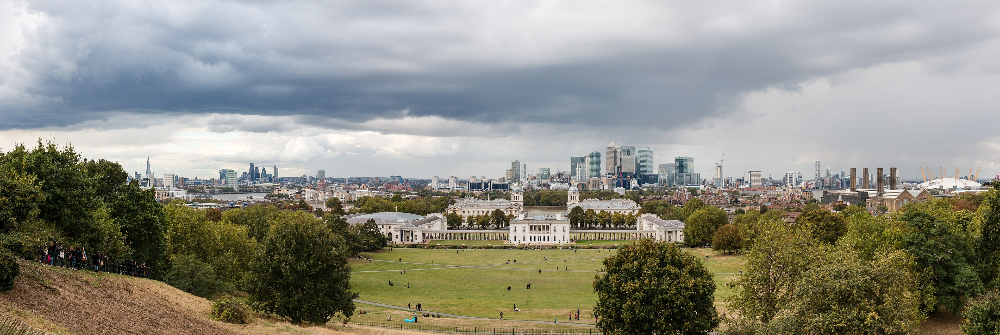

> 💡 **The Short Version.**
> A first visit comes down to five areas.
> - **[Westminster](#westminster):** Big Ben, the Abbey and Whitehall, all within a 15-minute walk. Come early, before the pavements fill.
> - **[South Bank](#south-bank):** a flat riverside walk from the London Eye to Tower Bridge, with Tate Modern (free) and Borough Market on the way.
> - **[City of London](#city-of-london):** St Paul's, the Tower and Tower Bridge, plus free skyline views. Go on a weekday; it empties at weekends.
> - **[Covent Garden](#covent-garden):** the piazza, street performers and the West End theatres. Weekday mornings are calm.
> - **[South Kensington](#south-kensington):** the Natural History Museum, the V&A and the Science Museum, all free and 400 metres apart. Arrive at 10:00.

London is a set of neighbourhoods that are each walkable end to end and a short Tube ride or a longer walk apart. Which ones suit a trip depends on what you want to do, how long you have, and the day of the week: Columbia Road Flower Market runs on Sundays only, Borough Market is closed on Mondays and Portobello Road is at its fullest on Saturdays.

## The areas compared

| Area | Best for | Time to allow | Nearest station | What it's like |
| --- | --- | --- | --- | --- |
| **[Westminster](/articles/westminster-area-guide/)** | Sights | Half a day; a full day with the Abbey and War Rooms | Westminster | Parliament, the Abbey, Whitehall and St James's Park within a 15-minute walk; crowded all day and quiet after the offices close |
| **[South Bank](/articles/south-bank-area-guide/)** | Sights, food, markets, wet weather | Half a day | Waterloo | A flat riverside path from the London Eye to Tower Bridge, past Tate Modern, Shakespeare's Globe and Borough Market |
| **[City of London](/articles/city-of-london-area-guide/)** | Sights, views | A full day with the Tower and St Paul's | St Paul's or Bank | Roman street plan, Wren churches and glass towers; a crush on weekdays and nearly empty at weekends |
| **[Covent Garden](/articles/covent-garden-area-guide/)** | Theatre, shopping, families | Half a day | Leicester Square | A cobbled piazza with licensed street performers, surrounded by West End theatres; very busy on Saturday afternoons |
| **[Soho](/articles/soho-area-guide/)** | Food, nightlife | An evening, or half a day with Chinatown | Tottenham Court Road | A working media district by day; restaurants, bars and Chinatown fill from about 18:00, and there are no major sights |
| **[South Kensington](/articles/south-kensington-area-guide/)** | Families, museums | A full day for two museums | South Kensington | A Victorian museum quarter with three free museums and the Royal Albert Hall; quiet after about 20:00 |
| **[Bloomsbury](/articles/bloomsbury-area-guide/)** | Museums, quiet streets | Half a day; a full day with the British Museum | Russell Square | Georgian garden squares, bookshops and the British Museum; largely closes after office and university hours |
| **[Mayfair](/articles/mayfair-area-guide/)** | Galleries, shopping | Half a day | Green Park | A Georgian grid with free Victorian arcades and commercial galleries; expensive, and quiet in the evening |
| **[Marylebone](/articles/marylebone-area-guide/)** | Shopping, free art | Half a day | Baker Street or Bond Street | A village high street four minutes north of Oxford Street, with the free Wallace Collection and Regent's Park behind |
| **[Kensington](/articles/kensington-area-guide/)** | Parks | Half a day | High Street Kensington | A palace, Kensington Gardens and Holland Park's Kyoto Garden, mostly free and unhurried |
| **[Notting Hill](/articles/notting-hill-area-guide/)** | Markets, antiques | Half a day; a full day on a Saturday | Notting Hill Gate | Pastel terraces and a market over a mile long, at its fullest on Saturday |
| **[Camden](/articles/camden-area-guide/)** | Markets, live music, street food | Half a day | Chalk Farm or Camden Town | Loud and dense, with canalside street food, vintage stalls and the Roundhouse |
| **[King's Cross](/articles/kings-cross-area-guide/)** | Families, canal walks | Half a day | King's Cross St Pancras | Rebuilt railway land with fountains, a canal and the British Library's free Treasures Gallery |
| **[Hampstead](/articles/hampstead-area-guide/)** | Parks, views | A full day | Hampstead or Hampstead Heath (Overground) | A hilltop village with Georgian lanes and 800 acres of heath behind it |
| **[Shoreditch](/articles/shoreditch-area-guide/)** | Markets, nightlife, street art | Half a day, or a full Sunday | Liverpool Street or Shoreditch High Street (Overground) | Warehouses, painted walls and markets that mostly run at the weekend |
| **[Hackney](/articles/hackney-area-guide/)** | Markets, parks, canals | Half a day | London Fields (Overground) | Residential London with a Saturday market, a lido and no Tube station |
| **[Wapping](/articles/wapping-area-guide/)** | Quiet river walks, historic pubs | Two to three hours | Wapping (Overground) | Cobbled warehouse streets and old river pubs, quiet almost all the time |
| **[Bermondsey](/articles/bermondsey-area-guide/)** | Food, markets, breweries | Half a day | London Bridge | Railway arches, warehouse conversions and a weekend food market |
| **[Greenwich](/articles/greenwich-area-guide/)** | Sights, parks, families | A full day | Cutty Sark (DLR) | A maritime village below a hill with a park, a market and a view across to Canary Wharf |
| **[Richmond](/articles/richmond-area-guide/)** | Parks, wildlife | A full day | Richmond | A Georgian riverside town with a 2,500-acre deer park behind it |

Powered by <a target="_blank" rel="sponsored" href="https://www.getyourguide.com/london-l57/">GetYourGuide</a>

## Central London: the first visit

### Westminster

*Zone 1 · Westminster · half a day, or a full day with the Abbey and War Rooms · best before 09:00*

The Elizabeth Tower and the Palace of Westminster, Westminster Abbey, the Churchill War Rooms, Whitehall and Trafalgar Square are all within a 15-minute walk. Photograph the tower from the far end of Westminster Bridge: from the station side you cannot fit it in. St James's Park, with its pelicans, is the break between monuments.

It is crowded all day and quiet at night, when the offices empty and little replaces them. The Churchill War Rooms sell out their timed slots, so book before you travel. The guard changes at Buckingham Palace at 11am on Mondays, Wednesdays and Fridays.

*The Palace of Westminster, from the Albert Embankment. Photo: [Txllxt TxllxT](https://commons.wikimedia.org/wiki/File:London_-_Albert_Embankment_path_-_Lambeth_Palace_Road_-_South_Bank_-_Jubilee_Walkway_-_View_NNW_towards_Houses_of_Parliament,_Westminster_Bridge_%26_London_Eye.jpg), [CC BY-SA 4.0](https://creativecommons.org/licenses/by-sa/4.0/).*

Read the [Westminster area guide](/articles/westminster-area-guide/), or walk it with the [Westminster Bridge to Trafalgar Square route](/articles/westminster-walk/): eleven stops, 4km, two to three hours.

### South Bank

*Zone 1 · Waterloo, Southwark, London Bridge · half a day · Borough Market is closed on Mondays*

A flat, step-free riverside path runs from the London Eye past the Southbank Centre, the National Theatre, Tate Modern and Shakespeare's Globe to Borough Market, HMS Belfast and Tower Bridge. Tate Modern is free, open until 9pm on Fridays and Saturdays, and its tenth-floor viewing level costs nothing. A standing place at the Globe is £10.

The stretch between the Eye and the Southbank Centre is crowded from late morning every day; Bankside and Borough are calmer. Borough Market is open Tuesday to Friday 10am to 5pm, Saturday 9am to 5pm and Sunday 10am to 4pm, and closed on Mondays.

Read the [South Bank area guide](/articles/south-bank-area-guide/), or walk the [South Bank from Westminster to Tower Bridge](/articles/south-bank-walk/) or the inland [Bankside and Borough route](/articles/bankside-borough-walk/).

### City of London

*Zone 1 · St Paul's, Bank, Tower Hill · a full day with the Tower and St Paul's · weekdays for open pubs, Sunday morning for empty streets*

St Paul's (528 steps to the Golden Gallery; Evensong is free), the Tower of London, Tower Bridge (free to walk across), Leadenhall Market, a stretch of Roman wall beside Tower Hill station and the Temple of Mithras under Bloomberg's building (free, pre-booked). The roof terrace at One New Change gives a close view of St Paul's dome at no cost.

About half a million people work in the Square Mile and about 8,000 live in it. On a weekday it is a crush; on a Sunday morning the medieval lanes are silent and much of it is shut. The Bank of England Museum is free and opens on weekdays only.

*St Paul's, over Paternoster Square.*

Read the [City of London area guide](/articles/city-of-london-area-guide/), or walk [Bank to Tower Bridge](/articles/city-of-london-walk/) in eleven stops.

### Covent Garden

*Zone 1 · Leicester Square or Holborn · half a day · weekday mornings before 11am*

The cobbled Piazza and its market halls, licensed street performers, Seven Dials and Neal's Yard, the Royal Opera House (its terrace bar, Bar Cicoria, takes walk-ins from midday) and the London Transport Museum. The area is the West End theatre district, with a theatre on almost every corner.

On a Saturday afternoon the Piazza is close to impassable. Skip Covent Garden station, which has lifts and stairs only; Leicester Square, four minutes away, is quicker.

Read the [Covent Garden area guide](/articles/covent-garden-area-guide/), or walk [Leicester Square to Somerset House](/articles/covent-garden-walk/) in eleven stops.

### Soho

*Zone 1 · Tottenham Court Road · an evening, or half a day with Chinatown · Thursday to Saturday evenings*

One square kilometre of restaurants, bars, theatres and Chinatown, where Gerrard Street's windows hang with roast meats. Berwick Street market has traded since the 1770s (Monday to Saturday, 8am to 6pm), Kingly Court is three floors of independent restaurants around a covered courtyard, and Ronnie Scott's jazz club is on Frith Street.

There is no museum or monument here. By day it is a media district with good coffee; from about 18:00 the bars and restaurants fill. Book Dean Street and Frith Street restaurants for the evening, and reach Chinatown for dim sum before about 4pm, when the kitchens stop.

*The Chinatown stretch of Wardour Street.*

Read the [Soho area guide](/articles/soho-area-guide/), or walk [Tin Pan Alley to Gerrard Street](/articles/soho-chinatown-walk/) in eleven stops.

### South Kensington

*Zone 1 · South Kensington · a full day for two museums · weekday mornings at 10:00*

The Natural History Museum (with Hope, the blue whale skeleton, in Hintze Hall), the V&A and the Science Museum are within 400 metres of each other. All three are free; special exhibitions and the Science Museum's Wonderlab are ticketed. The Royal Albert Hall is at the top of Exhibition Road, with Kensington Gardens opposite.

Two museums fill a day; three in a morning means corridors. Book the free timed entry to skip the weekend queue, and use the Museum Subway from inside the station: it is dry and comes up beside the museums. The area is quiet after about 20:00.

Read the [South Kensington area guide](/articles/south-kensington-area-guide/).

## Central London: calmer streets

### Bloomsbury

*Zone 1 · Russell Square · half a day, or a full day with the British Museum · weekdays*

The [British Museum](/articles/british-museum-guide/) is free and open daily 10.00 to 17.00, until 20.30 on Fridays. Around it are the glazed Great Court, the garden squares (Gordon and Tavistock are the quietest), the Charles Dickens Museum on Doughty Street and the independent shops of Lamb's Conduit Street.

Most visitors leave straight after the museum, so the squares three minutes north are almost empty. Bloomsbury largely closes after office and university hours; eat in Soho or Covent Garden. The Montague Place entrance at the back of the museum usually has no queue.

*The Great Court roof. Photo: [rbrwr](https://www.flickr.com/photos/38411862@N00/467099756), [CC BY-SA 2.0](https://creativecommons.org/licenses/by-sa/2.0/).*

Read the [Bloomsbury area guide](/articles/bloomsbury-area-guide/).

### Mayfair

*Zone 1 · Green Park · half a day · Tuesday to Friday; the Royal Academy is shut on Mondays*

Burlington Arcade opened in 1819 and is still patrolled by uniformed Beadles who enforce its rules: no running, whistling, singing or opening umbrellas. The Royal Academy's courtyard, the commercial galleries on Cork Street and the other Victorian arcades are free to walk into, and Shepherd Market has pubs with pavement tables.

It is a Georgian grid laid out from the 1720s, and the prices show on every menu. After dark most of it is offices and embassies. The Royal Academy is closed on Mondays and open until 9pm on Fridays and Saturdays; the galleries mostly close on Sundays.

Read the [Mayfair area guide](/articles/mayfair-area-guide/), or walk [Fitzrovia to Mayfair](/articles/fitzrovia-mayfair-walk/) in eleven stops.

### Marylebone

*Zone 1 · Baker Street or Bond Street · half a day · Sunday for the farmers' market, 10:00 to 14:00*

Marylebone High Street has independent shops and delis, and Daunt Books shelves its main room by country. The Wallace Collection, in a Manchester Square townhouse, is free and open daily 10.00 to 17.00, with Old Masters and a large armour collection. Regent's Park is ten minutes north. Marylebone Lane curves because it follows the course of the buried River Tyburn.

It is a village street four minutes north of Oxford Street, and most of it shuts by early evening. Baker Street, with 221B and Madame Tussauds, is the busiest and least pleasant part.

*The Wallace Collection's armoury. Photo: [gruntzooki](https://www.flickr.com/photos/37996580417@N01/55292433963), [Public Domain Mark](https://creativecommons.org/publicdomain/mark/1.0/).*

Read the [Marylebone area guide](/articles/marylebone-area-guide/), or walk [Baker Street through Regent's Park to Marylebone](/articles/regents-park-marylebone-walk/) in eleven stops.

### Kensington

*Zone 1–2 · High Street Kensington · half a day · first thing in the morning*

Kensington Gardens (265 acres) hold Kensington Palace, the Sunken Garden, the Albert Memorial and the two Serpentine galleries. Holland Park has the Kyoto Garden, with a waterfall, koi and peacocks. The Design Museum's permanent gallery is free, and Leighton House has an Arab Hall lined with tiles from Damascus.

The palace is ticketed; the gardens around it are free. Both parks close at dusk. The Kyoto Garden is small and busy from mid-morning, so allow 20 minutes and go early. Kensington adjoins South Kensington and covers similar ground, so give each its own half day.

Read the [Kensington area guide](/articles/kensington-area-guide/).

## North and west: markets, canals and the Heath

### Notting Hill

*Zone 1–2 · Notting Hill Gate · half a day, or a full day on a Saturday · Saturday for the full market*

Portobello Road Market runs for more than a mile: antiques arcades at the southern end (Friday and Saturday), then fruit and veg, then vintage stalls under the Westway flyover. The pastel terraces are not on Portobello Road. Hillgate Village, four minutes from Notting Hill Gate, has the strongest colour and few visitors; Lancaster Road is the closest to the market.

The market does not run on Sundays. The houses are people's homes, so photograph from the pavement. Over the August bank holiday weekend Carnival takes over the area, shops board up and nearby stations go exit-only or close.

*Portobello Road, below the Union Jack frontage.*

Read the [Notting Hill area guide](/articles/notting-hill-area-guide/), or follow [the eleven streets that actually have the colourful houses](/articles/notting-hill-colourful-houses/).

### Camden

*Zone 2 · Chalk Farm or Camden Town · half a day · weekday mornings*

Camden Market is open daily from 10am to 7pm, bank holidays included. The Stables Market holds vintage dealers in a Victorian horse hospital, the lock has street food on canalside terraces, and the Roundhouse is a former engine shed that now stages concerts. The Regent's Canal towpath reaches King's Cross in about 30 minutes, and Primrose Hill, 15 minutes north-west, has a protected view of the skyline.

It is loud and dense. On a Sunday afternoon queues build even to get into Camden Town station, so arrive at Chalk Farm and walk south through the Stables to the lock.

Read the [Camden area guide](/articles/camden-area-guide/), or walk [the Regent's Canal from King's Cross to Camden](/articles/kings-cross-camden-canal-walk/) in ten stops.

### King's Cross

*Zone 1 · King's Cross St Pancras · half a day · summer afternoons for the fountains and the canal steps*

Coal Drops Yard sits under Thomas Heatherwick's kissing roofs, and Granary Square has more than a thousand fountains (switched off in winter) above the canal steps. St Pancras has Barlow's iron trainshed, Platform 9¾ is free to queue for and paid for the photo, and the British Library's free Treasures Gallery holds Magna Carta and the Lindisfarne Gospels.

This is rebuilt railway land, and almost nothing in it predates the 1850s. King's Cross and St Pancras are separate stations two minutes apart, so check which one your ticket names. Camley Street Natural Park, a two-acre nature reserve, shuts at 4pm from October to March.

*Coal Drops Yard's kissing-roof.*

Read the [King's Cross area guide](/articles/kings-cross-area-guide/), or walk [the canal to Camden](/articles/kings-cross-camden-canal-walk/) from the steps below Granary Square.

### Hampstead

*Zone 2–3 · Hampstead (Northern line) or Hampstead Heath (Overground) · a full day · a clear morning*

Hampstead Heath covers 800 acres. Parliament Hill has a legally protected view of the City skyline, Kenwood House is free and holds a Rembrandt self-portrait and a Vermeer, and the bathing ponds are open for swimming. The village has Georgian lanes such as Flask Walk and Church Row.

It is hilly and takes most of a day. Hampstead Heath station is the better start for Parliament Hill and the ponds; Hampstead station, about 58 metres down, is the deepest on the Underground and is reached by lift. The Heath is unlit, so be off it by dusk.

Read the [Hampstead area guide](/articles/hampstead-area-guide/), or walk [the Heath to Primrose Hill](/articles/hampstead-heath-primrose-hill-walk/): ten stops, about 9km, four to five hours.

## East London: markets and the river

### Shoreditch

*Zone 1 · Liverpool Street or Shoreditch High Street (Overground) · half a day, or a full Sunday · Sunday*

Columbia Road Flower Market runs on Sundays from 8am to about 3pm. Old Spitalfields Market trades daily under its Victorian roof, the Truman Brewery on Brick Lane holds several markets, and the Brick Lane Vintage Market, in a basement at 85 Brick Lane, is open seven days. Street art covers Hanbury Street and Chance Street.

From Monday to Wednesday most markets are shut and the area is quiet. On a Sunday, go to Columbia Road at 8am for room to move, or in the last hour for cut prices, then walk south through Brick Lane to Spitalfields.

*Brick Lane, under the railway bridge.*

Read the [Shoreditch area guide](/articles/shoreditch-area-guide/), or walk [Columbia Road to Petticoat Lane](/articles/shoreditch-spitalfields-walk/) in eleven stops.

### Hackney

*Zone 2 · London Fields (Overground) · half a day · Saturday before 11:00*

Broadway Market runs on Saturdays from 9am to 5pm, with a smaller market on Sundays from 10am to 4pm. London Fields Lido is a heated 50-metre outdoor pool, open all year; book a session. From the bottom of Broadway Market the Regent's Canal towpath leads east to Victoria Park and Hackney Wick's canal-side breweries.

This is residential London: no Tube station, no major museum and nothing to tick off. Use the Overground. Saturday morning is the busy time for the market; midweek, the park and the lido are quiet.

Read the [Hackney area guide](/articles/hackney-area-guide/), and see [the best canal walks in London](/articles/best-canal-walks-london/) for the towpath east.

### Wapping

*Zone 2 · Wapping (Overground) · two to three hours · any day; Saturday for the market on Shadwell Basin*

Wapping High Street is a cobbled run of warehouses with their hoist beams still bolted on. The Prospect of Whitby and the Town of Ramsgate are riverside pubs with terraces, and Wapping Old Stairs leads down to the foreshore at low tide. St Katharine Docks is 15 minutes west.

There are almost no shops, no museum, and little open on a Sunday, so bring what you need. It is quiet almost all the time and works best as a river walk and a pub, combined with the Tower or Bermondsey.

*The Prospect of Whitby. Photo: [Christine Matthews](https://commons.wikimedia.org/w/index.php?curid=174127501), [CC BY-SA 2.0](https://creativecommons.org/licenses/by-sa/2.0/).*

Read the [Wapping area guide](/articles/wapping-area-guide/), or walk [four riverside pubs from Wapping to Canary Wharf](/articles/wapping-canary-wharf-walk/): eleven stops, 6km.

### Bermondsey

*Zone 1–2 · London Bridge · half a day · Saturday before midday*

Maltby Street Market fills the railway arches on Ropewalk on Fridays from 5.30pm to 9pm, Saturdays 10am to 5pm and Sundays 11am to 4pm. White Cube on Bermondsey Street is free, Shad Thames has its iron gantries over a brick canyon, and the Beer Mile's taprooms mostly open on Saturdays. The Friday antiques market in Bermondsey Square runs from 6am to 2pm.

From Monday to Thursday Ropewalk is shuttered arches and most breweries are closed production sites. Ropewalk is one alley wide and stops moving by lunchtime on a Saturday. Borough Market is ten minutes west, and the [Bankside and Borough walk](/articles/bankside-borough-walk/) starts at London Bridge.

Read the [Bermondsey area guide](/articles/bermondsey-area-guide/).

## Further out: a full day

### Greenwich

*Zone 2–3 · Cutty Sark (DLR) · a full day · arrive by boat*

The Cutty Sark and the Painted Hall are ticketed. The National Maritime Museum and the Queen's House are free, Greenwich Market trades daily, and the Greenwich Foot Tunnel runs under the Thames to Island Gardens. The view from Observatory Hill over the Old Royal Naval College to Canary Wharf is free.

The Royal Observatory and the Prime Meridian line close on 2 November 2026 for refurbishment; Royal Museums Greenwich says the Meridian Courtyard reopens in summer 2027. The hill view stays free. North Greenwich, the stop for The O2, is two miles away and a different place: for the sights, use Cutty Sark. By Uber Boat, Greenwich is about 25 minutes from Tower Bridge.

*The view from Greenwich Park.*

Read the [Greenwich area guide](/articles/greenwich-area-guide/), or walk in from the north with [Canary Wharf to Greenwich](/articles/canary-wharf-greenwich-walk/): eleven stops, 6.5km, with the foot tunnel at stop six.

### Richmond

*Zone 4 · Richmond (District line, Overground, rail from Waterloo) · a full day · late April to May for the Isabella Plantation*

Richmond Park covers 2,500 acres and has around 600 deer. King Henry's Mound has a protected sightline to St Paul's, ten miles away, and the view from Richmond Hill is protected by its own Act of Parliament. The Thames Path runs south to Ham House, and Richmond Green is ringed by Georgian houses.

Richmond is in Zone 4, about 30 minutes from Earl's Court on the District line, so it takes most of a day. Keep 50 metres from the deer, and more in the autumn rut. The 371 and 65 buses save the climb from the town to Richmond Gate.

Read the [Richmond area guide](/articles/richmond-area-guide/).

## More neighbourhoods with their own guides

- **[Chelsea](/articles/chelsea-area-guide/):** the Physic Garden, Cheyne Walk and the pastel streets off the King's Road. Walk it with [Belgravia](/articles/belgravia-area-guide/) on the [blue plaque route](/articles/chelsea-belgravia-plaques-walk/).
- **[Fitzrovia](/articles/fitzrovia-area-guide/):** Charlotte Street's restaurants, a short walk from the British Museum.
- **[Islington](/articles/islington-area-guide/):** Upper Street's restaurants, the Almeida Theatre, Union Chapel and the Camden Passage antiques market on Wednesdays and Saturdays.
- **[Peckham](/articles/peckham-area-guide/):** Rye Lane's grocers and market stalls, with rooftop bars above a car park.
- **[Canary Wharf](/articles/canary-wharf-area-guide/):** a free roof garden on top of the Elizabeth line station and the free London Museum Docklands.
- **[Stratford](/articles/stratford-area-guide/):** the Queen Elizabeth Olympic Park and the Olympic pool, open for public swimming.
- **[Battersea](/articles/battersea-area-guide/):** the Power Station's turbine halls (free to walk into) and Battersea Park.
- **[Paddington](/articles/paddington-area-guide/):** Little Venice and the canal boat to Camden.

## By interest

### First visit

- [Westminster](#westminster): the landmarks.
- [South Bank](#south-bank): the river walk.
- [City of London](#city-of-london): St Paul's and the Tower.
- [Covent Garden](#covent-garden): theatre and street performers.
- [South Kensington](#south-kensington) or [Bloomsbury](#bloomsbury): free museums.

For a plan by days, see the [three-day](/articles/three-days-in-london-itinerary/) and [five-day](/articles/five-days-in-london-itinerary/) itineraries and [one-day itineraries by interest](/articles/one-day-london-itineraries-by-interest/).

### With children

- [South Kensington](#south-kensington): three free museums.
- [King's Cross](#kings-cross): Granary Square's fountains and Platform 9¾.
- [Greenwich](#greenwich): the Cutty Sark and the free Maritime Museum.
- [Kensington](#kensington): the Diana Memorial Playground in Kensington Gardens.
- [Covent Garden](#covent-garden): street performers and the London Transport Museum.

More in [London with children](/articles/london-with-children/).

### Food and markets

- [South Bank](#south-bank): Borough Market, closed Mondays.
- [Bermondsey](#bermondsey): Maltby Street Market at weekends.
- [Shoreditch](#shoreditch): Columbia Road on Sundays, Old Spitalfields daily.
- [Hackney](#hackney): Broadway Market on Saturdays.
- [Camden](#camden): market and street food daily.
- [Notting Hill](#notting-hill): Portobello Road on Saturdays.
- [Soho](#soho): Chinatown and Berwick Street.

Market days for the whole city are in [London's best markets](/articles/best-london-markets/).

### Nightlife

- [Soho](#soho): bars, restaurants and jazz.
- [Shoreditch](#shoreditch): bars around Old Street and Hoxton Square.
- [Camden](#camden): live music at the Roundhouse and the Dublin Castle.
- [Covent Garden](#covent-garden): theatres and pre-theatre dining.
- [Islington](/articles/islington-area-guide/) and [Peckham](/articles/peckham-area-guide/): theatres and rooftop bars away from the centre.

### Parks and views

- [Hampstead](#hampstead): Parliament Hill and Kenwood.
- [Richmond](#richmond): Richmond Park and Richmond Hill.
- [Greenwich](#greenwich): the view from Observatory Hill.
- [Kensington](#kensington): Kensington Gardens and Holland Park.
- [Westminster](#westminster): St James's Park.
- [Camden](#camden): Primrose Hill.
- [City of London](#city-of-london): free skyline viewpoints at One New Change and, with booking, the Sky Garden.

More in [the best parks and gardens](/articles/best-parks-gardens-london/) and [the best views in London](/articles/best-views-london/).

### Away from the crowds

- [Bloomsbury](#bloomsbury): garden squares three minutes from the British Museum.
- [Marylebone](#marylebone): a village high street, and the Wallace Collection.
- [Wapping](#wapping): cobbled lanes and river pubs.
- [Kensington](#kensington): Holland Park first thing.
- [City of London](#city-of-london): empty on a Sunday morning.
- [Belgravia](/articles/belgravia-area-guide/) and [Fitzrovia](/articles/fitzrovia-area-guide/): quiet streets that visitors pass through.

## Plan the rest of the trip

- [Best areas to stay in London](/articles/best-areas-to-stay-in-london/): which neighbourhood to sleep in.
- [Best walking tours in London](/articles/best-walking-tours-london/) and [walks along the Thames](/articles/london-walks-along-the-thames/).
- [London in the rain](/articles/london-in-the-rain/): where to go when the forecast is wet.
- [London's blue plaques](/articles/london-blue-plaques/) and the [plaques map](/plaques/).
- [Getting around London](/articles/getting-around-london-transport-guide/).

