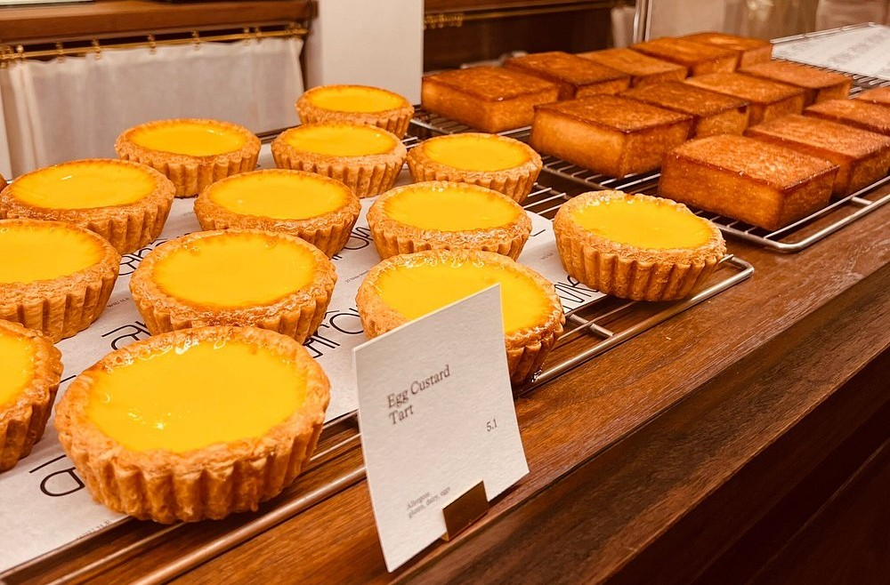
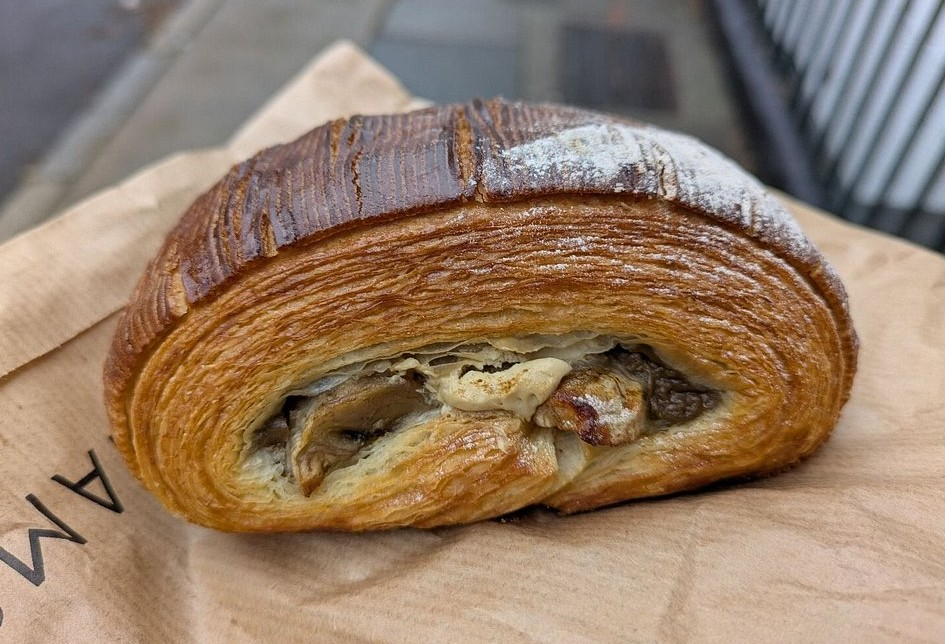
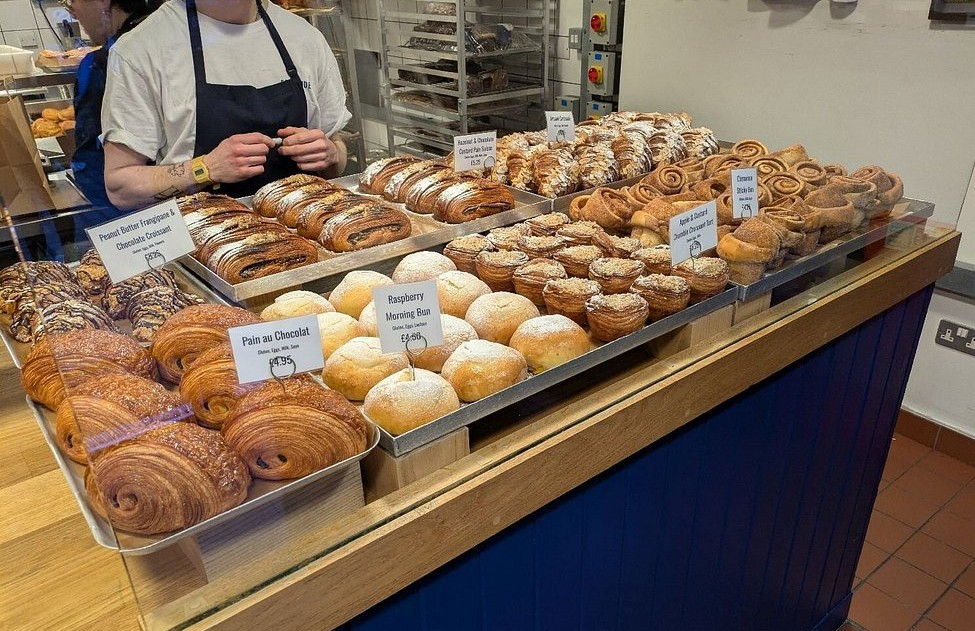
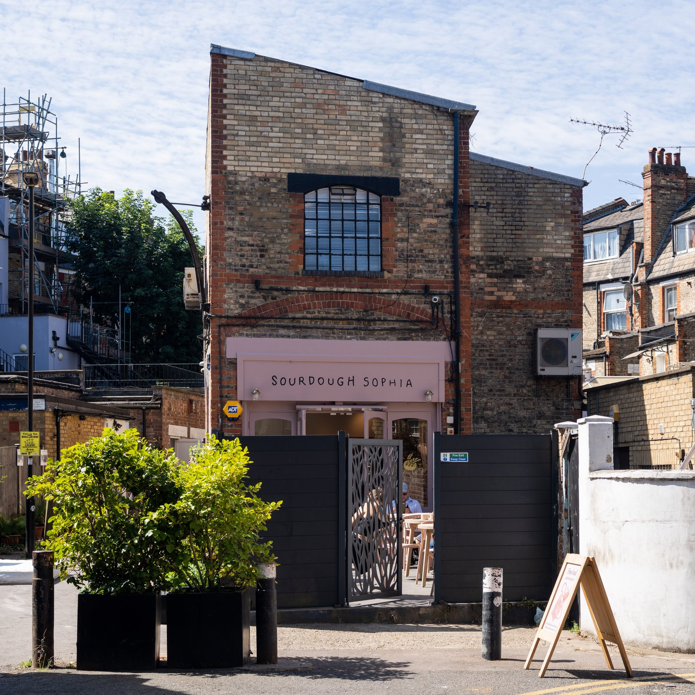
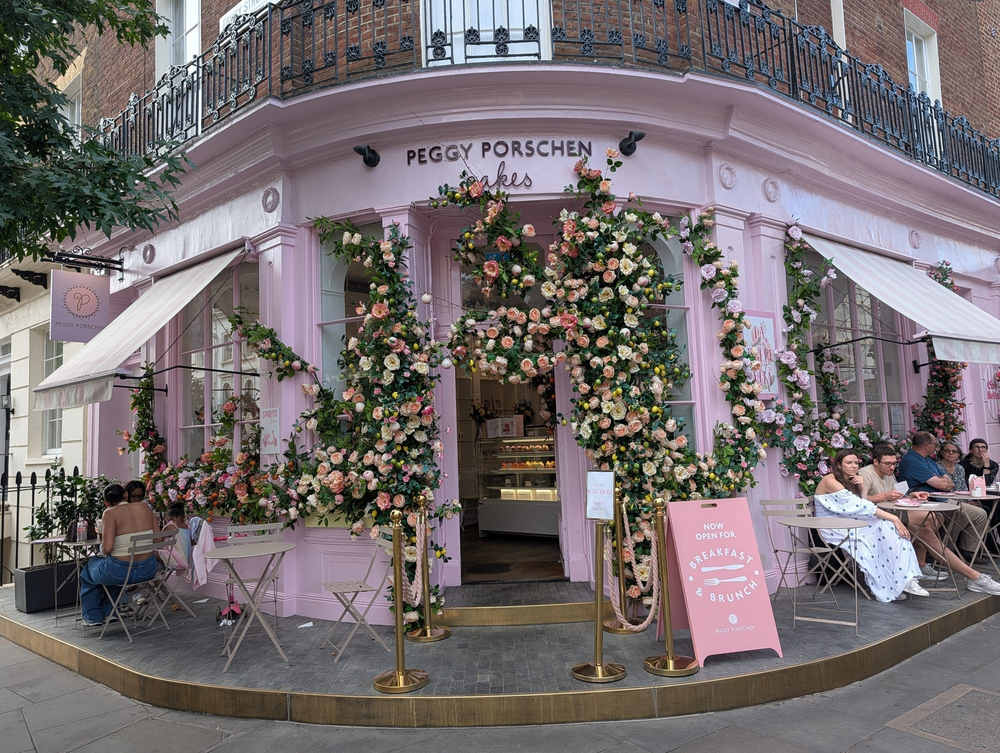
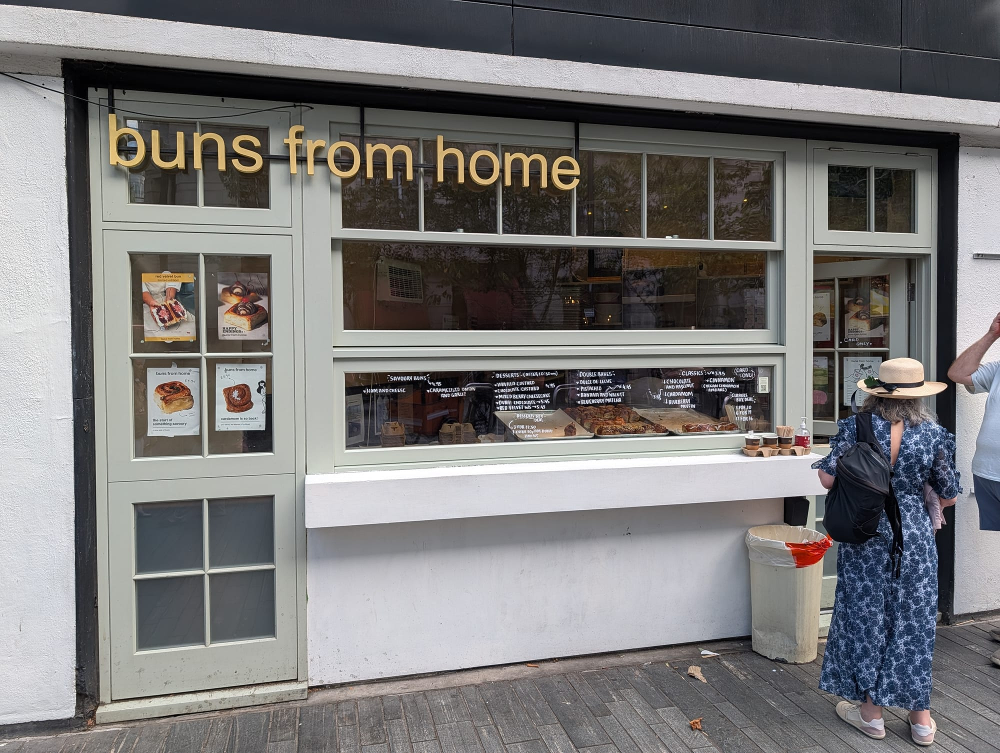
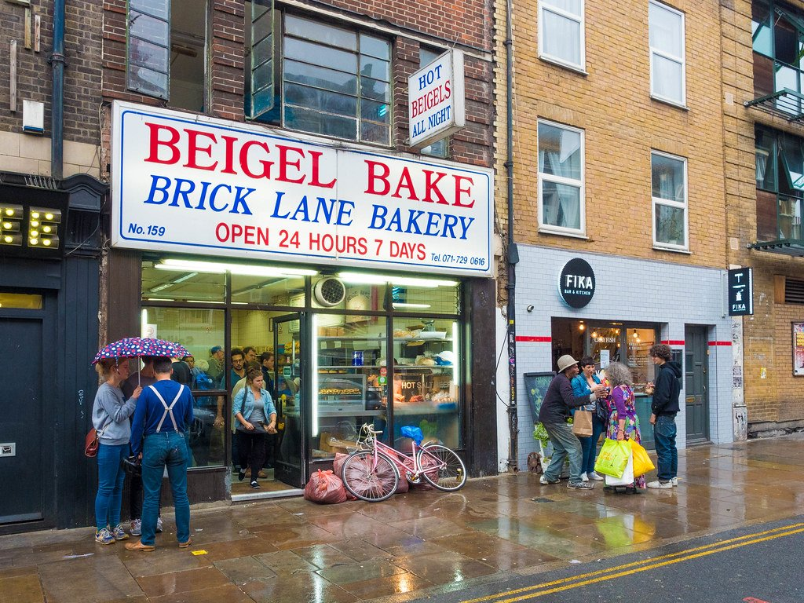
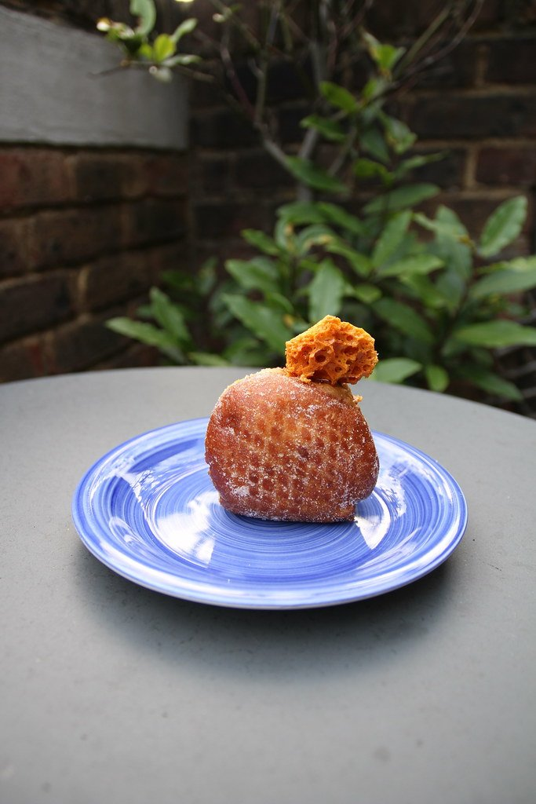
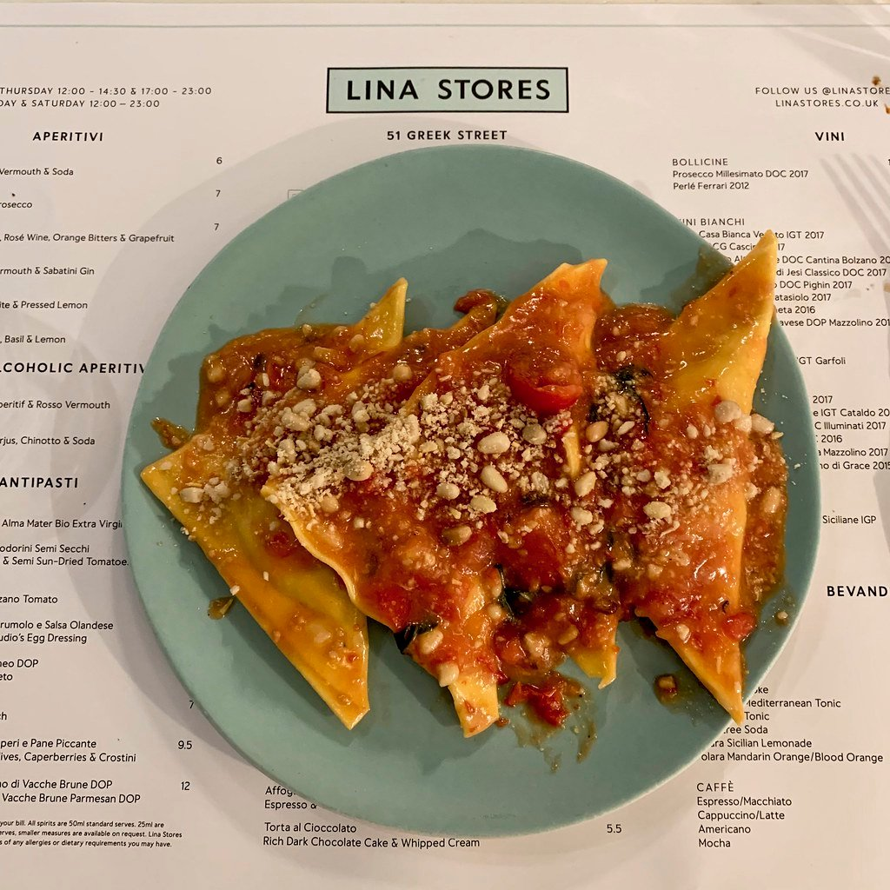

Many of London's best bakeries now put other cuisines through French technique: **miso in the escargot, pineapple buns beside the sourdough, baobab in the danish**.

> 💡 **The Short Version:** **Toad** in Camberwell has a weekend queue the Good Food Guide warns about. **Eric's** in East Dulwich makes croissants the Guide calls arguably the best in London, and opens twice a week. **Arôme** does honey butter toast and miso bacon escargots. **E5 Bakehouse** grinds its own flour under the Hackney arches. **Lisboa Patisserie** has been doing pastéis de nata on Golborne Road since 1984. And **Beigel Bake** on Brick Lane is open 24 hours.

> 📊 **The evidence behind this guide.**
> **7 sources carrying 101 citations** across **61 named bakeries**. **16 bakeries are named by two or more independent sources; 10 carry a dated award.**
> **Built on:** the Good Food Guide's national bakery list; Time Out and The Infatuation; independent bakery writers.
> *Evidence rebuilt 30 August 2026 · [How we rank →](/how-we-rank/)*

## Where they are

  

    Best bakeries in London map
  

  

    
Loading the interactive map…

  

  

    <i class="restaurant-map-key restaurant-map-key--editorial" aria-hidden="true"></i> Recommended in this guide
  

  <noscript>
    
The interactive map requires JavaScript. Nearest stations and walking times are listed against every entry below.

  </noscript>

| If you are near… | Where to go |
| --- | --- |
| **Covent Garden** | Arôme, Bageriet |
| **Soho & Oxford Circus** | Fred, Lina Stores |
| **Bloomsbury** | Fortitude Bakehouse |
| **Hackney & London Fields** | E5 Bakehouse, Dusty Knuckle |
| **Islington & Newington Green** | Pophams, Jolene |
| **Highgate & Crouch End** | Tarn, Sourdough Sophia |
| **Walthamstow** | Lucky Yu, Suba |
| **Camberwell & East Dulwich** | Toad, Eric's |
| **Battersea & Crystal Palace** | August, Chatsworth Bakehouse |
| **Queen's Park & Notting Hill** | Don't Tell Dad, Lisboa Patisserie |
| **Borough & Bermondsey** | Bread Ahead, Little Bread Pedlar |
| **Brick Lane** | Beigel Bake |
| **Everywhere central & west** | Buns from Home (12 branches) |

---

## What the rankings actually say

Bakeries are ranked more loosely than restaurants, as there is no Michelin for bread, so here is what the awards on this page mean.

**The [Good Food Guide's 50 Best British Bakeries](https://www.thegoodfoodguide.co.uk/best-of/britains-best-bakeries-2026)** is judged, dated and national, so a London entry has beaten bakeries from the whole country. **Ten of the fifty for 2026 are in London, and seven of those ten are new entries.**

**The Telegraph** runs its own annual ranking. **Time Out** reports on both rankings rather than judging independently, so the two are not independent sources of the same claim.

**None of them measures consistency.** A bakery can win on the day the judge visits and sell out by ten every Saturday after, which is why we lean on the queue commentary below: it comes from people who went back.

---

## Britain's best, 2026

Seven of the ten are new entries: Arôme, August, Chatsworth, Don't Tell Dad, Fred, Lucky Yu and Suba.

### Toad Bakery, Camberwell

*The queue · Cited by 4 sources · Good Food Guide 2026*

A small, crowdfunded Camberwell bakery with a weekend queue that regularly reaches the corner.

**Sandwiches and pastries** are the trade: thick fillings on its own long-fermented bread, changing weekly, plus laminated viennoiserie and a rotating list of tarts and buns.

**£, walk-in, closed Monday.** Go in late morning, when the sandwich menu is up and the pastries are not yet gone.

### Eric's, East Dulwich

*Open two days a week · Cited by 3 sources · Good Food Guide 2026*

An East Dulwich bakery run by Helen Evans, formerly of Flor, and named on the national fifty.

Order the **laminated pastries**. The croissants are made with wholemeal and emmer flour, and the savouries include an aubergine and fermented fava bean swirl; there are also pain au chocolat and cinnamon buns, and sourdough and sandwiches on it. It serves only filter coffee.

**£, walk-in, and go early.** By late morning the pastry case is picked over; by early afternoon it is largely gone.

> ⚠️ **Open twice a week only.** Check which days before travelling.

### Arôme Bakery, Covent Garden

*French technique, East Asian flavours · Cited by 2 sources · Good Food Guide 2026*

*Egg tarts at Arôme.*

A bakery on Endell Street founded by Singaporean restaurateur Ellen Chew and French-born pâtissier Alix André. It started as a Soho pop-up and has been in Covent Garden since 2020; there is a second branch on Duke Street in Marylebone.

Order the **honey butter toast**, a take on Japanese shokupan milk bread, and the **miso bacon escargots**. Also on the counter: hotdog croissants with Japanese BBQ sauce, gula melaka coconut buns, pandan and matcha pastries and egg tarts in a laminated shell.

**£, walk-in.** Expect a queue; go before ten or after three.

### E5 Bakehouse, Hackney

*Under the railway arches · Cited by 3 sources · Good Food Guide 2026*

**Sourdough baked under the London Fields arches**, with a café attached and **flour sold by the bag**.

The grain is ground on site: the croissants use three heritage flours and raw cultured butter, and the **Hackney Wild** sourdough is sold beside the flour it is made from. The café does soup, sourdough sandwiches and seasonal specials, with currant buns, florentines and rye cookies always on. There are also branches in Poplar and Hackney Wick, and a bakery school in the arch.

**£, walk-in.** The counter queue is permanent but moves quickly; busiest on a Saturday when the market is on.

### August Bakery, Battersea

*Opened late 2024 · Cited by 3 sources · Good Food Guide 2026*

Run by Harry Robins and Florrie Beard, who began by delivering loaves and pastries by cargo bike from a Putney flat and crowdfunded the shop, which opened in December 2024.

**Sourdough**, sweet seasonal buns and **focaccia sandwiches** are the offer. The bread is sold by the loaf and goes by mid-morning at weekends, and the pastry case is picked over well before that.

**£, walk-in, closed Monday.** Almost nowhere to sit.

### Don't Tell Dad, Queen's Park

*Bakery and restaurant · Cited by 1 source · Good Food Guide 2026*

A bakery by day and a restaurant and wine bar by night, in one Queen's Park room.

Head baker Keren Sternberg makes the **brown-butter maple challah doughnuts** and a bergamot sfogliatella. There are sandwiches on weekday lunchtimes, pies at weekends and seasonal small plates in the evening.

**£ at the counter, more if you sit down.** Walk-in for pastries; book for a table in the evening.

### Fred Bakery, Oxford Circus

*Warm all day · Cited by 1 source · Good Food Guide 2026*

Fred's Oxford Circus branch opened in 2025; the original is in Holborn.

**Pastries and coffee** rather than a full bread operation: croissants, buns and filled viennoiserie. The **swirls** and the flavoured croissants are what people queue for.

**£, walk-in.** Best before the lunchtime office rush takes what is left.

### Chatsworth Bakehouse, Crystal Palace

*Savoury · Cited by 2 sources · Good Food Guide 2026*

**Sian Evans and Tom Mathews started with lockdown loaves for neighbours**; the Good Food Guide says you know you are near when you spot the queue.

**Focaccia sandwiches and pizza by the slice** are the savoury draw, with malted-milk maritozzi and pumpkin spiced doughnuts, and sourdough as the foundation. There is a pre-order pick-up at 120a and a walk-in site a few doors down.

**£, walk-in, and open Wednesday to Friday 12.30pm–4pm and Saturday 11am–4pm only.** It is closed Sunday, Monday and Tuesday, which catches people out.

### Suba Bakery, Walthamstow

*African and Asian influences · Cited by 3 sources · Good Food Guide 2026*

Pa Modou came to Walthamstow from the Gambia by way of Hackney, and his African- and Asian-inflected bakes are why Suba is on the national fifty.

The croissants are glazed with mango syrup; there are **bantu buns** fragrant with caraway, the signature **mango baobab danish** with cardamom cream, and a Japanese egg mayo sandwich. There are also branches in Spitalfields and Upper Clapton.

**£, walk-in.** Small counter; the pastry case empties fast.

### Lucky Yu Bakery, Walthamstow

*British-Cantonese · Cited by 1 source · Good Food Guide 2026*

A micro-bakery run by Hai Lin Leung from her Walthamstow home alongside a full-time medical career, so it works to her own schedule.

The British-Cantonese bakes include fluffy **pineapple buns** and a **sesame soy congee sourdough**; matcha, black sesame, yuzu and miso also turn up in pastries and buns.

---

Powered by <a target="_blank" rel="sponsored" href="https://www.getyourguide.com/london-l57/">GetYourGuide</a>

## The other queues

Not in the 2026 fifty.

### Pophams, Islington

*Go early · Cited by 4 sources*

*A pastry at Pophams.*

**Pastries at the counter and a small kitchen behind it**, so it works for breakfast and lunch.

The **bacon and maple croissant** is the dish Pophams is known for, and the laminated pastries around it are made in the room. The kitchen runs a short brunch menu, and there is fresh pasta at some sites in the evening.

**£, walk-in.** Islington is the original; there are sites in Hackney and Victoria Park. Get there before eleven for the full pastry range.

### Jolene, Newington Green

*Bakery and restaurant · Cited by 2 sources*

**A bakery and restaurant milling its own flour**, from grain sourced from British farms and ground in-house.

**Sourdough** from that flour is the foundation, with pastries and a short seasonal menu alongside.

**£ at the counter.** Newington Green is the original; there are sites in Portobello and Redchurch Street. Walk-in for bread, book for a table.

### Dusty Knuckle, Dalston

*A social enterprise · Cited by 1 source*

**Bread and sandwiches from a bakery that runs a training programme for young people facing barriers to work.**

The **sandwiches on their own sourdough** are what people queue for: thick-cut and heavily filled. The bread is sold by the loaf alongside.

**£, walk-in.** Dalston is the original railway-arch site; there is a Harringay branch. Go at lunch for the sandwich, early for the bread.

### Little Bread Pedlar, Bermondsey

*Wholesale and retail*

A Bermondsey bakery that supplies restaurants wholesale and has a counter of its own attached.

**Sourdough, viennoiserie and cakes** made in the arch behind the shop. The croissants are the counter's strength and the loaves are what the wholesale trade is built on.

**£, walk-in.** Spa Terminus, and open at weekends alongside the other Bermondsey arch producers, which is the way to visit.

### Fortitude Bakehouse, Bloomsbury

*Small and excellent · Cited by 3 sources*

*The counter at Fortitude Bakehouse.*

**A small Bloomsbury bakehouse a couple of minutes from Russell Square.**

**Pastries, buns and cakes** made in the room, with coffee and a handful of seats. The **cardamom buns** and the seasonal tarts are what regulars come back for, and the range is deliberately short.

**£, walk-in.** Tiny, so it fills at lunchtime with people from the surrounding museums and colleges. Quietest mid-afternoon.

### Tarn, Highgate

*UK-grown grain · Cited by 1 source*

A Highgate bakery and café: bread, pastry and a short menu.

**Sourdough and laminated pastries** through the morning, with **sandwiches on their own bread** at lunch. The range is short on purpose, and what is there is made that day.

**£, walk-in.** A few minutes from Highgate station and close enough to the Heath to build a walk around it.

### Sourdough Sophia, Crouch End

*Cruffins · Cited by 2 sources*

Started as a lockdown home bakery and is now a Crouch End shop with a queue before opening.

**Sourdough** is the foundation and the name, with **laminated pastries and filled buns** beside it. The bread is long-fermented and the crust is the selling point.

**£, walk-in.** Busiest on a Saturday morning.

*Sourdough Sophia, Crouch End. Photo: [Keith Page](https://commons.wikimedia.org/w/index.php?curid=196207114), [CC BY-SA 4.0](https://creativecommons.org/licenses/by-sa/4.0/).*

---

Powered by <a target="_blank" rel="sponsored" href="https://www.getyourguide.com/london-l57/">GetYourGuide</a>

## Also well supported, and not above

Five bakeries carried by two or more independent sources.

| Bakery | Where | Sources | What it is |
| --- | --- | --- | --- |
| **Forno** | Hackney | 3 | An Italian bakery where, in The Infatuation's phrase, everywhere you look there is something that demands to be eaten |
| **Bunhead Bakery** | Herne Hill | 3 | Palestinian-inspired; go early |
| **Layla Bakery** | Ladbroke Grove | 3 | A corner neighbourhood bakery with a weekend queue |
| **Kuro Bakery** | Notting Hill Gate | 2 | Tiny, with sourdough, cakes and a bread-and-butter pudding people order specifically |
| **Common Breads** | Victoria | 2 | Lebanese, with traditional bakes |

---

## The one that is everywhere

### Peggy Porschen, Belgravia and Chelsea

**A pink shopfront framed by floral displays**, redressed seasonally on the corner of Ebury Street. There is usually a queue of people photographing it who do not go in.

The cakes are proper Victoria sponge and layer cakes by the slice, priced for the postcode. **Go on a weekday morning** if you want to sit down; the outside tables fill whenever the sun is out.

### Buns from Home, twelve branches

*Chain · mostly central and west*

Started by a baker called Barney making pastries in his mother's kitchen during lockdown, and now **twelve branches** — Notting Hill, Holland Park, Oxford Circus, Bank, Covent Garden, Marylebone, Sloane Square, Canary Wharf and more.

The cinnamon buns are large and generously filled, the flavours rotate, and you are rarely more than a few stops from a branch. It is the fallback when Eric's is shut or Toad has sold out.

> ⚠️ **Consistency is the trade-off.** Recent reviews raise stock control and variation between branches. Expect a queue, and expect the best flavours to be gone at peak.

---

## Institutions

### Lisboa Patisserie, Notting Hill

*Golborne Road · since 1984*

**Pastéis de nata** with scorched tops and shattering pastry, at a fraction of what central London charges. Trading since 1984.

Golborne Road is the north end of Portobello, past the antiques, in the Portuguese community that has been on this street for decades. Order at the counter and take it standing.

### Beigel Bake, Brick Lane

*Open 24 hours*

**Salt beef beigels at any hour of the day or night**, for a few pounds, from a counter open 24 hours.

The other Brick Lane beigel shop a few doors down has a long-running rivalry with this one. Try both.

*Beigel Bake, Brick Lane. Photo: [chas679](https://www.flickr.com/photos/128863823@N04/20362225603), [CC BY 2.0](https://creativecommons.org/licenses/by/2.0/).*

### Bread Ahead, Borough Market

*Doughnuts*

**The crème brûlée doughnut is blowtorched in front of you.** It started as one Borough Market stall and is now a bakery school and a small chain.

The **doughnuts** are the whole business: filled to order with vanilla custard, salted caramel or seasonal fillings. Bread and pastries alongside, and a **baking school** in the same building.

**£, walk-in, closed Monday.** Borough Market is busy by midday at weekends; go early.

*The doughnuts at Bread Ahead. Photo: [Bex.Walton](https://www.flickr.com/photos/7831824@N04/35138538481), [CC BY 2.0](https://creativecommons.org/licenses/by/2.0/).*

---

## Elsewhere in Europe

### Bageriet, Covent Garden

*Swedish*

**A tiny Swedish bakery on Rose Street**, down an alley off Covent Garden.

**Kanelbullar** — the cardamom-heavy Swedish cinnamon bun, a different thing from the American version — plus **prinsesstårta**, the green marzipan-domed princess cake, and semlor in season. Everything is made in the basement below the shop.

**£, walk-in.** It seats about six, so most people take it away. Open Monday to Friday 9am–6.30pm and Saturday 10am–6.30pm; closed Sunday.

### Lina Stores, Soho

*Italian · since 1944*

**The mint-green Brewer Street deli, open since 1944**, now with restaurants attached.

A **fresh pasta counter** with the pasta made daily and sold by weight, plus a full Italian deli: cured meats, cheese, oils and tinned fish. The restaurants came later than the shop.

**££ at the deli.** Walk-in for the shop; the restaurants take bookings.

*Lina Stores, Brewer Street. Photo: [Bex.Walton](https://www.flickr.com/photos/7831824@N04/48224733512), [CC BY 2.0](https://creativecommons.org/licenses/by/2.0/).*

---

## Best value

* **Beigel Bake** — a salt beef beigel under £8, at four in the morning if you want.
* **Lisboa Patisserie** — pastéis de nata at Golborne Road prices, not Notting Hill ones.
* **A pastry and a coffee anywhere on this list** is £6–£8.
* **Chatsworth Bakehouse** — pizza by the slice and focaccia sandwiches, for lunch rather than breakfast.

---

Powered by <a target="_blank" rel="sponsored" href="https://www.getyourguide.com/london-l57/">GetYourGuide</a>

## Planning a bakery morning

**Timing.** Pastries are baked in the early morning and bread usually appears mid-morning. If there is one item you have come for — the honey butter toast, the cruffin, the maple challah doughnut — assume it will be gone by lunchtime at a weekend.

**Two bakeries in a morning is realistic.** Toad and Eric's are a short ride apart in south London, and Pophams and Jolene are both in the Islington-to-Newington-Green corridor.

**Where to put a bakery in a day.** Fred at Oxford Circus and Arôme in Covent Garden fit inside a normal sightseeing day without a detour; the rest mean going somewhere on purpose.

**Cash and cards.** Almost everything here takes cards. Lisboa Patisserie is the one where cash still moves the queue faster.

**Sitting down.** Dusty Knuckle, Jolene, Don't Tell Dad and Chatsworth Bakehouse all do proper sit-down food; Fortitude, Bageriet and Lisboa are small rooms where a table is luck rather than a plan.

---

## What to know

* **Check the opening days.** Eric's opens twice a week and Chatsworth four days. Several others close Mondays.
* **Sourdough is £4.50–£6** for a proper loaf.
* **The queue is not always the signal.** Toad's queue is widely agreed to be worth it; some central London queues are photography, not baking.
* **Seven of the ten London entries in the Good Food Guide's 2026 fifty are new**, so a list you read two years ago is out of date.
* **Gluten-free is rare and rarely safe** at a flour-heavy bakery. Ask directly.

---

## Continue planning your London trip

- 🇵🇭 **[The Best Filipino Restaurants in London](/articles/best-filipino-restaurants-london/)** — where Panadera's longanisa roll sits in the wider Filipino scene
- ☕ **[The Best Coffee in London](/articles/best-coffee-london/)**
- 🍳 **[The Best Breakfast and Brunch in London](/articles/best-breakfast-brunch-london/)**
- 💷 **[Cheap Eats in London](/articles/cheap-eats-london/)**
- 🛍️ **[London Markets by Day](/markets/)**
- 🎨 **[Shoreditch Area Guide](/articles/shoreditch-area-guide/)**
- 🛍️ **[Notting Hill Area Guide](/articles/notting-hill-area-guide/)**
