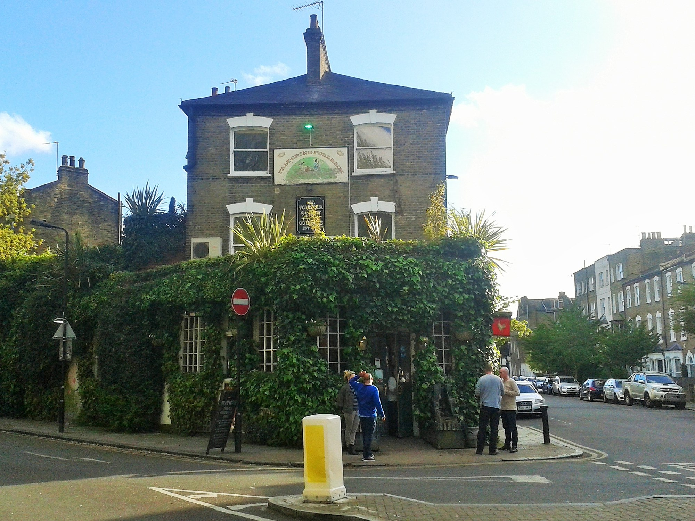
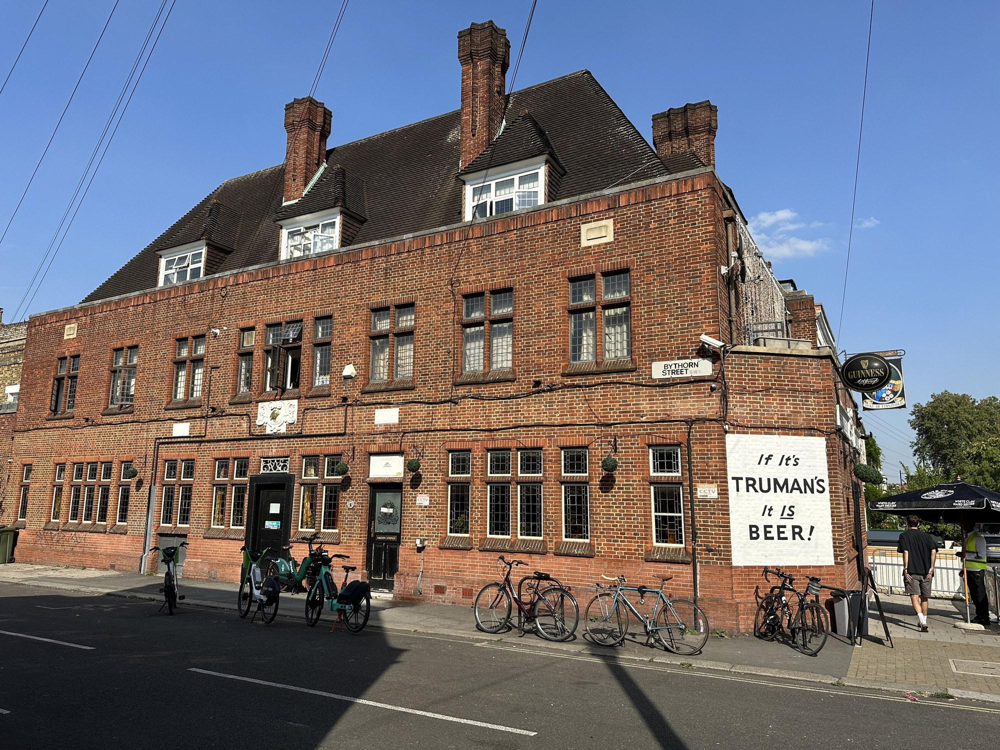
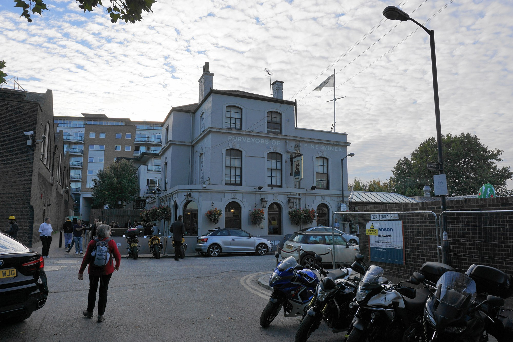
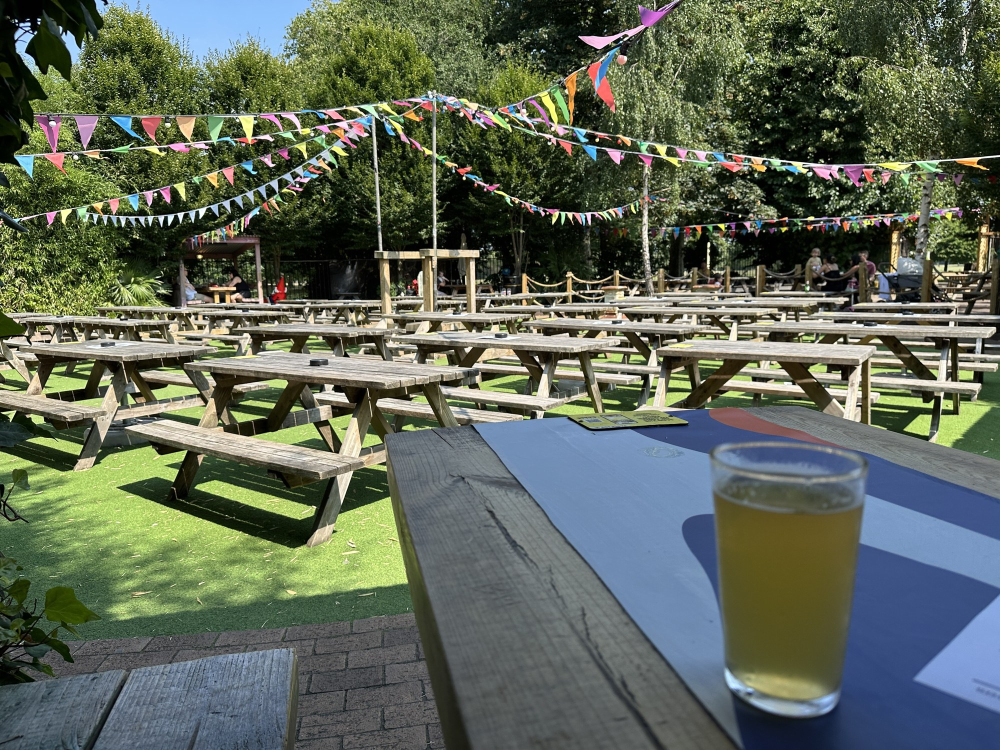
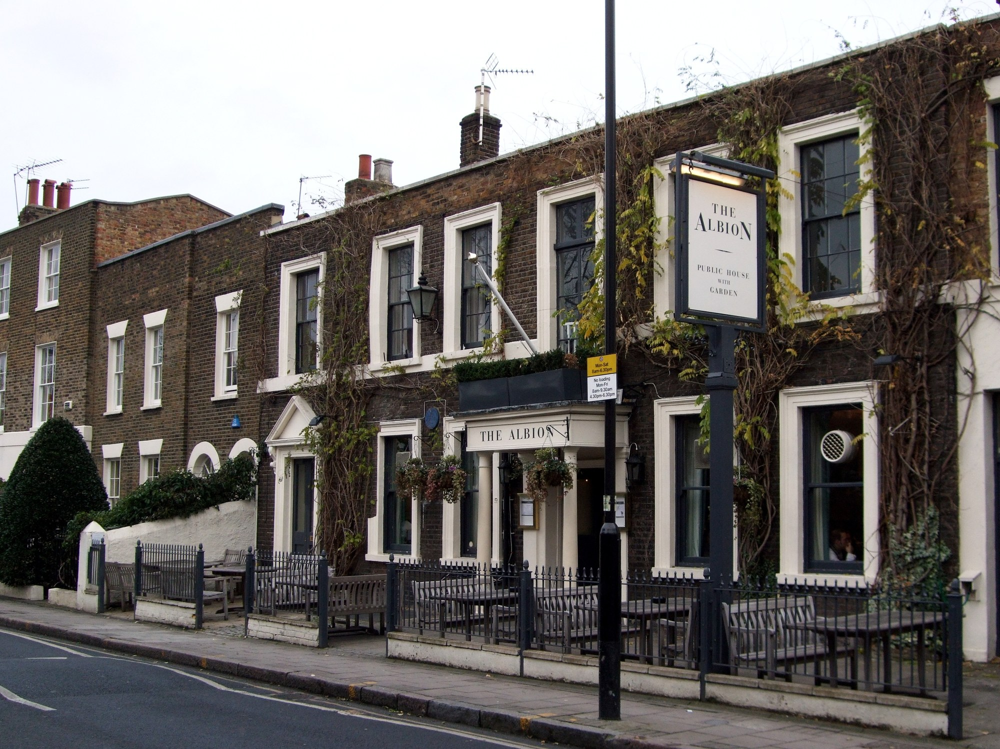
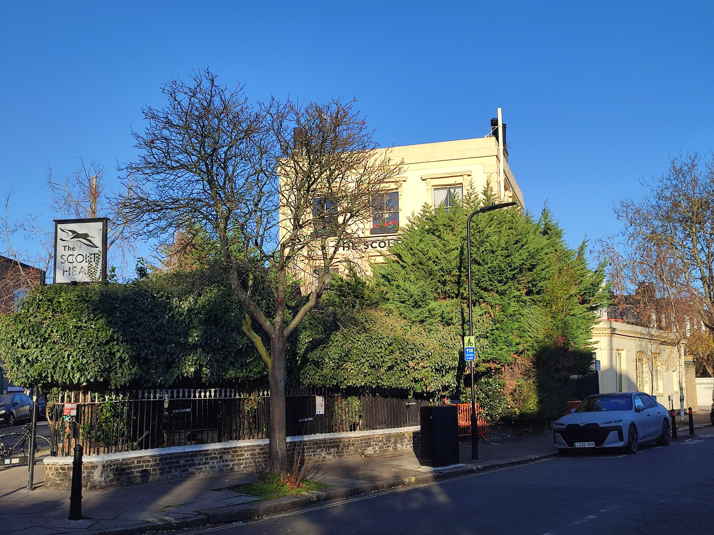
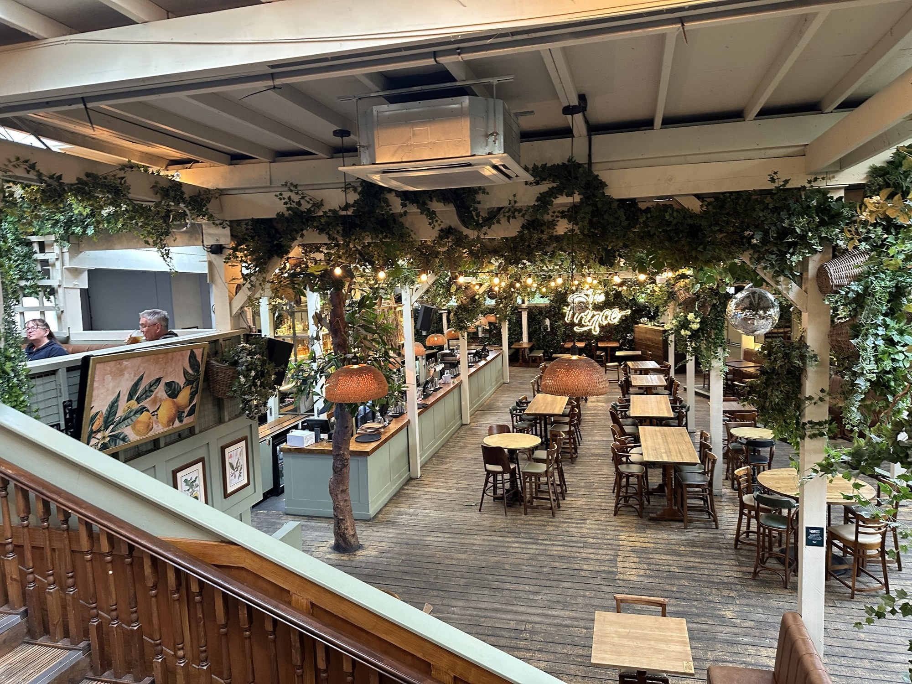
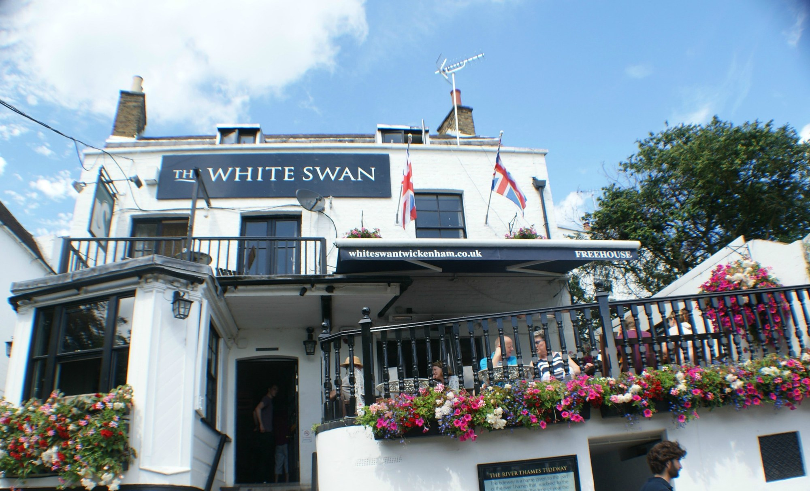
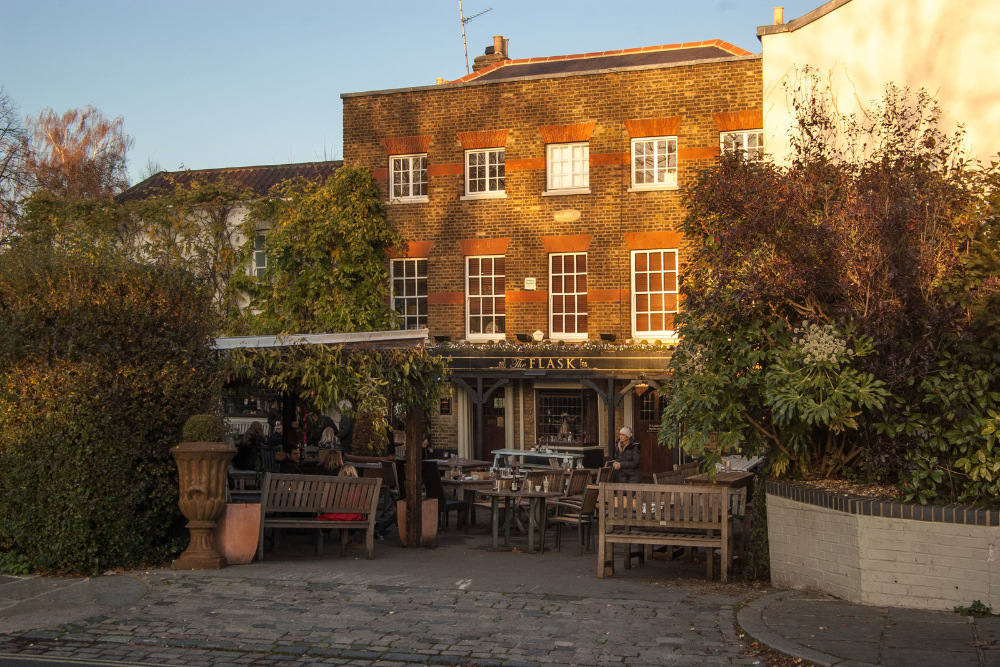

**The most-named beer gardens in London are The Duke of Edinburgh in Brixton and The Ship in Wandsworth, with People's Park Tavern in Victoria Park next. Time Out's number one is The Faltering Fullback in Finsbury Park.**

This guide counts how many independent lists name each pub for its garden. For roofs rather than gardens, see the [best rooftop bars](/articles/best-rooftop-bars-london/); for the beer itself, the [best craft beer pubs](/articles/best-craft-beer-pubs-london/).

> 💡 **The Short Version:** **The Duke of Edinburgh** and **The Ship, Wandsworth** are named by 14 sources each, and **People's Park Tavern** by 11. Time Out's number one, **The Faltering Fullback**, has a heated garden and takes no bookings. In winter, **The Crooked Billet** in Clapton has a retractable roof and the **Hope and Anchor** in Brixton is covered and heated. Many gardens close earlier than the pub: The Duke of Edinburgh's at 9.30pm.

> 📊 **The evidence behind this guide.**
> **19 independent sources carrying 476 citations** across **223 named pubs**. **81 are named by two or more sources.**
> **Built on:** Time Out's ranked 24, the Evening Standard, Condé Nast Traveller, The Infatuation, SquareMeal and eight more mastheads; Secret London, London On The Inside and the beer blog Beer Is My Life; and three YouTube channels.
> *Evidence built 16 November 2026 · [How we rank →](/how-we-rank/)*

## Covered or heated in winter 2026–27

| Pub | Area | What keeps the weather off |
| --- | --- | --- |
| **The Crooked Billet** | Clapton | A retractable roof over most of the garden, heaters and blankets |
| **Hope and Anchor** | Brixton | The garden is covered and heated in winter; bookable Tiki huts with TVs |
| **The Faltering Fullback** | Finsbury Park | Heaters, so the garden is used all year |
| **The Ship** | Wandsworth | A covered, heated pergola; heaters and an awning on the front terrace |
| **The Avalon** | Balham | A covered, heated courtyard and front terrace; the back garden is shut October to March |
| **People's Park Tavern** | Victoria Park | The Greenhaus, a glasshouse for winter drinking |
| **The Prince** | West Brompton | A retractable roof over the garden and its bar |
| **The Stag** | Belsize Park | A Garden Room with a retractable roof and a log burner |
| **The Edinboro Castle** | Camden | A covered garden |
| **The King's Arms** | Wandsworth | The Moatside, a covered area for up to 60, plus huts |

Everywhere else the garden is open but uncovered, which in November means a coat. **The Avalon's** back garden, **The Canonbury Tavern's** seafood shack and **The Crabtree's** barbecue are summer only.

## Booking

| | Pubs |
| --- | --- |
| **No bookings at all** | The Faltering Fullback, Bank of Friendship, The Chesham Arms |
| **Garden walk-in only** | The Ship's riverside decking, The Crabtree's river terrace, The Scolt Head's garden outside weekday daytimes, The Avalon's outdoor tables for groups under ten |
| **Book a hut** | Hope and Anchor, The Leather Bottle, The King's Arms, The Castle, The Eagle, The Ship's riverside cabins |
| **Bookable tables** | The Duke of Edinburgh, The Albion, Pub on the Park, People's Park Tavern, Big Penny Social, The Prince (on Saturdays, bookings or guest list only) |

---

## The winners

### The Faltering Fullback — Time Out's number one

*Finsbury Park · Cited by 10 sources · #1 of 24, Time Out · [pub's site](https://falteringfullback.com/)*

*The Faltering Fullback on Perth Road. Photo: [Stuart Shepherd](https://commons.wikimedia.org/wiki/File:The_Faltering_Fullback_-_geograph.org.uk_-_4507440.jpg), [CC BY-SA 2.0](https://creativecommons.org/licenses/by-sa/2.0/).*

An ivy-covered, family-run Irish pub on a residential street near Finsbury Park station. Behind it the garden climbs in **levels of decking with cubby holes and seating wrapped in ivy**, which the pub compares to an Ewok treehouse. Order Guinness; a Thai kitchen serves from 5pm on weekdays and 2pm at weekends. Rugby is shown in a back room called the Sin Bin, and there is a quiz on Mondays at 8pm. **The garden has heaters and is used all year, but the pub takes no bookings**: every table is first come, first served. Children until 6pm.

### The Duke of Edinburgh — Brixton, and a giant screen

*Brixton · Cited by 14 sources · #2 of 24, Time Out · [book a table](https://bookings.designmynight.com/book?venue_id=5de6287ca70f975e246a9543&venue_group=5d67a2510b10836b4f4d2f44&source=partner&locale=en-GB)*

*The Duke of Edinburgh on Ferndale Road. Photo: [Matt Brown](https://commons.wikimedia.org/wiki/File:Duke_of_Edinburgh_pub_in_Brixton.jpg), [CC BY 2.0](https://creativecommons.org/licenses/by/2.0/).*

A 1930s pub on Ferndale Road, a short walk from Brixton station, with a garden the pub bills as one of South London's biggest and a **giant projector screen** for live sport; commentary is played only indoors. Beers include Brixton Brewery's on tap, cocktails are £11, and there is a happy hour on weekdays from 3pm to 7pm. **The garden closes at 9.30pm every day**, and there is no cover or heating. Tables for two to twenty can be booked with a £25 card hold, charged only if you do not turn up. Under-18s until 7pm Sunday to Thursday and 5pm on Friday and Saturday.

### The Ship, Wandsworth — on the Thames

*Wandsworth · Cited by 14 sources · #13 of 24, Time Out · [book a table](https://bookings.designmynight.com/book?venue_id=512b206dd5d190d2978ca8d0)*

*The Ship on Jews Row. Photo: [Bill Boaden](https://commons.wikimedia.org/wiki/File:The_Ship,_Wandsworth_-_geograph.org.uk_-_4706098.jpg), [CC BY-SA 2.0](https://creativecommons.org/licenses/by-sa/2.0/).*

A Young's pub on Jews Row with its outside space in several parts: decking on the river under the Ship sign, riverside cabins with their own screens, a **covered and heated pergola** in front of the outside bar, and a front terrace with heaters and an awning. Burgers come from the Ship Shack (order at the bar and they text you); cocktails are £14.50. **The riverside decking is walk-in only, all year**; the cabins, pergola and front terrace can be booked. Rugby is shown inside and out.

### People's Park Tavern — in Victoria Park

*Victoria Park · Cited by 11 sources · #14 of 24, Time Out · [book the garden](https://bookings.designmynight.com/book?venue_id=52df9e340a8efb0636ca1b9c&source=partner&type=53d80b946c4f063250922ae6)*

*The People's Park Tavern garden. Photo: [Matt Brown](https://commons.wikimedia.org/wiki/File:Beer_garden_of_the_People's_Park_Tavern_2024-08-02.jpg), [CC BY 2.0](https://creativecommons.org/licenses/by/2.0/).*

A pub on the edge of Victoria Park in Hackney with long rows of picnic tables on artificial grass under bunting, and barbecue platters when the weather allows. For winter there is **the Greenhaus, a glasshouse**, bookable for four to thirty; on 28 November 2026 it hosts a winter party with DJs. The kitchen runs noon to 10pm with Sunday roasts until 4pm. The garden can be booked for four to thirty, tables are held for three hours, and under-18s are welcome until 7pm.

## Named by seven to ten sources

### The Albion, Islington — wisteria and roasts

*Barnsbury · Cited by 10 sources · #8 of 24, Time Out · [book a table](https://www.sevenrooms.com/explore/thealbionlondon/reservations/create/search?venues=thealbionlondon)*

*The Albion on Thornhill Road. Photo: [Ewan Munro](https://commons.wikimedia.org/wiki/File:Albion,_Barnsbury,_N1_%284229553468%29.jpg), [CC BY-SA 2.0](https://creativecommons.org/licenses/by-sa/2.0/).*

A Georgian pub in the Barnsbury conservation area off Upper Street, with **over 450 square metres of wisteria-covered garden** reached through French windows from the dining room, and log fires and panelling inside. It is a roast pub: 45-day dry-aged sirloin is £29, slow-roast lamb shoulder £27. The garden is used through the year but has no heating, and it closes at 9.45pm. Tables book through SevenRooms with a card; cancel within 48 hours and it is £25 a head.

### Pub on the Park — London Fields

*London Fields · Cited by 10 sources · [book a table](https://bookings.designmynight.com/book?venue_id=528261990a8efb31363976d4&venue_group=5d67a2510b10836b4f4d2f44&source=partner&locale=en-GB)*

Three outdoor decks and a garden on the edge of London Fields, with big umbrellas for rain and twelve screens for football, rugby and darts. The kitchen is run by From the Ashes, an east London barbecue smokehouse: jumbo wings, smoked meats, a burger and Sunday roasts with porchetta or bavette. Choose the sports booking type to sit in view of a screen; on spring and summer Saturdays there is one table per booking, up to ten, and the last booking is 3pm. Kitchen from 5pm on weekdays and noon at weekends.

### The Crabtree — the quiet stretch of the Thames

*Fulham · Cited by 10 sources · [book a table](https://www.thecrabtreew6.co.uk/book-a-table)*

A riverside pub on Rainville Road on the stretch of Thames between Hammersmith and Putney bridges, a few minutes from Craven Cottage, so it fills on Fulham match days. The river terrace is for diners and first come, first served; for the garden or bar you contact the pub. The Crabshack barbecue grills **from spring to autumn only**. A bottle of prosecco is £25 on Fridays and there is a quiz on Tuesdays. The Thames Dining Room seats 48 with river views.

### The Spaniards Inn — on the edge of Hampstead Heath

*Hampstead · Cited by 9 sources · #9 of 24, Time Out · [book a table](https://www.thespaniardshampstead.co.uk/onlinebookingform)*

A Grade II-listed inn built in 1585 on Spaniards Road, where the road narrows past the old toll house between Hampstead and Highgate, close to Kenwood House. It is linked to Dickens, Keats and the Dick Turpin legend, and serves cask ales and craft beer. The garden is what puts it on these lists. It opens at 10am Tuesday to Saturday, and tables can be booked online or on 020 8731 8406. It is a natural stop on a Heath walk, and stays open over Christmas.

### Hope and Anchor, Brixton — Tiki huts, heated

*Brixton · Cited by 8 sources · [book a hut](https://bookings.designmynight.com/book?venue_id=59141e6aff52d644a1323b93)*

A Young's pub on Acre Lane whose garden is **covered and heated in winter**. It is full of more than ten named and decorated Tiki huts, each with its own TV, seating six to fifteen, plus a Mega Hut for forty; the open tables share the garden screens. It shows all live sport and the pub calls itself a home for prosecco parties. The kitchen serves every day from noon to 9pm. Huts are the thing to book, through the pub's site; they are bookable all year.

### The Leather Bottle — Earlsfield, huts and two outdoor bars

*Earlsfield · Cited by 8 sources · [book a table](https://bookings.designmynight.com/book?venue_id=512b206fd5d190d2978ca8fa)*

A Young's pub on Garratt Lane with a garden it calls huge: seven named huts for 12 to 30 people (the largest, Garratt, has a TV and a fireplace), raised decking, **two outdoor bars**, a burger shack and a front garden on the street. It opens at 10am for brunch and runs Sunday roasts and winter cocktails. Dogs get biscuits and water. Huts and tables book online; on big match nights there is walk-in space with a queue.

### Big Penny Social — Walthamstow's beer hall

*Walthamstow · Cited by 7 sources · [book a table](https://bookings.designmynight.com/book?venue_id=5ef4accad4ea515dbc2e723b)*

The old Truman's Social Club on Blackhorse Lane, now a beer hall that brews its own beer, holds up to 1,400 and has a big sunny garden; it is on the Blackhorse Beer Mile, seven minutes from Blackhorse Road. It is the family pick: children are welcome every day until 7pm. The garden has no winter set-up, but **from 26 November 2026 to 17 January 2027 a curling club runs indoors**, with lanes for two to twelve. Booking strongly recommended Thursday to Saturday; groups up to 60 online.

### The Scolt Head — De Beauvoir

*De Beauvoir · Cited by 7 sources · #20 of 24, Time Out · [pub's site](https://www.thescolthead.co.uk/)*

*The Scolt Head and its corner garden. Photo: [Ewan-M](https://commons.wikimedia.org/wiki/File:Scolt_Head,_De_Beauvoir_Town,_N1.jpg), [CC BY-SA 4.0](https://creativecommons.org/licenses/by-sa/4.0/).*

An independent pub on Culford Road, named after an island off the north Norfolk coast, with a restaurant, a back room for swing, jazz, quizzes and film nights, and a corner garden behind tall hedges. Mini kegs of beer can be pre-ordered to take away. Big football and rugby fixtures are shown, first come, first served. **The garden can be booked online only on weekday daytimes; at all other times it is first come, first served**, and the pub asks you not to email for garden tables. Online bookings take up to eight.

### The Crooked Billet, Clapton — a retractable roof

*Clapton · Cited by 7 sources · #22 of 24, Time Out · [book a table](https://bookings.designmynight.com/book?venue_id=652fa217c3b8976d37310017)*

A Young's pub on Upper Clapton Road whose refurbished garden now has **a new retractable roof over most of it**, heaters, blankets and an outdoor bar. Several screens and one very large one show Sky and TNT football and the Autumn Nations rugby; there are film nights and DJ nights in the garden and a weekly quiz. Pints come from local breweries, and the kitchen serves until 10pm Monday to Saturday. Book a spot through the pub's site.

### The Stag, Belsize Park — cabanas and a Garden Room

*Belsize Park · Cited by 7 sources · #16 of 24, Time Out · [book a table](https://bookings.designmynight.com/book?venue_id=693fce67b6c06d14824981f7)*

A Young's local on Fleet Road, six minutes' walk from Hampstead Heath, with a big garden of cabanas for drinks and sport, and a **Garden Room with a retractable roof and a log burner** that is used as a dining room all year. There are 20 beer lines plus five rotating taps, and a menu of seven seasonal martinis. Quiz on Mondays at 7pm, a DJ on Fridays. Cabanas and the Garden Room book through the pub's site.

### The Prince, West Brompton — a roof over the garden

*West Brompton · Cited by 7 sources · [book a table](https://bookings.designmynight.com/book?venue_id=5e33fa05d4ea51457c4b0ae3)*

*The Prince's garden on Lillie Road. Photo: [Matt Brown](https://commons.wikimedia.org/wiki/File:The_Prince_14_Lillie_Road_beer_garden_2025-05-21.jpg), [CC BY 2.0](https://creativecommons.org/licenses/by/2.0/).*

A multi-floor pub on Lillie Road whose garden has its own long bar under ivy and festoon lights and **a retractable roof**, and holds 500 standing. Friday happy hour, 5pm to 8pm, is £6 pints and £8 cocktails. **On Saturdays it is bookings or guest list only, with no walk-ins; it is over-21s after 8pm on Friday and all day Saturday, with a smart dress code.** Upstairs, The Loft shows football, rugby, F1 and NFL.

## Named by five or six sources

### The Canonbury Tavern — oysters in summer

*Canonbury · Cited by 6 sources · #15 of 24, Time Out · [book a table](https://bookings.designmynight.com/book?venue_id=57470557426ba17e548b4597)*

A Young's pub tucked into Canonbury Place, a short walk from Highbury & Islington, with a leafy garden, a garden bar and, in season, the C Shack: Maldon Rock oysters, cider-battered fish and chips and lobster rolls, Thursday to Sunday. Stone & Wood beer and Dusty's ginger beer are poured in the garden. The dining room inside has a fire and looks onto the garden. **The garden and pub are adults only after 6pm.** Groups of up to 30 can enquire about a garden space.

### The Edinboro Castle — Camden, covered

*Camden · Cited by 6 sources · #21 of 24, Time Out · [book a table](https://www.edinborocastlepub.co.uk/onlinebookingform)*

A pub on Mornington Terrace between Camden's markets and Regent's Park, with a large garden behind a wooden gate that the pub says is **covered, for rain or shine**, and offers to groups. Inside it is homely and a little eccentric, with what it calls an explorative drinks menu. It is open daily from 11am (noon on Sunday) and through the Christmas holiday, including Christmas Day until 6pm. Book a table online or on 020 7255 9651; garden groups use the enquiry form.

### The King's Arms, Wandsworth — the Wandle and a big screen

*Wandsworth · Cited by 6 sources · [book a hut](https://bookings.designmynight.com/book?venue_id=59141f1dff52d644b6659934)*

A Young's pub on Wandsworth High Street whose garden runs down to the River Wandle. It has huts with TVs, a Mega Hut for ten to twenty-five, and **the Moatside, a covered area for up to 60** along the river. A very large screen shows live sport, there is a burger shack and a garden bar, and live music in the garden every Saturday. Dogs are very welcome; children until 8pm.

### The Crown and Shuttle, The White Swan and The Magic Garden

*The Crown and Shuttle · Shoreditch · Cited by 5 sources · [enquiries](https://www.crownandshuttle.com/enquires)*

*The White Swan, Twickenham · Twickenham · Cited by 5 sources · #5 of 24, Time Out · [book a table](https://bookings.designmynight.com/book?venue_id=67c1eab70354654ebe58d84c)*

*The Magic Garden · Battersea · Cited by 5 sources · #17 of 24, Time Out · [book a table](https://bookings.magicgardenpub.com/)*

*The White Swan's riverside terrace. Photo: [Robert Lamb](https://commons.wikimedia.org/wiki/File:View_of_The_White_Swan_pub_on_Riverside_-_geograph.org.uk_-_5039948.jpg), [CC BY-SA 2.0](https://creativecommons.org/licenses/by-sa/2.0/).*

**The Crown and Shuttle** is an East End pub on Shoreditch High Street with a garden reached by steps that closes at 10.30pm; a burger or wings with a pint is £17.50, and bookings go through its enquiry form. **The White Swan** is a 17th-century pub on the Thames at Twickenham, ten minutes' walk from the station; on Twickenham rugby days it opens early and serves no food. **The Magic Garden** on Battersea Park Road is a music pub with a large garden where it hands out blankets and hot water bottles, free gigs on Wednesdays and Thursdays and blues on Sunday afternoons.

### The Eagle, The Avalon and The Castle

*The Eagle, Shepherd's Bush · Shepherd's Bush · Cited by 5 sources · [book a hut](https://bookings.designmynight.com/book?venue_id=538dc9950df690c17e623732)*

*The Avalon · Balham · Cited by 5 sources · [book a table](https://booking.resdiary.com/widget/Standard/TheAvalonPub/61631)*

*The Castle, Tooting · Tooting · Cited by 5 sources · [book a hut](https://bookings.designmynight.com/book?venue_id=572b22417fb8d7575d00c0d9)*

**The Eagle** on Askew Road, a Young's pub, has two garden huts (one, My Place, fully covered), a party area for sixty and a burger shack; the garden closes at 9pm Sunday to Thursday and 10pm at weekends. **The Avalon** on Balham Hill has a **covered, heated courtyard and front terrace open all year** and hot cocktails in winter; its rear Summer Garden opens April to September only, and outdoor tables are first come unless you are ten or more. **The Castle** on Tooting High Street has seven mini-castle huts with sofas and TVs for ten to thirty-five, used for the Autumn Nations rugby.

## Time Out's picks with fewer citations

### The Flask, Highgate — Time Out's number three

*Highgate · Cited by 4 sources · #3 of 24, Time Out · [pub's site](https://www.theflaskhighgate.com/)*

*The Flask's front terrace in winter. Photo: [Jim Osley](https://commons.wikimedia.org/wiki/File:%22The_Flask%22_public_house,_Highgate_-_geograph.org.uk_-_5215230.jpg), [CC BY-SA 2.0](https://creativecommons.org/licenses/by-sa/2.0/).*

A Fuller's pub on Highgate West Hill whose stable block dates from 1663, with two 17th-century horseboxes still inside; the main pub is from the 1720s, with its shutter-window bar and bullseye glass. The front terrace of benches sits on a cobbled forecourt, and there is a garden as well. Cask ales and a real fire inside. The only cover outside is a smoking shelter. Food Monday to Saturday until 10pm; book through the panel on its site.

### The Fox & Firkin — Lewisham, with a railway carriage

*Lewisham · Cited by 3 sources · #4 of 24, Time Out · [book a table](https://bookings.designmynight.com/book?venue_id=64538e6390fe670184568613&source=partner)*

A live-music pub on Lewisham High Street with a backyard garden that has **covered areas**, a restored 1950s first-class railway carriage for private hire, a pizza van and the Firkin Brewery next door, whose beer it pours. There is live music most nights, reggae to folk to jazz, and the garden is used as a stage. Open until 3am on Friday and Saturday; some events are ticketed and sell out.

### The Black Eel — Dalston, behind a pie-and-mash shop

*Dalston · Cited by 3 sources · #6 of 24, Time Out · [book for 8 or more](https://bookings.designmynight.com/book?venue_id=68b6fa77d92e20582827a6e9)*

Exale Brewing's pub inside the Grade II-listed former Cooke's pie and mash shop on Kingsland High Street. Out the back is a big leafy garden with a boat turned into seating, open until 10pm; inside are darts, shuffleboard and a karaoke room. **It books only groups of eight (ten outside), except on Sundays**, and when the garden is full it is one in, one out. Card only. **Closed on 3 December and 24 to 26 December 2026.**

### Bank of Friendship and The Chesham Arms — no bookings

*Bank of Friendship · Highbury · Cited by 4 sources · #7 of 24, Time Out · [pub's site](http://www.bankoffriendship.com/)*

*The Chesham Arms · Homerton · Cited by 4 sources · #12 of 24, Time Out · [pub's site](https://www.cheshamarms.com/)*

**Bank of Friendship** on Blackstock Road, five minutes from Arsenal station, has been a local since 1881, with a big garden for summer evenings, two open fires inside, and cask ales and craft beer. **It takes no reservations, is strictly over-21s and is dog-free.** **The Chesham Arms** on Mehetabel Road is a Victorian backstreet pub run as a community asset, CAMRA East London Pub of the Year in 2016, with a big garden behind a terrace, two fireplaces and a rotating range of beers on cask and draught. **It takes no bookings either**, and the garden is reached by a narrow corridor with steps.

## Also named

- **[The Prospect of Whitby](https://www.greeneking.co.uk/pubs/greater-london/prospect-of-whitby)**, Wapping — a riverside tavern that says it was built in 1520, with a garden and roof seating over the Thames. *Cited by 4 sources.*
- **[The White Hart, Stoke Newington](https://www.thewhitehart.net/)**, Stoke Newington — a Georgian-style pub on the High Street with a garden and a hireable terrace. *Cited by 4 sources.*
- **[The Beehive, Tottenham](https://beehiven17.com/)**, Tottenham — a large garden with heaters and covered spots; no bookings on Spurs match days. *Cited by 3 sources.*
- **[Ferry Boat Inn Tottenham](https://www.heritagepubs.co.uk/pubs/ferry-boat-tottenham)**, Tottenham Hale — a rear garden of over 50 tables with patio heaters, by Walthamstow Wetlands. *Cited by 2 sources.*
- **[The Red Lion & Sun](https://www.theredlionandsun.com/)**, Highgate — a front garden under a marquee roof and a back garden bookable by phone, 48 hours ahead at most. *Cited by 2 sources.*

---

## Continue planning your London trip

- 🍹 **[The Best Rooftop Bars in London](/articles/best-rooftop-bars-london/)** — drinking outside one floor up, and which roofs are covered
- 🍻 **[The Best Craft Beer Pubs in London](/articles/best-craft-beer-pubs-london/)**
- 🏛️ **[The Most Beautiful Pubs in London](/articles/most-beautiful-pubs-london/)**
- 🍻 **[London's Historic Pubs and Dining Rooms](/articles/historic-pubs-dining-rooms-london/)**
- 🍽️ **[The Best Gastropubs in London](/articles/best-gastropubs-london/)**
- 🪑 **[The Best Places to Eat Outside in London](/articles/eat-outside-london/)**
- 🍽️ **[Eat in London: Restaurants, Food Markets & Quick Food Hub](/articles/eat-in-london-guide/)**
- 🌳 **[Hackney Area Guide](/articles/hackney-area-guide/)**, **[Islington Area Guide](/articles/islington-area-guide/)** and **[Hampstead Area Guide](/articles/hampstead-area-guide/)**
