London does two breakfasts: the **Australian brunch** the city imported around 2010 (hotcakes, avocado, flat whites) and the older **fry-up**. Both are here, alongside the hotel dining rooms.

> 💡 **The Short Version:** **The Wolseley** is a grand café in a 1920s car showroom. **Dishoom's bacon naan roll** is the dish people queue for. **Granger & Co** is the place for ricotta hotcakes. **Duck & Waffle** is open 24 hours forty floors up. And **Wetherspoons** does a cooked breakfast from 8am for a few pounds.

> 📊 **The evidence behind this guide.**
> **14 sources carrying 209 citations** across **160 named rooms**. **36 rooms are named by two or more independent sources; 9 by three or more.**
> **Built on:** the Good Food Guide; Time Out, The Infatuation and DesignMyNight; caff specialists; creator videos.
> *Evidence rebuilt 21 September 2026 · [How we rank →](/how-we-rank/)*

> 📅 **Booking, at a glance.**
> **Book weeks ahead:** Duck & Waffle (the window tables especially), Hide, Fallow, Akub.
> **Book a few days ahead, and always for a weekend:** The Wolseley, Berners Tavern, Bistrotheque, Carmel, Christopher's, Mr Bao, The Laundry, Inis, Megan's.
> **Bookable but rarely needed at breakfast:** Dishoom takes any party size before 6pm, and mornings barely queue. Caravan and The Good Egg both book online and both usually have a weekday morning table.
> **Walk-in only — turn up and wait:** Granger & Co, Milk, The Table Café, Esters, Ginger & White, Kaffeine, Prufrock, WatchHouse, Beany Green, The Breakfast Club.
> *The queue is the real cost at the walk-ins: Granger & Co before 10am or around 3pm gets you straight in, and Milk rarely runs past half an hour.*

## Where they are

| If you are near… | Where to eat |
| --- | --- |
| **Piccadilly & Mayfair** | The Wolseley, Fallow |
| **The City & Liverpool Street** | Duck & Waffle, Darwin Brasserie, Polo Bar, The Crosse Keys, Hamilton Hall |
| **Covent Garden** | Dishoom |
| **Fitzrovia & Marylebone** | Berners Tavern, TOKii, Kaffeine, The Attendant |
| **Clerkenwell** | Caravan, Prufrock |
| **Notting Hill & west** | Granger & Co, Beany Green |
| **Southwark & Bankside** | The Table Café |
| **South London** | Milk (Balham), WatchHouse (Bermondsey) |
| **North London** | Ginger & White (Hampstead) |

**Price guide:** **£** under £15 · **££** £15–£30 · **£££** £30–£50 · **££££** £55+.

---

## The London institutions

### The Wolseley, Piccadilly

*£££ · 3 min from Green Park* · Cited by 2 sources

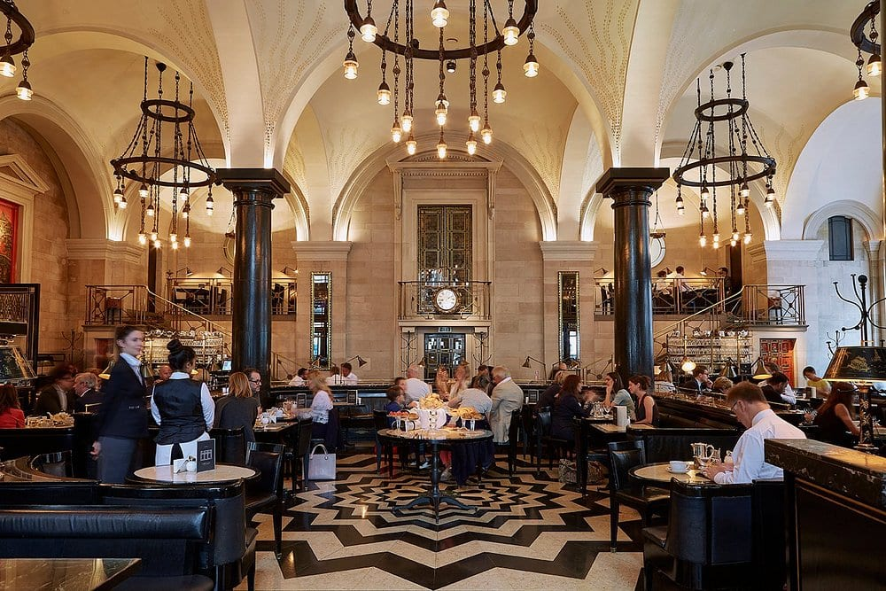

A 1920s Wolseley Motors showroom on Piccadilly, now a Viennese-style grand café with vaulted ceilings, black lacquer and brass. Weekday breakfasts at 8am are full of business meetings.

The menu runs from viennoiserie and classic egg dishes through to a full English, and **kedgeree**, the Anglo-Indian smoked haddock and rice dish. Fruit, yoghurts and cereals are also on the menu.

**Breakfast runs 7am–11.30am on weekdays ([book a table](https://www.sevenrooms.com/reservations/wolseleylondon/)) and 8am–11.30am at weekends.**

### Dishoom, Covent Garden

*££ · 3 min from Covent Garden · 8 London sites* · Cited by 3 sources

The original, opened in **2010** by cousins Shamil and Kavi Thakrar, modelled on the **Irani cafés of 1960s Bombay**: sepia photographs, ceiling fans, marble-topped tables, bentwood chairs.

The **bacon naan roll** is smoked streaky bacon, cream cheese, chilli-tomato jam and herbs in a fresh naan, and there is a double version at £9. Beside it, **akuri** (soft eggs with chilli, coriander and ginger), the Big Bombay, and chai poured from a height.

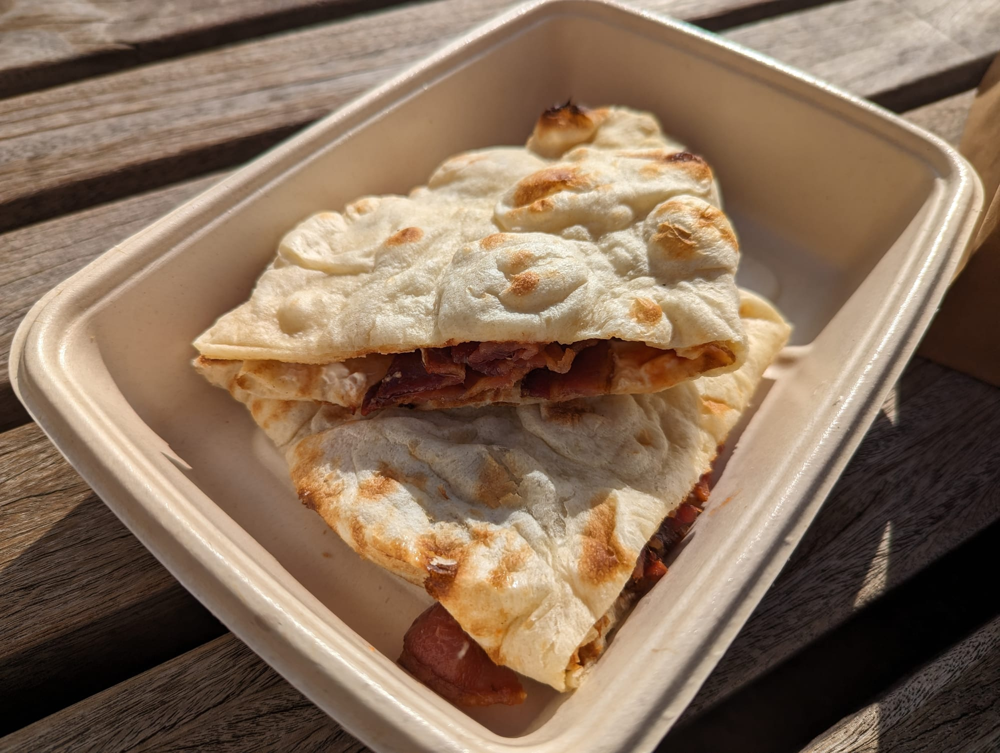

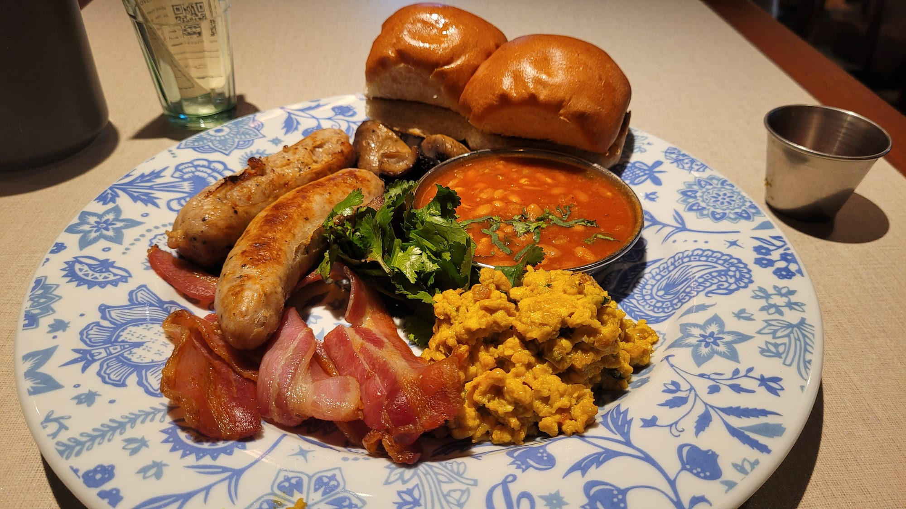

**Breakfast and lunch barely queue, unlike the evenings**, and any party size can book before 6pm ([book a table](https://www.sevenrooms.com/explore/dishoom/reservations/create/search?venues=dishoombattersea%2Cdishoomcarnaby%2Cdishoomcanarywharf%2Cdishoomcoventgarden%2Cdishoomkensington%2Cdishoomkingscross%2Cdishoomshoreditch%2Cdishoombirmingham%2Cdishoomedinburgh%2Cdishoomglasgow%2Cdishoomleeds%2Cdishoommanche)). Dishoom Borough, the eighth London site, opened on 21 October 2026.

### Duck & Waffle, City of London

*££££ · 3 min from Liverpool Street · 24 hours · one site* · Cited by 2 sources

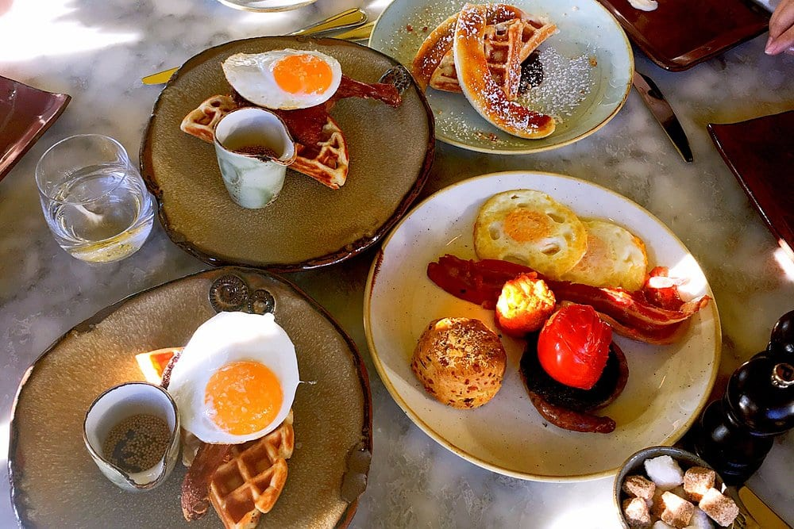

The **40th floor of Heron Tower**, with floor-to-ceiling windows, an open kitchen in the middle of the room and a 24-seat indoor-outdoor bar, **open around the clock**.

The dish it is named for is **two waffles stacked with a confit duck leg and a fried duck egg**, with a jug of mustard maple syrup poured at the table. Around it are tapas-style small plates, sweet and savoury waffles from duck benedict to caramelised banana, and a **foie gras 'all day breakfast'**.

**Breakfast proper runs 6am–11am**, though the kitchen never actually stops. There is also a three-course Sunday roast. **Book** ([book a table](https://www.sevenrooms.com/reservations/duckandwaffle)); the window tables go weeks ahead.

### Berners Tavern, Fitzrovia

*££££ · a vast Edwardian ballroom* · Cited by 1 source

**Jason Atherton's** dining room inside The London EDITION on Berners Street: an Edwardian ballroom with the walls hung with framed pictures, under chandeliers. It is much quieter at breakfast than at dinner.

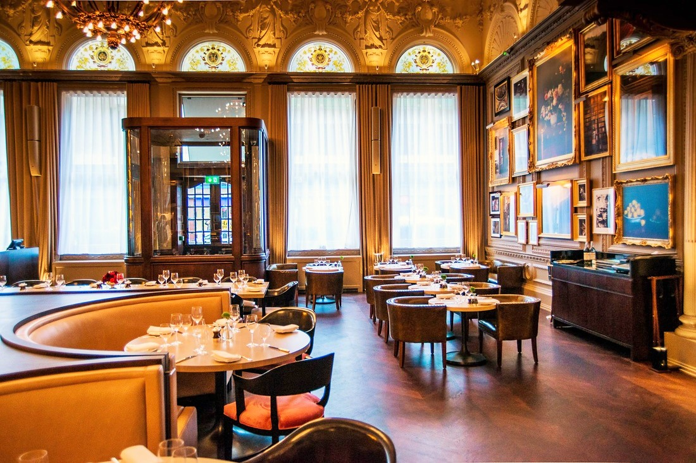

*Berners Tavern's empty dining room.*

Smoked salmon and scrambled egg on sourdough, **brioche French toast**, eggs Florentine and a full English, with lighter fruit and pastry options. The signature flourish is a **Bloody Mary trolley** wheeled to the table with three different twists to choose from.

Breakfast runs daily, with brunch on Saturday and a Sunday lunch. **[Book](https://www.opentable.com/booking/restref/availability?restref=96693) for weekends**; on a weekday morning you can usually walk in.

### Hide, Mayfair

*££££ · Michelin-starred · one site* · Cited by 2 sources

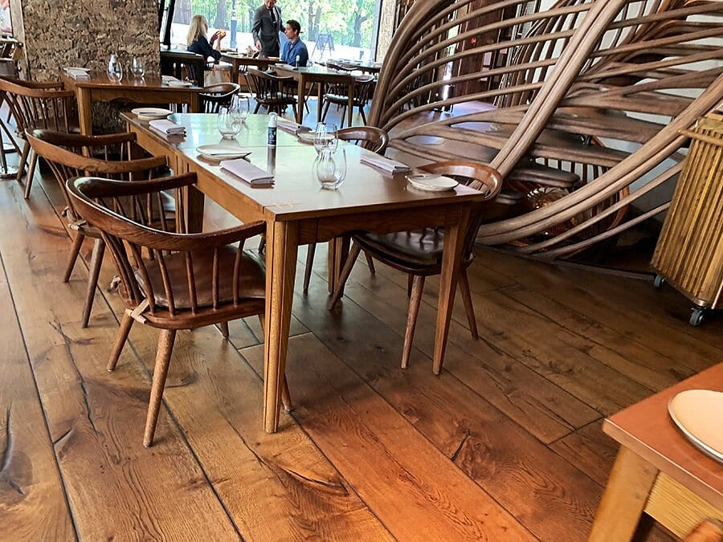

**Ollie Dabbous's** restaurant at 85 Piccadilly, overlooking **Green Park**. Breakfast is served in **Ground**, the ground-floor room, under an oak staircase that spirals up through all three floors.

The Michelin-starred kitchen serves breakfast in four parts: fruits, seeds and grains; **viennoiseries baked on site every morning** at the open bakery; a caviar and oysters section; and a savoury selection built around the signature **HIDE croque monsieur**. Elsewhere, **truffled scrambled eggs**, a reworked full English, avocado on toast, and a house granola.

**Book** ([book a table](https://www.sevenrooms.com/explore/hidegrounduk/reservations/create/search)), and ask for a window table on the park side.

### Fallow, St James's

*£££ · nose-to-tail* · Cited by 2 sources

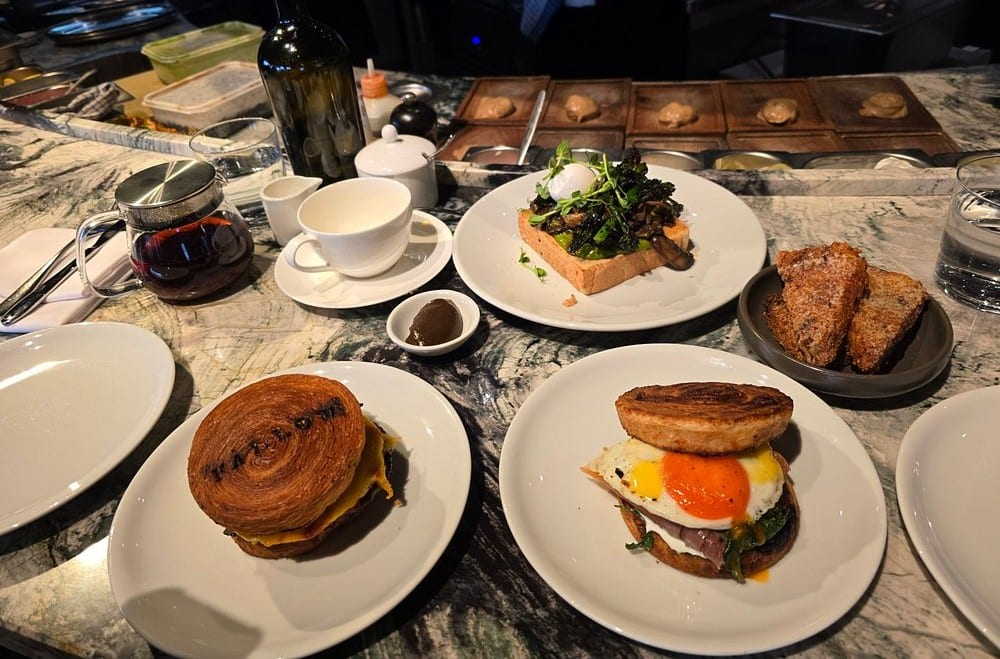

The St James's Market kitchen from two ex-Dinner chefs, cooking nose-to-tail. The dinner menu is known for a **smoked cod's head with sriracha butter** and ex-dairy-cow steak, and breakfast follows the same approach.

The **Fallow Full** — smoked bacon, black pudding, sausage, herbed mushrooms, fried eggs, tomatoes and sourdough — sits alongside a **Black Pudding Benedict**, Turkish eggs, wild mushrooms on toast, and the **corn ribs with kombu seasoning** from the dinner menu. Rye sourdough with Longman's butter, and a granola with London honey.

**52 Haymarket**, a few minutes from Piccadilly Circus. Book ([book a table](https://www.sevenrooms.com/explore/fallowstjames/reservations/create/search?venues=roe%2Cfallowstjames%2Cfowl)); it is a restaurant rather than a café, and it fills.

---

## Australian brunch

### Granger & Co, Notting Hill

*£££ · Bill Granger* · Cited by 4 sources

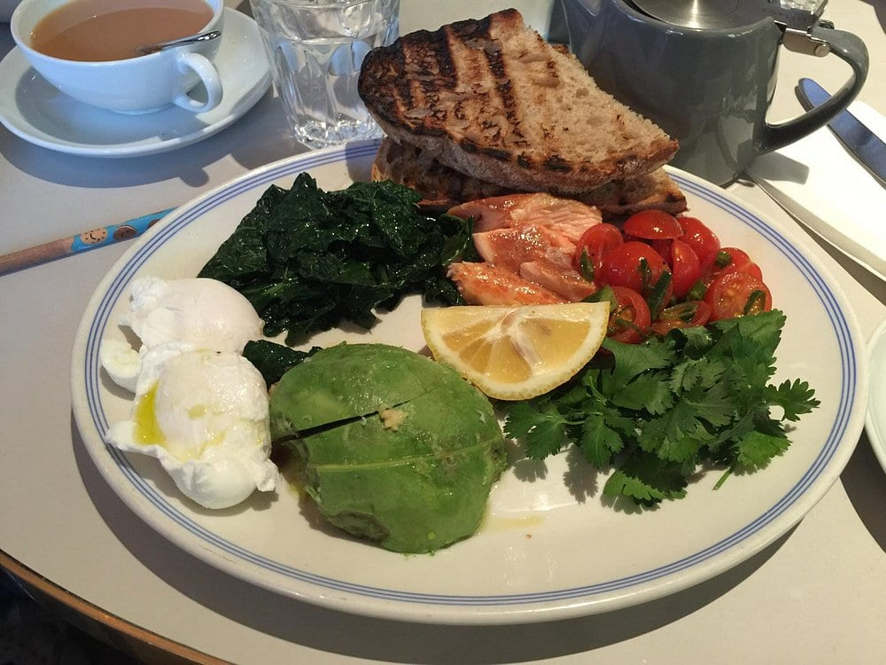

Bill Granger opened his Sydney brunch café in Notting Hill in 2011. It is the original and the **smallest of the four** London sites.

The **ricotta hotcakes with fresh banana and honeycomb butter (£19)** are the signature dish. The menu also has soft scrambled eggs, a shrimp burger and avocado dishes.

**No bookings, seven days a week, and there is a queue.** Come before 10am or around 3pm and you will walk in; arrive at 11 on a Saturday and you will not.

### Caravan, Clerkenwell

*£ · Exmouth Market · 7 London sites · its own roastery* · Cited by 1 source · [book a table](https://www.sevenrooms.com/explore/caravanrestaurants/reservations/create/search?venues=caravankingscross,caravancanarywharf,caravancity,caravancoventgarden,caravanexmouthmarket,caravanfitzrovia,caravanbankside,vardochelsea,caravanmanchester)

The Exmouth Market room, opened by New Zealanders in 2010, with an all-day menu drawing on cuisines from around the world and its own roasted coffee.

It is now a **seven-site London group**: Bankside, Canary Wharf, the City, Exmouth Market, Fitzrovia, King's Cross and Vardo in Chelsea.

The coffee is roasted at **Lamb Works** in Islington. Brunch dishes include jalapeño cornbread with a fried egg, chorizo and potato hash, and vanilla pancakes with date molasses.

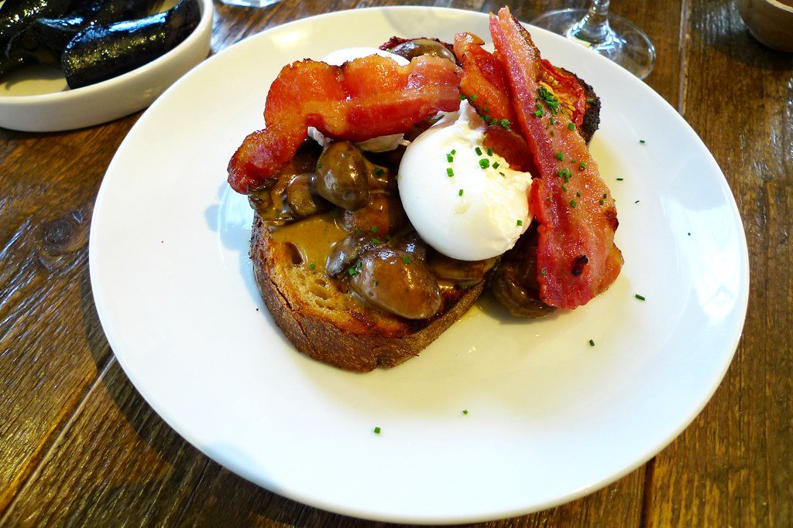
*Caravan, Exmouth Market. Photo: [Ewan-M](https://www.flickr.com/photos/55935853@N00/5624757340), [CC BY-SA 2.0](https://creativecommons.org/licenses/by-sa/2.0/).*

### Milk, Balham

*££ · 3 min from Balham · one site* · Cited by 3 sources

On **Hildreth Street Market since 2012**, opened by **Julian Porter and Lauren Johns**, who knocked through into the shop next door in 2015. It is still small and loud at 11am on a Sunday.

The dish to order is the **Convict Gloucester** — an Old Spot pork patty on an English muffin with streaky bacon, scrambled eggs, Lincolnshire Poacher and the **hangover sauce** the place is known for. Beside it the **Sweet Maria**, the banana bread, a secret-recipe granola, and poached eggs under a burnt butter hollandaise.

Coffee is **an exclusive roast with Assembly** in Brixton, with Plot Roasting also on the bar. Porter and Johns also run Fields on Clapham Common, but Milk has no second site.

**No bookings**, and the queue moves: even at weekends you are unlikely to wait more than half an hour.

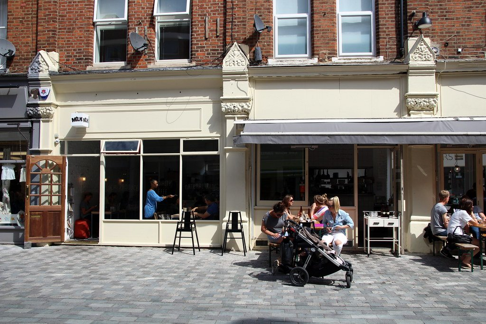
*Milk, Balham. Photo: [Bex.Walton](https://www.flickr.com/photos/7831824@N04/28220076190), [CC BY 2.0](https://creativecommons.org/licenses/by/2.0/).*

### Beany Green, Little Venice

*££ · the towpath*

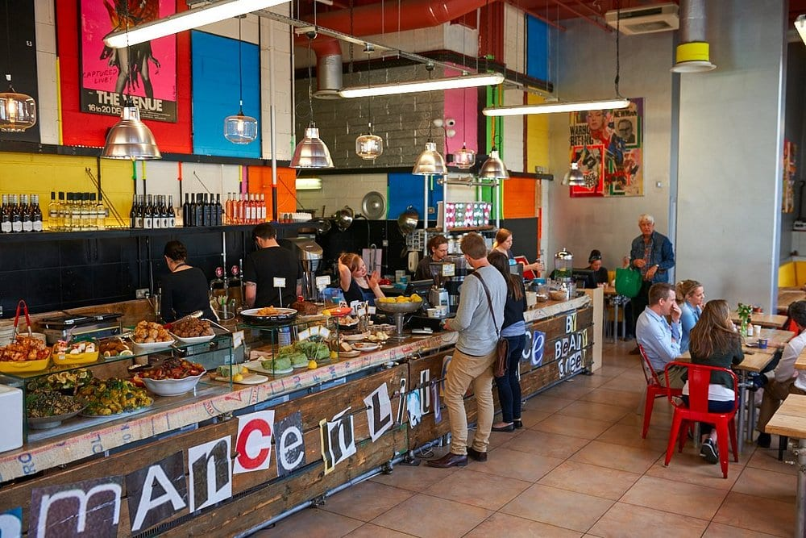

Part of the Australian **Daisy Green** group, on the canal towpath at Paddington Basin, with a large terrace beside the narrowboats.

**Breakfast is served all day, every day.** The award-winning **banana bread sandwich** is the dish to order, with buttermilk blueberry pancakes and a smashed avocado sandwich behind it.

Walk-in; the terrace is first-come, and the indoor room is small.

---

Powered by <a target="_blank" rel="sponsored" href="https://www.getyourguide.com/london-l57/">GetYourGuide</a>

## The proper fry-up

### The Table Café, Southwark

*££ · 5 min from Southwark · no bookings · 2 sites*

An independent on Southwark Street **since 2005**, using seasonal British ingredients. A second site is on Battersea Rise.

The **Borough Full English** is the main dish, with eggs benedict variations, sweet and savoury waffles, pancakes and a vegan pancake stack. Its prices: **big breakfasts £11–13, breakfast bruschetta £9.50, pancakes and waffles £8–9.**

**The terrace runs seven days and takes no bookings.**

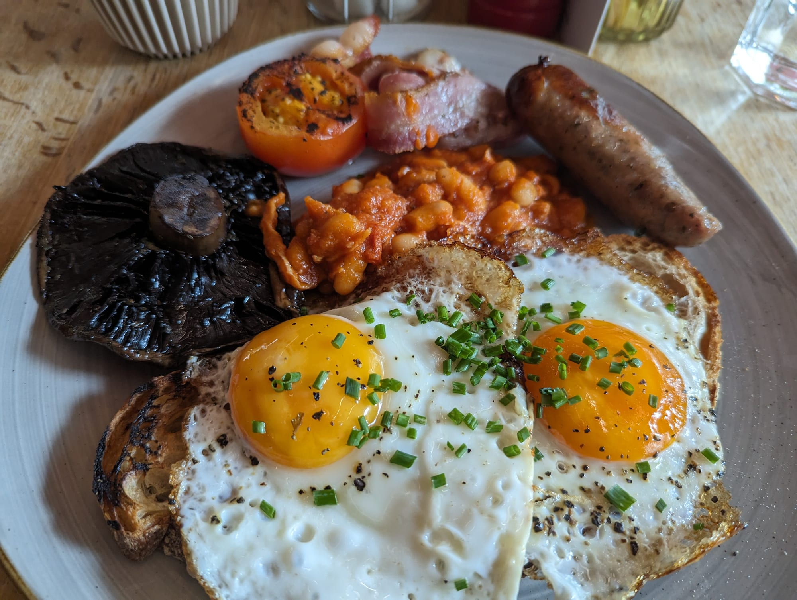

### Hawksmoor, several sites

*£££ · a separate breakfast menu · 7 London sites*

The steakhouse group's full English is made from its own butchery.

**Breakfast for two is £36** and arrives as a shared spread: a **smoked bacon chop**, sausages, black pudding, **short-rib bubble and squeak**, **grilled bone marrow**, trotter baked beans, fried eggs, grilled mushrooms, roast tomatoes, **HP gravy** and unlimited toast.

> ⚠️ **Breakfast is not served at every branch, or every day.** Guildhall has run it on weekdays and Air Street on Saturdays, but the schedule moves. Check the specific site ([book a table](https://www.opentable.com/booking/experiences-availability?rid=11335&restref=11335&experienceId=682033)) before travelling for it.

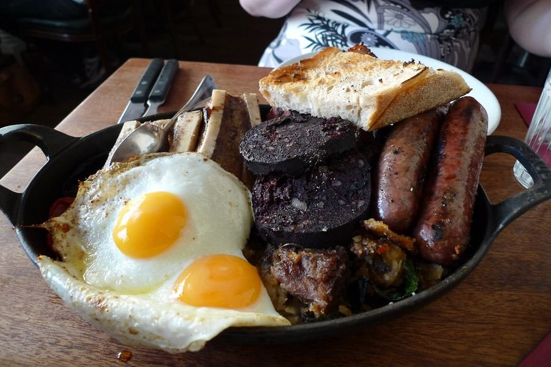
*The breakfast for two. Photo: [Ewan-M](https://www.flickr.com/photos/55935853@N00/5652623969), [CC BY-SA 2.0](https://creativecommons.org/licenses/by-sa/2.0/).*

---

## Coffee-first

### Kaffeine, Fitzrovia

*£ · 6 min from Oxford Circus · 2 sites*

Australian and New Zealand owned, opened on **Great Titchfield Street in 2009**. A second site followed on **Eastcastle Street in 2015**, five minutes away.

Coffee is **Square Mile**, with a rotating guest espresso and filter.

**The menu changes weekly.** Expect **espresso-drizzled pancakes with mascarpone and berries**, **smashed avocado on sourdough**, and sandwiches made on site — smoked salmon with chive cream cheese, breaded brie with roasted aubergine — alongside a pastry case that sells out by early afternoon.

**Mon–Fri 7.30am–5.30pm, Saturday 9am–4pm, closed Sundays.** It fills with office workers, so it is calmest before 9am and after 3pm. Counter service.

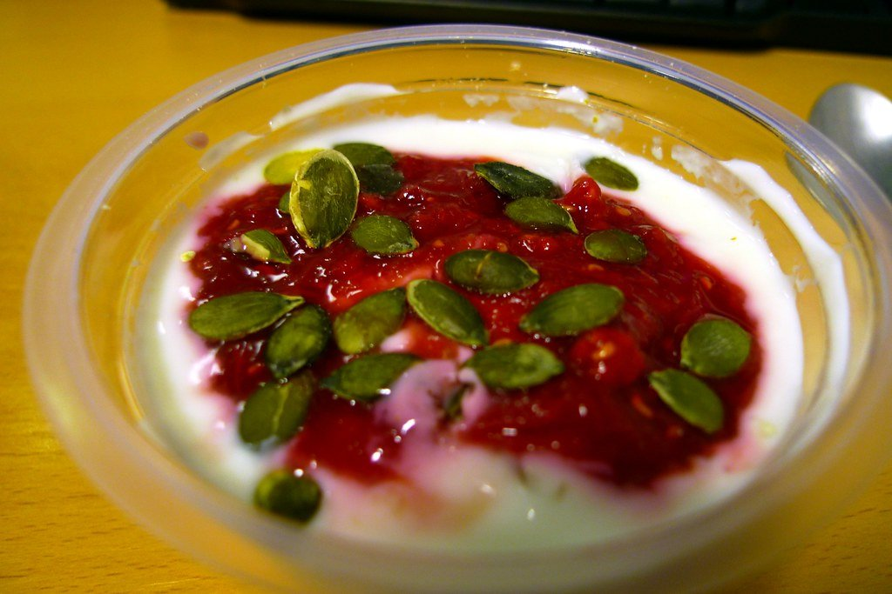
*Kaffeine, Great Titchfield Street. Photo: [Ewan-M](https://www.flickr.com/photos/55935853@N00/3859693639), [CC BY-SA 2.0](https://creativecommons.org/licenses/by-sa/2.0/).*

### Prufrock, Clerkenwell

*£ · Leather Lane*

**23–25 Leather Lane**, with a coffee training school attached. Spacious, bright and functional.

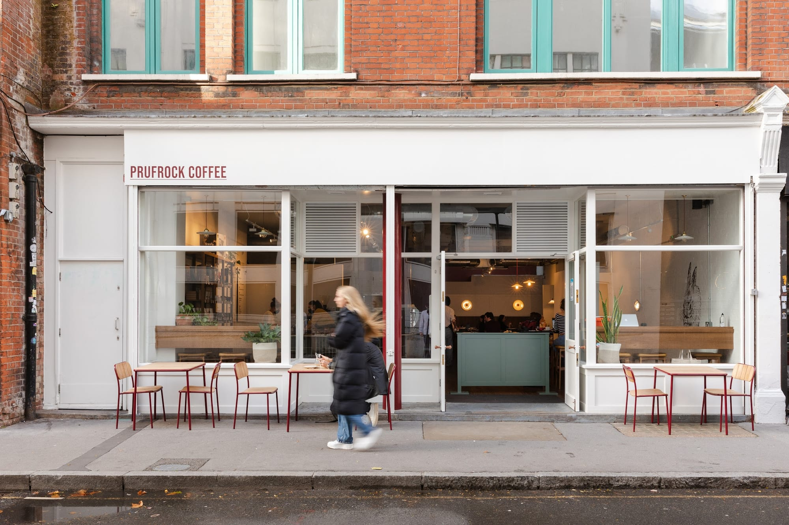

*Prufrock's pavement tables.*

Food includes **veggie eggs benedict with soft poached eggs and bitter greens**, and a dense coconut and almond cake among the counter bakes.

Weekday mornings it fills with people working, and there are power sockets. Leather Lane's street market runs outside at lunchtime.

### WatchHouse, Bermondsey

*£ · a watchman's hut*

The original site is a **watch house built between 1810 and 1812** to guard the graves in St Mary Magdalen churchyard next door from body snatchers. It **seats ten**.

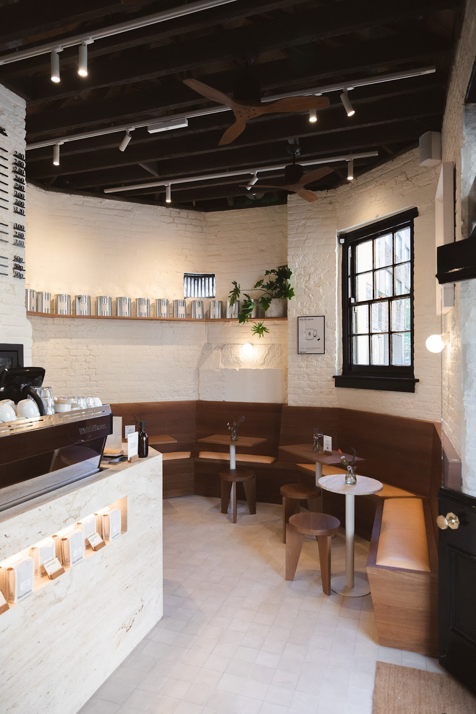

*Inside the original WatchHouse.*

Coffee is roasted in-house, and the counter runs to **pastries, fresh bakes and very good sandwiches** rather than a full kitchen. The group splits its sites into Espresso Houses, which do bakes and sandwiches like this one, and larger Brunch Houses that serve **oat and rye porridge, breakfast classics and seasonal plates** until 11am. The group has other sites across the City, in Bath and in New York.

### Ginger & White, Hampstead

*£ · Perrins Court*

In **Perrins Court**, a narrow pedestrian alley off Hampstead High Street: a small café with indoor and outdoor tables and no reservations.

**Dippy eggs** with soldiers, toasties, shakshuka, borekas, granola, cinnamon buns and a banana chocolate chip cake, with **homemade peanut butter** and turkey bacon among the fillings. Coffee is **Square Mile**.

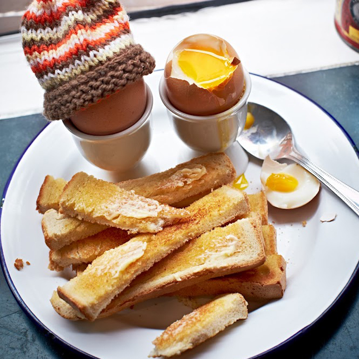

*Dippy eggs and soldiers.*

**Mon–Fri 7.30am–5.30pm, Saturday from 7.30am to 6pm, Sunday 8am–6pm.** Ten minutes from the Heath.

---

Powered by <a target="_blank" rel="sponsored" href="https://www.getyourguide.com/london-l57/">GetYourGuide</a>

## Weekend-only, and worth planning around

These brunches run **on Saturday and Sunday only**.

### Akub, Notting Hill

*Weekend only · Sat 11am–3pm, Sun 11am–4pm* · Cited by 2 sources

Chef **Fadi Kattan's** Palestinian dining room on Uxbridge Street, cooking the food of Bethlehem, where he grew up.

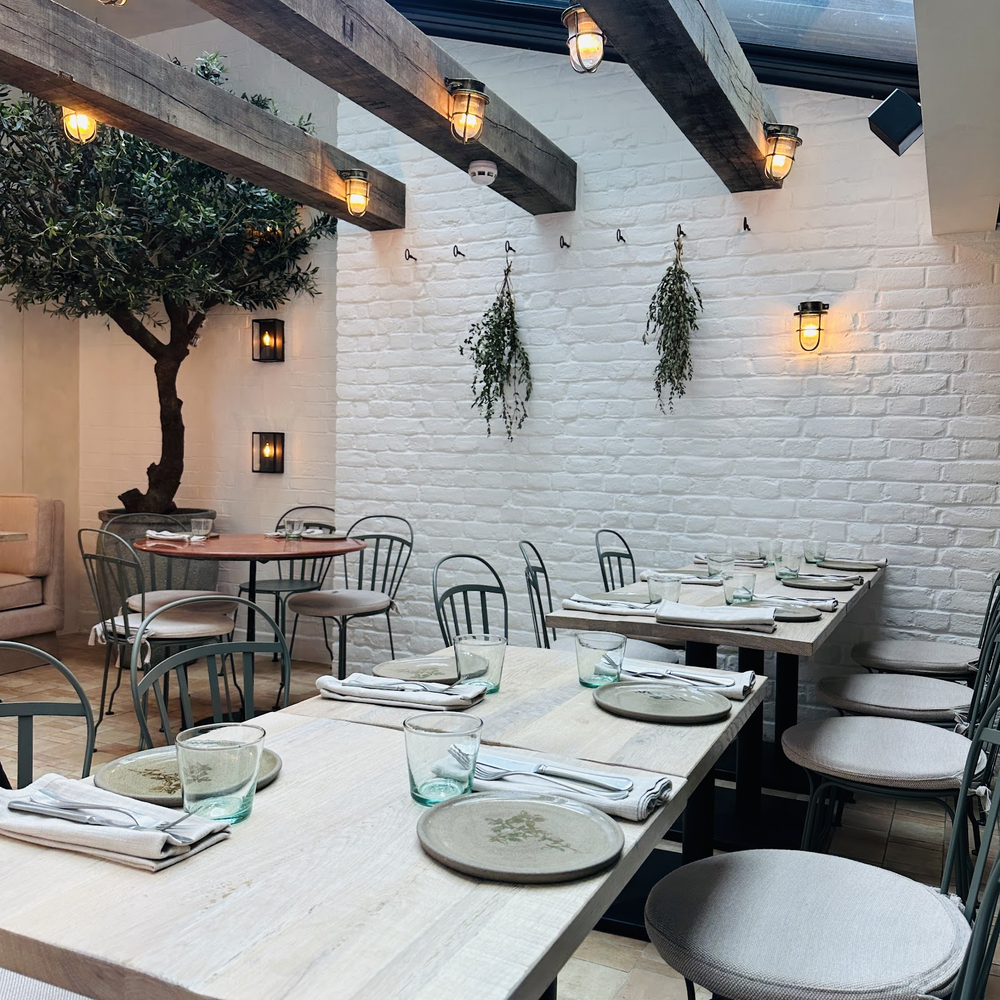

*Akub's dining room.*

The brunch centres on **Arabic coffee, French toast and zahra fritters**. Order the **qalayet bandora** — eggs cooked into a slow, rich tomato sauce — with labaneh under za'atar, the nutty cauliflower fritters with coriander tahini, and the **aubergine fatteh** under garlic yoghurt. The French toast is made with Arabic coffee and finished with cocoa and pistachio.

**Weekends only for brunch, and it books up ([book a table](https://www.sevenrooms.com/reservations/akub))**. In the MICHELIN Guide.

### Bistrotheque, Bethnal Green

*Weekend only · live piano 12–3pm* · Cited by 2 sources

Up a side street in Bethnal Green, in the remains of an old clothing **sweatshop**: a large white-walled warehouse room with no signage outside, open since 2004.

Weekend brunch pulls dishes from the main bistro carte alongside the breakfast ones: a **full English**, eggs Benedict, **scrambled eggs with chorizo**, next to moules marinière, steak tartare, and asparagus with a poached egg and hollandaise. A **live pianist plays pop covers** through the service.

**Saturday and Sunday, and reservations are essential ([the venue's site](https://www.bistrotheque.com/))**.

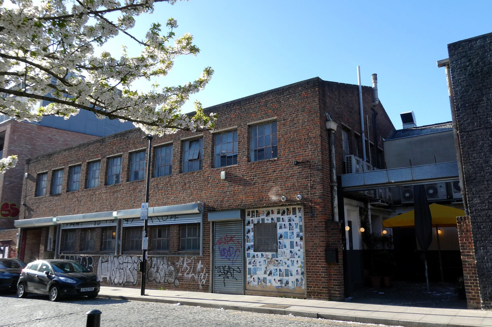
*Bistrotheque, Bethnal Green. Photo: [Ewan-M](https://commons.wikimedia.org/w/index.php?curid=187564628), [CC BY-SA 4.0](https://creativecommons.org/licenses/by-sa/4.0/).*

### Carmel, Queen's Park

*Weekend only · Sat and Sun 10am–3.30pm* · Cited by 2 sources

The Queen's Park sibling of Berenjak and Palomar, cooking across the **Eastern Mediterranean** in a relaxed all-day room.

The centrepiece is the **tabun oven**, and the flatbreads that come out of it with a changing set of seasonal toppings are what to order. Around them are morning mezze, pastries baked in-house, and a short list of plates that changes often.

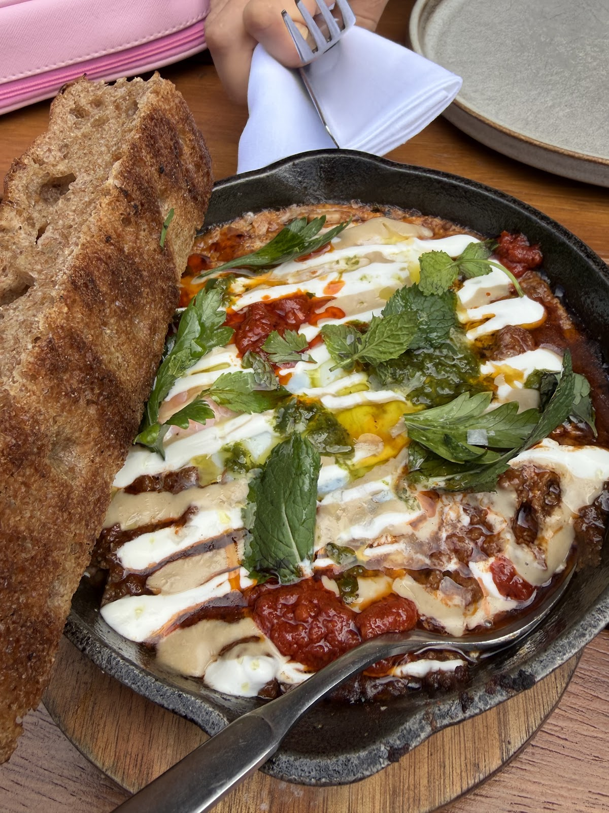

*Carmel's baked eggs.*

**Brunch runs Saturday and Sunday, 10am to 3.30pm.** Book through [the venue's site](https://www.carmelrestaurant.co.uk/); the early and late slots are easier to get.

### Mr Bao, Peckham

*Weekend only · bottomless £24 an hour* · Cited by 2 sources

A small Peckham room doing **Taiwanese steamed bao** and small plates, with breakfast fillings inside the bao at brunch.

The **hash brown bao** is the one to order: crispy rösti, shiitake mushrooms, cheese and chilli bean sauce inside a steamed bun. Beside it a **bacon bao** with a smoked ham hock fritter and plum sauce, **The Drunken Prawn** with pickled mooli and spiced spring onions, a beef brisket bao, and a salmon and onsen egg bao. Order smacked cucumber, sticky edamame and the flaky jiang bing crepe to share, and the **smoked salmon chawanmushi** with ginger and crispy potato if it is on.

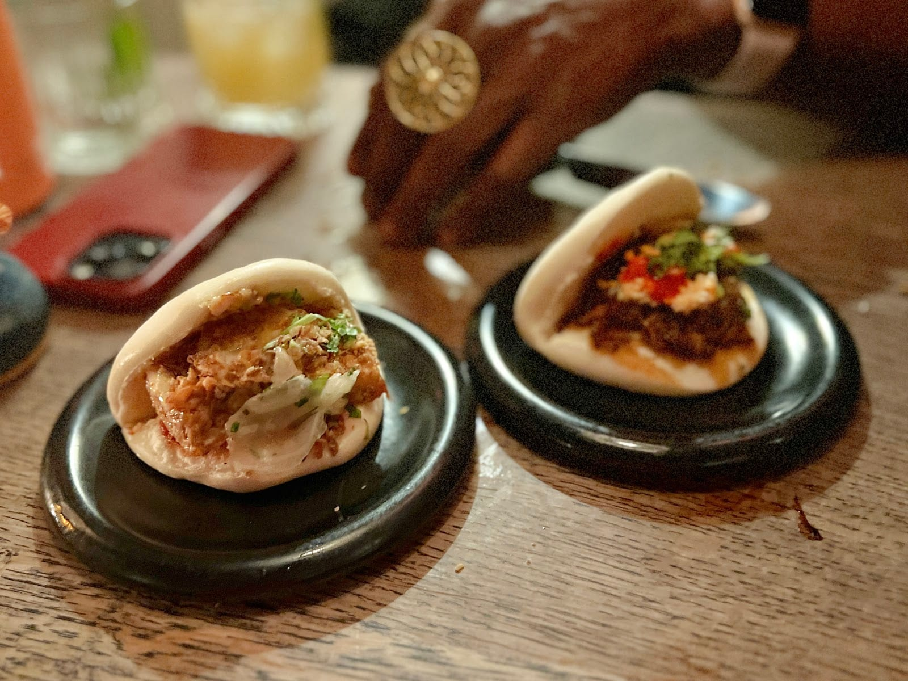

*Mr Bao's hash brown bao.*

**Brunch is weekends only, 11am to 4.30pm.** The room is tiny — book ([book a table](https://www.sevenrooms.com/explore/mrbaoryelane/reservations/create/search/)), or go early.

### Christopher's, Covent Garden

*Weekend only · Sat 11am–3pm, Sun 11am–3.30pm* · Cited by 3 sources

On the same Covent Garden corner **since 1991**, in a building from 1870. Two storeys: a martini bar on the ground floor and a sweeping staircase up to the first-floor dining room, which is where brunch happens.

The **chocolate brioche French toast** is the house speciality, buttermilk pancakes are the weekend order, and there is a **whole grilled lobster with garlic butter** for anyone treating brunch as lunch.

**Brunch runs until 3.30pm on Sundays**, and books through [the venue's site](https://www.christophersgrill.com/).

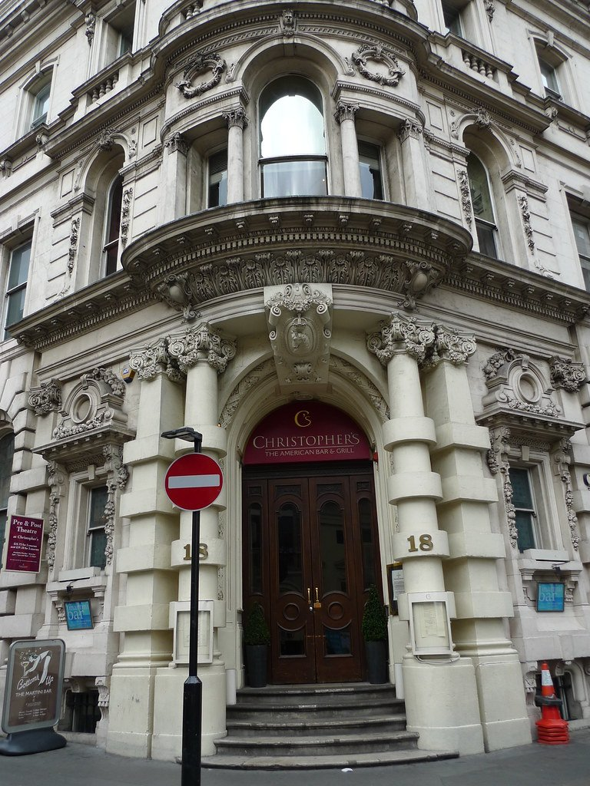
*Christopher's, Covent Garden. Photo: [Ewan-M](https://www.flickr.com/photos/55935853@N00/3588167076), [CC BY-SA 2.0](https://creativecommons.org/licenses/by-sa/2.0/).*

### Esters, Stoke Newington

*Saturday only · no bookings, card only* · Cited by 2 sources

A small corner café on Stoke Newington Church Street run by **Nia and Jack**, who make as much as they possibly can in-house: the jams, the yoghurts, the pickles, the cakes.

The menu changes with the season and keeps three fixtures: **Bircher muesli with a seasonal compote**, a **French toast** that gets rebuilt constantly (whipped ricotta, kumquat and cranberries in winter), and an egg dish, fried or poached, with whatever is good that month.

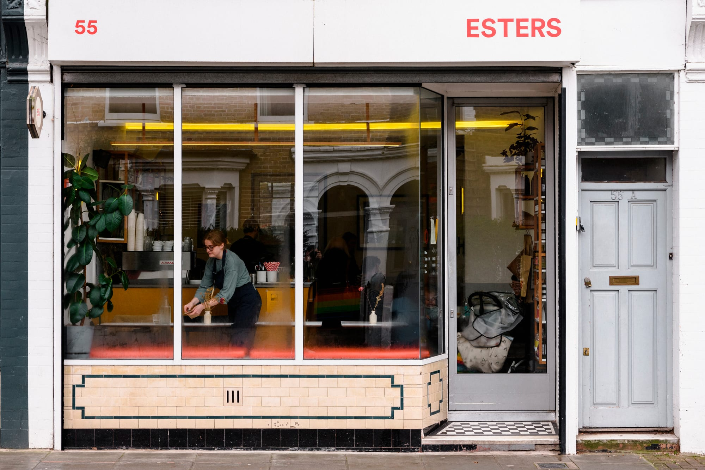

*Esters, Stoke Newington.*

**Small, and no bookings**; expect a queue on Saturday.

---

Powered by <a target="_blank" rel="sponsored" href="https://www.getyourguide.com/london-l57/">GetYourGuide</a>

## Every day of the week

### Sunday in Brooklyn, Notting Hill

*Daily · also Marylebone* · Cited by 2 sources

The Williamsburg original's first site outside New York, and the **hazelnut and brown butter pancakes** are the reason to come.

Prices: avocado toast **£12.80**, cheddar scramble **£17.50**, shakshuka **£15.50**, an egg sandwich **£13.80**, and chia pudding at **£8** if you want the cheap way in.

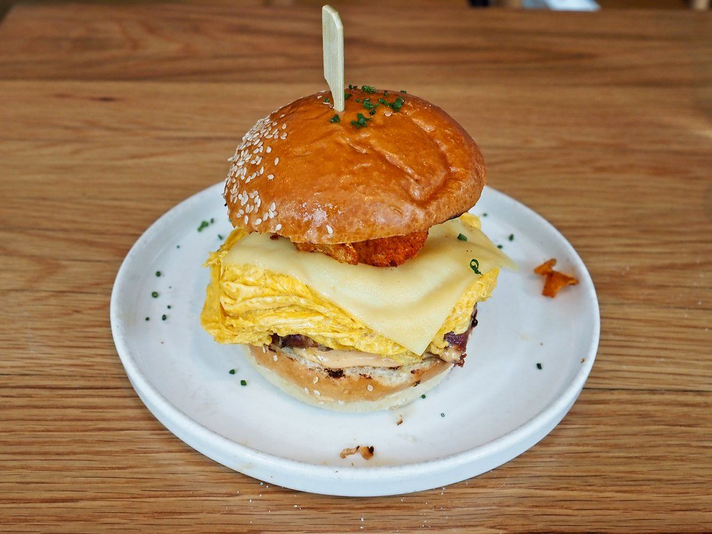

*Sunday in Brooklyn, Shoreditch. Photo: [Bex.Walton](https://www.flickr.com/photos/7831824@N04/51995111426), [CC BY 2.0](https://creativecommons.org/licenses/by/2.0/).*

### TAB x TAB, Westbourne Grove

*Daily · last food orders 3pm* · Cited by 2 sources

An independent at **14–16 Westbourne Grove** with a short menu of specialty coffee and tea, brunch, baked goods and cocktails.

The **oat flat white made with Ozone coffee** is what it is known for, alongside good matcha and **single-origin filter from a guest roaster that changes monthly**, so the brew list is different every few weeks. On the food side: **avocado toast, vegan pancakes, creamy mushrooms and scrambled eggs on toast, eggs Benedict and Royale**, plus a **halal chicken katsu sando** and **berry French toast**.

Counter service; it fills mid-morning at weekends and is calm on a weekday.

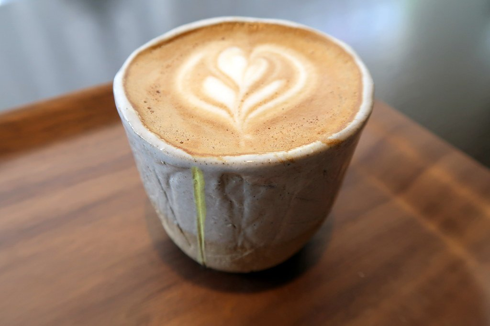
*Tab x Tab, Bayswater. Photo: [Bex.Walton](https://www.flickr.com/photos/7831824@N04/36652781816), [CC BY 2.0](https://creativecommons.org/licenses/by/2.0/).*

### The Laundry, Brixton

*Daily · a former laundry* · Cited by 2 sources

An all-day bistro a minute from Brixton station, in a converted laundry.

Order the **toasted banana bread with honeycomb butter** or the **courgette and cheddar cornbread** with black bean and tomato salsa under a green goddess dressing. There are eggs and bigger plates behind both.

**Brunch runs 10am to 3pm on Saturdays**, and the kitchen is open all day the rest of the week. Book at weekends ([the venue's site](https://www.thelaundrybrixton.com/)).

### Inis, Fish Island

*Wed–Sun · mornings end at 11.30am* · Cited by 2 sources

**British and Irish cooking** in Fish Island Village, on the canal behind the Olympic Park.

The **Full Irish** is the signature dish. Also on the menu: **roast potato farls with eggs**, porridge with poached quince, blackberries and a brown butter crumble, **brûléed French toast with caramelised baked apples**, a fine herb omelette with butterhead salad, and house-made Irish brown or tin loaf toast with their own jam.

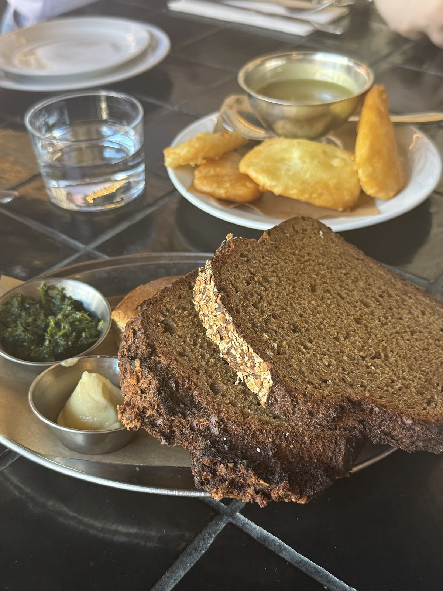

*Inis's brown bread.*

Open for breakfast, brunch, lunch and a **Sunday lunch**. Book at weekends; a weekday is much quieter.

### Burnt Arches, Bethnal Green

*Tue–Sun · a railway arch · Cited by 2 sources*

The Burnt group's Poyser Street site is a **café, restaurant and working bakery under one railway arch**, with the bakery visible from the tables.

The brunch menu includes a **crab and 'nduja herby omelette** with brown crab aioli and fried bread, and **aloo gobi fried eggs** under a coriander salsa. The bakery counter changes daily and runs to things like a **Welsh rarebit custard danish** and kimchi loaves. Coffee is **Climpson & Sons**.

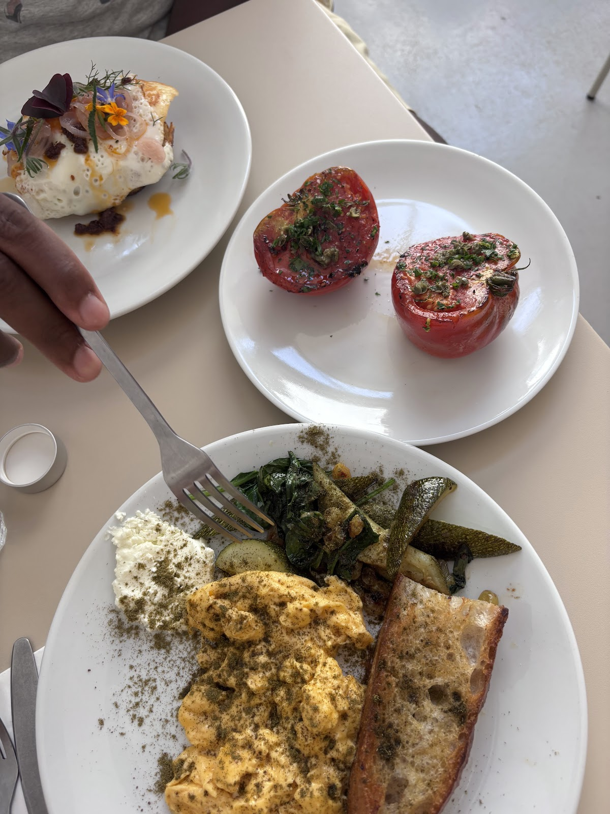

*Burnt Arches' spiced eggs.*

**278 Poyser Street, E2. Closed Mondays**, open for coffee and brunch daily otherwise, with dinner four nights a week. The other Burnt sites are in Shepherd's Bush and inside RADA.

---

## Chains and mini-chains worth the visit

Three chains are covered in full above: **[Granger & Co](#granger--co-notting-hill)** (four London sites), **[Dishoom](#dishoom-covent-garden)** (eight) and **[Caravan](#caravan-clerkenwell)** (seven). The rest are below.

### The Breakfast Club, several sites

*££ · since 2005* · Cited by 3 sources

Started as one café in Soho in 2005, American-diner in spirit.

**Pancakes are the order**: with bacon or berries and maple syrup, the all-American pancake breakfast, salted caramel and banoffee, and a vegan blueberry version. Full breakfasts, huevos rancheros and a long list of egg dishes alongside.

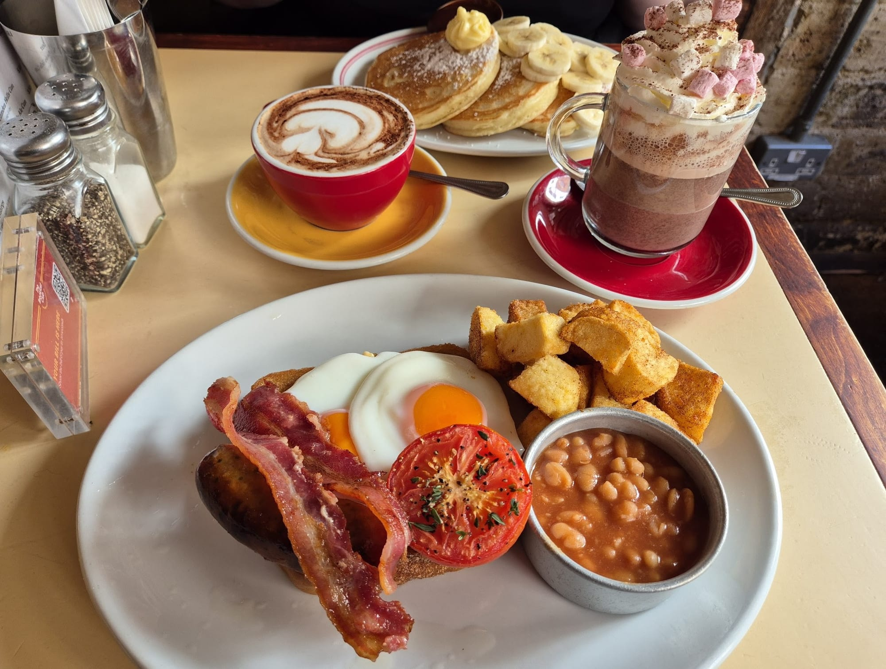

*Pancakes and a full breakfast.*

Covent Garden, Hackney Wick, London Bridge and Croydon among others. **The queues are real at weekends** and most sites do not take bookings — go on a weekday or go early.

### Megan's, many sites

*££ · the flower-covered ones* · Cited by 2 sources

Flower-covered frontages, Mediterranean all-day food and a bottomless brunch.

The format is **mezze you assemble yourself**: dips, flatbreads, small plates and little grills. The house things are the **posh kebabs**, the espresso martini and the **half-baked cookie dough**, and the brunch menu runs the usual eggs alongside bowls and grills.

**Twenty-two sites, ten of them in London** — Parsons Green, Battersea, Clapham Old Town, Balham, Wandsworth, Wimbledon, Dulwich, Chiswick, Kensington and Islington, with the rest along the Thames and out through Surrey and the home counties.

**[Book for weekends](https://megans.co.uk/bookings/)**, particularly the bottomless sittings, which run to a time limit and fill first. Weekday mornings are walk-in and calm.

### Ottolenghi, five sites

*£££ · the counter* · Cited by 2 sources

Deli counters piled with salads and cakes, with shared tables; the Good Food Guide singles out the morning trade. [Islington](https://ottolenghi.co.uk/pages/restaurants/islington), Notting Hill, Spitalfields, Chelsea and Marylebone.

The **Middle Eastern breakfast (£12.90)** is the one to have: feta, a fried egg, chopped salad and pita. A bread board of croissant or pain au chocolat runs **£7.90**, and granola with yoghurt and fruit salad **£12.60**.

Counter service and communal seating, so it suits one or two people better than a group. Best before 10am.

---

Powered by <a target="_blank" rel="sponsored" href="https://www.getyourguide.com/london-l57/">GetYourGuide</a>

## Cheap, and open early

**Across the thirteen caffs one specialist has priced, a full English runs from £6.50 to £18.50.** The sub-£10 caffs are in Newham, Leytonstone, Pimlico, Hammersmith and Liverpool Street. Central London caffs otherwise cluster around £11–£13, and the modern brunch rooms start around £13 for a plate of eggs.

#### Under £10

* **Cosy Café**, Newham — **£6.50**, the cheapest of the thirteen priced. *Cited by 1 source*
* **Astral Café**, Pimlico — **£8.70**. *Cited by 1 source*
* **George's Café**, Leytonstone — **£8.80**. *Cited by 1 source*
* **The Ritz Café**, Hammersmith — **£8.90**, British-Turkish, open from 6.30am and every breakfast comes with tea. *Cited by 2 sources*
* **Riccardo's Café**, Liverpool Street — **£9**. *Cited by 1 source*
* **Half Moon Café**, Hammersmith — **£9.20**. *Cited by 1 source*

#### The caffs

* **Regency Café**, Westminster — a **set breakfast at £9.99**. Open since 1946, black-tiled, with orders shouted across the room. Monday to Saturday, 7am to 3.30pm, closed Sundays. *Cited by 3 sources*
* **Terry's Café**, Southwark — the Standard is **£15.50** and the Works **£18.50** with Cumberland sausage, bubble and squeak and black pudding. Daily 7.30am–3pm. Home-cured bacon, and a family running it since 1982. *Cited by 4 sources*
* **E Pellicci**, Bethnal Green — Grade II listed and family-run since 1900. Cash-friendly, closed Sundays. *Cited by 3 sources*
* **The Electric Café**, West Norwood. *Cited by 3 sources*
* **The River Café**, Putney Bridge — **£11.60**. The caff, not the Michelin-starred Italian in Hammersmith; two sources name this one and mean the fry-up. *Cited by 2 sources*
* **Andrew's Café**, Holborn — **£11.80**, running since the 1970s. *Cited by 2 sources*
* **Billingsgate Café**, Poplar — **£13**, opening for the fish market. *Cited by 2 sources*

#### Pubs and odd hours

* **Wetherspoons**: a cooked breakfast from 8am for a few pounds. **There are around 37 branches in central London**, and roughly 800 across the UK; Westminster has eight, Camden seven, Southwark six, the City four. Four are in notable buildings: **The Crosse Keys** (a 1913 banking hall), **Hamilton Hall** (the Great Eastern Hotel's former ballroom), **The Ledger Building** (an 1802 West India Dock office) and **The Montagu Pyke** (a former cinema). The breakfast menu is the same in all of them.
* **Polo Bar**, Liverpool Street — a fry-up at any hour, run by the Inzani family since 1953. **It has no front door**; on Christmas Day, the only day it closes, they nail plywood over the entrance.
* **The Attendant**, Fitzrovia — brunch inside a Victorian public lavatory, with the urinals as the counter.

#### Markets and bakeries

* **Borough Market** opens early, and the bakery counters sell coffee and a pastry for a few pounds.
* **Maltby Street Market**, weekends — **St John Bakery Room** does the Old Spot bacon sandwich that people cross London for.
* **Old Spitalfields** and **Seven Dials Market** both have breakfast counters open before the shops around them.

---

## Also named, briefly

Six more rooms, each named by two independent sources.

| Venue | Area | Cited by | What it is |
| --- | --- | --- | --- |
| **[Common Ground](https://www.commongroundlondon.co.uk/)** | Finsbury Park | 2 | A garden, a gently enforced no-laptop policy and a potato latke eggs benedict, at 49 Stroud Green Road |
| **[The Good Egg](https://the-good-egg-neighbourhood-restaurant-stoke-newington.resos.com/booking)** | Stoke Newington | 2 | Middle Eastern street food across separate brekky and brunch menus on Church Street, with a second London room inside Eat17 in Walthamstow. Books online |
| **[Corrochio's](http://corrochios.com/)** | Dalston | 2 | A Mexican dining room on Stoke Newington Road doing brunch tortas and chilaquiles with a fried egg dribbling into the refried beans, and margaritas alongside |
| **Sunday** | Islington | 2 | Brioche french toast and a courgette fritter at 169 Hemingford Road, and the weekend queue that goes with them |
| **[Brickwood](https://www.brickwoodcafes.co.uk/)** | Clapham | 2 | An Antipodean café on Clapham Common South Side, with more of them south of the river in Balham, Battersea and Putney |
| **[Juliet's Quality Foods](https://juliets.london/)** | Tooting | 2 | Hollandaise infused with espresso and a house cornbread built for hand-churned butter, on a busy stretch of Tooting high street |

---

## What to know

* **Hotel breakfasts are often open to non-residents** and are usually quieter than the brunch rooms.
* **A flat white in London runs £3.50–£4.50.** Anything under £3 is unusual; anything over £5 is a hotel.

---

## Continue planning your London trip

- 🇬🇧 **[Classic British Food in London](/articles/classic-british-food-london/)** — Scotch eggs, pie and mash, sausage rolls and proper puddings, dish by dish.
- ☕ **[The Best Coffee in London](/articles/best-coffee-london/)**
- 💷 **[Cheap Eats in London](/articles/cheap-eats-london/)**
- 🫖 **[The Best Afternoon Tea in London](/articles/best-afternoon-tea-london/)**
- 🍽️ **[Eat in London: Restaurants, Food Markets & Quick Food Hub](/articles/eat-in-london-guide/)**
- 🎭 **[Covent Garden Area Guide](/articles/covent-garden-area-guide/)**
- 🏙️ **[City of London Area Guide](/articles/city-of-london-area-guide/)**
