London's burgers come in two shapes: the **smash**, a thin patty pressed hard onto the hot plate so the crust caramelises edge to edge, and the **thick dry-aged patty**, cooked pink and treated like a small steak. Almost every place below commits to one, and knowing which you prefer halves the list.

Every restaurant below is ranked by **how many independent awards, critics and reviewers named it**, with the judged award weighted above the press and the press above the listings sites. Where they disagree, it gets its own section.

> 💡 **The Short Version:** **Bleecker** and **The Plimsoll** are level at the top on seven sources each. **Honest Burgers** won the National Burger Awards 2026 — but only at one branch. **Supernova** in Soho runs a 25-word menu. **Dove** makes ten burgers a night and stops. And **Jupiter Burger** at Netil Market sells two burgers and nothing else.

> 📊 **The evidence behind this guide.**
> **9 sources carrying 110 citations** across **49 named burgers**. **24 are named by two or more independent sources; 6 carry a dated award.**
> **Built on:** the National Burger Awards 2026; Time Out, Hot Dinners, The Infatuation and Eater London.
> *Evidence built 31 August 2026 · [How we rank →](/how-we-rank/)*

## Where they are

| If you are near… | Where to eat |
| --- | --- |
| **Soho & Fitzrovia** | Supernova, Heard, Manna, Chuck's, Fat Hippo |
| **Mayfair & Victoria** | Dover Street Counter, Hanbaagaasuuteeki |
| **Shoreditch & Spitalfields** | Burger & Beyond, Dumbo, Blacklock, One Club Row |
| **Hackney & London Fields** | Bake Street, Jupiter Burger, Lagom (Dalston) |
| **North London** | The Plimsoll (Finsbury Park), Bolland & Crust (Tottenham) |
| **West London** | Dove (Notting Hill), GOAT Burger (Knightsbridge) |
| **South London** | Mother Flipper (Brockley), Baba G's (Brixton) |
| **Multiple sites** | Bleecker, Honest Burgers, Patty & Bun, MEATliquor, Burger & Lobster, Beer + Burger Store |

**Price guide:** **£** under £15 a head · **££** £15–£30 · **£££** £35+.

---

## The two number ones

Two restaurants sit level at the top on seven sources each. **Bleecker** is a burger shop; **The Plimsoll** is a Finsbury Park pub whose kitchen makes the burger critics keep writing about. A third name, **Honest Burgers**, holds the 2026 trophy.

### Bleecker, Victoria, Soho and Baker Street

*££ · multiple sites · walk-in · Cited by 7 sources · National Burger Awards 2026 finalist · [website](https://www.bleecker.co.uk/)*

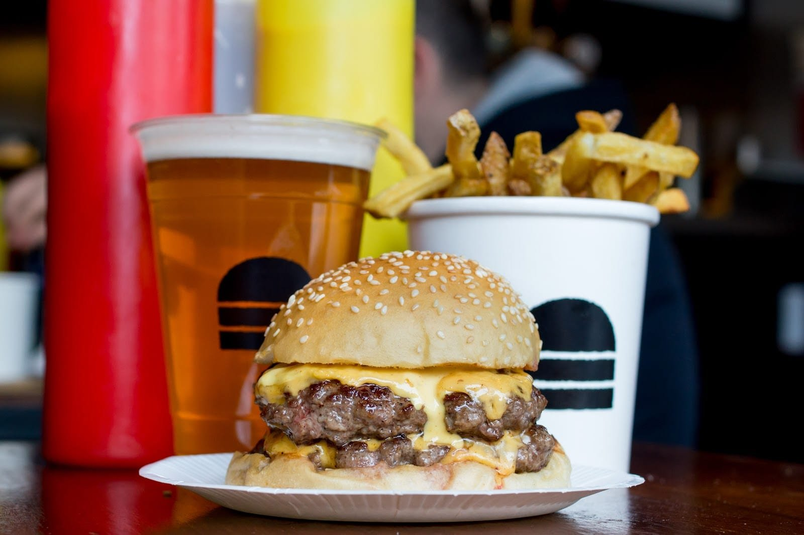

*Bleecker's double cheeseburger.*

**The only name here that appears on every kind of list**: the award shortlist, the critics, the listings sites and the tourist board.

The menu is tiny: **a cheeseburger, a double, a bacon double, and a blue cheeseburger**, on dry-aged beef with a crust from a hard sear. There is no lettuce or tomato. The **Bacon Double** is what it took to the National Burger Awards 2026 final.

Add a malted shake to cut through the salt and fat. The shops are counters and paper, no ceremony.

**££, walk-in, no bookings.** Victoria, Soho and Baker Street among others; queues move because the kitchen makes four things.

### The Plimsoll, Finsbury Park

*££ · Finsbury Park · 6 min from Finsbury Park · walk-in · Cited by 7 sources · [website](https://www.theplimsoll.co.uk/)*

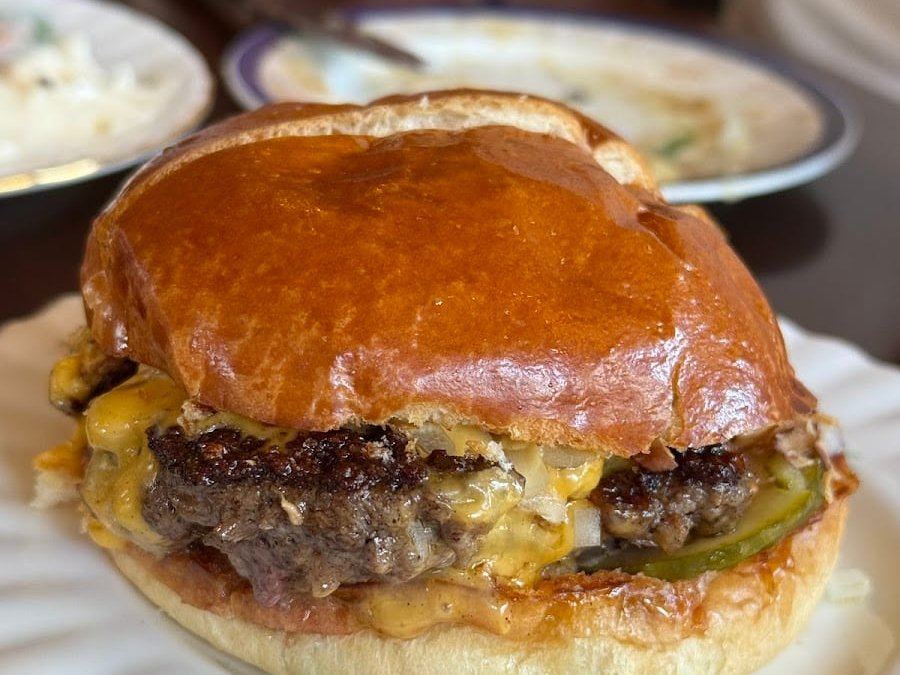

*The Plimsoll's Dexter cheeseburger.*

**A modern Finsbury Park pub whose burger is cooked by the chef duo Four Legs**, so some sources file it under Four Legs and some under the pub.

The **Dexter cheeseburger** is the order: a Dexter beef patty, diced onion, pickles, cheese and burger sauce in a soft bun, and **no lettuce and no tomato**. The kitchen has said it is aiming at a McDonald's burger made with better beef.

The pub also cooks a seasonal menu, so this is a night out rather than a counter stop.

**££, and it does not take bookings for the burger** — turn up, put your name down, drink while you wait. Busiest from seven and at weekends.

### Honest Burgers, Liverpool Street and across London

*£ · multiple sites · Cited by 4 sources · **winner, National Burger Awards 2026** · [website](https://www.honestburgers.co.uk/)*

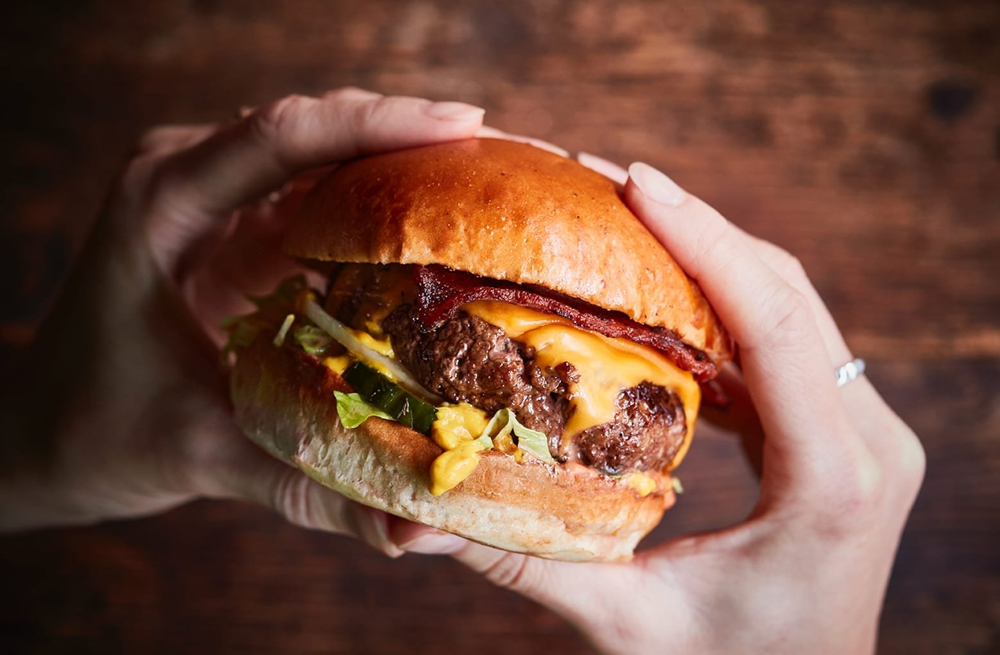

*Honest's cheeseburger.*

**The 2026 National Burger Awards winner**, and the winning burger is served at one address.

**The Honest** took the National Burger Awards outright: dry-aged beef from the company's own butchery, thick-cut Wiltshire bacon, a beef and onion relish, XL cheese, house pickles and diced onion. **It is on the menu only at the Smash + Grab site on Liverpool Street**, not at the chain's other branches, so ordering it elsewhere does not get you the winner.

The other branches each run a **local special**, changed regularly: Borough Market has done Brindisa chorizo and raclette, Covent Garden Lincolnshire Poacher with bourbon barbecue sriracha and crispy onions. Rosemary salted chips come with everything.

**£, walk-in at most sites**, among the cheapest sit-down burgers here.

---

## The disagreement

**The award and the critics are not measuring the same burger.**

The National Burger Awards is a live cook-off: sixteen finalists cook their signature burger for judges on one day in March, then cook two more rounds against a set of ingredients. The next is on 16 March 2027. It rewards a kitchen that can execute under pressure, and in 2026 a chain with its own butchery, **Honest Burgers**, beat the independents.

The critics favour **The Plimsoll**, **Bleecker**, **Black Bear Burger** and **Supernova**, none of which won in 2026; The Plimsoll did not enter.

The listings sites favour chains that are easy to reach: **MEATliquor**, **Burger & Lobster** and **Byron** turn up on Visit London and DesignMyNight and nowhere else in the sources.

For the burger a jury picked, go to Liverpool Street. For the one London's critics keep going back to, go to Finsbury Park.

---

Powered by <a target="_blank" rel="sponsored" href="https://www.getyourguide.com/london-l57/">GetYourGuide</a>

## Smash burgers

The smash burgers the sources agree on.

### Supernova, Soho

*££ · Soho · 3 min from Piccadilly Circus · walk-in · Cited by 4 sources*

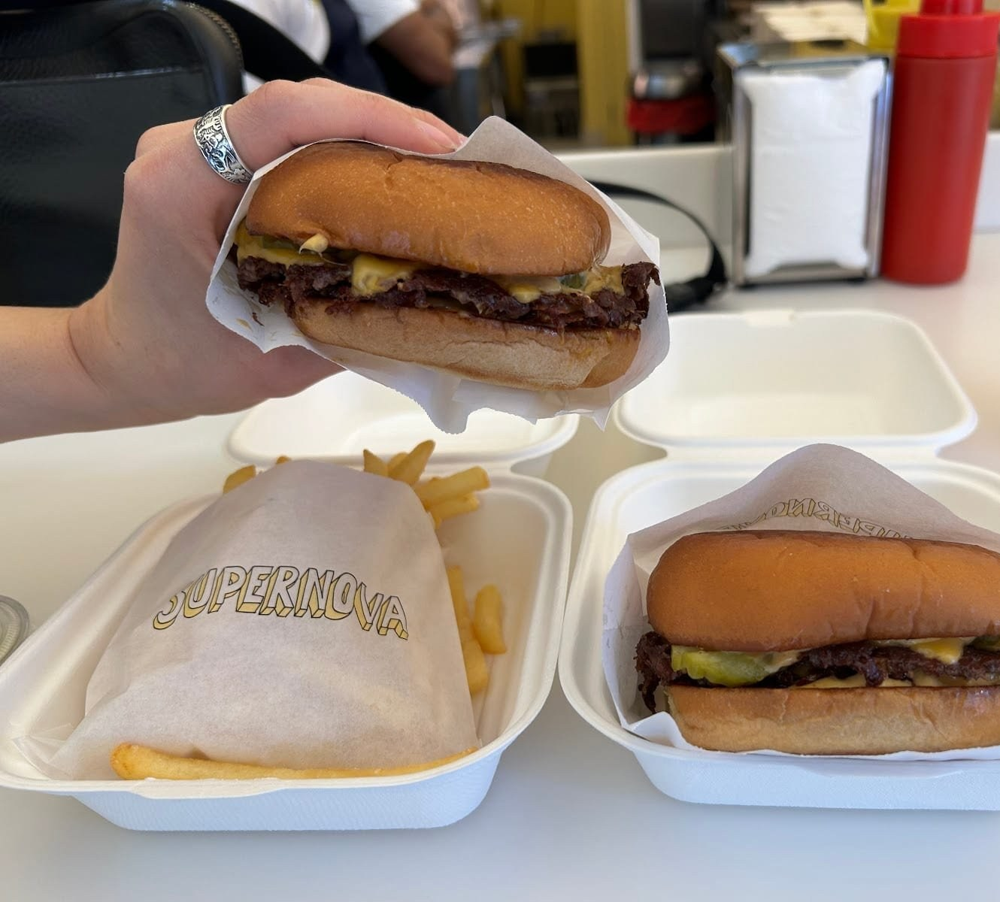

*Supernova's House Cheeseburger.*

**A 25-word menu.** It went viral on the shortness of the offer.

The **House Cheeseburger** is a smashed patty with house sauce, and the crust comes off so lacy at the edges that The Infatuation compared it to a doily. Hand-cut fries come beside it.

The room is small and pale, closer to a coffee bar than a burger joint, and it does takeaway.

**££, walk-in.** Soho, and it queues from about half past twelve.

### Manna, Soho

*£ · Arcade Food Hall, Tottenham Court Road · 1 min from Tottenham Court Road · walk-in · Cited by 4 sources*

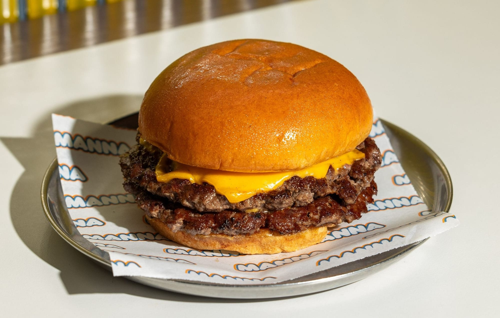

*Manna's cheeseburger.*

**A smash burger counter inside Arcade Food Hall**, straight up from the Tottenham Court Road ticket hall.

The burger is **heavy on cheese, with pickles and diced onion** on a thin, crisp-edged patty. There is a Nashville hot chicken version alongside it.

Everyone you are with can eat something different, nobody has to book, and a good burger costs under a tenner.

**£, walk-in, food hall hours.** Order at the counter, sit anywhere.

### Jupiter Burger, London Fields

*£ · Netil Market, London Fields · 8 min from London Fields · walk-in · Cited by 4 sources*

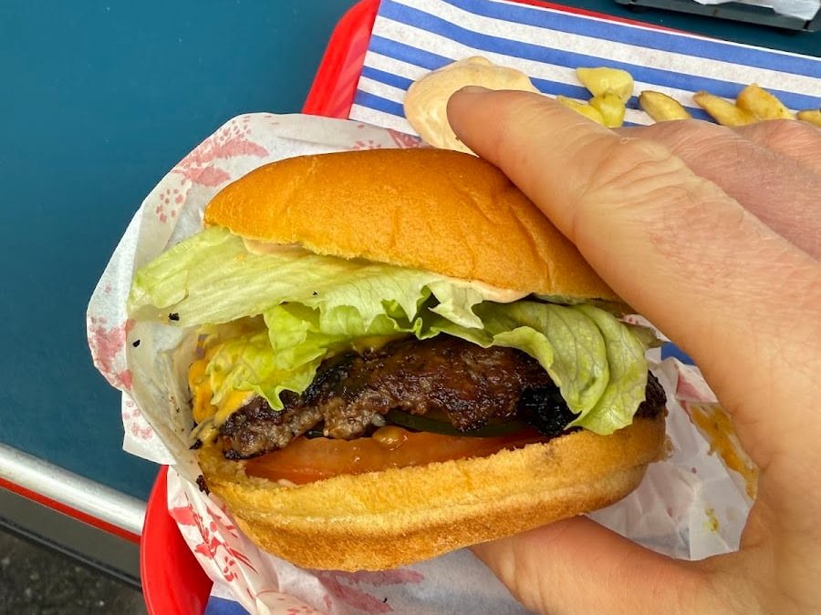

*Jupiter Burger's cheeseburger.*

**A stall at Netil Market styled as a retro diner**, from the team behind Dom's Subs.

**Two burgers on the menu and nothing else.** The cheeseburger is a well-seasoned smashed patty on a Martin's potato roll, small enough to eat one-handed round the market, with hand-cut fries if you want to stop.

Netil Market is a small yard of traders beside Broadway Market.

**£, walk-in, and market hours only**: it is not open every day, so check before travelling.

### Dumbo, Shoreditch

*£ · Shoreditch · 5 min from Shoreditch High Street · walk-in · Cited by 3 sources*

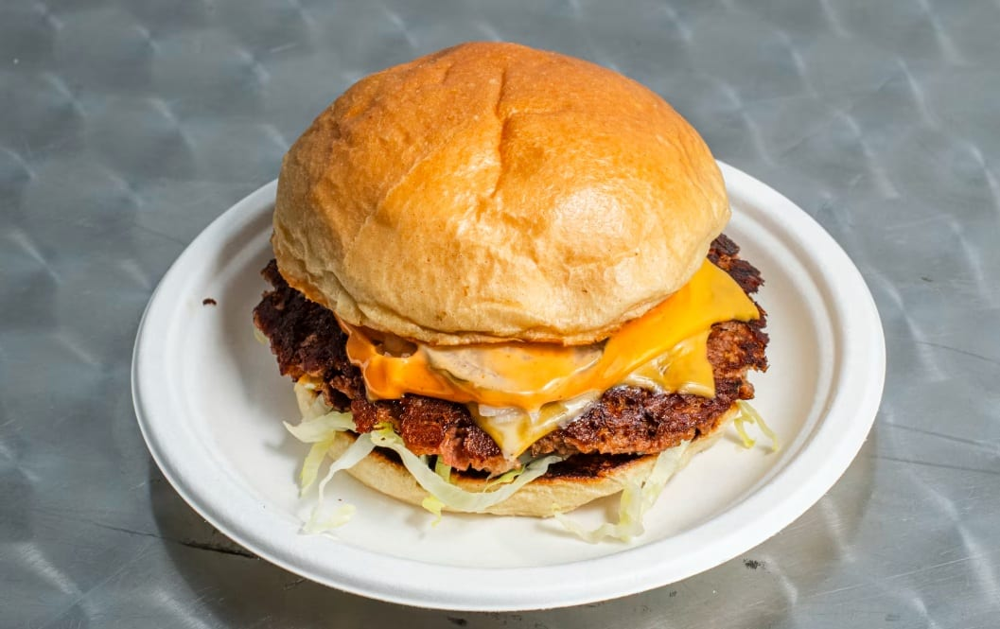

*Dumbo's smash burger.*

**Paris-born, with four items on the menu:** a cheeseburger, an earth burger, nuggets and fries.

The smashburgers have **juicy, crispy-edged patties with American cheese, onions, pickles, ketchup and mustard**, assembled the same way every time. The earth burger is the plant-based version.

Minimal room, quick turnover, a queue that moves.

**£, walk-in.** Shoreditch.

### Bake Street, Hackney

*££ · Hackney · walk-in · Cited by 3 sources*

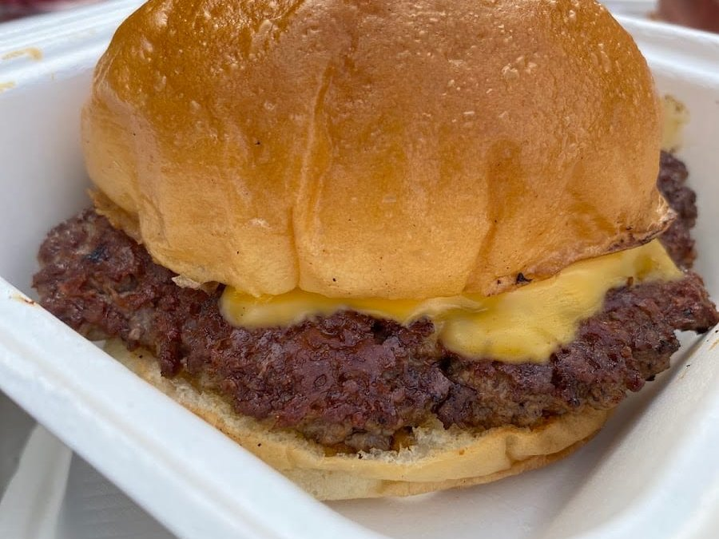

*Bake Street's weekend smashburger.*

**A bakery and all-day café whose burger is on three critics' lists.**

The smashburger is a **weekend-only item**, and the **Nashville hot chicken** is the alternative when it is on.

**££, walk-in, and check the day**: the burger is weekends only.

### Chuck's, Fitzrovia

*££ · Fitzrovia · walk-in · Cited by 2 sources*

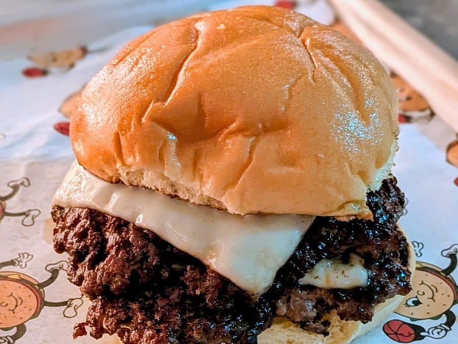

*Chuck's smash burger.*

**A candlelit den with a natural wine list that also makes a smash burger.**

The signature smashburger comes with **heavily charred edges on a fluffy potato bun**, and the kitchen has a **no-modifications policy**: it arrives as built or not at all.

**££, walk-in.** Small, in Fitzrovia.

### Hanbaagaasuuteeki, Victoria

*££ · 36 Buckingham Palace Road, SW1W 0RE · 4 min from Victoria · walk-in · Cited by 2 sources*

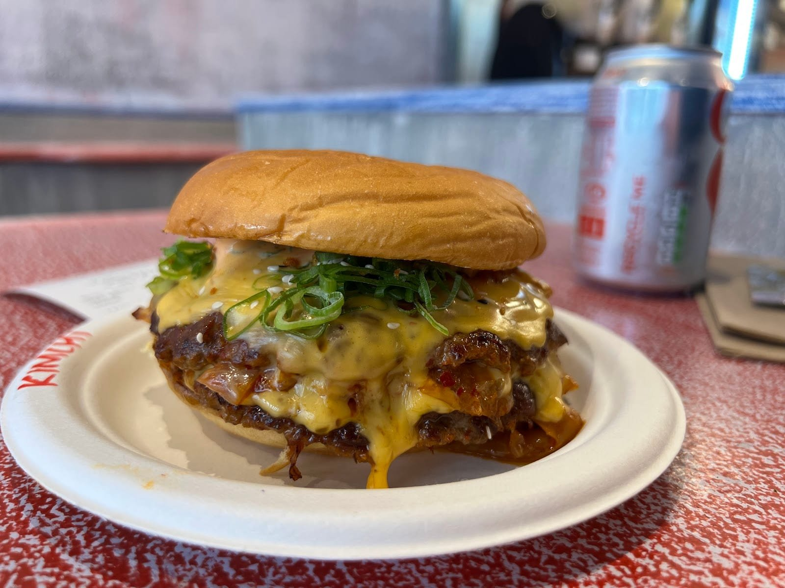

*The kimchi double smash.*

**The name translates roughly as "wonderful hamburger steak"**, and the restaurant is built on the Japanese *hanbāgu* tradition of treating a burger as a steak dish rather than a sandwich.

Smash patties go into **fluffy potato buns with Japanese, Korean, Thai and Chinese flavours**.

**££, walk-in, open daily 11.30am to 11pm.**

---

Powered by <a target="_blank" rel="sponsored" href="https://www.getyourguide.com/london-l57/">GetYourGuide</a>

## Thick patties, and the ones worth booking

A thick, dry-aged patty cooked pink. These are restaurants that make a burger, not burger shops, and several make very few of them.

### Dove, Notting Hill

*£££ · Notting Hill · book ahead · Cited by 4 sources*

**Ten burgers a service, and when they are gone they are gone.**

The patty is **50-day dry-aged British beef made from bavette offcuts, seared in beef dripping** for a heavy crust over a pink centre, then finished with **Lyonnaise onions cooked in butter and champagne and a layer of melted gorgonzola**. It is very rich; The Infatuation recommends splitting it.

**£££ and you must book**, early in the service. Just off Portobello Road; the rest of the menu is modern European.

### Blacklock, Shoreditch and across London

*£££ · 28–30 Rivington Street, EC2A 3DZ · book ahead · Cited by 4 sources · [book a table](https://theblacklock.com/)*

**A chop house whose burger critics rate above most burger restaurants.**

Inside a soft sesame bun: a juicy patty, **sliced gherkins, onions caramelised in vermouth and a mild sriracha-laced burger sauce**, with **beef-dripping fries** beside it. The rest of the menu is chops over charcoal in a warehouse room, plus a Sunday roast.

**£££ and it books ahead**, particularly at weekends. Several London sites; Rivington Street is the Shoreditch one.

### Dover Street Counter, Mayfair

*£££ · Mayfair · book ahead · Cited by 3 sources · National Burger Awards 2026 finalist*

**An upmarket Mayfair diner that took its plain cheeseburger to the National Burger Awards final.**

The burger is **ketchup, mustard and pickles on a golden brioche bun**, with **late-night service**.

**£££, book ahead.** Dover Street.

### Burger & Beyond, Shoreditch and Borough Yards

*££ · Shoreditch and Borough Yards · Cited by 6 sources · **second in the signature round, National Burger Awards 2026** · [website](https://burgerandbeyond.co.uk/)*

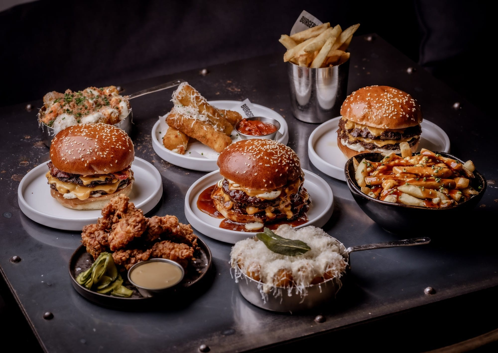

*The whole table at Burger & Beyond.*

**Second in the 2026 National Burger Awards**, and the most-cited name here after the top two.

The **Bacon Butter Burger** is what it entered and what to order: a dry-aged patty, **double American cheese, crispy pancetta, burnt butter mayo and onion**. Beyond it, the **Bougie Burger** with marrownaise and beef-fat onions, and a **Rice Krispie fried chicken burger**.

Order the **dirty tots** — tater tots under bone marrow gravy — rather than fries.

**££, walk-in at Shoreditch**, and the beef is dry-aged, grass-fed and native breed.

### Black Bear Burger, Shoreditch, Brixton and Exmouth Market

*££ · multiple sites · Cited by 5 sources · **winner, National Burger Awards 2025***

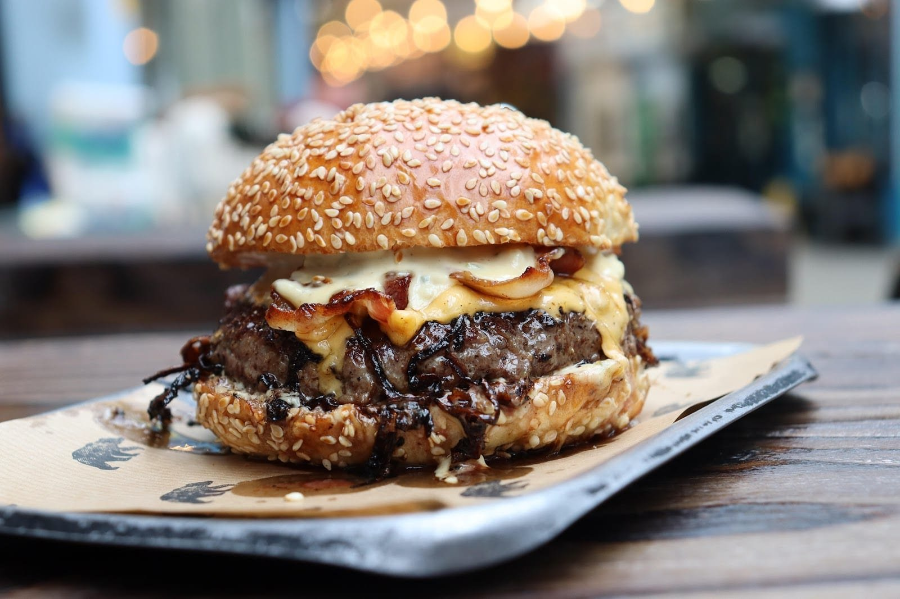

*Black Bear's dry-aged patty.*

**The 2025 national champion**, still named by five sources.

The **Miso Bacon Burger** is the one that won: dry-aged beef under **miso butter mayo and smoked bacon**. The **double black and blue** is the other order — dry-aged beef, cheese, smoked bacon, blue cheese sauce and onions. Add the wings; several sources insist on it.

**££, walk-in.** Sites in Shoreditch, Brixton and Exmouth Market among others.

### Heard, Soho and Borough

*££ · Soho and Borough · Cited by 3 sources*

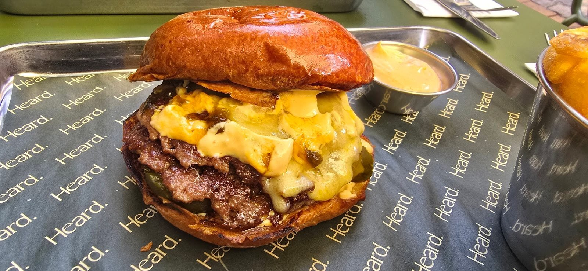

*Heard's double.*

**Founded by the two-Michelin-starred chef Jordan Bailey.**

Six burgers, all on **British beef from regenerative farms**, in **butter-toasted roast potato buns**. Wine or beer to match.

**££, walk-in.** Soho and Borough.

---

## Cheap, quick and at a market

* **Mother Flipper, Brockley** — *£ · Cited by 2 sources.* Started as a van, now a permanent Brockley site. The **Candy Bacon Flipper** is bacon fried in maple syrup with ketchup, mustard, lettuce, red onion, pickle and American cheese. **The van still trades at Brockley Market every Saturday, 10am to 2pm.**
* **Beer + Burger Store, King's Cross and east London** — *£ · Cited by 3 sources.* Craft ale alongside a double patty cheeseburger, a monthly special, kids' meals and a vegan burger on two pea protein patties. Order the dipping gravy.
* **Baba G's, Brixton** — *£ · Cited by 2 sources.* Indian-spiced burgers out of Brixton, on both Eater's and Hot Dinners' lists.
* **Lucky Chip, Islington** — *£ · Cited by 2 sources.* A long-running residency operation, at the Old Queen's Head.
* **Lagom, Dalston** — *££ · Cited by 4 sources.* A kitchen inside The Three Compasses doing a **smashburger with dill pickle slaw**, plus fried chicken and lamb. Pub setting, walk-in.
* **Buk, Camden** — *£ · Cited by 1 source.* Thin patty, double American cheese, chilli house sauce and caramelised onion. **Halal.**
* **Burnt Smokehouse, Leyton** — *£ · Cited by 1 source.* Double patty smashburger with caramelised onions and dill pickles, communal seating by the station. **Halal.**

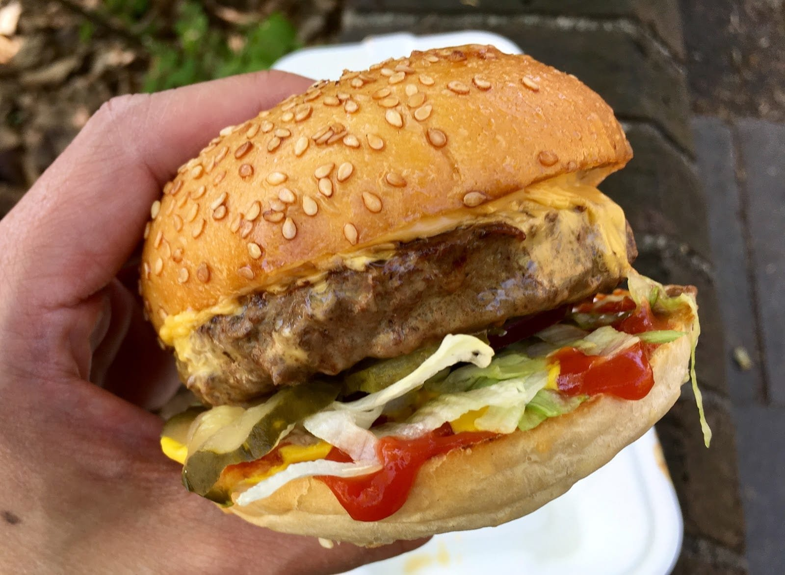

*Mother Flipper's cheeseburger.*

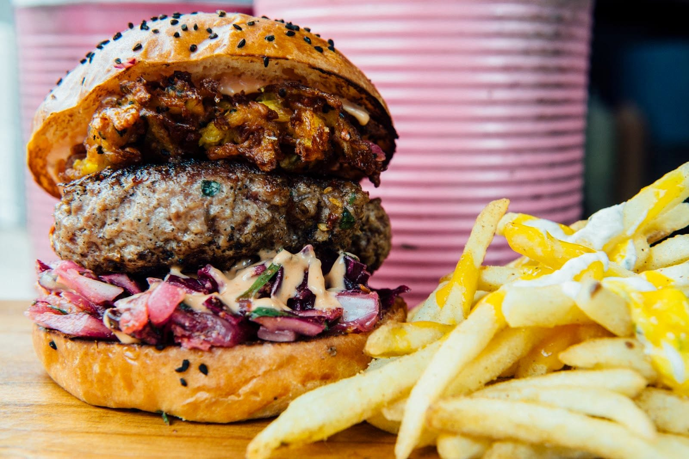

*Baba G's spiced patty.*

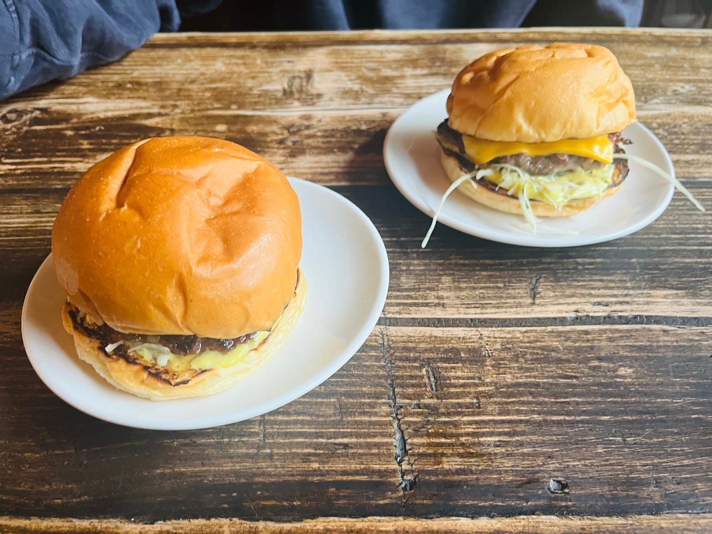

*Lagom's smashburger at The Three Compasses.*

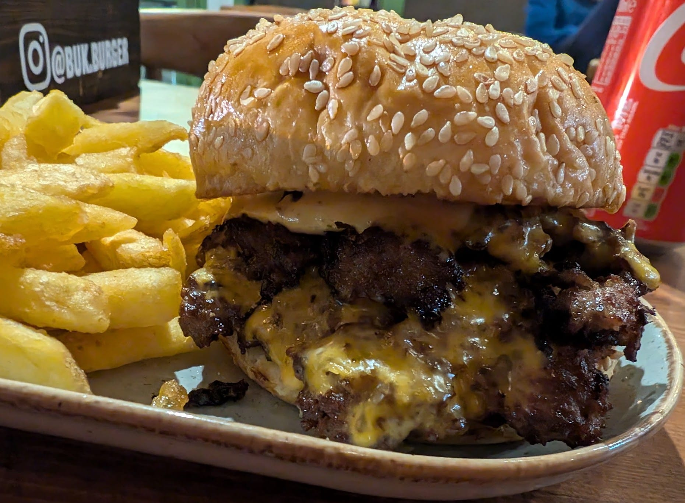

*Buk's double patty.*

---

Powered by <a target="_blank" rel="sponsored" href="https://www.getyourguide.com/london-l57/">GetYourGuide</a>

## The chains, and what they are for

Named by the listings sites rather than the critics.

* **Patty & Bun** — *££ · Cited by 2 sources.* Started as a 30-seat Marylebone room and now runs seven sites. Order **The Don**, or the **Ari Gold** with red leicester.
* **MEATliquor** — *££ · Cited by 2 sources.* The **Dead Hippie** with its secret sauce is the fan order. Good vegan options, including impossible nuggets and a black bean chilli dog.
* **Burger & Lobster** — *£££ · Cited by 2 sources.* The **B&L burger** with Nebraskan beef and Atlantic lobster, the most expensive burger in this guide: burger, lobster or lobster roll, all at one price, with the sides included. Bookable.
* **Dirty Bones, Carnaby, Soho and Shoreditch** — *££ · Cited by 1 source.* The **Mac Daddy** is topped with pulled beef rib and mac and cheese.
* **Fat Hippo, Soho** — *£ · National Burger Awards 2026 London finalist.* Entered **The Lovue Loot**. Won the plant-based Burger of the Year in 2025.
* **SoBe Burger, Walthamstow** — *£ · National Burger Awards 2026 London finalist.* Entered a **Double Bacon Black Garlic**.

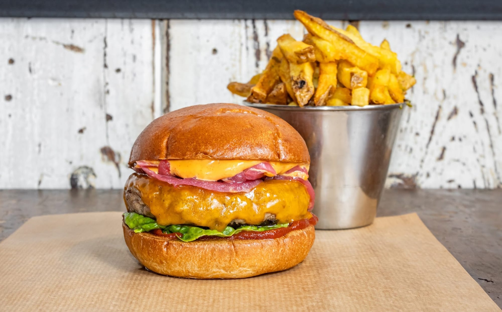

*Patty & Bun's cheeseburger.*

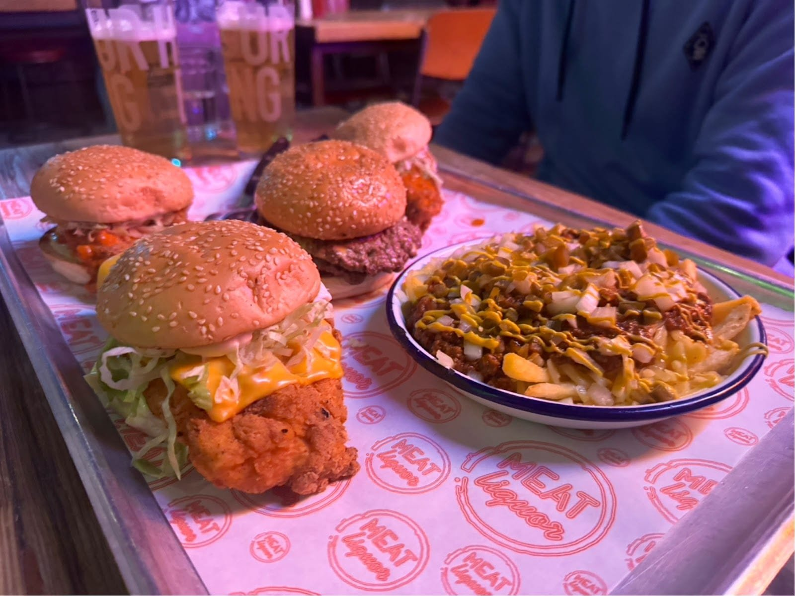

*MEATliquor's burgers and fries.*

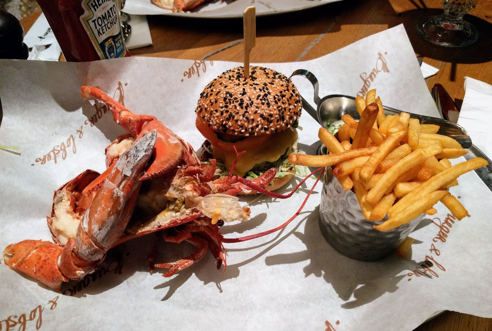

*The Burger & Lobster combination.*

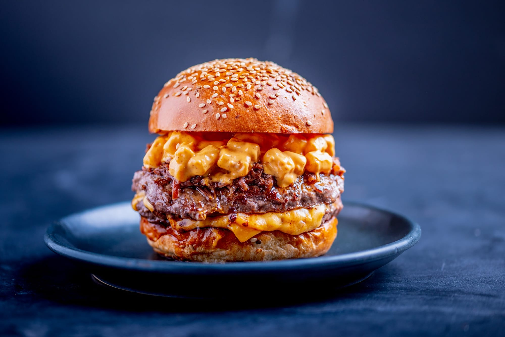

*Dirty Bones' cheeseburger.*

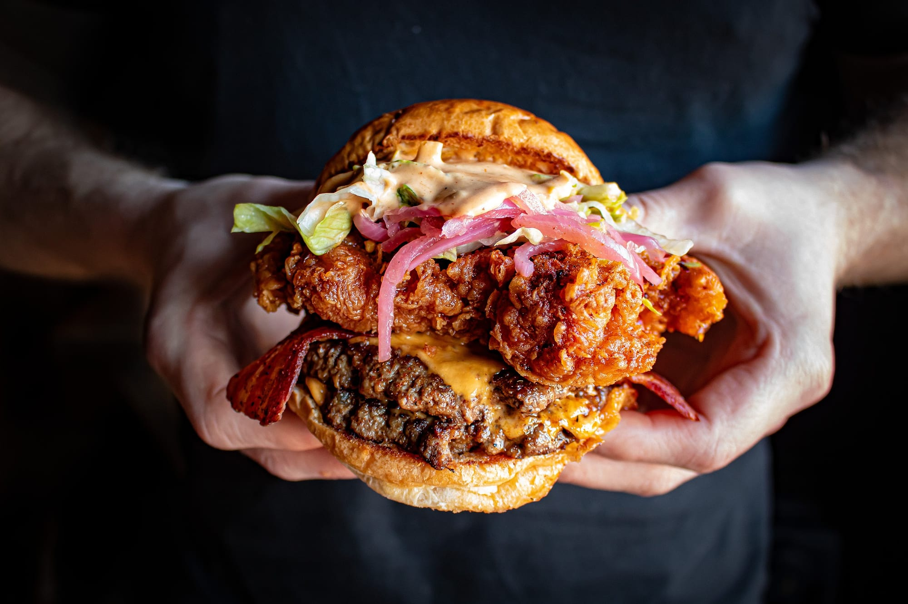

*Fat Hippo's stacked burger.*

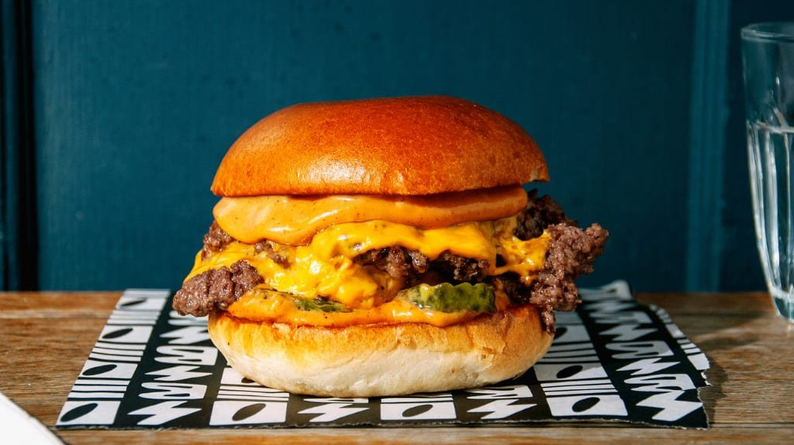

*SoBe's double smash.*

---

## Booking, and what to know

* **Almost nothing here needs a booking.** Bleecker, Supernova, Manna, Jupiter, Dumbo, Chuck's, Bake Street and every market stall are walk-in only.
* **Four places need one:** **Dove** and **Vesper** make roughly ten burgers a service and sell out early; **Blacklock** and **Dover Street Counter** are restaurants first. **One Club Row** is hard to book — it runs a walk-in light box outside, or try a lunch slot.
* **The award-winning burger is at one address.** "The Honest" is served at Honest Burgers' Smash + Grab on Liverpool Street and nowhere else.
* **Check the day before travelling** for **Bake Street** (burger at weekends only), **Jupiter Burger** (market hours) and **Mother Flipper's** Saturday van at Brockley Market.
* **Halal:** **Buk** in Camden and **Burnt Smokehouse** in Leyton are both halal.

---

## Continue planning your London trip

- 🍔 **[Cheap Eats in London: Places to Eat Well Under £15](/articles/cheap-eats-london/)**
- 🥩 **[The Best Steak in London](/articles/best-steak-restaurants-london/)**
- 🍕 **[The Best Pizza in London](/articles/best-pizza-london/)**
- 🍺 **[London's Historic Pubs and Dining Rooms](/articles/historic-pubs-dining-rooms-london/)**
- 🌙 **[Late-Night Eating in London](/articles/late-night-eating-london/)**
- 🗺️ **[Eat in London: the full food handbook](/articles/eat-in-london-guide/)**

---

*This guide is independent and contains no paid placements. Ranked on [how many independent sources name each venue](/how-we-rank/), not on our own visits. Evidence built **31 August 2026**.*
