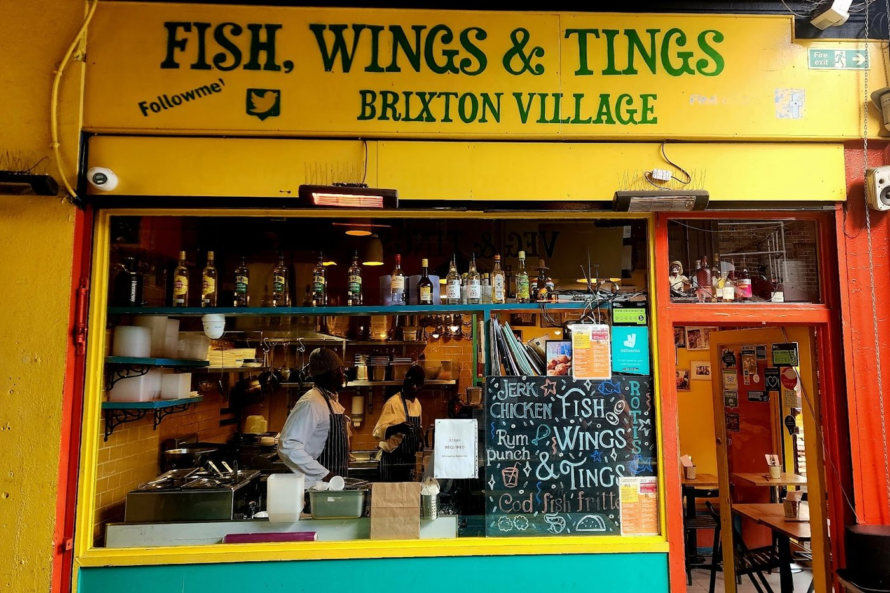
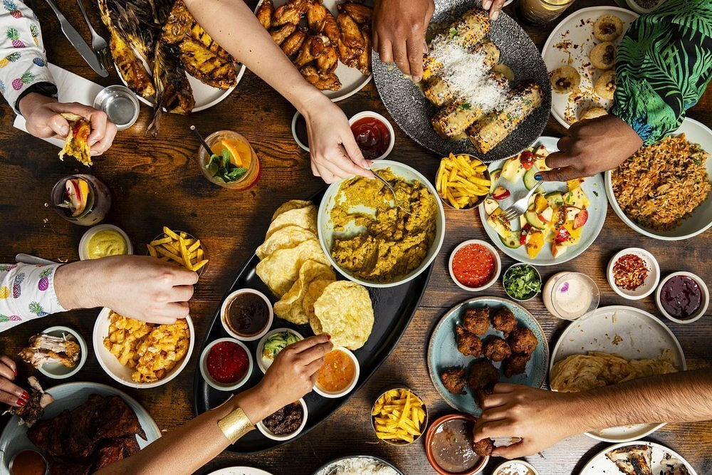
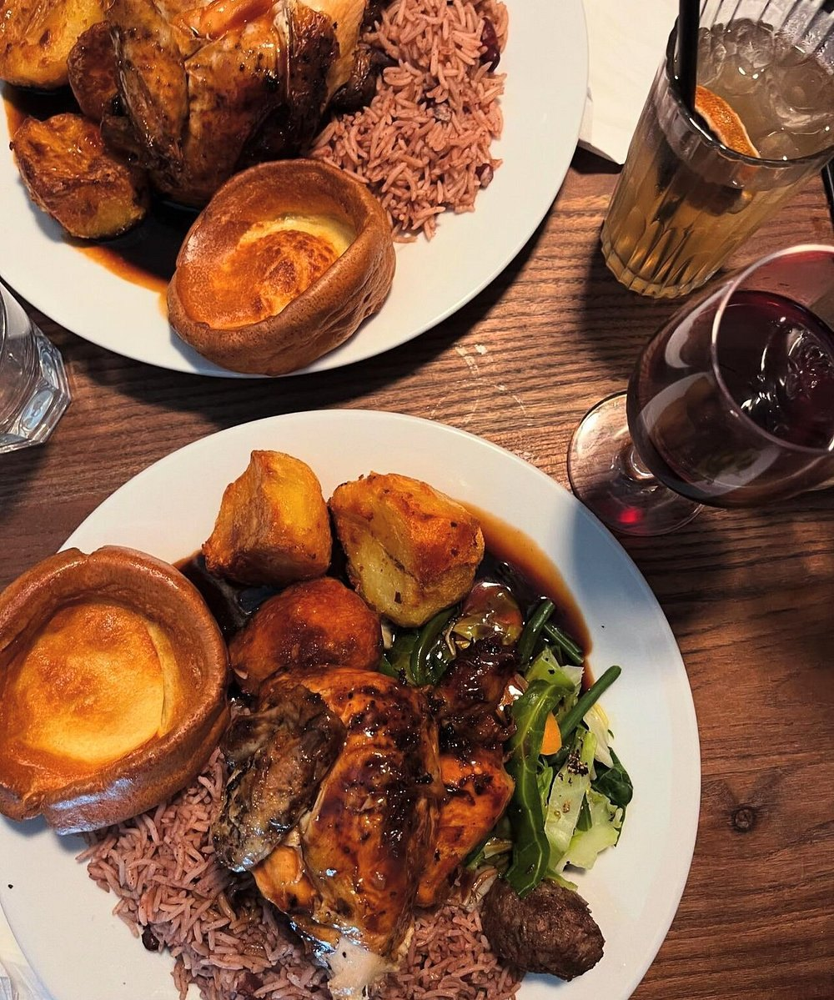
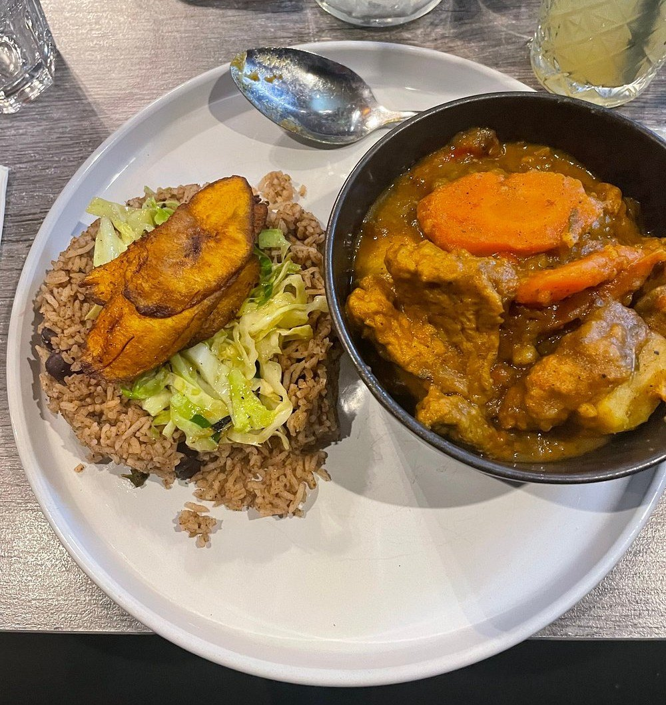

Ask the internet where to eat Jamaican food in London and it will answer with Caribbean guides. **The serious sources cover the islands together and separate them inside the piece**, because Trinidadian roti, Guyanese stews and Jamaican jerk are different cooking.

**Much of it is not in restaurants.** The most thorough source in this pass — a food blog with its own photographs — names caterers, food trucks, jerk drums, a tuck shop and a café inside the Peckham bus garage, and roughly two dozen of its entries appear in no magazine.

> 💡 **The Short Version:** **Fish, Wings & Tings** in Brixton Village is named by seven sources, more than anything else. **Limin** on the South Bank is six. **Jam Delish** is entirely vegan and named by five. **Ewart's** in Dalston is barely covered by magazines and heavily covered by everyone else. The best of this scene is as often a counter as a dining room.

> 📊 **The evidence behind this guide.**
> **13 independent sources carrying 140 citations** across **82 named venues**. **25 are named by two or more sources.**
> **Built on:** Time Out, The Infatuation, SquareMeal and The Handbook; independent writers; YouTube.
> *Evidence built 8 September 2026 · [How we rank →](/how-we-rank/)*

## Where they are

| If you are near… | Where to eat |
| --- | --- |
| **Brixton** | Fish, Wings & Tings, Danclair's Kitchen, Veg and Tings, Maureen's |
| **South Bank & Waterloo** | Limin |
| **Deptford** | Buster Mantis |
| **Islington & Angel** | Jam Delish |
| **Camden & Shoreditch** | Ma Petite Jamaica |
| **Dalston** | Ewart's |
| **Stratford, Finsbury Park & Shepherd's Bush** | Roti Joupa |
| **Herne Hill** | Umana Yana |
| **Peckham** | Soulfood Peckham, the bus garage café |

**Price guide:** **£** under £15 a head · **££** £15–£30 · **£££** £35+.

Brixton and Peckham carry most of this list. The [Peckham area guide](/articles/peckham-area-guide/) covers the Caribbean grocers, butchers and the sixty-unit indoor market on Rye Lane.

---

## The most-cited

### Fish, Wings & Tings — a Brixton Village counter, since 2012

*£ · Brixton Village, Coldharbour Lane, SW9 8PR · Cited by 7 sources*

*The counter, in Brixton Village.*

**Brian Danclair**, born in Trinidad, opened it in 2012. Seven sources name it, more than anything else in this pass, and two of them are YouTube channels rather than magazines.

The cooking is **Trinidad and Tobago street food**. Order **doubles** — fried flatbreads called baras, topped with spiced chickpeas — and **aloo pie**, fried pastry filled with spiced potato. It is a market counter rather than a dining room, so expect to eat close to other people.

Danclair runs two more in the same market: **Danclair's Kitchen**, named by four sources, and **Veg and Tings**, which takes the same Trinidadian menu plant-based.

### Limin — from a Spitalfields pop-up to the river

*££ · Gabriel's Wharf, South Bank · Cited by 6 sources*

*Limin's spread, Gabriel's Wharf.*

**Sham Mahabir started Limin' as a pop-up in Spitalfields market** before it became permanent on the Thames at Gabriel's Wharf.

**Freetas** — split pea fritters with spinach — and **Trini puri** are the things to order. It is the most central and the easiest to get to of the well-cited places.

### Buster Mantis — under the arches, half of it an arts space

*££ · Deptford · Cited by 5 sources*

*Buster Mantis's Sunday roast.*

In the **railway arches beside Deptford station**, and only half of it is a restaurant: one side is a bar and kitchen, the other a **creative arts space running exhibitions, screenings and events**.

Independent and family-run. **Closed Monday to Wednesday**, open Thursday from 6pm, Friday and Saturday until 2am, and Sunday 1.30pm to 6pm only for the roast. It takes bookings.

### Jam Delish — entirely vegan, and five sources agree

*££ · Islington · Cited by 5 sources*

*Jam Delish's curry, with rice and peas.*

A **100% vegan** Caribbean restaurant and cocktail bar.

**BBQ jerk plantain**, buttermilk oyster mushrooms with a spicy plantain ketchup, and a curry "goat" that contains no goat. Time Out names it their pick for vegan Caribbean outright.

It takes bookings, which most of this page does not, and delivers through Deliveroo, Uber Eats and Just Eat.

### Ma Petite Jamaica — London's first Caribbean diner

*££ · Camden and Shoreditch · Cited by 4 sources*

Two sites built on **jerk chicken and rum cocktails** with sweet potato and pumpkin fritters alongside. It bills itself as London's first Caribbean diner.

**The one to pick if you want a table rather than a counter**, and the only entry here with a branch in both north and east London. Both rooms are small, so a group of more than four should call ahead.

### Ewart's — the one the magazines have missed

*£ · Dalston · Cited by 4 sources*

Four sources name it and **only one is a masthead** — the rest are a food blog and two YouTube channels.

**It is a smoking drum in the middle of Gillett Square**, not a dining room. The Infatuation describes reggae and the cracking of tinnies as the permanent soundtrack. **Jerk chicken** is what it does. There are no tables, so it is walk-in only.

### Maureen’s — a home kitchen run as a restaurant

*£ · 52 Railton Road, Brixton, SE24 0LF · Cited by 3 sources*

**Maureen runs her Brixton home kitchen as a Jamaican restaurant**, and it is a takeaway operation rather than a room with tables.

The fried chicken is what people write about: drumsticks and thighs, golden and jagged, stripped to the bone. **Walk-in and takeaway only**, so plan to eat it somewhere else.

### Roti Joupa — Trinidadian roti, three branches

*£ · Stratford, Finsbury Park and Shepherd's Bush · Cited by 4 sources*

**Time Out's pick for Trinidadian cooking**, with branches in Finsbury Park, Shepherd's Bush and Stratford.

The range runs from **channa-packed baras** through rotis The Infatuation calls newborn-sized to wedges of **macaroni pie** with sweet tamarind sauce poured over.

**It is a takeaway operation, walk-in only**, with nowhere to linger. **Roti Stop**, named by four sources as well, is the other name to know for the same food.

---

Powered by <a target="_blank" rel="sponsored" href="https://www.getyourguide.com/london-l57/">GetYourGuide</a>

## By island, because they are not one cuisine

Every one of the serious guides writes "Caribbean" in the title and then separates the islands inside.

**Trinidadian** is disproportionately well represented at the top of the list — Fish, Wings & Tings, Limin, Roti Joupa and Roti Stop are all Trinidadian.

**Jamaican** is the largest strand by volume: Ma Petite Jamaica for a dining room, Ewart's and Maureen's for jerk, Buster Mantis for a family kitchen with a Jamaican connection.

**Guyanese** has a clear address — **Umana Yana in Herne Hill**, which Time Out picks for exactly that.

**Vegan** cuts across all of them, with Jam Delish in Islington and Veg and Tings in Brixton Village.

---

## West African food nearby

[West African food in London](/articles/best-west-african-restaurants-london/) is the other half of this story, and the same neighbourhoods carry it — Peckham and Brixton especially.

The most thorough source in this pass runs to thirty-nine names and around two dozen appear nowhere else: **Jay Dees Catering, Crystal Caterers, Sunvalley Jerk, Jerk in Da Park, Cool Runnings Jerk Centre, Bokit'la, Rainbow Cook Out, Mum's Caribbean Takeaway, a Jamaican tuck shop, and a café inside the Peckham bus garage.**

These are caterers, food trucks, drums on a pavement and counters with no seats. For much of this food that is the normal form, so do not turn up expecting a table.

For more of it, [the best street food in London](/articles/best-street-food-london/) compares every multi-trader market, food hall and container yard on traders, seating and which days each one exists. [Cheap eats in London](/articles/cheap-eats-london/) covers the same under-£15 territory across every other cuisine.

*Takeaway counters and market stalls change hours more often than restaurants do, so check before travelling.*
