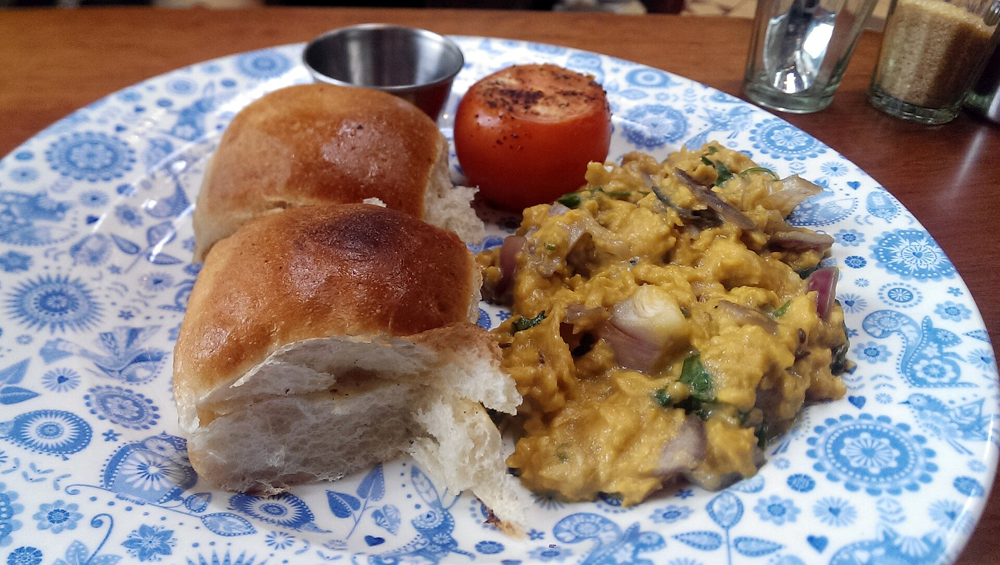
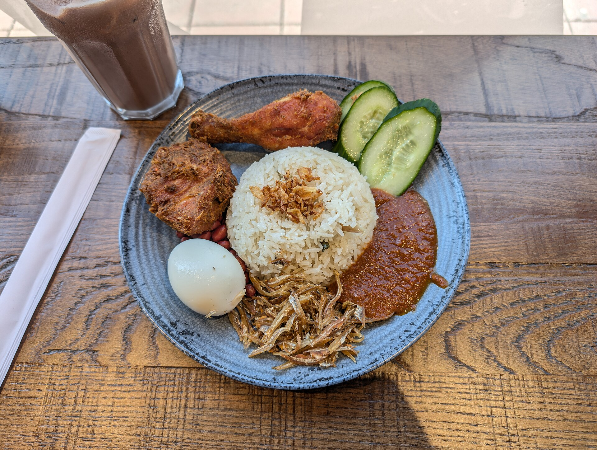
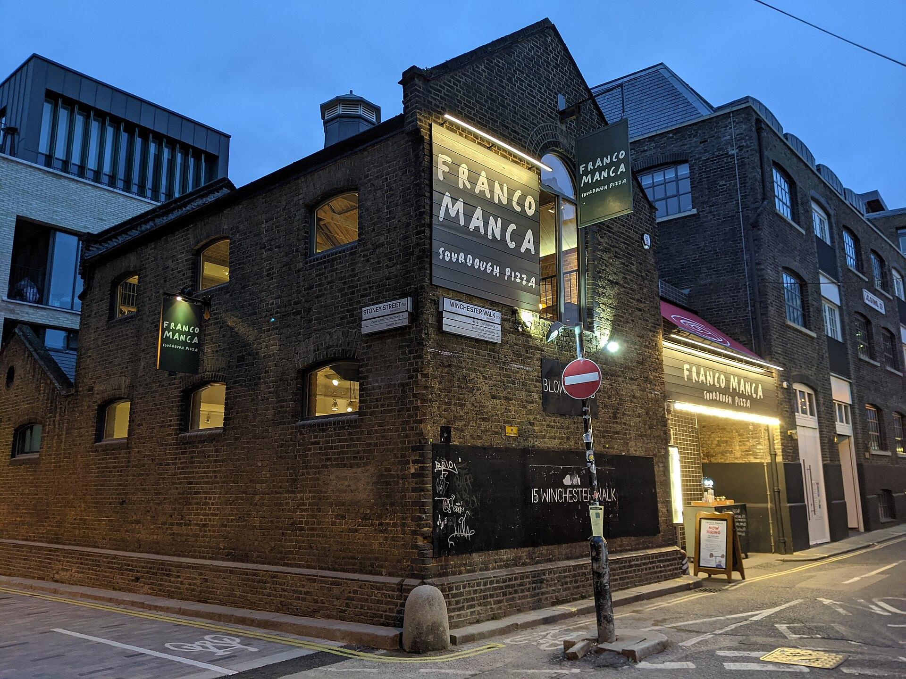
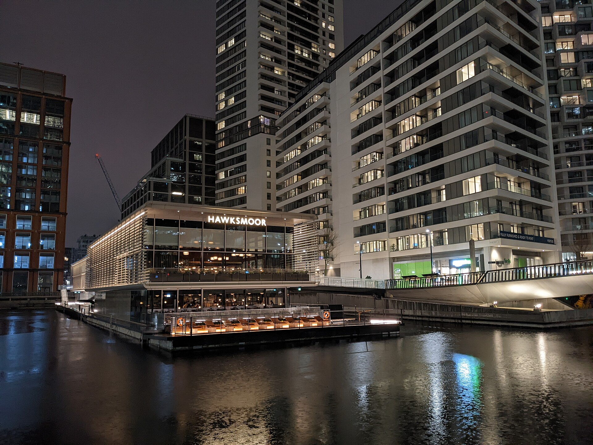
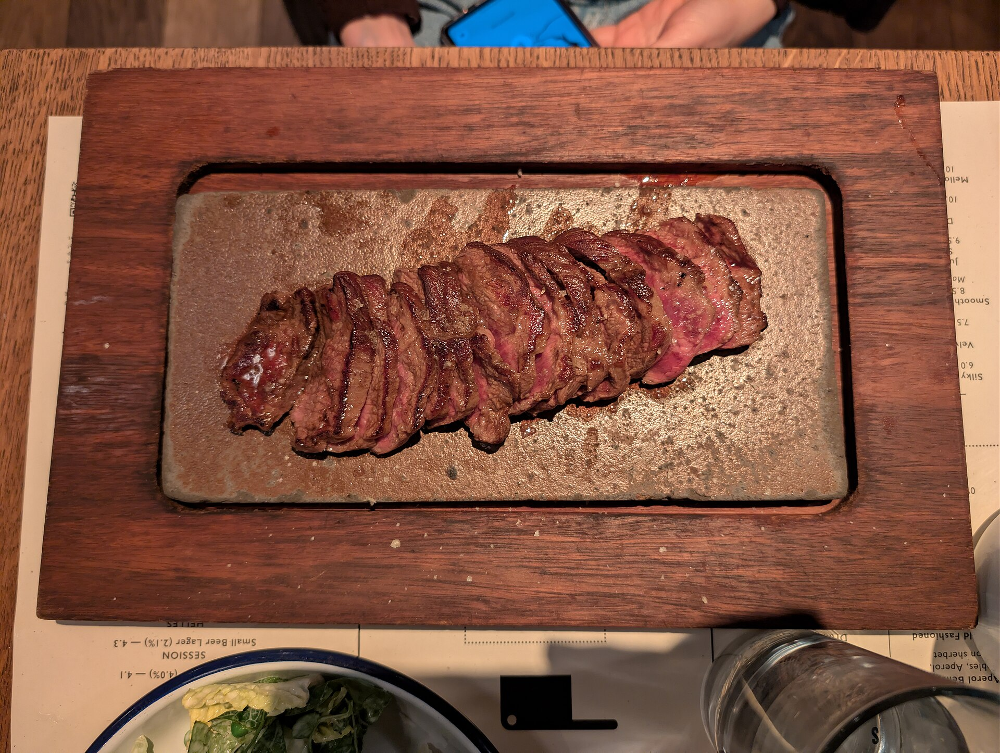
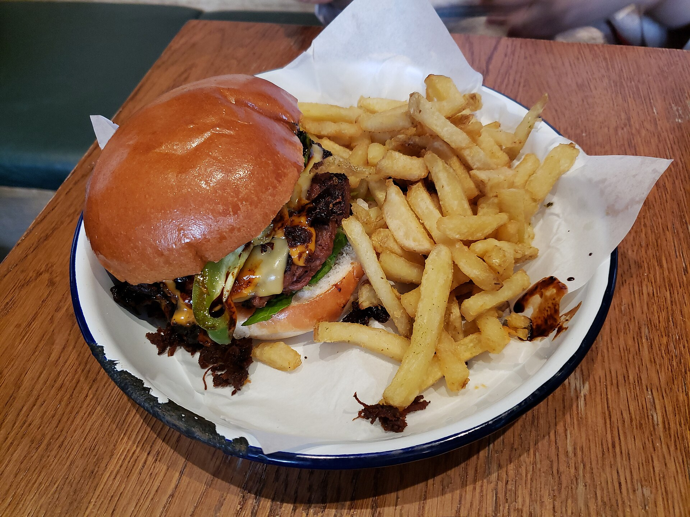
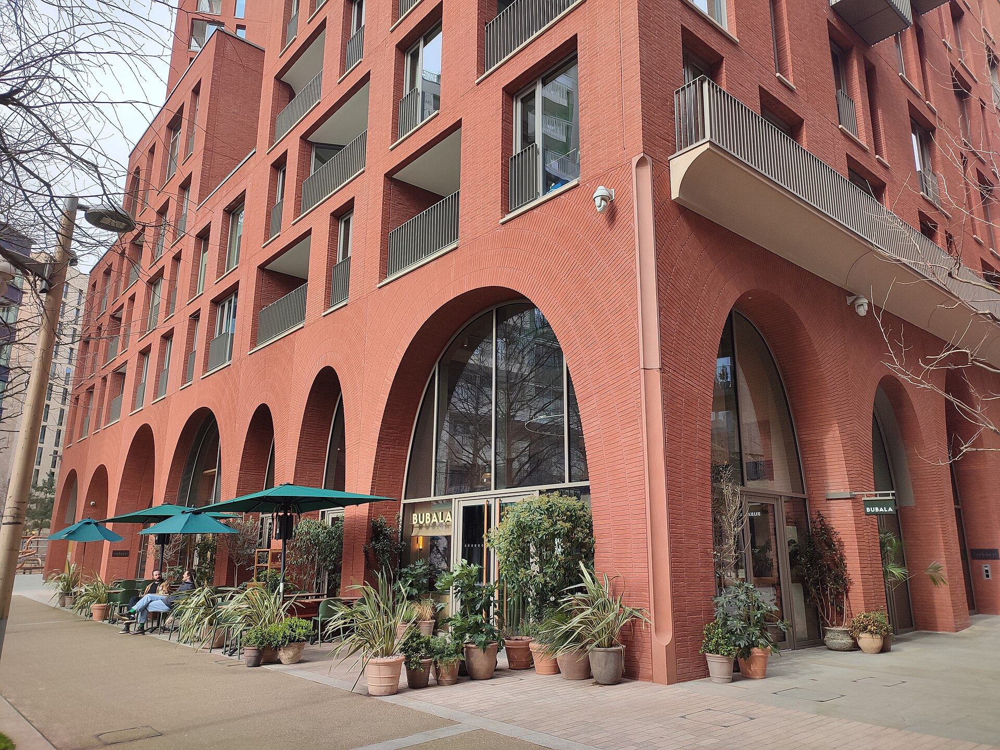

> 💡 **The Short Version:**
> - **Best by the evidence:** **Hoppers** is first on Time Out's ranking of London chains (list updated 27 August 2026), and its Soho restaurant holds a 2026 Michelin Bib Gourmand.
> - **Cheapest:** **Tonkotsu**'s £10.50 weekday lunch, **Roti King** (roti canai with dhal £10.50), **Padella**'s pasta from £9.50, **Franco Manca**'s £12.50 pizza and drink on weekdays, **Flat Iron**'s £15 steak.
> - **For a group:** **Dishoom** takes groups of six or more for dinner, **Bancone** Kensington books up to 30 online and **Pizza Pilgrims** has feasting menus from £25 a head for eight or more.
> - **For a special night:** **Hawksmoor**, whose St Pancras restaurant is 13th in the World's 101 Best Steak Restaurants 2026, or **Berenjak** for Persian kababs at a counter.
> - **No booking needed:** **Roti King**, **Bao** Soho and **Barrafina** Dean Street are walk-in only.

This page covers brands with two or more London restaurants cooking one menu, grouped by food. The national high-street names, such as Wagamama, Pizza Express and Nando's, are left out.

*Branch counts, menus, prices and booking rules as of 31 October 2026.*

There is no judged ranking of chain restaurants. Time Out's [ranked list of London chains](https://www.timeout.com/london/restaurants/londons-best-chain-restaurants-ranked) covers brands with three or more London branches, and nine of the brands below are on it: Hoppers (1st), Dishoom (4th), Hawksmoor (5th), Lina Stores (6th), Roti King (7th), Flat Iron (8th), Bao (10th), Wahaca (15th) and Tonkotsu (20th). Michelin awards a Bib Gourmand, its mark for good cooking at a fair price, to one restaurant rather than a brand, and the [2026 London list](https://guide.michelin.com/gb/en/greater-london/london/restaurants/bib-gourmand) includes five of these: Hoppers, Kricket and Berenjak in Soho, Bancone in Covent Garden and Padella at Borough Market.

| Brand | What it's for | Price | How to get a table |
| --- | --- | --- | --- |
| **Dishoom** | Naan rolls and black daal, all day | Weekday lunch £16 each, two sharing | Mostly walk-in; groups of any size can book before 6pm, groups of six or more after |
| **Hoppers** | Sri Lankan hoppers and curries | Curries £12.20 to £17.60 | Soho books for two to four; walk-ins join a virtual queue |
| **Kricket** | Modern Indian small plates | £20 thali until 4.45pm | Book online; counter and communal seats are kept for walk-ins |
| **Sticks'n'Sushi** | Sushi and grilled sticks | Set menus £26 to £65 a head | Book through its site |
| **Bao** | Taiwanese bao and fried chicken | Weekday set menu, 12pm to 5pm | Soho is walk-in only; the other six sites book |
| **Tonkotsu** | Ramen | £10.50 weekday lunch | Soho books and leaves room for walk-ins |
| **Roti King** | Malaysian roti and curry | £10.50 to £13.95 | Walk-in only at all four sites |
| **Din Tai Fung** | Soup dumplings | £££ | Online for six or seven; some tables held for walk-ins |
| **Padella** | Fresh pasta | £9.50 to £16.50 | Borough Market has a virtual queue; Soho books up to four weeks ahead |
| **Bancone** | Fresh pasta | £12 to £19 | Online only, up to 120 days ahead |
| **Lina Stores** | Fresh pasta | £10 to £18 | Online for up to six; the kitchen counter is walk-in |
| **Pizza Pilgrims** | Neapolitan pizza | Feasting menus from £25 (eight or more) | Bookings at most sites; walk-ins always welcome |
| **Franco Manca** | Sourdough pizza | £12.50 weekday lunch with a soft drink | Plenty of walk-in space; bookings at most |
| **Hawksmoor** | Dry-aged steak | £21 set-lunch main and side | Book; the set lunch caps tables at seven |
| **Blacklock** | Chops on flatbreads | £28 a head for All In | Book, or walk in: tables are kept back |
| **Flat Iron** | Steak | £15 | Books and takes walk-ins |
| **Honest Burgers** | Burgers | Slider-sized burgers from £5 | Not every site takes bookings |
| **Berenjak** | Persian kababs | Kababs £21 to £45 | Online a month ahead; walk-in seats, then a queue |
| **Bubala** | Vegetable-led Middle Eastern | Plates £8.50 to £15 | Book online |
| **Barrafina** | Spanish tapas | Plates £4.50 to £30 | Dean Street is walk-in only; the other four sites book |
| **Wahaca** | Tacos | Two tacos £7.25 to £8.95 | Book online |
| **Mildreds** | Vegan | ££ | Book online |
| **Poppies Fish and Chips** | Fish and chips | Haddock £20.99 | Reservations page on its site |

---

## Indian and Sri Lankan

All three are in the [British Indian Good Food Guide's 2025 top 100](https://britishindiangoodfoodguide.com/best-100-indian-restaurants-uk-british-indian-good-food-guide-2025/): Hoppers and Kricket for Soho, Dishoom for Covent Garden. For the full lists, see the [Indian](/articles/best-indian-restaurants-london/) and [Sri Lankan](/articles/best-sri-lankan-restaurants-london/) guides.

### Dishoom

Dishoom has eight London cafés: Battersea, Borough, Canary Wharf, Carnaby, Covent Garden, Kensington, King's Cross and Shoreditch. They are modelled on the Irani cafés of Bombay. Covent Garden is dressed as a 1940s cinema-era Bombay, with period photographs and portraits covering the walls.

*Akuri at Dishoom. Photo: [Ewan Munro](https://commons.wikimedia.org/wiki/File:Dishoom,_King's_Cross,_London.jpg), [CC BY-SA 2.0](https://creativecommons.org/licenses/by-sa/2.0/).*

Breakfast runs from 8am on weekdays and 9am at weekends to 11.45am. The **bacon naan roll (£11.70)** is a tandoor-baked naan with cream cheese, tomato-chilli jam and coriander. Later in the day, order the **house black daal (£11.50)**, cooked for 24 hours, the **keema pau (£11.50)**, minced lamb with buttered toasted buns, and the **lamb biryani (£21.50)**. The [breakfast guide](/articles/best-breakfast-brunch-london/) covers the morning menu.

**Mostly walk-in.** Groups of any size can book before 6pm, and after 6pm only groups of six or more can. Dishoom keeps most tables back for walk-ins. On weekdays from 12pm to 5pm, lunch for two to share is £16 or £20 a head and can be booked. More in the [restaurant deals guide](/articles/restaurant-deals-london/).

**Book:** [Dishoom reservations](https://www.sevenrooms.com/explore/dishoom/reservations/create/search?venues=dishoombattersea%2Cdishoomcarnaby%2Cdishoomcanarywharf%2Cdishoomcoventgarden%2Cdishoomkensington%2Cdishoomkingscross%2Cdishoomshoreditch%2Cdishoombirmingham%2Cdishoomedinburgh%2Cdishoomglasgow%2Cdishoomleeds%2Cdishoommanche)

### Hoppers

*£££ · Soho · 4 min from Leicester Square · book weeks ahead*

Hoppers has four London restaurants: Soho, Marylebone, King's Cross and Shoreditch. The Soho original on Frith Street is modelled on a Sri Lankan village toddy shop (a bar selling palm wine). Time Out ranks it first among London chains.

A **hopper (£6.60)** is a bowl-shaped pancake of fermented rice and coconut batter, with a runny egg in the middle for £7.80. Scoop it through a **kari**, Sri Lanka's word for curry: the **Lankan chicken kari (£15.20)**, **black pork kari (£16.60)** or **bone marrow varuval (£14.20)** with roti. The **lamb kothu roti (£22.40)** is chopped roti stir-fried with lamb curry, eggs and greens. The **Hoppers Experience (£35 a head)** is a shared spread for the whole table, and the **Lunch Plate (£22 a head)** is a lighter, quicker taste of the classics.

**Reservations are for parties of two to four; everyone else joins the virtual queue,** which seats complete parties only. Soho takes card payments only.

**Book:** [Hoppers Soho](https://www.sevenrooms.com/explore/hopperssoho/reservations/create/search/)

### Kricket

Kricket has four London restaurants: Brixton, Canary Wharf, Shoreditch and Soho. Soho, on Denman Street, was the first and has held a Bib Gourmand since its first year. It has two floors: a long marble counter facing the open kitchen upstairs and big communal tables downstairs.

Order the **smoked baingan barta**, smoky aubergine with pickled walnuts and khakhra crackers to scoop it up, and the **duck leg kothu parotta**, shredded duck leg with green beans, peanuts and a black pepper masala. The **£20 thali** (a set platter) is served daily until 4.45pm at Soho, Shoreditch and Canary Wharf, with a choice of chicken mappas or grilled squash makhani.

**The counter and communal tables are kept for walk-ins;** book online for everything else.

**The restaurant's site:** [kricketrestaurants.com](https://kricketrestaurants.com/locations/soho/)

---

## Asian

### Sticks'n'Sushi

Sticks'n'Sushi has 13 restaurants in London and Greater London: Battersea, Canary Wharf, Chelsea, Covent Garden, Greenwich, Islington, Kingston, Richmond, Shoreditch, Soho, Victoria, White City and Wimbledon. The Covent Garden restaurant is at 11 Henrietta Street, in the theatre quarter, and is open until 11.30pm Monday to Saturday.

The menu is sushi and grilled *sticks* (skewers). Order the **ebi sando (£11.50)**, a crisp sandwich of prawn, truffle and miso aioli, the **kani korokke (£9.90)**, crab croquettes with wasabi Caesar dressing, and the **ebi bites (£9.90)**, tempura shrimp. Nigiri is £2.70 to £3.90 a piece.

**Set menus are £26 to £65 a head and need two or more people.** Book through the site.

**The restaurant's site:** [sticksnsushi.com](https://www.sticksnsushi.com/gb/en/restaurants/covent-garden/)

### Bao

Bao has seven London restaurants: Soho, Marylebone, Borough, King's Cross, the City, Shoreditch and Battersea. The original is a Taiwanese *xiao chi* (small-eats) house on Lexington Street in Soho, open since 2015. Five sites also have karaoke rooms: the City, Borough, Marylebone, Shoreditch and Battersea. Time Out ranks Bao tenth among London chains.

Order the signature **bao** (soft steamed buns), the **Taiwanese fried chicken** and, at Soho, the **grilled beef rice**: a 40-day aged Denver steak finished over charcoal. On weekdays from 12pm to 5pm, a BAO15 set menu runs, and it varies by site.

**Soho is walk-in only. The other six restaurants take bookings.**

**The restaurant's site:** [baolondon.com](https://baolondon.com/restaurant/bao-soho/)

### Tonkotsu

*££ · Soho · 5 min from Leicester Square*

Tonkotsu has 15 London restaurants, from Soho and Bankside to Peckham, Walthamstow and Ealing. Soho on Dean Street was the first, opened in 2012, with two floors, a few seats outside and beer on tap. The noodles are made in-house; you can watch them being made at Tonkotsu East in Haggerston. Time Out ranks it twentieth among London chains.

The namesake **Tonkotsu (£15.95)** is a pork-bone broth with lardo, roast pork belly, bamboo shoots, beansprouts and burnt garlic oil. The **Geki Kara (£16.95)** adds scotch bonnet mash for heat, and the **Chilli Chicken (£15.95)** is a chicken-broth bowl. Every ramen comes in a small size for 25% off. More bowls in the [ramen guide](/articles/best-ramen-london/).

**The weekday lunch is £10.50:** a lunch-sized ramen or chilled noodle salad plus a lunch-sized side, Monday to Friday until 5pm, excluding bank holidays. Soho takes bookings and leaves plenty of room for walk-ins.

**Book:** [Tonkotsu Soho](https://app.walkup.co/create_booking/vendor/restaurant_000000Bo6urTUyCADsYOiM7Vi1SCO)

### Roti King

Roti King has four London restaurants: Spitalfields on Artillery Lane, Euston on Doric Way, Battersea Power Station and Waterloo on Lower Marsh. Time Out ranks it seventh among London chains.

*The nasi lemak at Roti King. Photo: [Andy Li](https://commons.wikimedia.org/wiki/File:Nasi_Lemak_-_Roti_King_2025-09-19.jpg), [CC0 1.0](https://creativecommons.org/publicdomain/zero/1.0/).*

Order the **roti canai**, two pieces of flaky roti served with a kari to dip: dhal (£10.50), chicken (£11.75), mutton (£12.95) or beef rendang (£13.45). The **nasi lemak (£13.25)** is coconut rice with fried anchovies, peanuts, egg, sambal and spiced fried chicken, and the **kari laksa (£13.25)** is egg noodles in coconut curry broth with seafood and tofu.

**No reservations at any site, and card payments only.** Euston closes between 3pm and 5pm from Monday to Thursday.

**The restaurant's site:** [rotiking.com](https://rotiking.com/restaurants/)

### Din Tai Fung

*£££ · Covent Garden · 5 min from Covent Garden · book weeks ahead*

Din Tai Fung has four London restaurants: Covent Garden on Henrietta Street, Centre Point on St Giles Square, Canary Wharf in Crossrail Place and the fourth floor of Selfridges. A fifth, at 1 Lewis Cubitt Walk in King's Cross, opens on 1 December 2026.

The main order is the **xiao long bao**, soup dumplings that Din Tai Fung folds by hand with at least 18 pleats; the menu says each passes through six preparation stations over 40 minutes. The pork version comes in fives or tens. Other fillings are crab and pork, truffle and pork, chilli crab and pork, beef and chicken, plus a vegan mushroom and truffle one. Add the **chilli crab and pork buns**, **Taiwanese fried chicken** or **egg fried rice**. More dumplings in the [dim sum guide](/articles/best-dim-sum-london/).

**Book online for parties of six or seven, depending on the site; Din Tai Fung holds some tables for walk-ins,** who may wait. A discretionary service charge is added, and Covent Garden, Centre Point and Canary Wharf do not take American Express.

**Book:** [Din Tai Fung reservations](https://www.sevenrooms.com/reservations/dintaifungcanarywharf/?venues=dintaifungcanarywharf,dintaifungkingscross,dintaifungcentrepoint,dintaifunglondon,dintaifungatselfridges)

---

## Pasta and Italian

Padella, Bancone and Lina Stores all make fresh pasta by hand. The [Italian guide](/articles/best-italian-restaurants-london/) has the independent restaurants.

### Padella

Padella has three restaurants: Borough Market, Shoreditch and Soho. The original opened at Borough Market in 2016, and its pappardelle with beef shin ragu and pici cacio e pepe have been on the menu since day one. It has two floors, a little outside seating and a kitchen counter, and holds a 2026 Bib Gourmand.

Order the **pappardelle with 8-hour Hereford beef shin ragu (£16.50)**, the **pici cacio e pepe (£13.50)** or the **tagliarini with chilli, garlic and pangrattato (£9.50)**, the cheapest pasta on the menu. The **tiramisu** is £8.50.

**Borough Market takes no reservations.** Join the virtual queue by scanning the QR code at the door or through the Dojo app, for parties up to six. Soho takes reservations up to four weeks ahead, and Shoreditch takes group bookings and also runs a virtual queue.

**Book:** [Padella Soho](https://web.dojo.app/create_booking/vendor/Gbzsvht-JlwuwLjO6nuUO-FvWWsj1wcZRbuK6qbdHkE_restaurant)

### Bancone

*££ · Covent Garden · 3 min from Charing Cross · Michelin Guide*

Bancone has six London restaurants: Covent Garden, Golden Square in Soho, Borough Yards, Kensington, the City and Russell Square. The Covent Garden restaurant on William IV Street holds a 2026 Bib Gourmand.

The **silk handkerchiefs with walnut butter and confit egg yolk (£14.50)** are sheets of fresh pasta, and Bancone also serves them as a carbonara (£18.50). The **bucatini cacio e pepe (£14)** and the **spicy pork and 'nduja ragù with tagliatelle (£18)** complete a short pasta list. The **Feasting Menu is £49 a head** at Covent Garden.

**Reservations are online only, up to 120 days ahead, and Covent Garden takes up to four guests online.** Kensington takes up to 30. Bancone is cashless.

**Book:** [Bancone reservations](https://www.sevenrooms.com/explore/banconegroup/reservations/create/search/?venues=banconerussellsquare%2Cbanconecity%2Cbanconekensington%2Cbanconeboroughyards%2C%2Cbanconesoho%2Cbanconecoventgarden)

### Lina Stores

*££ · Soho · 4 min from Tottenham Court Road*

Lina Stores has eight London restaurants: Greek Street, King's Cross, Bloomberg Arcade, Marylebone Lane, Clapham, South Kensington, Shoreditch and Broadgate Circle. Its Brewer Street delicatessen in Soho has traded since 1944. Time Out ranks it sixth among London chains.

Greek Street has a 12-seat bar around an open kitchen on the ground floor and the restaurant and an aperitivo bar downstairs. Order the **tagliolini al tartufo (£17)**, made with 30 egg yolks and finished with black truffle, the **spaghetti alla carbonara (£16)** or the **pici alla Calabrese (£10)**, with 'nduja and pork sausage ragù. The **tiramisù** is £8.

**The kitchen counter is walk-in only.** Tables book online for up to six every day and up to ten from Sunday to Wednesday. Lina Stores is cashless.

**The restaurant's site:** [linastores.co.uk](https://www.linastores.co.uk/locations/greek-street-restaurant)

---

## Pizza

The independent pizzerias are in the [pizza guide](/articles/best-pizza-london/).

### Pizza Pilgrims

Pizza Pilgrims has 20 London pizzerias, from Dean Street in Soho to Wimbledon and Queen's Park, and cooks Neapolitan pizza. It won Pizza Restaurant Chain of the Year at the PAPA Industry Awards in 2025, and it is a finalist in the 2026 National Pizza Awards, which are decided on 3 November 2026.

Order the **'nduja**, made with nduja di Spilinga, the **8 Cheese**, which is twice a four-cheese and finished with smoked chilli jam, or the **double pepperoni and hot honey**. The **margherita** is on the menu too, and the **carbonara pizza** carries guanciale, pecorino, spaghetti and an egg yolk.

**You can book at most sites, and walk-ins are always taken.** Groups of eight or more can book feasting menus from £25 a head. A discretionary 12.5% service charge is added.

**Book:** [Pizza Pilgrims bookings](https://www.pizzapilgrims.co.uk/bookings)

### Franco Manca

Franco Manca has 31 London pizzerias. The sourdough pizzas are numbered 1 to 12 on the menu, and the dough rises for 24 hours. A few sites vary the menu slightly. It is a finalist in the 2025 and 2026 National Pizza Awards.

*Franco Manca, Winchester Walk, Southwark. Photo: [Daniel from Glasgow](https://commons.wikimedia.org/wiki/File:Franco_Manca,_15_Winchester_Walk,_Blows_Yard,_Southwark,_November_2021.jpg), [CC BY 2.0](https://creativecommons.org/licenses/by/2.0/).*

Order **No. 2, the margherita**, **No. 5, the Napoli**, with Cantabrian anchovies, olives and capers, or **No. 8, the Mezzaluna**, half pizza with ventricina salami and slow-cooked pork and half calzone filled with ricotta, spinach and grana. More deals in the [restaurant deals guide](/articles/restaurant-deals-london/).

**A pizza and a soft drink is £12.50 at every pizzeria, Monday to Friday, 12pm to 4pm.** There is plenty of room for walk-ins, and most sites also take bookings.

**The restaurant's site:** [francomanca.co.uk](https://www.francomanca.co.uk/pizzerias/)

---

## Steak and meat

For the independent steakhouses, see the [steak guide](/articles/best-steak-restaurants-london/).

### Hawksmoor

*££££ · Spitalfields · 4 min from Shoreditch High Street · book weeks ahead*

Hawksmoor has eight London restaurants: Air Street, Borough, Guildhall, Knightsbridge, Seven Dials, Spitalfields, St Pancras and Wood Wharf. The St Pancras restaurant is 13th in the World's 101 Best Steak Restaurants 2026, and Time Out ranks Hawksmoor fifth among London chains. Seven Dials is in the old Watney-Combe brewery on Langley Street.

*Hawksmoor, Wood Wharf. Photo: [The wub](https://commons.wikimedia.org/wiki/File:Hawksmoor,_Wood_Wharf_-_2022-02-09.jpg), [CC BY-SA 4.0](https://creativecommons.org/licenses/by-sa/4.0/).*

Beef is dry-aged and cooked over charcoal. Order the **cast-iron fillet steak (£39)** with bone marrow and onions, or the **prime rib (£16 per 100g)**, or start with **roasted bone marrow (£12)**. The Sunday roast is in the [roast guide](/articles/best-sunday-roast-london/).

**The set lunch is the way in:** Monday to Saturday, 12pm to 3pm, £21 for a main and a side, £26 for two courses and £30 for three. At Seven Dials the main is a 35-day dry-aged rump steak, and a table is capped at seven people.

**Book:** [Hawksmoor](https://thehawksmoor.com/book-a-table/)

### Blacklock

Blacklock has five London restaurants: Soho, the City, Shoreditch, Covent Garden and Canary Wharf. Soho on Great Windmill Street is in a basement, with no lift; Canary Wharf and Shoreditch are at ground level.

Order **All In (£28 a head, for two or more)**: pre-chop bites, then beef, pork and lamb chops piled on charcoal-grilled flatbreads, with a side each. The **Blacklock burger** is £14 and the **steak sarnie** £15. A Sunday sirloin special is £33 a head.

**On Mondays in London, every big chop (porterhouse, prime rib) is £8 per 100g.** Soho keeps tables back for walk-ins and takes reservations; for eight to ten people, email the restaurant.

**The restaurant's site:** [theblacklock.com](https://theblacklock.com/restaurants/blacklock-soho/)

### Flat Iron

*£ · Soho · 6 min from Piccadilly Circus · bookings and walk-ins*

Flat Iron has 16 London restaurants. Soho on Beak Street was the first, opened after a 2012 pop-up above the Owl and Pussycat pub in Shoreditch. Time Out ranks it eighth among London chains.

*The flat iron steak. Photo: [Andy Li](https://commons.wikimedia.org/wiki/File:Flat_Iron_Steak_-_Flat_Iron_2026-02-24.jpg), [CC0 1.0](https://creativecommons.org/publicdomain/zero/1.0/).*

The **flat iron steak is £15**. Alongside it come **beef dripping chips** and **crispy bone marrow garlic mash**, a **35-day aged ribeye (£20)** and a **Wagyu steak of the day**. The **smashed onion double cheeseburger** is £14.

**Flat Iron takes bookings and keeps space for walk-ins; if there is a wait, it takes your number rather than making you queue.** Bookings are 90 minutes for one to four guests.

**The restaurant's site:** [flatironsteak.co.uk](https://flatironsteak.co.uk/restaurant/soho/)

### Honest Burgers

Honest Burgers has 33 restaurants in London and Greater London, from Baker Street to Brixton Village and Kingston. Its burger The Honest won the overall title at the National Burger Awards 2026; the [burger guide](/articles/best-burgers-london/) explains where it is served.

*A burger and chips at Honest Burgers. Photo: [Andy Li](https://commons.wikimedia.org/wiki/File:Teriyaki_Burger_with_rosemary_chips_-_Honest_Burgers_2023-07-21.jpg), [CC0 1.0](https://creativecommons.org/publicdomain/zero/1.0/).*

Order a **smashed burger**, either single or double, with American cheese, brown butter mustard mayo, onions and pickles, or the **Honest**, with dry-aged beef, red onion relish, smoked bacon and cheddar. **Honest Mighties** are slider-sized burgers, from £5 for a solo taster. Each restaurant also has a local special.

**Not every site takes bookings;** the locations page on Honest's site filters for the ones that do.

**The restaurant's site:** [honestburgers.co.uk](https://www.honestburgers.co.uk/locations/all/)

---

## Middle Eastern and Spanish

### Berenjak

*£££ · Soho · 3 min from Leicester Square · book weeks ahead*

Berenjak has three London restaurants: Soho on Romilly Street, Borough and Mayfair. Soho, "the Tehran hole-in-the-wall", opened in 2018 and holds a 2026 Bib Gourmand. Parties of two sit at the counter.

The menu centres on charcoal-grilled kababs. Order the **koobideh kabab (£26)**, minced lamb shoulder with onion and black pepper, or the **jujeh kabab (£28)**, saffron chicken. Add the **mirza ghasemi (£10.50)**, coal-cooked aubergine with garlic, tomato and eggs, and **house rice (£7.50)**, saffron rice with crispy rice.

**Book online a month ahead.** Walk-in seats go first-come, and then a virtual queue forms that can run to three hours at peak. Mayfair takes a £60 a head deposit for dinner. Cards only.

**Book:** [Berenjak reservations](https://www.sevenrooms.com/explore/berenjakjks/reservations/create/search/?party_size=4&tracking=berenjak-website&venues=berenjakjks%2Cberenjakborough)

### Bubala

Bubala has four London restaurants: Spitalfields on Commercial Street, Soho, King's Cross and Covent Garden. The cooking is vegetable-led and Middle Eastern, with most dishes vegan.

*Bubala, King's Cross. Photo: [Ewan-M](https://commons.wikimedia.org/wiki/File:Bubala,_King's_Cross,_N1.jpg), [CC BY-SA 4.0](https://creativecommons.org/licenses/by-sa/4.0/).*

On the Spitalfields menu, order the **falafel with tahini, amba and sumac onions (£9.50)**, the **hummus with burnt butter (£9)** and the **Herefordshire fryer "halloumi" with chamomile and fennel honey (£13)**, with the **oyster mushroom skewer (£5.50)** on the side. Bubala Knows Best is a set menu for the table, served in waves. More in the [Middle Eastern guide](/articles/best-middle-eastern-restaurants-london/).

**Book online; card payments only.**

**The restaurant's site:** [bubala.co.uk](https://bubala.co.uk/)

### Barrafina

Barrafina has five London restaurants: Dean Street in Soho, Adelaide Street and Drury Lane in Covent Garden, Coal Drops Yard in King's Cross and Borough Yards. Each has an open kitchen, a marble and steel bar and red leather stools, and chefs add a daily specials board. Dean Street at 26-27 Dean Street is the original. More Spanish places are in the [Spanish guide](/articles/best-spanish-restaurants-london/).

Order a **tortilla**, classic (£13.50) or chorizo (£15), **ham croquetas (£8.50)** for two, **gambas rojas (£24.50)**, and the **tarta de queso (£9)**.

**Dean Street takes no reservations;** a standing bar holds you while you wait, and there is a heated terrace. The other four restaurants take reservations.

**The restaurant's site:** [barrafina.com](https://www.barrafina.com/locations/dean-street/)

---

## Mexican, vegan and fish and chips

### Wahaca

Wahaca has ten London restaurants: Covent Garden, Stratford, Southbank, Wimbledon, Oxford Circus, White City, Shoreditch, Waterloo, Canary Wharf and Paddington. Time Out ranks it fifteenth among London chains. The independent Mexican places are in the [Mexican guide](/articles/best-mexican-restaurants-london/).

Tacos come two to a plate. Order the **pork pibil (£7.95)**, free-range pork slow-cooked in citrus and achiote, the **beef gringa (£8.95)**, grass-fed beef with grilled cheese and salsa fresca, or the **halloumi al pastor (£8.25)**. The **guacamole** is £7.25 and the **house nachos** £10.95.

**Book through the site.**

**The restaurant's site:** [wahaca.co.uk](https://www.wahaca.co.uk/locations/)

### Mildreds

*££ · Soho · 6 min from Piccadilly Circus*

Mildreds has five London restaurants: Camden, Covent Garden, King's Cross, Soho and Victoria. Soho at 45 Lexington Street is where it began in 1988, and is open from 9am. More in the [vegetarian and vegan guide](/articles/best-vegetarian-vegan-restaurants-london/).

The winter menu includes the **oyster mushroom and hispi shawarma**, the **gochujang tofu** with kimchi rice, **glazed handmade dumplings** with chilli miso and **shiitake whipped silken tofu**. Soho has a breakfast menu.

**Book:** [Mildreds reservations](https://www.sevenrooms.com/explore/mildredslondon/reservations/create/search/)

### Poppies Fish and Chips

Poppies Fish and Chips has four London restaurants: Spitalfields on Hanbury Street, Soho on Old Compton Street, Camden on Hawley Crescent and Portobello. The restaurants have a retro look and cook fish in groundnut oil, with vegetable oil available for nut allergies. More in the [fish and chips guide](/articles/best-fish-and-chips-london/).

Every fish meal comes with chips and homemade tartare sauce. Order **haddock (£20.99 regular, £24 large)** or **cod (£21.99)**, or share the **hot seafood platter (£20.99)** of fish bites, scampi, calamari and whitebait.

**Book:** [Poppies reservations](https://poppiesfishandchips.co.uk/reservations/)

