"Chinese food" in London covers a two-starred kitchen in Victoria working through the whole country, a Sichuan room on Frith Street numbing your mouth with peppercorns, hand-pulled Shaanxi noodles in Holloway, Uyghur lamb skewers in Walthamstow and Cantonese roast duck in Bayswater. They are regional cooking from a country the size of Europe, not variations on one cuisine.

This guide keeps them apart and counts each against its own sources rather than blending them.

> 💡 **The Short Version:** **A. Wong** is the only Chinese restaurant in London with a Michelin star, and it has two. **Tao Tao Ju**, **Plum Valley**, **Four Seasons**, **Murger Han** and **Etles** are the most-cited after it. **Barshu** is the Sichuan entry and **Etles** the Uyghur one. **Xi'an Impression** does a beef bun for £5.

> 📊 **The evidence behind this guide.**
> Counted separately for each cuisine: **Chinese — 13 sources, 206 citations across 112 restaurants, 46 named twice or more**; **Thai — 13 sources, 126 citations across 63 restaurants, 18 named twice or more**; **Korean — 9 sources, 118 citations across 74 restaurants, 19 named twice or more**.
> **Built on:** Michelin; Eater London, The Infatuation, Time Out and SquareMeal.
> *Evidence rebuilt 14 September 2026 · [How we rank →](/how-we-rank/)*

## Where they are

| If you are near… | Where to eat |
| --- | --- |
| **Chinatown** | Tao Tao Ju, Plum Valley, Four Seasons, Wong Kei, Chinatown Bakery, Bun House, Dumplings' Legend, Kung Fu Noodle |
| **Soho** | Barshu, Noodle & Beer, Rasa Sayang |
| **Mayfair & Belgravia** | Kai Mayfair, Canton Blue |
| **Victoria & Pimlico** | A. Wong, Hunan, Shan Shui Social |
| **Covent Garden** | Din Tai Fung |
| **The City & Aldgate** | Murger Han, Dream Xi'an |
| **Queensway & Paddington** | Mandarin Kitchen, Gold Mine |
| **King's Cross & Bloomsbury** | Master Wei |
| **North London** | Xi'an Impression (Holloway), Etles (Walthamstow) |
| **Shoreditch & Hackney** | Facing Heaven |
| **South London** | Dragon Castle, Silk Road (Camberwell) |
| **Colindale** | Bang Bang Oriental food hall |

**Price guide:** **£** under £15 · **££** £15–£35 · **£££** £40–£70 · **££££** £90+.

---

## The most-cited Chinese restaurants

### A. Wong, Victoria

*££££ · 7 min from Victoria · Cited by 4 sources · Two Michelin stars, 2026*

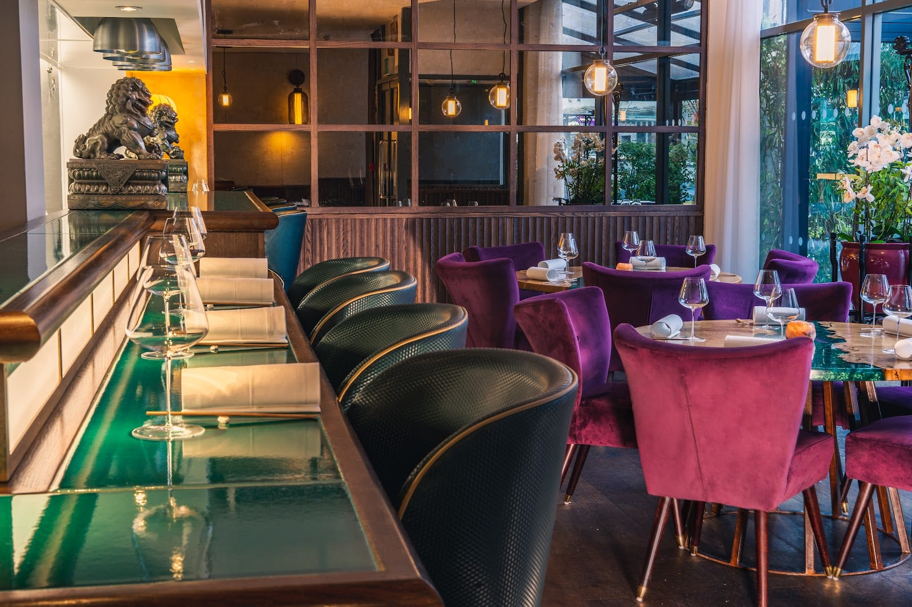

*A. Wong's dining room.*

**The only Chinese restaurant in London holding a Michelin star, and it holds two.** Andrew Wong works through the regional cooking of the whole country rather than the Cantonese repertoire London expects, and the tasting menu is organised as a journey across provinces.

**The two services differ.** Dim sum at lunch is far cheaper than the evening tasting menu: the same kitchen for a fraction of the outlay.

**££££, closed Sunday and Monday, and the evening books months ahead.** Seven minutes from Victoria.

### Tao Tao Ju, Chinatown

*£££ · 2 min from Leicester Square · Cited by 4 sources*

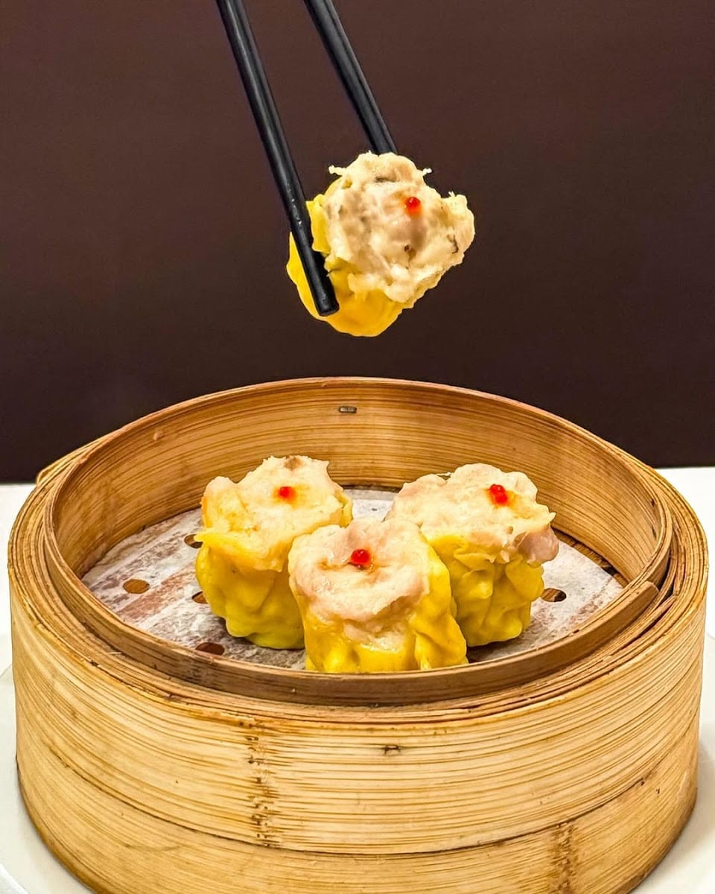

*Steamed siu mai.*

Steamed and grilled dim sum in towering bamboo baskets, **made fresh on site each day** rather than bought in frozen. It is the most-cited dim sum room in this guide.

Order across both cooking methods: the steamed **har gau** and **siu mai**, then the grilled and fried baskets. The dining room is quieter and smarter than the street outside suggests.

**£££**, and two minutes from Leicester Square. Good for a group or a date.

### Plum Valley, Chinatown

*£££ · Gerrard Street · Cited by 4 sources*

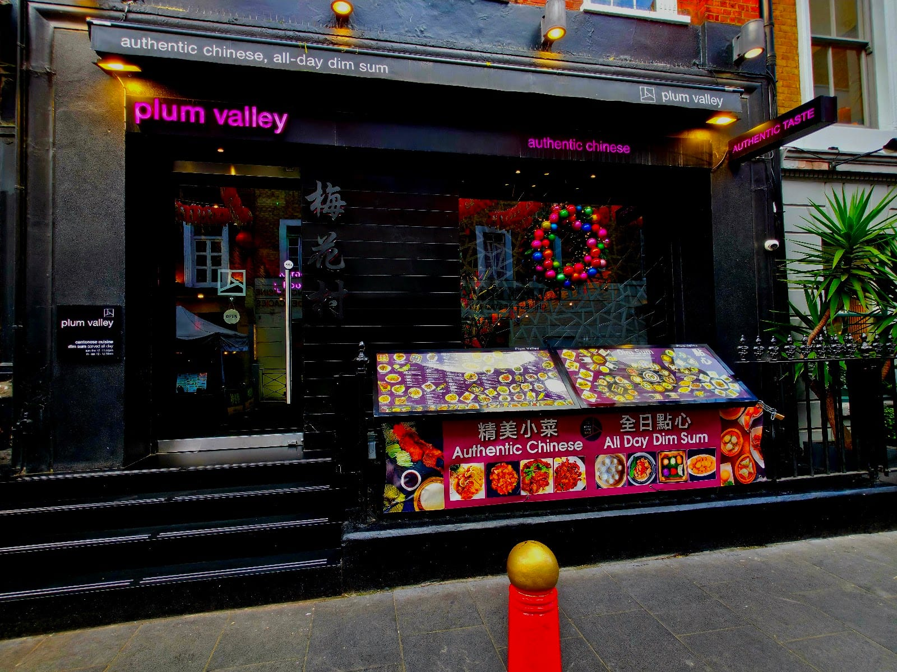

*Plum Valley, Gerrard Street.*

The black-fronted Gerrard Street room, family-run, named by every masthead in these sources and by three separate video creators.

**More than sixty handmade dim sum options**, made fresh daily by a dedicated team of dim sum chefs, in a smarter setting than most of Chinatown.

**£££**, three minutes from Leicester Square.

### Four Seasons, Bayswater

*££ · 84 Queensway · also Chinatown and Colindale · Cited by 4 sources*

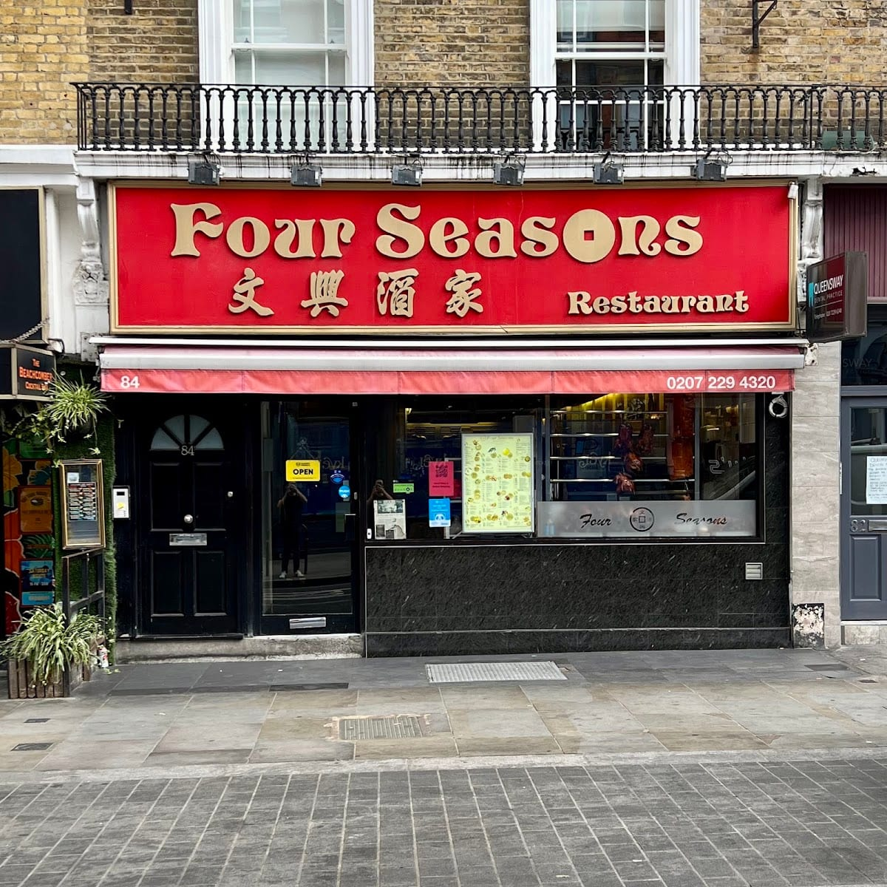

*Four Seasons, Queensway.*

**Hong Kong-style roast duck.** The Queensway room is the original; the business started here in 1990 before it reached Chinatown.

The **roast duck** hangs in the window and is carved to order, served over rice or on its own with plum sauce. It is what to order.

**££ and no bookings** — turn up, expect to wait, and go early evening before the duck sells out.

### Murger Han, City of London

*££ · Cited by 4 sources*

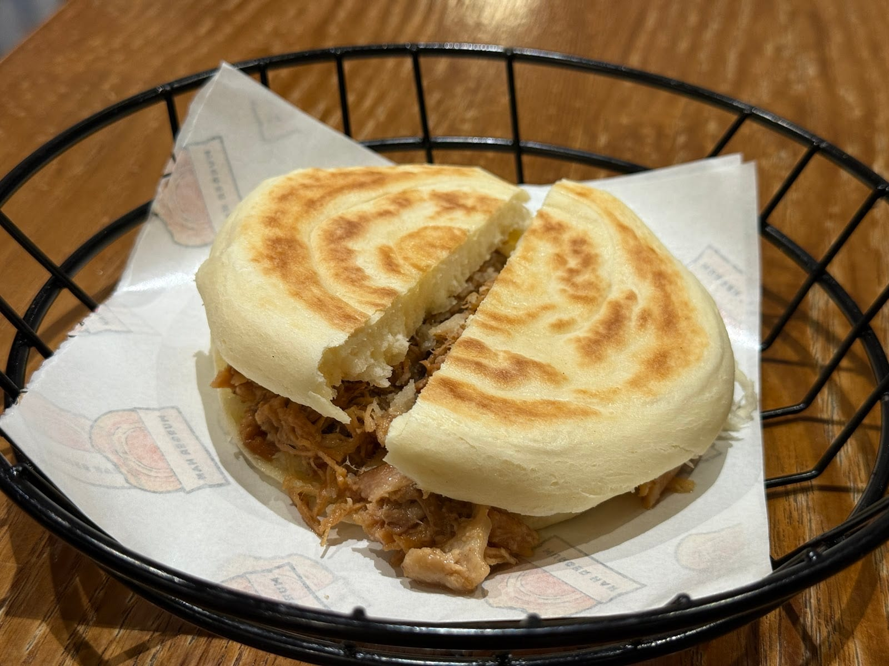

*The murger — rou jia mo.*

Shaanxi cooking from China's north-west, named for the **murger** — *rou jia mo*, slow-cooked spiced meat packed into a flatbread bun, which is the dish to order.

Alongside it, **hand-pulled noodles** made to order, cold liangpi noodles and cumin-heavy lamb — the Muslim-influenced cooking of Xi'an.

**££, walk-in, and quick** — this is a lunch counter more than a dining room. There are two sites; the Euston one on Eversholt Street is the original.

### Etles, Walthamstow — Uyghur

*££ · 235 Hoe Street · closed Mondays · Cited by 4 sources*

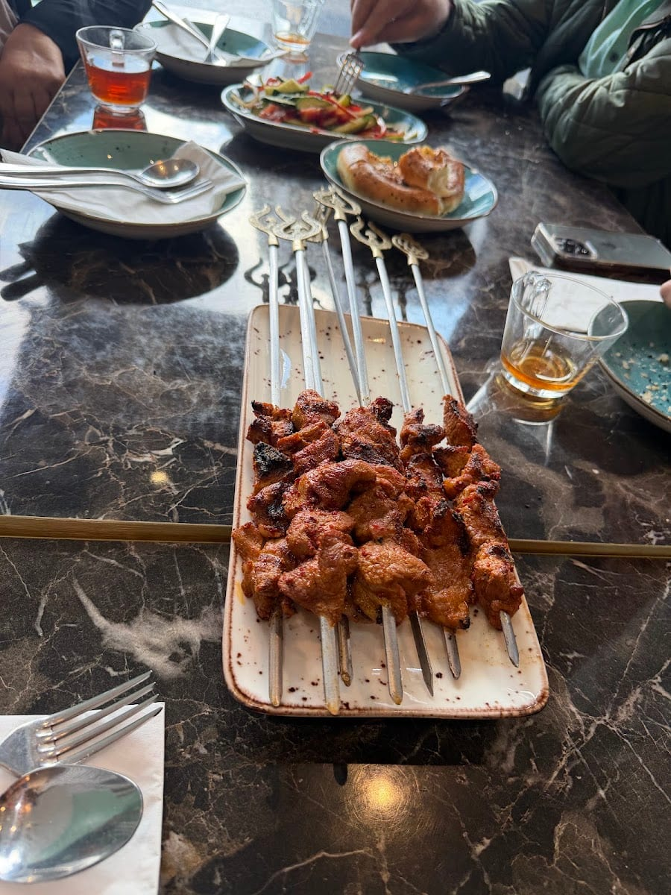

*The lamb skewers.*

**Uyghur cooking from Xinjiang**, a Turkic-Muslim tradition from China's far west.

The signatures are **hand-pulled laghman noodles**, cut and stretched to order and served under cumin-heavy lamb, and the **lamb skewers** grilled over charcoal with cumin and chilli. There is polo — the Uyghur rice pilaf — and thin-skinned lamb dumplings. The food is closer to Central Asian cooking than to anything in Chinatown.

Walk-in, cheap and family-run. Take the Victoria line to the end.

---

Powered by <a target="_blank" rel="sponsored" href="https://www.getyourguide.com/london-l57/">GetYourGuide</a>

## Regional Chinese

Most of London's Chinese food is Cantonese. These are Sichuan, Shaanxi, Hunan and Peranakan kitchens, then Cantonese seafood and roasts on Queensway.

### Barshu, Soho — Sichuan

*£££ · 28 Frith Street · Cited by 3 sources*

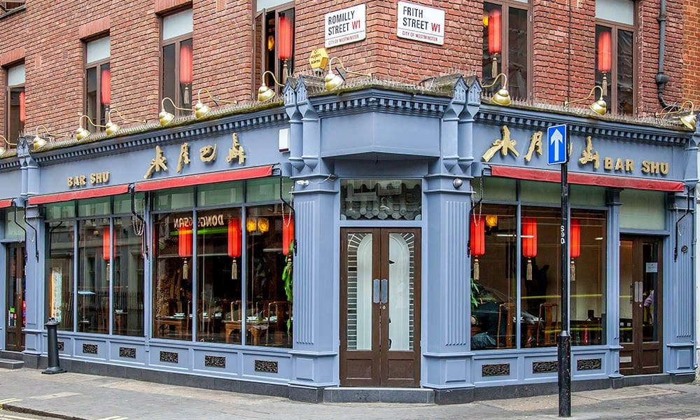

Opened in **2006**, on the corner of Frith Street and Romilly Street, on the edge of Chinatown rather than in it.

The signature is **water-boiled beef** — a misleading name for beef poached in a bath of chilli oil and Sichuan peppercorn — alongside dry-fried green beans and the numbing-hot dishes the region is built on. **Heat levels are marked on the menu.**

**£££**, and two minutes from Leicester Square. Good for a group sharing a full spread.

### Xi'an Impression, Holloway — Shaanxi

*£ · 117 Benwell Road · BYOB · no bookings · Cited by 3 sources*

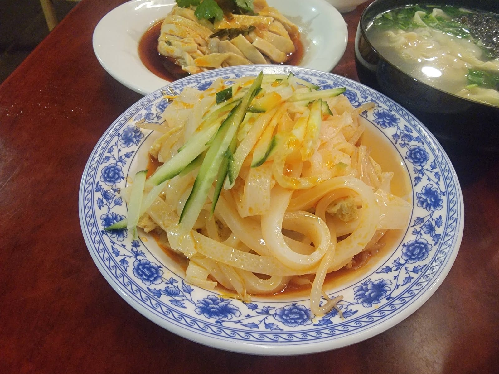

*Liangpi cold noodles.*

**Shaanxi cooking from China's north-west**, in a small room opposite the Emirates Stadium.

**Liangpi cold noodles** are the signature: chewy, hand-cut, dressed in chilli oil and vinegar and eaten cold. Beside them, hand-pulled **biang biang noodles** — one enormous belt-wide noodle per bowl — and the **Xi'an burger**, the same rou jia mo bun that Murger Han is named for.

Tiny, cash-friendly, walk-in. Impossible to get into on a match day, and easy on any other.

### Master Wei, Bloomsbury — Shaanxi

*££ · 13 Cosmo Place · Cited by 3 sources*

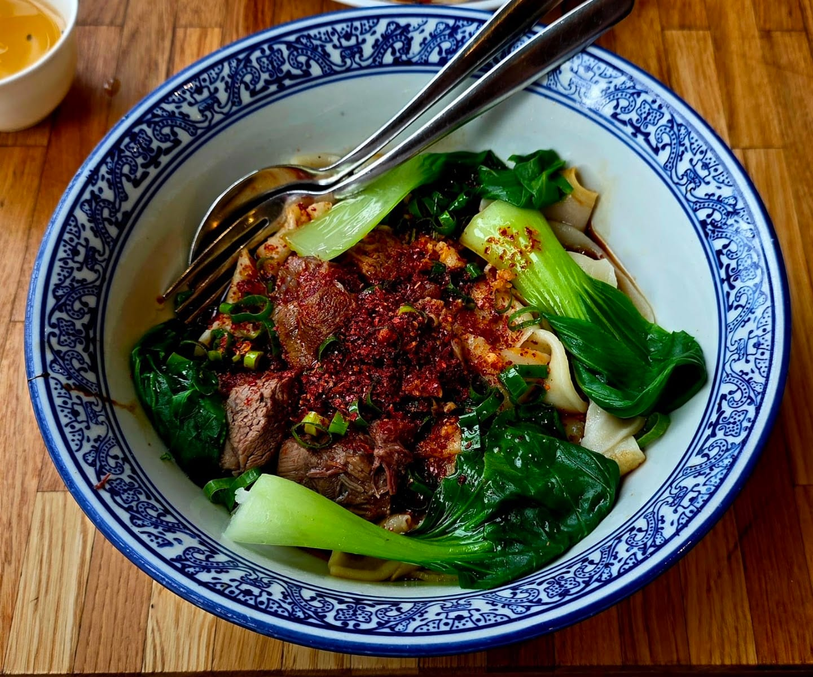

*Biang biang noodles.*

The same tradition from **Guirong Wei**, who opened Xi'an Impression. This is her own place, in Bloomsbury.

**Biang biang noodles** and **liangpi** again, plus dumplings in chilli oil and the cumin lamb that anchors Shaanxi menus. The room is small and the noodles are pulled to order.

Walk-in, and a short walk from Holborn or Russell Square.

### Hunan, Pimlico

*££££ · 6 min from Sloane Square · Cited by 3 sources*

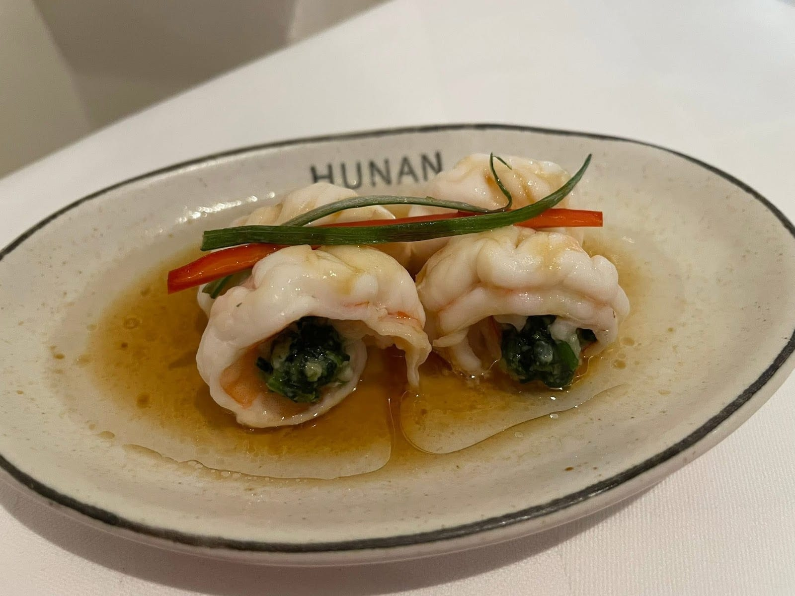

*A dish at Hunan.*

**No menu at all.** You tell them what you dislike and dishes keep arriving until you say stop. It has run this way for decades.

The cooking is **Hunanese** rather than Sichuan, which means chilli heat without the numbing peppercorn — sharper, more sour, and served as a long procession of small plates. Expect fifteen to twenty dishes.

**Book, and go hungry.** Tell them your budget as well as your dislikes when you sit down — the format has no other brake on it.

### Noodle & Beer, Chinatown — Sichuan

*££ · 27 Wardour Street · kitchen to 4am · Cited by 2 sources*

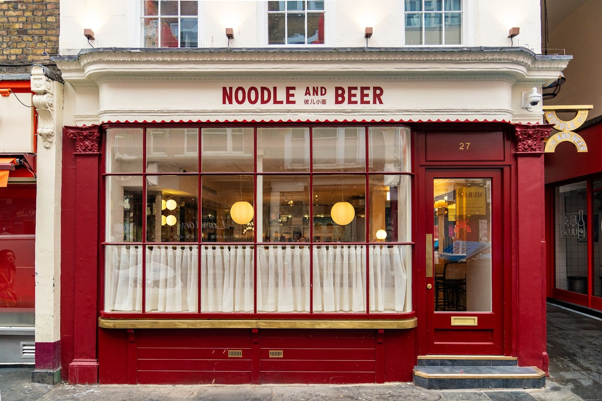

Sichuan cooking with **a kitchen that runs to 4am from Thursday to Saturday**.

Chilli-oil noodles, dry pot and skewers to eat with beer. Loud and bright.

**Walk-in.**

### Rasa Sayang, Chinatown — Malaysian-Peranakan

*££ · 5 Macclesfield Street · Cited by 3 sources*

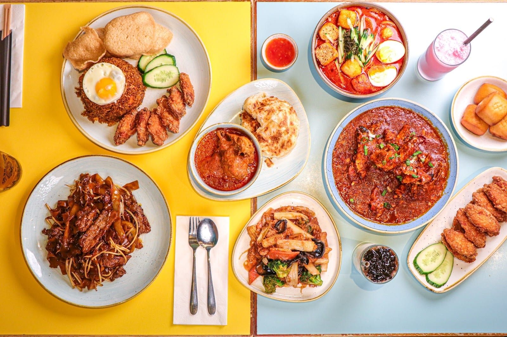

*Nasi lemak.*

**Peranakan cooking** — Chinese technique married to Malay spicing, from the Straits communities of Malaysia and Singapore — and reportedly **the only halal restaurant in Chinatown**.

**Nasi lemak** — coconut rice with sambal, anchovies, peanuts and egg — and **Singapore chilli crab** are the dishes to order, with char kway teow and Hainanese chicken rice behind them.

Walk-in, cheap and busy at lunch. The menu is not Cantonese.

### Mandarin Kitchen, Queensway — Cantonese seafood

*£££ · 14–16 Queensway · Cited by 1 source*

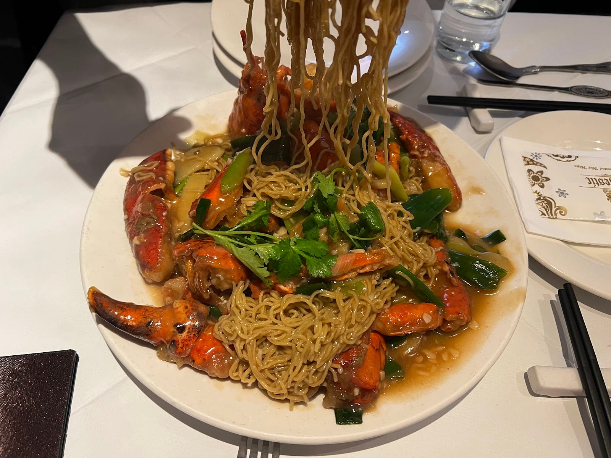

*The lobster noodles.*

Order the **lobster noodles**: a whole lobster over ginger and spring onion noodles, served in the shell.

Beyond it, a Cantonese seafood menu — steamed fish, razor clams, salt-and-pepper squid.

**Book at weekends.** Not cheap once the lobster arrives.

### Gold Mine, Queensway — Cantonese roasts

*££ · walk-in · Cited by 1 source*

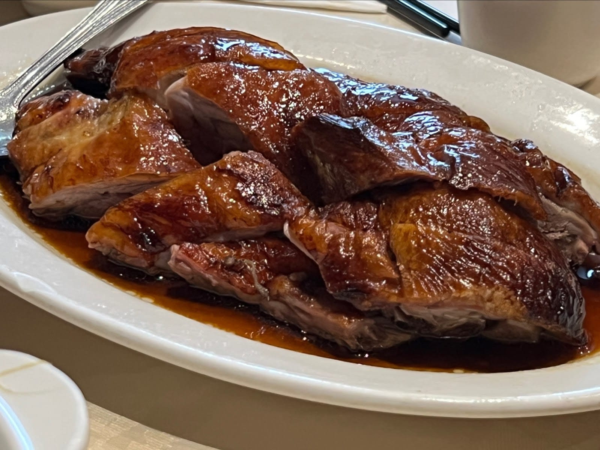

*The roast duck.*

Roast duck hanging in the window and carved to order, **cheaper than Chinatown for the same thing**. Two independent creators as well as the mastheads name it.

The **roast duck** is the order, on rice or on its own; roast pork and char siu hang beside it. A small room on Queensway with a queue at peak and fast turnover, and the carving happens in front of you.

**Duck sells out — go early evening.** Walk-in, cash-friendly, and about two minutes from Bayswater.

---

Powered by <a target="_blank" rel="sponsored" href="https://www.getyourguide.com/london-l57/">GetYourGuide</a>

## Dim sum

[**The Best Dim Sum in London**](/articles/best-dim-sum-london/) compares the rooms in full, with the trolley rooms and the booking-required ones separated out.

The short version: **A. Wong** in Victoria is the two-starred lunch; **Royal China** in Marylebone and **Yauatcha** in Soho are the mid-range rooms; **Dumplings' Legend** and **Joy King Lau** are the Chinatown standbys; and **Pearl Liang** is near Paddington.

---
## The Chinatown institutions

### Wong Kei, Chinatown

*££ · 41–43 Wardour Street · Cited by 3 sources*

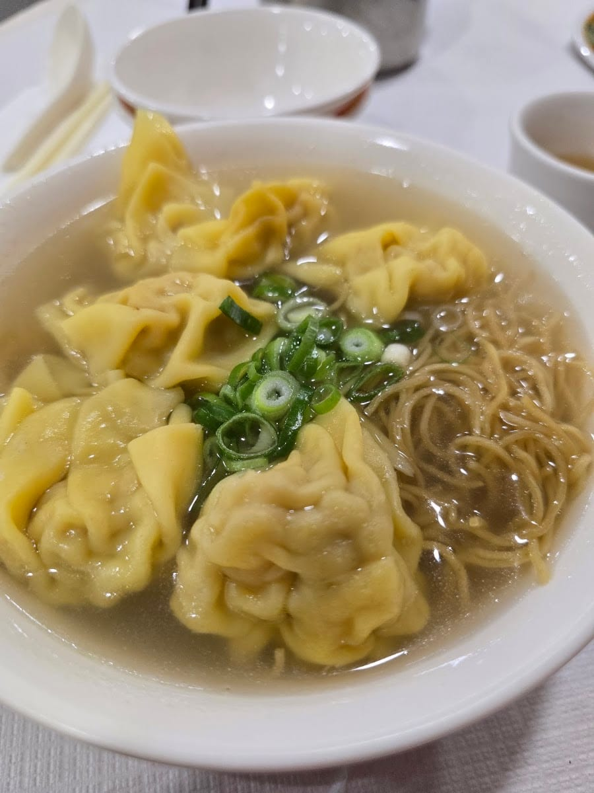

*Wonton soup.*

Around **five hundred covers** over several floors, and known for decades for its **brusque service**.

The menu is large: **roast meats over rice**, wonton soup and single-plate Cantonese cooking. Cash was the rule for years.

**£, walk-in, fast, and loud.** Three minutes from Piccadilly Circus.

### Chinatown Bakery, Newport Place

*£ · Cited by 3 sources*

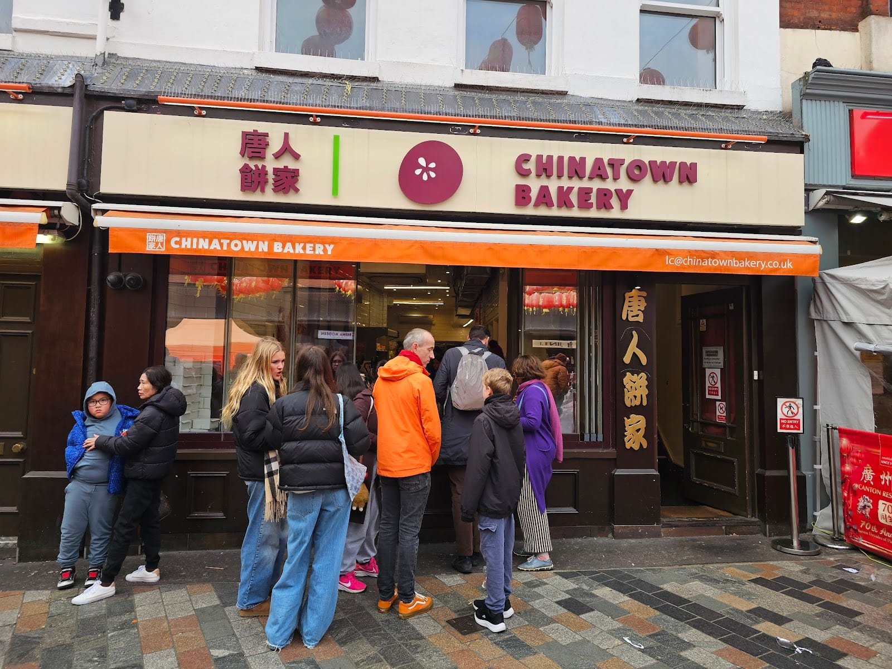

**Egg tarts, bolo bao and taiyaki made in the window** on Newport Place, at bakery prices. There is usually a queue.

Order the **egg tart**, served warm from the tray. **Bolo bao** is the sugar-crusted pineapple bun, which contains no pineapple. The taiyaki are made to order in fish-shaped irons.

**£, walk-in.**

### Dumplings' Legend, Chinatown

*££ · 15–16 Gerrard Street · Cited by 2 sources*

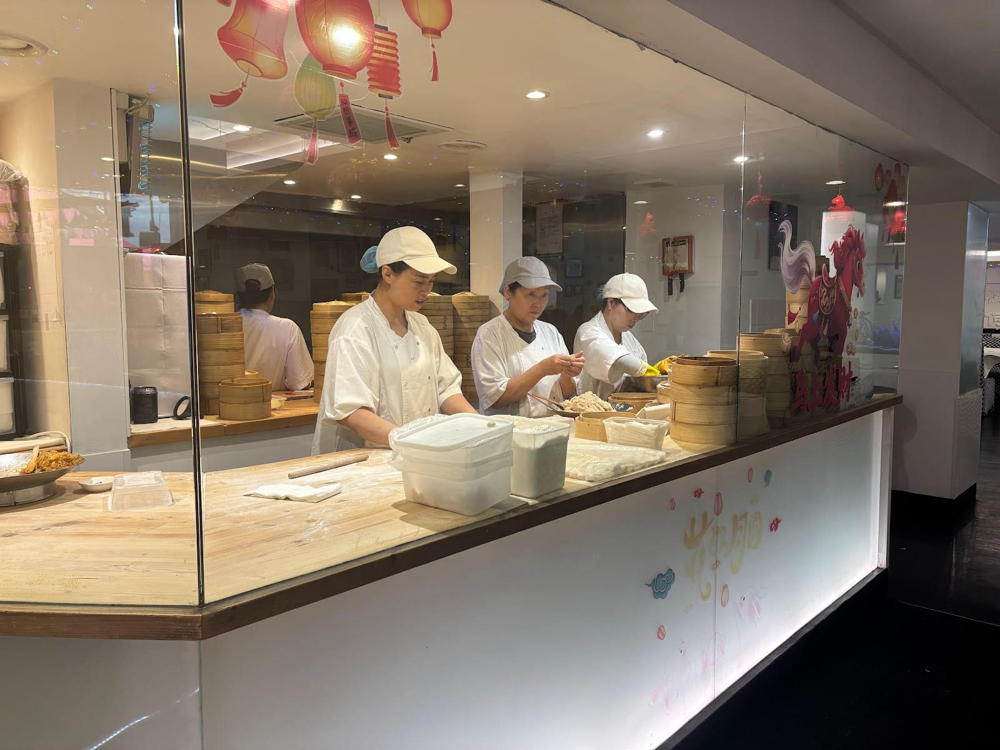

*The glass-walled kitchen at Dumplings' Legend.*

A **glass-walled kitchen on Gerrard Street** where the xiao long bao are folded in front of the queue.

**Xiao long bao** are the signature: Shanghainese soup dumplings, pleated by hand and steamed to order, and there are forty-odd other dim sum options behind them. The cooking is Shanghainese rather than Cantonese.

**££, walk-in**, three minutes from Leicester Square. Go at an odd hour to avoid the window queue.

### Din Tai Fung, Covent Garden

*£££ · Cited by 2 sources*

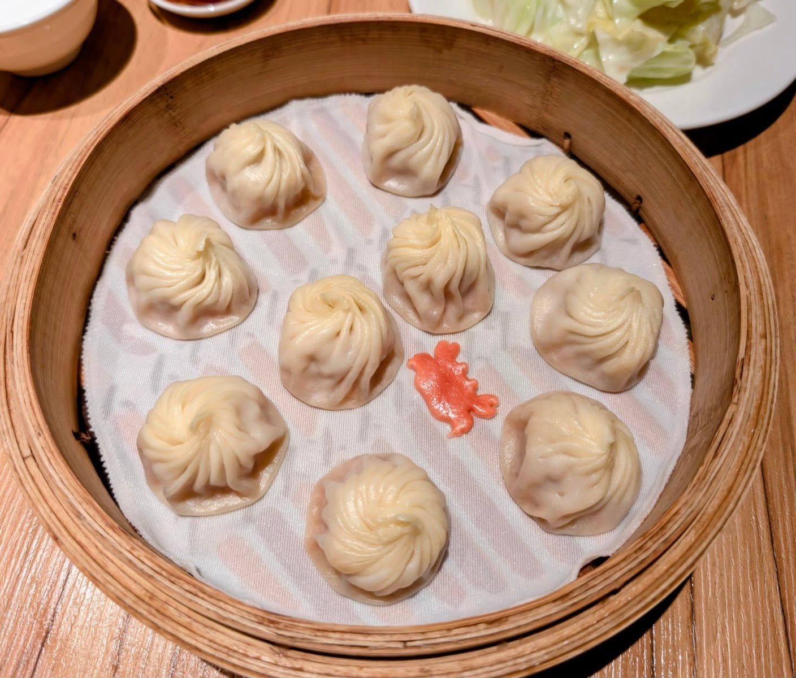

*Xiao long bao.*

**Xiao long bao folded to eighteen pleats behind glass** — the Taiwanese chain Ken Hom put in the New York Times' world top ten, and this was its first London site.

The **xiao long bao** are the proposition: thin skins, hot soup inside, eaten with black vinegar and ginger. Truffle and crab versions cost more. Noodles and greens fill out the rest.

**£££ and it books weeks ahead; walk-in queues are long at peak.** Centre Point is the larger of the two sites and has a bar lounge, which is where to wait.

---

## Thai, Korean and Japanese

These are separate cuisines, each with its own guide.

* [**The Best Thai Restaurants in London**](/articles/best-thai-restaurants-london/) — arranged by region: Isaan from the north-east is sour, fermented and chilli-driven, Southern Thai is coconut-rich and hotter again.
* [**The Best Korean Restaurants in London**](/articles/best-korean-restaurants-london/) — including the New Malden strip, with its Korean grills and bakeries.
* [**The Best Japanese Restaurants in London**](/articles/best-japanese-restaurants-london/) — split by format rather than price: omakase counter, yakitori grill, izakaya, ramen shop.

---
## Best value

* **Xi'an Impression**, Holloway — a **£5** Xi'an beef bun, and BYOB. *Cited by 3 sources*
* **Chinatown Bakery**, Newport Place — egg tarts and bolo bao at bakery prices. *Cited by 3 sources*
* **Bun House**, Chinatown — steamed bao from a shopfront. *Cited by 3 sources*

  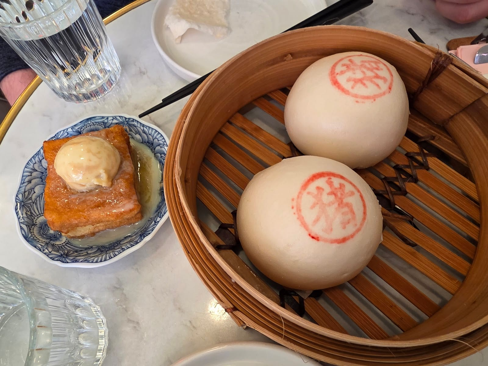

  *Steamed bao at Bun House.*

* **Kung Fu Noodle**, Chinatown — noodles pulled to order in the window. *Cited by 2 sources*

  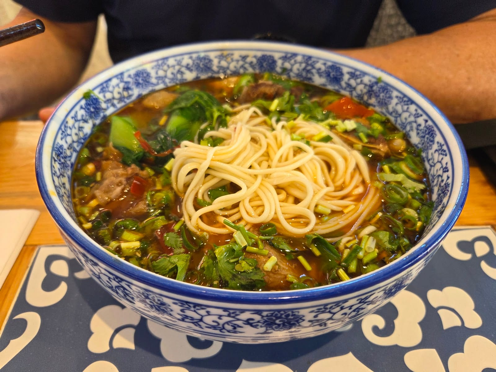

  *Noodles pulled to order.*
* **Kung Fu Burger**, Shaftesbury Avenue — a kiosk with no seating doing a shredded pork belly bun under a tenner. Cash only. *Cited by 2 sources*
* **Master Wei**, Bloomsbury — biang biang noodles around **£10** from the chef behind Xi'an Impression. *Cited by 3 sources*

### Food halls and supermarkets

* **Bang Bang Oriental**, Colindale — an Asian food hall with a **Four Seasons counter** serving the same roast duck as the Queensway restaurant for less.

  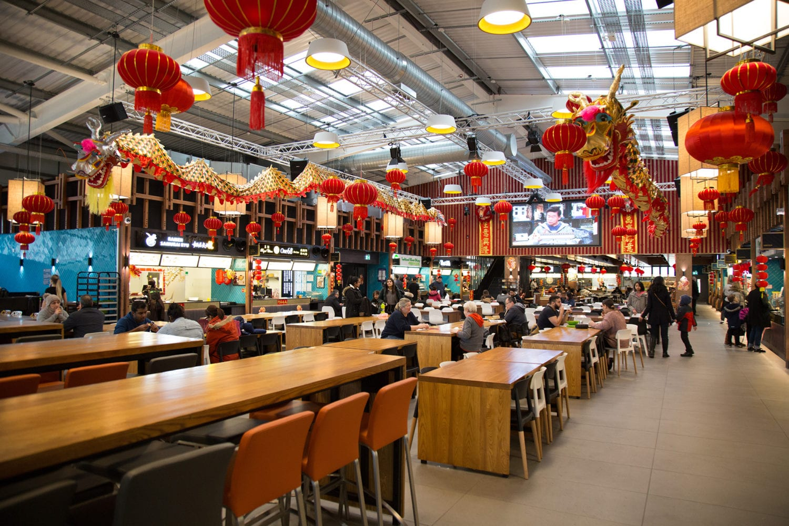
* **Chinatown's supermarkets** — Loon Fung and See Woo sell roast meats by weight over the counter. Half a roast duck to take away costs a fraction of a sit-down plate.
* **Arcade Food Hall** at Centre Point carries several Chinese and East Asian counters if you want one dish rather than a table.

---

Powered by <a target="_blank" rel="sponsored" href="https://www.getyourguide.com/london-l57/">GetYourGuide</a>

## Also named, with less behind them

Everything else the Chinese sources carry by two or more independent publications.

| Venue | Where | Price | Sources | What it is |
| --- | --- | --- | --- | --- |
| **Silk Road** | Camberwell | £ | 2 | Xinjiang cooking in south London — big plate chicken, hand-cut noodles |
| **Facing Heaven** | Hackney | ££ | 2 | Sichuan in a Hackney railway arch |
| **Golden Phoenix** | Chinatown | ££ | 2 | Dim sum through the day, quieter than its neighbours |
| **Chinese Tapas House** | Chinatown | ££ | 2 | Small plates rather than a banquet |
| **Cafe TPT** | Chinatown | £ | 2 | Late Cantonese canteen, open past midnight |
| **The Eight** | Chinatown | ££ | 2 | Cantonese, on Gerrard Street |
| **Orient London** | Chinatown | £££ | 2 | Four floors, dim sum trolleys at weekends |
| **Dream Xi'an** | Aldgate | ££ | 2 | Shaanxi again, on the eastern edge of the City |
| **Shan Shui Social** | Victoria | £££ | 2 | Cantonese in Nova, near A. Wong |
| **Canton Blue** | Belgravia | ££££ | 2 | The Peninsula hotel's Cantonese room |
| **Kai Mayfair** | Mayfair | ££££ | 2 | Formerly held a star; still on two guides' lists |
| **Yi-Ban** | Royal Docks | ££ | 2 | Dim sum by the water at the ExCeL end of the DLR |
| **Pochawa Grill** | Chinatown | £££ | 2 | Korean barbecue on the Chinatown grid |

---

## What to know

* **Dim sum is a lunch service** at most traditional halls, finishing around 5pm. Yauatcha and Dragon Castle are the exceptions.
* **Chinatown is best approached with a list.** Fifteen of its addresses are named by two or more independent sources.
* **Chinatown is not the whole story.** The most-cited Chinese cooking is spread from Victoria to Walthamstow, and several rooms here are nowhere near Gerrard Street.
* **Only A. Wong on this page holds a Michelin star**, and it has two. The counts show agreement between sources, not a verdict.
* **Service charge** of 12.5% is discretionary and standard.

---

## Continue planning your London trip

- 🔀 **[The Best Fusion Restaurants in London](/articles/best-fusion-restaurants-london/)** — Indo-Chinese, the cooking of Kolkata's Hakka community
- 🇵🇭 **[The Best Filipino Restaurants in London](/articles/best-filipino-restaurants-london/)**
- 🍽️ **[Eat in London: Restaurants, Food Markets & Quick Food Hub](/articles/eat-in-london-guide/)**
- 💷 **[Cheap Eats in London](/articles/cheap-eats-london/)**
- 🥟 **[The Best Dim Sum in London](/articles/best-dim-sum-london/)**
- 🍛 **[The Best Indian Restaurants in London](/articles/best-indian-restaurants-london/)**
- 🌿 **[Best Vegetarian and Vegan Restaurants](/articles/best-vegetarian-vegan-restaurants-london/)**
- 🍜 **[Soho Area Guide](/articles/soho-area-guide/)**
- 🎭 **[Covent Garden Area Guide](/articles/covent-garden-area-guide/)**
