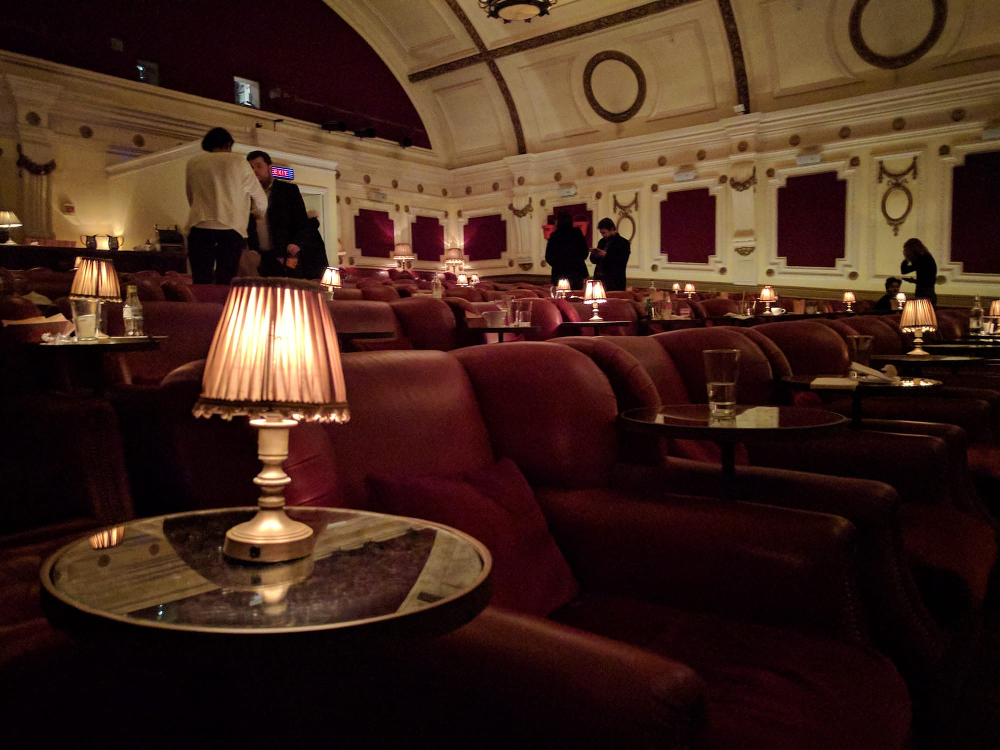
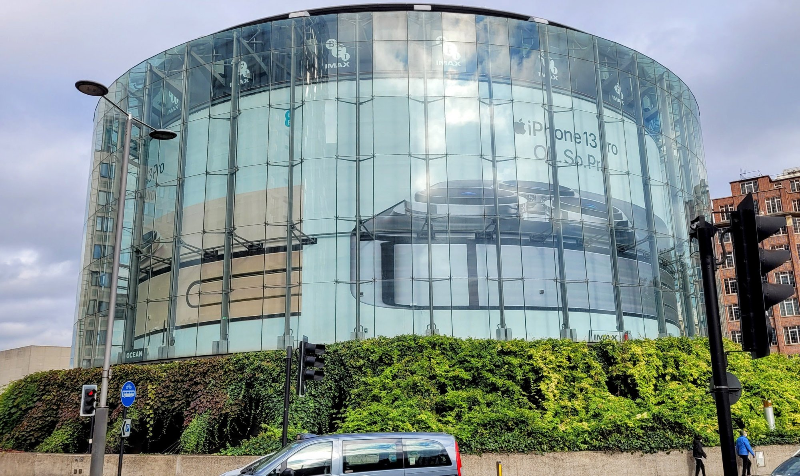
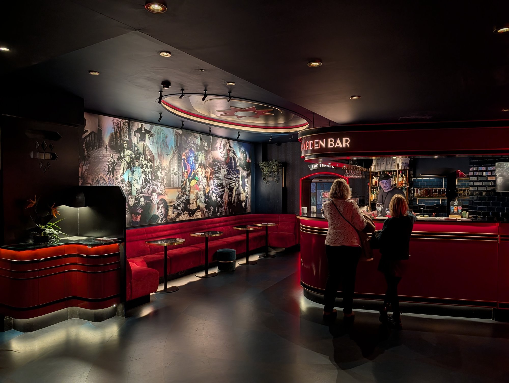
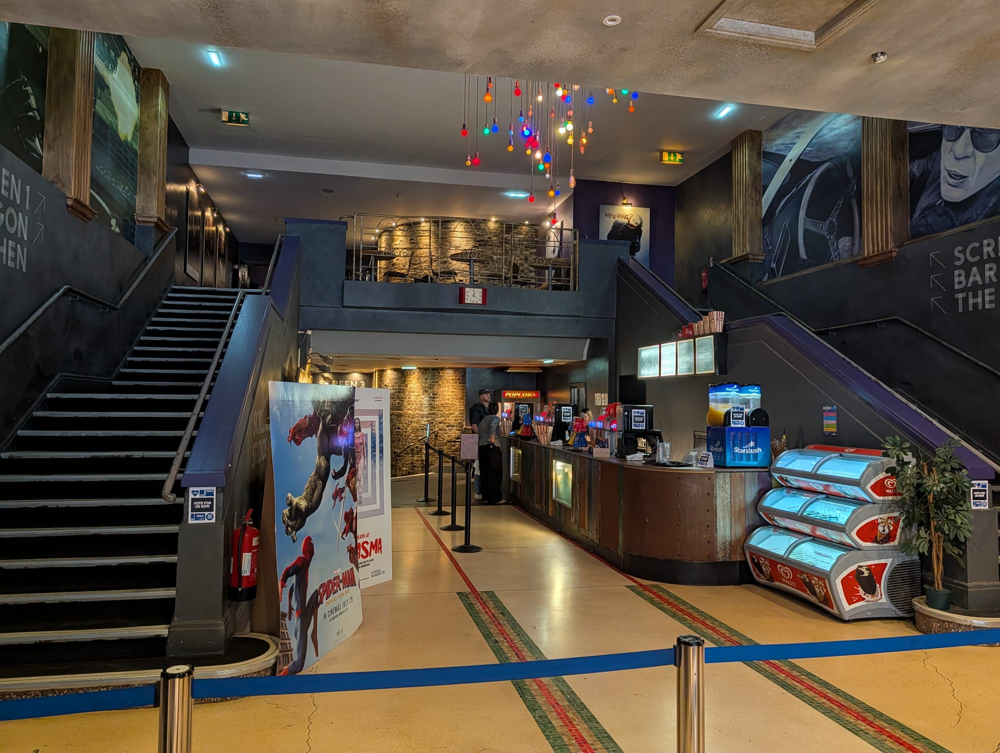
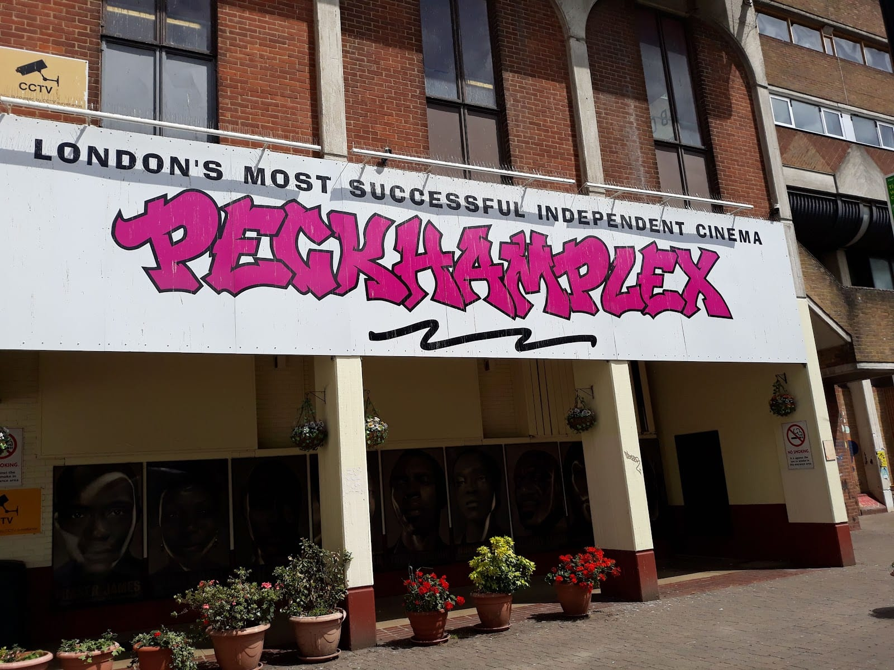

> 💡 **The Short Version:** **The Prince Charles** shows 35mm and 70mm prints, quote-alongs and all-night marathons. **Regent Street Cinema** is where the Lumières first showed film in Britain in 1896. **Electric Portobello** opened in 1911, is London's oldest purpose-built cinema, and has armchairs, sofas and front-row beds. **Genesis** charges £4.99 Monday to Wednesday, **Peckhamplex** £6.99 any day, and **Screen on the Canal** is free.

> 📘 **How we choose these (editorial note).**
> No paid placements. These are drawn from a wide spread of sources - the food and travel press, the big listings sites, independent blogs and specialists, video, and what Londoners recommend themselves - and cross-referenced against each other. No chains, except where a chain operates a historic building.

## Where they are

| If you are near… | Where to go |
| --- | --- |
| **Leicester Square & Covent Garden** | Prince Charles Cinema, The Garden Cinema |
| **Oxford Circus** | Regent Street Cinema |
| **South Bank** | BFI Southbank, BFI IMAX |
| **Notting Hill** | Electric Portobello |
| **White City** | Electric White City |
| **Hackney & Clapton** | Rio Cinema, The Castle Cinema |
| **King's Cross** | Everyman Screen on the Canal |
| **Peckham** | Peckhamplex, Rooftop Cinema Club |

---

## The famous ones

### Prince Charles Cinema, Leicester Square

*Off Leicester Square*

**35mm and 70mm prints, quote-alongs, sing-alongs and all-night marathons**, with a membership that pays for itself in about six visits.

Two screens: **300 velvet seats downstairs and 104 leather seats upstairs**. The programme is cult and classic film rather than new releases, such as *The Thing* at midnight.

### Regent Street Cinema, Oxford Circus

*Since 1896*

Where the **Lumière brothers' Cinematographe had its first British showing in late February 1896**, and still a cinema. It reopened in 2015 after a **£6.1 million restoration** with 185 seats, a restored 1936 John Compton organ, and projection for **16mm, 35mm, Super 8 and 4K**.

### Electric Portobello, Notting Hill

*191 Portobello Road, W11 2ED · opened 1911*

**London's oldest purpose-built cinema**, opened on **27 February 1911**. The Phoenix in East Finchley (1912) holds the "continuously operating" title because the Electric has closed and reopened since.

The seating is the draw: **98 leather armchairs**, some with footstools, **two leather sofas across the back row** and **double beds in the front row**. There is a full bar and a food menu.

*The armchairs at Electric Portobello.*

**Prices vary by session.** A non-member armchair is **£25** on Friday evening and all weekend, **£20** on weekday evenings and **£15 before 5pm Monday to Friday**. Front-row beds are £30–£40 and back-row sofas £40–£50, both sold for two people. **Children are £10 at any time.**

### Electric White City

*2 Television Centre, 101 Wood Lane, W12 7FR*

The second Electric, inside **BBC Television Centre**.

Same armchair-and-sofa format as Portobello, with a kitchen rather than a snack counter, and easier to get into: Portobello sells out days ahead, this one rarely does.

**Book a specific seat.** Armchairs, sofas and double beds are priced differently.

White City (Central line) and Wood Lane are each about five minutes away.

### BFI Southbank

*South Bank*

The BFI's own cinema, with a repertory programme and a Mediatheque where you can watch archive material free. Each October it is one of the venues for the [BFI London Film Festival](/articles/london-film-festival/).

It is also **the only cinema in the UK licensed to publicly screen nitrate film**, the flammable stock used until the early 1950s.

### BFI IMAX, Waterloo

*Waterloo · 70mm IMAX film*

A glass drum on the roundabout north of Waterloo station, and **the largest cinema screen in the UK** by the BFI's own measure. It is one of only three cinemas in the country that can still project genuine **70mm IMAX film** rather than digital.

Most screens marketed as IMAX are digital and much smaller. This one runs the real format when a film is released in it, a handful of titles a year.

**Sit further back than feels right.** The screen is over twenty metres high and the front third of the auditorium is too close to take it in.

**It sits on an island in the middle of the roundabout, and the only way in is through the pedestrian subways.** There is no direct link from Waterloo station: come out, find a subway entrance on the roundabout's edge, and go under. There is no road crossing.

---

Powered by <a target="_blank" rel="sponsored" href="https://www.getyourguide.com/london-l57/">GetYourGuide</a>

## Saved by their neighbourhoods

### Rio Cinema, Hackney

*Kingsland High Street*

Opened in 1915 as the Kingsland Empire and rebuilt in Art Deco style in 1937; the Grade II-listed auditorium still stands. It has been the Rio since 1976, and a second, smaller screen was added in the basement in 2017.

Run as a registered charity, with regular Classic Matinees for over-60s and a long-running queer film club, Pink Palace.

### The Castle Cinema, Clapton

*Crowdfunded back*

A **1913 cinema that became a bingo hall, a shoe factory and a snooker club** before Clapton crowdfunded it back into use.

It now has a second screen, a kitchen and an all-day café, a locally sourced, largely vegan bar menu, and runs no adverts before its films.

### The Garden Cinema, Covent Garden

*Between Holborn and Covent Garden*

Opened in 2022 on Parker Street, between Holborn and Covent Garden. **Three screens (40, 60 and 70 seats)** run curated seasons alongside new releases from around the world, with regular post-screening discussions with filmmakers.

Membership is **£25 a year**: £3 off standard tickets for you and a friend, one free ticket, and free fortnightly members' screenings.

**The bar downstairs is open to anyone**, ticket or not.

**Parker Street is hard to find**, tucked between Kingsway and Drury Lane. Holborn and Covent Garden stations are each about five minutes away.

*The Garden Cinema's art deco bar.*

---

## The ones that still project film

### Close-Up, Shoreditch

*40 seats · 35mm and 16mm · Sclater Street*

Forty seats, reel-to-reel **35mm and 16mm**, and behind it a **lending library of 19,000 titles** covering early cinema, world cinema, experimental film and video art.

**The library is a lending library you can join and borrow from**, so it is the one entry here you can use without buying a ticket.

**Forty seats means it sells out**, and the programme is repertory and one-off rather than runs, so a film you want may screen once. Book when you see it listed.

**On Sclater Street**, two minutes from Shoreditch High Street and five from Brick Lane.

### Genesis Cinema, Mile End

*5 screens · £4.99 Monday to Wednesday*

**Tickets are £4.99 Monday to Wednesday**, £7.75 on Thursday and £12 Friday to Sunday. There are five screens, a bar and a dedicated 35mm strand.

**The bar and cafe are open without a ticket.**

**Mile End station** (Central, District, Hammersmith & City) is five minutes away.

*The foyer at Genesis Cinema.*

### Barbican Cinema, City of London

*3 screens · 35mm · £7 Mondays*

Three screens, seating 288, 156 and 156, inside the Grade II-listed Barbican Centre. Listings tag the **35mm prints**, so you can filter for film rather than digital before booking.

**Mondays are £7** for the latest films, and there are pay-what-you-can screenings alongside a members' series.

> ⚠️ **The three screens are in two different buildings.** Cinema 1 is inside the Centre; Cinemas 2 and 3 are on Beech Street, a few minutes away through the estate. Check which is on your ticket, because finding the second pair from the first is not quick.

**Follow the yellow line painted on the pavement** from Barbican station.

### Phoenix Cinema, East Finchley

*Opened 1912 · a registered charity*

**London's oldest continuously operating cinema**, opened as the East Finchley Picturedrome on **11 May 1912** and running ever since — an Edwardian barrel-vaulted ceiling, fourteen Art Deco panels, and a large neon side sign.

It is often called *Britain's* oldest, and it is not: **the Duke of York's in Brighton opened in September 1910**. Electric Portobello opened in 1911, earlier, but has closed and reopened since; the Phoenix never has.

Saved from demolition in 1983 and now run as a registered charity.

### The Lexi, Kensal Rise

*2 screens · a social enterprise*

Seventy-five seats, opened in 2008, and run largely by volunteers under a **legal covenant to donate 100% of distributable profits** to the Sustainability Institute in South Africa.

**Seventy-five seats** means popular screenings sell out; the programme mixes new releases with one-off events.

**Kensal Rise is the station**, on the Overground, about five minutes' walk — it is not on the Tube, and from central London it is a change at Willesden Junction or a bus.

### Ciné Lumière, South Kensington

*2 screens · inside the Institut français*

French and world cinema, subtitled in English, inside the Institut français on Queensberry Place, and often the only place a given title screens. You do not need to speak French.

**The building has a cafe and a French bookshop** open to anyone.

**Two minutes from South Kensington station**, and about the same from the V&A and the Natural History Museum.

> ⚠️ **Renovation.** The first phase closed the cinema from 13 July to 28 August 2026 for new seats. A second phase adds more than 20 seats and new projection equipment, so check the programme before you travel.

### Olympic Studios, Barnes

*3 screens · the former recording studio*

The former Olympic recording studio, where the Rolling Stones, Led Zeppelin and Hendrix recorded, now a cinema with a 17-seat members' screening room.

**£15 for a weekday matinee, rising to £18.95.** There is a dining room, a bar and armchair seating.

**Barnes is not on the Tube**: take the mainline from Waterloo to Barnes Bridge, then walk.

### The Ritzy, Brixton

*5 screens · opened 1911*

Opened on **11 March 1911** as the Electric Pavilion, and now five screens on Brixton Oval.

**Happy Mondays** has tickets from £7.99 all day on Mondays, and **all child tickets are £4.99** every day.

**The cafe and bar are open without a ticket** and run late, with live music some nights.

**Brixton station** (Victoria line) is two minutes away, with the market arcades opposite.

---

Powered by <a target="_blank" rel="sponsored" href="https://www.getyourguide.com/london-l57/">GetYourGuide</a>

## Cheap and outdoors

### Peckhamplex, Peckham

*£6.99 a seat*

An independent showing **current releases for £6.99**, plus a 60p booking fee per ticket (£7.59 in total). 3D costs £1 more.

**The price is flat**: a Saturday night costs the same as a Tuesday.

It is a multiplex showing the same releases as everyone else, so this is where you see a blockbuster.

*Peckhamplex, Rye Lane.*

**Peckham Rye station is five minutes away**, and Rye Lane and Old Spike are both within ten.

### Everyman Screen on the Canal, King's Cross

*Free · summer*

Films projected beside the canal in summer and watched from the **canal steps below Granary Square**, free. No ticket, no booking, no minimum spend.

**Bring something to sit on.** The steps are stone and no seating is provided.

**It runs in summer only** and in dry weather, and the programme is announced a few weeks ahead rather than months, so check close to the date.

**King's Cross St Pancras is five minutes away.**

### Rooftop Cinema Club, Peckham

*Ticketed · seasonal*

A working open-air cinema on top of the **Bussey Building**, 133 Rye Lane, a couple of minutes from Peckham Rye station. The main season is **May to September**, with screenings into early November. New releases and cult favourites from deckchairs, with headphones rather than a PA system.

Popular slots sell out and **a waitlist opens once a screening does**.

**Dress for it.** It is a roof in the open air, not a heated room, and a warm evening turns cold by the credits. Ponchos are handed out if it drizzles.

---

## What it costs, and how to pay less

Cinema in London runs from £4.99 to nearly £19 for the same film.

#### The cheapest tickets

* **Genesis**, Mile End — **£4.99 Monday to Wednesday**.
* **BFI Southbank** — **£4 for anyone aged 16 to 25**, any film, any time.
* **Peckhamplex** — current releases for **£6.99** plus a 60p booking fee.
* **Barbican** — **£7 on Mondays**.
* **The Ritzy** — Happy Mondays from £7.99, and **£4.99 for children** every day.
* **The Garden Cinema** — **£8.50** for a weekday matinee before 5pm, and weekend family films are pay-what-you-can.

#### Memberships that pay for themselves

* **The Prince Charles — £15 a year.** It takes at least £2.50 off every ticket and gives **£8 weekday matinees** and access to **regular £1 screenings**. Six visits and it has paid for itself. Concession £12.50, buyable at the box office only.
* **The Garden Cinema — £25 a year**: £3 off tickets for you and a friend, one free ticket and free fortnightly members' screenings.
* **The Castle Cinema** — £35 a year, with **£6 Mondays**, £6 weekday matinees and a friend free at Tuesday to Friday daytime screenings.
* **BFI membership** from £44, with two free tickets a year and £6 member screenings.

#### General

* **Matinees are cheaper** at almost every cinema here, often by £5 or more.
* **Book direct.** The aggregators add a fee.

---

Powered by <a target="_blank" rel="sponsored" href="https://www.getyourguide.com/london-l57/">GetYourGuide</a>

## What to know

* **Soho House and Soho Friends members pay less at both Electrics** all week, and under-27 members get a further discount on Mondays, bookable only at the box office.
* **BFI Southbank's Mediatheque is free** and lets you watch archive film with no ticket at all.
* **Check the cinema's own site.** Repertory programmes change weekly and aggregators miss them.

---

## Continue planning your London trip

- 💷 **[The Best Cinema Deals in London](/articles/cinema-deals-london/)**
- 🎬 **[London Filming Locations](/articles/london-filming-locations/)**
- 🎪 **[Free Things to Do in London](/free/)**
- 🎵 **[The Best Live Music Venues in London](/articles/best-live-music-venues-london/)**
- 💷 **[Cheap Eats in London](/articles/cheap-eats-london/)**
- 🎨 **[Peckham Area Guide](/articles/peckham-area-guide/)**
- 🏙️ **[South Bank Area Guide](/articles/south-bank-area-guide/)**
