London's cocktail scene splits in two. The **Mayfair and St James's hotel bars** charge about £20 a drink in rooms with a century of history behind them. The **east London independents** charge about £14, and most do not take bookings.

> 💡 **The Short Version:** **The Connaught Bar** has twice been voted the world's best and mixes the martini at your table. **Dukes** holds guests to two martinis, poured neat from a frozen bottle. **The American Bar** at the Savoy is where the Savoy Cocktail Book was written. **Satan's Whiskers** rewrites its menu by hand every day and was named Bar of the Year at the CLASS Bar Awards 2026. **Tayēr + Elementary** is two bars in one room.

> 📘 **How we choose these (editorial note).**
> No paid placements. Where a bar holds a world ranking we give the position and the year. Current rankings are from the World's 50 Best Bars 2026, announced on 7 October 2026.

## Where they are

  

    Map of the best cocktail bars in London
  

  

    
Loading the interactive map…

  

  <noscript>
    
The interactive map requires JavaScript. Every entry below lists its area.

  </noscript>

| If you are near… | Where to go |
| --- | --- |
| **Mayfair & St James's** | The Connaught Bar, Kwãnt, Dukes Bar |
| **Marylebone** | Artesian |
| **Covent Garden & Strand** | The American Bar, Oriole |
| **Holborn** | Scarfes Bar |
| **Soho** | Swift, Bar Termini, Three Sheets Soho, Bar Crispin |
| **Shoreditch & Bethnal Green** | Tayēr + Elementary, Satan's Whiskers, Coupette, Seed Library |
| **Hoxton, Haggerston & Dalston** | Happiness Forgets, A Bar with Shapes for a Name, Three Sheets (Dalston) |
| **North London** | Little Mercies (Crouch End), Half Cut Market (York Way) |
| **South Bank** | Lyaness |

---

## The world-ranked

### The Connaught Bar, Mayfair

*££££ · Mon–Sat 4pm–1am · no reservations, ever*

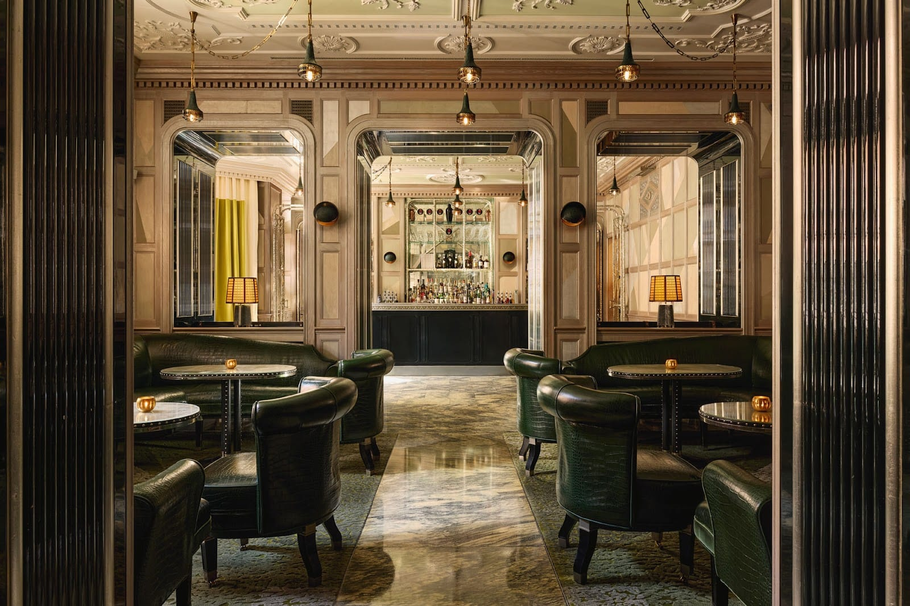

*The Connaught Bar.*

**No.8 in the World's 50 Best Bars 2026** · world No.1 in 2020 and 2021

The **martini is mixed at your table** from a trolley of tinctures: you pick the gin, then choose from bergamot, cardamom, coriander, liquorice and lavender as the bartender works, which takes several minutes. It is £30.

> 💡 **It takes no bookings at all.** The bar's policy is no reservations, at any hour, for anyone, so the only strategy is to arrive early. Four o'clock, when it opens, is the answer.

**Monday to Saturday, 4pm to 1am.** At The Connaught, Carlos Place, W1K 2AL, five minutes from Bond Street, through Mount Street.

### Artesian, Marylebone

*££££ · £15–£85 · Sun–Wed 4pm–midnight, Thu–Sat 4pm–1am*

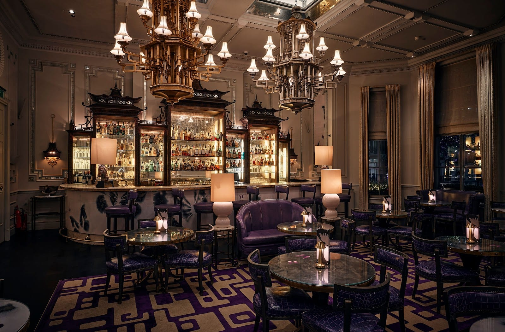

*Artesian's pagoda-topped back bar.*

**Four consecutive years as the best bar in the world** in the 2010s. It is a high-ceilinged, chinoiserie-panelled bar off the lobby of The Langham, with a back bar that runs the full width of the room.

**Drinks run £15 to £85.** Head bartender Giulia Cuccurullo took the GQ Food & Drink award in 2022.

**Dress code is smart casual.** **Strictly over-18s after 6pm**; accompanied over-15s are admitted before that, so come before 6pm with older teenagers.

At The Langham, 1c Portland Place, W1B 1JA, at the top of Regent Street opposite Broadcasting House.

### Tayēr + Elementary, Old Street

*££££ · closed after a fire*

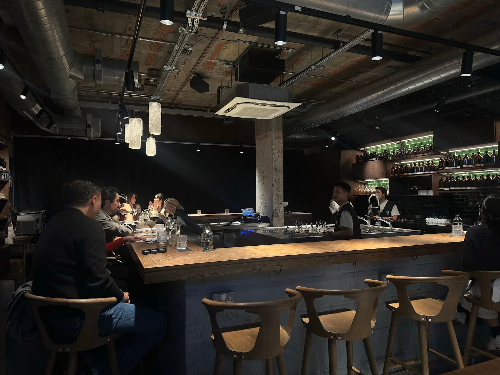

*The seated room behind the bar.*

**No.5 in the World's 50 Best Bars 2025**, the highest-ranked London bar on that list, and not in the 2026 top 100

Alex Kratena and Monica Berg split it in two: a standing bar at the front for a fast drink, a seated room behind for a slow one.

> ⚠️ **Closed since a fire in the building on 5 May 2026**, with no reopening date announced. Do not travel for it.

### Lyaness, South Bank

*££££ · £17–£31 · Mon–Thu 5pm–midnight, Fri 4pm–1am, weekends from 1pm*

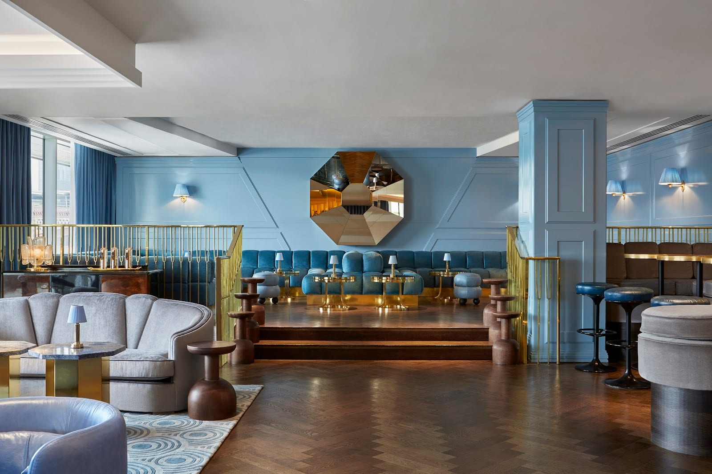

*Lyaness, at Sea Containers London.*

Ryan Chetiyawardana builds the menu around a handful of house-made ingredients and **rewrites it wholesale** each time rather than editing it. The current one is called **Collaboration 2.0**, with a separate five-drink Special Editions list beside it.

**Drinks run £17 to £31**, with 13.5% discretionary service. The Pink Belly Gimlet is £17, and its non-alcoholic version is £11.

**Weekends open at 1pm.** SevenRooms for tables; walk-ins are taken subject to space.

At Sea Containers London, 20 Upper Ground, SE1 9PD, in the same building as 12th Knot upstairs.

---

## The historic rooms

### The American Bar, Covent Garden

*££££ · Mon–Sat noon–midnight, Sun noon–10pm*

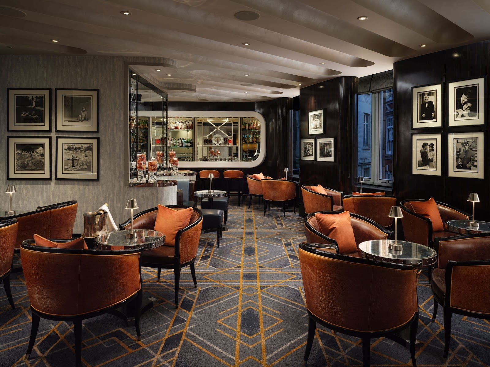

*Where the Savoy Cocktail Book was written.*

The room where **Harry Craddock compiled the Savoy Cocktail Book in 1930**, and where the White Lady was popularised. There is a pianist at the baby grand and the staff wear white jackets. The Savoy says it has been serving since 1893.

**Noon opening, seven days.** An afternoon drink here has the same room as an evening one.

**No formal dress code**, but dress elegantly; sports jerseys are strictly prohibited. Book through SevenRooms.

It was **World's Best Bar in 2017** and is not in the current top 100.

### Dukes Bar, St James's

*££££ · walk-in only · Mon–Sat 3pm–10pm*

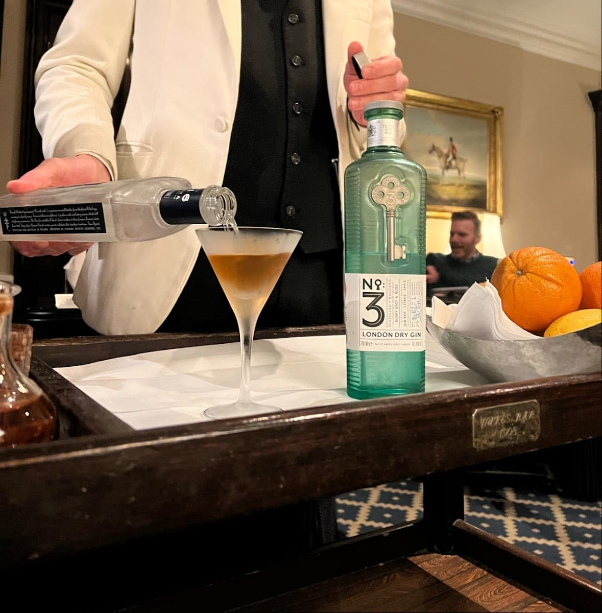

*The Dukes martini trolley.*

The **martini is made at your table from frozen bottles**, poured with no ice and no dilution, and the house holds guests to two. Ian Fleming drank here and the Vesper is the order.

> ⚠️ **Do not try to book.** The bar is **walk-in only**. During busy periods there may be a short wait for a table.

**Last orders are 10pm and the bar closes at 10.30**, so this is a pre-dinner room, not a late one.

**Smart casual and strictly over-18s:** no sportswear, shorts or T-shirts, with short-sleeved collared shirts the one exception. The hotel is mid-refurbishment and its entrance is **not wheelchair accessible**. It is at 35 St James's Place, SW1A 1NY, down a cul-de-sac off St James's Street that is easy to walk past.

### Scarfes Bar, Holborn

*££££ · £20–£24 · from 5pm*

**No.77 in the World's 50 Best Bars 2026**

Gerald Scarfe's caricatures cover the walls, there is a real fire and about a thousand antiquarian books, and a live band plays most nights.

**The current menu is called Heroes & Villains**, and each drink is printed as a matched pair, a Hero version and a Villain version of the same idea. Prices are **£20 to £24** (High Society £22, Hot-Air Balloon £24, Divided Kingdom £20), with 15% discretionary service.

Open from 5pm until late. Book through SevenRooms. At the Rosewood, 252 High Holborn, WC1V 7EN, two minutes from Holborn.

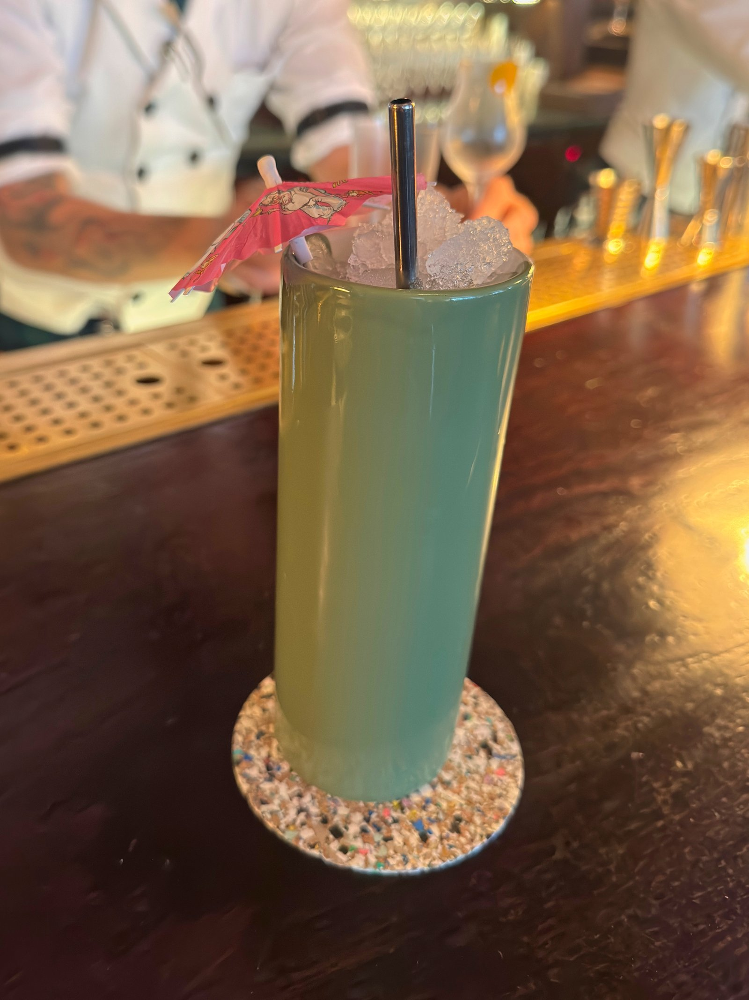

*Scarfes Bar. Photo: [Bex Walton](https://commons.wikimedia.org/w/index.php?curid=189969117), [CC BY 4.0](https://creativecommons.org/licenses/by/4.0/).*

### Kwãnt, Mayfair

*££££ · 52 Stratton Street W1J 8LN · 5pm–1.30am, seven days*

**No.79 in the World's 50 Best Bars 2025**; not in the 2026 top 100

Erik Lorincz, formerly head bartender at the Savoy's American Bar, runs a basement room off Piccadilly.

**The signature is a five-course drink tasting menu**, so you sit down for a sequence rather than ordering a round.

**Open 5pm until 1.30am, every day of the week.** Booking and enquiries go through kwantmayfair@icloud.com.

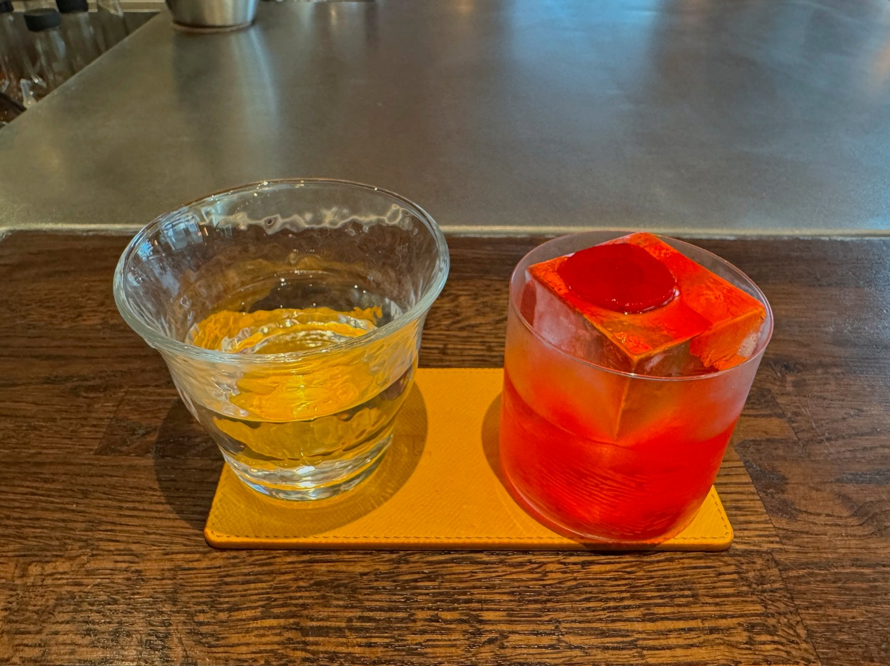

*Kwãnt, Mayfair. Photo: [Bex Walton](https://commons.wikimedia.org/w/index.php?curid=193540390), [CC BY 4.0](https://creativecommons.org/licenses/by/4.0/).*

---

Powered by <a target="_blank" rel="sponsored" href="https://www.getyourguide.com/london-l57/">GetYourGuide</a>

## The independents

Cheaper and later.

### Satan's Whiskers, Bethnal Green

*£££ · book by phone only · from 5pm daily*

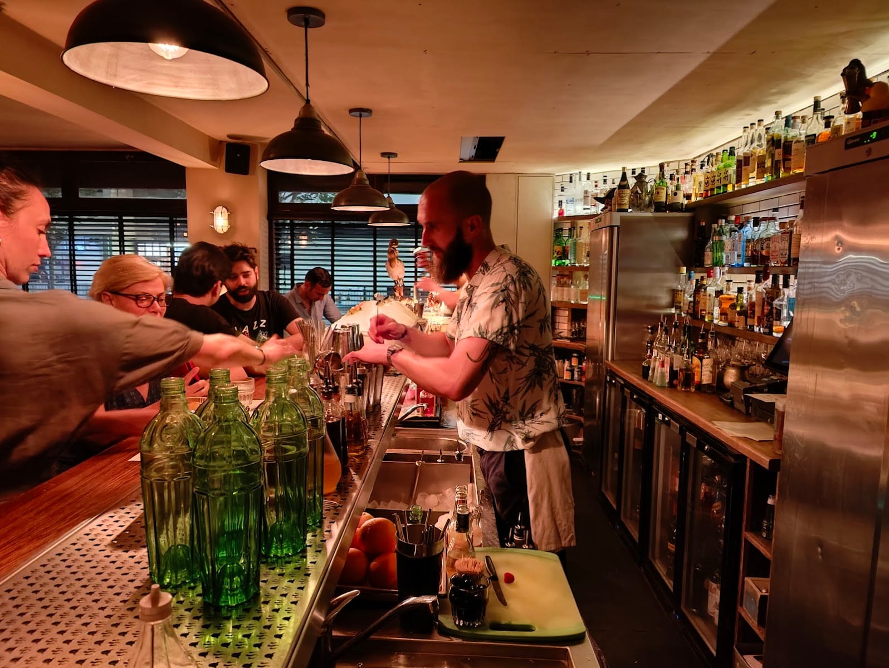

*Satan's Whiskers.*

**No.29 in the World's 50 Best Bars 2026** · Bar of the Year, CLASS Bar Awards 2026

**Taxidermy on the walls, hip-hop loud enough to talk over**, and a menu rewritten daily since it opened in late 2013.

Walk-in guests are accepted, and reservations are recommended but not essential, but **reservations are taken by telephone only**.

Open **from 5pm every day**, running later on Fridays and Saturdays. 343 Cambridge Heath Road, E2 9RA, five minutes from Bethnal Green.

### Coupette, Bethnal Green

*£££ · £11–£15 · Sun–Thu 6pm–11.30pm, Fri–Sat 5pm–1am*

Calvados and apple run through the whole menu, in a corner site on Bethnal Green Road with a zinc bar and a lot of mirror.

**Drinks are £11 to £15** with 13% discretionary service: the Caravela is £13, the Champagne Piña Colada £15 under a Coupette Legacy Cocktails heading, and a "Guilt Free" non-alcoholic list runs **£7**.

**On Sundays** a "Biblio-Coupette" bartenders' book-club session runs from 4pm with **every drink at £9**.

It was **No.18 in the World's 50 Best Bars in 2018 and No.23 in 2019** and is no longer ranked. Bookings by Quandoo, OpenTable, phone or email. 423 Bethnal Green Road, E2 0AN.

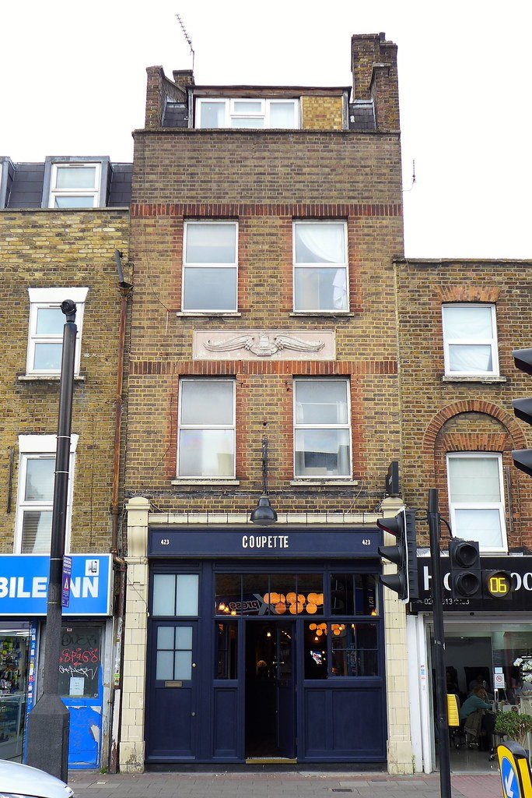

*Coupette, Bethnal Green. Photo: [Ewan-M](https://www.flickr.com/photos/55935853@N00/48470775107), [CC BY-SA 2.0](https://creativecommons.org/licenses/by-sa/2.0/).*

### Swift, Soho

*£££ · £9–£16 · Mon–Sat 3pm–midnight, Sun 3pm–11pm*

**Two bars in one building**: a bright room upstairs for a quick drink before dinner, and a dark one downstairs with a long whisky list for after it.

**Upstairs is £9 to £16**, downstairs £12 to £16. The Droplet is £13, the Carmen and the Chiffon £16, the Imperial Gimlet downstairs £14.

> 💡 **£7 cocktails, Monday to Thursday before 6pm.** Named drinks, the Droplet and the Pippin among them, drop to £7 in that window, against £13 and £14 the rest of the time.

**Downstairs has live jazz on Tuesdays 6–8pm and Sundays 6–9pm.** Card only, no cash, and 12.5% optional service which goes entirely to staff. 12 Old Compton Street, W1D 4TQ.

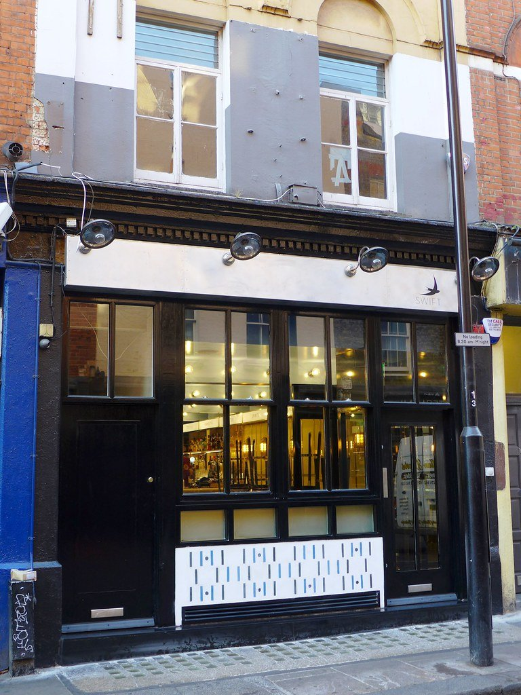

*Swift, Soho. Photo: [Ewan-M](https://www.flickr.com/photos/55935853@N00/34156340355), [CC BY-SA 2.0](https://creativecommons.org/licenses/by-sa/2.0/).*

### Bar Termini, Soho

*£££ · classics from £15.50, house negroni £9.50*

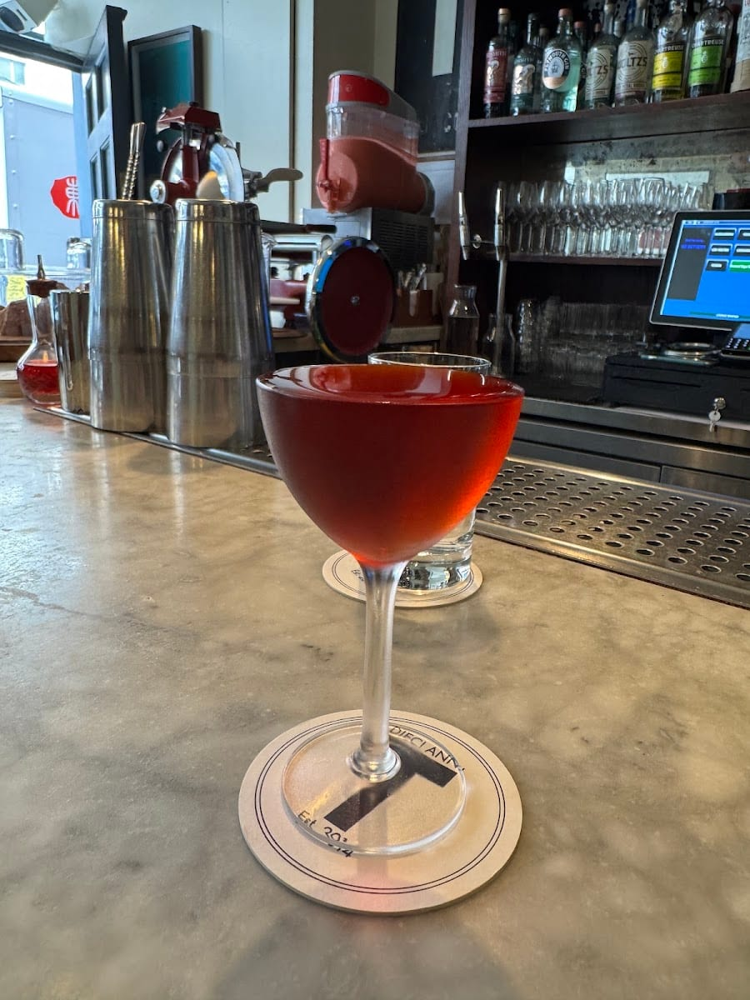

*The house negroni, on the marble counter.*

A tiny Italian counter bar on Old Compton Street, done as a Roman station bar, with an espresso machine at the front, a marble counter and waiter service. It is small enough that you should expect to wait.

**Order the negroni.** The house build is £9.50, and there are four of them; everything else on the list starts at **£15.50**.

**The negronis are also sold bottled to take away**: Superiore, Rosato, Classico, Robusto, Terroir and an Old Fashioned, in 200ml at £16.25 and 700ml from £38.95, with nationwide delivery.

Bookings are open and walk-ins welcome. 7 Old Compton Street, W1D 5JE. 14.5% discretionary service.

### Three Sheets, Soho and Dalston

*£££ · Dalston Tue–Sun · Soho seven days*

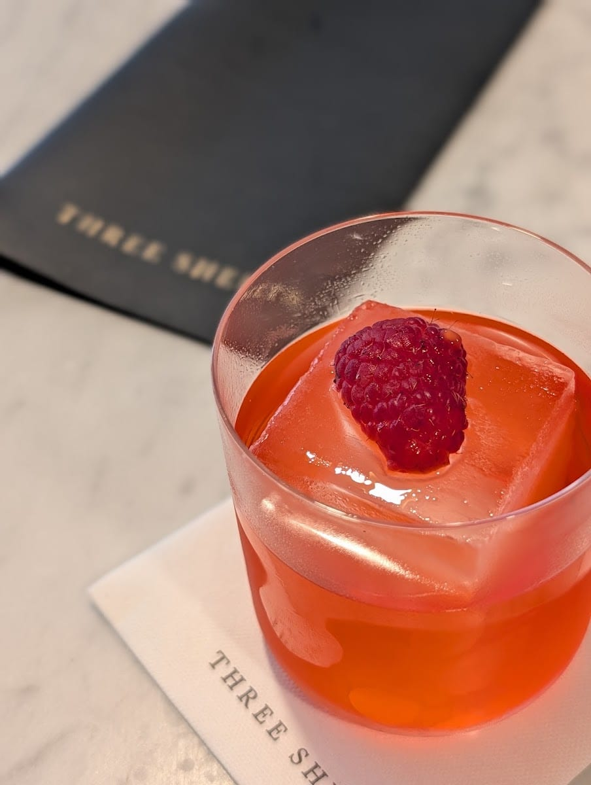

*Three Sheets.*

**Soho: No.73 in the World's 50 Best Bars 2026** · **Dalston: No.16 in 2019**

Brothers **Max and Noel Venning** run a short menu with **no theatre**: the drinks arrive without a speech.

**Dalston came first, in 2016**, at 510b Kingsland Road, E8. Its menu is divided into **One, Two and Three Sheet sections by intensity**, so you order by how much you want the drink to do. Open Tuesday to Sunday.

**Soho** is at **13 Manette Street, W1D 4AP**, just off Greek Street, and open in the afternoon until late, **seven days a week**. It does British oysters with champagne and a burger alongside the drinks.

### A Bar with Shapes for a Name, Haggerston

*£££*

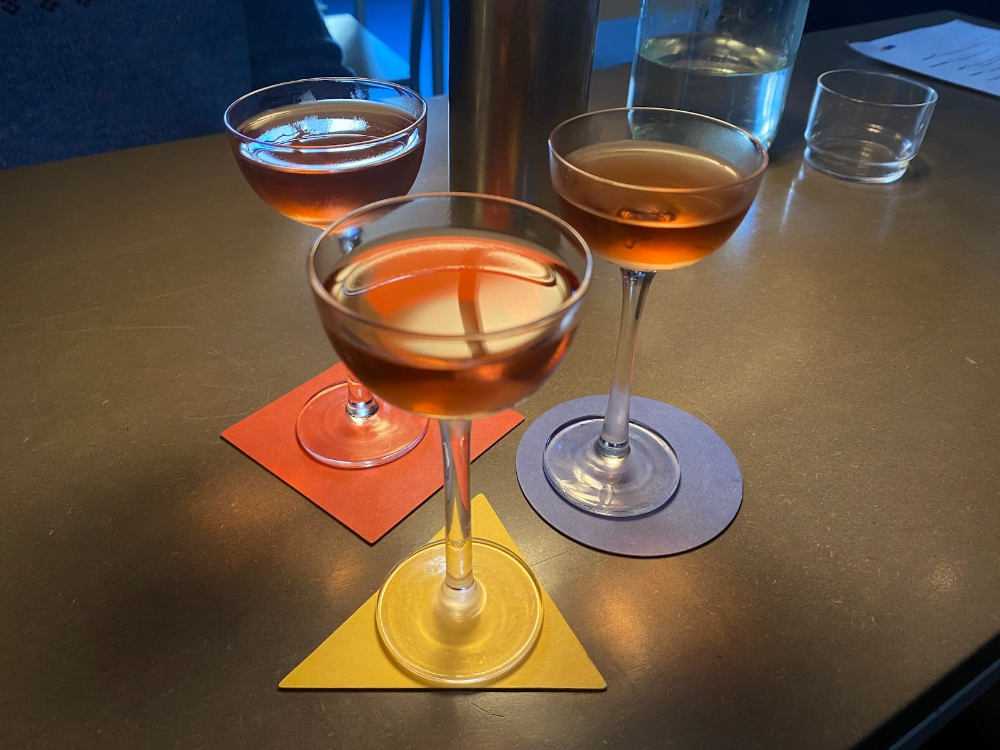

*A Bar with Shapes for a Name.*

**No.73 in the World's 50 Best Bars 2025**; not in the 2026 top 100

Built on **Bauhaus principles down to the glassware**, with a menu of about a dozen drinks. The name is a joke about its own signage, which is three shapes.

### Little Mercies, Crouch End

*££ · 20 Broadway Parade · open Tue–Sat · 30% off 6–7pm*

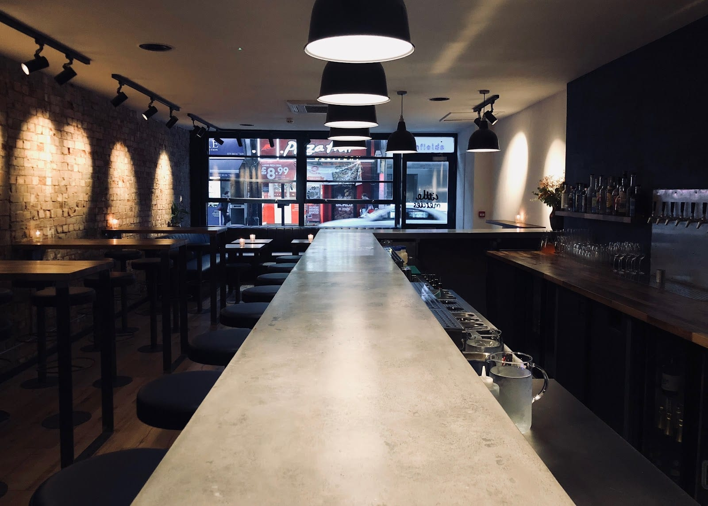

*Little Mercies, Crouch End.*

A low-waste neighbourhood bar from the same family behind Three Sheets, built around house distillates, ferments and bottled spirits, and named **Sustainable Bar of the Year in 2022, 2023 and 2025**.

The Snickers Old Fashioned, Moro Margarita and Rhubarb Negroni are the signatures, £10.50–£12.50, with £7 "mini drinks" for something smaller.

**Thirty per cent off every drink between 6 and 7pm, on every day they open.** The bar runs **6pm to midnight, Tuesday to Saturday, closed Sunday and Monday**.

### Half Cut Market, York Way

*££ · 396 York Way N7 9LW · Tue–Sat only · restaurant first*

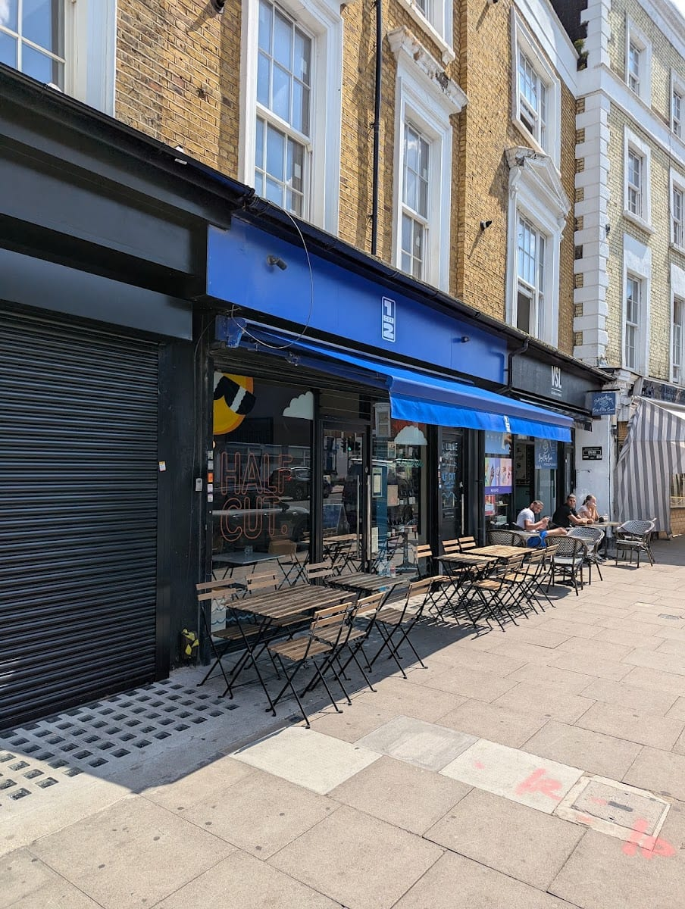

*Half Cut Market's shopfront on York Way.*

**This is a restaurant, wine bar and bottle shop, not a cocktail bar.** It earns a place here on price: the **Half Cut Martini is £10** and a vermouth and soda **£7**.

Around eighty low-intervention bottles to drink in or carry out, and a Konro-grilled seasonal menu. **Wine is available to take away any time they are open.**

**Shop hours Tuesday and Wednesday 5–10pm, Thursday 5–10.30pm, Friday and Saturday 4–11pm. Closed Sunday and Monday.** The kitchen runs a narrower 5.30–9.30pm inside those. **A set menu on Tuesdays and Wednesdays is £24 for two courses, £28 for three.**

Caledonian Road & Barnsbury is the nearest station.

### Bar Crispin, Soho

*££ · 19 Kingly Street · Mon–Sat noon–9.30pm, Sun 1pm–9pm*

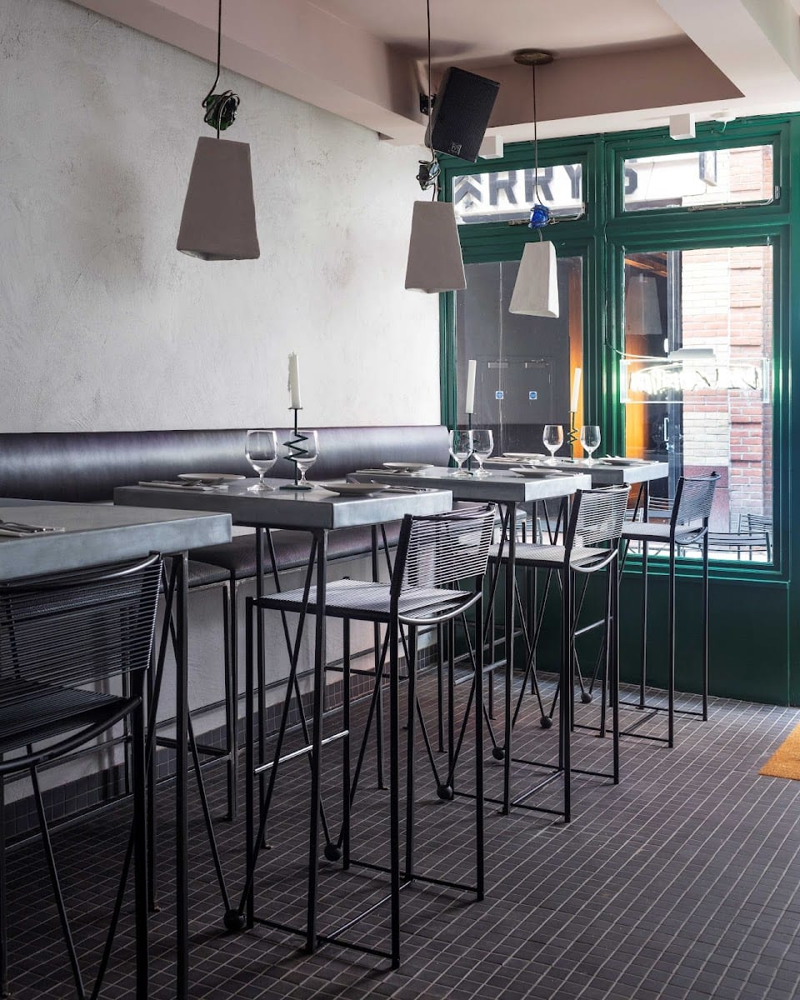

*Bar Crispin, Soho.*

A low-intervention wine bar with a short cocktail list of four drinks: an **olive oil negroni**, a burnt butter old fashioned, a tonka bean espresso martini and a citrus margarita.

**It closes early**, at 9.30pm on weekdays and Saturdays and 9pm on Sunday, on a street where everything else runs to midnight. It suits the hour before dinner or instead of it.

**There is a 14-seat back room called the Green Room** and a terrace on Kingly Street itself, which is pedestrianised. It is part of the HAM Restaurants group, with a sibling Crispin in Spitalfields on White's Row.

Booking through OpenTable. 19 Kingly Street, W1B 5PY, in the lane behind Liberty.

### Seed Library, Shoreditch

*£££ · Wed–Thu & Sun 6pm–1am, Fri–Sat 5pm–2am · closed Mon–Tue*

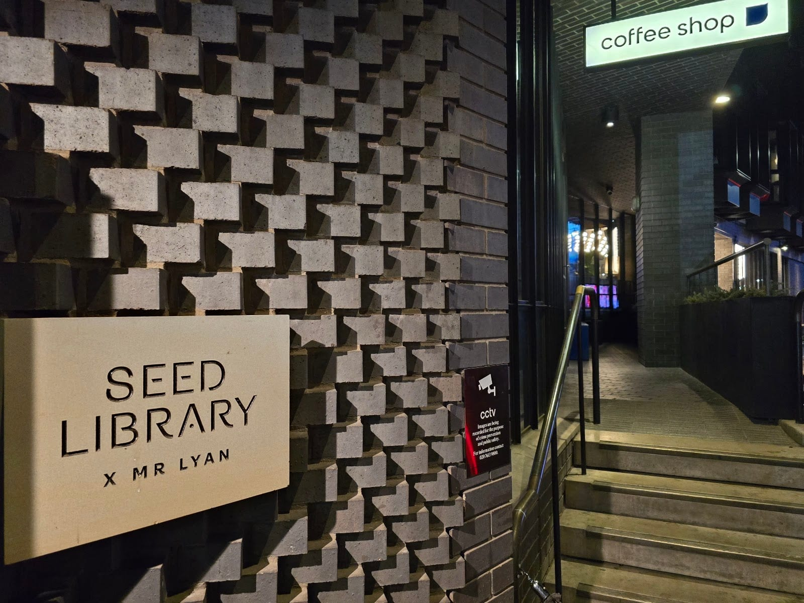

*The sign at One Hundred Shoreditch.*

Ryan Chetiyawardana of Lyaness runs this stripped concrete basement, serving **short, low-alcohol drinks**.

East London vinyl collective **Diggers Dozen** hold a residency every Friday and Saturday, playing jazz-laced disco-funk on two turntables and a Bozak mixer through a system specified for listening.

**Closed Mondays and Tuesdays**, and open until 2am on Friday and Saturday. Walk-ins are accommodated; tables up to 15 through SevenRooms. Over-18s only.

In the basement of One Hundred Shoreditch, 100 Shoreditch High Street, E1 6JQ, two minutes from Shoreditch High Street station.

### Happiness Forgets, Hoxton

*£££ · from 5pm, every day*

A basement bar under Hoxton Square with low ceilings, low light and a short menu. Its own tagline is "Great Cocktails, No Wallies".

**Open from 5pm every day.**

Book through the widget on their site: the room holds about thirty people, and you will not walk into it on a Friday. At **8-9 Hoxton Square, N1 6NU**, with a basement entrance below a restaurant and only a pavement board at street level. Old Street is five minutes.

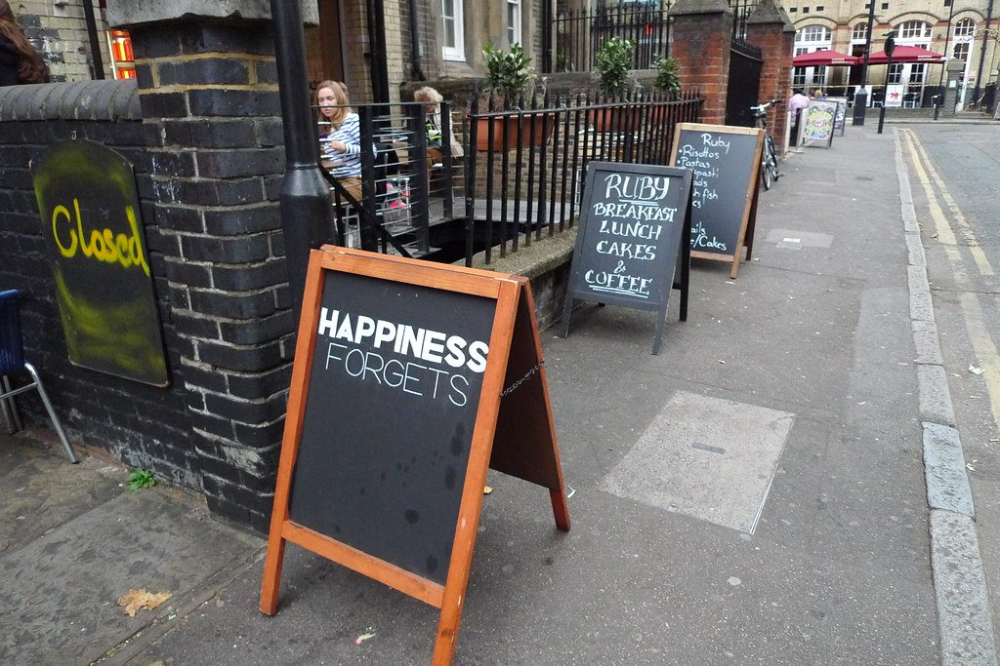

*Happiness Forgets, Hoxton Square. Photo: [Ewan-M](https://www.flickr.com/photos/55935853@N00/6258205723), [CC BY-SA 2.0](https://creativecommons.org/licenses/by-sa/2.0/).*

### Nightjar, Shoreditch

*£££ · 129 City Road · live jazz*

Historic cocktails in a basement off Old Street: Singapore Slings, Zombies and Charlie Chaplins rebuilt from the original specifications, at **£15 or so a drink**.

Live jazz three sets a night, with a **music cover of £6 standard or £10 premium per person**, paid to the musicians, and a **minimum spend of £15 per person per hour**. No bookings between 9.15pm and 11pm during live sets. Over-21s.

> The Carnaby Street site closed permanently in September 2025. Shoreditch is the one that trades.

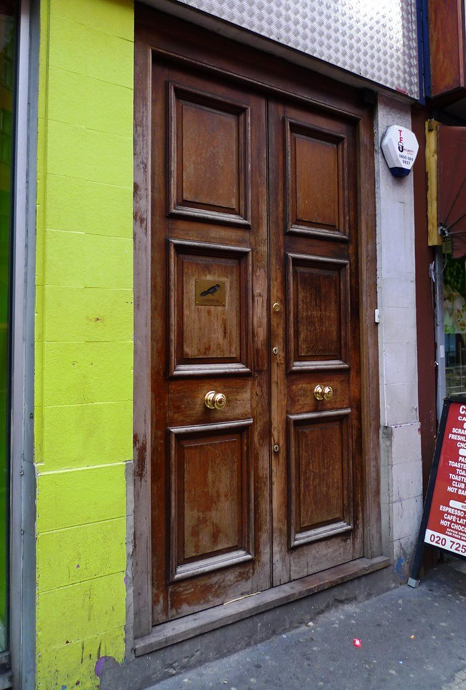

*Nightjar's door, unmarked. Photo: [Ewan-M](https://www.flickr.com/photos/55935853@N00/8473655212), [CC BY-SA 2.0](https://creativecommons.org/licenses/by-sa/2.0/).*

### Oriole, Covent Garden

*££££ · 7-9 Slingsby Place · £14–£16 · Tue–Sat*

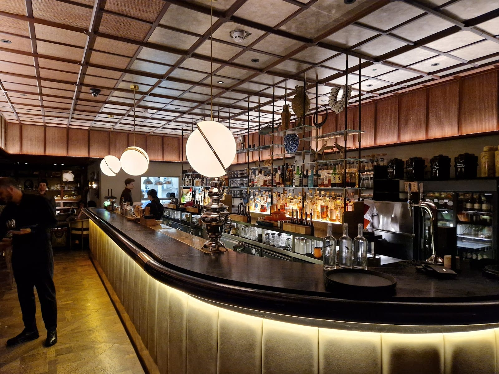

*Oriole, Covent Garden.*

Live music nightly and a menu organised by continent: the current Eighth Edition runs sections headed Europe & Africa and onwards, and you order by where a drink comes from. It is a sibling of Nightjar and charges the same way, with **the musicians paid directly through a live-music charge**.

Drinks run **£14 to £16** (Syracuse £16, Bergerac £14, Kalahari Julep £15) with 13.5% discretionary service on top. Booking is through SevenRooms, shared with Nightjar Shoreditch.

**Closed Sunday and Monday.** Tuesday 3pm–11pm, Wednesday 3pm–midnight, Thursday noon–midnight, Friday and Saturday noon–1am.

7-9 Slingsby Place, WC2E 9AB, down a flight of stairs off the courtyard behind St Martin's Lane.

---

Powered by <a target="_blank" rel="sponsored" href="https://www.getyourguide.com/london-l57/">GetYourGuide</a>

## Best value

#### Cheap drinks

* **Little Mercies**, Crouch End: **30% off all drinks, 6–7pm, every day they open** (Tuesday to Saturday). That takes the £11 Snickers Old Fashioned to about £7.70. Takeaway drinks excluded.
* **Swift**, Soho, Shoreditch and Borough: **named cocktails at £7, Monday to Thursday before 6pm**, against drinks that are otherwise £12–£15.
* **Three Sheets Soho**: no drinks offer, but **three free oysters with any martini or champagne, Sunday to Friday before 6pm**. Oysters are £3.95 each there.
* **Bar Termini**, Old Compton Street: the **house Negroni is £9.50**, all four builds, all day. It is the price, not a happy hour.
* **Coupette**, Bethnal Green: **Sunday Development Sessions, all drinks £9** from 4pm, experimental pours that are not on the menu. The regular list runs £11–£15.

#### For comparison, the top end

The **Connaught Martini is £30**, mixed at your table from the trolley. **Nightjar** is around £15 a drink *plus* a £6–£10 music cover and a £15 per person per hour minimum spend.

#### The flat-price bars

* **Discount Suit Company**, Spitalfields: **every cocktail on the list is £10**, flat, no offer required, in a former tailor's on Wentworth Street.
* **FAM Bar**, Marylebone: **£8.50 a cocktail, Tuesday to Saturday 4–7pm**.
* **Zapoi**, Peckham: **any four classics for £35**, or £8.75 each, daily until 7pm, in a plant-filled Rye Lane room.

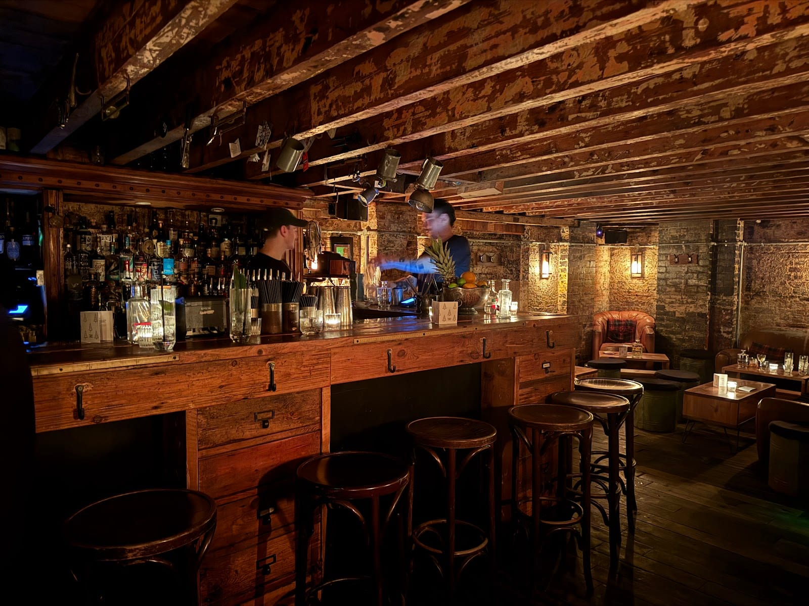

*Discount Suit Company, Spitalfields.*

#### Two-for-one

* **Simmons Bar**: **two-for-one on all cocktails, seven days a week**, 4–9pm at most sites and 3–8pm across the West End ones. With a list running £10.50–£12.80, that is around **£5.25 a drink**. Fifteen branches.
* **The Tommyfield**, Kennington: two-for-one **Monday to Friday, 4.30–6.30pm**, on margaritas, espresso martinis and Aperol spritzes. The list price is £11.50, so about **£5.75** each.

> ⚠️ Two traps in this category. **Be At One's two-for-one only works on two of the same cocktail**, and its "£6 cocktails" is a **student price requiring ID**, not the standard rate. And **Bar Termini is not a cheap bar**: the £9.50 is the house negroni alone; everything else on that menu is £15.50.

#### Cheap by the glass, not by the hour

* **Half Cut Market**, York Way: the **Half Cut Martini is £10** and a vermouth and soda is **£7**, in a restaurant and wine bar that also sells you the bottle to take home. **Tuesday to Saturday only.**
* **Little Mercies**, Crouch End: the signatures run £10.50–£12.50 and the "mini drinks" are **£7**.
* **Three Sheets Dalston**: the house list is £15.50–£16, but the menu states **classics from £13**.

#### Food halls and markets

**Seven Dials Market** in Covent Garden has two bars, Bar Nana on the ground floor and the Warehouse Bar below it, pouring East London Liquor Co. spirits. **Market Halls** runs bars at Oxford Street, Canary Wharf and Paddington with **two spritzes for £20 between 3pm and 5pm** on its free Hall Pass app. That offer does not run at Market Halls Victoria.

**Jim & Tonic at Mercato Mayfair** pours from its own distillery on the altar of a deconsecrated church.

#### General

* **Go early.** Almost every bar here is cheaper and calmer before 7pm.
* **Ask for the classics.** A negroni or daiquiri usually sits at the bottom of the list.

---

Powered by <a target="_blank" rel="sponsored" href="https://www.getyourguide.com/london-l57/">GetYourGuide</a>

## What to know

* **Hotel bars seat walk-ins early.** Go at 6 or book.
* **Dukes holds guests to two martinis.** They are close to neat spirit.
* **Satan's Whiskers only takes bookings by phone.** Turn up, or call ahead, and go early on a weekend.
* **£20 a cocktail in Mayfair is normal.** East London is £13–£16.
* **Service charge** of 12.5% is standard and discretionary.
* **Hidden bars:** Nightjar, Discount Suit Company and the rest of London's speakeasies, with how to find each door, are in [the speakeasy guide](/articles/best-speakeasy-bars-london/).

---

## Continue planning your London trip

- 🗝️ **[The Best Speakeasy Bars in London](/articles/best-speakeasy-bars-london/)** — behind fridges, bookcases and unmarked doors
- 🌇 **[The Best Rooftop and Riverside Restaurants in London](/articles/best-rooftop-restaurants-london/)**
- 🎪 **[Unusual Restaurants in London](/articles/unusual-restaurants-london/)**
- 🏛️ **[Historic Pubs and Dining Rooms in London](/articles/historic-pubs-dining-rooms-london/)**
- 🌙 **[Late-Night Eating in London](/articles/late-night-eating-london/)**
- 🍽️ **[Eat in London: Restaurants, Food Markets & Quick Food Hub](/articles/eat-in-london-guide/)**
- 🛍️ **[Mayfair Area Guide](/articles/mayfair-area-guide/)**
- 🍜 **[Soho Area Guide](/articles/soho-area-guide/)**
