London's specialty coffee is antipodean by descent: the flat white, the counter format and most of the early shops came from Australia and New Zealand.

This guide covers **independents**, not chains. Most are counters rather than cafés, and several have nowhere to sit.

> 💡 **The Short Version:** **Monmouth** has been roasting since 1978. **Rosslyn** is a City counter with almost no seats and weekday hours. **Prufrock** runs its own barista training centre. **Kaffeine** is Australian-run, with a food counter. **The Attendant** is inside a Victorian lavatory. And **Redemption Roasters** runs barista academies in four London prisons and employs prison leavers.

> 📘 **How we choose these (editorial note).**
> No paid placements and no chains. Where a shop roasts its own we say so.

## Where they are

  

    Map of the best coffee in London
  

  

    
Loading the interactive map…

  

  <noscript>
    
The interactive map requires JavaScript. Every entry below lists its area.

  </noscript>

| If you are near… | Where to go |
| --- | --- |
| **The City & Clerkenwell** | Rosslyn, Prufrock, Caravan |
| **Shoreditch & Old Street** | Origin, Ozone |
| **Soho** | Algerian Coffee Stores |
| **Marylebone** | Workshop Coffee |
| **Holborn** | Catalyst |
| **Borough & Bermondsey** | Monmouth, WatchHouse |
| **Fitzrovia** | Kaffeine, The Attendant |
| **Bloomsbury** | Redemption Roasters |
| **Hampstead** | Ginger & White |
| **Hackney & London Fields** | Climpson & Sons |
| **South London** | Old Spike (Peckham) |
| **West London** | Carbon Kopi (Hammersmith), Beany Green (Little Venice) |

**Price guide:** flat white £3.50–£4.50 at everything here.

---

## The originals

### Monmouth Coffee Company, Borough

*£ · 3 min from London Bridge*

**Roasting since 1978.** The Borough Market shop is the one to visit: long queue, no seats.

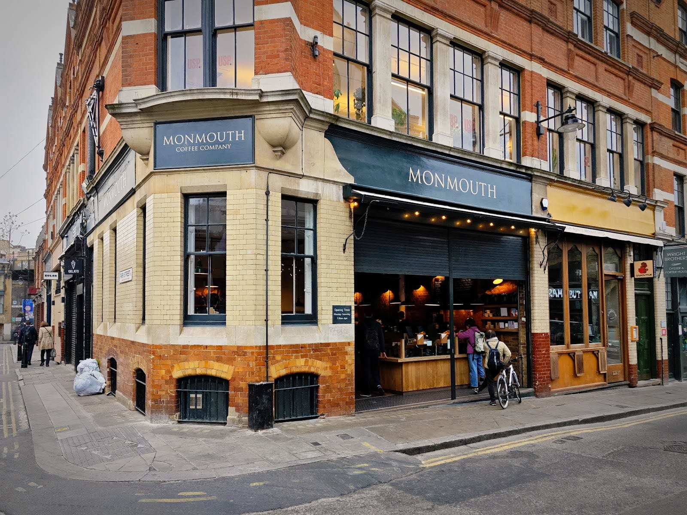

*Monmouth's Borough shop.*

**Open Monday to Saturday, 7.30am to 6pm; closed Sundays.** The Borough queue is longest during weekend market hours, and 11am to 2pm on a Saturday is the worst of it.

**The Covent Garden shop** (27 Monmouth Street, Monday to Saturday 8am to 7pm) is quieter and pours the same coffee.

**2 Park Street, SE1 9AB**, three minutes from London Bridge. **No seats**: it is a standing counter, so plan to walk with it.

### Prufrock Coffee, Clerkenwell

*£ · Leather Lane*

A Leather Lane counter that **runs its own barista training centre**.

The food is toasties, banana bread and a short breakfast list.

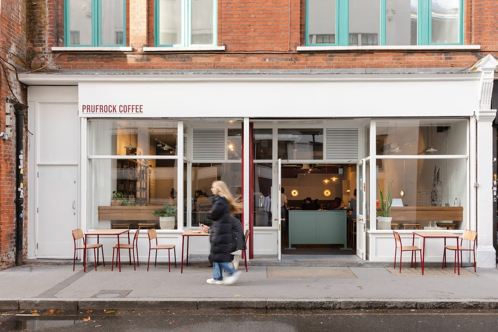

*Prufrock, Leather Lane.*

**Walk-in only, three minutes from Chancery Lane**, and busiest with the Leather Lane lunch trade between noon and 2pm, when the street market outside is at full volume.

**It keeps weekday hours.** Leather Lane is an office-and-market street, so weekends are quiet or shut; check before a Saturday trip. Mid-morning is the quiet window.

### Kaffeine, Fitzrovia

*£ · 6 min from Oxford Circus*

Australian-run, with a food counter alongside the espresso.

A small, bright room off Great Titchfield Street with a handful of seats and a lot of people passing through.

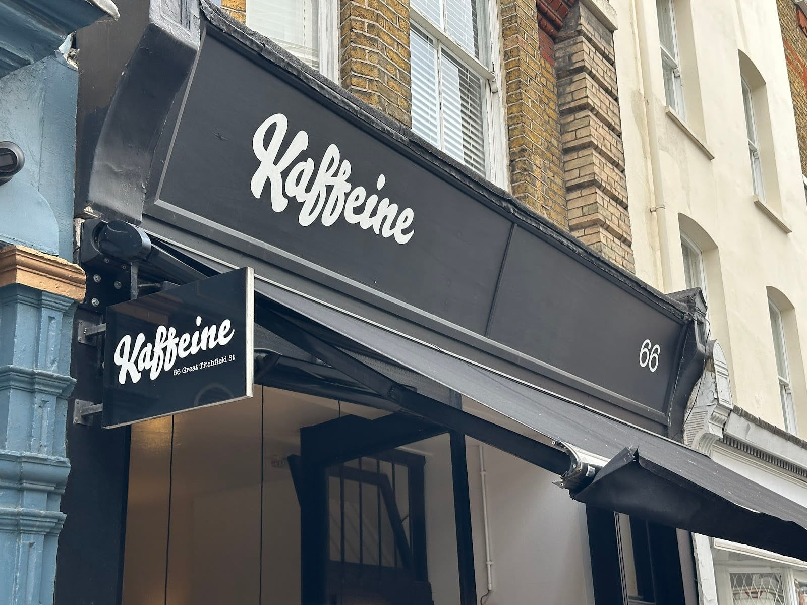

*Kaffeine, Great Titchfield Street.*

**Counter service, no bookings.** Mon–Fri 7.30am–5pm, Sat 8.30am–5pm, Sun 9am–5pm.

**Six minutes from Oxford Circus**; Oxford Street itself has only chains.

**66 Great Titchfield Street**, and a second Kaffeine on Eastcastle Street is a few minutes away. Seats are limited at both.

---

## The rankings

### Rosslyn Coffee, City of London

*£ · 2 min from Moorgate*

A **tiny City counter** with almost nowhere to sit, built for a queue of people on their way somewhere else.

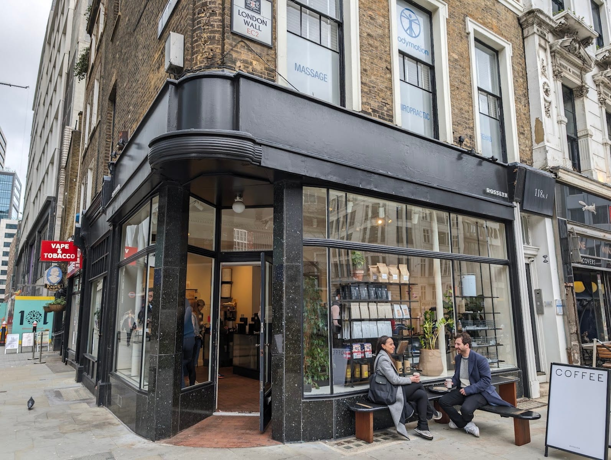

*Rosslyn's London Wall corner shop.*

**Open Monday to Friday, 6.30am to 5pm; closed Saturdays and Sundays.** A weekend trip to the City for this is wasted.

**118 London Wall, EC2Y 5JA**, two minutes from Moorgate. The queue moves fast because almost nobody sits down, so a long line is not the wait it looks like.

**Go mid-morning or mid-afternoon.** 8 to 9.30 and lunchtime are the office rush.

### Carbon Kopi, Hammersmith

*£ · 8 min from Barons Court*

Moved from New Zealand to Hammersmith in 2019.

A small neighbourhood room, so expect to stand at busy moments.

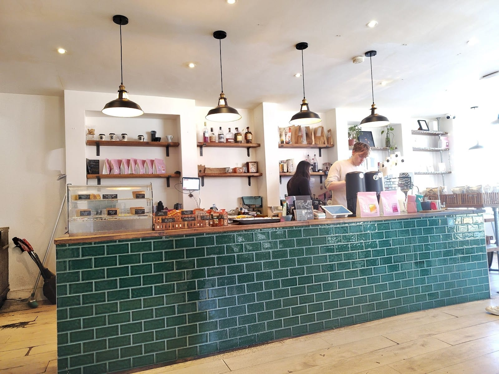

*Carbon Kopi's counter.*

**Walk-in only, eight minutes from Barons Court.** Worth the detour if you are already in west London.

### WatchHouse, Bermondsey

*£ · Bermondsey Street*

Started in a **nineteenth-century watchman's hut** on Bermondsey Street and now runs several sites.

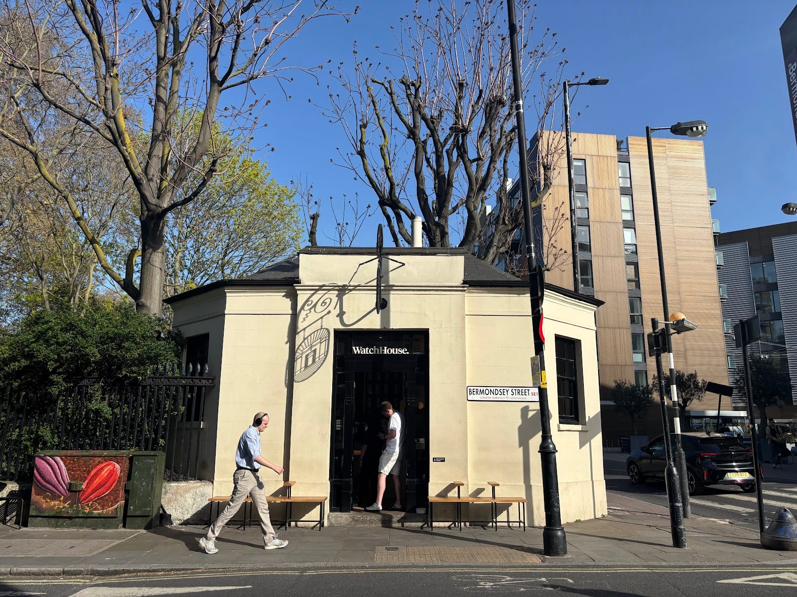

*The original WatchHouse.*

**Room to sit, unlike most of this list**, though the Bermondsey Street original seats about ten. The larger Brunch Houses serve breakfast until 11am and are the ones to pick if you want a table and a plate.

**Walk-in.** Sixteen minutes from Borough, so pair it with Bermondsey Street rather than making a special trip.

---

Powered by <a target="_blank" rel="sponsored" href="https://www.getyourguide.com/london-l57/">GetYourGuide</a>

## Roasteries with kitchens

### Caravan, Clerkenwell

*£ · 10 min from Farringdon*

An all-day kitchen with its own roastery attached, in a big industrial room.

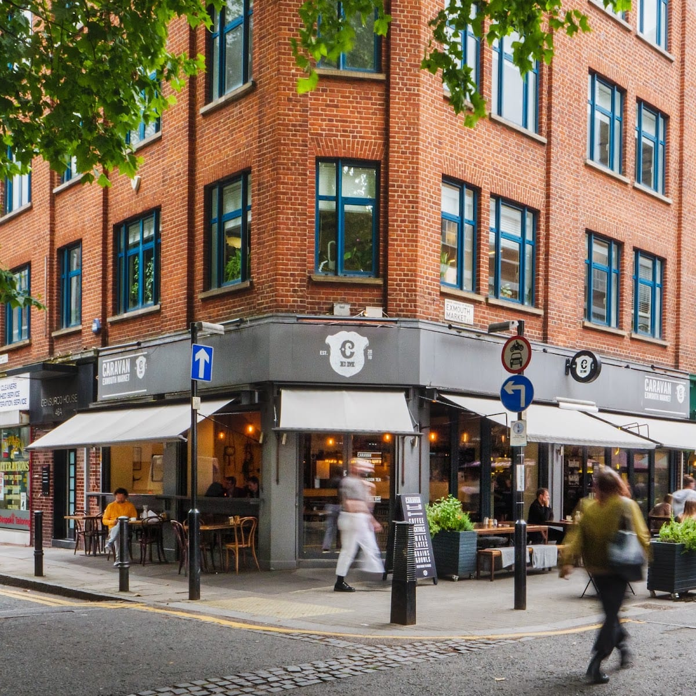

*Caravan, Exmouth Market.*

**Bookings are taken at Caravan's London sites**, unlike most of this page, and are worth making at weekends when brunch runs long.

**It is the one entry here you can treat as a meal.** Full kitchen all day, with room to sit and work.

**11–13 Exmouth Market, EC1R 4QD**, ten minutes from Farringdon and about the same from Angel.

### Redemption Roasters, Bloomsbury

*£ · 7 min from Russell Square*

The beans are **roasted inside prisons** by people the company then trains and employs on release. The company exists to reduce reoffending.

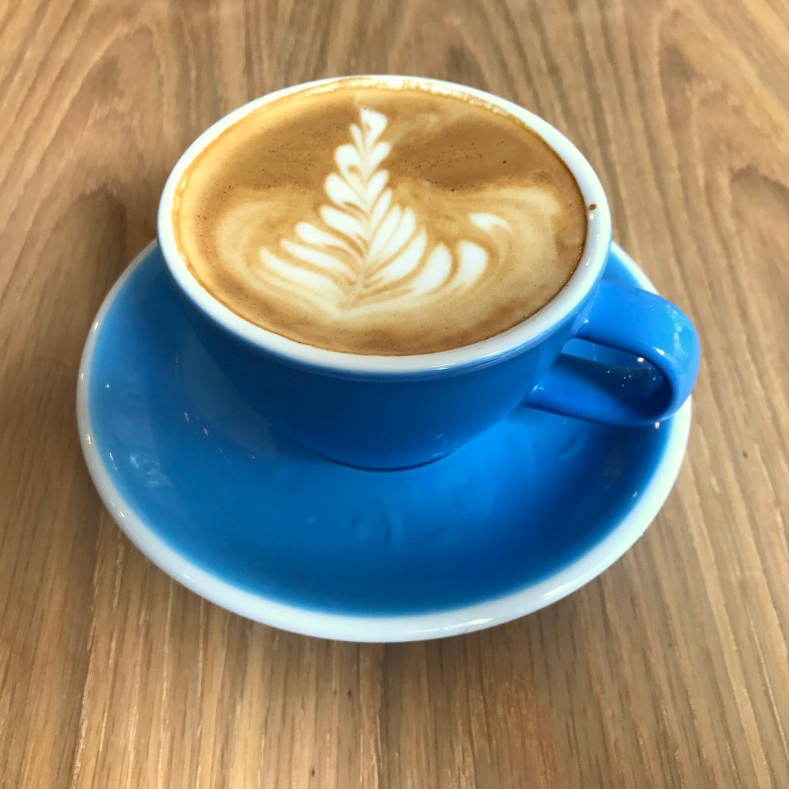

*Redemption Roasters' coffee. Photo: [Bex.Walton](https://www.flickr.com/photos/7831824@N04/36031309506), [CC BY 2.0](https://creativecommons.org/licenses/by/2.0/).*

**Walk-in, no bookings.** At **84b Lamb's Conduit Street, WC1N 3LR**, seven minutes from Russell Square and five from Holborn, close to the [British Museum](/articles/british-museum-guide/).

**Walk down Lamb's Conduit Street.** Half-pedestrianised and independent end to end, with Noble Rot and Honey & Co on the same short run. **Most of it closes on Sundays**, including here.

---

## The roasters

### Origin Coffee Roasters, Shoreditch

*£ · 3 min from Old Street*

Roasted in **Cornwall** and poured in a modern Shoreditch room.

Pastries and a short toastie list, so this is a coffee stop rather than a meal.

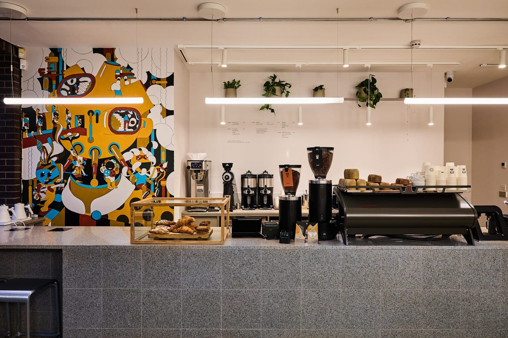

*Origin's Shoreditch counter.*

**65 Charlotte Road, EC2A 3PE.**

**Calmest mid-afternoon.** The room fills with laptops from about ten and again at lunch; between two and four it is quieter.

### Ozone Coffee Roasters, Shoreditch

*£ · 4 min from Old Street*

A **working roastery in the basement with a full kitchen above it**, busy for brunch as much as for coffee.

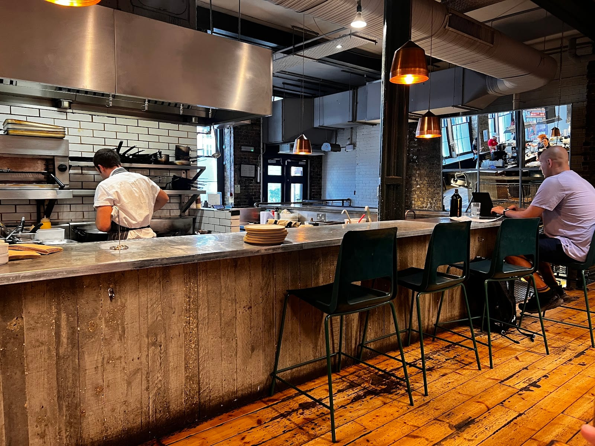

*Ozone's kitchen.*

**Walk-in**, at **11 Leonard Street, EC2A 4AQ**.

Brunch is the busy service and the queue peaks around 11am at weekends — **come on a weekday to avoid the wait**; the basement roastery is running then too.

**It takes no bookings**, so a weekend brunch means queueing on the pavement.

### Workshop Coffee, Marylebone

*£ · 5 min from Bond Street*

A roaster's shop where **the filter list changes constantly** and the staff will talk you through it.

**32–34 New Cavendish Street, W1G 8UE**, five minutes from Bond Street and about the same from Oxford Circus.

**Walk-in, and it seats perhaps a dozen.** Marylebone office trade makes it busiest at 9am and 1pm and quieter in between.

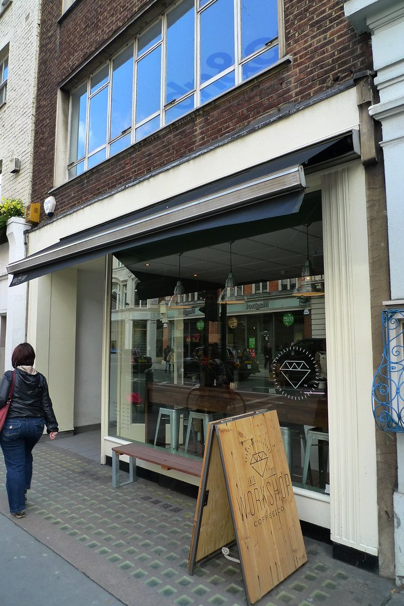

*Workshop Coffee. Photo: [Ewan-M](https://www.flickr.com/photos/55935853@N00/8401291269), [CC BY-SA 2.0](https://creativecommons.org/licenses/by-sa/2.0/).*

### Climpson & Sons, London Fields

*£ · 6 min from Cambridge Heath*

On **Broadway Market**, roasting its own and busiest on a Saturday. Pair it with the market.

Pastries and sandwiches from the counter rather than a menu.

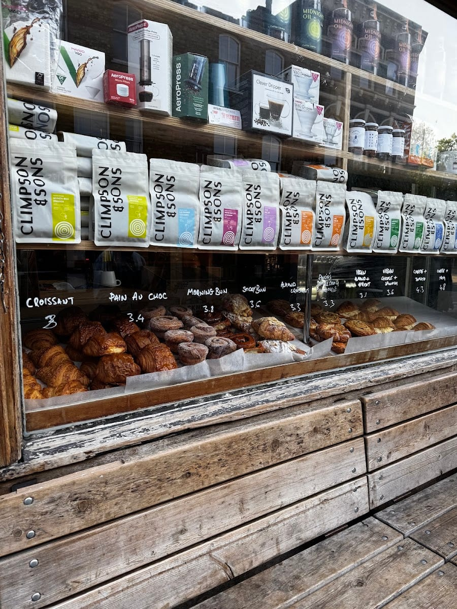

*Climpson & Sons, Broadway Market.*

**Walk-in**; London Fields station is about as far as Cambridge Heath.

**Saturday is busiest**: Broadway Market is on. A weekday gets you a seat and a quiet street, but several neighbouring shops are shut.

The roastery arch is nearby rather than on site.

### Catalyst, Holborn

*£ · 3 min from Chancery Lane*

A Scandinavian-style room a few streets from Prufrock, **named among the best coffee shops in the UK for 2026**.

**Walk-in, three minutes from Chancery Lane**. It is small, so a seat at the wrong hour is unlikely.

**Do the three together.** Catalyst, Prufrock and Redemption Roasters are within about ten minutes of each other around Leather Lane and Lamb's Conduit Street, and all three keep weekday hours — so this is a Tuesday morning rather than a Sunday one.

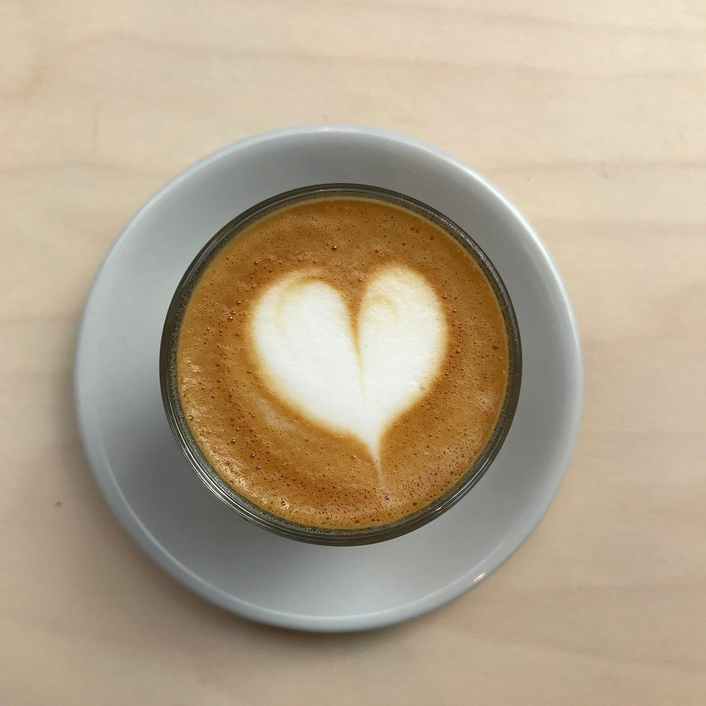

*Catalyst, near King's Cross. Photo: [Bex.Walton](https://www.flickr.com/photos/7831824@N04/33625242186), [CC BY 2.0](https://creativecommons.org/licenses/by/2.0/).*

**Closed Saturdays and Sundays**, like most of the legal-district shops.

### Old Spike, Peckham

*£ · 5 min from Peckham Rye*

A Peckham roastery that **employs and trains people who have experienced homelessness**.

**54 Peckham Rye, SE15 4JR**, five minutes from Peckham Rye station, and it faces the common rather than the high street — so it is a quieter stop than anything on Rye Lane.

**Walk-in, with room to sit.** Pair it with Rye Lane and Frank's Cafe on the car park roof, which opens in summer only.

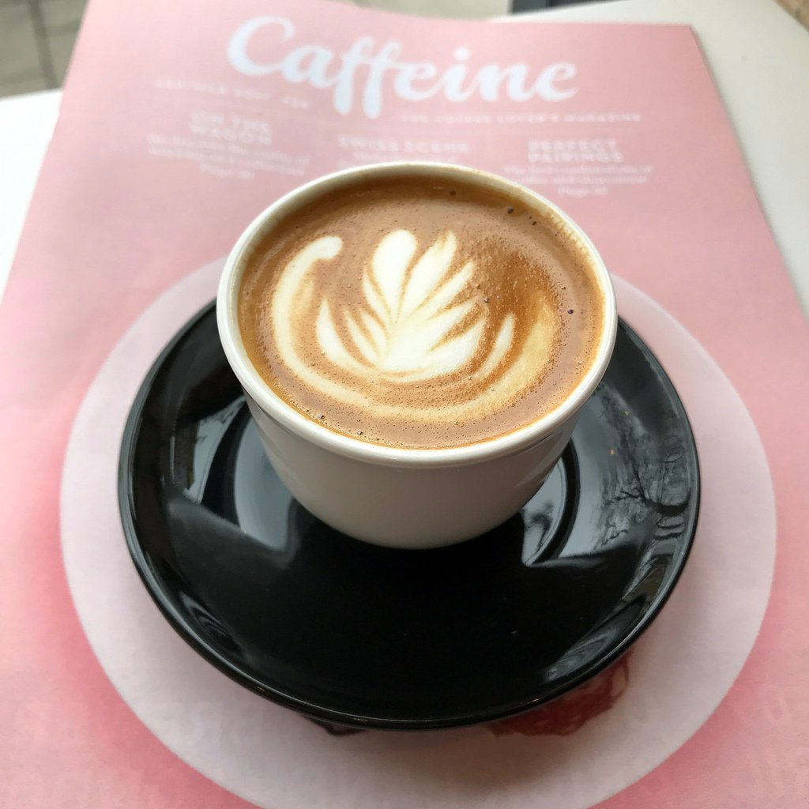

*Old Spike Roastery, Peckham. Photo: [Bex.Walton](https://www.flickr.com/photos/7831824@N04/33666350895), [CC BY 2.0](https://creativecommons.org/licenses/by/2.0/).*

---

Powered by <a target="_blank" rel="sponsored" href="https://www.getyourguide.com/london-l57/">GetYourGuide</a>

## Worth the detour

### Algerian Coffee Stores, Soho

*£ · Old Compton Street · since 1887*

Trading on Old Compton Street since **1887**, selling beans over the counter with an espresso hatch and **nowhere at all to sit**; you drink on the pavement.

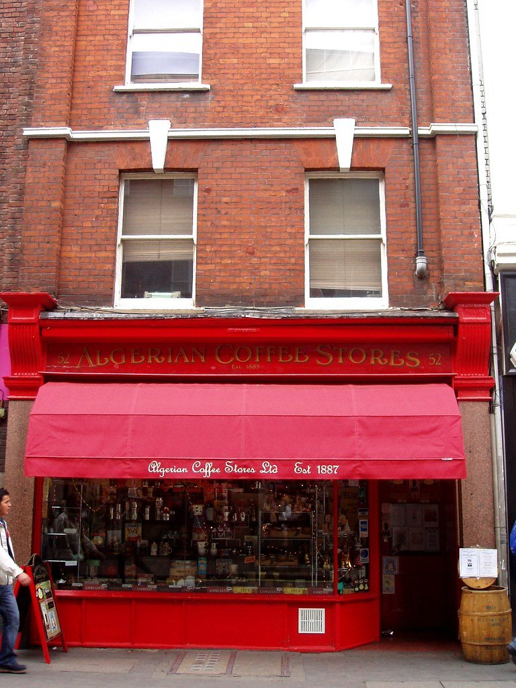

*Algerian Coffee Stores, since 1887. Photo: [Ewan-M](https://www.flickr.com/photos/55935853@N00/2441960131), [CC BY-SA 2.0](https://creativecommons.org/licenses/by-sa/2.0/).*

### The Attendant, Fitzrovia

*£ · 7 min from Goodge Street*

Coffee served inside a **restored Victorian public lavatory**, with the original porcelain urinals turned into the counter you sit at.

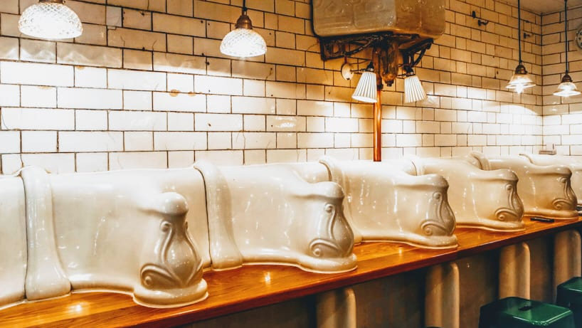

*The Attendant's urinal counter.*

It is a small, dim basement with perhaps a dozen seats, **better for a stop than a long stay**.

**27A Foley Street, W1W 6DY**, seven minutes from Goodge Street and about the same from Oxford Circus.

**Come for the room.** Kaffeine is a few minutes' walk away if the coffee matters more than the setting.

**Go outside the lunch hour.** A dozen people is a crowd down there.

### Ginger & White, Hampstead

*£ · Perrins Court*

Coffee and a British breakfast down a Hampstead alley: **dippy eggs and toasties** to go with the flat white.

Perrins Court is a pedestrian lane, so there are outdoor tables and no traffic.

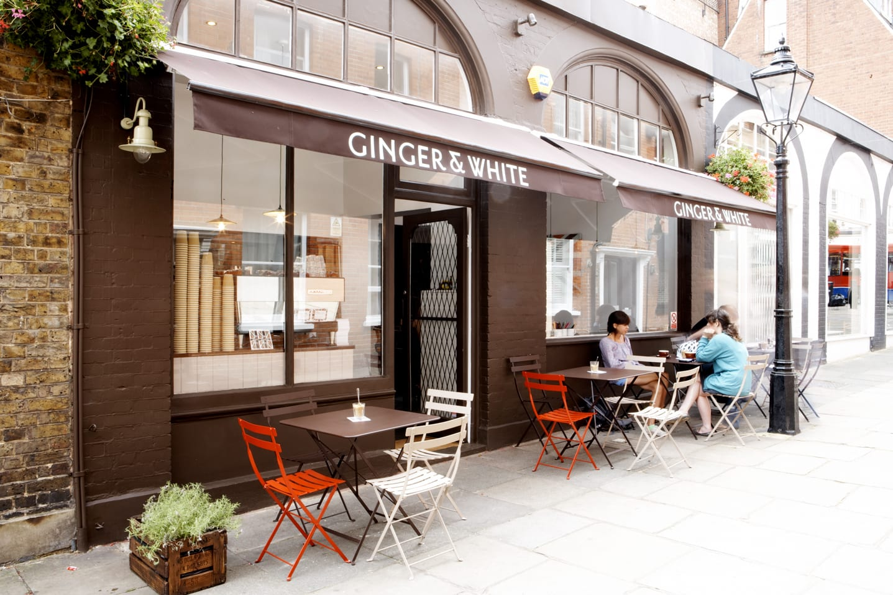

*Ginger & White, Perrins Court.*

**No reservations**, indoor and outdoor seating. Mon–Fri 7.30am–5.30pm, Sat 7.30am–6pm, Sun 8am–6pm, so **open all weekend**. Two minutes from Hampstead station, and the obvious start to a Heath walk.

### Beany Green, Little Venice

*££ · the towpath*

Australian brunch on the canal with a big terrace, **five minutes from Paddington**.

The setting is outdoors: tables out on the towpath at **Sheldon Square, W2 6EZ**, water on one side and offices on the other.

**It is an office district that empties at weekends.** Saturday gets you the terrace and a reduced operation; a weekday gets full service and the lunch crowd.

**Walk-in, five minutes from Paddington station**, and the canal walk to Little Venice starts here — ten minutes west to the moorings, or about an hour on to Camden.

---

Powered by <a target="_blank" rel="sponsored" href="https://www.getyourguide.com/london-l57/">GetYourGuide</a>

## Best value

A flat white costs £3.50–£4.50 almost everywhere, so the saving is not in the cup price.

* **Buy beans from the roasters.** A bag from Monmouth, Square Mile, Assembly or Origin costs about the same as three flat whites and makes forty. The roasteries in this guide all sell retail, and several will grind to your method.
* **Markets.** **Monmouth at Borough Market** is the original. **Maltby Street** and **Netil Market** both have serious coffee carts at market prices rather than café ones.
* **Food halls.** **Seven Dials Market**, **Mercato Mayfair** and **Old Spitalfields** all carry independent coffee counters — useful when you want a good flat white without hunting for a specific address.
* **Filter over espresso.** Batch brew is usually £1 cheaper than a flat white.
* **Bring a cup.** Most independents take 25–50p off, and a few take more.

---

## What to know

* **Monmouth's Borough queue** moves faster than it looks. Go before 10am at weekends.
* **Ask where the beans are from.** Every shop here will tell you, and several roast their own.

---

## Continue planning your London trip

- 🍳 **[The Best Breakfast and Brunch in London](/articles/best-breakfast-brunch-london/)**
- 💷 **[Cheap Eats in London](/articles/cheap-eats-london/)**
- 🎪 **[Unusual Restaurants in London](/articles/unusual-restaurants-london/)**
- 🛍️ **[London Markets by Day](/markets/)**
- 🎨 **[Shoreditch Area Guide](/articles/shoreditch-area-guide/)**
- 🏙️ **[City of London Area Guide](/articles/city-of-london-area-guide/)**
