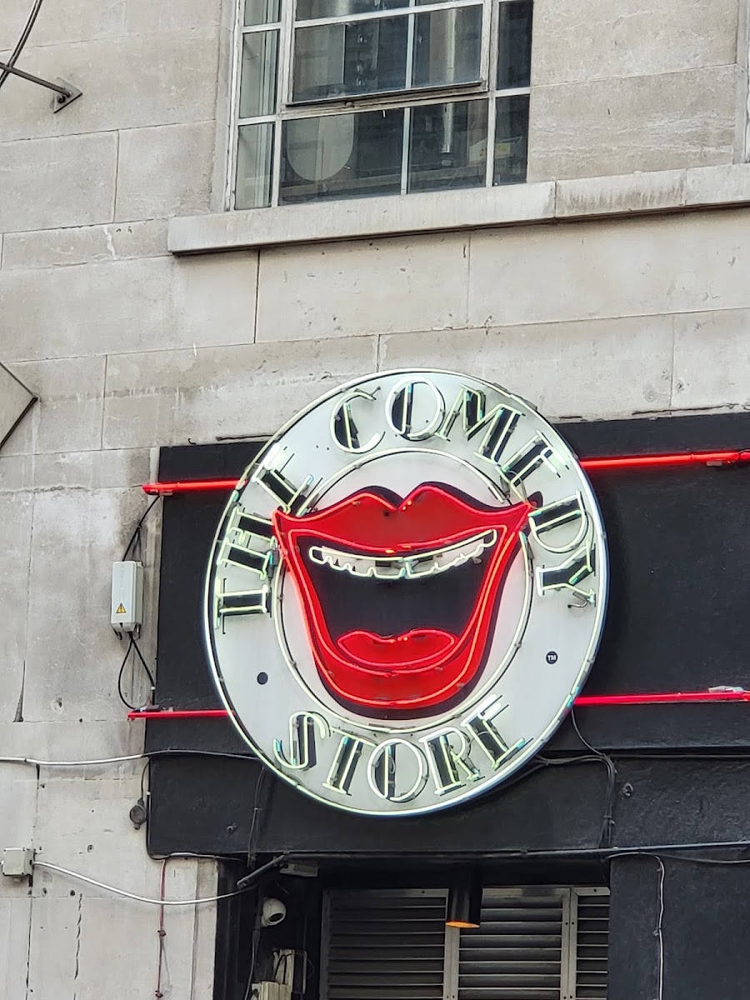
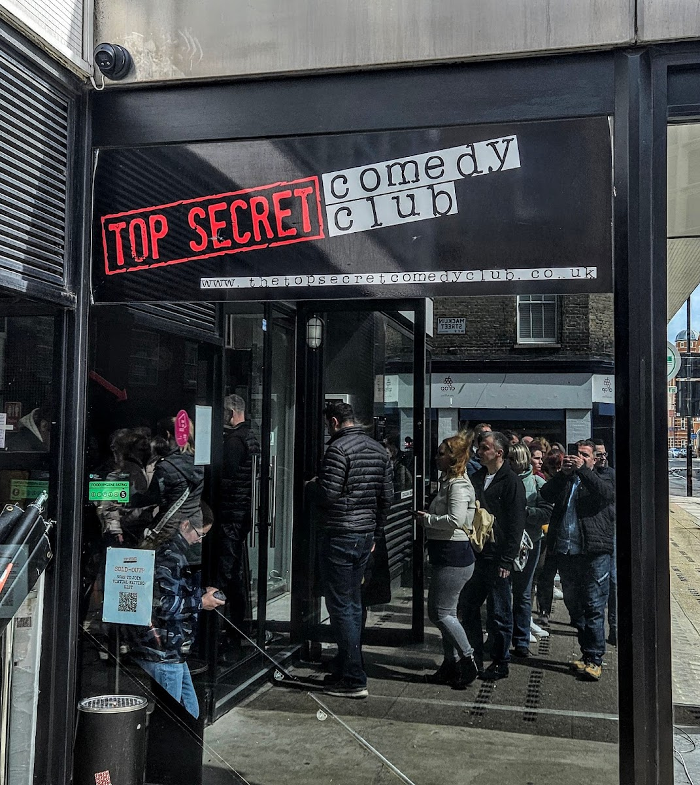
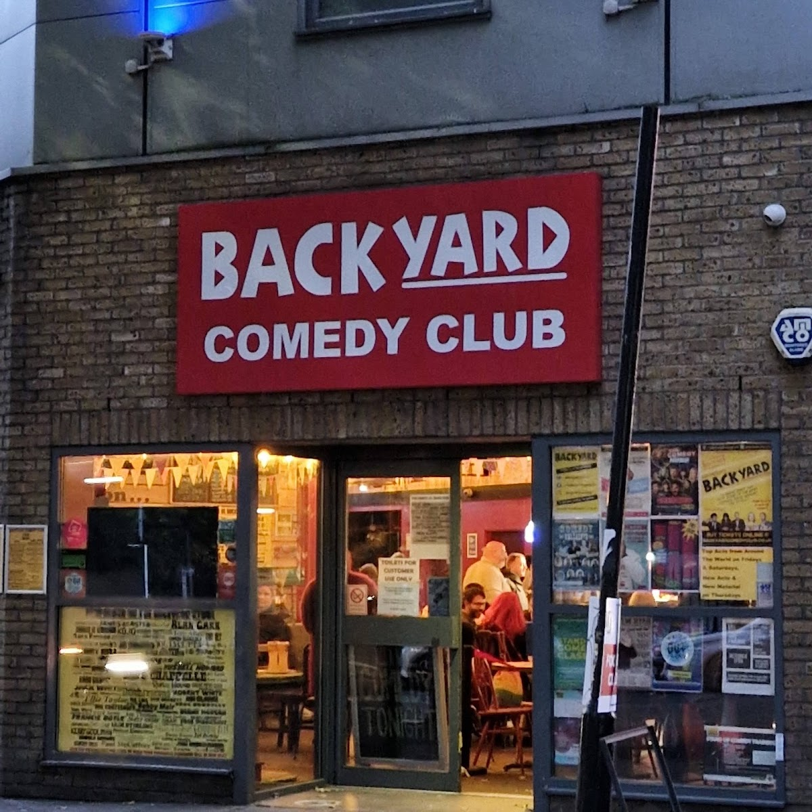
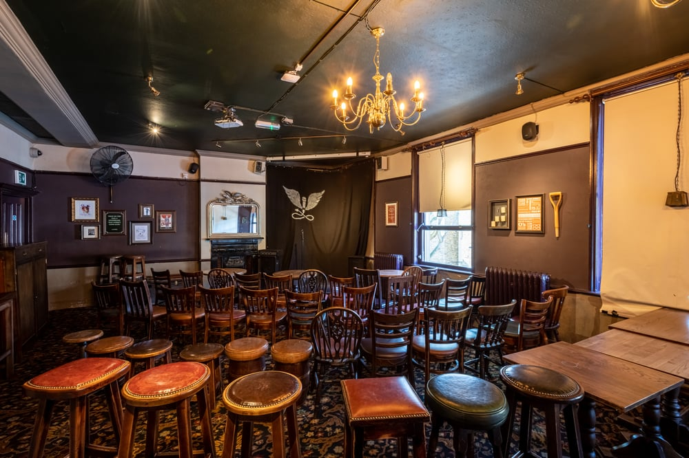
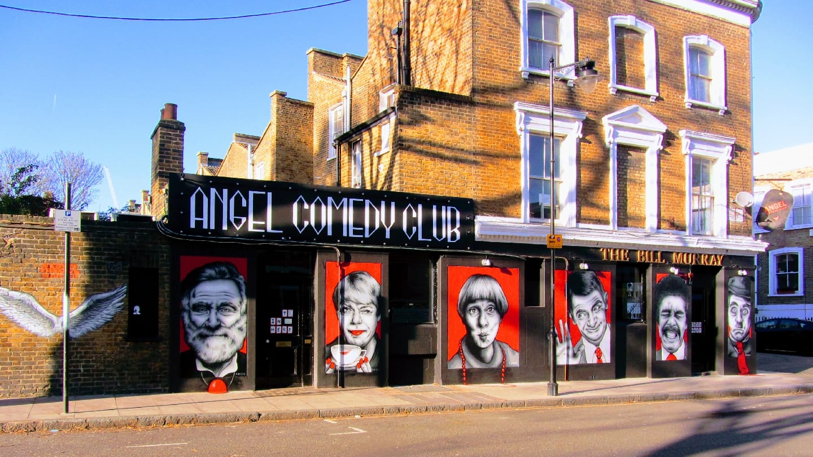
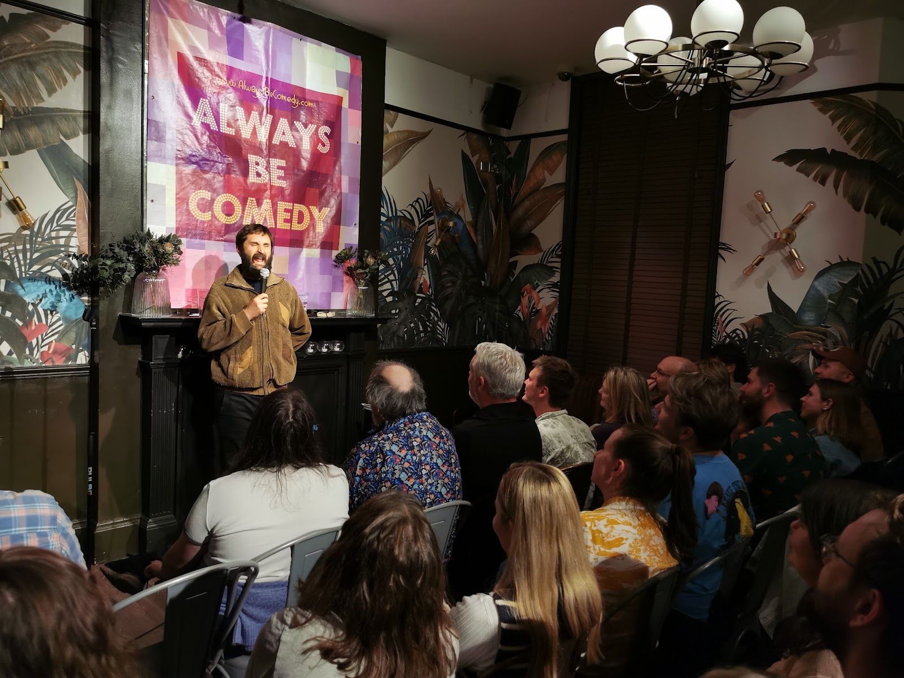
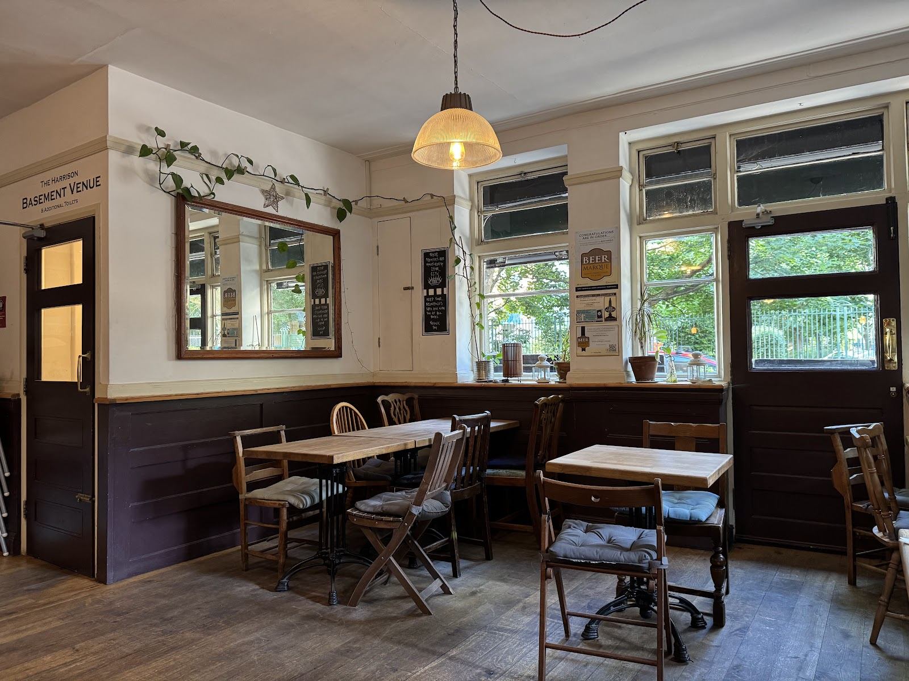
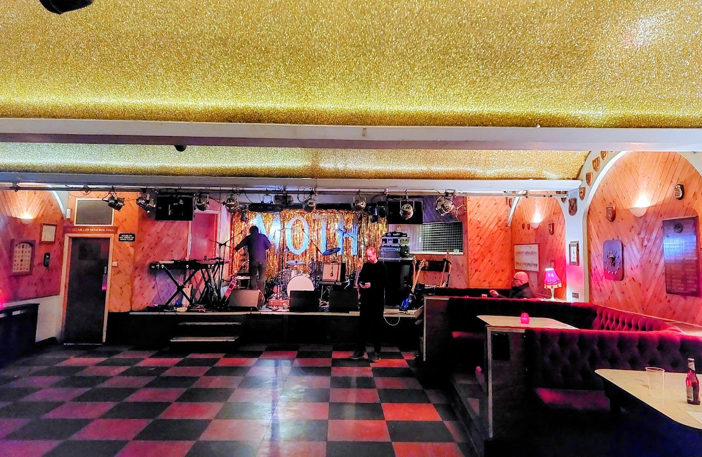
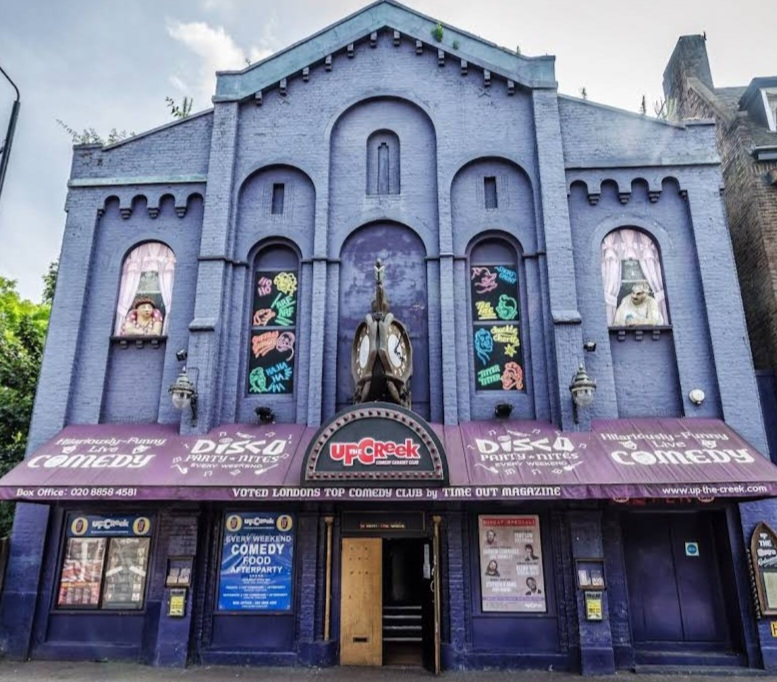
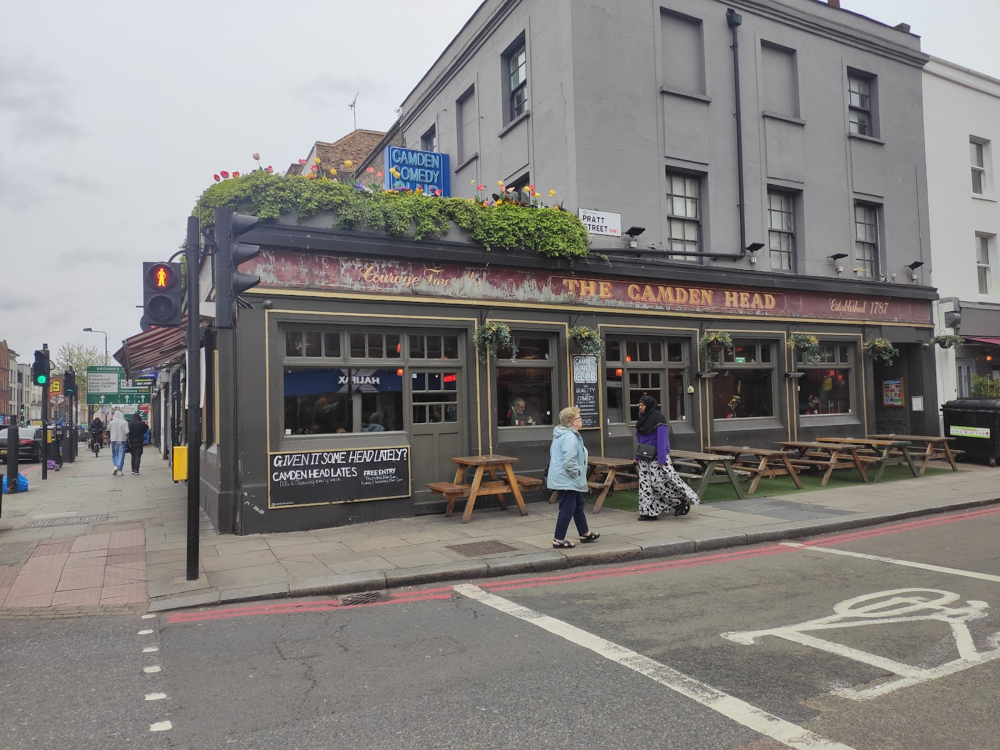

British alternative comedy started in a former Soho strip club in 1979. Several nights in London are now **free**, and the pub rooms run £4 to £8.

The trade-off is certainty. A £30 ticket buys a booked bill of professionals. A free ticket buys five acts, two of whom are working something out and one of whom is about to be famous.

> 💡 **The Short Version:** **The Comedy Store** is where it began. **Angel Comedy** runs free stand-up seven nights a week across two pubs. **Top Secret** is the cheap central option where big names drop in unannounced. **Always Be Comedy** in Kennington gets the surprise guests. The **Comedy Store Players** have been improvising on the Comedy Store stage since 1985.

> 📘 **How we choose these (editorial note).**
> No paid placements. Line-ups change weekly and rooms above pubs close without much warning; check before travelling.

## Where they are

| If you are near… | Where to go |
| --- | --- |
| **Soho & Piccadilly** | The Comedy Store |
| **Covent Garden** | Top Secret Comedy Club, Covent Garden Comedy Club |
| **Islington & Angel** | Angel Comedy at The Camden Head, Angel Comedy at The Bill Murray |
| **King's Cross** | The Harrison |
| **Camden** | Camden Comedy Club |
| **Hoxton & Shoreditch** | Comedy Cabin |
| **Hackney** | Knock2Bag at MOTH Club |
| **Bethnal Green** | Backyard Comedy Club |
| **Waterloo & South Bank** | Big Belly Comedy Club |
| **South London** | Always Be Comedy (Kennington), Happy Mondays (New Cross) |

**Price guide:** **Free** · **£** under £8 · **££** £15–£30.

---

## Where it started

### The Comedy Store, Soho

*££ · 3 min from Piccadilly Circus*

Don Ward opened it in **May 1979**, in the old Gargoyle nightclub on Dean Street. It has since moved to **1a Oxendon Street, SW1Y 4EE**.

*The Comedy Store's neon sign.*

**The Comedy Store Players** have performed here since **October 1985**, with Paul Merton, Josie Lawrence, Neil Mullarkey, Richard Vranch and Lee Simpson among them. *Whose Line Is It Anyway?* took their short-form improv to Channel 4 in 1988, and **Guinness confirmed in 2010 that it is the world's longest-running comedy show with the same cast**.

> 💡 **The Players play Sundays at 7:30pm.** It is improv rather than stand-up.

### Top Secret Comedy Club, Covent Garden

*£–££ · 4 min from Covent Garden*

A basement in the West End running shows **every day of the week**. It is known for **unannounced drop-ins**: established comedians working out material in a room of a hundred people who paid a few pounds.

*Top Secret Comedy Club, sold out.*

**It is two rooms, not one**, and the tickets do not make that clear: **170 Drury Lane** and **23 Kingsway**, a few minutes apart. Check which address is on your booking before you set off.

**Prices run £11 to £22, with concessions at £9 to £18**, and vary by slot rather than by night: the early 7pm show is typically the cheapest and the 9pm the dearest. Doors open an hour before most shows. Pints at the bar start at £4.20.

> ⚠️ **It sells out, routinely and days ahead.** Several shows on any given weekend are gone before the day, so book. A sold-out show has a QR code on the door for a virtual waiting list.

### Backyard Comedy Club, Bethnal Green

*££ · 5 min from Bethnal Green*

A purpose-built club rather than a room above a pub, founded by the comedian Lee Hurst. It has a raked floor, a real stage and booked bills, so everyone can see the stage for the whole two-hour bill.

**It is on Resolution Way at E2 0EL**, about five minutes from Bethnal Green station. Weekend bills book ahead; midweek is cheaper.

---

## Free, and good

These are free rooms with professional acts, not open-mic nights.

### Angel Comedy at The Camden Head, Islington

*Free · every single night*

**Free stand-up every night of the week**, in a pub near Angel. Angel Comedy books working professionals.

The **RAW** nights on Monday, Tuesday, Wednesday, Thursday and Sunday are where new material gets tested; **Friday shows run at 7.15pm and 9.15pm** and are the polished bills.

Between three and six consecutive shows run each night, so you can stay for one or for the evening, and leaving early costs you nothing.

**The Camden Head is at N1 8DY**, on Camden Passage, three minutes from Angel station. The bar is downstairs and the room is upstairs, and you are expected to buy a drink.

> ⚠️ **Free does not mean easy to get into.** At weekends, arrive up to **ninety minutes early** to collect a stamp.

### Angel Comedy at The Bill Murray, Islington

*Free seats · seven nights*

Angel Comedy's second venue, a refurbished pub they run themselves, five minutes from the first. It carries **the heavier programme of the two**: on a typical weekend it runs shows at 6pm, 5.30pm, 4pm, 7pm and 9.30pm across Friday to Sunday, which is four or five separate bills a day.

*The Bill Murray, Islington.*

New-material nights, Edinburgh previews and professional shows, with **at least a few free seats at most of them**.

**The Edinburgh preview season, roughly June to early August,** brings full-length hours for a few pounds, performed to a room of thirty, before the same show goes north.

**It is at N1 8NQ on Queen's Head Street**, a dedicated comedy venue rather than a pub that hosts comedy, with a published schedule you can plan around.

### Comedy Virgins

*Free · four pubs across London*

Free nights at **Signature Brew in Haggerston, The Railway in Putney, The Gipsy Queen in Kentish Town and The Wheatsheaf in Tooting Bec**. They are the most geographically spread of the free options, and the only ones in south-west and north London.

**Open-mic means what it says.** Five-minute slots, mostly people starting out, and quality swings from act to act. Do not judge it against Angel Comedy's booked professionals.

**Check the night before travelling.** The four venues run on different days and the schedules move.

### Comedy Cabin, Hoxton

*Free Thursdays · around £5 otherwise*

A small Hoxton room mixing established acts with new ones. **Free on Thursdays**, and rarely more than a fiver the rest of the time.

**The free Thursday fills**, so arrive early rather than on time.

Hoxton and Old Street stations are both a short walk. Comedy Cabin is within ten minutes of Angel Comedy's two venues and MOTH Club.

---

Powered by <a target="_blank" rel="sponsored" href="https://www.getyourguide.com/london-l57/">GetYourGuide</a>

## Where the locals actually go

Cheap neighbourhood nights with line-ups that outclass their ticket prices.

### Always Be Comedy, Kennington

*£ · a pub back room*

A Kennington pub back room known for **big-name special guests turning up unannounced** alongside the booked bill.

*The stage at Always Be Comedy.*

The surprise act is never advertised in advance, so the line-up you book against is not the line-up you get.

**It runs monthly rather than weekly.** Dates go on sale in advance and sell. Kennington and Oval stations are each about five minutes away.

### The Harrison, King's Cross

*£ · around £4*

**Around four pounds** for a bill mixing up-and-coming acts with comedians you will recognise from television, in the back room of a King's Cross pub.

The pub is open every day noon to 11pm, food until 9.30pm, **pints at £5**, and 10% off food between noon and 4pm on weekdays with 20% for students.

*The Harrison's ground-floor bar.*

**There is a pub quiz on Mondays, 7pm to 9.30pm**, and the back room does not run comedy every night, so check which night you are coming for. The comedy runs in its own room down a separate staircase, not the ground-floor bar.

**WC1H 8JF on Harrison Street**, about seven minutes from King's Cross St Pancras.

### Happy Mondays Comedy, New Cross

*£ · around £5*

Established names and newcomers in a New Cross pub for **about five pounds**. It runs on Mondays, the night working comedians are free and big names try things out.

It is a twenty-minute train from London Bridge. New Cross and New Cross Gate stations are both close, and the Overground runs late enough to get back.

### Knock2Bag at MOTH Club, Hackney

*£–££ · Valette Street*

Big names and new acts in the **glittery ex-servicemen's club** on Valette Street, about eight minutes from Hackney Central Overground. Tickets cost a little more than the pub nights.

*MOTH Club, Hackney.*

MOTH stands for Memorable Order of Tin Hats, a veterans' association; the tinsel-curtained stage and Artex ceiling are original fittings. The entrance is unmarked enough that people walk past it.

> **Knock2Bag is sometimes listed as free. It is not.** Mailing-list subscribers occasionally get free or heavily reduced tickets.

---

Powered by <a target="_blank" rel="sponsored" href="https://www.getyourguide.com/london-l57/">GetYourGuide</a>

## The rest of the circuit

### Up the Creek, Greenwich

*££ · around 275 · Thu–Sun*

Founded in **1991 by Malcolm Hardee** in an old church hall. **The heckling is part of the format**, and comedians either handle it or are eaten. It won the **first ever Chortle Award for Best Large Venue** in 2002.

Not the room for a nervous first-timer.

**Seating is unreserved**, doors open an hour or more before the show, and the club advises arriving early for the best seats. The front rows are part of the act.

Typical timings are **doors 7pm for an 8pm start**, with earlier 7.30pm shows on some nights and a later 8.45pm on others, so check the specific date.

**SE10 9SW on Creek Road**, five minutes from Cutty Sark DLR and ten from Greenwich.

### 2Northdown, King's Cross

*£ · 100 seats · 2 min from King's Cross St Pancras*

Opened in **June 2017**, and used by comedians for previews and works-in-progress. A hundred seats, **step-free from the street**.

Tickets are cheap, but shows are unpolished by design, run from notes, and sometimes stop and restart. Almost every other room in this guide is a pub cellar or an upstairs function room, so this is the step-free option in central London comedy. Being two minutes from a mainline station also makes it easy to get home from a late show.

### Soho Theatre, Soho

*££ · Dean Street*

New theatre, cabaret and full-length stand-up hours, and the London stop for most Edinburgh transfers, so a show you missed in August turns up here between September and Christmas.

Club nights give you five acts doing twenty minutes; Soho Theatre gives you one act doing an hour.

**A second venue, Soho Theatre Walthamstow,** is on Hoe Street, **E17 4QH**, in a restored art deco cinema. The original is at **W1D 3NE on Dean Street**, four minutes from Tottenham Court Road.

**Book ahead.** These are theatre runs with named performers, and the good ones sell out weeks in advance.

### Camden Comedy Club, Camden Town

*£ · above a pub*

Above the Camden Head pub, **not the Islington pub of the same name** where Angel Comedy runs. This one is **NW1 0LU**, on Camden High Street.

*The Camden Head, Camden Town.*

Touring acts, previews and new-material nights in a small upstairs room. Seating is unreserved and the sound of the bar carries. **Camden Town station is two minutes away.**

### Covent Garden Comedy Club, Covent Garden

*££ · central*

A long-running central club with a weekend bill. **It is at WC2N 6NG**, in the streets between Covent Garden and Charing Cross, within five minutes of most West End theatres, so a 6pm or late show either side of a theatre booking is practical.

Charing Cross, Leicester Square and Covent Garden stations are each about four minutes away.

### Big Belly Comedy Club, Waterloo

*£–££ · a vaulted cellar*

In a **brick vaulted cellar** near Waterloo, with low arched ceilings and no natural light.

**Weekend timetable**: Friday shows at 7pm and 9pm, Saturday at 6pm and 8.30pm. Their Midweek Madness nights start **from £5**, against weekend tickets that stay under £20. **Sunday is a new-act competition**, five minutes each.

**SE1 9LQ**, a few minutes from Waterloo, and the last trains from there run late enough for the 9pm show.

---

## Where the names play

Everything above is a club: a bill of several acts. To see one specific comedian do one show, you want a different kind of building. None of the venues below is a comedy venue; they are theatres, churches and an arena that book the biggest touring names.

| Venue | Where | What it books | Notes |
| --- | --- | --- | --- |
| **Eventim Apollo** | 45 Queen Caroline Street, Hammersmith W6 9QH | The largest touring stand-up shows short of an arena | Seated for comedy |
| **Leicester Square Theatre** | 6 Leicester Place WC2H 7BX | Long runs and work-in-progress shows by names you know | **Card only**, and there is no cloakroom |
| **Museum of Comedy** | The Undercroft, St George's Church, Bloomsbury Way WC1A 2SR | Nightly shows, plus a museum of British comedy | Under a Hawksmoor church, and run by the same people as Leicester Square Theatre |
| **Bloomsbury Theatre** | 15 Gordon Street WC1H 0AH | Touring stand-up and student comedy on the same stage | UCL's theatre, so the programme runs from a household name to a first-ever gig |
| **Union Chapel** | Compton Terrace, Islington N1 2UN | Comedy in a working Victorian church | Pews, no bar in the auditorium |
| **Clapham Grand** | 21–25 St John's Hill, Battersea SW11 1TT | Comedy alongside club nights, cabaret and drag | A restored 1900 variety theatre by Clapham Junction |
| **Hackney Empire** | 291 Mare Street, Hackney E8 1EJ | Touring comedy in a 1901 Frank Matcham theatre | Charlie Chaplin and Stan Laurel played the building |
| **The O2** | Greenwich Peninsula | Arena stand-up only: the very few comedians who can fill it | Book the lower tiers, as the upper bowl is a long way from the stage |

**The Roundhouse belongs here too**, but only for one month of the year; see the festivals below.

**Soho Theatre straddles both categories**, which is why it appears in the club list above. It books full solo hours by touring names at prices closer to a club.

> 💡 **The practical difference.** Clubs are decided on the night and cost between nothing and £30. These venues go on sale months ahead and sell out. If you are going to see one specific comedian, buy the ticket the week it is announced.

---

## Comedy festivals

London's comedy festivals fall in **July and August**. All four below run inside a six-week window, and outside it the city has no comedy festival, so the clubs are the answer in February.

| Festival | When | Where | What it is |
| --- | --- | --- | --- |
| **Greenwich Comedy Garden** | Five nights in mid-July | Old Royal Naval College SE10 9NL | Touring headliners in a tent in the grounds, with street food and a bar. Calls itself London's biggest comedy festival |
| **Ealing Comedy Festival** | Four nights in late July | Big Top, Walpole Park, Mattock Lane W5 5EQ | Part of the wider Ealing Summer Festivals, programmed by Headliners Comedy Club |
| **Roundhouse Comedy Festival** | Throughout August | Roundhouse, Chalk Farm Road NW1 | A month of one-off shows in the main space |
| **Camden Fringe** | All of August | 39 venues across Camden | **450+ shows**, open access, an hour each. Theatre, improv, opera and a gameshow too. Applications for 2027 open on 4 January |

> ⚠️ **VAULT Festival is gone.** It ran under Waterloo station from 2012 and its **final festival was in 2023**.

**The two August festivals overlap.** The Roundhouse books people off the television into a seated room, at theatre prices, one night each. Camden Fringe is open-access, in pub rooms a few streets away, and many tickets cost less than a pint.

**The Greenwich and Ealing festivals are outdoor**, in a tent and a Big Top, so dress for a British July.

> 💡 **The Roundhouse runs a second festival.** Its **Three Sixty Festival** also carries comedy, including a Channel 4 new-talent showcase, so a Roundhouse comedy listing is not automatically part of the comedy festival.

---

Powered by <a target="_blank" rel="sponsored" href="https://www.getyourguide.com/london-l57/">GetYourGuide</a>

## What to know

* **Arrive early for anything free.** Ninety minutes at The Camden Head on a Saturday is not an exaggeration.
* **June to early August is Edinburgh preview season.** Full shows, small rooms, a few pounds, before the same show costs three times as much at the Fringe.
* **Front-row seats get spoken to,** at every club on this page. Sit further back if you would rather not be.
* **The ticket price does not include a drink.**
* **Check the line-up the same week.** Bills change constantly and a name announced a month out is not a guarantee.
* **Angel Comedy is free seven nights a week at The Camden Head,** but The Bill Murray also runs paid shows.

---

## Continue planning your London trip

- 🎷 **[Dinner and a Show in London](/articles/dinner-and-a-show-london/)**
- 🎵 **[The Best Live Music Venues in London](/articles/best-live-music-venues-london/)**
- 🎬 **[The Best Cinemas in London](/articles/best-cinemas-london/)**
- 🍸 **[The Best Cocktail Bars in London](/articles/best-cocktail-bars-london/)**
- 💷 **[London on a Budget](/articles/london-on-a-budget/)**
- 🌙 **[Late-Night Eating in London](/articles/late-night-eating-london/)**
- 🎭 **[Islington Area Guide](/articles/islington-area-guide/)**
