CAMRA, the Campaign for Real Ale, doesn't crown one London winner. Its Pub of the Year competition runs branch by branch, thirteen of them across Greater London, with no final round where Bromley's winner meets Richmond's, and two branches ran theirs as a dead heat.

This guide counts across the eleven branches that published a result, the editorial lists that rank taprooms rather than pubs, the independent specialists who walk the beer miles, and the video crawls that go pub to pub.

> 💡 **The Short Version:** There's no single London-wide CAMRA winner — but **The Cockpit** in Chislehurst has taken Bromley's branch award four years running and the Greater London round too in 2026, and **The Hope** in Carshalton has won the Greater London award five times. **Exale Brewing & Taproom** tops Time Out's taproom list; **Cask Pub & Kitchen**, open since 2009, tops Secret London's and calls itself London's original craft beer pub. For a beer mile on foot, **Bermondsey** and **Blackhorse Lane** are the two the sources keep returning to. Most of this list is walk-in — book only where there's a kitchen behind the bar.

> 📊 **The evidence behind this guide.**
> **34 independent sources carrying 395 citations** across **325 named pubs, breweries and taprooms**. **48 are named by two or more independent sources; 13 carry a dated CAMRA branch award.**
> **Built on:** CAMRA's Pub of the Year results from 11 London branches; four mastheads; three specialist writers; 16 YouTube channels.
> *Evidence rebuilt 13 September 2026 · [How we rank →](/how-we-rank/)*

## Where they are

| If you are near… | Where to drink |
| --- | --- |
| **Bermondsey & Borough** | Hand & Marigold, The Kernel, Anspach & Hobday, The Rake, The Market Porter |
| **Hackney & Hackney Wick** | Howling Hops, Beer Merchants Tap, The Pembury Tavern, Hackney Church Brew Co. |
| **Hoxton & Clerkenwell** | The Wenlock Arms, The Sutton Arms |
| **Euston & Pimlico** | Euston Tap, Cask Pub & Kitchen |
| **Gospel Oak & Kentish Town** | The Southampton Arms |
| **Walthamstow (Blackhorse Beer Mile)** | Exale Brewing & Taproom |
| **Croydon, Sutton & Wimbledon** | The Hope, The Dark Horse, The Sultan |
| **Kingston & Epsom** | The Antelope, Jolly Coopers |
| **Richmond, Ealing & Paddington** | The Mitre, The Dodo Micropub, The Bear |
| **Barnet & Bexley** | Ye Olde Mitre Inne, Robin Hood & Little John |

**Price guide:** **£** a pint under £5 · **££** £5–£7 · **£££** £7+.

---

## The winners

Eleven CAMRA branches, thirteen winning pubs, no round where they meet: each pub below won in its own patch, not against the others on this list.

### The Cockpit, Chislehurst — four years running, then Greater London too

*£ · Chislehurst, Bromley · Cited by 1 source · Bromley AND Greater London CAMRA Pub of the Year 2026*

Four Pub of the Year wins running for the Bromley branch, and in 2026 the Greater London round agreed: the branch puts it as "Bromley AND Greater London CAMRA Pub of the Year 2026".

A micropub: **one room, no music, no fruit machines**, with **cask ale poured by gravity straight from the cask rather than through a handpump**, a fine-cider list, local gins and a board of Neal's Yard cheeses and cured charcuterie in place of a kitchen.

**Both card and cash work, and there's no hot food** — eat first if you want more than the board. 4 Royal Parade, Chislehurst BR7 6NR.

**Site:** [thecockpitchislehurst.co.uk](https://thecockpitchislehurst.co.uk)

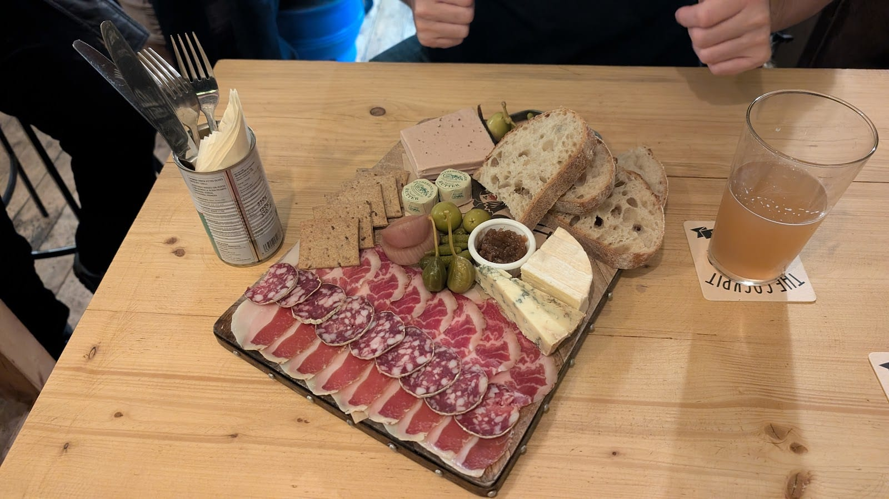

*The cheese and charcuterie board at The Cockpit.*

### The Hope, Carshalton — five-time Greater London champion

*£ · Carshalton, Sutton · Cited by 2 sources · Sutton Borough CAMRA Pub of the Year 2026, and Greater London Pub of the Year 2012, 2013, 2016, 2017 and 2019*

ShortList picked it for the best beer list in London and CAMRA's Sutton branch named it its 2026 winner, independently of each other. It is a mock-Tudor pub with **seven handpumps for real ale** and, per the branch's own count, more than ten Pub of the Year wins, five of them at Greater London level.

Inside: **no TV, no muzak, no fruit machines**, a warren of small rooms rather than one bar, and a kitchen limited to soups and sandwiches.

**Food service stops at 2.45pm** and the pub runs to 11pm most nights. 48 West Street, Carshalton SM5 2PR.

**Site:** [hopecarshalton.co.uk](https://www.hopecarshalton.co.uk)

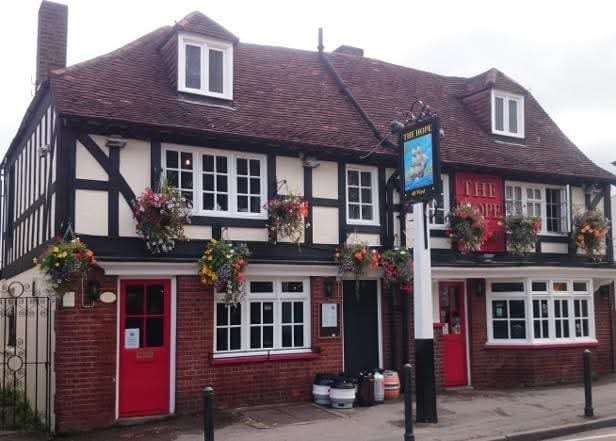

### Hand & Marigold, Bermondsey — a Victorian corner pub back from the dead

*££ · Bermondsey Street · Cited by 2 sources · South East London CAMRA Pub of the Year 2026*

Closed as a pub in 2021, reopened by new owners in March 2025, and judged the best pub in the South East London CAMRA branch within about a year. Will Hawkes's beer newsletter also named it, independently of the award. It is run by Alice and Oli Carter-Esdale.

A single-room Victorian corner pub on Bermondsey Street and Cluny Mews, refurbished in the traditional style rather than knocked through.

**Open to 10pm on weeknights, 11pm Friday and Saturday.** 244 Bermondsey Street, London SE1 3UH.

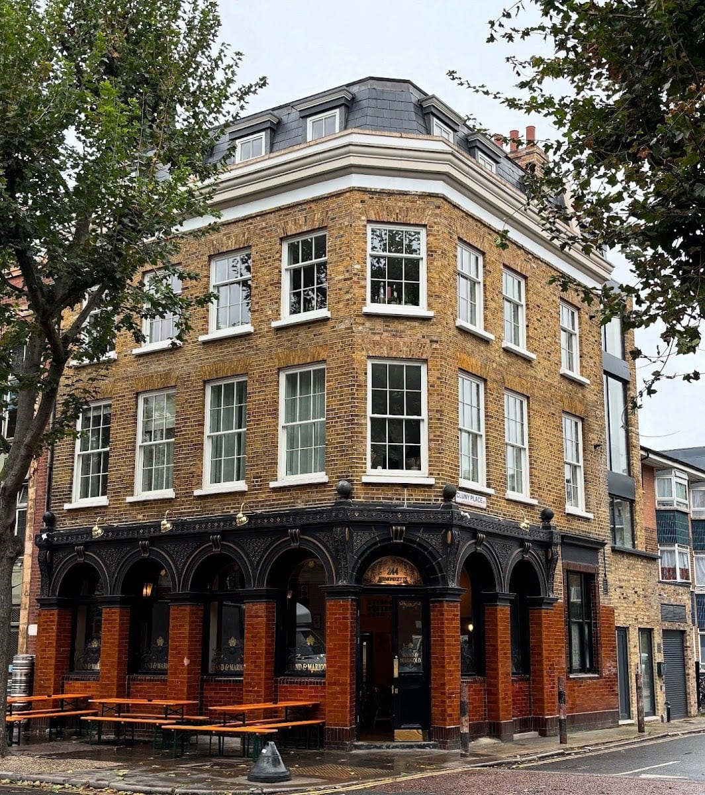

### The Wenlock Arms, Hoxton — the jazz pub that came back from a demolition threat

*£ · Hoxton, N1 · Cited by 2 sources · North London CAMRA Pub of the Year 2026*

CAMRA describes it as "a classic story of rags to riches then back to rags and finally riches": a 1994 reinvention as a real ale and jazz pub, a threatened closure, and a second Pub of the Year win. Tweedy Pubs filmed a tour of the pub independently of the award.

The pour is **a constantly changing range of cask ales, keg beers and real ciders**, in a plain room with no kitchen and no food beyond crisps and pork scratchings, and a jazz night that has run since the nineties.

**Closed Mondays; open 4pm to 11pm Tuesday and Wednesday, later Thursday to Saturday (1am on Friday and Saturday) and to 10pm on Sunday.** 26 Wenlock Road, London N1 7TA.

**Site:** [wenlockarms.com](https://wenlockarms.com)

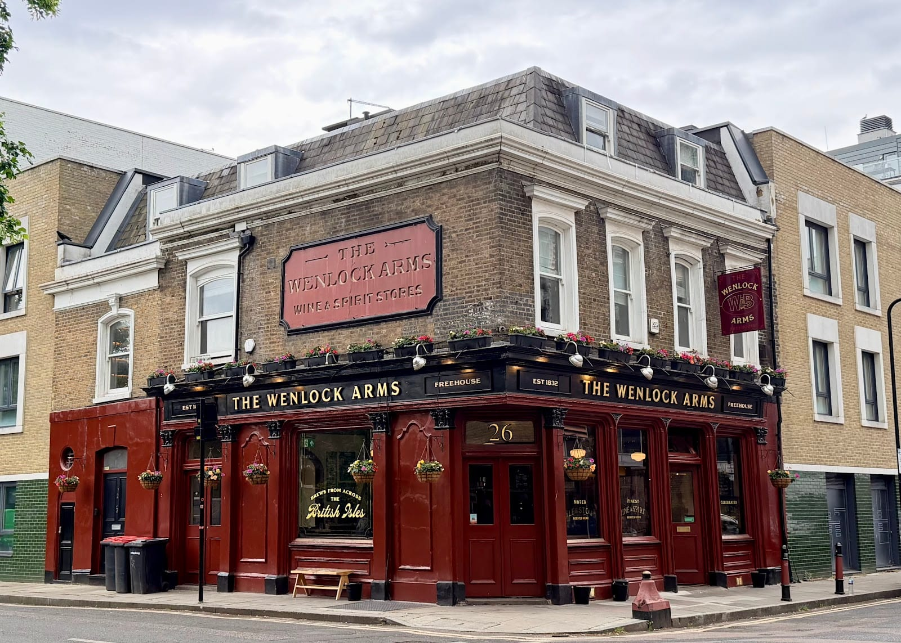

### The Sultan, South Wimbledon — Hop Back's only London pub

*£ · South Wimbledon · Cited by 2 sources · South West London CAMRA Pub of the Year (most recent published result: 2023)*

Its most recent branch win was in 2023. Rebel Atlas's independent guide calls it **"a revered Hop Back pub and south-west London cask beacon"**.

It's the brewery's only tied house in London — a 1950s brick rebuild that CAMRA calls "a remarkably intact survivor of the early post-war period" — pouring **up to eight Hop Back beers**, Summer Lightning among them, plus a wine list, in a community pub with soups, sandwiches and a garden with a conservatory.

**Open to 11pm Monday to Wednesday and 11.30pm Thursday to Sunday.** 78 Norman Road, South Wimbledon SW19 1BT.

**Site:** [hopback.co.uk/our-pubs/the-sultan](https://www.hopback.co.uk/our-pubs/the-sultan)

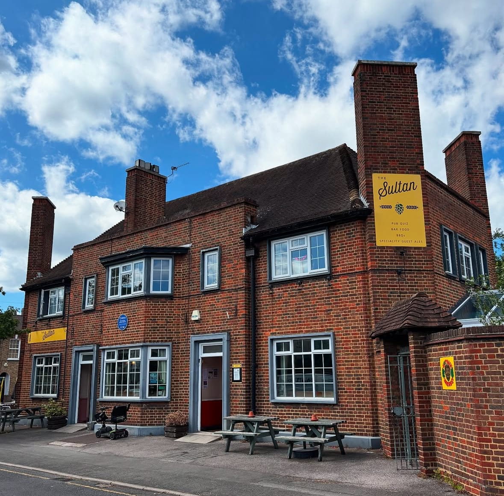

### Exale Brewing & Taproom, Walthamstow — Time Out's number one

*££ · Blackhorse Lane, Walthamstow · Cited by 1 source · #1 of 22, Time Out's Best Breweries and Taprooms*

Time Out's taproom countdown puts it top of 22, calling it **"a fun and friendly taproom"** on the Blackhorse Beer Mile. A former furniture factory with an industrial fit-out, it brews on site on a weekly cycle, across **fourteen taps**.

It is **open to 2am on Friday and Saturday, with a late bar and regular live music**. Food runs to burgers and tacos rather than a kitchen menu.

Unit 2C Uplands Business Park, Blackhorse Lane, London E17 5QJ.

**Site:** [exale.uk](https://www.exale.uk)

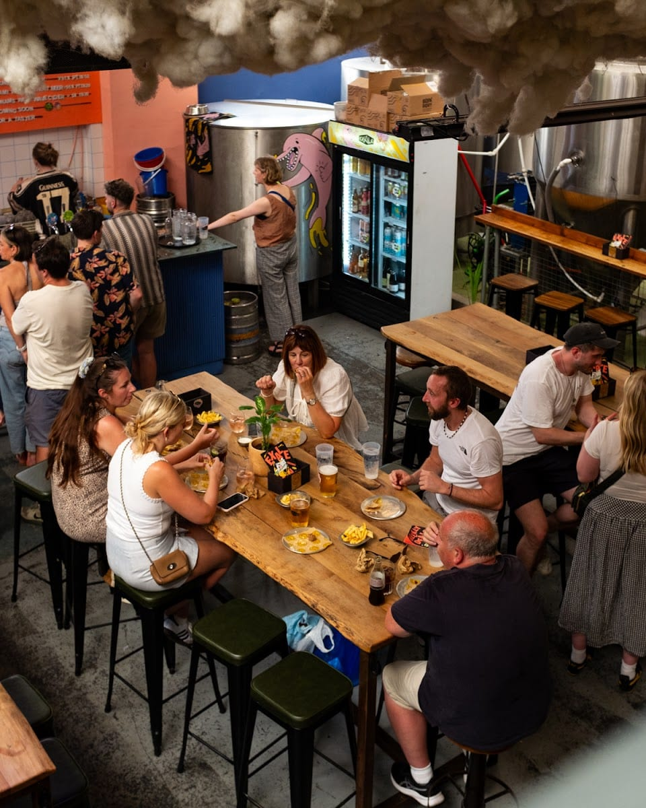

*Exale's taproom.*

### Cask Pub & Kitchen, Pimlico — London's original craft beer pub

*££ · Pimlico · Cited by 1 source · #1 of 15, Secret London's craft beer countdown*

Opened in 2009 and describing itself as **London's first craft-beer-focused pub**, it tops Secret London's 2024 countdown as an **"award-winning pub"** with **"an extensive list of draught beer."** That means **ten cask lines, twenty-two keg taps and a "vintage cellar"** of aged and rare bottles, in a corner pub a ten-minute walk from Victoria.

The kitchen does burgers, and the room is large, not a two-table micropub.

**Open to 11pm Monday to Saturday, 10.30pm Sunday.** 6 Charlwood Street, London SW1V 2EE.

**Site:** [caskpubandkitchen.com](https://www.caskpubandkitchen.com)

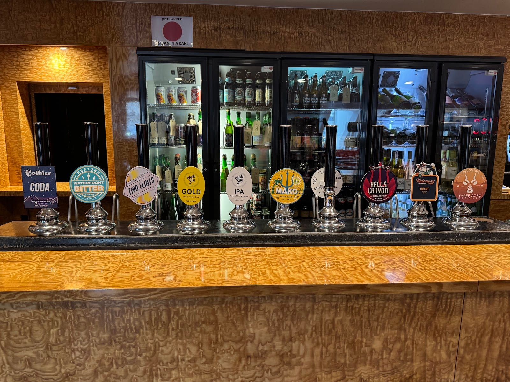

*The bar at Cask Pub & Kitchen.*

Powered by <a target="_blank" rel="sponsored" href="https://www.getyourguide.com/london-l57/">GetYourGuide</a>

## Every other branch's current winner

| Branch | Pub | Where | What it is |
| --- | --- | --- | --- |
| Bexley | The Robin Hood & Little John | Bexleyheath | A 1830s back-street local; seven real ales and two rotating guests, food Tue–Sat lunchtimes only |
| Kingston & Leatherhead *(joint)* | The Antelope | Surbiton | Original home of Big Smoke Brew Co.; 10 real ales, 5 ciders, 14 keg lines |
| Kingston & Leatherhead *(joint)* | Jolly Coopers | Epsom | A working brewpub — cask-conditioned ales brewed on site under the Fuzzchat name |
| Enfield & Barnet *(2025)* | Ye Olde Mitre Inne | High Barnet | Grade II-listed Greene King house, pub on the site since 1553 — not the Holborn Ye Olde Mitre |
| Richmond & Hounslow | The Mitre | Richmond | Free house, 14 handpumps, an ever-changing cask and craft list, build-your-own pizza |
| West London | The Bear | Paddington | Independent family-owned pub; 6 cask ales and 29 keg lines |
| West Middlesex *(2025)* | The Dodo Micropub | Hanwell, Ealing | One-room free house, up to 5 changing cask ales on gravity dispense |
| Croydon & Sutton *(Croydon side)* | The Dark Horse | Selhurst | Reopened July 2025, independent family pub, three changing cask ales |

---

## Also strongly backed

Nothing here won a branch award, but each is named by three or more independent sources.

### Hackney Church Brew Co. — a working brewery under the railway arches

*££ · Bohemia Place, Hackney Central · Cited by 4 sources*

A brewery and taproom in the railway arches of Bohemia Place (Arch 17 and the Barrel Store). Rebel Atlas calls the beer **"brewpub energy under the Overground,"** and the taproom runs **rotating own-brewed keg lines** alongside Hendl rotisserie chicken and buffalo wings.

Expect it **loud and full on a Friday night**, with big shared wooden tables rather than a pub layout.

**Closed Monday and Tuesday; open 5pm to 11pm Wednesday and Thursday, from 12pm Friday and Saturday, and to 10pm on Sunday.** 17 Bohemia Place, London E8 1DU.

**Site:** [hackneychurchbrew.co](https://hackneychurchbrew.co)

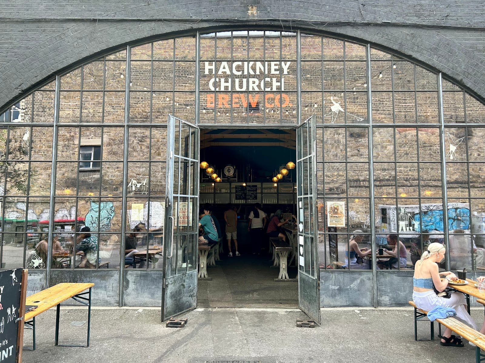

### The Pembury Tavern, Hackney — the Five Points brewery tap since 1856

*££ · Amhurst Road, Hackney · Cited by 4 sources*

A corner pub that's been pulling pints since 1856, now run as the tap house for **The Five Points Brewing Company**, whose brewery is a mile down the road. One reviewer praised it for using **"real ale traditionally, not hop oils or malt extract"**.

The kitchen belongs to **ACE Pizza**, resident since 2018, and the room keeps its hardwood floors and a bar billiards table rather than going for a taproom fit-out.

**Open from 4pm Monday to Thursday and 12pm Friday to Sunday; to 11pm Sunday to Thursday and midnight Friday and Saturday.** 90 Amhurst Road, London E8 1JH.

**Site:** [pemburytavern.co.uk](https://pemburytavern.co.uk)

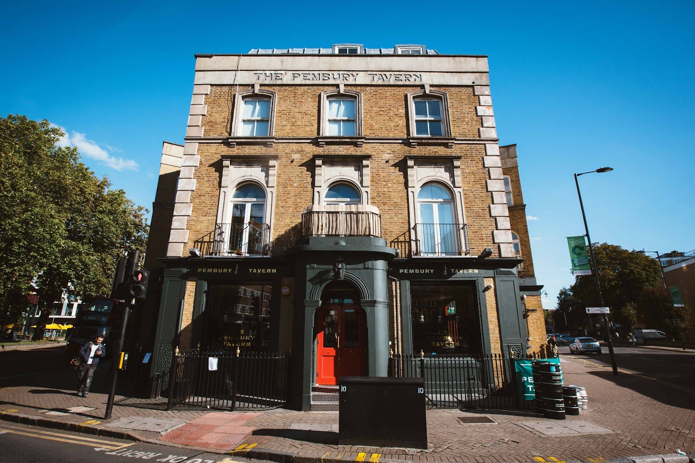

### Howling Hops — Tank Bar, Hackney Wick — the UK's first dedicated tank bar

*££ · Queen's Yard, Hackney Wick · Cited by 4 sources*

**"The UK's first dedicated tank bar,"** in its own words: **ten tanks, ten different beers, poured straight from the tank along a ten-metre bar** rather than through a font. It moved to Queen's Yard from a previous site on Mare Street some years ago, so an older write-up may place it elsewhere.

A European-style beer hall rather than a traditional pub: long tables, high ceilings, food cooked and eaten in the same room. It fills up fast on a warm evening, close to Victoria Park.

**Open to 11.30pm Sunday to Thursday and 1.30am Friday and Saturday.** 9 White Post Lane, London E9 5EN.

**Site:** [howlinghops.co.uk](https://www.howlinghops.co.uk)

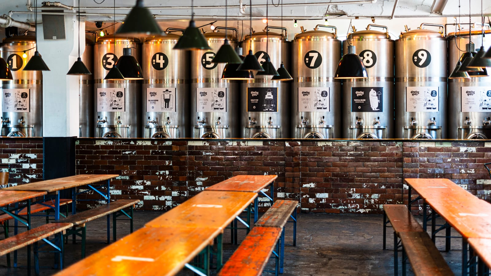

*The tank bar at Howling Hops.*

### Beer Merchants Tap, Hackney Wick — a bottleshop you can drink in

*££ · Wallis Road, Hackney Wick · Cited by 4 sources*

The taproom of an online bottle shop that ships around a thousand different beers, with **twenty keg lines** running from affordable pints to hard-to-find bottles. CAMRA's listing confirms the twenty.

Plenty of seating inside, a beer garden out the back, and a wine and spirits range alongside the beer.

**Open from 3pm Monday to Wednesday and 12pm Thursday to Sunday; closes at 11pm Monday to Saturday and 10pm on Sunday.** 99 Wallis Road, London E9 5LN.

**Site:** [beermerchantstap.com](https://beermerchantstap.com)

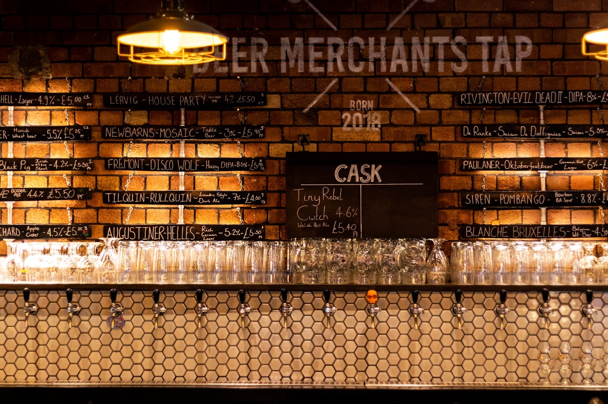

*The tap wall at Beer Merchants Tap.*

### Anspach & Hobday: The Arch House, Bermondsey — the porter that's taking on Guinness

*££ · Druid Street, Bermondsey · Cited by 6 sources*

The beer to order is **London Black**, a revival of the old London Porter style, poured on draft at the brewery itself; one reviewer called the draft version "easily the best stout on the [mile]."

A working mixed-fermentation brewery with a taproom: **twelve beers on tap**, an arched ceiling and a bottle shop by the door.

**Closes early, around 7pm.** 118 Druid Street, London SE1 2HH.

**Site:** [anspachandhobday.com/the-arch-house](https://www.anspachandhobday.com/the-arch-house)

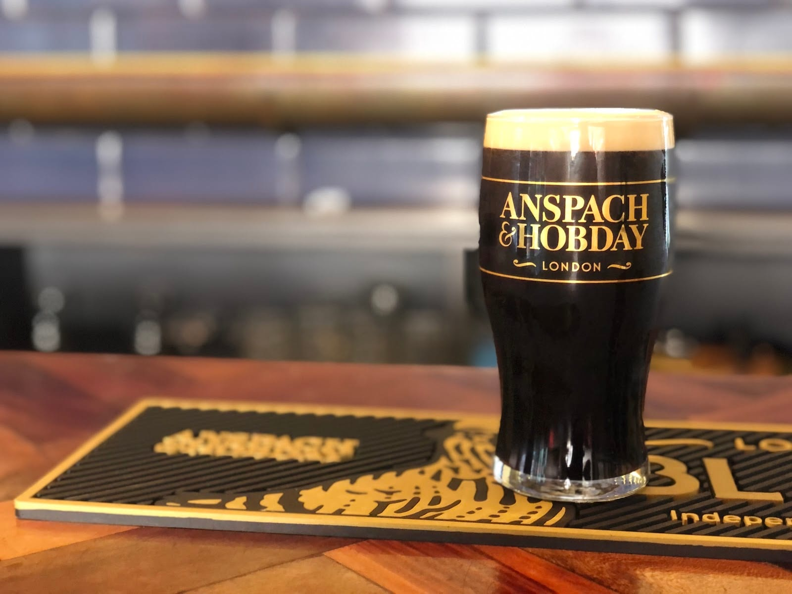

*London Black.*

### The Kernel, Bermondsey — ShortList's "most important independent brewery"

*££ · Spa Road, Bermondsey · Cited by 3 sources*

ShortList calls it **"London's most important independent brewery,"** and MyBeerStops calls the flagship **Export India Porter** "legendary." The taproom moved in August 2024 from an adjacent railway arch into a purpose-built ground-floor space, with **twenty-five keg taps and two handpumps** and a Japanese kitchen (Yagi Izakaya) in the room.

If an older write-up sends you to "the arch," that's the pre-2024 site — brewing still happens there, but the bar moved next door.

**Open Wednesday to Sunday only: to 10pm Wednesday to Friday, 9pm Saturday and 8pm Sunday.** 132 Spa Road, London SE16 3AE.

**Site:** [thekernelbrewery.com/tap.php](https://www.thekernelbrewery.com/tap.php)

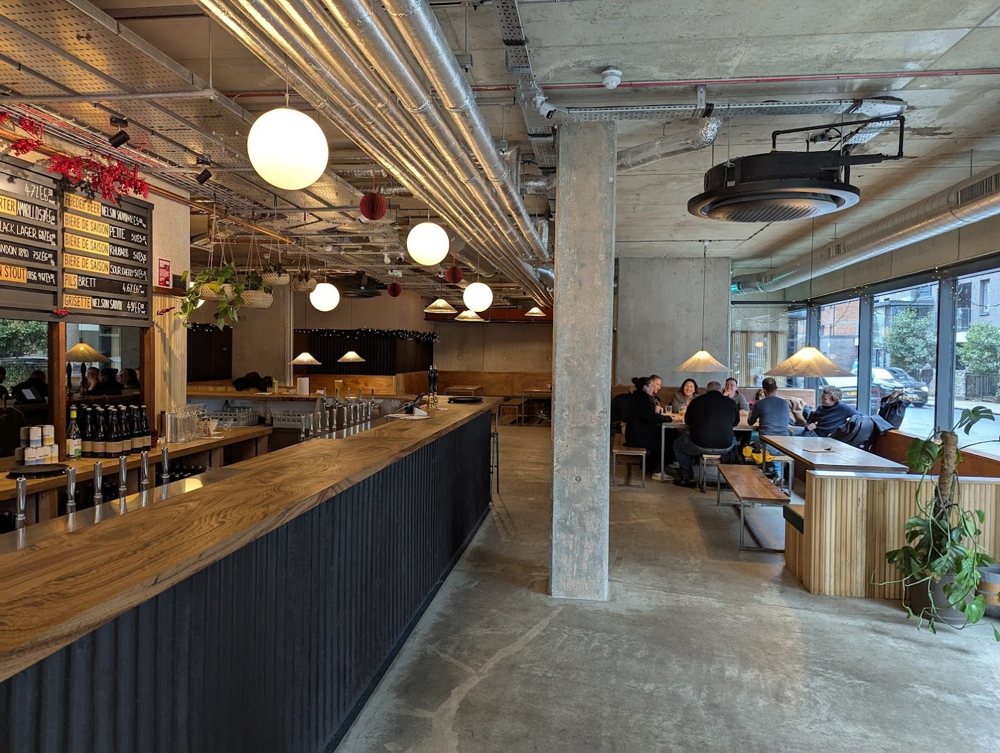

*The Kernel's taproom bar.*

### The Southampton Arms, Gospel Oak — "Ales, Cider, Meat," and nothing else claimed

*£ · Gospel Oak · Cited by 3 sources*

The sign outside says **"Ales, Cider, Meat"**: small-batch beers and ciders from UK independent breweries, a short menu built around meat rolls, and no wine list or cocktail menu. Time Out notes the old piano by the way out to the beer garden and the crackly vinyl on the stereo.

It **takes card as well as cash**, though it was cash-only for years.

**Open until midnight.** 139 Highgate Road, London NW5 1LE.

**Site:** [thesouthamptonarms.co.uk](http://www.thesouthamptonarms.co.uk)

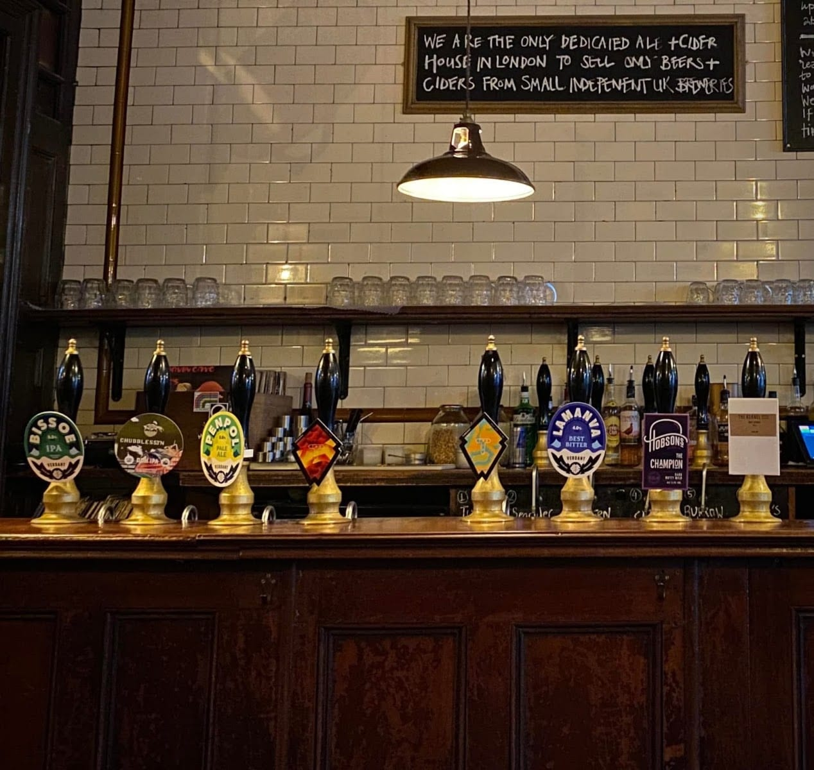

*The bar at the Southampton Arms.*

### Euston Tap, Euston — a pub in a train station's gatehouse

*££ · Euston Road · Cited by 3 sources*

This is the west one of two matching Grade II-listed lodges that once marked the entrance to the old Euston station. It describes itself as **"London's original cask ale, real cider and craft beer tavern,"** and runs **forty-seven draught lines** with no brewery tie. One visitor singled out **London Black**, Anspach & Hobday's porter, as the best stout they'd had in the country.

It's small: one ground-floor room, a smaller room upstairs and heated outside seating, five minutes' walk from the Euston platforms.

**Open to 11pm Monday to Saturday and 10pm Sunday.** West Lodge, 190 Euston Road, London NW1 2EF.

**Site:** [eustontap.com](https://eustontap.com)

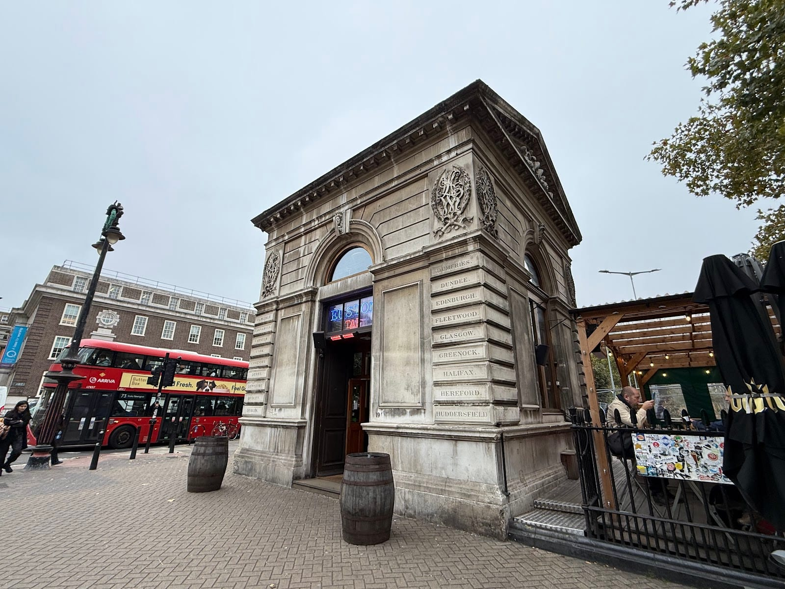

### The Rake, Borough Market — four handpumps, eighteen taps, one tiny room

*££ · Borough Market · Cited by 3 sources*

Run by Richard Dinwoodie and Mike Hill, the founders of the online retailer Utobeer, and billed as **"London's original beer bar"**. CAMRA's listing counts **four handpumps and eighteen keg taps** in a tiny space. The selection leans to changing, off-the-beaten-track brews.

Mostly standing room, and it fills when Borough Market does; go early or late.

**Closes at 10pm.** 14A Winchester Walk, London SE1 9AG.

**Site:** [utobeer.co.uk/the-rake](https://www.utobeer.co.uk/the-rake)

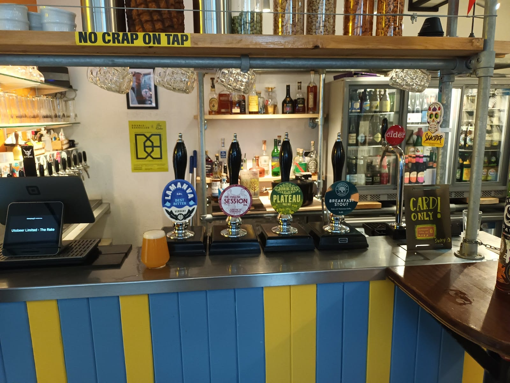

*The bar at The Rake.*

---

Powered by <a target="_blank" rel="sponsored" href="https://www.getyourguide.com/london-l57/">GetYourGuide</a>

## By style: cask, keg or taproom

**Cask, or "real ale"** finishes conditioning in the cask itself and is pulled by handpump, or in a few pubs here, straight off the cask by gravity with no pump at all. Most of the winners above pour it, and The Cockpit and The Dodo Micropub both serve by gravity rather than handpump. **The Market Porter** at Borough Market runs twelve handpumps and opens 6am to 9am on weekdays under an old market trading licence, one of only two pubs in the city with that right; its other hours run to 10.30pm.

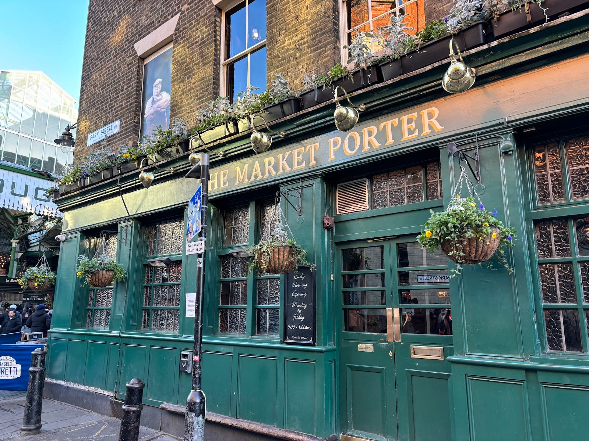

**The Sutton Arms** in Clerkenwell is a small, traditional freehouse with an upstairs dining room, though it closes early, around 7pm most nights.

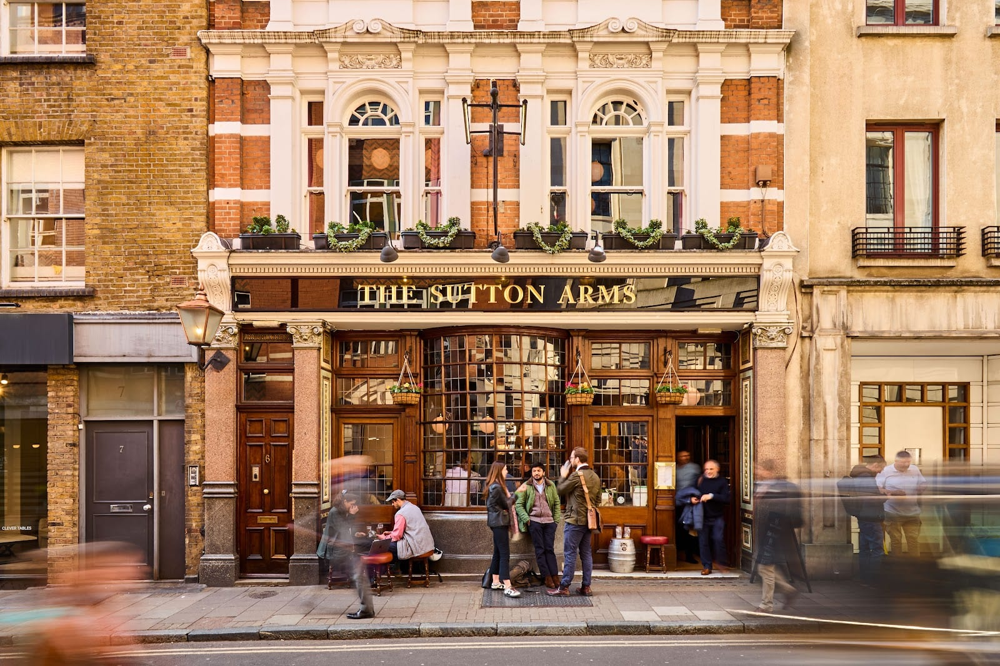

Holborn's **Ye Olde Mitre** — a completely different pub from the Barnet CAMRA winner above despite the near-identical name — is covered in full in [London's historic pubs](/articles/historic-pubs-dining-rooms-london/); the short version for beer purposes is bar snacks only, closed Sundays, and a hidden entrance up an alley off Ely Place.

**Modern craft, or keg**, is chilled and carbonated before it reaches the pub — the sours, pastry stouts and hazy IPAs that don't exist in cask form. Cask Pub & Kitchen, Euston Tap, The Bear and Beer Merchants Tap above are all built around big keg lists rather than a handpump row.

**Brewery taprooms** mean drinking where the beer is made, and London has two beer miles for it.

**Bermondsey**, the run of railway arches south of Tower Bridge, has The Kernel and Anspach & Hobday above as its anchors, and two independent video crawls both stopped at **Cloudwater** and **The Barrel Project**. **Southwark Brewing Co**, **Bianca Road Brewery**, **Mash Paddle Brewery** and the **Dutch Taproom** (also chapter-listed as Craft Beer Junction) fill out the rest of the mile. Maltby Street Market sits in the middle of it and gets difficult to move through during Saturday market hours.

**Blackhorse Lane** in Walthamstow is the newer beer mile. Exale above is the anchor; **Signature Brew's Blackhorse Road taproom**, **Pretty Decent's Blackhorse Road brewery and taproom**, and **Forest Road Taproom** are the other stops the sources name repeatedly.

---

## New openings

**The Black Eel, Dalston** opened in October 2025 inside the former F Cooke pie-and-mash shop, run by the same team as Exale. The original tiled pie-and-mash fittings are still up.

**The Three Lords, City of London** — taken on by London Brewing Co in late 2025 and trading under the same roof, listed in some places as Ye Three Lords, now serving the brewery's own range.

---

Powered by <a target="_blank" rel="sponsored" href="https://www.getyourguide.com/london-l57/">GetYourGuide</a>

## What to know

**Most of this list is walk-in.** The CAMRA branch winners above are almost all one-room micropubs; turn up and find a seat if there is one.

**The exception is anywhere with a real kitchen.** Jolly Coopers in Epsom books online through Dojo; The Bear in Paddington and The Dark Horse in Croydon both run their own booking pages for food.

**Cash-only is rarer than its reputation.** The Southampton Arms took cash only for years and now takes card as well.

**Hours vary more than in a restaurant guide.** Anspach & Hobday's taproom closes around 7pm, The Kernel's between 8pm and 10pm and only Wednesday to Sunday, and The Southampton Arms runs to midnight. Check the hours before travelling out to a brewery taproom.

**"Real ale" and "craft beer" are not opposites here.** Most of the pubs above pour both, a handpump row and a keg wall side by side.

---

## Continue planning your London trip

- 🍻 **[London's Historic Pubs and Dining Rooms](/articles/historic-pubs-dining-rooms-london/)**
- 🍽️ **[The Best Gastropubs in London](/articles/best-gastropubs-london/)**
- 🏛️ **[The Most Beautiful Pubs in London](/articles/most-beautiful-pubs-london/)**
- 🍺 **[The Best Wetherspoons in London](/articles/best-wetherspoons-pubs-london/)**
- 🍷 **[The Best Wine Bars in London](/articles/best-wine-bars-london/)**
- 🍸 **[The Best Cocktail Bars in London](/articles/best-cocktail-bars-london/)**
- 🍕 **[The Best Pizza in London](/articles/best-pizza-london/)**
- 🍽️ **[Eat in London: Restaurants, Food Markets & Quick Food Hub](/articles/eat-in-london-guide/)**
