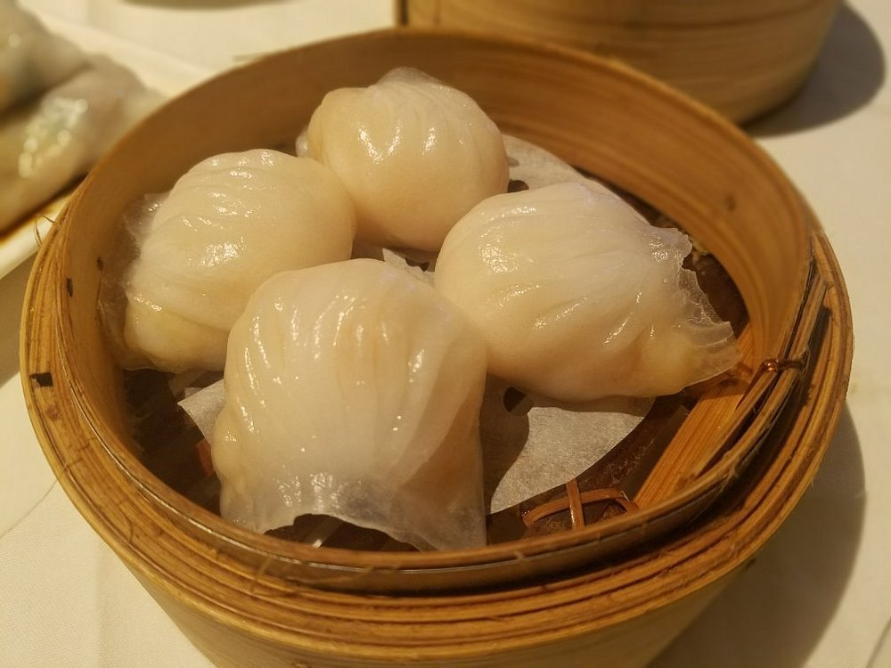
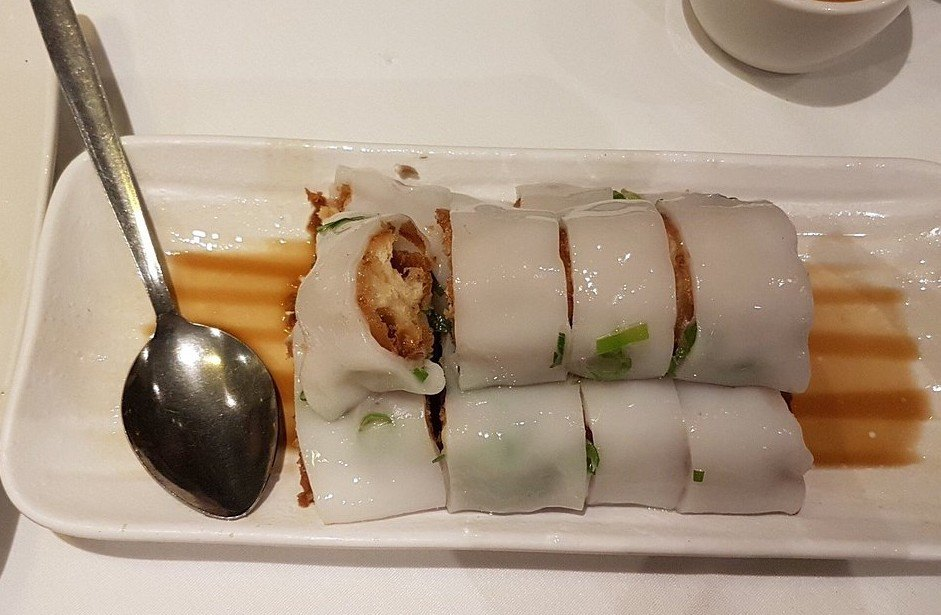
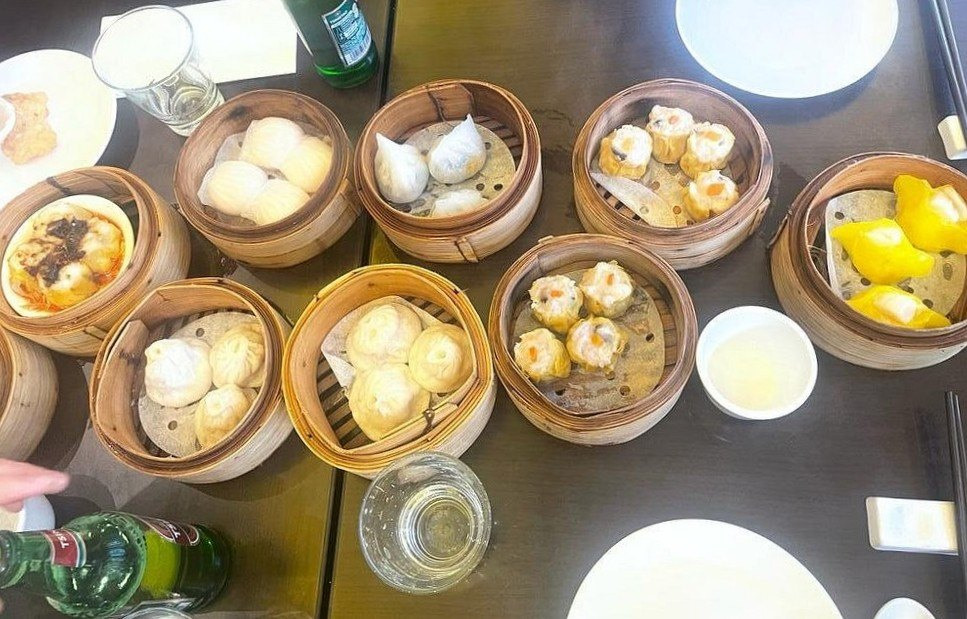
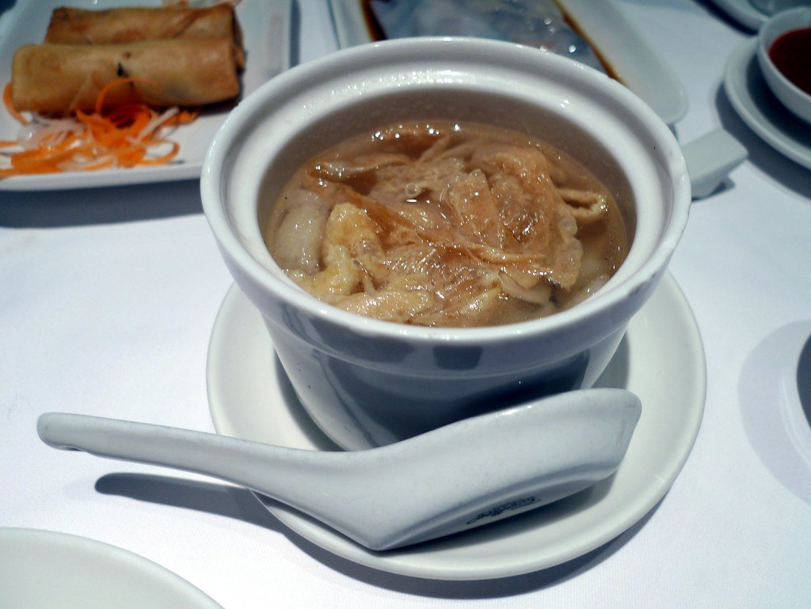
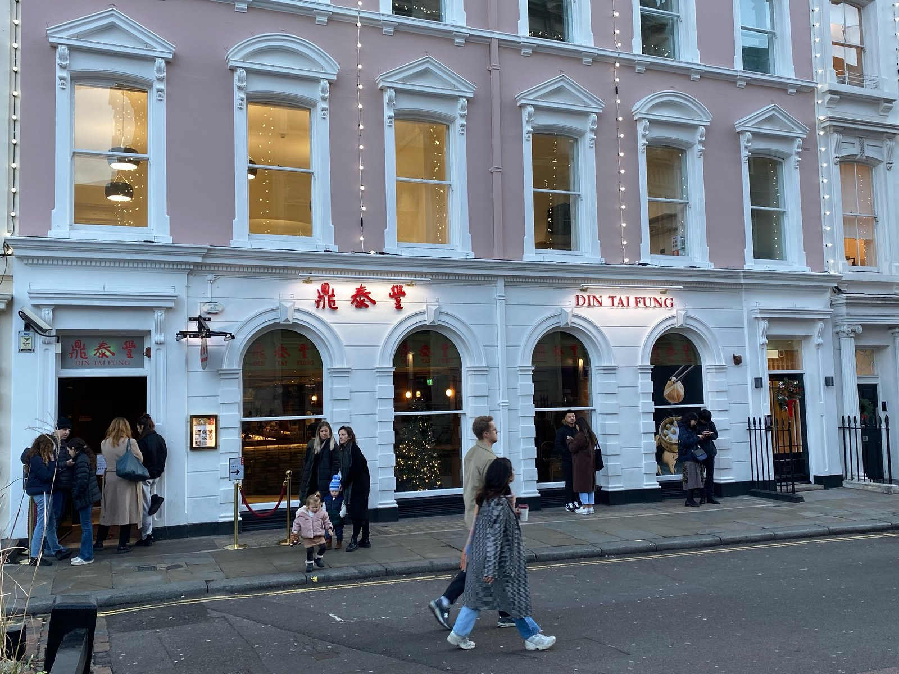
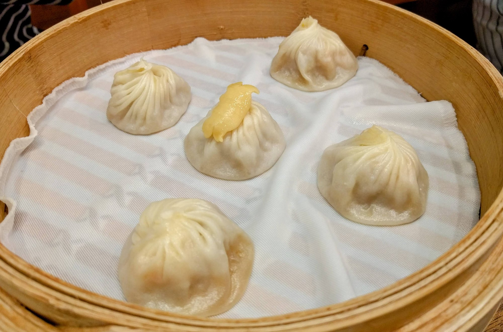

**The best dim sum in London is at Royal China on Baker Street, with A. Wong in Victoria for a two-Michelin-starred lunch. In Chinatown, Tao Tao Ju is the refined room and Joy King Lau the trolley-era one.**

**Most dim sum halls stop serving around 5pm.** It is a lunch, not a dinner.

> 💡 **The Short Version:** **Royal China** on Baker Street is the benchmark and takes no bookings at peak. **A. Wong** is the only two-starred Chinese kitchen in Europe and its lunch is the cheap way in. **Tao Tao Ju** is the refined end of Chinatown. **Dragon Castle** is half the price for the same thing. And **Yauatcha** serves all day.

> 📘 **No paid placements.** Service times change more than anything else here; confirm before travelling.

## Where they are

  

    Map of the best dim sum in London
  

  

    
Loading the interactive map…

  

  <noscript>
    
The interactive map requires JavaScript. Every entry below lists its area.

  </noscript>

| If you are near… | Where to eat |
| --- | --- |
| **Chinatown & Leicester Square** | Tao Tao Ju, Plum Valley, Joy King Lau, Dumplings' Legend, BaoziInn, Orient London |
| **Soho** | Yauatcha |
| **Marylebone** | Royal China |
| **Victoria** | A. Wong |
| **Covent Garden** | Dim Sum Library, Din Tai Fung |
| **Paddington** | Pearl Liang |
| **South London** | Dragon Castle |

**Price guide:** **££** £15–£30 · **£££** £35–£55 · **££££** £70+.

---

## The best

### Royal China, Marylebone

*£££ · 8 min from Bond Street · no bookings at peak*

A black-and-gold banquet hall on Baker Street where weekend dim sum runs at high volume.

**No bookings at weekend lunch**: expect a queue down Baker Street, though tables turn fast. Loud, built for groups and families.

*Har gau at Royal China.*

### A. Wong, Victoria

*££££ · 7 min from Victoria · two Michelin stars*

The only **two-Michelin-starred Chinese restaurant in Europe**. Andrew Wong cooks the regional cuisines of China. Dim sum is served at lunch only, Wednesday to Saturday, 12pm to 2.30pm, priced by the piece from £5, and it is cheaper than dinner.

**Closed Sunday and Monday**, and the evening service books months ahead.

### Tao Tao Ju, Chinatown

*£££ · 2 min from Leicester Square*

**Towering bamboo baskets** of steamed and grilled dim sum, made on site each day rather than bought in. The refined end of Chinatown. It takes groups, dates and families, and is **two minutes from Leicester Square**.

*Cheung fun at Tao Tao Ju.*

### Yauatcha, Soho

*£££ · 6 min from Piccadilly Circus · all day*

**All-day dim sum** with a patisserie counter downstairs, from the Hakkasan founder; it **held a Michelin star for fourteen years**. Running all day solves the problem of Chinatown kitchens that close at 4pm.

**Book weeks ahead.** Good for a date or a pre-theatre meal.

Powered by <a target="_blank" rel="sponsored" href="https://www.getyourguide.com/london-l57/">GetYourGuide</a>

## Chinatown

### Plum Valley

*£££ · Gerrard Street*

A **family-run Gerrard Street room** with tablecloths rather than laminate. Good for a date or a small group, and three minutes from Leicester Square.

### Joy King Lau

*££ · off Leicester Square*

Four floors off Leicester Square doing **trolley-era dim sum the old way**. **££ rather than £££**, and it takes families and groups. Three minutes from Leicester Square.

### Dumplings' Legend

*££ · Gerrard Street*

A glass-walled kitchen on Gerrard Street where the **xiao long bao are folded in front of the queue** : Shanghainese soup dumplings rather than Cantonese steamed baskets, and the main order.

**££ and quick**, so a sensible choice with children or before a show. Three minutes from Leicester Square.

### BaoziInn

*££ · 1 min from Leicester Square*

Northern Chinese street food in a room done out in **Communist-era poster kitsch**.

**Walk-in, ££, and one minute from Leicester Square.**

### Dim Sum & Duck, King's Cross

*££ · Cantonese · walk-in*

Handmade dumplings and roast meats hanging in the window, on King's Cross Road.

The name is the menu: dim sum, and Cantonese roast duck carved to order. Cheaper and less polished than Chinatown.

### Yauatcha City, Broadgate

*£££ · the City sibling*

The Broadgate branch of the Soho dim sum room, for when you are in the City; usually easier to book.

### Yi-Ban, Royal Docks

*££ · closed Thursdays · dim sum to 4.30pm only*

A Cantonese dining room over the Royal Albert Dock with **City Airport's runway through the window**.

**Dim sum is served until 4.30pm only, and it closes on Thursdays.** Book a few days ahead. It's six minutes from Royal Albert on the DLR.

## Best value

### Dragon Castle, Elephant and Castle

*££ · 114 Walworth Road*

A **full-size Cantonese banqueting room** at roughly half the central mark-up, serving dim sum through the day rather than only at lunch. Big enough to take a group without booking far ahead.

**££**, seven minutes from Elephant & Castle.

*A table at Dragon Castle.*

### Pearl Liang, Paddington

*£££ · 2 min from Paddington*

A large **basement dining room behind Paddington station**, with **five set menus** for a table that wants to share rather than order dish by dish. **Book a few days ahead.**

*Pearl Liang, Paddington. Photo: [Ewan-M](https://www.flickr.com/photos/55935853@N00/3676852528), [CC BY-SA 2.0](https://creativecommons.org/licenses/by-sa/2.0/).*

> **Two cheaper routes.** **Chinatown's supermarkets** — Loon Fung and See Woo — sell roast meats and some frozen dim sum over the counter at a fraction of restaurant prices. And **Bang Bang Oriental** in Colindale, an Asian food hall, has several dim sum counters where you can eat a few baskets for well under £15.

## For an evening

### Dim Sum Library, Covent Garden

*£££ · 3 min from Covent Garden*

Dim sum in a **bar-led room** rather than a banquet hall, open into the evening: cocktails first, dumplings after. £££, good for a date or pre-theatre.

### Din Tai Fung, Covent Garden

*£££ · Taiwanese*

**Xiao long bao folded to eighteen pleats** behind glass, at the Taiwanese chain Ken Hom put in the New York Times' top ten. Open into the evening.

**Walk-in queues are long at peak**, and the Centre Point site is the larger of the two with a bar lounge, so head there if the Covent Garden line looks hopeless. £££ and loud, book weeks ahead for a weekend, and five minutes from Covent Garden.

*Din Tai Fung, Covent Garden. Photo: [Heeheemalu](https://commons.wikimedia.org/w/index.php?curid=127443026), [CC BY-SA 4.0](https://creativecommons.org/licenses/by-sa/4.0/).*

*Xiao long bao at Din Tai Fung.*

Powered by <a target="_blank" rel="sponsored" href="https://www.getyourguide.com/london-l57/">GetYourGuide</a>

## What to know

* **Most halls stop around 5pm.** Yauatcha, Dragon Castle, Dim Sum Library and Din Tai Fung are the exceptions.
* **Order three to four plates per person** and add more as you go.
* **Har gau and siu mai** are the two every kitchen is judged on. Order both first.
* **Xiao long bao are Shanghainese**, not Cantonese — a different tradition on the same menus.
* **Royal China at weekends means queueing.** Go at opening or after 2pm.
* **A. Wong's lunch** is the cheaper way into a two-starred kitchen.

---

## Continue planning your London trip

- 🥟 **[Best Chinese and East Asian Restaurants](/articles/best-chinese-east-asian-restaurants-london/)**
- 💷 **[Cheap Eats in London](/articles/cheap-eats-london/)**
- 🍜 **[Soho Area Guide](/articles/soho-area-guide/)**
- 🍽️ **[Eat in London: Restaurants, Food Markets & Quick Food Hub](/articles/eat-in-london-guide/)**
- 🇯🇵 **[Best Japanese Restaurants in London](/articles/best-japanese-restaurants-london/)**
- 🎭 **[Covent Garden Area Guide](/articles/covent-garden-area-guide/)**
