**Chinatown is about six streets, and the food runs from a bakery bun to Peking duck.** The queue that went viral is for Noodle Inn's hand-pulled biang biang noodles, just over Charing Cross Road on Old Compton Street. Inside the gates, the old Cantonese rooms still hang roast meat in the window, and Kawan, Uncle Roger's Malaysian restaurant, opened on Macclesfield Street in 2026.

> 💡 **The Short Version:** **The viral noodles are at Noodle Inn**, 4–6 Old Compton Street: biang biang noodles, no bookings at that branch, and a queue before it opens at noon. **Kung Fu Noodle** on Shaftesbury Avenue is its sister and easier to get into. **Roast duck: Four Seasons** on Gerrard Street. **Dim sum: Tao Tao Ju** on Lisle Street, **Plum Valley** on Gerrard Street, or **Dumplings' Legend** for xiao long bao. **Uncle Roger's Kawan** on Macclesfield Street is walk-in only. **Laksa: C&R Café** in Rupert Court, closed Mondays. **Snacks:** buns at **Bun House**, egg tarts at **Chinatown Bakery**, popcorn chicken at **Good Friend**, ube ice cream at **Mamasons**. **Wong Kei is cash only.**

*Prices, menus and opening times are each venue's own, as at 19 November 2026.*

## What to order where

| If you want… | Go to | The order |
| --- | --- | --- |
| **The viral queue** | Noodle Inn | Biang biang noodles in chilli oil |
| **Roast duck** | Four Seasons, Gold Mine | Half a roast duck |
| **Dim sum** | Tao Tao Ju, Plum Valley, Joy King Lau | Har gau and siu mai |
| **Soup dumplings** | Dumplings' Legend, Leong's Legend | Xiao long bao |
| **Hand-pulled noodles** | Kung Fu Noodle, Lanzhou Lamian | Beef noodle soup |
| **Malaysian** | C&R Café, Rasa Sayang, Kawan | Laksa, nasi lemak, fried rice |
| **Hot pot** | Shu Xiang Ge, Real Beijing, Leong's Legend | A nine-grid or copper pot |
| **Under £10** | Chinese Tapas House, Good Friend, Bun House, Chinatown Bakery | Jianbing, popcorn chicken, a custard bun |
| **After 11pm** | Noodle & Beer, Dumplings' Legend, Lanzhou Lamian | Noodles, dumplings |

**Price guide:** **£** under £15 a head · **££** £15–£30 · **£££** £35–£55.

**Getting there:** Leicester Square (Northern, Piccadilly) is two minutes from Lisle Street. Piccadilly Circus (Bakerloo, Piccadilly) is five minutes from Gerrard Street.

---

## The viral noodles and the noodle bars

### Noodle Inn

*£ · 4–6 Old Compton Street · no bookings at this branch · [the venue's site](https://noodleinn.com/locations/)*

**The hand-pulled noodle shop that went viral**, on the corner of Old Compton Street and Charing Cross Road, two minutes from Gerrard Street. Chefs stretch the dough in an open kitchen, and the noodles are made from flour, water and salt.

Order the **biang biang noodles**: belt-wide ribbons dressed in chilli oil, garlic, cumin and Sichuan pepper. Grace Dent's review in the *Guardian* (November 2024) found the queue forming at 11.25am for a noon opening, and put the bill at about £20 a head before drinks. It is a canteen: order, eat, leave.

**The Soho branch takes no reservations and opens noon to 10pm daily.** For a booked table, Noodle Inn's Covent Garden branch at 13–14 Maiden Lane takes reservations by phone.

### Kung Fu Noodle

*£ · 64 Shaftesbury Avenue · walk-in*

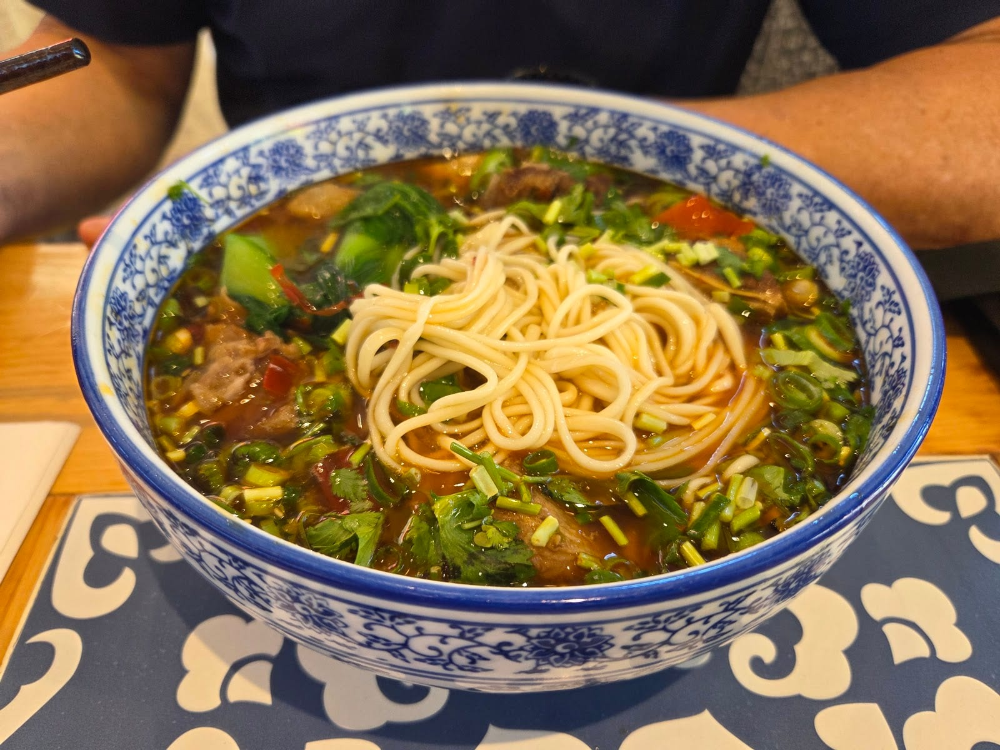

*Noodle soup at Kung Fu Noodle.*

**Noodle Inn's older sister**, on the corner where Shaftesbury Avenue meets Chinatown. It cooks the food of **Gansu province** in north-west China, and you choose **hand-pulled or knife-cut** noodles for each bowl.

Order the **Lanzhou beef noodle soup**, noodles in a clear beef broth. The cold-skin noodles are the other order.

**Walk-in.**

### Lanzhou Lamian Noodle Bar

*£ · 33 Cranbourn Street · open until 2am Monday to Thursday*

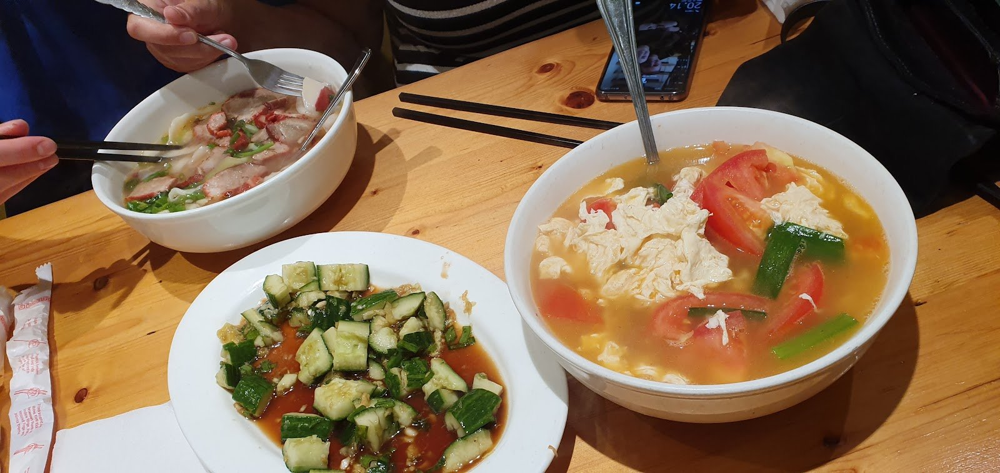

*Tomato and egg soup and smashed cucumber at Lanzhou Lamian.*

A cramped noodle bar on the Leicester Square side of Chinatown where the noodles are **pulled to order** in view of the tables. You may share a table, and service is fast.

Order **beef brisket noodle soup**, or noodles with **crispy pork belly**. The menu goes well beyond noodles, but the noodles are why the queue forms.

**Open until 2am Monday to Thursday** and 11pm on Sundays, which makes it the late-night noodle stop on the west side of Chinatown.

### Noodle & Beer

*££ · 27 Wardour Street · open until 4am Thursday to Saturday · [book a table](https://www.noodleandbeer.com/reservations)*

**Chongqing-style noodles over two floors on Wardour Street**, from the team behind the Spitalfields original. The menu is halal.

Order the **Chongqing xiao mian** (£16), wheat noodles in chilli oil and Sichuan pepper, or the **beef soup noodles** (£17.80). Every guest orders at least one main.

**Open until 4am Thursday to Saturday and 11pm the rest of the week.** Online booking is for one or two people; larger groups walk in.

---

## Roast meat and the old Cantonese rooms

### Four Seasons

*££ · 12 Gerrard Street · books by phone · [the venue's site](https://www.fs-restaurants.co.uk/chinatown-gerrard-street)*

**The roast duck hanging in the window is the order.** Four Seasons opened on Queensway in 1990 and has three Chinatown addresses: 12 Gerrard Street, a branch at **23 Wardour Street** with a more Sichuan menu, and **Little Four Seasons** at 11 Gerrard Street, which does hot pot.

A half **roast duck** is £23.50 and roast pork belly £16.80. The first plate of chilli oil is free.

**Gerrard Street takes bookings by phone on 020 7494 0870**; it closes at 10pm on Sundays.

### Gold Mine

*££ · 45 Wardour Street · dim sum all day · [book a table](https://www.goldminerestaurant.com/reservations)*

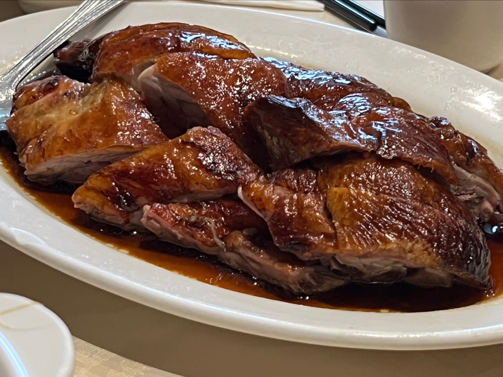

*Roast duck at Gold Mine.*

The Chinatown branch of the Queensway roast-meat house our [Chinese restaurants guide](/articles/best-chinese-east-asian-restaurants-london/) covers. It serves **dim sum all day** alongside the roasts.

Order **roast duck**, or **Peking duck** with pancakes at £32 for a half.

**Books online**, and open until 10.30pm, 11pm on Fridays and Saturdays.

### Wong Kei

*£ · 41–43 Wardour Street · cash only · walk-in*

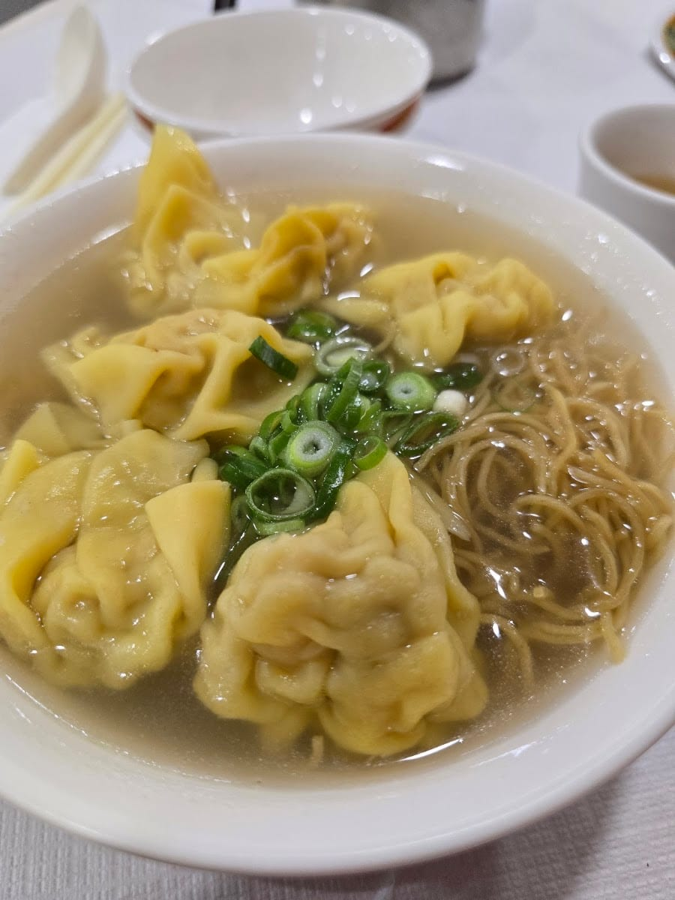

*Wonton noodle soup at Wong Kei.*

**Several floors of Hong Kong diner** behind an Edwardian doorway on Wardour Street, known for decades for its brusque service and roast meats over rice.

Order **roast pork belly (siu yok) or roast duck over rice**, or **beef ho fun**, wide rice noodles stir-fried with beef and beansprouts. Noodle and rice plates are around £10.

**Cash only, and walk-in.**

---

## Dim sum and dumplings

Our [dim sum guide](/articles/best-dim-sum-london/) compares these with the rest of London, from Royal China to A. Wong.

### Tao Tao Ju

*££ · 15 Lisle Street · £15 minimum spend · [book a table](https://web.dojo.app/create_booking/vendor/zVkxS5iHOE0AEx5AITZIlNNd3NEbhcfG4qNmfRPt4Gg_restaurant)*

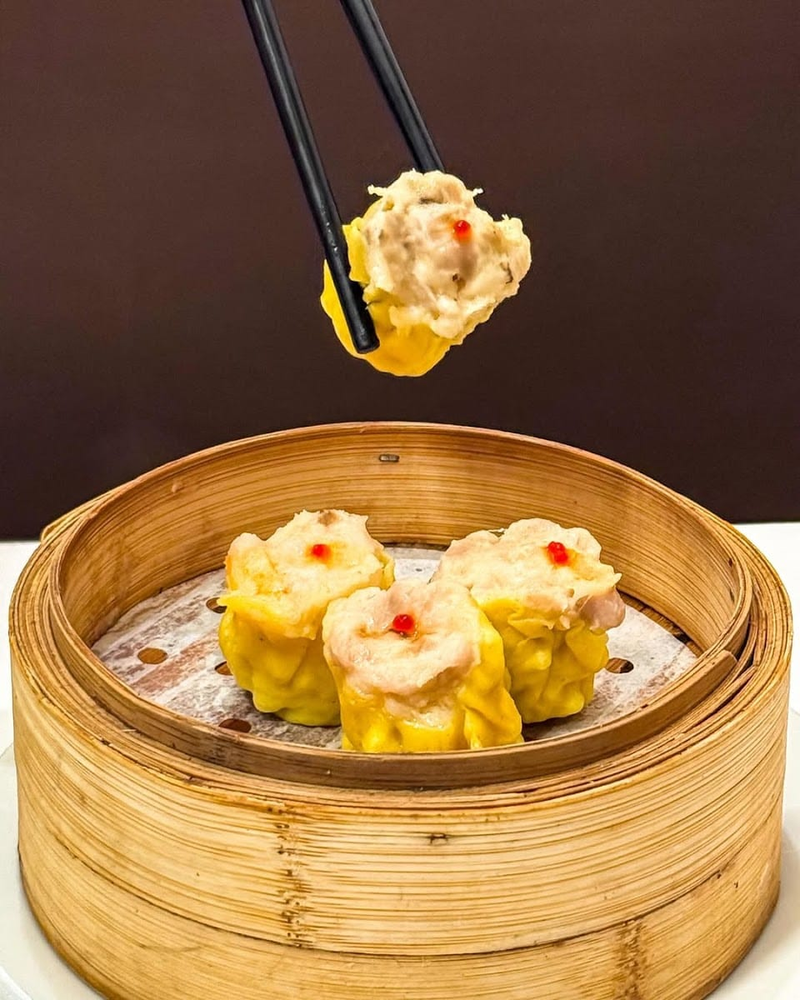

*Siu mai at Tao Tao Ju.*

**Dim sum made on site each day**, in a dining room that is quieter and smarter than Lisle Street outside.

**Har gau, siu mai and xiao long bao** are £7.90 a basket. The crispy aromatic duck starts at £20.80 for a quarter. There is a private karaoke room for up to 20.

**£15 minimum spend per person.** It takes bookings for up to ten and walk-ins.

### Plum Valley

*££ · 20 Gerrard Street · dim sum all day · [book a table](https://plumvalley.co.uk/reservations/)*

A **family-run Gerrard Street room** with dark wood, low lighting and tablecloths, serving **dim sum all day**, until an hour before closing.

**Har gau and siu mai** are £6.10. On weekdays from noon to 3pm, the **lunch combo** of dim sum with rice or noodles is £15.80 a head.

**Open until midnight on Fridays and Saturdays.** It keeps a few tables for walk-ins each evening.

### Joy King Lau

*££ · 3 Leicester Street · [book a table](https://joykinglau.co.uk/reservation/)*

**Cantonese since 1977**, just off Leicester Square, with a long dim sum list at around **£6 a basket**.

**King prawn dumplings** are £6 and roast pork cheung fun £6.80.

**Books online**, and open until 10.30pm Monday to Saturday.

### Dumplings' Legend

*££ · 15–16 Gerrard Street · open until 2am Thursday to Saturday · walk-in*

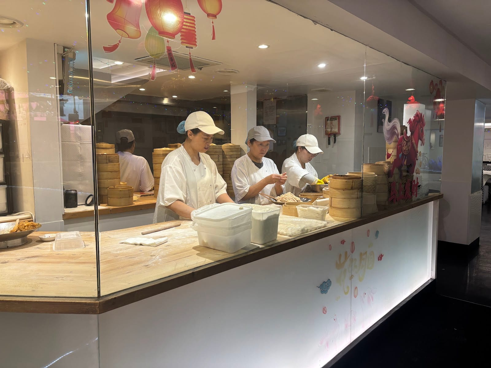

*The dumpling kitchen at Dumplings' Legend.*

A **glass-walled kitchen on Gerrard Street** where the xiao long bao are folded in front of the queue. Opium, a cocktail bar that also serves dim sum, is upstairs.

Order the **xiao long bao**, Shanghainese soup dumplings, including a spicy pork version. The menu is long, and the sharing dishes go well beyond dumplings.

**Walk-in, and open until 2am Thursday to Saturday**, 9pm on Sundays.

---

## Malaysian and Singaporean

### Kawan

*££ · 12 Macclesfield Street · walk-in only · [the venue's site](https://www.kawanlondon.co.uk/)*

**Uncle Roger's restaurant.** Nigel Ng, the comedian whose Uncle Roger character went viral reviewing other people's fried rice, opened Kawan in Chinatown in 2026. It is a bright two-floor room, with plates printed "leftovers still better than your cooking".

**Fried rice** is the centre of the menu: the **Chinatown fried rice** (£15.90) has Chinese sausage and wind-dried pork belly. Beyond it there is **nasi lemak** from £15.90 and a **Chinese Wellington** (£28.90), a nod to Gordon Ramsay's beef Wellington. The chicken, beef and seafood come from halal-certified suppliers.

**No bookings; open noon to 10.30pm daily.**

### C&R Café

*££ · 4 Rupert Court · closed Mondays · walk-in only · [the venue's site](https://www.cnrcaferestaurant.com/)*

**Chinatown's first independent Malaysian restaurant**, in an alley between Wardour Street and Rupert Street, run by the same family since 1998.

Order the **Singapore laksa** or **Penang assam laksa** (£14.50 each). **Bak kut teh**, pork rib soup with rice, is £16.50.

**Closed on Mondays and walk-in only**: the whole party must be there to be seated. Cards are taken for bills of £10 or more.

### Rasa Sayang

*££ · 5 Macclesfield Street · [book a table](https://www.rasasayangfood.com/booking/)*

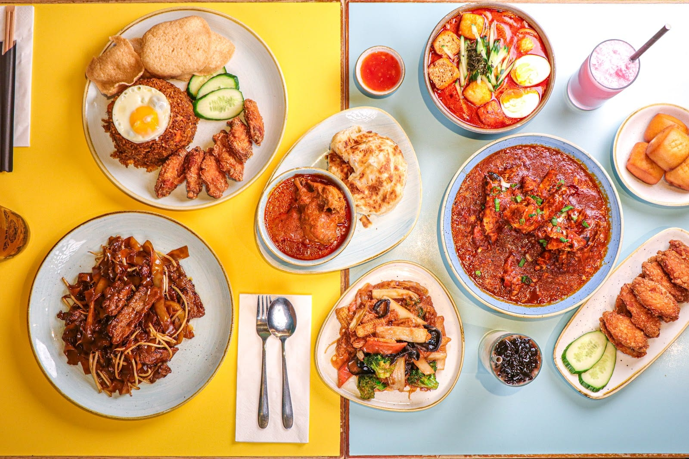

*Nasi lemak and other Malaysian dishes at Rasa Sayang.*

**Malaysian and Singaporean cooking** in a glass-fronted room on Macclesfield Street. The menu is halal.

**Nasi lemak**, **Hainanese chicken rice** and **Singapore laksa** are £15.95 each. **Singapore chilli crab** is £33.95.

**Booking is by request**; if you miss your slot, walk in. Open until 10pm, 9pm on Sundays.

### YiQi

*££ · 14 Lisle Street · books by phone · [the venue's site](https://www.yiqipanasia.co.uk/)*

Malaysian, Singaporean and Thai cooking in a modern room on Lisle Street.

Order the **charcoal chicken wings** (£14.80) or the **Volcano Thai pork spare ribs** (£22.80).

**Book by phone on 020 7287 2751.** Open until 11pm, 10.30pm on Sundays.

---

## Hot pot, Sichuan and Taiwanese

Our [hot pot guide](/articles/best-hot-pot-london/) explains how ordering works and covers the rest of London.

### Shu Xiang Ge

*£££ · 10 Gerrard Street · book a few days ahead*

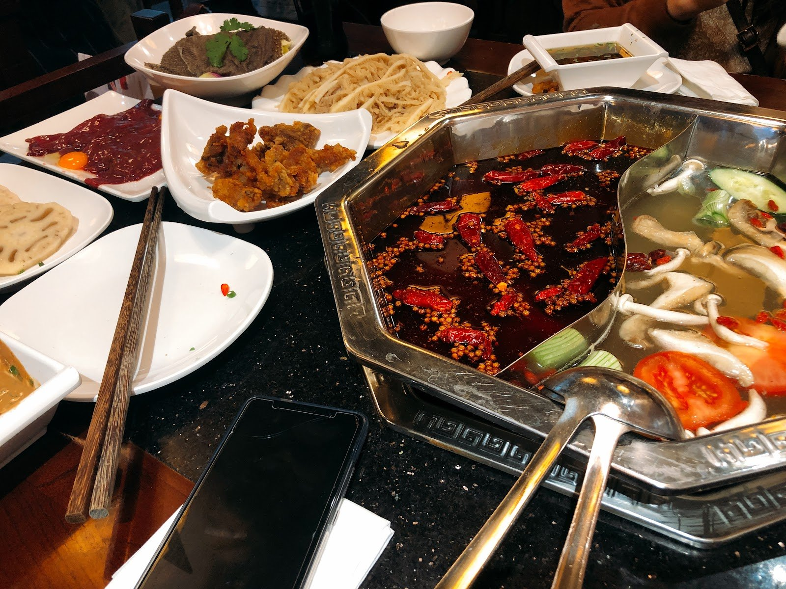

*Split Sichuan hot pot at Shu Xiang Ge.*

**Sichuan hot pot in a nine-grid pot**: one broth split into nine compartments, so each ingredient cooks in the grid that suits it. A split pot is there for anyone who cannot take the heat.

**Book a few days ahead**, especially at weekends.

### Real Beijing Food House

*££ · 46 Gerrard Street · books by phone · [the venue's site](https://realbeijngfoodhouse.com/)*

**Two restaurants in one building.** Downstairs is a northern Chinese menu for sharing. Upstairs is **all-you-can-eat hot pot**, including the Beijing **charcoal copper pot** with thinly sliced lamb, dipped in sesame sauce rather than chilli oil.

**Book by phone on 020 7287 2818**, and say which floor you want. It has halal options.

### Leong's Legend

*££ · 39 Gerrard Street · [the venue's site](https://chinatown.co.uk/en/brands/leong-s-legend/)*

**Taiwanese cooking** in a lantern-lit room. The basement is where Ronnie Scott's jazz club opened in 1959.

Order **xiao long bao**, **oyster omelette**, **beef noodle soup** or **gua bao**, the braised pork bun. The all-you-can-eat **hot pot** is around £25 a head.

**Open until 11pm, 10pm on Sundays.**

---

## Buns, bakeries and street snacks

### Bun House

*£ · 26–27 Lisle Street · walk-in only · [the venue's site](https://bun.house/pages/bun-house-chinatown)*

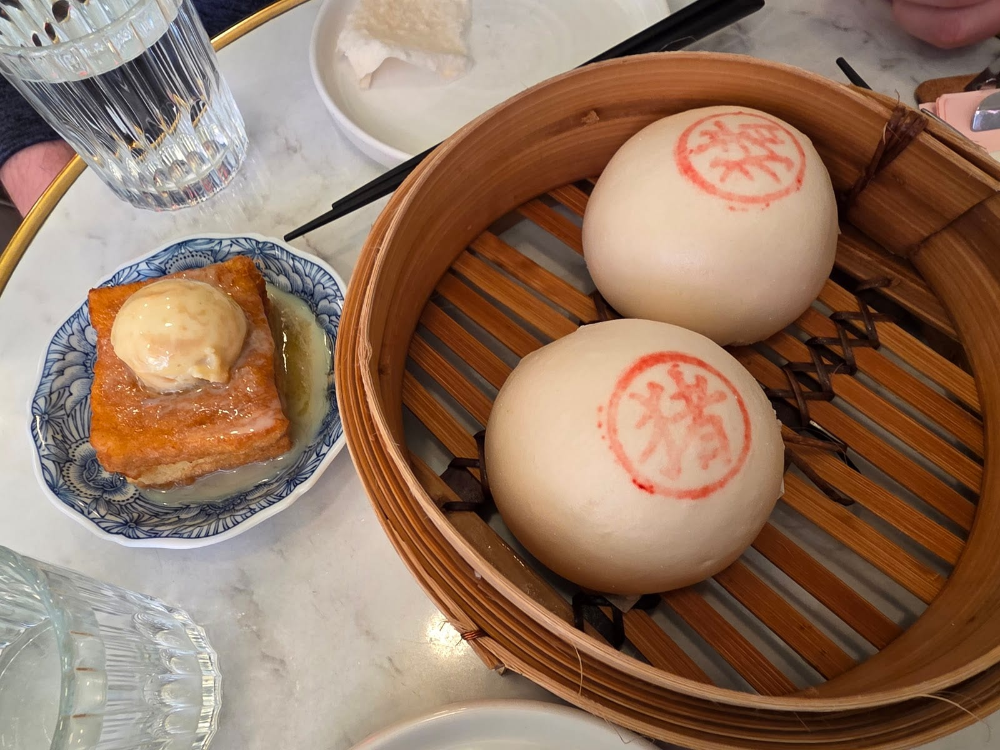

*Steamed buns at Bun House.*

**Steamed buns from the counter**, with a café behind for Cantonese small plates.

The **custard bun** with salted egg yolk is the one to start with. Then the **lamb**, with cumin and chilli, or the **pig**, BBQ pork belly with lardo. Siu mai, wontons and fried rice fill out a meal.

**Walk-in only**, open from noon, until 10.30pm on Fridays and Saturdays.

### Chinatown Bakery

*£ · Newport Place · 10.30am to 9pm daily*

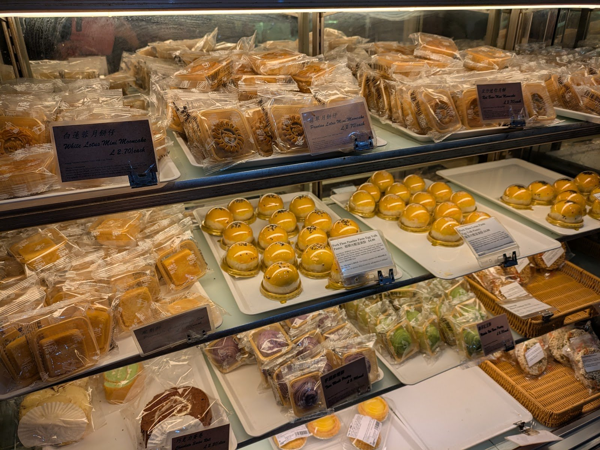

*Pastries and mooncakes at Chinatown Bakery.*

**Egg tarts, bolo bao and taiyaki** from the window on Newport Place, at bakery prices. There is usually a queue.

Order an **egg tart** warm from the tray and a **bolo bao**, the sugar-crusted "pineapple bun" with no pineapple in it. The **taiyaki**, fish-shaped cakes, are cooked in the front window. Savoury buns include BBQ pork and spring onion with pork floss.

**Open 10.30am to 9pm daily.** A second branch on Wardour Street is open until 10.30pm.

### Good Friend

*£ · 14 Little Newport Street · queue, takeaway*

**Taiwanese fried chicken from a yellow shopfront** a minute from Leicester Square.

**Popcorn chicken** is the order, shaken with one of eleven seasonings; plum and chilli is the popular one. The menu also has a flattened whole crispy chicken breast.

**There is nearly always a queue, and it moves fast.** Order, take a ticket and wait for your number. Our [fried chicken guide](/articles/best-fried-chicken-london/) has it with the rest of London.

### Chinese Tapas House

*£ · 15 Little Newport Street · 11.30am to 9pm daily*

A counter next door to Good Friend making **jianbing**: a crêpe cooked on a hot plate with egg, coriander, chilli sauce and a crisp cracker folded inside. It also serves malatang and bubble waffles.

Ask for less chilli if you don't want the full heat.

**Takeaway, open 11.30am to 9pm daily.**

---

## Desserts and bubble tea

Newport Court has four bubble tea shops within a few doors of each other; our [bubble tea guide](/articles/best-bubble-tea-london/) says which to pick.

### Mamasons Dirty Ice Cream

*£ · 32 Newport Court · walk-in · noon to 10pm*

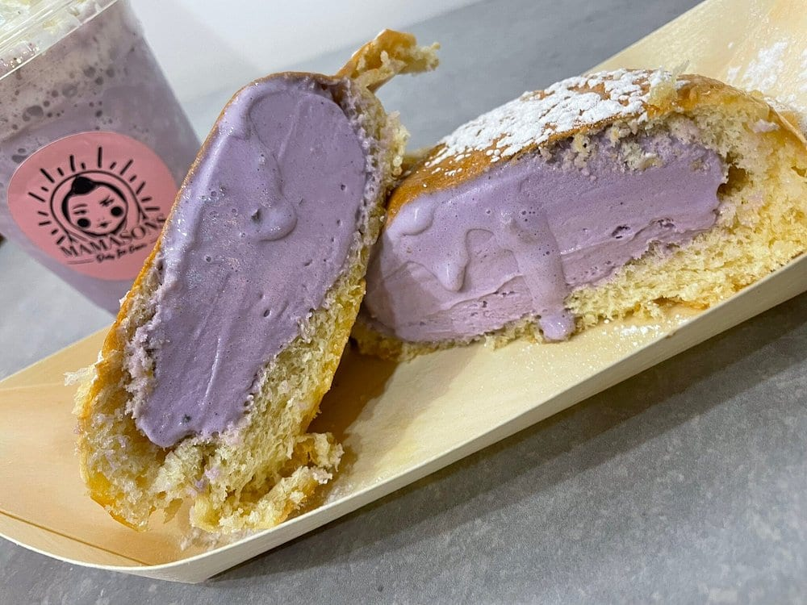

*The ube bilog at Mamasons.*

**Filipino ice cream** on Newport Court. The flavours lead with **ube**, the purple yam, alongside Milo and queso.

Order a **bilog**: a toasted milk bun stuffed with ice cream. **Ube runs out**, regularly and early.

**Walk-in, open noon to 10pm.**

### Candy Café

*£ · first floor, 3 Macclesfield Street*

A long-standing family dessert café **up a flight of stairs** on Macclesfield Street, easy to walk past.

Order a **mango dessert** or **tang yuan**, sticky rice balls in hot ginger soup. Brick toast, waffles, bubble tea and noodle bowls are on the menu too, and there is a private karaoke room for up to seven.

**Open from noon**, and later than most of Chinatown's dessert shops at weekends.

### Tsujiri

*£ · 33 Newport Court · walk-in*

A **Japanese matcha parlour**: soft serve, sundaes and matcha drinks.

Order the **matcha soft serve**.

**Open from 11am.**

### Kova

*£ · 20A Newport Court · walk-in*

**Japanese and French patisserie** with bubble tea, a few doors from Tsujiri.

Order a **cake** with a milk tea.

**Open from 11am.**

---

## Late night: Thai on Rupert Street

### Speedboat Bar

*££ · 30 Rupert Street · until 1am Friday and Saturday · [book a table](https://www.sevenrooms.com/explore/speedboat/reservations/create/search?venues=speedboat%2Cplaza)*

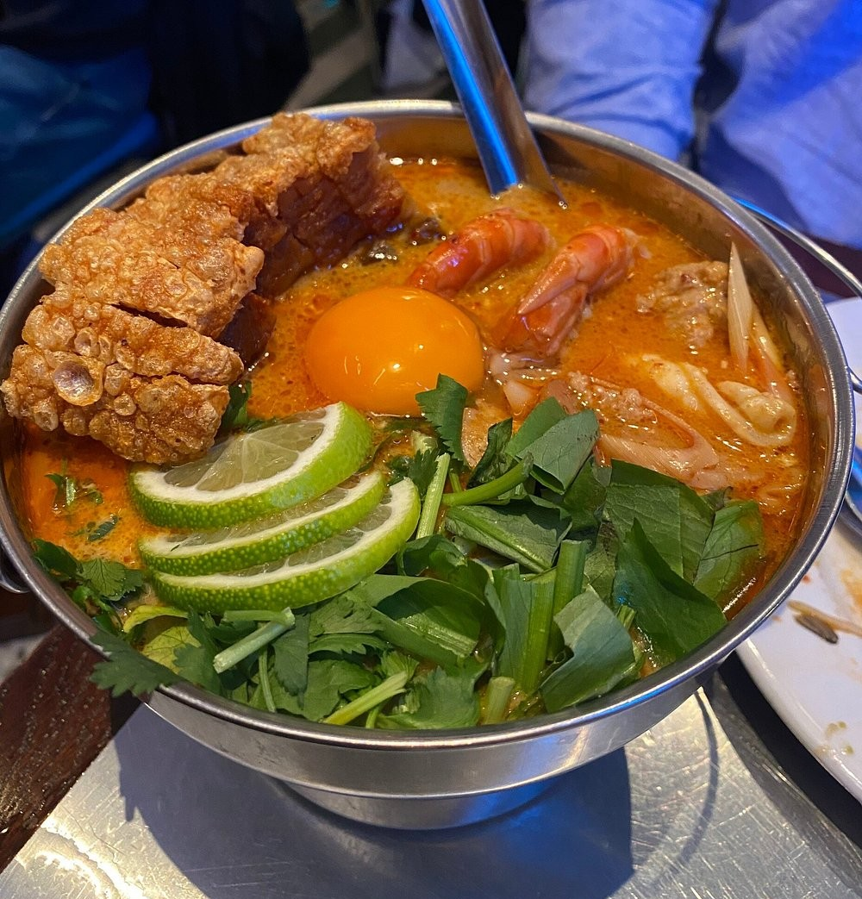

*Speedboat Bar on Rupert Street.*

**Canteen food from Bangkok's Chinatown**, on the street that runs along Chinatown's western edge. Loud, bright and boozy, with a pool table upstairs.

Order the **tom yam mama noodles** with squid, pork and prawns, and **chicken skins with zaep seasoning**. The food is hot.

**Open until 1am on Fridays and Saturdays**, last food orders 12.15am.

Powered by <a target="_blank" rel="sponsored" href="https://www.getyourguide.com/london-l57/">GetYourGuide</a>

---

## Shopping

### Loon Fung

*£ · 42–44 Gerrard Street · 10am to 9pm daily · [the venue's site](https://www.loonfung.co.uk/new-stores)*

**The big Chinese supermarket on Gerrard Street**: noodles, sauces, frozen dumplings and dim sum, snacks and teas to take home.

**Open 10am to 9pm daily.**

---

## Tips for eating in Chinatown

- **Lunch is the cheap meal.** Plum Valley's weekday dim sum combo, noon to 3pm, is £15.80.
- **Queues move.** Noodle Inn, Good Friend and Bun House are run for speed: order, eat, leave.
- **Book only where it helps.** Shu Xiang Ge, Real Beijing's hot pot floor and Tao Tao Ju at weekends. Noodle Inn's Soho branch, Kawan, C&R and Bun House take no bookings.
- **Carry some cash for Wong Kei.**
- **Lunar New Year fills Chinatown.** For parade day, see our [Chinese New Year guide](/articles/chinese-new-year-london/).

## Continue planning your London trip

- 🥟 **[The Best Dim Sum in London](/articles/best-dim-sum-london/)**: Royal China, A. Wong and the Chinatown rooms compared
- 🥢 **[The Best Chinese and East Asian Restaurants in London](/articles/best-chinese-east-asian-restaurants-london/)**: Sichuan, Xi'an and Cantonese across the city
- 🍲 **[The Best Hot Pot in London](/articles/best-hot-pot-london/)**: nine-grid pots, copper pots and malatang
- 🧋 **[The Best Bubble Tea in London](/articles/best-bubble-tea-london/)**: the Newport Court shops and the rest
- 🍜 **[The Best Ramen in London](/articles/best-ramen-london/)**: the Japanese noodle bars a few streets away
- 🧧 **[Chinese New Year in London](/articles/chinese-new-year-london/)**: the parade route and where to eat that weekend
- 🚶 **[A Walk Through Soho and Chinatown](/articles/soho-chinatown-walk/)**: eleven stops ending on Gerrard Street
- 💷 **[Cheap Eats in London](/articles/cheap-eats-london/)**: good meals under £15 across the city
- 🌙 **[Late-Night Eating in London](/articles/late-night-eating-london/)**: where the kitchens stay open
- 🍴 **[London Food Tours](/articles/london-food-tours/)**: guided walks that include Chinatown
- 🏮 **[Soho Area Guide](/articles/soho-area-guide/)**: Chinatown in the context of the neighbourhood
- 🛏️ **[Where to Stay in Soho and the West End](/articles/where-to-stay-soho-west-end/)**: hotels a few minutes' walk away
- 🍽️ **[Where to Eat in London](/articles/eat-in-london-guide/)**: every food guide on the site
