French cooking in London runs from two three-star hotel dining rooms to a Farringdon pub upstairs doing bourgeois classics.

> 💡 **The Short Version:** **Alain Ducasse** and **Hélène Darroze** are two of London's six three-star kitchens. **Bouchon Racine** is the bistro revival, above a pub. **Otto's** presses duck at your table. **La Poule au Pot** serves coq au vin by candlelight. And **lunch is much cheaper everywhere**.

> 📊 **The evidence behind this guide.**
> **7 sources carrying 114 citations** across **72 named restaurants**. **19 restaurants are named by two or more independent sources; 27 carry a dated Good Food Guide listing.**
> **Built on:** the Good Food Guide; The Infatuation, Time Out, The Handbook and The Nudge.
> *Evidence rebuilt 30 August 2026 · [How we rank →](/how-we-rank/)*

## Where they are

| If you are near… | Where to eat |
| --- | --- |
| **Mayfair** | Alain Ducasse at The Dorchester, Hélène Darroze at The Connaught |
| **Belgravia** | La Poule au Pot, Brooklands |
| **Clerkenwell & Farringdon** | Bouchon Racine, Pique-Nique |
| **Holborn** | Otto's |
| **Covent Garden** | Clos Maggiore, Mon Plaisir, Maison François (St James's) |
| **Soho** | The French House, L'Escargot |
| **Fitzrovia** | 64 Goodge Street |
| **Borough & Bermondsey** | Camille, Casse-Croûte |
| **Spitalfields** | Galvin La Chapelle |
| **East London** | Planque (Haggerston) |
| **South & north** | Chez Bruce (Wandsworth), Les 2 Garçons (Crouch End) |

**Price guide:** **£££** £40–£70 · **££££** £90+ · tasting menus £150+.

---

## The three-star rooms

### Alain Ducasse at The Dorchester, Mayfair

*££££ · Park Lane · book months ahead*

**Classical French haute cuisine at three Michelin stars**, inside The Dorchester on Park Lane.

The cooking is classical: sauces reduced for hours, luxury produce, and a tasting menu that moves slowly. The **Table Lumière** is a private table for six ringed by a curtain of fibre optics.

**Closed Sunday and Monday. Ask about the Table Lumière specifically when booking; it is not offered by default.**

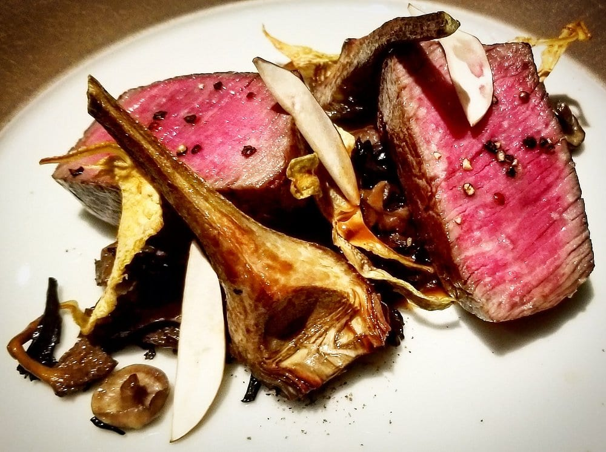

*A dish at Alain Ducasse at The Dorchester.*

### Hélène Darroze at The Connaught, Mayfair

*££££ · Carlos Place · book months ahead* · Cited by 1 source

**Three stars for cooking rooted in Darroze's native Landes**, in south-west France. The **third star came in 2021**.

Expect the produce of Gascony: **Landes duck, foie gras, Armagnac**, and vegetables from named growers, in a tasting sequence chosen from an ingredient list rather than a fixed menu.

**Closed Sunday and Monday.** It is inside The Connaught, so the room is the hotel's.

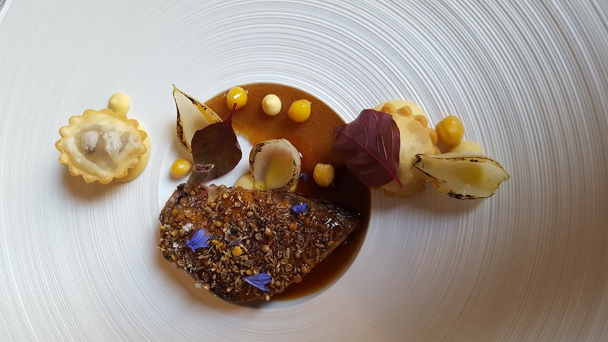

*A dish at Hélène Darroze.*

---

## The bistro revival

### Bouchon Racine, Clerkenwell

*££££ · 3 min from Farringdon · above a pub* · Cited by 3 sources

**Henry Harris cooking unapologetic French bourgeois food above a Farringdon pub**, **named the best restaurant in the UK at the 2026 National Restaurant Awards**.

The menu is the old repertoire: **snails, veal kidneys, duck confit, tarte tatin**.

**Closed Sunday and Monday**, and harder to book since the award.

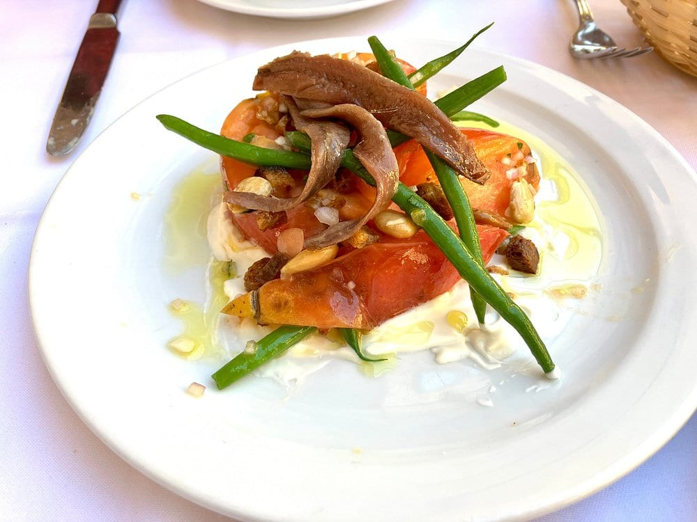

*A dish at Bouchon Racine.*

### La Poule au Pot, Belgravia

*££££ · 5 min from Sloane Square · since the 1960s* · Cited by 1 source

**Trading since the 1960s on coq au vin, beef bourguignon and candlelight.**

The menu is in French with no translation. **Coq au vin**, **bœuf bourguignon** and a whole roast chicken for two come to the table in the dish they were cooked in, among dried flowers and mismatched china.

Ask for a corner table; the room is dark.

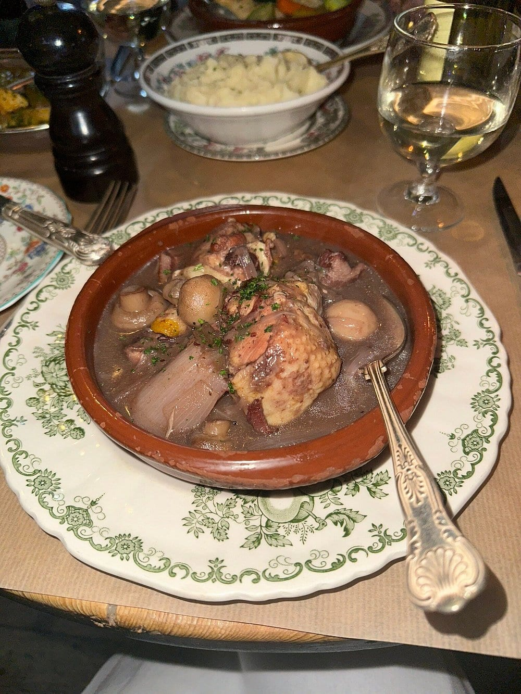

*Coq au vin at La Poule au Pot.*

---

Powered by <a target="_blank" rel="sponsored" href="https://www.getyourguide.com/london-l57/">GetYourGuide</a>

## Classical technique

### Otto's, Holborn

*££££ · 7 min from Chancery Lane · order in advance* · Cited by 4 sources

**Canard à la presse carved and pressed at the table**, a classical French service few London restaurants still perform.

The duck is roasted, carved, and the carcass crushed in a **silver duck press** to extract the juices for the sauce, all in front of you, over about forty minutes. It must be ordered **48 hours in advance**. Beyond it, lobster Thermidor and the rest of the old canon.

**Closed Sunday and Monday.** Order the duck when you book.

### Brooklands, Belgravia

*££££ · on the roof of the Peninsula*

**Claude Bosi cooking on the roof of the Peninsula**, in a room themed on British motor racing and aviation, looking over Hyde Park Corner — with a **Concorde model suspended through the dining room**.

Bosi holds two stars at Bibendum; the cooking here is French technique with British produce, in a tasting menu. The view is over Wellington Arch and the park.

**Closed Sunday and Monday.** Ask for a window table when booking.

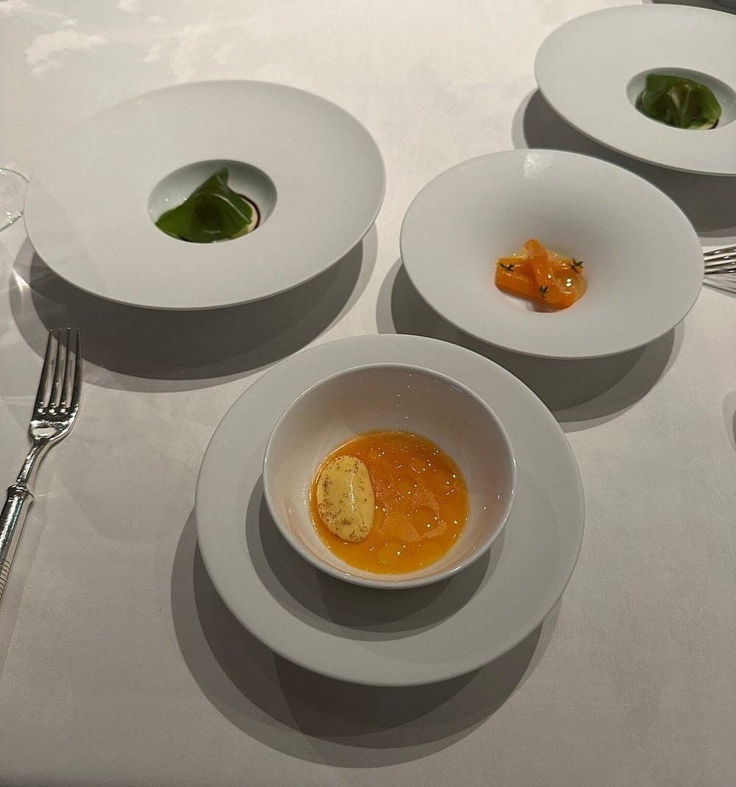

*The tasting menu at Brooklands.*

---

## The bistros people actually book

### Camille, Borough

*£££ · Borough Market* · Cited by 3 sources

A small Borough Market bistro cooking the French provincial repertoire.

The menu is short and changes constantly: **terrines and pâté en croûte**, offal, slow-cooked meat, and a **tarte** to finish. It leans on the market next door, so what is on depends on the day. The wine list is natural rather than classical.

Lunch is easier to book than dinner.

### Casse-Croûte, Bermondsey

*£££ · Bermondsey Street* · Cited by 5 sources

**Three dishes per course chalked on a board, in a room the size of a front parlour.**

The board changes daily: three starters, three mains, three puddings. Expect **rillettes, blanquette de veau, îles flottantes**, in a room with about twenty covers and red-checked tablecloths.

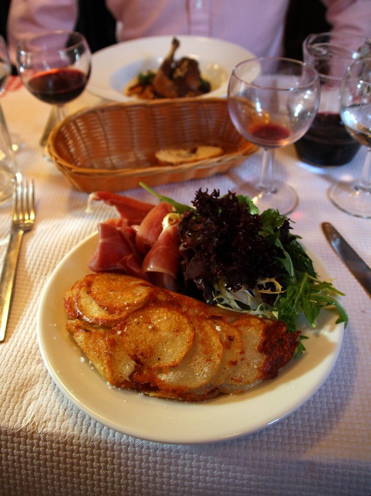
*Casse-Croûte, Bermondsey Street. Photo: [Bex.Walton](https://www.flickr.com/photos/7831824@N04/34881836400), [CC BY 2.0](https://creativecommons.org/licenses/by/2.0/).*

### Pique-Nique, Bermondsey

*£££ · Tanner Street Park* · Cited by 4 sources

**The Casse-Croûte team in a former park pavilion in Bermondsey**, built around **rotisserie chicken** and a short set menu, from the same team in a cheaper format.

The chicken comes off the spit and is the dish to order; there is a **set menu** of five or so courses for anyone wanting the full treatment.

Easier to book than Casse-Croûte.

### 64 Goodge Street, Fitzrovia

*£££ · 64 Goodge Street* · Cited by 3 sources

**A Fitzrovia brasserie from the Woodhead group** with steak frites, a long bar and late service.

**Steak frites** is the order, with oysters, soufflé and the standard brasserie canon. The bar runs the length of the room and takes walk-ins when the tables have gone.

It serves later than most of this guide, useful after a show or a late finish.

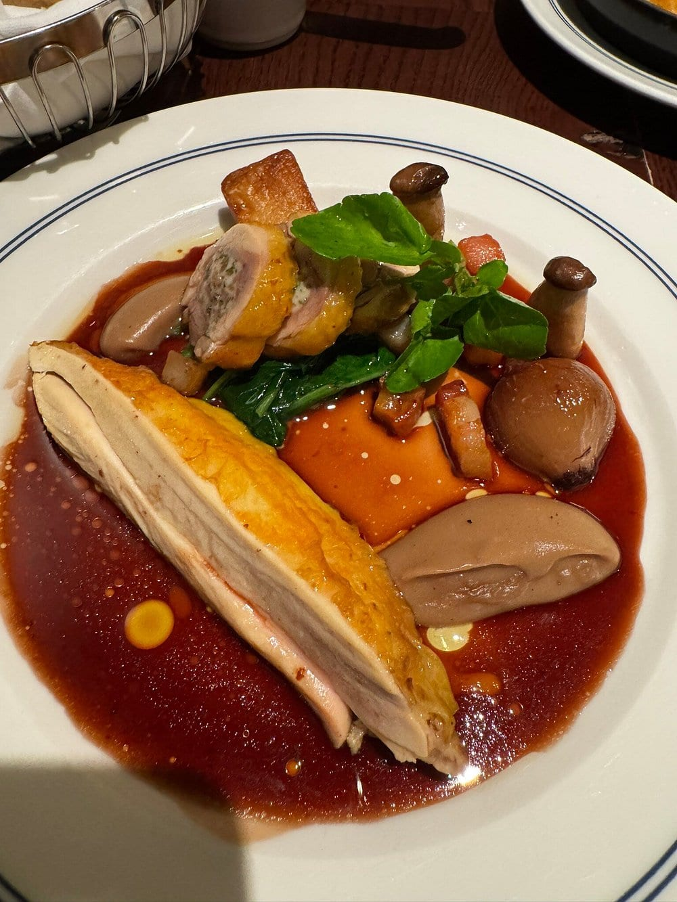

*A dish at 64 Goodge Street.*

### Maison François, St James's

*£££ · Duke Street* · Cited by 3 sources

**A large Parisian brasserie in St James's**, with high ceilings, banquettes and a trolley.

Classic brasserie cooking: **the dessert trolley**, wheeled over and worked through in front of you, and a **grand plateau de fruits de mer** for the table. Steak, sole and soufflé behind them. **Frank's**, the bar downstairs, is a separate and quieter proposition.

### Les 2 Garçons, Crouch End

*£££ · Crouch End* · Cited by 2 sources

**A Crouch End neighbourhood bistro run by two Frenchmen, as the name says.**

The menu is short and traditional: **escargots, steak tartare, duck confit, crème brûlée**.

**Closed Sunday and Monday.**

---

Powered by <a target="_blank" rel="sponsored" href="https://www.getyourguide.com/london-l57/">GetYourGuide</a>

## The old rooms

### Mon Plaisir, Covent Garden

*£££ · Monmouth Street* · Cited by 3 sources

**London's oldest family-run French restaurant**, in business since the 1940s, with a zinc bar salvaged from a Lyon brasserie and four connected dining rooms.

Most people come for the pre-theatre menu.

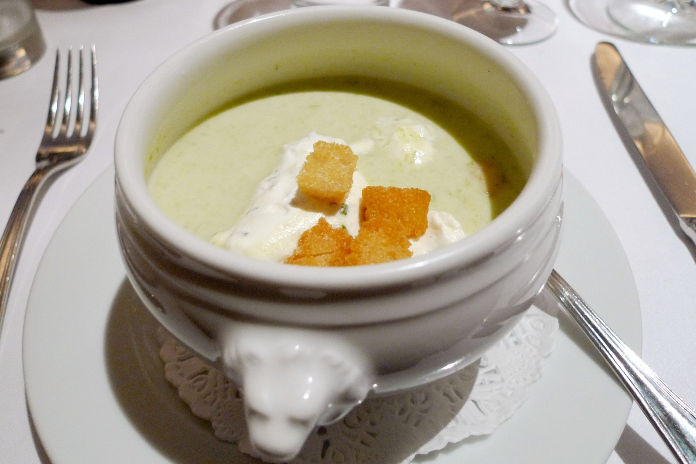

*Mon Plaisir, Covent Garden. Photo: [Ewan Munro from London, UK](https://commons.wikimedia.org/w/index.php?curid=24281649), [CC BY-SA 2.0](https://creativecommons.org/licenses/by-sa/2.0/).*

### L'Escargot, Soho

*£££ · Greek Street* · Cited by 3 sources

**Established in 1896 and on Greek Street since 1927**, with a private dining floor above the main room.

**Snails** are the thing to order, alongside a classical repertoire: **coq au vin, steak tartare, soufflé**. The ground-floor room has the atmosphere.

Central Soho, so it works before a theatre; the dining room upstairs is quieter.

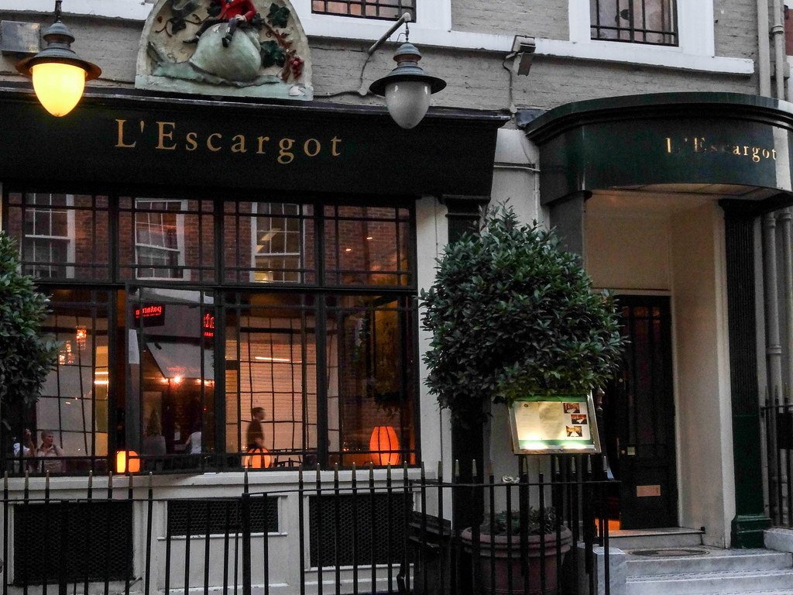
*L'Escargot, Greek Street. Photo: [michaeljohnbutton](https://www.flickr.com/photos/73156278@N08/9671711481), [CC BY 2.0](https://creativecommons.org/licenses/by/2.0/).*

### The French House, Soho

*££ · Dean Street · no chips, no phones* · Cited by 5 sources

**The Soho pub that was the Free French headquarters in the war**, with a small dining room above it and **beer served only in halves downstairs**.

The upstairs room does a short, changing menu of French and British cooking: offal, whole fish. **No music, no mobile phones downstairs.**

The dining room books weeks ahead. Drink in halves downstairs first; they do not serve pints.

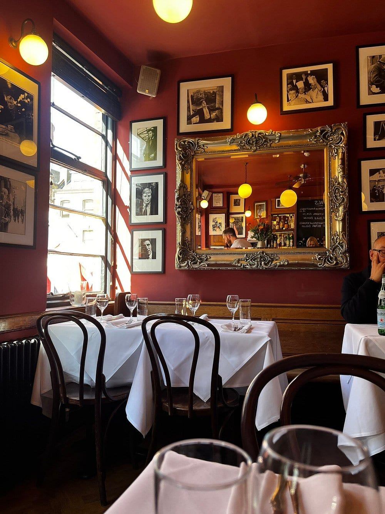

*The dining room above The French House's bar.*

### Galvin La Chapelle, Spitalfields

*££££ · Michelin star · a converted chapel* · Cited by 3 sources

**A Michelin-starred dining room inside a former Victorian girls' school chapel** in Spitalfields, with vaulted ceilings, arched windows and a mezzanine.

The cooking is classical French with a light touch: **Dorset crab lasagne**, tagine of Bresse pigeon, and a soufflé to finish. The Galvin brothers have held the star here since 2011.

The set lunch is cheaper than dinner and served in the same room.

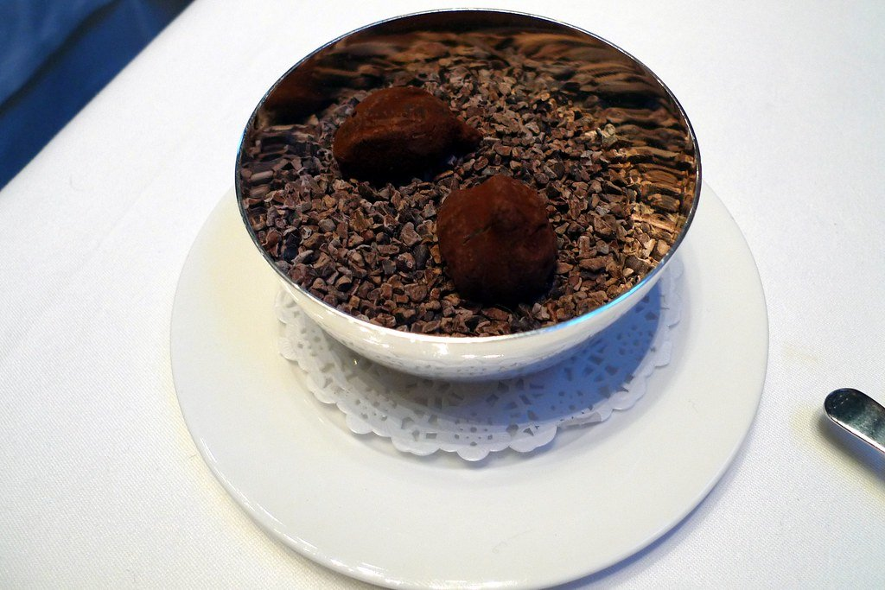
*Galvin La Chapelle, Spitalfields. Photo: [Ewan-M](https://www.flickr.com/photos/55935853@N00/4286655868), [CC BY-SA 2.0](https://creativecommons.org/licenses/by-sa/2.0/).*

### Chez Bruce, Wandsworth

*££££ · Michelin star · by Wandsworth Common* · Cited by 2 sources

**A neighbourhood restaurant on Wandsworth Common that has held a Michelin star for over two decades.**

The cooking is French with British produce: **offal**, a cheese board wheeled to the table, and puddings in the old style. It runs a set menu.

Book weeks ahead, particularly for Sunday lunch. It is a long way from central London.

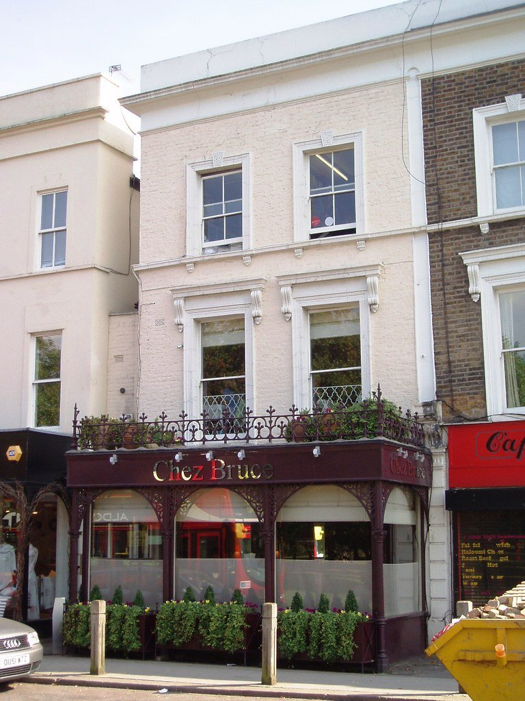
*Chez Bruce, Wandsworth. Photo: [Ewan-M](https://www.flickr.com/photos/55935853@N00/2879798210), [CC BY-SA 2.0](https://creativecommons.org/licenses/by-sa/2.0/).*

### Planque, Haggerston

*£££ · a wine warehouse* · Cited by 2 sources

**A wine warehouse with a restaurant attached** on the Haggerston side of Kingsland Road; members store their own bottles in the racks along the wall.

The kitchen cooks modern French to match the cellar: a short menu built around **fire and fermentation**, with plates designed to be ordered against a bottle. You do not need to be a member to eat there.

Come for the wine list.

---

Powered by <a target="_blank" rel="sponsored" href="https://www.getyourguide.com/london-l57/">GetYourGuide</a>

## Best value

### Borough Market

French food is cheapest **standing up at Borough Market**: raclette scraped onto potatoes, saucisson and cheese from the French traders, and galettes from the crêpe stalls — a proper lunch for under a tenner, thirty seconds from Camille's front door.

**Maltby Street Market**, ten minutes away, does the same on Saturdays.

#### Pre-theatre and set lunch

* **Mon Plaisir's pre-theatre menu** is the cheaper way into London's oldest family-run French restaurant.
* **Pique-Nique's set menu** is cheaper than its sibling Casse-Croûte.
* **Otto's set lunch** costs a fraction of the pressed duck, and the duck needs ordering in advance anyway.
* **Lunch menus generally.** Almost every restaurant on this page runs one for materially less than dinner, from the same kitchen.

#### The bistros

* **Bouchon Racine** serves serious French cooking above a pub.
* **Casse-Croûte** and **Les 2 Garçons** both run about £40–£55 a head for three courses.
* **The French House** is a pub, and priced like one downstairs.

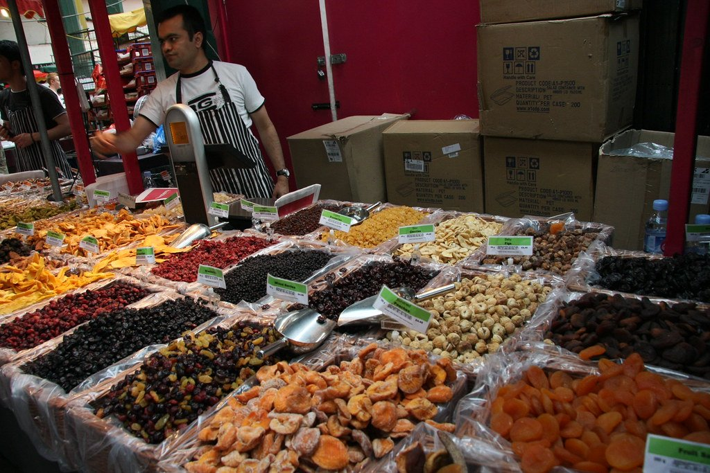

*Borough Market.*

---

## What to know

* **Canard à la presse must be ordered in advance**, 48 hours ahead at Otto's.
* **The Table Lumière at Ducasse** seats six. Ask early.
* **Dress codes** are smart at the hotel rooms; the bistros have none.
* **Service charge** of 12.5% is discretionary and standard.

---

## Continue planning your London trip

- ⭐ **[Special Occasion Restaurants in London](/articles/special-occasion-restaurants-london/)**
- 🇮🇹 **[Best Italian Restaurants in London](/articles/best-italian-restaurants-london/)**
- 🥘 **[Best Spanish Restaurants in London](/articles/best-spanish-restaurants-london/)**
- 🍽️ **[Eat in London: Restaurants, Food Markets & Quick Food Hub](/articles/eat-in-london-guide/)**
- 🛍️ **[Mayfair Area Guide](/articles/mayfair-area-guide/)**
- 🏙️ **[City of London Area Guide](/articles/city-of-london-area-guide/)**
