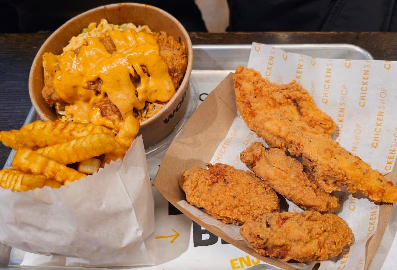
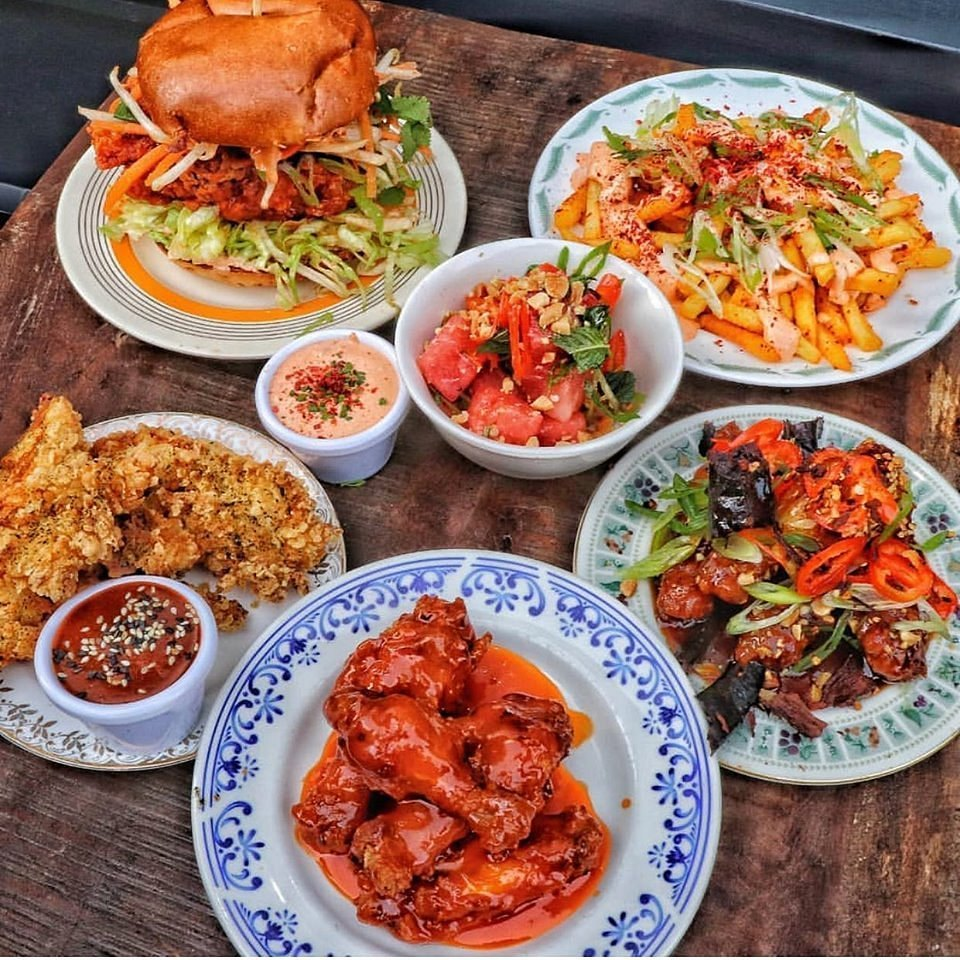
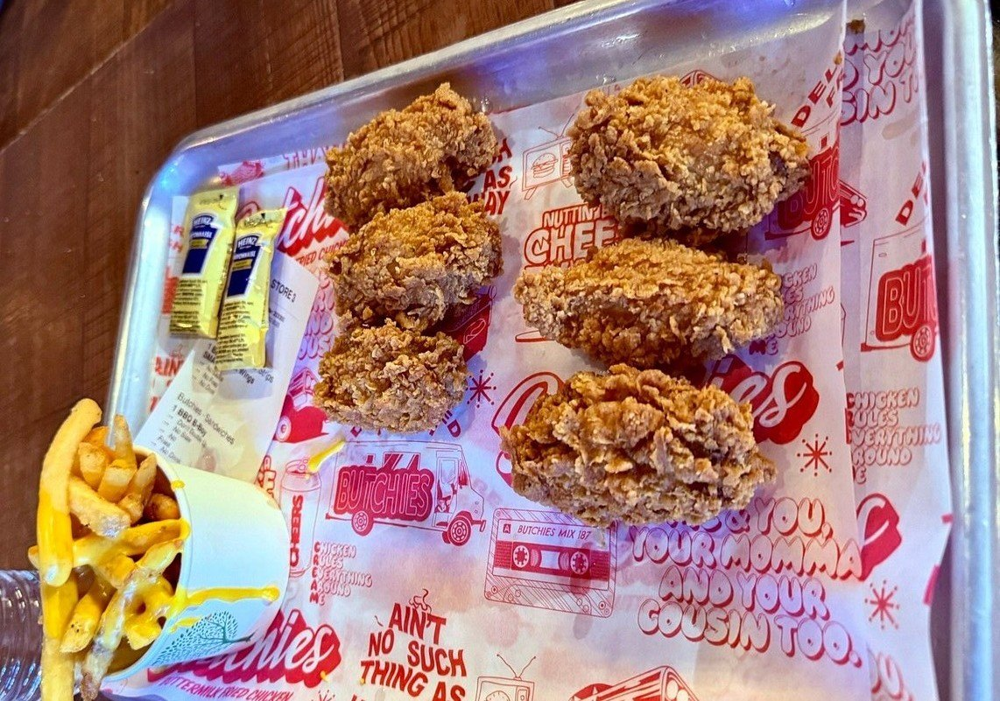
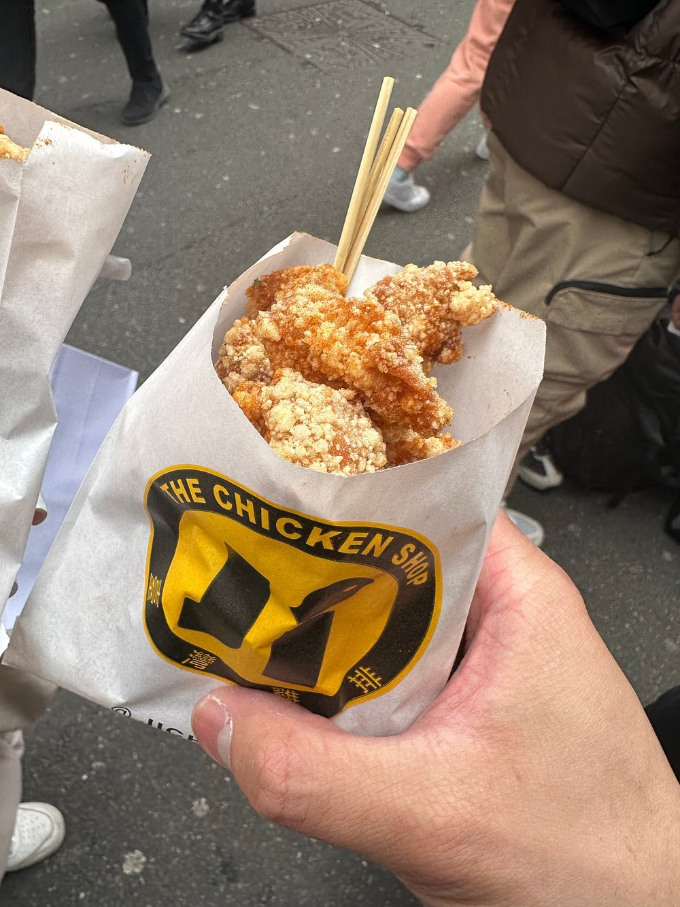
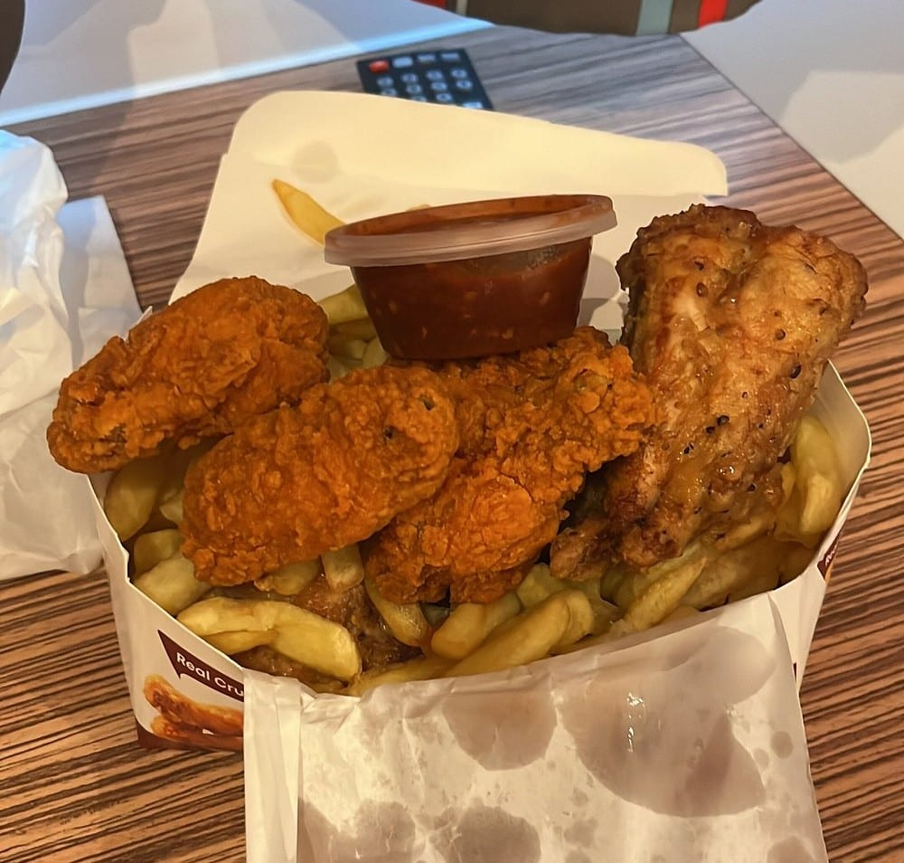
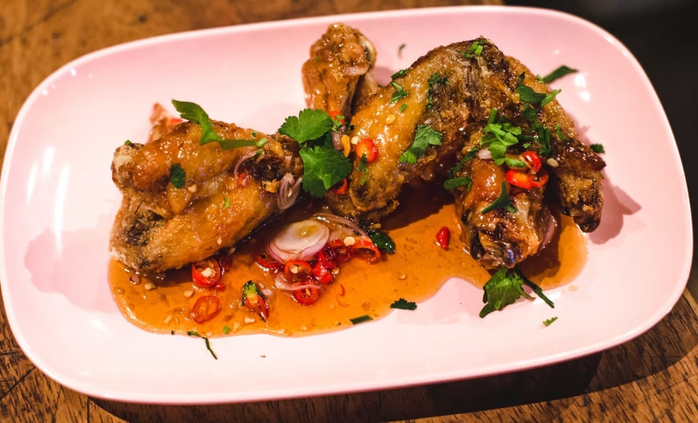
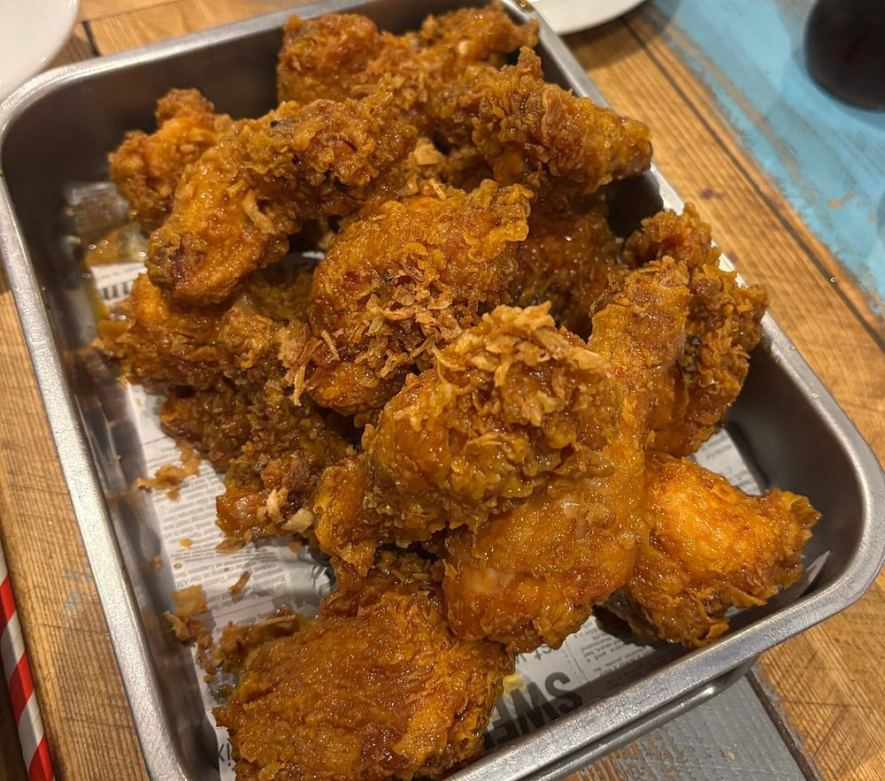

Ask who fries the best chicken in London and you get two answers that do not overlap.

Britain's only judged fried chicken competition ran for the first time in January 2026 and gave the title to **20Ft Fried Chicken**, a West End operation that appears on **no editorial list**. The place named by more independent sources than anything else in the city is **Good Friend**, a Taiwanese counter in Chinatown that has never won anything.

> 💡 **The Short Version:** **20Ft Fried Chicken** won the only judged championship. **Good Friend** in Chinatown is named by more sources than anything else. **Chick'N'Sours** and **Butchies** are the only two names in both camps — and Chick'N'Sours is at the Big Chill in King's Cross. **Morley's** is the chicken shop the serious lists actually name. For Korean, go to **New Malden**.

> 📊 **The evidence behind this guide.**
> **14 independent sources carrying 130 citations** across **71 named venues**. **21 are named by two or more sources; six carry a dated award.**
> **Built on:** the Fried Chicken Championships; Time Out, The Infatuation and the Evening Standard; independent blogs; YouTube.
> *Evidence built 7 September 2026 · [How we rank →](/how-we-rank/)*

## Where they are

| If you are near… | Where to eat |
| --- | --- |
| **Chinatown & Leicester Square** | Good Friend |
| **Soho & Oxford Street** | Bao, Kricket, Manna (Arcade Food Hall), 20Ft (Holles Street), CheeMc Soho |
| **Covent Garden** | Lucky's Hot Chicken (Seven Dials Market) |
| **Shoreditch** | Butchies, Smoking Goat |
| **King's Cross** | Chick'N'Sours (Big Chill) |
| **Elephant & Castle** | CheeMc, La Barra |
| **North London** | Chick King (Tottenham) |
| **South London** | Morley's (everywhere), Maureen's (Brixton) |
| **New Malden** | Chick and Beers, Tongdak, Imone |
| **West & north-west** | Normah's (Queensway), The Best Broasted (Willesden) |

**Price guide:** **£** under £15 a head · **££** £15–£30 · **£££** £35+.

---

## The ones that won something

The **Fried Chicken Championships** was held in January 2026: four judges, five scoring criteria, and two entrants finished on identical points.

### 20Ft Fried Chicken — the champion nobody writes about

*£ · Holles Street, W1 · 2 min from Oxford Circus · Champion, Fried Chicken Championships 2026*

**It won on the 20Ft Hot Chicken Burger.** None of the seven mastheads or two blogs we collected names it. It trades from Holles Street, just behind Oxford Street, and through the delivery platforms.

*20Ft Fried Chicken, off Oxford Street.*

### Chick'N'Sours — joint second, and it is at the Big Chill

*£–££ · King's Cross · Joint second, Fried Chicken Championships 2026 · Cited by 7 sources*

*Chick'N'Sours, at the Big Chill.*

**Go to the Big Chill at King's Cross**, a three-floor bar with a roof terrace, open every day from midday.

There are also kitchens at Corner Corner in Canada Water (Friday to Sunday, from midday) and the Crown & Castle pub in Dalston (walk-ins only).

### Butchies — joint second, and the tenders beat the burger

*£ · Shoreditch · Joint second, Fried Chicken Championships 2026 · Cited by 8 sources*

*Butchies' tenders, Shoreditch.*

Tied with Chick'N'Sours on points, and the only one of the top three that is an ordinary restaurant. It is known for buttermilk-fried **chicken sandwiches**, but Time Out says **the tenders are the better order**.

They arrive with house BBQ sauce as standard. Order extra dips; skip the blue cheese, which Time Out describes as watery.

### Fortune Fried Chicken — third place, in a market stall

*£ · Unit SP4C, Old Spitalfields Market, 12 Horner Square, E1 6EW · Third, Fried Chicken Championships 2026*

**Third in the championship, from a counter in Old Spitalfields Market.** The judged dish was the **Nam Jim chicken tenders**: Thai, sharp and hot rather than American and sweet.

It is a sister brand of the Indian restaurant **Gunpowder** and, like the champion, appears on no editorial list.

Order ahead for collection on its own site, or walk up. **The market's hours are its hours**, and our [Shoreditch and Spitalfields walk](/articles/shoreditch-spitalfields-walk/) passes the door.

---

Powered by <a target="_blank" rel="sponsored" href="https://www.getyourguide.com/london-l57/">GetYourGuide</a>

## The ones the sources agree on

### Good Friend — the most-cited fried chicken in London

*£ · 14 Little Newport Street, WC2H 7JJ · 1 min from Leicester Square · Cited by 7 sources*

*Good Friend, Little Newport Street.*

**Seven independent sources — five mastheads and two YouTube channels — name this Taiwanese counter, more than anything else in the city.** No judge has given it anything.

**Popcorn chicken** is the order: boneless, bite-size, fried dark, then shaken with one of **eleven seasonings**. Plum and chilli is the one two sources single out. The menu also has a flattened whole crispy breast, crispy squid, chicken skin, tofu and sweet potato.

**There is nearly always a queue out of the yellow shopfront, and it moves fast.** Takeaway is the norm.

### Morley's — the chicken shop the critics actually name

*£ · Branches across London · Cited by 8 sources*

It started in south London and now runs from **Edmonton to Finsbury Park to Brick Lane**.

**The spicy wings are the order**, fried in a peppery spice mix, at **about 80p each**.

### Chick King — Tottenham, and worth the journey

*£ · 755 High Road, N17 8AH · Cited by 4 sources*

A Tottenham takeaway that four sources treat as a destination. The chicken stays crunchy without turning greasy, and is seasoned without going salty.

**Order the hot wings**, crumbed rather than battered, with the thick-cut chips. The rest of the board is chicken portions, spare ribs, sausages and a chicken fillet burger, which Eater singles out for its size. **There is nothing to book and nowhere to sit**: it is a shopfront on the High Road, two minutes from White Hart Lane station.

*Chick King, Tottenham.*

### La Barra — Colombian, and enormous

*£ · 147 Eagle Yard Arch, Walworth, SE1 6SP · Cited by 4 sources*

**The five-piece Dominican fried chicken plate** comes with plantain and a pile of chicharrónes, and is a lot of food. The batter is thick and deeply crunchy. Squeeze the lemon over it and ask for the house chilli sauce.

An Elephant and Castle railway arch, good for groups, and cheap.

### Coqfighter — four sites, and it takes bookings

*£–££ · Liverpool Street, Soho, King's Cross and Finsbury Park · Cited by 4 sources*

Named by the Evening Standard, SquareMeal, Secret London and Hungry Soles.

The breast is brined overnight and twice-fried in a house flour blend, then built into a **sandwich at £11.50** on a sesame bun. The original comes with sambal mayo, Korean hot sauce and pink onions; the Nashville version is dipped in hot oil and finished with green slaw and chipotle mayo. **Wings are £10** and glazed rather than sauced — sweet Korean with pickled ginger, laksa and coconut milk butter, or a Thai butter finished with toasted rice powder and lime. There is also half a chicken, marinated 24 hours and basted in the house sauces, at £13.50.

Four London sites, all by a mainline or Tube station, open **noon to 10pm Monday to Saturday and noon to 9pm on Sunday**, and it takes bookings, which almost nothing else here does. Express lunch is **Monday to Friday, noon to 3pm**: sandwich and fries for £12.50. It is the one to pick for a group, or to sit down without queueing.

### Smoking Goat — the wings that are not really fried chicken

*££ · 64 Shoreditch High Street, E1 6JJ · Cited by 3 sources*

A Thai restaurant; the **chilli fish sauce wings** are why it is in a fried chicken guide. Sweet, sour and crunchy. It is a proper dining room rather than a counter, so this is the one on the list for dinner.

*Smoking Goat's chilli fish sauce wings.*

### Bao — Taiwanese fried chicken as a bar snack

*££ · 53 Lexington Street, W1F 9AS · Cited by 3 sources*

The order is **Taiwanese fried chicken in hot sauce, £9.25 for five pieces**, or the **chilli lime fried chicken steak at £12.75** if you want a slab. The batter is light, with a sharp vinegary hot sauce over the top. Extra dips are £1.50, and a fried chicken bao is £5.95.

**Order two portions.** This is the original BAO, on Lexington Street since 2015 and a Michelin Bib Gourmand winner for nine years. Counter seating suits eating alone. **Walk-ins only and card only**; the kitchen shuts between 3pm and 5pm Monday to Thursday.

### Chick and Beers — Korean, in New Malden

*£ · 282 Burlington Road, New Malden, KT3 4NL · Cited by 3 sources*

*Chick and Beers, New Malden.*

Family-owned. The chicken is **double-fried**, and **sticky nuggets** are the order.

It is a shopfront on Burlington Road, not the High Street where Imone sits, and takes collection and delivery orders on [its own site](https://www.chickandbeers.uk/). **Closed Mondays, and 4.30pm to 8.45pm the rest of the week**, with one extra Saturday sitting from 1.15pm to 3.45pm.

---

## By tradition, because they are not the same food

Fried chicken in London means at least six different things.

**Korean.** Double-fried and sauced. **New Malden is the centre** — Chick and Beers, **Tongdak** on Kingston Road (seven seasonings, and a 20–30 minute wait because it is fried to order) and **Imone** on the High Street (kan pung gi, in a smoky, spicy sauce) are all in the same quarter. In the centre, **CheeMc** has Elephant and Castle and Soho branches and sells seven flavours; the honey butter powder is the best known.

**Taiwanese.** Lighter batter, boneless, seasoned from a shaker rather than sauced. Good Friend, on the Chinatown grid our [Chinese and East Asian guide](/articles/best-chinese-east-asian-restaurants-london/) walks you round, and Bao a few streets north on Lexington Street.

**Nashville hot.** Cayenne-heavy oil, served in a bun with pickles. **Lucky's Hot Chicken** at Seven Dials Market and Mikkeller on Exmouth Market twice-fries its strips and sandos, with heat levels from "country" up to an XXX seasoning. **Manna** inside Arcade Food Hall on New Oxford Street does the bun version with cheese, pickles and a house sauce.

**Caribbean and West African.** **Maureen's Brixton Kitchen** on Railton Road is a Jamaican home kitchen, takeaway only.

**South Asian.** **Kricket** in Soho does Keralan fried chicken — thighs marinated in tandoori spices then rolled in masala, flour and buttermilk, served with pickled mooli and curry-leaf mayonnaise. It is a small restaurant that takes bookings.

**Levantine and Malaysian.** **The Best Broasted** in Willesden Green does Syrian broasted chicken with toum, pickles and chips. **Normah's** in Queensway Market does lightly spiced Malaysian wings — **and releases bookings in monthly batches**.

---

Powered by <a target="_blank" rel="sponsored" href="https://www.getyourguide.com/london-l57/">GetYourGuide</a>

## What to know

**Almost none of this needs booking**: the list is counters, takeaways and queues, and Bao is walk-ins only. The exceptions are Coqfighter and Kricket, which take bookings, and Normah's, which releases them in monthly batches.

**Two venues named in the sources have closed:** Sichuan Fry in Hackney and Kaieteur Kitchen in Elephant and Castle.

*Evidence built 7 September 2026. Award results are from the Fried Chicken Championships' own published 2026 results. Chicken shops change hours often, so check before a long journey.*