London's galleries divide into the national collections that cost nothing, the commercial spaces that also cost nothing and are far less busy, and a handful of house collections you can actually finish.

**The free contemporary galleries are the quiet ones.** White Cube is 54,000 square feet and free, and weekdays are the quietest.

> 💡 **The Short Version:** **Tate Modern** is the one everybody does and the tenth-floor view is free. **The National Gallery** is unfinishable — pick two rooms. **White Cube Bermondsey** is free contemporary art at museum scale. **Dulwich** opened in 1817 as the world's first purpose-built public gallery. And the **Wallace Collection** is the one you can complete in an afternoon.

> 📘 **How we choose these (editorial note).**
> No paid placements. These are drawn from a wide spread of sources - the food and travel press, the big listings sites, independent blogs and specialists, video, and what Londoners recommend themselves - and cross-referenced against each other. Admission prices are the galleries' own. Commercial galleries are free, and we have included the ones that mount museum-scale shows.

## Where they are

| If you are near… | Where to go |
| --- | --- |
| **Bankside & South Bank** | Tate Modern, Hayward Gallery |
| **Trafalgar Square** | National Gallery, National Portrait Gallery |
| **Westminster** | Tate Britain |
| **Mayfair & Marylebone** | Royal Academy, Wallace Collection |
| **Strand** | The Courtauld |
| **Kensington & Hyde Park** | Serpentine Galleries, Design Museum, Leighton House |
| **Bermondsey** | White Cube |
| **Chelsea** | Saatchi Gallery |
| **The City & Holborn** | Guildhall Art Gallery, London Silver Vaults |
| **South London** | Dulwich Picture Gallery |

---

## The national collections

### Tate Modern, Bankside

*Free · Sun–Thu 10am–6pm, Fri–Sat 10am–9pm*

The national collection of international modern art inside Giles Gilbert Scott's power station. The Turbine Hall runs its full length: five storeys of empty space, free to stand in.

**The collection is free and needs no booking.** Only the big temporary exhibitions are ticketed, and members go into those free without booking.

**Level 10 in the Blavatnik Building is free too**: a cafe bar looking over the river, St Paul's and the City. It keeps the gallery's hours, so on **Fridays and Saturdays it runs to 9pm**.

**Bankside SE1 9TG.** Southwark and Blackfriars are five minutes; the Millennium Bridge puts you at St Paul's in three.

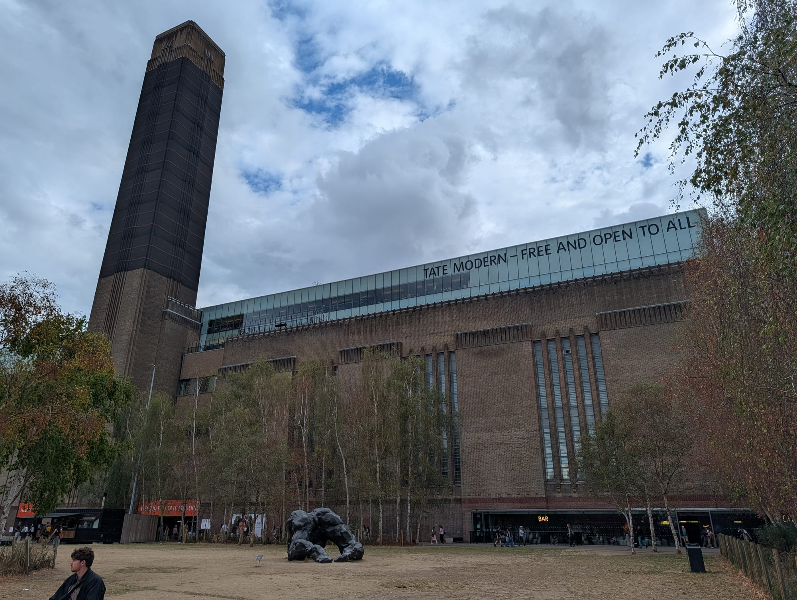

### National Gallery, Trafalgar Square

*Free · daily 10am–6pm, Fridays to 9pm*

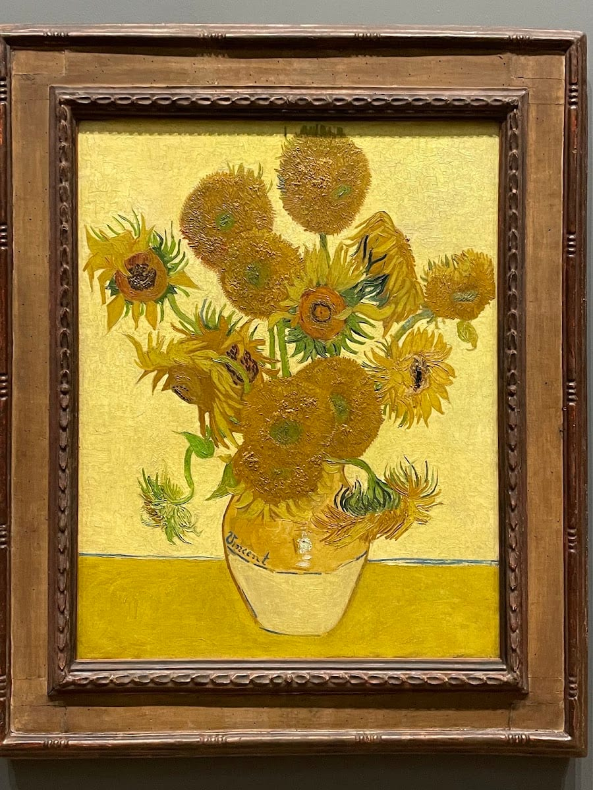

*Van Gogh's Sunflowers, at the National Gallery.*

Two thousand paintings from the 1200s to 1900 — Van Gogh's *Sunflowers*, Turner's *Fighting Temeraire*, the Wilton Diptych, Velázquez's *Rokeby Venus*. It cannot be finished in a day: **pick two rooms and actually look at them.**

**Free, no ticket, no booking**, and you can walk in to see one painting and leave.

**Friday late opening** is the quietest time for the famous ones: the coach parties have gone and the rooms empty after six.

**Trafalgar Square WC2N 5DN**, two minutes from Charing Cross. Closed 24–26 December and 1 January. The Sainsbury Wing holds the early Italian work and is the calmer half; the main building holds the crowd-pullers.

### National Portrait Gallery, Trafalgar Square

*Free · Sun–Thu 10.30am–6pm, Fri–Sat to 9pm*

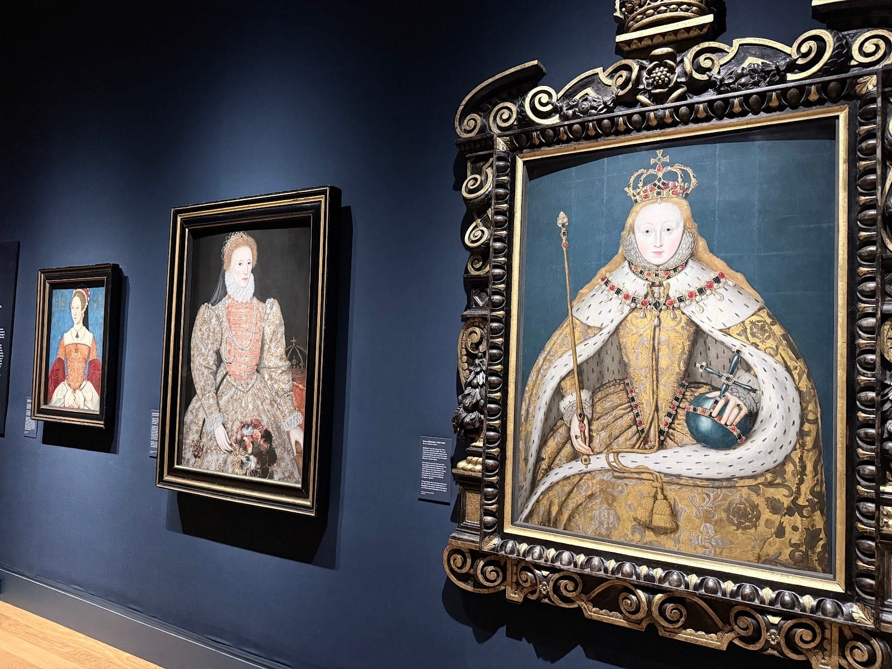

*The Tudor rooms, at the National Portrait Gallery.*

Reopened in 2023 after a three-year redevelopment that reversed the entrance, opened up the north facade and rehung the whole thing. Round the corner from the National and usually calmer.

It is arranged by period rather than by artist: Tudors at the top, the twentieth century at the bottom, and you work downwards.

**Free to everyone, with a charge for some temporary exhibitions.** Booking a free admission ticket in advance is recommended to guarantee entry rather than required. Last entry is 5.30pm, or 8.30pm on Friday and Saturday.

**St Martin's Place WC2H 0HE**, and every entrance is step-free.

### Tate Britain, Westminster

*Free · daily 10am–6pm*

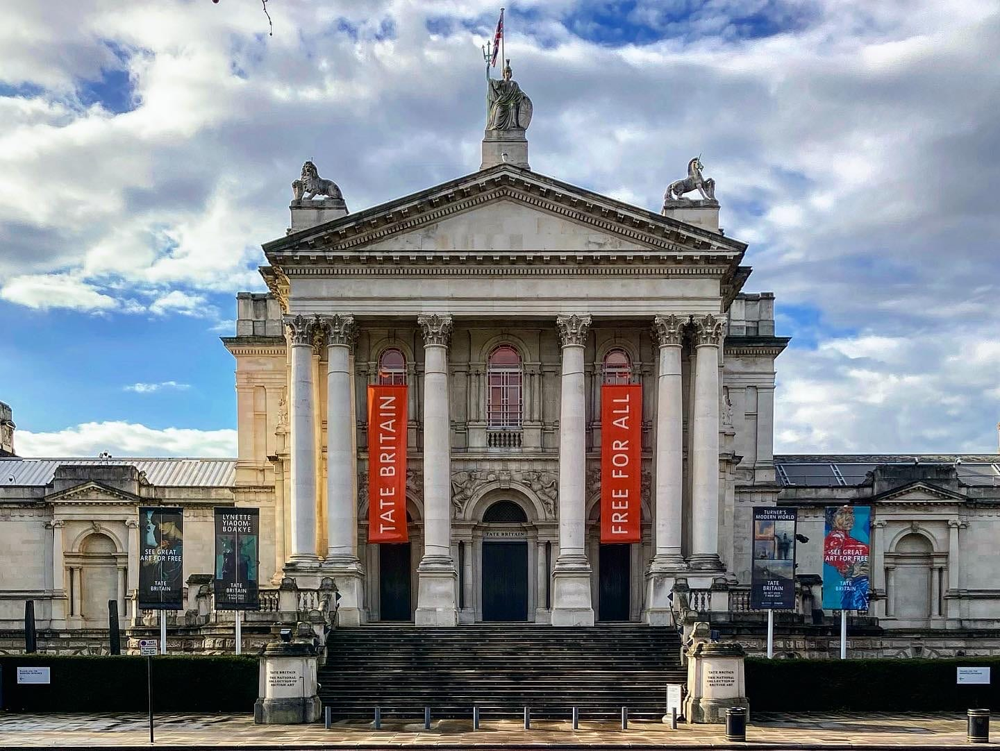

*Tate Britain.*

The national collection of British art — five hundred years of it, from Tudor portraits to the present, and **the largest holding of Turner anywhere**, kept in the purpose-built Clore Gallery. If you came to London's galleries for Turner, this is the building, not the National.

**Free and open every day with no booking needed.** Only special exhibitions are ticketed.

**The Tate Boat runs from the pier outside to Tate Modern every 20 to 30 minutes during gallery hours.** It is a river bus rather than a tour, takes about 18 minutes and accepts contactless.

**Millbank SW1P 4RG.** Pimlico is five minutes' walk and Westminster about fifteen along the river.

---

## Free contemporary

### White Cube Bermondsey

*Free · Tue–Sat 10am–6pm, Sun 12–6pm · closed Mondays · 144–152 Bermondsey Street SE1 3TQ*

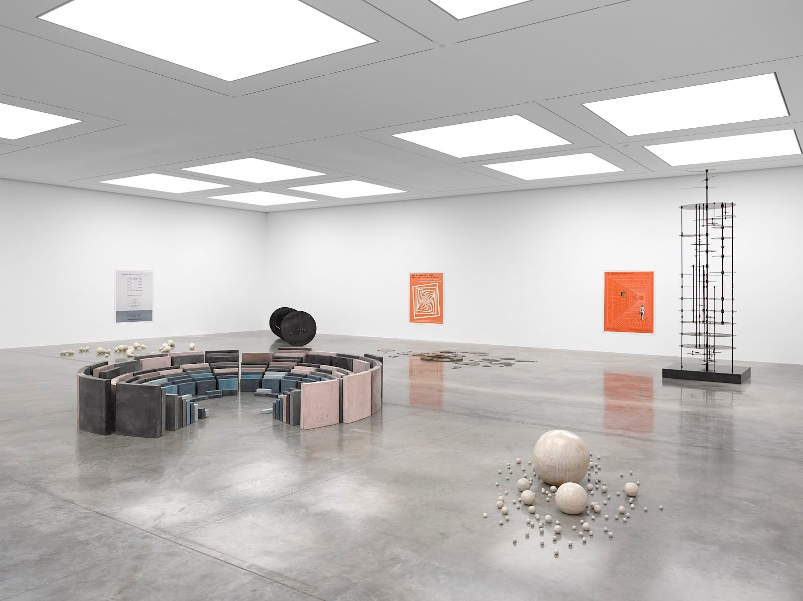

*One of White Cube Bermondsey's galleries.*

**Fifty-four thousand square feet** behind a plain 1970s warehouse frontage, showing international artists at a scale few museums match.

**Free, with no ticket and no queue.** It is a selling gallery, so weekday afternoons are often nearly empty. The price list is on the desk if you want to know, and looking without buying is normal.

White Cube also runs a smaller space at **Mason's Yard, SW1Y 6BU** in St James's. London Bridge and Borough are both about ten minutes' walk from Bermondsey.

### Serpentine Galleries, Kensington

*Free · Tue–Sun 10am–6pm · closed Mondays*

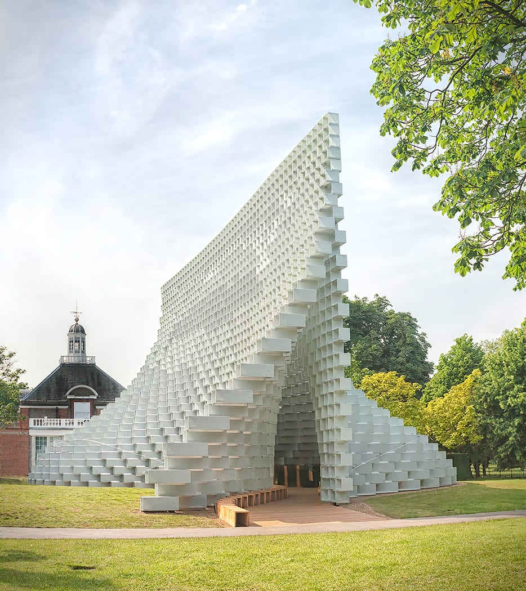

*The summer Pavilion, at the Serpentine.*

Two contemporary galleries **a five-minute walk apart** across the Serpentine bridge — Serpentine South in a 1930s tea pavilion, Serpentine North in a former gunpowder store with a Zaha Hadid extension. Both free, both small enough to see in an hour together.

**The summer Pavilion** is a temporary building commissioned from a different architect every year, always their first completed structure in the UK, put up beside Serpentine South from June to October. It is free to walk into and there is a cafe inside it.

In **Kensington Gardens, W2 2AR and W2 3XA.** Lancaster Gate and South Kensington are the nearest stations, both a walk across the park.

### Saatchi Gallery, Chelsea

*Daily 10am–6pm · Duke of York's HQ, SW3 4RY*

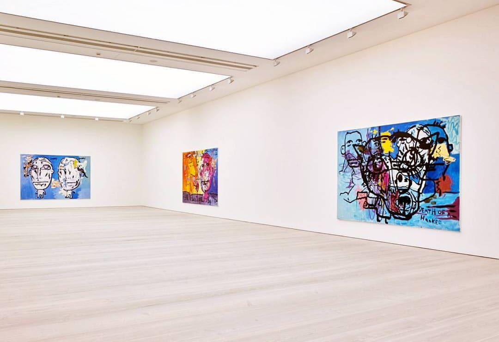

*One of the Saatchi Gallery's rooms.*

Seventy thousand square feet of white-walled gallery in the former Duke of York's military headquarters off the King's Road: fifteen rooms over three floors.

**Some exhibitions are free and others are ticketed**, and each has its own last-entry time, so two shows in the same building can close 50 minutes apart. Check which you are going to.

**Open every day, 10am to 6pm**, with last entry to the ground-floor exhibitions at 5.20pm. Re-entry on the same ticket is allowed.

Sloane Square is three minutes away; the gallery is in a courtyard set back from the King's Road.

---

### Whitechapel Gallery, Whitechapel

*Free · Tue–Wed and Fri–Sun 11am–6pm, Thu 11am–9pm · closed Mondays · E1 7QX*

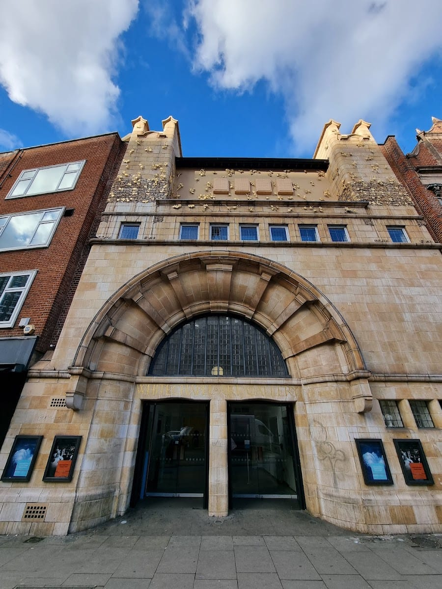

*Whitechapel Gallery.*

Founded in 1901, it gave **Picasso's Guernica its only British showing in 1939**, and gave Jackson Pollock, Mark Rothko and Frida Kahlo their first UK exhibitions.

**Free to walk in, and under-16s go free to the ticketed shows too.** Group rates are £6.50 a head for university groups and £9.50 for independent ones; school and community groups are always free.

**Closed Mondays**, and Aldgate East station is directly outside. There are Common Rooms with chairs, sofas and books, reachable by lift, if you want somewhere to sit that is not a cafe.

### The Photographers' Gallery, Soho

*£14 · free after 5pm on the first Friday of the month · Ramillies Street W1F 7LW*

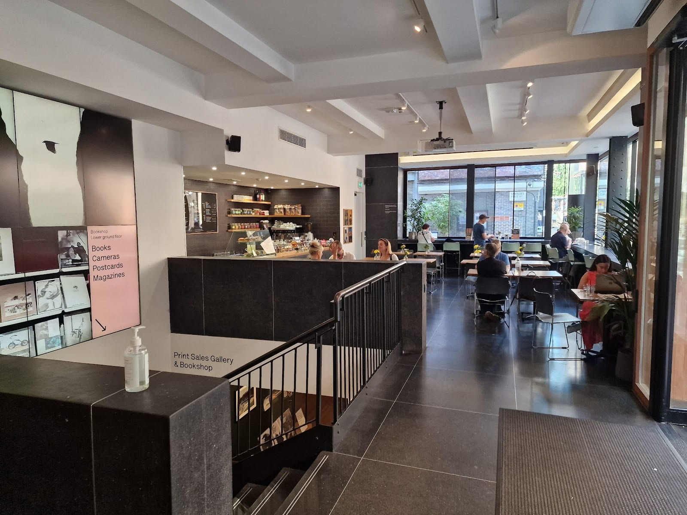

*The Photographers' Gallery bookshop.*

The first gallery in Britain devoted entirely to photography, founded in 1971, now in a converted warehouse on a Soho side street behind Oxford Street — five floors, a bookshop, and a print sales room where you can buy work.

> 💡 **Entry is free after 5pm on the first Friday of each month**: 6 November, 4 December, 8 January and 5 February. On other Fridays it is £5 after 5pm. Otherwise admission is **£14 including a £2 optional donation**, or £11 for seniors, students, jobseekers and disabled visitors; 18s and under go free.

**Late opening Thursday and Friday to 8pm**, otherwise 10.30am–6pm Monday to Wednesday and Saturday and 11am–6pm Sunday, with last admission 30 minutes before close. Closed 24 December to 1 January.

**The bookshop and print sales room are free all day regardless**, so you can go in, look at photographs for sale and leave without paying anything. Oxford Circus is three minutes away.

### Barbican Art Gallery, City of London

*Ticketed · inside the Barbican Centre*

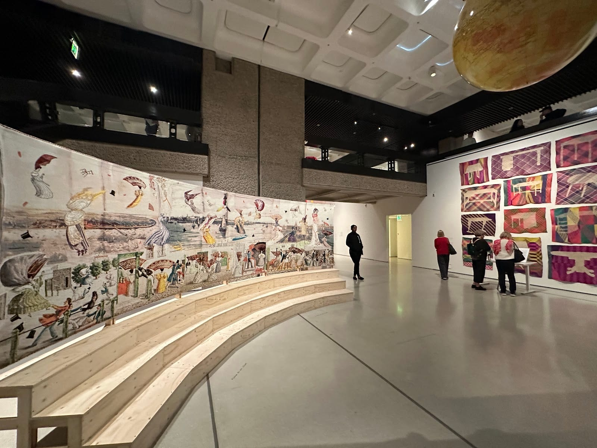

*The Curve, at the Barbican.*

Big thematic shows in the middle of the Barbican — architecture, design and photography as often as painting.

**The Curve** downstairs is a free, curved gallery space: a single ninety-metre bending room running one commissioned installation at a time, no ticket. There are usually other free displays around the building alongside it.

**The main Art Gallery is ticketed; the Curve and the foyers are free.**

**Silk Street EC2Y 8DS.** Barbican and Moorgate are both five minutes; follow the yellow line painted on the pavement from Barbican station to find the entrance.

### South London Gallery, Peckham

*Free · Wed 12–9pm, Thu–Sun 12–6pm · 65–67 and 82 Peckham Road SE5 8UH*

A Victorian gallery on Peckham Road with a **converted fire station opposite** as a second building, running experimental contemporary work.

**Two buildings, one visit**: they are directly across the road from each other, so check both.

The **garden behind the main building** is a walled garden, free, with a cafe attached.

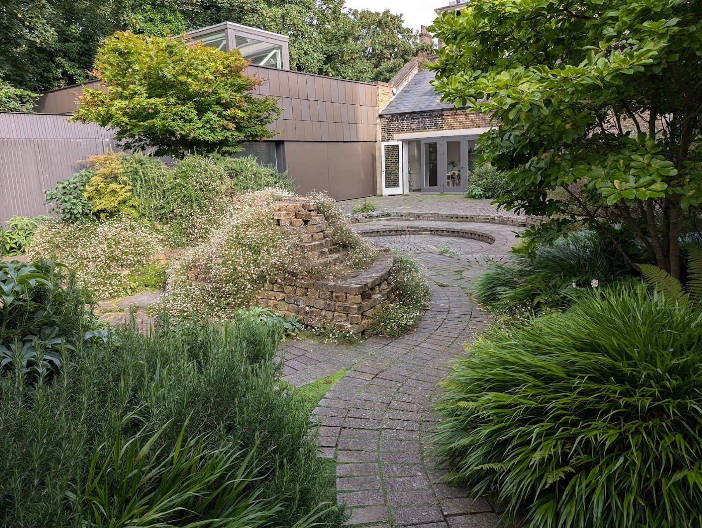

*The garden behind South London Gallery.*

Peckham Rye is about ten minutes' walk; the gallery sits between Peckham and Camberwell.

---

Powered by <a target="_blank" rel="sponsored" href="https://www.getyourguide.com/london-l57/">GetYourGuide</a>

## Collections you can finish

### The Wallace Collection, Marylebone

*Free · daily 10am–5pm · Manchester Square W1U 3BN*

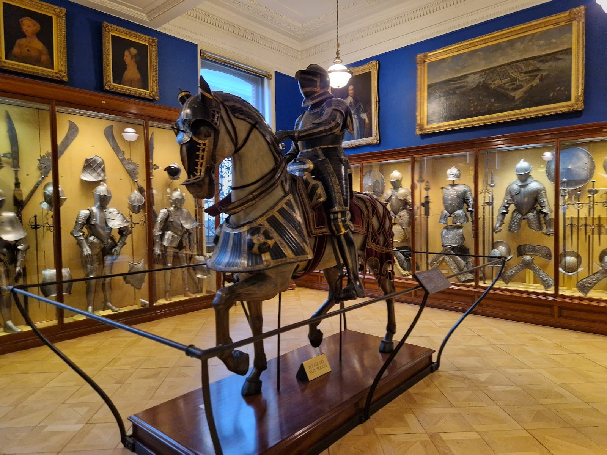

*The armoury, at the Wallace Collection.*

A single townhouse full of Old Masters, armour and French eighteenth-century furniture, left to the nation in 1897 **on condition that nothing ever leaves it** — no loans out, ever. Everything you see is always here.

Frans Hals's *The Laughing Cavalier* is the famous one; the armoury in the basement is the surprise.

**Entry to the permanent collection is free**, no booking, and it is **doable in ninety minutes** — which almost nothing else here is.

It closes only on 24, 25 and 26 December. There are Friday Lates, talks and concerts through the year. Bond Street is five minutes.

### The Courtauld, Strand

*£14 · daily 10am–6pm · Somerset House WC2R 0RN*

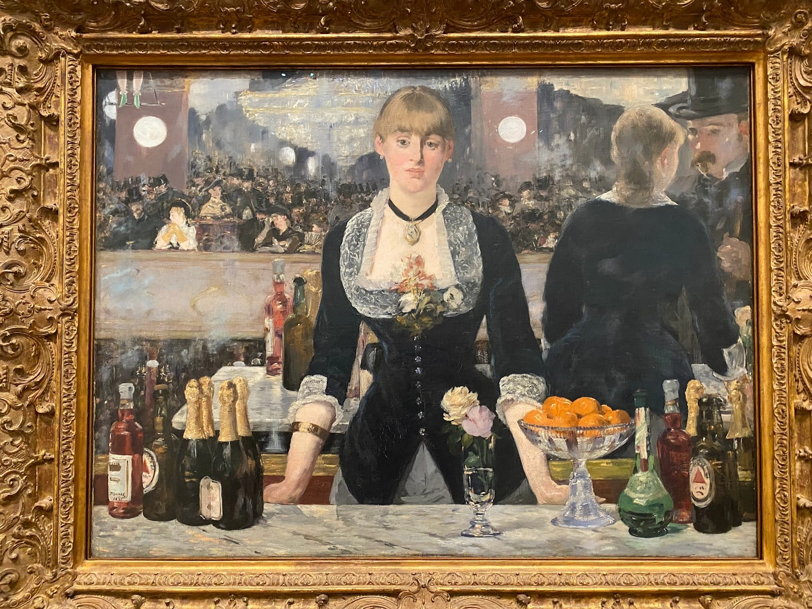

*Manet's A Bar at the Folies-Bergère.*

Impressionists and post-Impressionists in a compact gallery above Somerset House's courtyard — Manet's *A Bar at the Folies-Bergère* and Van Gogh's *Self-Portrait with Bandaged Ear*, in a collection small enough to see in a single visit.

**£14 for the permanent collection**, or £16 with the voluntary donation. A ticket that includes the temporary exhibition is £16, or £18 with donation. **18 and under go free**; students, Art Fund members and anyone on Universal or Pension Credit get into the permanent collection free, and students and Universal or Pension Credit claimants pay £7 with the exhibition.

**Open every day, 10am to 6pm, last entry 5.15pm.**

It is inside **Somerset House**, so pair it with the courtyard, which has fountains in summer and an ice rink in winter. Temple is two minutes away.

### Dulwich Picture Gallery, Dulwich

*Ticketed · Tue–Sun 10am–5pm · closed Mondays*

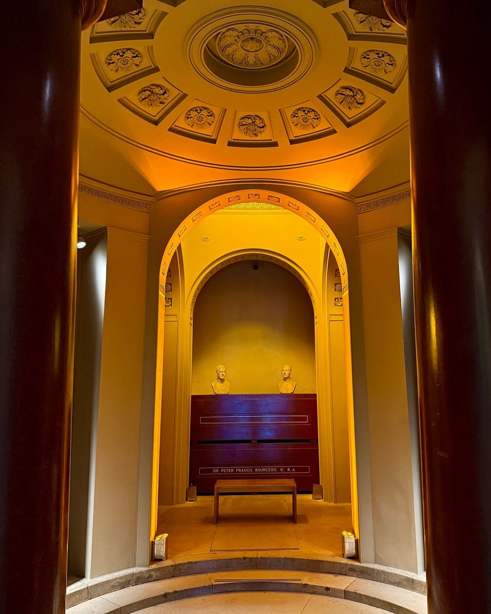

*The mausoleum, at Dulwich Picture Gallery.*

Opened in **1817 as the first purpose-built public art gallery anywhere in the world**, designed by Sir John Soane.

Rembrandt, Rubens, Poussin and Gainsborough, in a collection small enough to see in full. The founders are buried in a mausoleum inside the gallery.

**Closed Mondays.** It is a journey rather than a walk: about twelve minutes by train from Victoria to West Dulwich, then five minutes on foot.

**Gallery Road SE21 7AD.** The gardens are free, and Dulwich Park is next door.

### Guildhall Art Gallery, City of London

*Free · last admission 4.45pm · Guildhall Yard EC2V 5AE*

*The Roman amphitheatre, at the Guildhall Art Gallery.*

Victorian and Pre-Raphaelite paintings in the City of London's own gallery, including Millais and Rossetti, plus a large collection of London topographical painting.

**Go downstairs.** London's **Roman amphitheatre** was found in 1988 when the foundations for this building were dug, and the surviving walls are displayed in the basement, outlined in light where the missing seating would have been.

**Free entry to both**, though booking a general admission ticket ahead is recommended. **Last admission is 4.45pm.**

Bank and St Paul's are both about five minutes, and the Guildhall Yard entrance is set back from the street.

---

Powered by <a target="_blank" rel="sponsored" href="https://www.getyourguide.com/london-l57/">GetYourGuide</a>

## Unusual

### The London Silver Vaults, Holborn

*Free · Mon–Fri 9am–5.20pm, Sat 9am–12.50pm · closed Sunday*

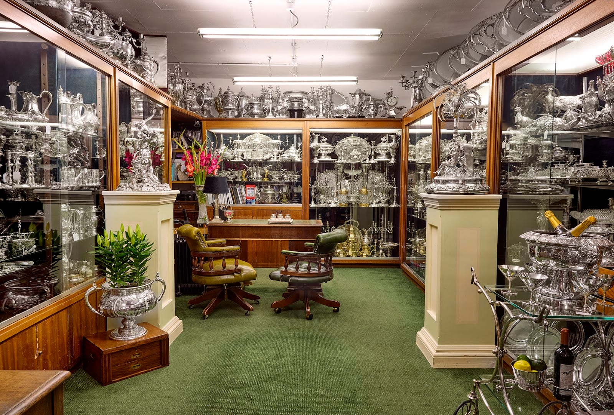

*One of the dealers inside the London Silver Vaults.*

A working **vault complex beneath Chancery Lane**, trading here since 1953, holding around thirty independent dealers behind steel doors, and describing itself as the largest selection of silverware for sale in the world. You go down a staircase, through a vault door, and into a corridor of shops.

**Free to walk in, no appointment necessary**, and browsers are welcome. Everything is for sale, from a few pounds for a spoon to five figures for a Georgian tureen.

**Hours: 9am to 5.20pm Monday to Friday, 9am to 12.50pm on Saturday, closed Sunday and bank holidays.**

**53–64 Chancery Lane WC2A 1QS**, with the entrance on Southampton Buildings rather than Chancery Lane itself. Chancery Lane station is two minutes.

### Leighton House, Kensington

*Ticketed · Holland Park Road, Kensington*

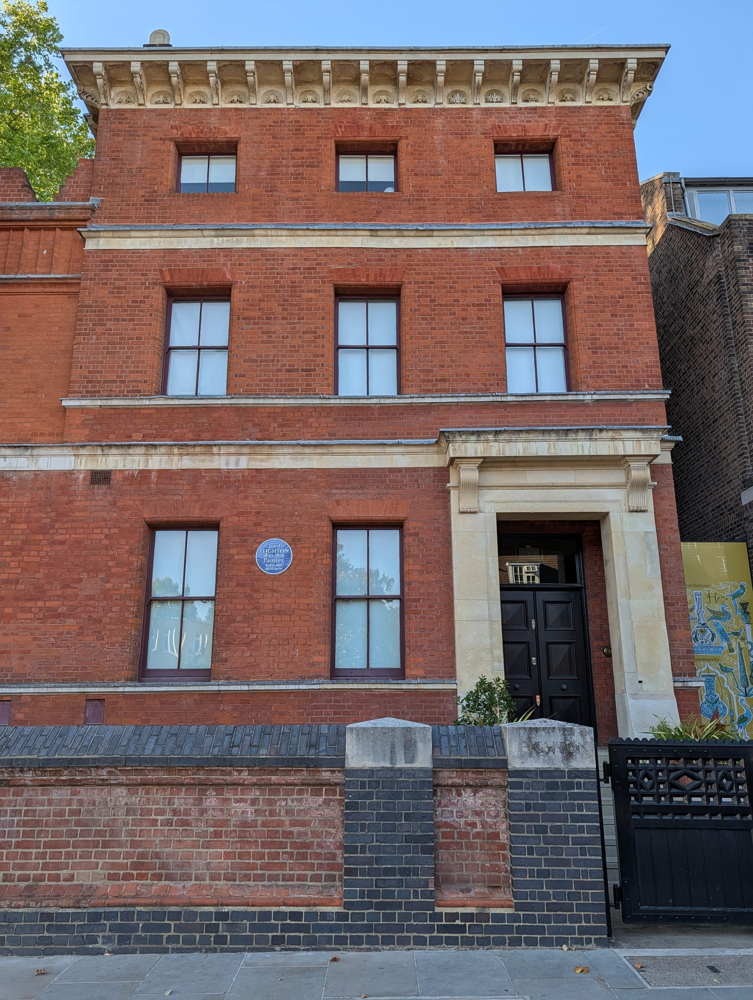

*Leighton House, from Holland Park Road.*

Frederic Leighton's studio-house, built over thirty years from 1866. Go for the **Arab Hall**: a domed, double-height room lined with sixteenth and seventeenth-century Damascus tiles Leighton collected on his travels, a gold mosaic frieze above them and a fountain in the floor.

It is a **house museum**: you go through it room by room, and the first-floor studio where Leighton painted, with its north window and its apse, is the other set piece.

**It reopened in 2022** after a major restoration that added a new wing, a cafe and a new entrance.

It is a walk rather than a Tube ride: **High Street Kensington is about fifteen minutes**, and Holland Park itself is next door if you want to make an afternoon of it.

### The Design Museum, Kensington

*Free; exhibitions ticketed · Mon–Thu 10am–5pm, Fri–Sun 10am–6pm*

**The permanent gallery is free**, and it is *Designer Maker User*, around a thousand objects tracing modern design from the Anglepoise lamp to road signage, on the top floor.

The building is the **old Commonwealth Institute of 1962**, kept for its hyperbolic paraboloid roof — a swooping concrete curve, Grade II* listed — with the interior rebuilt in oak around a full-height atrium.

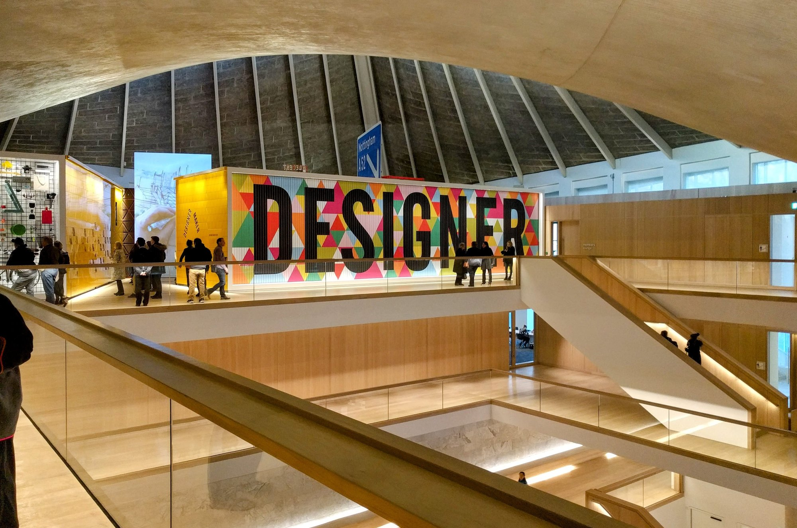

*The atrium, at the Design Museum.*

**Free to walk into, with temporary exhibitions ticketed separately**; you can see the permanent collection without paying. It sits on the Holland Park side of Kensington High Street, about eight minutes from the station.

### Colosseum: The Legendary Arena and Space Explorers, Camden

*From £20.50 · 40 minutes · Eclipso London, Camden · 8+*

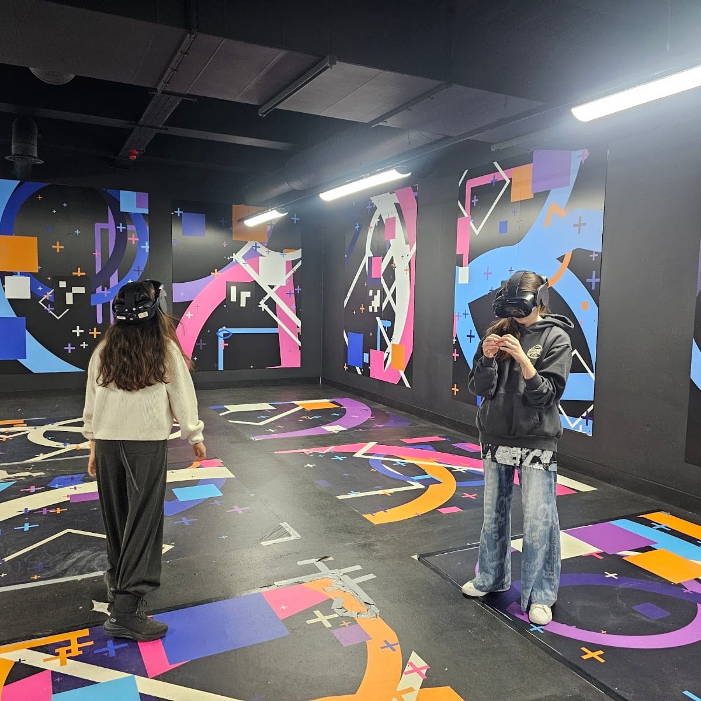

*Free-roaming VR, at Colosseum.*

Headset reconstructions you **walk through rather than watch** — the Colosseum as it stood, and a free-roaming VR piece built from footage shot aboard the actual International Space Station by the Emmy-winning *Space Explorers* series.

**The VR is free-roaming**: you move through a physical space that the VR maps onto, so walking forward in the room walks you forward on the station.

**The ISS experience runs about 40 minutes at £20.50**, and you should arrive 10 to 15 minutes early for check-in and fitting. **Minimum age 8**, with children accompanied.

> ⚠️ **It is not wheelchair accessible.**

---

Powered by <a target="_blank" rel="sponsored" href="https://www.getyourguide.com/london-l57/">GetYourGuide</a>

## Free, and how far that goes

**Almost every major public gallery in London is free to enter.**

**Free permanent collections:** the National Gallery, the National Portrait Gallery, Tate Modern, Tate Britain, the V&A, the Wallace Collection, the Serpentine Galleries, Whitechapel Gallery, the Guildhall Art Gallery, South London Gallery and the commercial galleries — White Cube and the Mayfair dealers — all cost nothing.

**What you pay for is the temporary exhibition.** The big shows at the Tates, the National Gallery and the Barbican are ticketed, often £20 or more.

**Ways to spend less:**

* **The Photographers' Gallery is free after 5pm on the first Friday of each month.**
* **Barbican's The Curve** is a free commissioned installation space inside a ticketed building.
* **National Art Pass** gives half-price entry to many major exhibitions across the country; check each venue, as some exclude it.
* **Under-25s and students** can get reduced entry to the Tates' ticketed exhibitions.
* **Go on a weekday morning.** The National Gallery at 10am is a different building from the National Gallery at 2pm on a Saturday.

> **Commercial galleries are free.** White Cube, Gagosian, Hauser & Wirth and the Cork Street dealers show work at no charge, and you are allowed to walk in.

---

## What to know

* **The Tate Boat** connects Tate Britain and Tate Modern every 20 to 30 minutes during gallery hours, stopping at the London Eye. Travelcard holders get a discount.
* **Friday late openings** are the quietest slots at the National Gallery and Tate Modern.
* **Special exhibitions are ticketed** even inside free galleries — typically £18–£25, and they book out at weekends.
* **The Serpentine Pavilion** is only up from roughly June to October.

---

## Continue planning your London trip

- 🏛️ **[The Best Museums in London](/articles/best-museums-london/)**
- 🎪 **[Free Things to Do in London](/free/)**
- 👀 **[The Best Views in London](/articles/best-views-london/)**
- 🏰 **[Historic Houses in London](/articles/historic-houses-london/)**
- 🏙️ **[South Bank Area Guide](/articles/south-bank-area-guide/)**
- 👑 **[Westminster Area Guide](/articles/westminster-area-guide/)**
