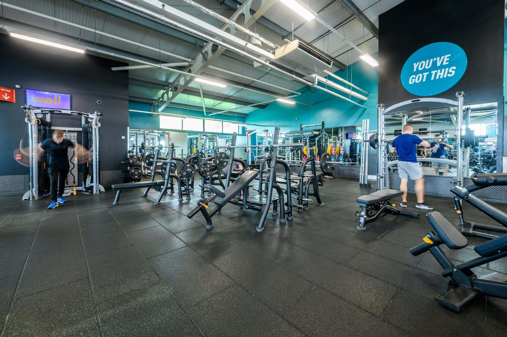
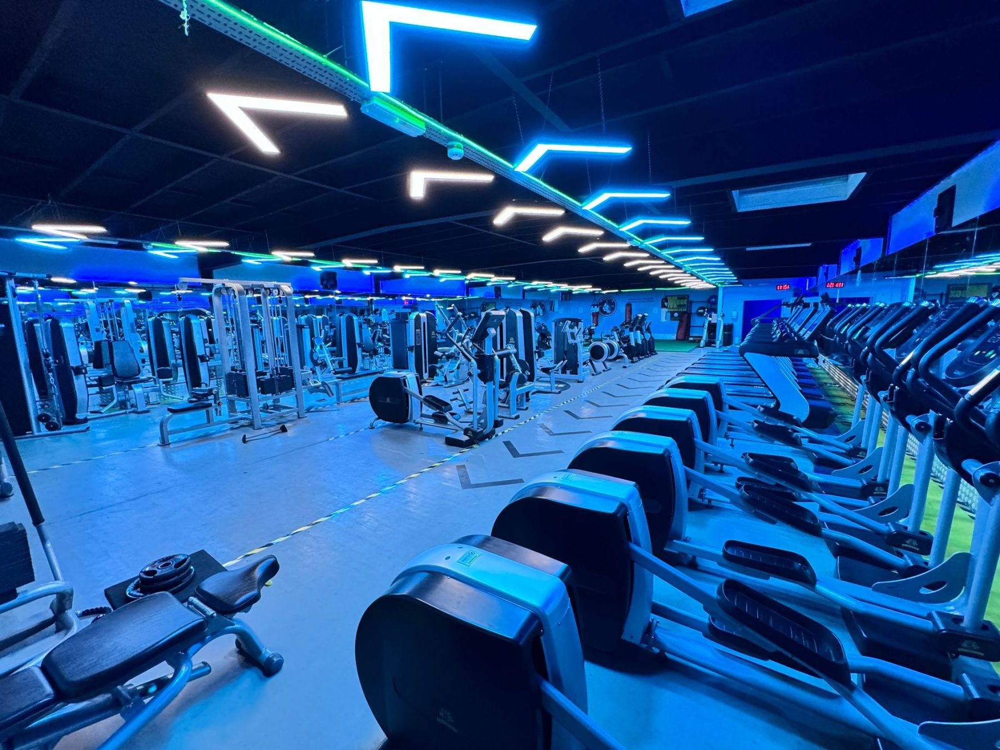
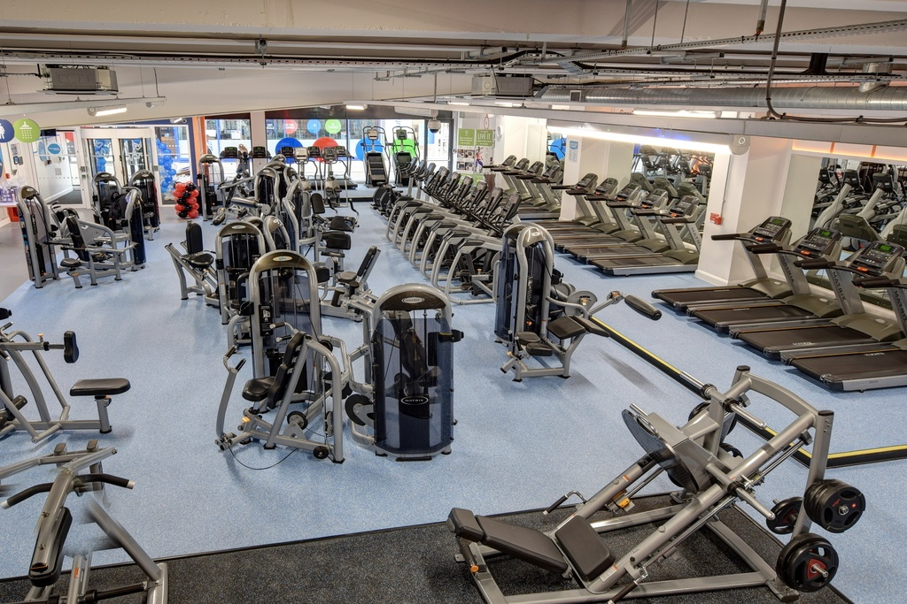

The joining fee, the clause that lets one chain move you onto a dearer club's rate, and the **£3.20 swim that needs no membership** are what decide the cost of a London gym, and the monthly price on the poster leaves out the first two.

> 💡 **The Short Version:** **Public leisure is not automatically cheaper.** Better runs **£34.25** at Phoenix to **£60.00** at Vauxhall, dearer than most commercial chains. Where public wins outright is casual swimming: **£3.20** at Crystal Palace against **£26–£35** for a single boutique class. The cheapest standard adult membership in the table below is **Fitness4Less at £20**, flat across all three clubs including one in Zone 1. **The joining fee is where the advertised price stops being the price:** Virgin Active charges **£25 to £250** depending on the club, and roughly doubles it if you go rolling. **JD Gyms is the only commercial chain in London with a standing no-fee policy.** And if you swim twice a week, **pay-as-you-go beats the membership** by **£150 a year** at Britannia.

> ⚠️ **The resident discount is the biggest number on this page.** A Camden resident pays **£54.10** a year for a Better Pay As You Go card. A non-resident pays **£109.40** for the same card. In Kensington and Chelsea the card is **free** to residents and **£37** to everybody else. Southwark residents swim and use the gym free at set times. Check your own borough before you sign anything.

---

## What a London gym actually costs

Ordered cheapest first within each block: budget chains, then mid-range, then premium, then public leisure. Boutique studios sell classes rather than gym floors and have their own table further down.

| Brand | London sites | Monthly | Joining fee | Contract | Pool |
| --- | --- | --- | --- | --- | --- |
| **Fitness4Less** | 3 | **£20.00** flat | Charged | No contract | No |
| **PureGym** | 87 | £22.99–£49.99 | £0–£25; commonest is £15 | Rolling, or fixed term | No |
| **The Gym Group** | 87 | £23.99–£39.99 | £0, £10, £15 or £20 | Rolling, or 9/12-month saver | No |
| **JD Gyms** | 3 | £25.99–£34.99 | **None, as standing policy** | Rolling, or 14-months-for-12 | No |
| **UK Fitness Club** | 3 | £25.99–£29.99 | £15 or £20 | No contract, or 6/12 months upfront | No |
| **énergie Fitness** | 18 | – | Often waived in offers | Both offered | No |
| **Snap Fitness** | 10 | – | £30, waived at some clubs | Rolling or fixed term | No |
| **Bannatyne** | 4 | £49.99–£69.99 | Waived in the current offer | – | Yes, all four |
| **Fitness First** | 17 | £54–£120 | Charged | Minimum term, or monthly | 7 of 17 |
| **Nuffield Health** | 33 | £77–£137 | **£29** (£39 at three City clubs) | 12 months, or rolling | **31 of 33** |
| **Everlast Gyms** | 1 | From £100 | £20 | – | Yes, Chiswick |
| **Gymbox** | 10 | £82–£141 | £30; £0–£10 on longer terms | 12 months, 3 months or rolling | No |
| **Virgin Active** | 32 | £160–£300 | **£25–£250** | 12 months, or rolling | Almost every club |
| **Third Space** | 17 | £257–£345 | £100 (£200 all-clubs) | Rolling on notice, fixed term sold | 11 of 17 |
| **David Lloyd** | 20 | On enquiry | On enquiry | 12 months, or 3 months | **Yes, every club** |
| **Be Well** (Tower Hamlets) | 7 | £15.00–£99.00 | **None** | No contract | 4 of 5 pools open |
| **Everyone Active** | 12 | £30.00–£75.99 | Waived in offers | No contract, month in advance | Most centres |
| **Move Southwark** | 8 | £31.99–£61.49 | £25 | – | Most centres |
| **Better (GLL)** | 85 | £34.25–£72.00 | £12.50 setup | No minimum term monthly | 53+ centres |
| **Places Leisure** | 11 | £35.00–£75.00 | Folded into the first payment | No minimum term | Most Wandsworth sites |
| **Mytime Active** (Bromley) | 6 | – | **None** | No contract | Yes, all six |

**Reading the "from" column.** Several floor prices are restricted tiers rather than a normal adult membership: Be Well's £15 is its disability membership, Everyone Active's £30 is swim-only at Porchester, Move Southwark's £31.99 is a concession rate, and Virgin Active's £160 is a twelve-month rate at two of the five London clubs that quote a price. The ceiling figures include multi-site tiers: Better's £72 is its UK-wide pass, and Third Space's £345 opens all seventeen clubs.

---

## Budget: £20 to £50 a month

*A PureGym free-weights floor.*

**Fitness4Less** has three clubs, Canning Town, Cambridge Heath and Southwark, all at **£20.00 a month**, including a site on Great Suffolk Street two minutes from Southwark Underground. PureGym charges £41.99 in Holborn and The Gym Group £39.99 at Monument. There is a joining fee, and £20 monthly is the only plan: no short-term, annual or off-peak price. Canning Town runs 05:00–01:00 Monday to Thursday.

**PureGym has 87 London clubs and a 2.2x price spread across them.** The same Core membership is **£22.99** at Croydon and Wembley and **£49.99** at Clapham. Off-peak runs £17.99 to £35.99, but only at 61 of the 87 clubs. Classes are included at most gyms. A guest costs you either the Plus tier or the **Buddy Access bolt-on "from just £3 extra per month"** for four guest visits.

**The Gym Group** has the same shape with a tighter ceiling: **£23.99** at Alperton, Colindale and Wembley Central to **£39.99** at Monument, and off-peak from £16.99 at 79 of its 87 clubs. There are **eleven distinct off-peak schedules** across the London estate, one of which chops the day into 00:00–06:00, 09:00–11:00 and 13:00–16:30. Classes are free on every tier. Personal training is not, because the trainers are freelance and set their own rates, though new members get one free session inside 60 days. Lockers need your own padlock or £5 from the vending machine.

**JD Gyms has three London clubs and charges no joining fee at any of them, as standing policy rather than an offer.** Charlton, Enfield and Uxbridge, **£25.99 to £34.99**, all three open 24/7, saunas in the changing rooms included, classes included even on a day pass. **The teaser rate is not the price.** JD advertises a first month at £10.99, then the clubs charge £25.99 at Uxbridge, £29.99 at Charlton and £34.99 at Enfield. Paying a year upfront buys fourteen months: £311 at Uxbridge, £359 at Charlton, £419 at Enfield.

*UK Fitness Club's East Ham floor.*

**UK Fitness Club** is a small east London independent with three London clubs: Barking, East Ham, and a women-only club next door to East Ham on Castle Street (a fourth is in Tilbury, Essex). Direct debit with no contract is **£25.99** at Barking, £28.99 at East Ham and £29.99 at the women-only club, plus a £15–£20 sign-up fee; paying monthly without a direct debit costs £4 to £6 more. A year upfront at Barking is **£219.99, which is £18.33 a month and £91.89 less than twelve direct debits**. East Ham adds the sauna and jacuzzi (£6.99 a session for non-members) and a family membership covering up to three people for £73.99 a month. Barking and East Ham open 06:00–23:00 every day; the women-only club closes at 22:30 on weekdays and keeps 09:00–21:00 at weekends. There is no personal training to buy.

**Snap Fitness** has ten London clubs and a £30 joining fee that some clubs waive. Every plan covers all 1,000+ Snap gyms worldwide, with no tier cap. **énergie** has eighteen London clubs, and its joining fee is often waived in an offer.

> ⚠️ **easyGym has no gym left in London.** Its only London site, Camberwell, has permanently closed. **TruGym** has shrunk to five clubs and none is in London. **Village Health + Wellness** has 35 clubs and the nearest to London is Watford.

---

## Mid-range: £50 to £140

*The Gym Group's gym floor.*

**Nuffield Health** charges a joining fee of £29, or £39 at the three City clubs, which no offer waives. Membership runs **£77** at Ilford to **£137** at Barbican, City and Moorgate on a twelve-month Anytime plan, with rolling costing £17 to £25 a month more.

At Islington the ladder is **£109 off-peak, £128 Anytime, £150 rolling**, so the off-peak tier saves £41 a month, more than twice what a year's commitment saves. Off-peak means something different at every club: Covent Garden is 09:00–17:00 weekdays with weekends entirely free, while **Bromley is 06:00–16:00 weekdays with no weekend access at all**. There are eight distinct London off-peak schedules. Check the specific club's hours before the price.

**Fitness First runs £54 at Brixton to £120 at Baker Street, London Bridge Cottons and Marylebone**, with Streatham at £65, Oxford Circus and The Strand at £75, and a cluster at £90. It charges a joining fee, paid upfront with the first payment. Multi-club access is included but tiered: "you can use any club at your membership tier or below". Liverpool Street advertises "from just £85 a month" and prices at £90.

**Bannatyne has four London clubs and a pool at all of them**: Chingford has a 25-metre pool with sauna, steam and spa pool, Orpington 15 metres plus a Bannatyne Spa, and Grove Park and Maida Vale have swim timetables. Monthly prices are **£49.99 at Maida Vale and £69.99 at Grove Park**. Bannatyne is advertising no joining fee and half price for November at selected clubs.

**Everlast Gyms is the Sports Direct gym brand, and its only London club is from £100 a month.** At Chiswick Sports Ground, that is more than double a PureGym in the same postcode area and dearer than Nuffield at Ealing. It has a pool, aqua classes, Hyrox, reformer Pilates, ice baths and free parking, and the shortest hours of any chain here: **Mon–Thu 06:00–22:00, Fri to 21:00, weekends 08:00–18:00.**

> **Sports Direct Fitness no longer exists as a brand.** The estate trades as Everlast under Frasers Group.

---

Powered by <a target="_blank" rel="sponsored" href="https://www.getyourguide.com/london-l57/">GetYourGuide</a>

## Premium: £160 to £345

**Virgin Active quotes a price for five of its 32 London clubs:** Mayfair, Chiswick Riverside, Kensington, Canary Riverside and Strand. At the other 27, including Aldersgate, Bank, Barbican, Clapham, Islington Angel, Moorgate, Notting Hill, Swiss Cottage, Tower Bridge and Wimbledon, you book a tour to find out.

The five show the widest joining fee in the table. **Strand: £25 on twelve months, £50 on rolling.** Canary Riverside £30 / £50. Kensington £45 / £75. **Mayfair and Chiswick Riverside: £250 on all membership types.** The rolling premium on the monthly rate compounds it: Strand £160 against £218, Chiswick Riverside £300 against £404, so flexibility costs you 26–36% plus a doubled fee.

Virgin Active has a **seven-tier club access table**: you can use any club in your tier or below. Tier 1 is Chiswick Riverside and Mayfair, Tier 2 Kensington, Tier 3 the Strand-and-Bank group, and so on. The tiers line up with the quoted prices, so the table gives a rough guide to what an unpriced club costs. There is no off-peak tier; the discount instead is 15% off the twelve-month rate for 16–17s, 18–25s and over-65s.

**Third Space** is the dearest gym floor in this guide: **£257** at Canary Wharf, City, Moorgate and Wood Wharf; £259 Tower Bridge; £265 Paternoster Square and Queen's Park; £269 Battersea, Clapham Junction and Wimbledon; £274 Richmond; **£287** at Islington, Marylebone, Soho and The Whiteley. Chelsea and Mayfair have no single-club price. The £299 Group tier "includes full access to all Third Space clubs, **excluding Mayfair and Chelsea**", and only Group Plus at **£345** opens everything.

**David Lloyd** negotiates the price with you at the club. The tier structure is fixed. **Club** is the off-peak tier with the narrowest hours of any chain here: **11am–4pm weekdays and after 2pm at weekends**, with no racquets, no spa and no Blaze. **Club Plus** adds unrestricted hours. **Platinum** adds racquets, Blaze, spa retreats, multi-club and a monthly guest pass, except that the guest pass is withdrawn at five London clubs: Acton Park, Enfield, Finchley, Hampton and Northwood. The "Flexible" three-month term is not available at Colliers Wood or Notting Hill, where twelve months is the only option. Every London club has a pool.

**Gymbox** is London-only, with ten clubs, and prices every contract length. Holborn and Old Street are cheapest at **£82** on twelve months; Farringdon and Victoria dearest at **£108 / £131 / £141** across twelve-month, three-month and rolling. Saunas at every club, red light therapy, snow shower and hyperbaric oxygen at Farringdon, unlimited classes across seven categories with resident DJs, five guest passes a year on every plan, and a free trial with no card details. No pool anywhere.

**Equinox** has three London clubs, Bishopsgate, Kensington and St James's. Kensington has yoga and boxing studios, a strength floor and a spa, and no pool.

---

## Public leisure, and why it is not automatically cheaper

**Better in Lambeth costs £60.00 a month.** Chelsea Sports Centre is £59.50. The Lewisham trio, Glass Mill, Forest Hill and Wavelengths, are £55.70. Britannia in Hackney is £55.00. Those are all more than a mid-market commercial gym and roughly double a budget one, and at Vauxhall, Glass Mill, Forest Hill and Wavelengths you cannot buy the multi-centre tier at all.

Better's cheapest London centre is **Phoenix Fitness Centre in Hammersmith at £34.25** single-centre, £39.45 multi-centre. At Britannia it runs **£55.00 single centre, £64.10 multi-centre, £72.00 UK-wide**, plus a **£12.50 setup fee** on every monthly membership. Off-peak knocks £6 to £11 off (Kensington £39.00 against £49.00, Cally Pool £32.00 against £40.00), with each centre setting its own hours.

The other public operators:

- **Everyone Active** runs the Westminster cluster plus the **London Aquatics Centre**, which is Sports & Leisure Management, not GLL. Porchester MOVE+ is £39.99, the Aquatics Centre £42.99, and a swim-only membership at Porchester is £30.00. The "no contract" claim comes with a compulsory **final month paid in advance** at sign-up, which you get back as a notice period rather than as money.
- **Places Leisure** runs Wandsworth and Kingston. Premium Flexi at Putney is **£47.00** with no minimum term, but the first payment is **£63.99**, described as "a pro rata payment to cover the remaining days of this period and a one-off fee".
- **Move Southwark** is council-run, uniform across eight centres: **£39.49** for Move Essential up to **£61.49** for Move Unlimited, £25 joining fee, freeze at £7.50 a month. The tiers differ on how many sites and how far ahead you can book, not on time of day.
- **Be Well** is Tower Hamlets in-house: **£44.45** anytime, **£36.60** off-peak, **£15.00** disability membership, **no joining fee and no contract**, and every membership covers all six centres. A "Be Well For Now" membership runs from one day upwards.
- **Mytime Active** runs Bromley's six centres as a charity with no contract and no joining fee.

> ⚠️ **Fusion Lifestyle is gone.** It went into administration on 1 April 2026 and **ceased to trade on 30 June 2026**. **Golden Lane Sport and Fitness closed on 30 April 2026.** **Brockwell Lido transferred to Active Lambeth**, Lambeth Council's own leisure service, on 1 July 2026.

---

## The resident discount

The same card, at the same centre, on the same day, costs different amounts depending on your address, and in three boroughs the answer is nothing at all.

| Borough | Operator | Resident | Non-resident |
| --- | --- | --- | --- |
| **Kensington & Chelsea** | Better | **£0.00** a year, adult, junior and concession | £37.00 adult, £21.00 junior |
| **Camden** | Better | £54.10–£54.35 adult; **£6.90** senior 60+ | **£109.40** adult; £45.85 senior |
| **Hillingdon** | Better | £0.00 card; swim £5.55 peak, lido £8.00 | Swim £6.40 peak, lido **£11.40** |
| **Hackney** | Better | £49.70 adult | £49.70 adult — **identical** |
| **Southwark** | Move Southwark | **Free** swim and gym at set times | £39.49–£61.49 a month |
| **Tower Hamlets** | Be Well | **Free** swimming for eligible groups | £44.45 a month anytime |
| **Wandsworth** | Places Leisure | Free 6- or 12-month memberships, means-tested | £47.00 a month Premium Flexi |
| **Greenwich** | Better | One Card: £9.50 at Charlton Lido, £5.75 off-peak | £11.50 at Charlton Lido |
| **Richmond** | Better | Resident card £28.00 a year; gym £10.40 | Gym £11.40 |
| **Lambeth** | Better | **£75.00** a year, the dearest card in this table | Not separately priced |
| **Islington** | Better | £81.70–£81.90 adult; £37.80–£38.60 concession | Not separately priced |

**Camden has the widest gap.** A non-resident pays roughly double for an adult Pay As You Go card (£109.40 against £54.10–£54.35) and **6.6 times** as much for a senior one (£45.85 against £6.90). Camden residents over 60 also swim free off-peak at Swiss Cottage and Oasis.

**Kensington and Chelsea gives residents the card free.** The swim price is the same £4.50 either way; the whole resident advantage is that the card costs £37 if you live over the boundary.

**Southwark** says on its own page: "Southwark residents can use the swimming and gym facilities for free in all of our leisure centres". The free sessions are all day Friday, Saturday 14:00–17:30, Sunday 14:00–21:00, Silver sessions all week for over-60s, and seven days a week for eligible disabled residents. Register with ID and proof of address. Turn up on a Tuesday evening and you pay.

**Tower Hamlets** offers free swimming at designated session times to resident women and girls 16 and over, residents 55 and over, and men 35 and over (registration open since 1 April 2026, sessions bookable since 6 April). A parent-and-child option lets an adult member bring up to two children free at designated family sessions. Register in person at a centre with proof of age *and* Tower Hamlets residency.

**Wandsworth's Access for All** is a means-tested scheme: a free six-month membership on Universal Credit, JSA, Housing Benefit, Council Tax Support, DLA or Incapacity Benefit; a free one-year membership for children on free school meals that covers one adult and up to two children; a free year of Premium for foster carers; £20 a month for care leavers aged 16–25; and free swimming for **all** under-8s with an adult. The free tiers are off-peak and weekends only, peak access is a £23.50 a month upgrade, and the Universal Credit membership expires after six months and needs re-proving with documents dated within the last 28 days.

**Hackney charges residents and non-residents exactly the same £49.70.** Residents get free swimming all year for under-18s, over-60s, disabled residents and carers at Britannia, Clissold and King's Hall.

---

Powered by <a target="_blank" rel="sponsored" href="https://www.getyourguide.com/london-l57/">GetYourGuide</a>

## When pay-as-you-go beats a membership

Everyone Active's FAQ says: "if you intend to visit the centre at least twice a week then a membership will normally be the best value option for you." On Better's published numbers, for a swimmer, that is optimistic.

**Britannia Leisure Centre, Hackney.** Single-centre membership is £55.00 a month plus the £12.50 setup, **£672.50 over a year**. A swim with a Pay As You Go card is £4.55, and the card is £49.70. Two swims a week for a year: 104 × £4.55 + £49.70 = **£522.90**. **Pay-as-you-go wins by £150**, and the membership only pulls ahead at about three visits a week, and only if you use the gym and classes as well.

**Crystal Palace.** A non-member off-peak swim is **£3.20**, with no card at all. Two a week is £332.80 against a £50.50 membership, £618.50 with the setup fee.

**Vauxhall, Lambeth.** The card is £75, the dearest in this table, and an off-peak swim is £6.50 with it. Two a week comes to £751 against £732.50 on the membership, so the membership is already £18.50 cheaper at two visits a week. Lambeth is the one borough here where the twice-a-week swimmer should take the membership.

**The cards need the same arithmetic.** A Hackney card at £49.70 saves £1.85 a swim, so it needs **27 swims a year** to break even. An Islington concession card at £38.50 needs about **16**. A Kensington and Chelsea resident card is free and breaks even on the first visit. At Vauxhall a non-member swim is £9.25 against £6.50 with the card, so the card pays for itself in about 27 swims.

**In the boutique world the membership always wins on unit price:** Psycle is £29 a single credit against £15.67 a class on PSYCLE15; 1Rebel £26 a session against £14.58 on All-Access 12; Heartcore £35 against £22.14; SoulCycle £28 against £19.50. Every one of those memberships carries a minimum term and an expiry.

---

## Boutique studios: the price is per class

Boutique studios sell a booked class at £26 to £35, then a way of paying less per class in exchange for going more often. **Nothing here has a pool.**

| Studio | London sites | One class | Membership from | Membership to | Restrictions |
| --- | --- | --- | --- | --- | --- |
| **Digme Fitness** | 2 | £26 | £69 (4 a month) | £159 unlimited | Classes valid one month, no carry-over |
| **1Rebel** | 13 | £26 | £75 (4 a month) | £229 unlimited | **6-month minimum on every membership** |
| **SoulCycle** | 1 (Soho) | £28 | £90 (4) | £312 (16) | Classes expire 30 days from purchase |
| **Psycle** | 7 | £29 | £100 (5 credits) | £350 | **Credits do not roll over** |
| **BXR London** | 2 | £30 (£15 for members) | £95 (weekends) | On enquiry | Full gym price is enquiry-only |
| **KXU** | 1 | £31 | £230 (10) | £350 (30) | "Unlimited" is capped at 30 a month |
| **Heartcore** | 8 | £35 | £237 (10) | £310 (14) | Every pack expires, 1 to 6 months |

**The expiry is the real price.** 1Rebel's own wording: "all bookings need to be made before you reach the expiry date", meaning booking, not attending. A single 1Rebel session dies in 30 days and the £59 intro pack in 14. Psycle's membership credits "must be used within the current billing period and do not roll over", so a £235 PSYCLE15 costs £235 whether you take fifteen classes or four. Heartcore's packs run one month for a single class up to six months for thirty. SoulCycle's £312 sixteen-class membership expires 30 days from purchase.

SoulCycle trades from one studio at 3–4 Great Marlborough Street, W1F 7HH. Digme Fitness trades from Moorgate and Richmond plus online. Barry's has seven London studios. F45 Training has 35 sites, franchised, with a 14-day trial for local residents only.

---

## Where to swim

**No PureGym, Gym Group, JD Gyms, Snap Fitness, énergie, Fitness4Less or Gymbox in London has a swimming pool**, at any of roughly 220 sites between them.

**Nuffield Health has a pool at 31 of its 33 London clubs.** The two exceptions are **Battersea** and **Bromley**, although Nuffield's membership wording says all plans include "full access to the gym floor, swimming pool, sauna and steam room".

**David Lloyd has a pool at every London club.** **Bannatyne has one at all four.** **Virgin Active has one at almost every club**: 25 metres at Bromley, Chiswick Park, Islington Angel, Moorgate, Swiss Cottage and Wandsworth; 20 metres at Aldersgate, Canary Riverside, Mayfair, Mill Hill, Notting Hill and Wimbledon; 24 at Repton Park, 17 at Clapham, 16 at Bank and Crouch End, 14 at Streatham. Aldersgate and Clapham add hydrotherapy pools.

**Third Space has a pool at 11 of its 17 clubs.** Yes at Battersea, Canary Wharf, City, Islington (20m, six lanes), Marylebone (16m, three lanes), Richmond, Soho (20m, four lanes, with a suspended glass training floor above it), Tower Bridge, Wimbledon (25m), The Whiteley and Wood Wharf. **No pool at Mayfair, Moorgate, Chelsea, Clapham Junction, Queens Park or Paternoster Square.** Chelsea has a cold plunge, Queens Park a hydro pool for 25 people, Paternoster Square one for 14.

**Fitness First has a pool at 7 of its 17 London clubs**: Baker Street (17m), Bishopsgate (16m), London Bridge Cottons, Hammersmith, Highbury, Streatham (20m) and Thomas More Square in Wapping (12m). No pool at Balham, Brixton, Clapham Junction, Oxford Circus, Queens Park or The Strand. **Marylebone has no pool of its own**; it offers "access to our nearby Baker Street club, less than a mile away" at the same £120 that Baker Street charges.

### The 50-metre pools, and the big outdoor ones

| Pool | Where | Operator | Size | A single swim |
| --- | --- | --- | --- | --- |
| **Tooting Bec Lido** | Tooting SW16 | Places Leisure for Wandsworth | **91m**, unheated, seasonal from 1 May | – |
| **Parliament Hill Lido** | Hampstead Heath NW5 | City of London | **60m**, unheated, open 365 days | £5.00–£8.80 by session |
| **London Aquatics Centre** | Olympic Park E20 | Everyone Active | **Two 50m pools** plus a diving pool | £7.90 peak, £7.30 off-peak |
| **Hillingdon Sports & Leisure** | Uxbridge UB8 | Better | **50m indoor and a 50m lido** | £5.55 resident, £6.40 non-resident |
| **London Fields Lido** | Hackney E8 | Better | **50m** heated, floodlit, open all year at 24°C | £6.40, or £4.55 with a card |
| **Charlton Lido** | Greenwich SE18 | Better | **50m** heated outdoor | £11.50, the dearest single swim in this table |

**Parliament Hill** is cheapest at the edges of the day. In summer the Morning and Afternoon blocks are £8.80, but the **Breakfast and Evening sessions are £5.00**, so a 07:00 or 19:00 swim costs 43% less than the same swim at 11:00. In winter it is £5.00 flat, £1.50 for a 5–15 year old, with a sauna at £7.00 from October to May that cannot be bought without a swim ticket. **Under-16s and over-60s swim free before 09:30, every day of the year**, at the Lido and at all three ponds.

**The Hampstead ponds are £5.00** — Kenwood Ladies', Highgate Men's and the Mixed Pond, open all year, £3.00 concession and under-16. They are deep, opaque and unlifeguarded; competent swimmers only. Season tickets run £83 for six months or £157 for a year on the ponds alone, £171 and £252 on the Lido, £216 and £348 for both.

**And the rest.** **Oasis in Covent Garden** has an outdoor heated pool and an indoor one in the middle of the West End (£8.10, or £5.80 with a Pay&Play card). **Ironmonger Row Baths** in Islington has the Turkish spa (£7.60 off-peak). **Pools on the Park** in Richmond has both indoor and outdoor. **Porchester** has a 30m four-lane main pool, a 20m teaching pool and the Porchester Spa. **Britannia** and **London Fields Lido** are £6.40, or £4.55 with a card. **Crystal Palace** is £3.20 off-peak, with seniors at £2.50 any time.

> ⚠️ **Crystal Palace has no 50-metre pool to swim in.** Better lists a 25-metre training pool and a teaching pool there. For long-course lanes, go to the London Aquatics Centre, Hillingdon or London Fields Lido.

---

Powered by <a target="_blank" rel="sponsored" href="https://www.getyourguide.com/london-l57/">GetYourGuide</a>

## What the price does not include

### The joining fee

**Virgin Active** charges £25 to £250 depending on the club, and roughly doubles it if you choose rolling over twelve months.

**PureGym's £0 is a promotion, not a price.** Five of its 87 London clubs charge nothing: Camden High Street, Chiswick Park, Cricklewood, Harrow and Kensington High Street. The commonest London fee is £15 at 25 clubs, then £20 at 18 and £19.99 at 14; the dearest is £25 at Bow Wharf, Fulham, Limehouse, Moorgate, Piccadilly and St Pauls.

**The Gym Group advertises a fee most of its London clubs do not charge.** Its London region page advertises a price from £30.99 that includes a one-off £10 joining fee. In fact **45 of its 87 London clubs charge £15**, 17 charge £10, 23 charge £0 and two charge £20. Its 9- and 12-month Saver plans carry no fee at all.

**JD Gyms is the only commercial chain with a standing no-fee policy.** Nuffield's £29 is never waived. Better charges £12.50 as a setup fee, waived on annual prepaid and on Pay As You Go cards. The council operators Be Well and Mytime Active also charge nothing.

### The clause that moves you to a dearer club

**Clause 9 of Fitness First's membership terms:** "If you use another club other than your home club more frequently over a two-month period, we may transfer your membership to that club, which could impact your fees."

Join at **Brixton for £54**, take a job near **Baker Street at £120**, use the club by your office more often for two months, and Fitness First reserves the right to move your membership, and your monthly payment, onto the dearer club.

Fitness First also charges a settlement fee to leave a minimum term early, defined as the total discount you received for committing, with its own worked example of £15 × 3 = £45 after three months of a twelve-month term. Free exit applies only for medical reasons, job loss, or moving more than five miles from your home club. Paying monthly costs more than the sticker price: "If you pay by monthly Direct Debit an additional charge for credit will be included in the membership fee."

### The discount that ends mid-contract

**Gymbox's 50% off ends after six months.** Its wording: "Get 50% off your first six months when you join. Your membership will then automatically go to the full price in **April 2027**." A Farringdon sign-up pays £54 a month for six months, then £108 for the remaining six months of a contract they cannot leave.

### "Open 24/7", except where it isn't

**The Gym Group's headline is 24/7 and four London clubs are not.** Its London FAQ names them: **Caledonian Road** (Mon–Fri 06:30–23:00, weekends 08:00–21:00), **Charing Cross** (Mon–Fri 6am–10pm, weekends 10am–5pm), **East Ham High Street** and **Oxford Street** (both Mon–Fri 6am–10pm, weekends 8am–8pm). Charing Cross and Oxford Street are two of the three most expensive Gym Group clubs in London.

PureGym's footnote is "†Most gyms open 24/7", and 19 of its 87 open London clubs are not advertised as 24-hour. Everlast Chiswick closes at 18:00 at weekends.

### The multi-site tier that is really a price band

**PureGym Plus** reads: "Get access to every other full priced PureGym at the same price or lower than yours." Buy Plus at Croydon for £28.99 and Clapham at £59.99 is not included. Buy it at Clapham and everything is.

**Bannatyne** works the same way and reserves the right to change it: "Membership of a club allows you to use any club in a lower or equal cost tier. **Tiers may change without notice.**" **Fitness First** and **Virgin Active** both tier the same way. **Snap Fitness** is the outlier at this price point: every plan includes every Snap gym worldwide, no cap.

### The rest of the small print, briefly

- **Third Space charges £40 a month to freeze**, the highest here (Fitness First charges £8, PureGym from £6.99, The Gym Group nothing on its top tier). It also takes a **£100 joining fee before it tells you when you can start**: "Initial access to these clubs will be staggered due to waitlists, and your confirmed access date will be provided upon joining." Cancelling the direct debit at your bank is **not** notice, since it is treated as non-payment and triggers debt recovery, and notice runs to the end of the month *after* the month you give it, so resigning on 2 October keeps you paying to 30 November.
- **Snap Fitness** is a franchise, and Belvedere's club FAQ sets fines: letting someone else use your card means "you will incur a £50 fine directly onto your membership account", and not racking your weights "may incur a £20". A replacement card is £15.
- **PureGym's fixed-term plans keep half your money.** "You can cancel you fixed-term membership anytime. Get a refund of 50% of the remaining credit on the account from the day you contact us."
- **Fitness First's extras add up:** a £30 refundable locker deposit forfeited if you lose the key, Reformer Pilates on £10 credits that expire in 60 days and are not reinstated after a late cancellation, and class access that "may result in members class booking access being revoked" after repeated no-shows.
- **Better's Flex membership is advertised at £10 a month** and prices at £12.50, plus the £12.50 setup fee, for one free booking a month.
- **Everyone Active's "no contract" comes with a compulsory month in advance.** On the Porchester swim membership that made the first payment £40.00 against a £30.00 monthly fee. Cancel the direct debit at the bank and you cancel every membership you hold; cancel after the 20th and you may have missed that month's collection.
- **énergie's discounts do not stack.** Acton's page: blue light 10%, student 10%, corporate 15%, and "These discounts cannot be used in conjunction with the monthly offer." A student takes one or the other, not both.

---

## Just visiting, or not ready to sign

Almost every operator here sells a day or a fortnight, and for a visitor the public pool is usually the cheapest option. If you want the pool in the building you sleep in, [London hotels with a pool](/articles/hotels-with-pool-london/) gives the length and the children's hours at each one.

**Day passes at the chains.**

| Operator | Day pass | What else it sells |
| --- | --- | --- |
| **UK Fitness Club** | **£6.99–£8.99** | £6.99 at Barking, £7.99 at East Ham, £8.99 at the women-only club |
| **The Gym Group** | £9.99–£16.99 | £9.99 at Alperton, Colindale and East Croydon; £16.99 at Monument. Three- and five-day passes at Oxford Street, £26.99 and £33.99 |
| **JD Gyms** | £10.99 or £12.99 | £10.99 at Uxbridge, £12.99 at Charlton and Enfield. Bought as a QR code in the app, valid 24 hours, full access including classes |
| **Snap Fitness** | £15 | £39.99 for fourteen days at Elephant and Castle, during staffed hours |
| **PureGym** | Priced per gym | Passes from one to thirty days, with "no contract or sign up fees" |
| **Nuffield Health** | Free, three days | A complimentary gym pass, arranged at club level |
| **Gymbox** | Free trial | No card details |
| **énergie Fitness** | Free trial | No card details |
| **Third Space** | **None** | Sells no day pass at all |

**Public leisure.** Better charges **£15 for a day and £30 for a week** at most centres, with thirty days at £54.95–£75, but £25 a day at Oasis, £20 a day at Jubilee Hall, and £41 a day at Charlton Lido. Everyone Active's card is free to register: at the Aquatics Centre a gym session is £15.00, a swim £7.90 peak or £7.30 off-peak, a class £14.40.

**The single swim is the cheaper hour.** £3.20 off-peak at Crystal Palace. £5.00 in the Hampstead ponds or at Parliament Hill Lido in winter. £5.90 at Kensington. £6.40 at Britannia or London Fields Lido. Against £15 for a gym day pass or £26–£35 for one boutique class, you can buy it on the door.

**Boutique intro offers are where the discounting is.**

| Studio | Intro offer | Per class |
| --- | --- | --- |
| **Digme Fitness** | 3 for £30, or two weeks unlimited for £49 | **£10.00** |
| **1Rebel** | **5 sessions for £59**, and only 14 days to use them | **£11.80** |
| **BXR London** | **4 classes for £49**; a single BXR City class is £15 | **£12.25** |
| **SoulCycle** | New Rider first class **£15**, 3 for £50, or unlimited for 14 days at £89 | **£15.00** on the first class |
| **Heartcore** | 3 Coreformer classes for £55, or 3 mat classes for £45 | **£15.00** on the mat pack, £18.33 on Coreformer |
| **Psycle** | **3 classes for £50**, or two weeks unlimited for £100 | **£16.67** |
| **KXU** | 3 for £59 | **£19.67** |

---

Powered by <a target="_blank" rel="sponsored" href="https://www.getyourguide.com/london-l57/">GetYourGuide</a>

## How to choose, in order

1. **Check your borough first, before any brand.** If you live in Southwark or Tower Hamlets, or you qualify in Wandsworth, part of your swimming and gym use is free and no commercial membership will beat it.
2. **Price the specific club, never the brand.** The same PureGym membership is £22.99 or £49.99. The same Nuffield is £77 or £137. The same Virgin Active joining fee is £25 or £250.
3. **Count your visits.** Under three a week, pay-as-you-go usually wins at a public pool. At a boutique studio, a pack beats a membership below twice a week, as long as you read the expiry.
4. **Add the joining fee to the first year.** A £15 monthly saving takes about a year and a half to earn back a £250 fee.
5. **If you need a pool, the choice narrows.** It rules out the entire budget market and Gymbox, and leaves Nuffield, David Lloyd, Bannatyne or your council.
6. **Read the off-peak hours, not the off-peak price.** Nuffield has eight different London schedules and The Gym Group eleven. David Lloyd's entry tier is 11am–4pm on weekdays.
7. **Check the contract length against how sure you are.** Rolling costs 26–36% more at Virgin Active, 31–37% at Gymbox and 18–20% at Nuffield.

---

## Continue planning your London trip

- 🌳 **[The Best Parks and Gardens in London](/articles/best-parks-gardens-london/)** — the Heath, the lidos and the ponds in context
- 💷 **[London on a Budget](/articles/london-on-a-budget/)** — the same arithmetic applied to everything else
- ☔ **[London in the Rain](/articles/london-in-the-rain/)** — indoor pools included
- 🏃 **[The London Marathon Guide](/articles/london-marathon-guide/)** — if you are joining to train
- 🌲 **[Hampstead Area Guide](/articles/hampstead-area-guide/)** — the ponds, the Lido and Parliament Hill
- 🚴 **[Cycling and Bike Hire in London](/articles/cycling-bike-hire-scooters-london/)** — the cheapest cardio in the city
- 🏙️ **[Stratford Area Guide](/articles/stratford-area-guide/)** — for the London Aquatics Centre
- 🏨 **[Aparthotels in London](/articles/aparthotels-london/)** — several include a gym in the nightly rate

---

*Gym pricing in London is set club by club and changes often, and several chains run joining-fee promotions that will not last. Confirm the figure for your specific club before you sign.*
