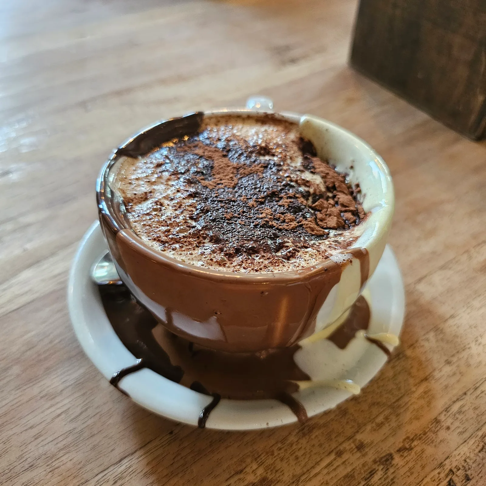
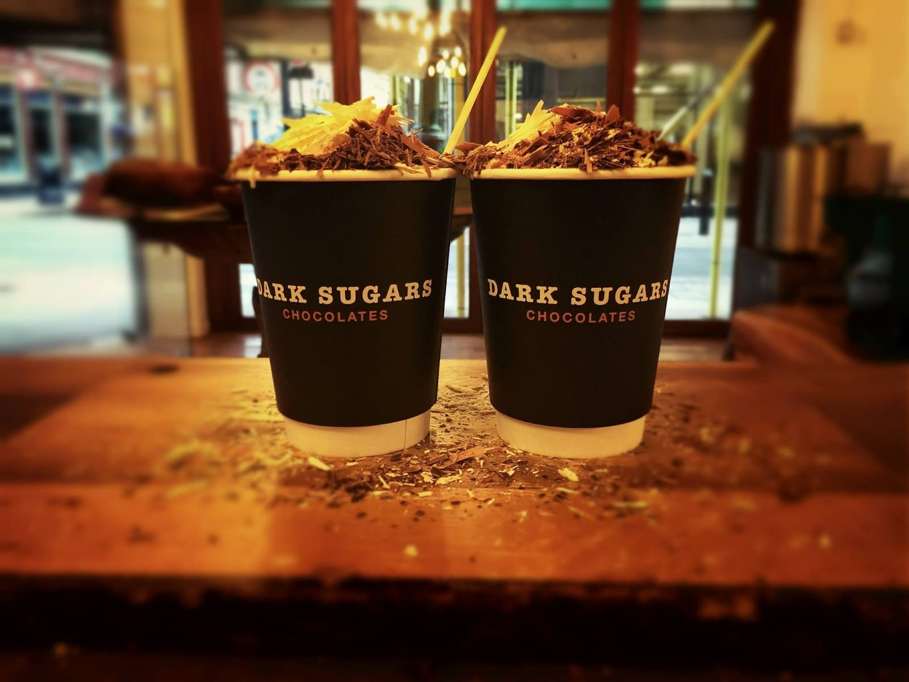
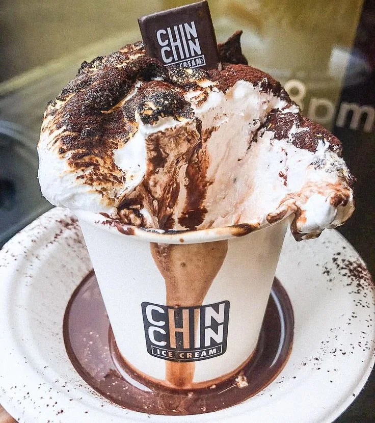
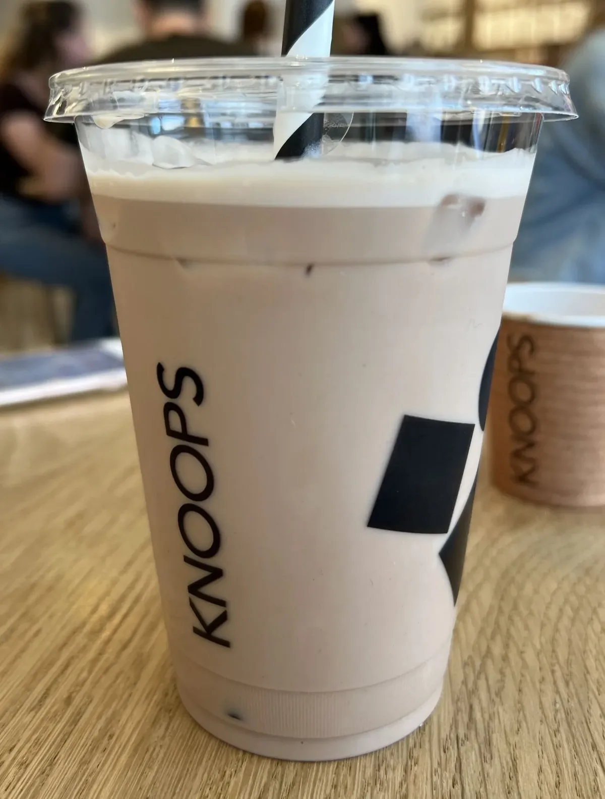
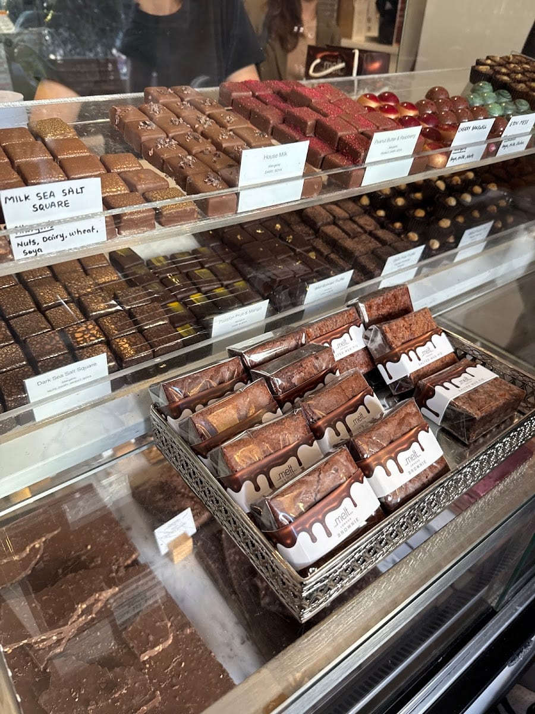
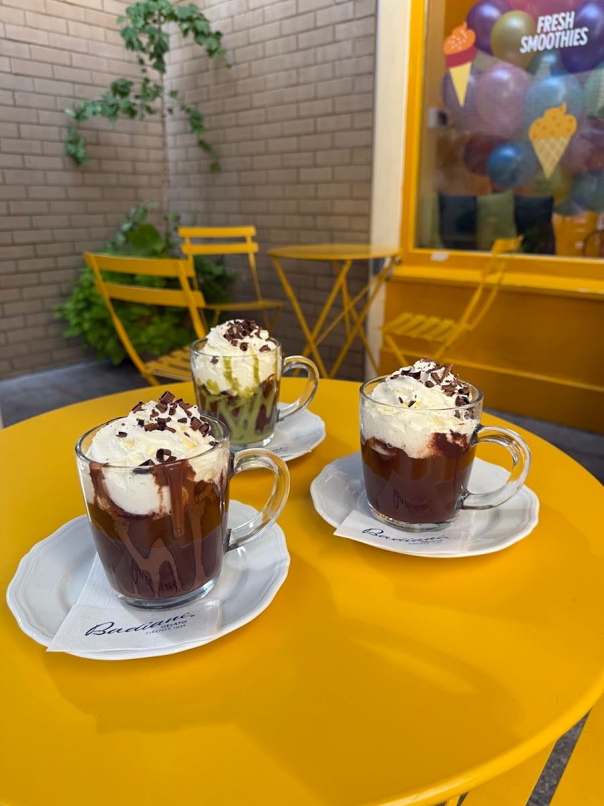

At the top of this list hot chocolate is closer to melted ganache in a cup, thick enough that the spoon does real work, and it costs £4 to £6. Every venue is ranked by how many independent lists, blogs and video reviews name it.

> 💡 **The Short Version:** **[Italian Bear Chocolate](#italian-bear-chocolate)** on Broadwick Street is named by more sources than anywhere else: a triple-layered cup closer to warm ganache than a drink, from £4.90. **[Dark Sugars](#dark-sugars-cocoa-house)** on Brick Lane grates chocolate over the cup until the first inch is solid shavings. **[Chin Chin Dessert Club](#chin-chin-dessert-club)** in Soho blowtorches a fist-sized marshmallow on top for £4.95. **[Knoops](#knoops)** lets you order by cocoa percentage, nine of them from 28% to 100%, from £4. Only Italian Bear takes bookings; Dark Sugars and Chin Chin queue at weekends, so go on a weekday afternoon.

> 📊 **The evidence behind this guide.**
> **12 sources carrying 67 citations** across **39 named venues**. **Eight venues are named by two or more independent sources.**
> **Built on:** Time Out and The Infatuation; Mostly Food and Travel, Clumsy Girl Travels and DesignMyNight; YouTube.
> *Evidence rebuilt 7 September 2026 · [How we rank →](/how-we-rank/)*

> ⏱️ **When to go.**
> Only Italian Bear takes bookings; the rest are counters and shops where you turn up. **Andrea's opens at weekends only**, and **Dark Sugars and Chin Chin queue at weekends**. On a weekday afternoon you walk straight in.

---

## The winners

### Italian Bear Chocolate

*£ · Carnaby · 4 min from Oxford Circus · Cited by 9 sources · [italianbearchocolate.com](https://www.italianbearchocolate.com/)*

*Italian Bear's hot chocolate.*

**41 Broadwick Street, W1F 9QL.** The thick Italian style, poured in three layers so the cup arrives striped, and dense enough that it behaves more like warm ganache than a drink. From **£4.90**.

Open 9am to 11pm Monday to Saturday and 9am to 10.30pm on Sunday. **Tables can be booked**, and there is a second shop at 29 Rathbone Place, W1T 1JG.

> 💡 **This is the old Said dal 1923 site.** Several lists still name Said dal 1923, which was at the same address.

---

Powered by <a target="_blank" rel="sponsored" href="https://www.getyourguide.com/london-l57/">GetYourGuide</a>

## Also strongly backed

### Dark Sugars Cocoa House

*£ · Brick Lane · 8 min from Shoreditch High Street · Cited by 8 sources · [darksugars.co.uk](http://www.darksugars.co.uk/)*

*Dark Sugars' hot chocolate.*

**141 Brick Lane, E1 6SB.** Chocolate is grated over frothed milk in front of you and the cup arrives buried under shavings — three kinds, piled high enough that the first inch is solid. The shop makes 72 of its own chocolates and works with Ghanaian cocoa.

Standing room only. **It is busy at weekends**, when Brick Lane's markets run.

### Chin Chin Dessert Club

*£ · Soho · 3 min from Tottenham Court Road · Cited by 6 sources · [chinchinicecream.com](https://www.chinchinicecream.com/)*

*The blowtorched marshmallow at Chin Chin.*

**54 Greek Street, W1D 3DS.** A paper cup topped with a handmade marshmallow the size of a fist, blowtorched at the counter until it chars and slumps. **£4.95**, with a vegan version done in raspberry and apricot. The same kitchen makes nitrogen ice cream.

Tiny, loud and built for a queue rather than a sit-down. **The blowtorching** happens in front of you and takes about ten seconds, which suits children.

### Knoops

*£ · Covent Garden · 3 min from Leicester Square · Cited by 4 sources · [knoops.com](https://knoops.com/uk)*

*A Knoops iced chocolate.*

**2 New Row, WC2N 4LH.** You order by number, not by flavour: its own menu runs **nine cocoa percentages — 28, 34, 38, 43, 54, 65, 70, 80 and 100%** — and the same drink tastes like four different things across that range. From **£4**. Ask for 70% if you have no idea; 100% is bitter. The same percentages are sold iced.

Small, with a few seats. **Five London stores**: Chelsea, Covent Garden, Kensington, Knightsbridge and Notting Hill.

### Mamasons Dirty Ice Cream

*£ · Chinatown · 2 min from Leicester Square · Cited by 3 sources*

**32 Newport Court, WC2H 7PQ.** The ube hot cocoa, **£5**, made with purple yam so it arrives violet. Filipino ice cream is the main business.

A narrow Chinatown shopfront with almost nowhere to sit, and a queue on Friday and Saturday nights that is mostly for the ice cream. **It opens late**, which suits after a show or a late dinner in Chinatown.

### Andrea's Hot Chocolate

*£ · Columbia Road · 10 min from Hoxton · Cited by 2 sources · [andreacacao.com](http://andreacacao.com/)*

**The Courtyard, behind Milagros Mexican shop, 61 Columbia Road, E2 7RG.** A single-origin specialist, open **Sundays 10am to 4pm** at Columbia Road, where the flower market runs. It also trades on Sundays 10am to 4pm in Victoria Park, between Bonner Gate and Gore Road, and on Saturdays 10am to 4pm in Lloyd Park, Walthamstow.

**Weekends only; nothing Monday to Friday.**

### Melt Chocolates

*££ · Notting Hill · 6 min from Notting Hill Gate · Cited by 2 sources · [meltchocolates.com](https://www.meltchocolates.com/)*

*Melt's chocolate counter.*

**59 Ledbury Road, W11 2AA.** A working chocolate kitchen with the counter at the front, so the drink is made from the same chocolate being tempered a few feet behind it. Boxed chocolates, slabs and hampers are the main business, and the hot chocolate is what you drink while choosing them.

**No booking and no queue.** The one to choose if you want to sit down with the cup.

### Badiani

*£ · Covent Garden · 4 min from Covent Garden · Cited by 2 sources · [badiani1932.com](http://www.badiani1932.com/)*

*Badiani's hot chocolate.*

**2 Mercer Walk, WC2H 9QP.** A Florentine gelateria trading since 1932, whose hot chocolate comes out thick and dessert-like.

**No booking, and it is a counter**, so most people take the cup out into Mercer Walk.

> ⚠️ **Sources name Badiani as a brand, not a branch.** There are several London sites and this is the Covent Garden one. Check which you are heading for.

---

## What the widely-shared list gets wrong

Time Out's list is dated **28 October 2022**. This is where its names stand now:

| Time Out's 2022 names | |
| --- | --- |
| **Closed** | Paul A Young Fine Chocolates, Ruby Violet, DeRosier, Rabot 1745 |
| **Still trading** | Chin Chin, Dark Sugars, Italian Bear, Melange, Farm Girl, The Haberdashery, Kapihan, The Parlour at Fortnum & Mason |

**Four have closed in four years.** Rabot 1745 was Hotel Chocolat's Borough Market café.

---

## Cheapest

Everything on this page except Melt sits in the **£4 to £6** band, which makes price a poor way to choose. The cheap end:

- 💷 **[Knoops](#knoops)** — from **£4**
- 💷 **[Italian Bear Chocolate](#italian-bear-chocolate)** — from **£4.90** for the triple-layered cup
- 💷 **[Chin Chin Dessert Club](#chin-chin-dessert-club)** — **£4.95** including the blowtorched marshmallow

The one to know about rather than book: **The Chocolate Cocktail Club** runs bottomless chocolate cocktails at **£32 a head**. It is an evening out rather than a hot chocolate.

---

## By style

**Thick Italian** — [Italian Bear Chocolate](#italian-bear-chocolate). Melted rather than mixed, eaten with a spoon.

**Classic, chocolate-forward** — [Dark Sugars](#dark-sugars-cocoa-house) and [Melt](#melt-chocolates). Real chocolate into hot milk, no theatre.

**Single origin and dark** — [Andrea's](#andreas-hot-chocolate) for the cocoa itself, [Knoops](#knoops) if you want to pick the percentage yourself.

**Topped and photogenic** — [Chin Chin](#chin-chin-dessert-club) for the blowtorched marshmallow, [Mamasons](#mamasons-dirty-ice-cream) for the purple ube.

---

Powered by <a target="_blank" rel="sponsored" href="https://www.getyourguide.com/london-l57/">GetYourGuide</a>

## Booking essentials

**Only Italian Bear takes bookings.** The rest are shops and counters where you walk in.

- **Andrea's is weekends only.** Closed Monday to Friday.
- **Weekend queues** at Dark Sugars and Chin Chin. A weekday afternoon is quieter.
- **Most of these have almost nowhere to sit.** For a table, book Italian Bear or go to Melt in Notting Hill.

---

## Continue planning your London trip

- 🍰 **[Afternoon tea in London](/articles/best-afternoon-tea-london/)** — every room, every price
- 🍦 **[Best ice cream in London](/articles/best-ice-cream-london/)** — several of these shops appear on both
- ☕ **[Best coffee in London](/articles/best-coffee-london/)** — the other winter drink
- 🧋 **[Best bubble tea in London](/articles/best-bubble-tea-london/)** — the summer counter drink, several of them round the corner from Chin Chin
- 🎄 **[Christmas in London](/articles/christmas-in-london/)** — markets, lights and what is worth queueing for
