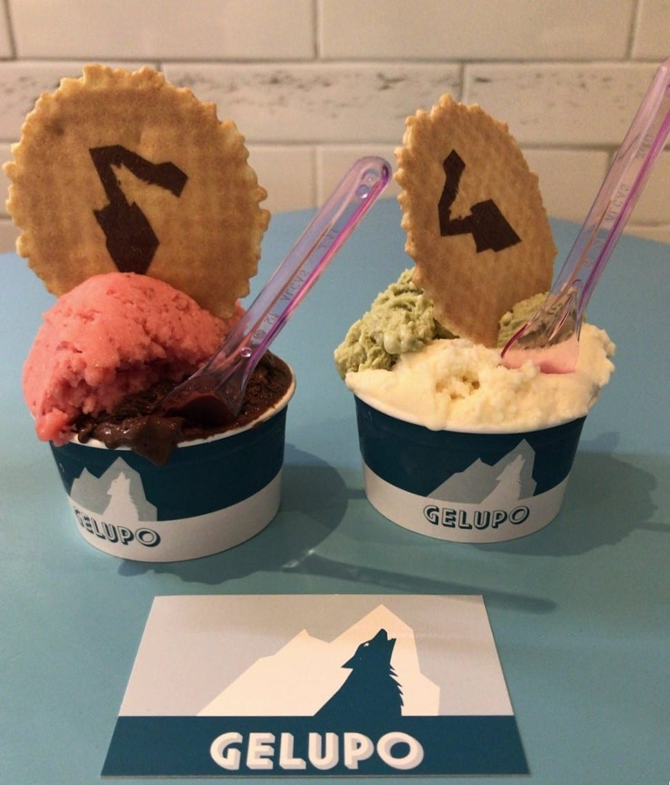
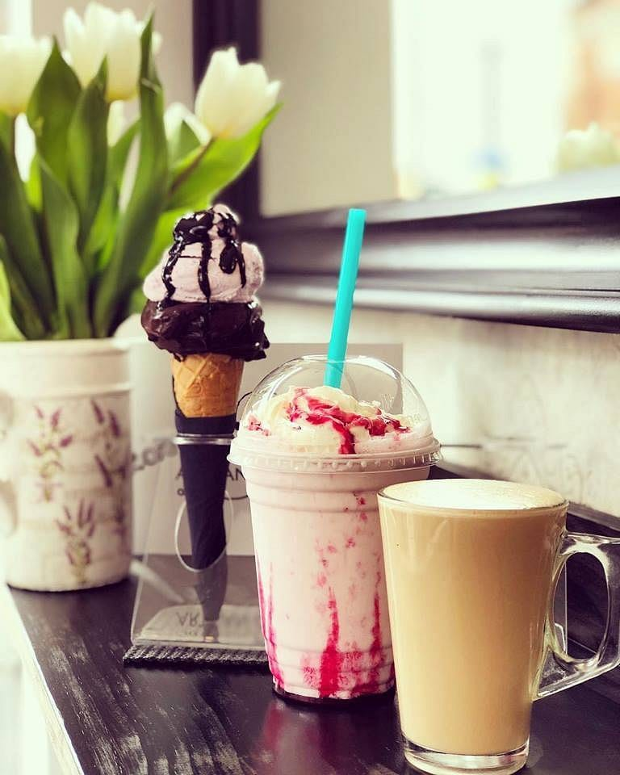
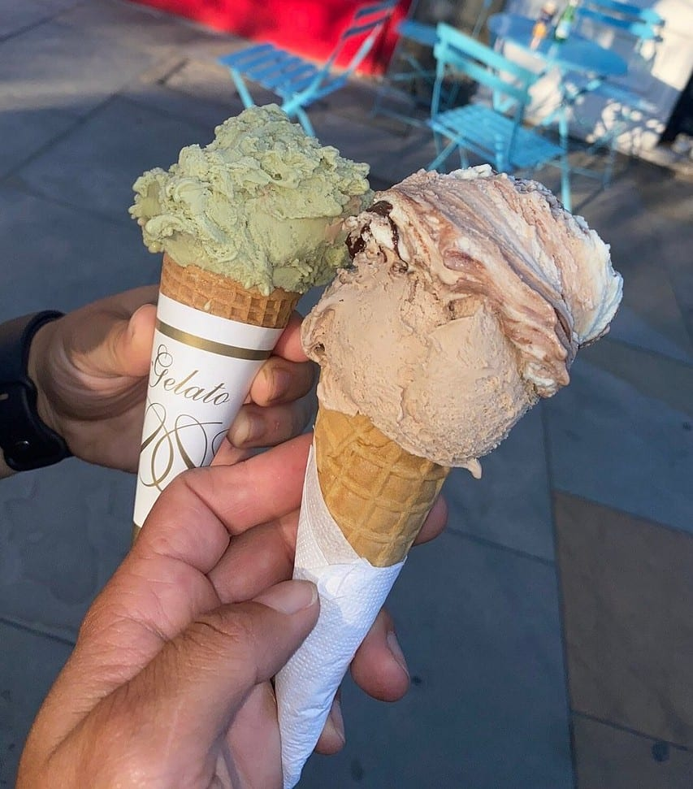
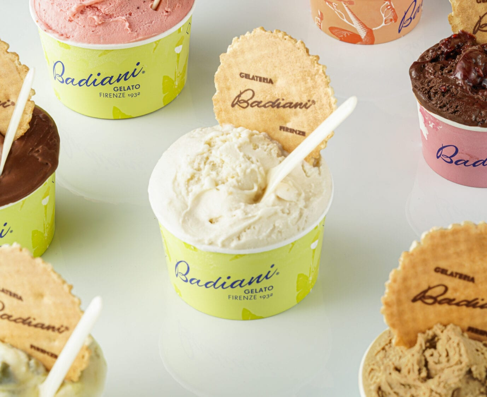
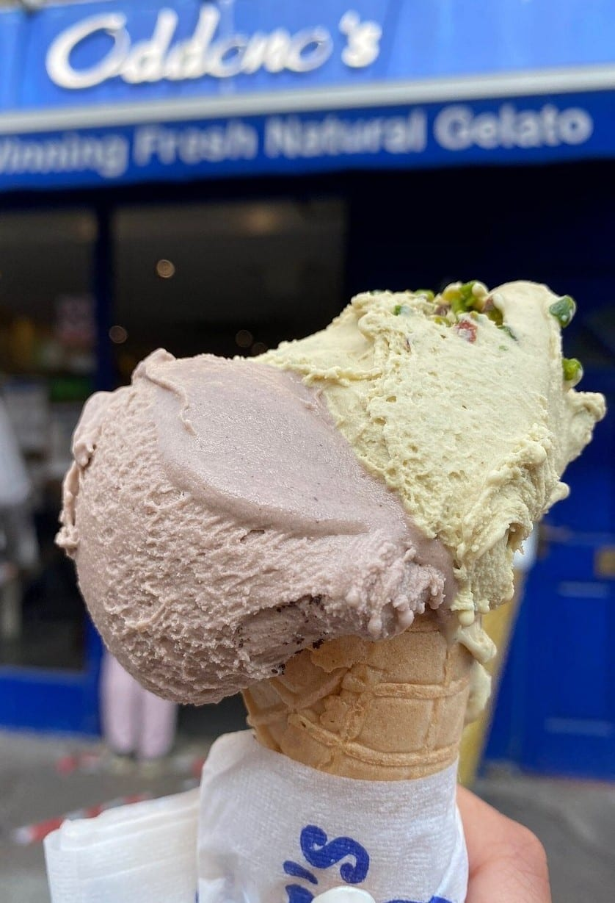
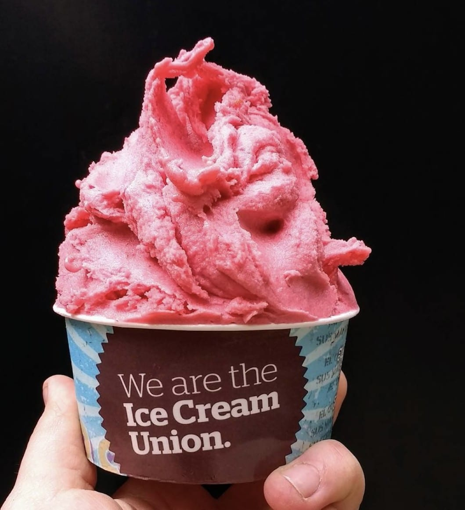
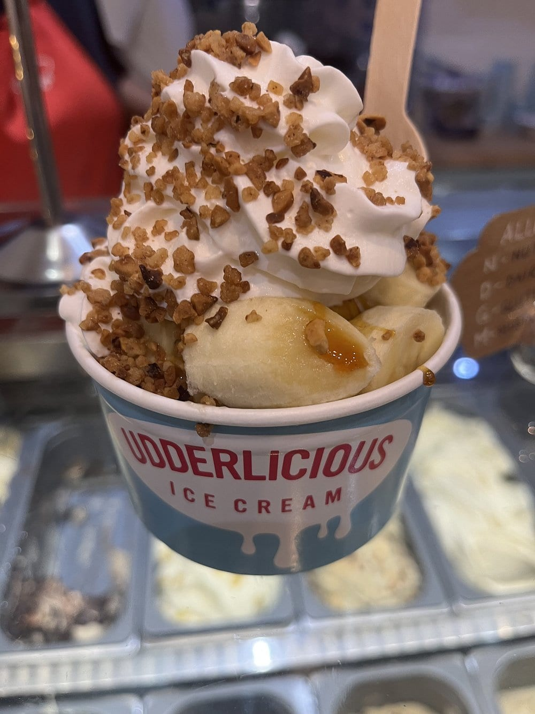
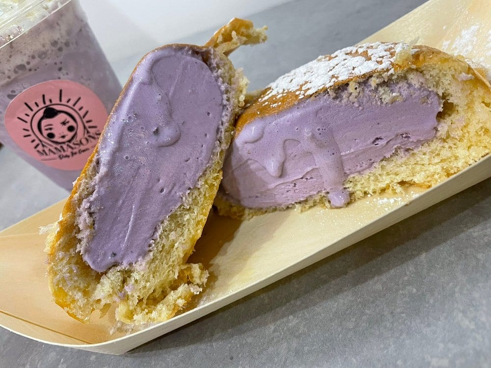
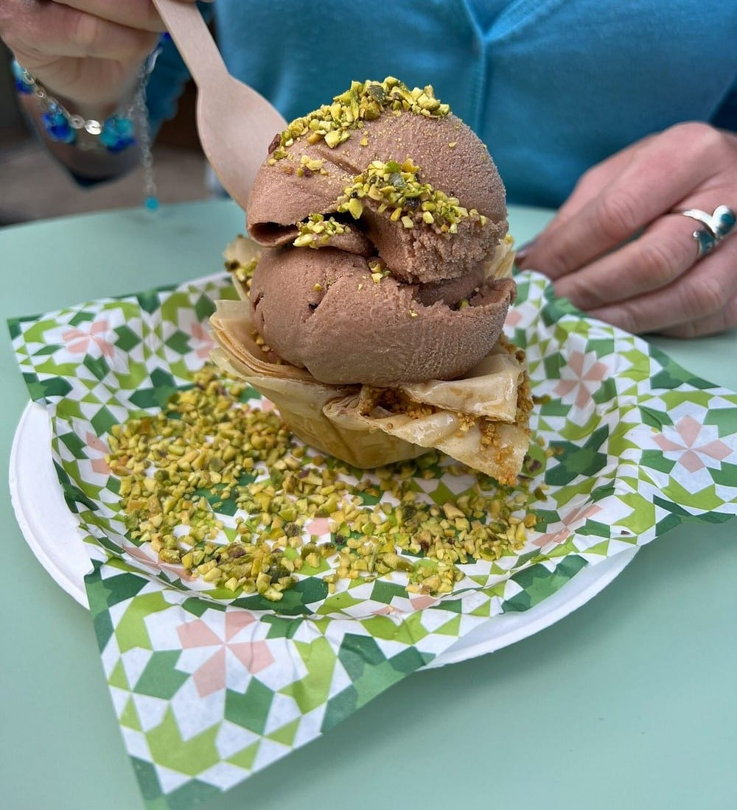

This guide covers **Italian gelaterias**, **small-batch makers** doing miso caramel and fig leaf, **Filipino ube**, **Middle Eastern flavours** and **vegan ice cream**.

> 💡 **The Short Version:** **Gelupo** in Soho, **Nardulli** in Clapham (which has the queue) and **Mamasons** are each named by four sources; Gelupo is open to midnight on Fridays and Saturdays. **Romeo & Giulietta** in Stoke Newington is Time Out's number one. **Badiani** for the Buontalenti. **Marcelo's** in Crystal Palace is entirely vegan and open two days a week only.

> 📊 **The evidence behind this guide.**
> **7 sources carrying 105 citations** across **73 named shops**. **20 shops are named by two or more independent sources.**
> **Built on:** Time Out, The Infatuation, Hot Dinners and The Sauce, plus three food blogs.
> *Evidence rebuilt 30 August 2026 · [How we rank →](/how-we-rank/)*

## Where they are

  

    Best ice cream in London map
  

  

    
Loading the interactive map…

  

  

    <i class="restaurant-map-key restaurant-map-key--editorial" aria-hidden="true"></i> Recommended in this guide
  

  <noscript>
    
The interactive map requires JavaScript. Nearest stations and walking times are listed against every entry below.

  </noscript>

| If you are near… | Where to go |
| --- | --- |
| **Soho & Covent Garden** | Gelupo, La Gelatiera, Udderlicious, Mamasons (Chinatown) |
| **Clapham** | Nardulli |
| **Stoke Newington** | Romeo & Giulietta |
| **Islington & Angel** | Udderlicious |
| **Chelsea** | Ice Cream Union |
| **South Kensington** | Oddono's |
| **Holland Park & Notting Hill** | Unico Gelato, Badiani |
| **Kentish Town & Camden** | Mamasons, Caliendo's counter |
| **Crystal Palace** | Marcelo's |
| **Marylebone** | Festok |

---

## The Italian gelaterias

### Gelupo, Soho

*7 Archer Street · open to midnight Fri–Sat* · Cited by 4 sources

Jacob Kenedy's gelateria, across the road from his restaurant Bocca di Lupo.

**Ricotta and sour cherry** is the flavour people describe years later, and the dark chocolate sorbet has its own following. There is also **Cremolato**, a lower-sugar southern Italian style that sits between a gelato and a granita.

The vegan sorbets are marked on the menu — watermelon, apricot, almond, lemon and rosemary, blood orange.

Open to **midnight on Fridays and Saturdays**, and to 11pm Sunday to Thursday.

*Gelupo, Soho.*

### Romeo & Giulietta, Stoke Newington

*137 Albion Road* · Cited by 2 sources

A Stoke Newington gelateria run by two Italians who make everything on site in small batches.

**Pistachio** is made with Bronte pistachios rather than colouring; the **stracciatella** is the other order. The base is a custard gelato, denser and slower to melt than whipped, over-aerated ice cream.

**£, walk-in.** Church Street, with a queue on the pavement on a warm evening. It has closed through the coldest months in some years, so check before travelling in winter.

*A cone at Romeo & Giulietta.*

### Nardulli, Clapham

*29 The Pavement · busy year-round* · Cited by 4 sources

Four writers describe the queue independently, one noting it **stretches towards the tube station on Saturdays**; all four note that it moves fast.

Traditional family gelato: **pistachio** is the consensus order, with Valrhona chocolate, liquorice, fig and a proper fior di latte behind it.

It is busy **in December** too.

*Pistachio at Nardulli.*

### Badiani 1932, twelve London shops

*Founded in Florence, 1932* · Cited by 2 sources

**Order the Buontalenti.** Cream, sugar, and essentially nothing else — four ingredients, no flavouring, named after the Renaissance architect credited with inventing it.

A Florentine company that started in 1932, it now has twelve shops in London.

*The Buontalenti at Badiani.*

### Unico Gelato, Holland Park

*78 Holland Park Avenue · also St John's Wood, Gloucester Road, Bromley* · Cited by 2 sources

An Italian gelateria with a laboratory attached, importing its raw materials directly from Italian producers.

The **pistachio** uses Bronte DOP pistachios and the **hazelnut** uses Piedmont IGP. Made fresh daily in the room behind the counter and served from covered pozzetti rather than heaped in tubs.

**£, walk-in.** There is a second site in Victoria. Ask for a *spatola* rather than a scoop — that is how it is meant to be served.

*Pistachio and hazelnut cones at Unico Gelato.*

### Oddono's, South Kensington

*14 Bute Street · six or seven branches* · Cited by 2 sources

A South Kensington gelateria that has been open for two decades.

**Gelato** made daily on the premises, with **pistachio** and **fior di latte**, the plain milk flavour, as the two to judge it on. Fruit sorbets for anyone avoiding dairy.

**£, walk-in.** Several sites across London now, but the Bute Street original is the one with the queue. Open late in summer.

*Oddono's, Bute Street.*

### La Gelatiera, Covent Garden

*New Row · also East Village and the OXO Tower* · Cited by 3 sources

A small Covent Garden gelateria making everything on site.

The **pistachio** and the **salted caramel** are the standing orders, with a rotating list of seasonal and unusual flavours — herbs, spices and vegetables among them.

**£, walk-in.** Just off the piazza, and open late enough to work after a show.

---

Powered by <a target="_blank" rel="sponsored" href="https://www.getyourguide.com/london-l57/">GetYourGuide</a>

## Small-batch and award-winning

### Ice Cream Union, Chelsea

*166 Pavilion Road · factory shop in Bermondsey* · Cited by 3 sources

**Named the best in the UK by The Times in July 2025.**

Eighteen years in, making its own nut pastes, fruit juices, ripple sauces and honeycomb rather than buying them in, across fifty-plus flavours. **Banana split, cornflake, dulce de leche**, and an Aperol Spritz sorbet.

They supply Michelin-starred Trinity in Clapham and Fortnum & Mason.

> ⚠️ **The Bermondsey factory shop opens Saturdays only, March to December** — so it is shut in January and February. The Chelsea parlour is open daily and year-round.

*Ice Cream Union's fruit sorbet.*

### Caliendo's, Kentish Town counter

*Inside Phoenicia Food Hall, 186 Kentish Town Road*

A Kentish Town counter making Neapolitan-style gelato, run by a family from Campania.

**Pistachio, nocciola and fior di latte** are the core, made in small batches and turned over quickly, with a short rotating list beside them. Neapolitan gelato is denser and less sweet than the northern Italian style.

**£, walk-in.** A counter rather than a parlour — there is nowhere to sit.

> ⚠️ **This is not a Kentish Town parlour**, despite how it is often written up. Caliendo's is a Bedfordshire producer with a counter inside a London food hall. Go for the counter, not for a shopfront.

---

## Vegan and dairy-free

### Marcelo's, Crystal Palace

*Haynes Lane Courtyard · Saturdays and Sundays only* · Cited by 1 source

**Entirely vegan**, made on a **house oat-milk base**, from a chef couple who started after a trip to Naples.

Ninety-plus flavours created so far, rotating weekly: **miso peanut butter and chocolate chip**, burnt miso caramel, chocolate Guinness cake, fig leaf, sea buckthorn with spiced rooibos. Their own line: *this isn't "good for a vegan" ice cream*.

> ⚠️ **Weekends only**, Saturday 10–5 and Sunday 11–5, from a fixed pitch at Haynes Lane Courtyard. They no longer keep a regular market stall at Herne Hill. Pint pre-orders open Mondays at 10am.

### Udderlicious, Islington

*187 Upper Street · also Covent Garden, Camden, Crouch End* · Cited by 3 sources

An Islington ice cream shop making everything in small batches on site.

The range is broad and changes constantly — **honeycomb, salted caramel** and a rotating list of specials — with **vegan and dairy-free options** as a core part of the range.

**£, walk-in.** Upper Street and a second Covent Garden site. Queues on a summer evening; almost none in the day.

*Udderlicious, Islington.*

### Crosstown

*Battersea Power Station and Greenwich scoop bars* · Cited by 1 source

A doughnut business that also makes **gelato**.

The **gelato** is made in small batches and sold alongside the sourdough doughnuts the company is known for — and the **doughnut-and-gelato combination** is the order.

**£, walk-in.** Sites across central and east London, most of them counters rather than places to sit. The Broadwick Street and Leather Lane shops are the busiest.

---

## Ice cream from somewhere else entirely

### Mamasons Dirty Ice Cream, Kentish Town and Chinatown

*91 Kentish Town Road · 32 Newport Court* · Cited by 4 sources

Filipino *sorbetes*, or "dirty ice cream", so called because it was traditionally sold from street carts.

**Ube**, the purple yam, leads the flavours, alongside Milo, queso and black buko. Order it as a **bilog**: a toasted pandesal milk bun stuffed with ice cream and dusted with icing sugar.

Reviewers say outright they came because of TikTok, but it also reviews well on its merits, and the sandwiches are worth the queue. **Ube runs out**, regularly and early.

*A bilog at Mamasons.*

### Festok, Marylebone

*65 Weymouth Street* · Cited by 2 sources

A Marylebone shop built around **Middle Eastern flavours in ice cream** — pistachio, rose, cardamom and halva.

The **pistachio** is made with real pistachio paste rather than flavouring; the **halva** and **rose** are the other orders. Toppings and kunafa are added at the counter.

**£, walk-in.** Small counter, no seating, and busiest in the evening.

*Pistachio gelato in kunafa at Festok.*

---

## Best value

A scoop runs from about £3.45 to over £6 depending on the postcode.

* **Crosstown** charges **£3.45 a scoop**, cup or cone, in store.
* **Caliendo's** sells **pints for £12 online**.
* **Markets and food halls.** **Borough Market**, **Mercato Mayfair** and **Seven Dials Market** all carry gelato counters.
* **Buy a tub, not a cone.** Takeaway tubs work out cheaper per scoop.
* **Avoid delivery apps.** They mark ice cream up over the counter price.

---

Powered by <a target="_blank" rel="sponsored" href="https://www.getyourguide.com/london-l57/">GetYourGuide</a>

## Where this sits in the rest of London's food

Our [complete guide to eating in London](/articles/eat-in-london-guide/) covers the rest, and the [bakeries guide](/articles/best-bakeries-london/) is the other half of the sweet answer.

## What to know

* **Check the season and the days.** Marcelo's is weekends only; Ice Cream Union's factory shop shuts for January and February.
* **Prices.** Expect roughly £4–£6 for a scoop in central London; delivery prices are higher than the shop price.
* **Order the plain one first:** Buontalenti at Badiani, fior di latte at Nardulli, nocciola at Oddono's.
