A Sicilian room in Fitzrovia, a Florentine steak house in Clerkenwell, a Milanese kitchen in London Fields and a Piedmontese butcher's counter in South Kensington cook different food, and "Italian" tells you almost nothing about any of them.

This guide starts with the restaurants the sources agree on, then splits the rest by **region**, by **price**, and by **which rooms are worth booking for the room alone**.

> 💡 **The Short Version:** **Trullo** and **Padella** are the two most-cited Italian restaurants in London. **River Café**, **Murano** and **Luca** are the three holding a Michelin star. **Bancone** and **Al Dente** are the value picks. **Norma** for Sicilian, **Brutto** for Florentine steak. And **Circolo Popolare** if you want the room more than the meal.

> 📊 **The evidence behind this guide.**
> **47 sources carrying 333 citations** across **187 named restaurants**. **45 restaurants are named by two or more independent sources; 27 carry a dated award.**
> **Built on:** Michelin, the Good Food Guide, Gambero Rosso and the Italian Awards; Time Out, The Infatuation and Eater London; YouTube.
> *Evidence rebuilt 30 August 2026 · [How we rank →](/how-we-rank/)*

## Where they are

  

    Map of the best Italian restaurants in London
  

  

    
Loading the interactive map…

  

  <noscript>
    
The interactive map requires JavaScript. Every entry below lists its area.

  </noscript>

| If you are near… | Where to eat |
| --- | --- |
| **Mayfair & Green Park** | Murano, Cecconi's, Il Gattopardo |
| **Soho & Piccadilly** | Bocca di Lupo, Lina Stores, Bar Italia, 40 Dean Street |
| **Covent Garden** | Bancone, Café Murano, Ave Mario |
| **Fitzrovia & Marylebone** | Norma, Circolo Popolare, Al Dente, The Italian Greyhound, Carlotta |
| **Clerkenwell & the City** | Luca, Brutto, Eataly |
| **Islington & north** | Trullo, Noci, Ciao Bella |
| **Shoreditch & east** | Manteca, Gloria, Campania & Jones, Ombra, E. Pellicci |
| **Borough & South Bank** | Padella, Flour and Grape, Legare, Forza Wine |
| **West London** | River Café, Jacuzzi, Como Garden |
| **South London** | Artusi (Peckham) |
| **Knightsbridge & Chelsea** | Sale e Pepe, Mucci's, Daphne's, Sette |

**Price guide:** **£** under £15 · **££** £15–£35 · **£££** £40–£70 · **££££** £90+.

---

## The starred kitchens

Three Italian restaurants in London hold a Michelin star in the 2026 guide.

### River Café, Hammersmith

*££££ · book months ahead · Cited by 4 sources · 1 Michelin star*

**Michelin-starred cooking on the Thames**, run by Ruth Rogers and the late Rose Gray's team. The menu is short, with few ingredients handled precisely: **wood-roasted whole fish**, hand-rolled pasta, and the **chocolate nemesis**, a flourless cake. Produce is flown from Italian growers weekly and priced accordingly.

**It books months ahead. The terrace tables go first** — ask specifically.

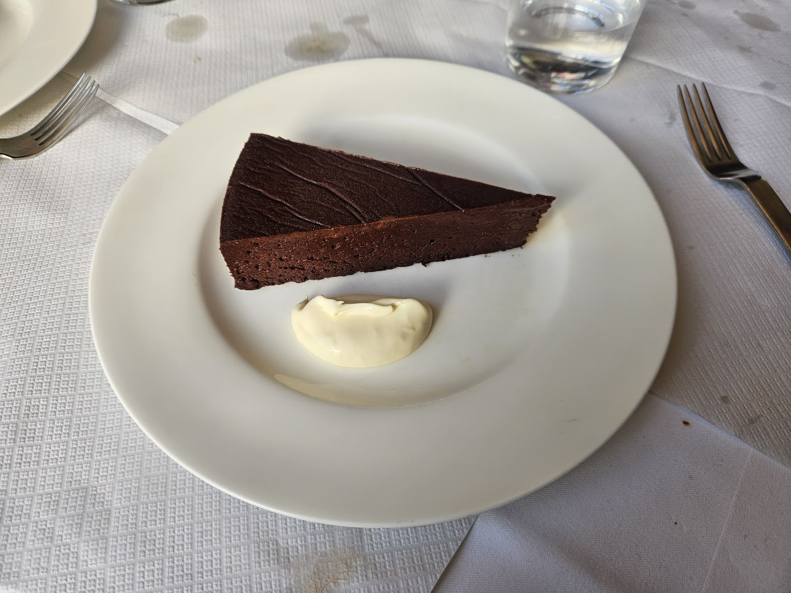
*The chocolate nemesis.*

### Luca, Clerkenwell

*£££ · 4 min from Farringdon · book weeks ahead · Cited by 8 sources · 1 Michelin star*

**Italian cooking through British produce, from the Clove Club team.** The **parmesan fries** are the starter, but the pasta is the main order: hand-rolled, changing weekly, built on British ingredients. There is a bar at the front that takes walk-ins and a conservatory dining room behind it.

**Closed Sunday, books weeks ahead.** The bar menu is a cheaper way into the same kitchen.

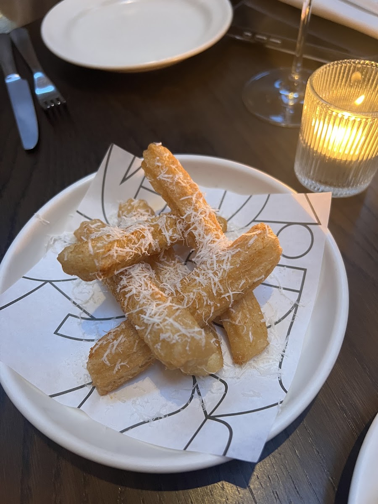
*Luca's parmesan fries.*

### Murano, Mayfair

*££££ · 5 min from Green Park · book weeks ahead · Cited by 3 sources · 1 Michelin star*

**Angela Hartnett's Mayfair dining room**, starred within four months of opening in 2008 and holding it since. Northern Italian cooking in a formal room: **hand-made pasta**, veal, and a set-price menu that lets you build two, three or four courses.

**Closed Sunday, and it books weeks ahead.** The set lunch is materially cheaper than dinner from the same kitchen.

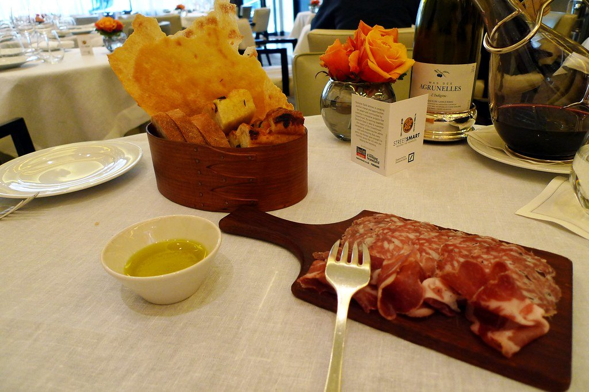
*Murano's set-price menu.*

---

## The most agreed on

No star, but the most citations from the sources.

### Trullo, Highbury

*£££ · 3 min from Highbury & Islington · book weeks ahead · Cited by 9 sources*

**Tim Siadatan — ex St John and Moro — cooking a frequently changing seasonal menu of hand-made pasta and charcoal-grilled meats.** The signature is **pappardelle with eight-hour beef shin ragù**, on the menu since the beginning. Everything else changes: the charcoal grill does whatever is in season, and the pasta is rolled daily.

**It books weeks ahead.** Sibling to Padella. St Paul's Road.

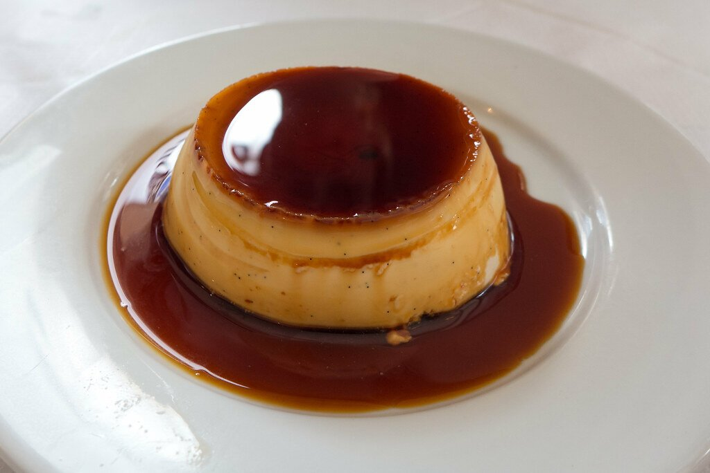
*Trullo, Highbury. Photo: [Ewan-M](https://www.flickr.com/photos/55935853@N00/14194656052), [CC BY-SA 2.0](https://creativecommons.org/licenses/by-sa/2.0/).*

### Padella, Borough

*£ · walk-in only · Cited by 9 sources*

**A short menu of hand-rolled pasta at low prices**, with a queue since 2016. Eight or nine dishes, most under a tenner: **pici cacio e pepe**, **tagliarini with Dorset crab**, and the pappardelle with beef shin ragù it shares with Trullo. Pasta is rolled in the room and cooked to order at a counter you can watch.

**No bookings at Borough Market — join the virtual queue on the Walk-In app** and go for a drink until it calls you. The Shoreditch and Soho sites take limited bookings.

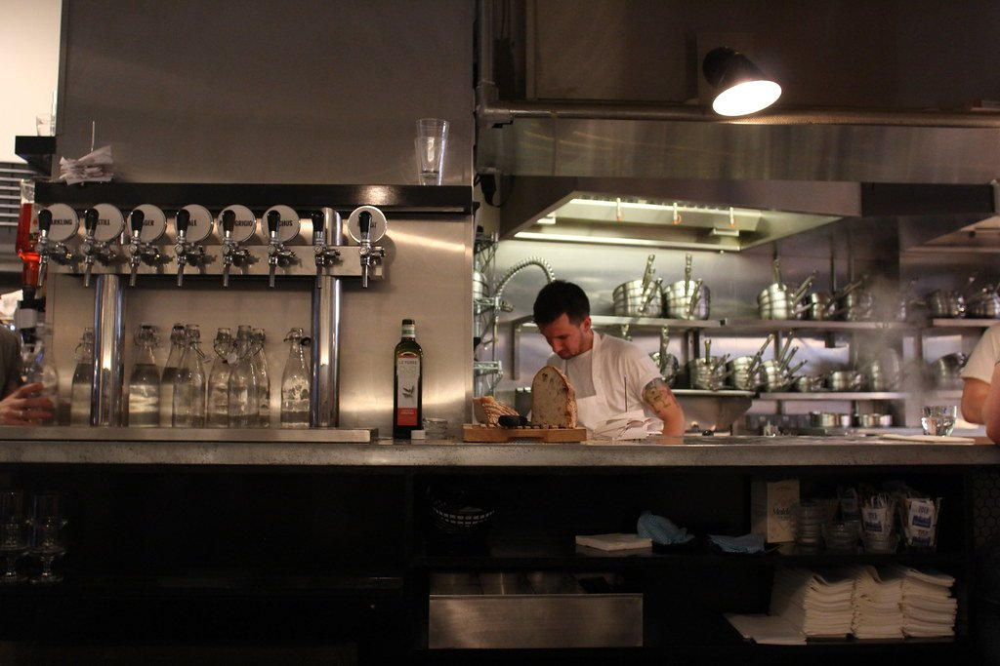
*Padella, Borough. Photo: [Bex.Walton](https://www.flickr.com/photos/7831824@N04/28035454561), [CC BY 2.0](https://creativecommons.org/licenses/by/2.0/).*

### Manteca, Shoreditch

*£££ · 10 min from Old Street · Cited by 8 sources · Bib Gourmand*

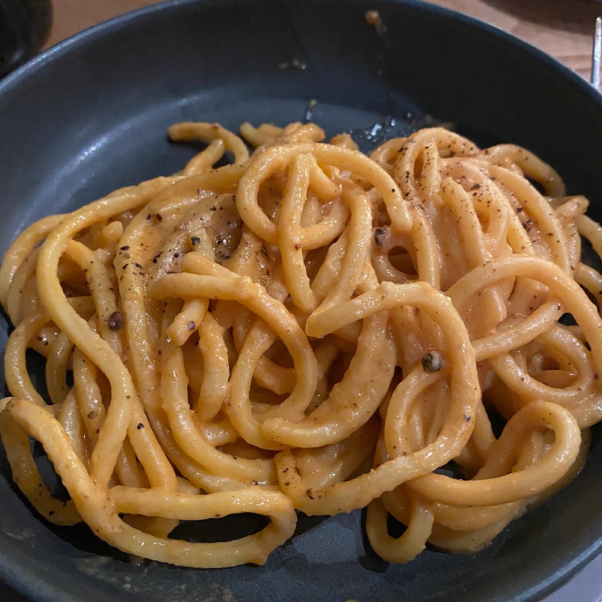
*The pig skin ragù rigatoni.*

**Chris Leach and David Carter's nose-to-tail Italian**, with **whole-animal butchery feeding a menu of house-cured salumi and hand-rolled pasta**. The salumeria is on site and visible.

The **pig skin ragù** with rigatoni is the dish to order, and the **house salumi**, cured in the building from whole animals broken down there, is what to start with.

**It books weeks ahead.** Loud.

### Bocca di Lupo, Soho

*£££ · 2 min from Piccadilly Circus · book weeks ahead · Cited by 7 sources*

**Regional cooking from across Italy, served trattoria-style in a buzzy Soho room**, with **every dish labelled with the region it comes from**. Everything comes in **small or large plate sizes**, so a table can order eight regional dishes rather than three courses. Expect Piedmontese, Venetian and Sicilian on the same menu. The **counter seats face the kitchen**.

**It books ahead.** Archer Street. Gelupo across the road is the same owners' ice cream shop — go afterwards.

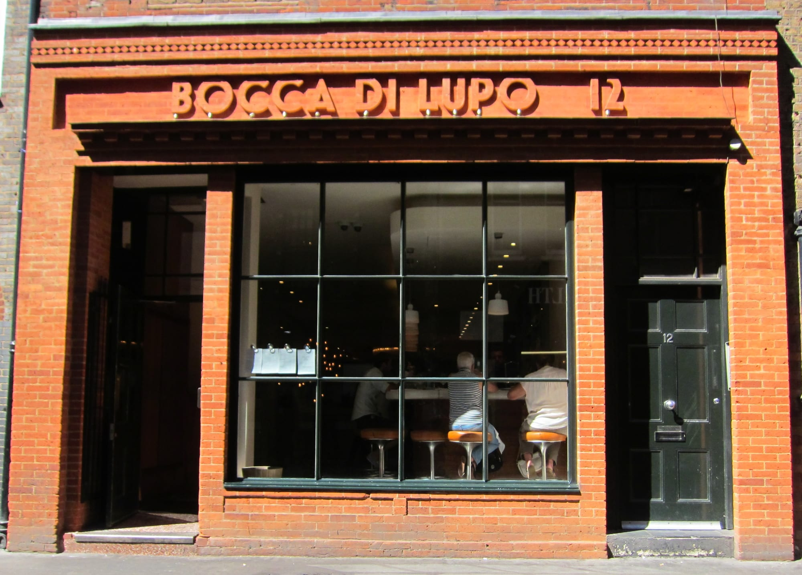
*Bocca di Lupo, Archer Street. Photo: [Andrew Davidson](https://commons.wikimedia.org/wiki/File:Bocca_Di_Lupo.JPG), [CC BY-SA 4.0](https://creativecommons.org/licenses/by-sa/4.0).*

### Lina Stores, Soho

*££ · Brewer Street · Cited by 5 sources*

The **mint-green deli on Brewer Street, open since 1944.** The shop sells fresh pasta cut to order, salumi, cheese and tinned goods, and it has restaurants alongside. **Take the pasta home**: it costs a fraction of the restaurant price.

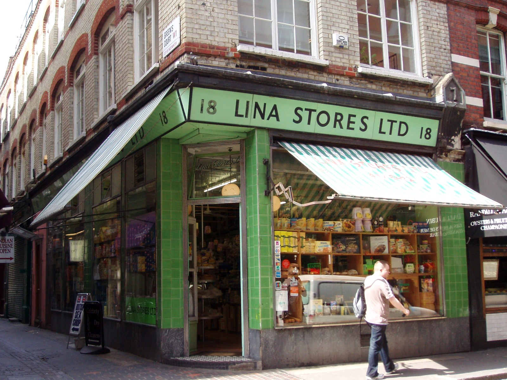

*Lina Stores, Brewer Street. Photo: [Ewan-M](https://commons.wikimedia.org/wiki/File:Lina_Stores,_Soho,_W1.jpg), [CC BY-SA 2.0](https://creativecommons.org/licenses/by-sa/2.0).*

### Bancone, Covent Garden

*££ · 3 min from Charing Cross · Cited by 5 sources · Bib Gourmand*

Watch the pasta being rolled at the counter. The **silk handkerchiefs with walnut butter and confit egg yolk** are the signature and originated here.

The Covent Garden original takes no bookings for small tables. The Borough and Golden Square sites do, and the pasta is the same.

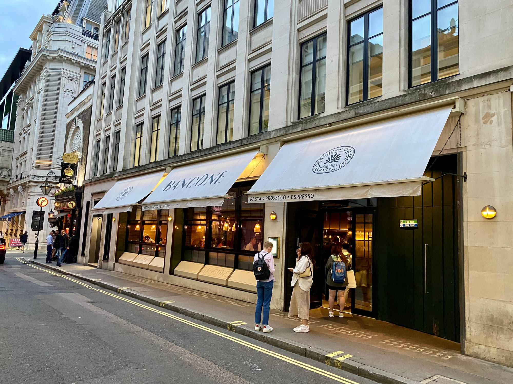

*Bancone, Golden Square. Photo: [No Swan So Fine](https://commons.wikimedia.org/wiki/File:Bancone,_Lower_James_Street,_Soho,_August_2023_02.jpg), [CC BY-SA 4.0](https://creativecommons.org/licenses/by-sa/4.0).*

### Ciao Bella, Bloomsbury

*£ · 5 min from Russell Square · Cited by 5 sources*

**A Lamb's Conduit Street Anglo-Italian restaurant: red sauce, low prices and a pianist.** Order **lasagne, veal milanese, spaghetti vongole**, garlic bread, and house wine by the carafe. The **live pianist** plays most evenings.

**It books ahead** despite the prices.

---

Powered by <a target="_blank" rel="sponsored" href="https://www.getyourguide.com/london-l57/">GetYourGuide</a>

## By region

Each of these cooks somewhere specific rather than "Italy".

### Norma, Fitzrovia — Sicilian

*£££ · 5 min from Goodge Street · Cited by 4 sources · Michelin Guide*

**Sicilian cooking with the Moorish influence kept in**, across four floors of a Fitzrovia townhouse. Sicily's Arab inheritance shows in **saffron, almonds, raisins, cinnamon and spice**. Expect **pasta alla Norma** with fried aubergine and ricotta salata, seafood crudo, and arancini.

**Closed Sunday, and it books ahead.** Charlotte Street. The ground-floor raw bar takes walk-ins when the dining rooms above have gone.

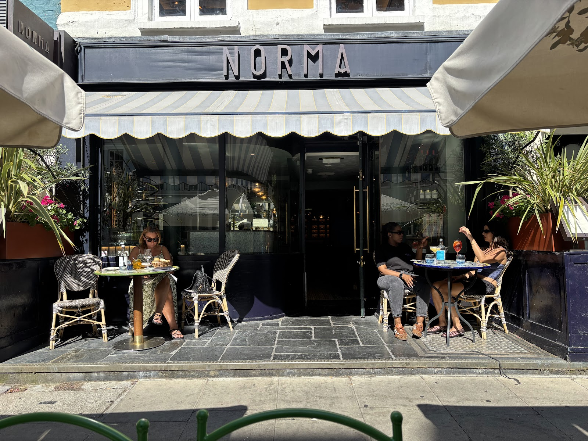
*Norma, Charlotte Street.*

### Campania & Jones, Bethnal Green — Campanian

*£££ · a converted dairy · Cited by 4 sources*

Cooking from Campania, the coast around Naples and Amalfi, in a **converted Victorian dairy** a minute from Columbia Road flower market. Pasta is made by hand every day and the menu is short. The room keeps its white tiles, marble and original dairy fittings.

**Go on a Sunday** and do the flower market first — it runs 8am to about 3pm.

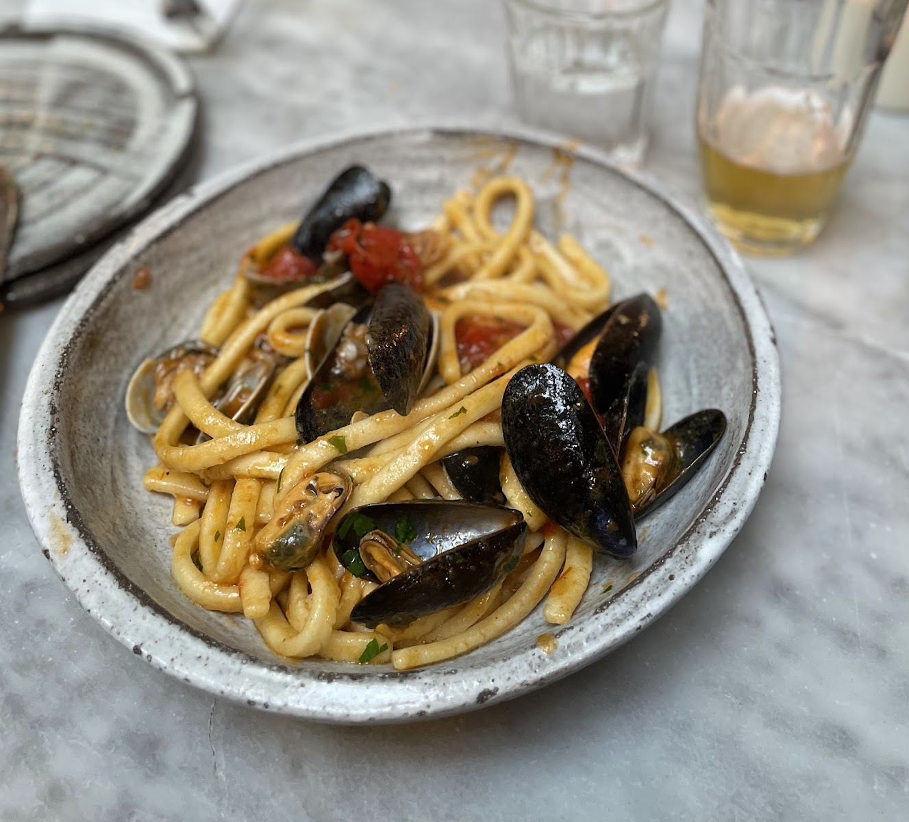
*The seafood pasta at Campania & Jones.*

### Brutto, Clerkenwell — Florentine

*££ · 4 min from Farringdon · Cited by 4 sources*

Unfussy Florentine cooking from the late Russell Norman.

**The bistecca is the order** — an 800g Florentine T-bone for sharing, priced by weight at around £8.25 per 100g, so a big one lands near £80 between two. The rest is crostini, a few pastas, and negronis.

Walk-ins are taken at the bar.

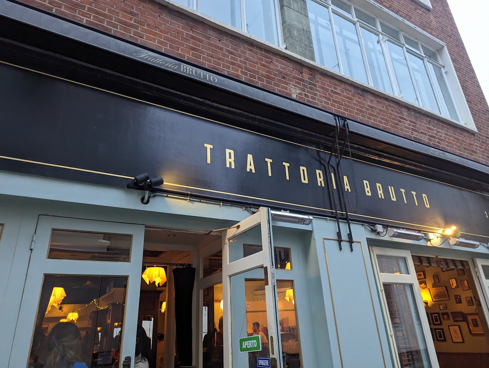
*Brutto, Clerkenwell.*

### Artusi, Peckham — seasonal Italian

*££ · 5 min from Peckham Rye · Cited by 4 sources*

**Classically based seasonal cooking with hand-made pasta** in a Peckham dining room. The menu is short and changes constantly: **pasta rolled that day**, one or two grilled dishes, and a handful of vegetable plates.

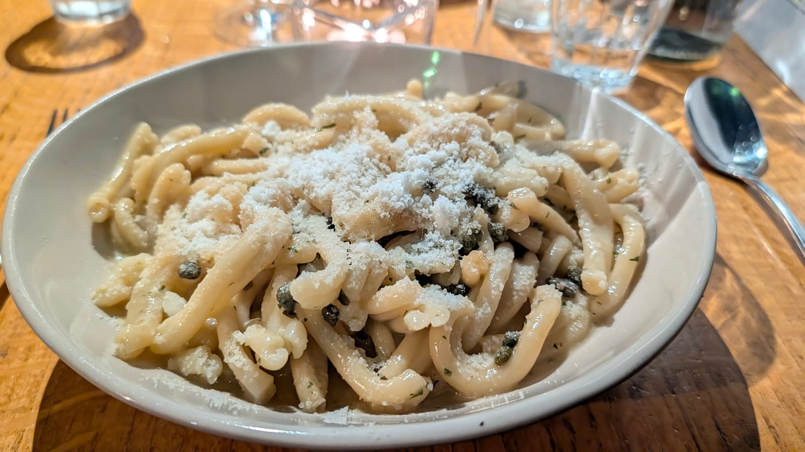

*Artusi's casarecce.*

**It books ahead** at weekends. Bellenden Road.

### Legare, Shad Thames — modern Italian

*££ · 8 min from London Bridge · Cited by 4 sources*

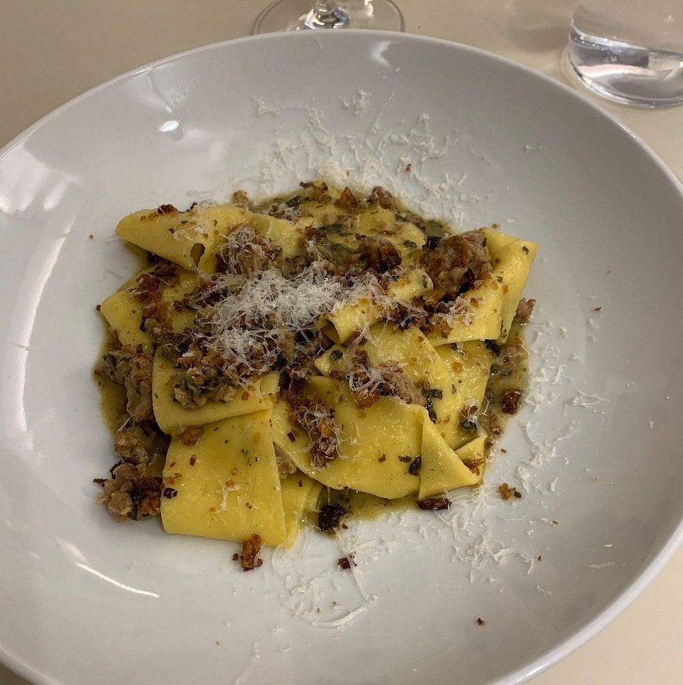
*Legare's pasta.*

**Opened in 2019 by Jay Patel (ex Barrafina) and chef Matt Beardmore (ex Trullo)**, in the warehouse streets by Tower Bridge. The pasta is **hand-rolled and changes weekly**, with grilled fish and meat around it and a short Italian wine list.

**It books ahead.** Five minutes from Tower Bridge.

### Noci, Islington — pasta-led

*££ · 4 min from Angel · Cited by 4 sources*

**A short, frequently changing pasta menu drawn from across the Italian regions.** Six or seven pastas at a time, rolled in the room: **cacio e pepe, ragù, and regional shapes** most London menus never carry. Small plates and a few desserts around them.

**It takes bookings.** Islington is the original; there are sites in Shoreditch and Battersea.

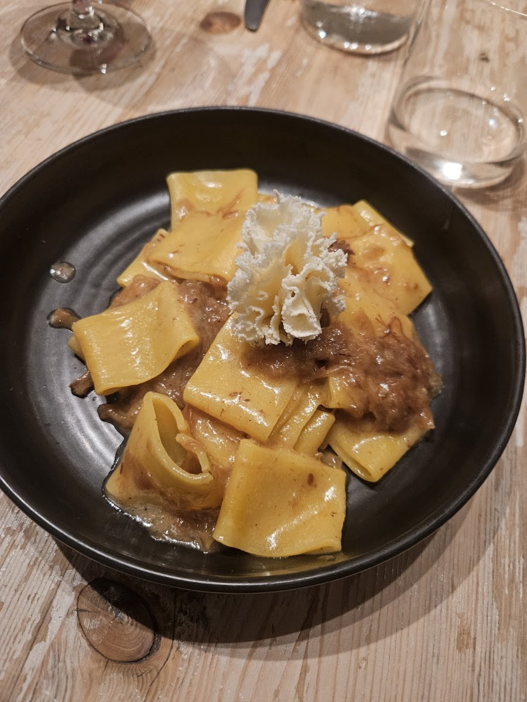
*Noci's paccheri.*

### Ornella, London Fields — Milanese

*££ · 7 min from Hackney Central*

**Milanese cooking on Wilton Way** from the team behind Roman-influenced Lupa in Highbury. Milanese means butter and rice rather than olive oil and tomato: **risotto alla milanese** stained with saffron, **cotoletta** (the breaded veal cutlet) and vitello tonnato. The menu is short and changes with what is available.

**Closed Monday and Tuesday, and it books ahead.** The pavement tables go first in summer.

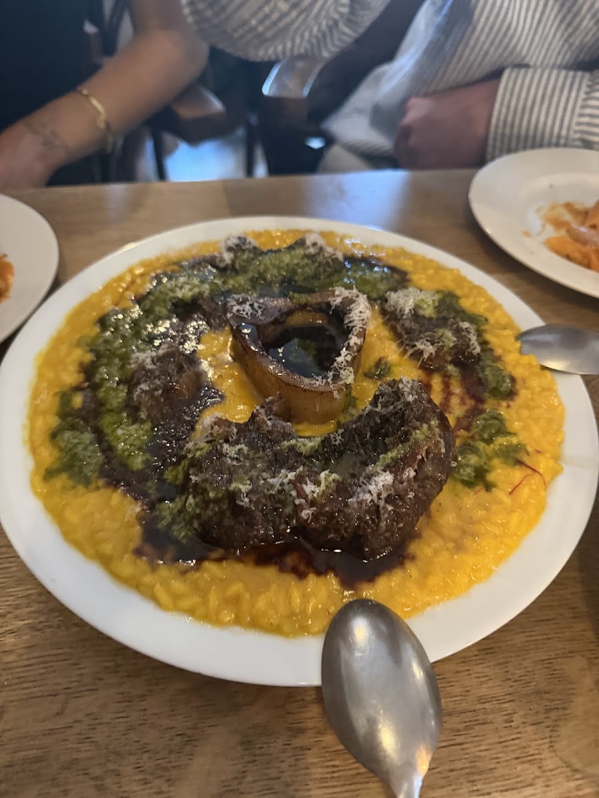
*Ornella's risotto alla milanese.*

### Macellaio RC, South Kensington — Piedmontese

*£££ · 5 min from South Kensington*

**A butcher's shop with a restaurant attached** (*macellaio* means butcher), hanging Piedmontese **Fassona** beef in the window and cutting it to order. Fassona is a lean breed served rare and unadorned: **tagliata**, carpaccio and a **battuta** tartare cut by hand. Pasta and a short Italian list sit around it.

**It books ahead.** Several London sites; South Kensington is the original. Steak is priced by weight and cut in front of you.

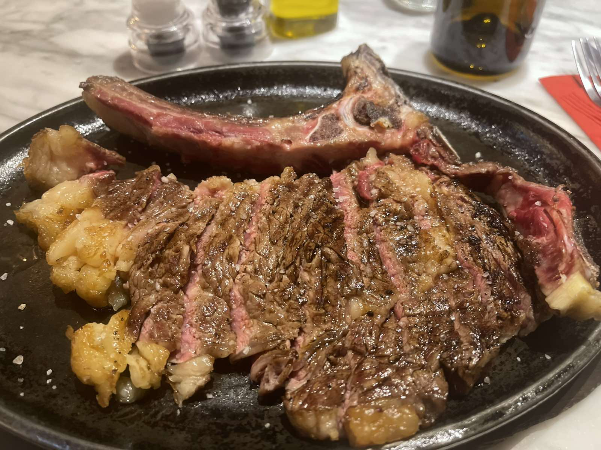
*Macellaio RC's tagliata.*

---

Powered by <a target="_blank" rel="sponsored" href="https://www.getyourguide.com/london-l57/">GetYourGuide</a>

## The nicest rooms

Rooms worth booking for the room.

### The Big Mamma group

Five London rooms from the same French-Italian group, all built to be looked at: maximalist, loud, all-Italian menus and big portions. What you are booking is the room.

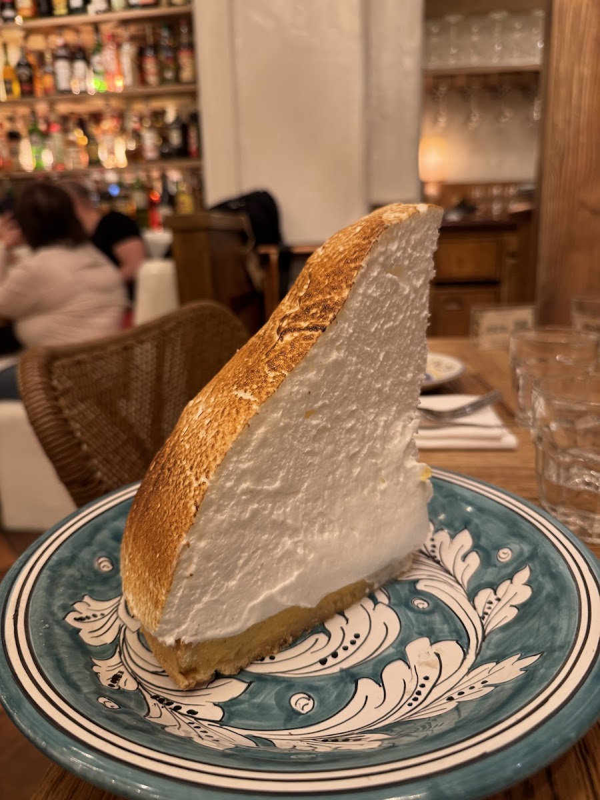
*Circolo Popolare's lemon meringue pie.*

- **Circolo Popolare**, Fitzrovia — a wall of thousands of backlit bottles, and a lemon meringue pie. *Cited by 3 sources* · [Book](https://www.sevenrooms.com/explore/circolopopolare/reservations/create/search?venues=avemariolondon%2Ccircolopopolare%2Ccarlottauk%2Cgloria%2Cjacuzzi%2Cbarbarellacanarywharf&tracking=bmg)
- **Ave Mario**, Covent Garden — stripy humbug walls and bright red seats across a basement, with a carousel bar. *Cited by 3 sources* · [Book](https://www.sevenrooms.com/explore/avemariolondon/reservations/create/search?venues=avemariolondon%2Ccircolopopolare%2Ccarlottauk%2Cgloria%2Cjacuzzi%2Cbarbarellacanarywharf&tracking=bmg)
- **Jacuzzi**, Kensington — painted ceilings and a marble bar, a few minutes from High Street Kensington station. *Cited by 2 sources* · [Book](https://www.sevenrooms.com/explore/jacuzzi/reservations/create/search?venues=avemariolondon%2Ccircolopopolare%2Ccarlottauk%2Cgloria%2Cjacuzzi%2Cbarbarellacanarywharf&tracking=bmg)
- **Gloria**, Shoreditch — a Capri-styled trattoria with green banquettes and the ten-layer lasagne. [Book](https://www.sevenrooms.com/explore/gloria/reservations/create/search?venues=avemariolondon%2Ccircolopopolare%2Ccarlottauk%2Cgloria%2Cjacuzzi%2Cbarbarellacanarywharf&tracking=bmg)
- **Carlotta**, Marylebone — Italian-American rather than Italian, done as a 1970s New York dining room. [Book](https://www.sevenrooms.com/explore/carlottauk/reservations/create/search?venues=avemariolondon%2Ccircolopopolare%2Ccarlottauk%2Cgloria%2Cjacuzzi%2Cbarbarellacanarywharf&tracking=bmg)

> ⚠️ **Book weeks ahead, and expect noise.** All five are loud by design. Walk-in seats at the bar early in the evening are the way in without a booking.

### Forza Wine, South Bank

*£££ · 5 min from Waterloo · Cited by 4 sources*

A terrace on top of the **National Theatre** looking up the Thames, with no ticket required. It serves Italian small plates rather than a full menu: cauliflower fritti with aioli, burrata with pickled onions, whatever is seasonal. Wine leads: natural, low-intervention, heavy on chilled reds and orange.

**Go for the golden hour and go early.** The terrace is first-come.

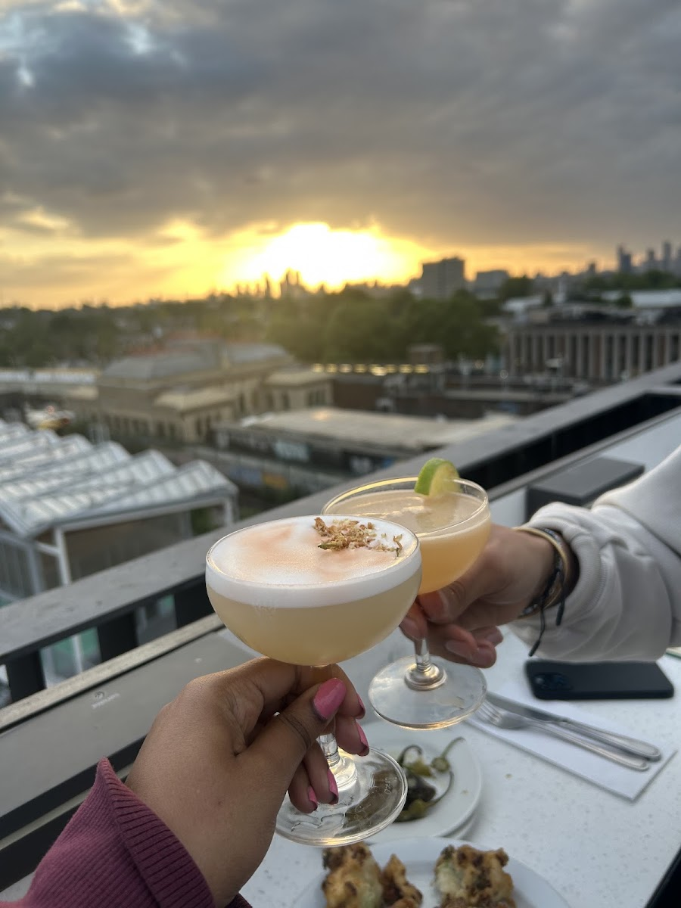
*Forza Wine's terrace.*

### Sale e Pepe, Knightsbridge

*£££ · 3 min from Knightsbridge · Cited by 3 sources*

**A Knightsbridge trattoria open since 1974**, with singing waiters and long-standing regulars. The cooking is the classic Italian repertoire: **hand-made pasta, veal milanese, whole fish** and a trolley of desserts. Portions are large and the room is deafening by nine.

**It books ahead.** Pavilion Road, minutes from Harrods.

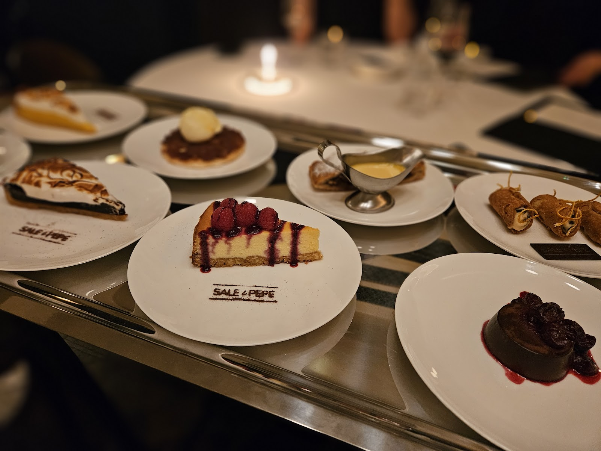
*The dessert trolley at Sale e Pepe.*

### Cecconi's, Mayfair

*££££ · 3 min from Green Park · Cited by 3 sources*

**A Mayfair restaurant since 1978**, now part of the Soho House group, on Burlington Gardens. Venetian-leaning all-day Italian: **cicchetti** at the bar, **crab and chilli linguine**, veal milanese, and a breakfast service. The room is green-and-white tiled.

**It books weeks ahead.** Non-members are welcome, despite the Soho House ownership. The bar seats take walk-ins.

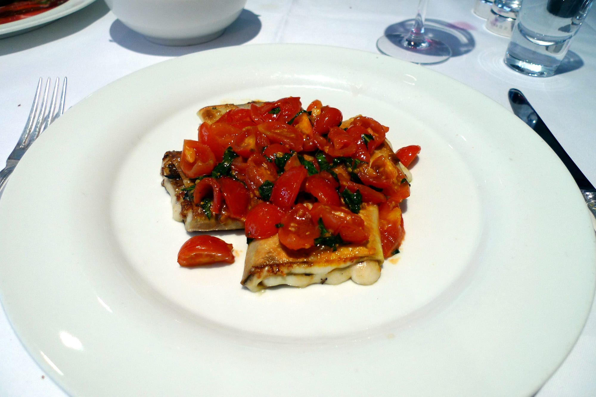
*Cecconi's, Burlington Gardens. Photo: [Ewan Munro](https://commons.wikimedia.org/wiki/File:Cecconis,_Mayfair,_London_(3872025826).jpg), [CC BY-SA 2.0](https://creativecommons.org/licenses/by-sa/2.0).*

---

## Best value

- **Mucci's**, Chelsea — **every starter £10, every main £20**, including a 200g sliced sirloin. *Cited by 4 sources*
- **[Ciao Bella](#ciao-bella-bloomsbury)**, Bloomsbury — a full Italian dinner under £30, with a pianist. *Cited by 5 sources*
- **[Padella](#padella-borough)**, Borough — most plates under £12. *Cited by 9 sources*
- **Al Dente**, Fitzrovia — handmade pasta rolled in front of you on Goodge Street, **every plate under £15**. The cacio e pepe is the order. *Cited by 2 sources*
- **Flour and Grape**, Bermondsey — pasta and a short wine list on Bermondsey Street, with almost everything under £13. *Cited by 3 sources*
- **[Café Murano](#murano-mayfair)**, Covent Garden — Angela Hartnett's everyday counterpart to Murano at roughly a third of the price. The set lunch is the cheapest way in. *Cited by 2 sources*
- **E. Pellicci**, Bethnal Green — family-run since 1900 and Grade II listed, with as much a full English as an Italian menu. *Cited by 2 sources*
- **Emilia's**, Canary Wharf and St Katharine Docks — fresh pasta and counter service. *Cited by 2 sources*

---

Powered by <a target="_blank" rel="sponsored" href="https://www.getyourguide.com/london-l57/">GetYourGuide</a>

## Other restaurants named

Backed by the sources but not written up above, either because only two guides name them or because they sit further out.

| Restaurant | Area | Price | Cited by | What it is |
| --- | --- | --- | --- | --- |
| **Norma** | Fitzrovia | £££ | 4 sources | *(see above)* — Sicilian |
| **The Italian Greyhound** | Marylebone | £££ | 3 sources | A Marylebone dining room |
| **Eataly** | City of London | ££ | 3 sources | Italian marketplace by Liverpool Street — several counters, one roof |
| **Il Gattopardo** | Mayfair | £££ | 2 sources | Southern Italian fine dining in a Mayfair townhouse, with a fixed-price lunch |
| **Daphne's** | Chelsea | £££ | 2 sources | On Draycott Avenue since 1964, with a glass-roofed back room |
| **Sette** | Knightsbridge | ££££ | 2 sources | Italian-American in the Bulgari hotel |
| **Como Garden** | Kensington | £££ | 2 sources | Lake Como cooking under a retractable glass roof |
| **Bar Italia** | Soho | £ | 2 sources | Frith Street since 1949, open almost around the clock, coffee rather than dinner |
| **Ombra** | Bethnal Green | ££ | 2 sources | Venetian cooking on the Regent's Canal, cicchetti and short pastas |
| **40 Dean Street** | Soho | ££ | 2 sources | An old-school Soho favourite, lobster ravioli |
| **Bardo St James's** | St James's | £££ | 2 sources | Opulent room near the National Gallery, with live classical evenings |
| **Casa Tua** | Camden | ££ | 2 sources | Small independent family kitchen; the carbonara is the one people go for |
| **Al Boccon di'vino** | Richmond | £££ | 2 sources | No menu at all — course after course of whatever is cooked that night |
| **Langosteria London** | Westminster | ££££ | — | The Milan seafood group inside the Old War Office on Whitehall |
| **Sale e Pepe Mare** | Marylebone | ££££ | — | Ligurian seafood in The Langham; cacio e pepe finished in the wheel |
| **Ornella** | London Fields | ££ | — | *(see above)* — Milanese |
| **Macellaio RC** | South Kensington | £££ | — | *(see above)* — Piedmontese Fassona beef, cut to order |

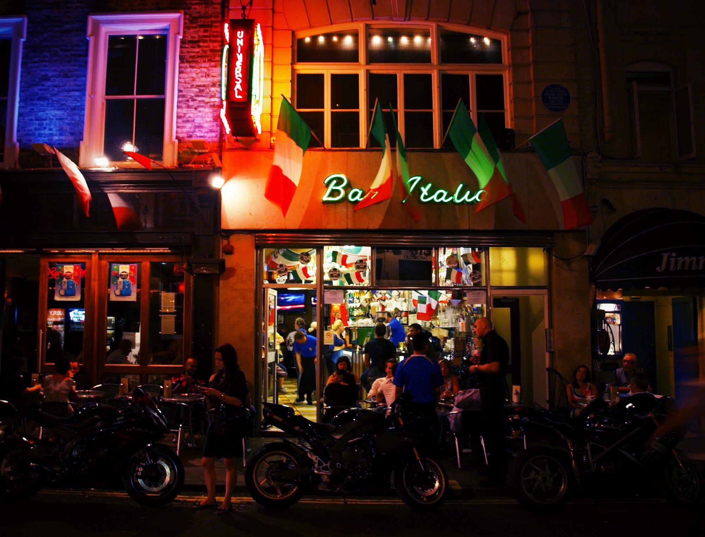

*Bar Italia, Frith Street. Photo: [SomeDriftwood](https://commons.wikimedia.org/wiki/File:Bar_Italia_-_Soho_(4764432107).jpg), [CC BY 2.0](https://creativecommons.org/licenses/by/2.0).*

[See all 112 Italian restaurants →](/restaurants/cuisine/italian)

---

## What to know

* **Region beats rating.** Choosing between Sicilian, Florentine and Milanese will change your meal more than a star will.
* **Padella and Bancone do not take bookings** at their original sites. Both run virtual queues.
* **The Big Mamma rooms** book out weeks ahead and are loud by design. Bar seats early in the evening are the walk-in route.
* **The pizza is a separate question** — see the dedicated guide below.
* **Service charge** of 12.5% is discretionary and standard on London restaurant bills.

---

## Continue planning your London trip

- 🍕 **[The Best Pizza in London](/articles/best-pizza-london/)**
- 🍛 **[The Best Indian Restaurants in London](/articles/best-indian-restaurants-london/)**
- 🍽️ **[Eat in London: Restaurants, Food Markets & Quick Food Hub](/articles/eat-in-london-guide/)**
- 💷 **[Cheap Eats in London](/articles/cheap-eats-london/)**
- 🌿 **[Best Vegetarian and Vegan Restaurants](/articles/best-vegetarian-vegan-restaurants-london/)**
- 🎭 **[Covent Garden Area Guide](/articles/covent-garden-area-guide/)**
- 🍜 **[Soho Area Guide](/articles/soho-area-guide/)**
