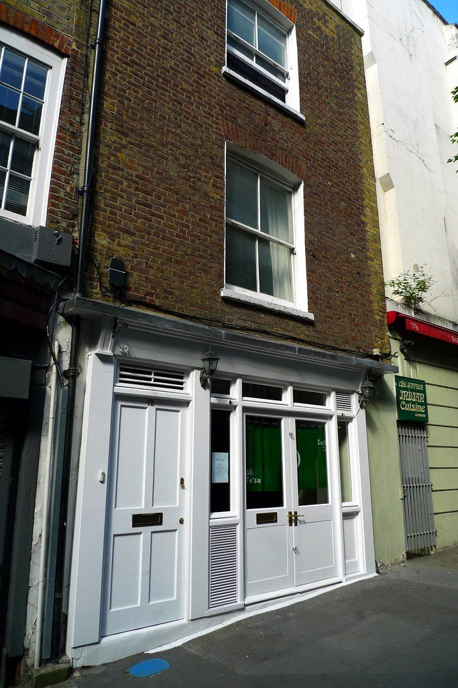
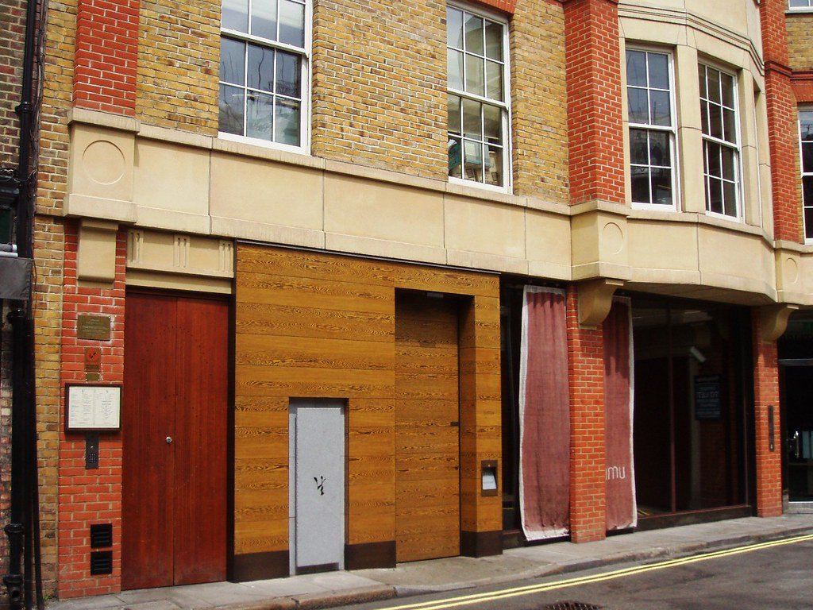
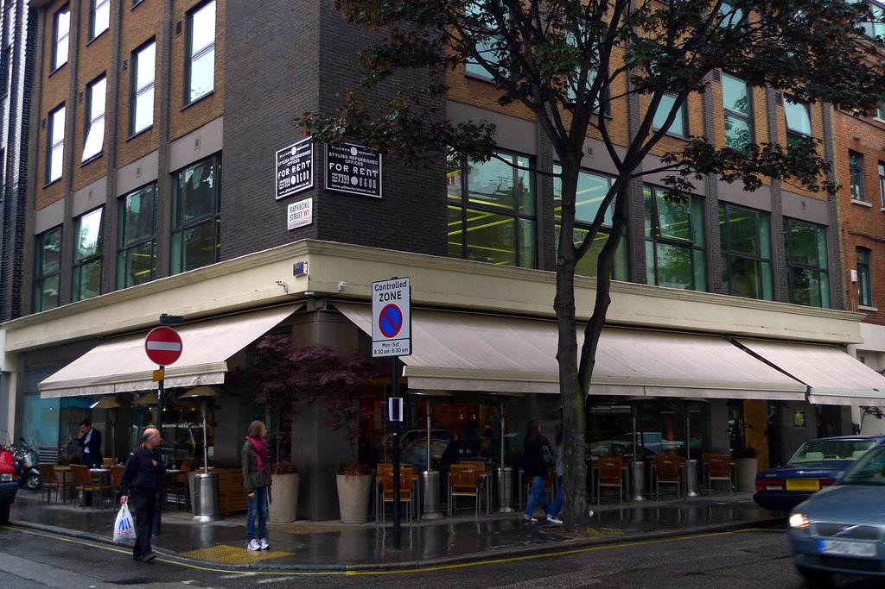
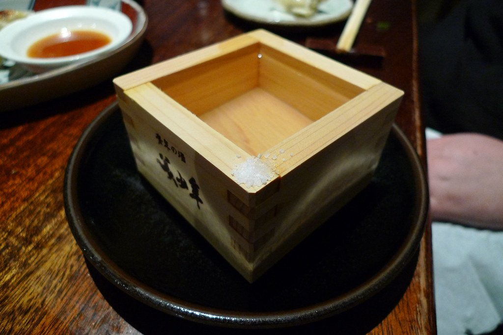

Japanese food in London splits by **format**, not by price. A seven-seat sushi counter, a charcoal yakitori grill, an izakaya built for drinking and a ramen shop are four different evenings.

> 💡 **The Short Version:** **Sushi Tetsu** has seven seats and its booking windows sell out in minutes. **Sushi Atelier** is the value omakase counter, from about £60. **Roka** and **Zuma** are the robata-grill izakaya. **Jin Kichi** in Hampstead does charcoal yakitori. **Umu** serves Kyoto-style kaiseki.

> 📊 **The evidence behind this guide.**
> **12 sources carrying 163 citations** across **116 named restaurants**. **27 restaurants are named by two or more independent sources; 5 hold a Michelin star.**
> **Built on:** the Michelin Guide; The Infatuation, Time Out and Country & Town House; ramen, omakase and izakaya specialists.
> *Evidence rebuilt 30 August 2026 · [How we rank →](/how-we-rank/)*

## Where they are

| If you are near… | Where to eat |
| --- | --- |
| **Mayfair & Green Park** | The Araki, Sushi Kanesaka, Umu, Nobu Old Park Lane |
| **Knightsbridge** | Zuma, The Aubrey |
| **Fitzrovia & Marylebone** | Roka, Sushi Atelier, Nobu Portman Square, TOKii |
| **Clerkenwell** | Sushi Tetsu |
| **Soho & Piccadilly** | Engawa |
| **Chelsea & Kensington** | Dinings SW3, Akira at Japan House |
| **The City** | SUSHISAMBA |
| **Bloomsbury & Holborn** | Koya Ko, Cocoro |
| **Islington & north** | Jin Kichi (Hampstead), Monohon Ramen |
| **Covent Garden** | Kanada-Ya |
| **South London** | Kurisu Omakase (Brixton) |

**Price guide:** **£** under £20 · **££** £20–£45 · **£££** £50–£90 · **££££** £120+.

---

## The omakase counters

Omakase means the chef chooses: you sit at the counter and courses arrive in sequence.

### Sushi Tetsu, Clerkenwell

*££££ · seven seats, two people running it* · Cited by 3 sources

**Seven seats at a pale hinoki counter in a Clerkenwell alley**, run by Toru Takahashi and his wife Harumi, and only them. He cures, cuts and serves; she runs the room.

Edomae omakase: nigiri served one piece at a time, the rice at body temperature, the fish aged to Takahashi's timing. He tells you what each piece is and when to eat it.

**Booking opens in windows and sells out within minutes**, so set a reminder. ££££, and there is no walk-in list.

*Sushi Tetsu, Clerkenwell. Photo: [Ewan-M](https://www.flickr.com/photos/55935853@N00/7670311580), [CC BY-SA 2.0](https://creativecommons.org/licenses/by-sa/2.0/).*

### The Araki, Mayfair

*££££ · around £310 · two sittings a night* · Cited by 2 sources

**A no-choice menu at around £310**, served in two sittings a night to a handful of people.

Edomae sushi: nigiri only, aged and cured to the chef's timing, served piece by piece across a counter with no substitutions and no à la carte.

**Tuesday to Saturday only, two sittings a night, closed Sunday and Monday, and it books months ahead.** ££££.

### Sushi Kanesaka, Mayfair

*££££ · 45 Park Lane · thirteen covers · Two Michelin stars, 2026 guide* · Cited by 4 sources

**Thirteen covers inside 45 Park Lane** — nine at the counter, four in a private room — doing **omakase only**, brought over from the Tokyo original, which opened here in July 2023.

**No à la carte.** The chef sets the sequence and the pace: nigiri on fish flown in and aged on site, rice seasoned to the Tokyo house style, served one piece at a time across the hinoki counter.

**££££, closed Sunday and Monday, and it books weeks ahead.** Ask for the nine counter seats rather than the four-seat private room.

### Sushi Atelier, Fitzrovia

*£££ · 7 min from Oxford Circus · the value pick* · Cited by 3 sources

**Omakase from about £60, named by three sources for its value** — the same counter format as the Mayfair rooms at a fraction of the price.

Omakase nigiri with the rice at body temperature and a chef who talks you through each piece. There is an à la carte if you want to spend less.

**£££, closed Sunday and Monday, book weeks ahead.** Seven minutes from Oxford Circus.

### Kurisu Omakase, Brixton

*££££ · eighteen courses* · Cited by 1 source

**Eighteen courses in Brixton**, where chef Chris Restrepo runs Japanese technique through his Thai-Colombian background.

The structure is omakase but the seasoning is not: Japanese cures and knife work meeting South American and Thai flavours, served to a small counter.

**££££, open Tuesday to Friday only** — closed Saturday, Sunday and Monday — and it books weeks ahead.

---

Powered by <a target="_blank" rel="sponsored" href="https://www.getyourguide.com/london-l57/">GetYourGuide</a>

## Kaiseki and fine dining

### Umu, Mayfair

*££££ · 7 min from Green Park · One Michelin star, 2026 guide* · Cited by 3 sources

**Kaiseki in the Kyoto tradition** — a fixed seasonal progression rather than a sushi counter.

Kaiseki follows a set order of preparations — raw, simmered, grilled, steamed — built around what is in season. Expect charcoal-grilled fish, dashi and vegetables.

**££££, closed Sunday, and it books weeks ahead.** Seven minutes from Green Park.

*Umu, Mayfair. Photo: [Ewan-M](https://www.flickr.com/photos/55935853@N00/2570835137), [CC BY-SA 2.0](https://creativecommons.org/licenses/by-sa/2.0/).*

### Engawa, Soho

*££££ · 2 min from Piccadilly Circus* · Cited by 2 sources

**Built around certified Kobe beef**, with sushi and sashimi alongside.

Kobe is served several ways across a set menu: seared on a hot stone at the table, as sukiyaki, and in sushi.

**££££, closed Monday, books weeks ahead.** Two minutes from Piccadilly Circus.

### Dinings SW3, Chelsea

*££££ · izakaya plates and a courtyard* · Cited by 5 sources

**The most-cited Japanese room in this guide, with five sources** — izakaya-scale plates with sushi-counter finish, and **a courtyard**.

The format is small plates rather than a set sequence: **tar tar chips** (spicy tuna on crisp discs), seared scallops, black cod, and nigiri from the same kitchen.

**££££ and it books weeks ahead.** Ask for the courtyard in summer.

---

## Izakaya

The Japanese pub format — small plates and grilled skewers, ordered across the table.

### Roka, Fitzrovia

*££££ · 5 min from Goodge Street* · Cited by 1 source

**The robata grill sits in the middle of the room and everything comes off it.** Open since 2003, with every table arranged to look at the fire.

The signature is **black cod on a hoba leaf**, grilled over charcoal and served on the leaf it cooked on. Around it, robata-grilled lamb, skewers and a sushi counter, ordered as small plates across the table.

**££££ and it books weeks ahead.** Five minutes from Goodge Street. Ask for a counter seat at the grill.

*Roka, Fitzrovia. Photo: [Ewan-M](https://www.flickr.com/photos/55935853@N00/3694773151), [CC BY-SA 2.0](https://creativecommons.org/licenses/by-sa/2.0/).*

### Zuma, Knightsbridge

*££££ · 2 min from Knightsbridge* · Cited by 2 sources

Opened in 2002 as an **informal, izakaya-inspired Japanese restaurant** and since opened in cities worldwide.

Three kitchens work at once: **robata grill**, sushi counter and main kitchen, and the menu is built to be ordered across all three. The **miso-marinated black cod** and the robata-grilled lamb chops are the dishes to order.

**££££ and it books weeks ahead.** Two minutes from Knightsbridge. It is loud.

### The Aubrey, Knightsbridge

*££££ · inside the Mandarin Oriental* · Cited by 2 sources

**A Ginza-style night out inside the Mandarin Oriental**, closer to a bar than a hotel dining room.

Izakaya plates and robata off the grill, alongside a cocktail and sake list. The **wagyu skewers** and the sushi are the food to order.

**££££ and it books weeks ahead.** Go late.

### Jin Kichi, Hampstead

*£££ · 2 min from Hampstead* · Cited by 1 source

**A small family-run izakaya on Heath Street** doing charcoal yakitori.

**Yakitori** is the order: skewers grilled over binchōtan charcoal, using the whole bird — thigh, skin, liver, heart, tail — rather than just breast. Sushi and sashimi alongside, and a short list of izakaya plates.

**£££, closed Monday, and book weeks ahead** because it is small. Two minutes from Hampstead station.

*Jin Kichi, Hampstead. Photo: [Ewan-M](https://www.flickr.com/photos/55935853@N00/3955871266), [CC BY-SA 2.0](https://creativecommons.org/licenses/by-sa/2.0/).*

---

Powered by <a target="_blank" rel="sponsored" href="https://www.getyourguide.com/london-l57/">GetYourGuide</a>

## Nobu, and the London-Peruvian thread

### Nobu Old Park Lane, Mayfair

*££££ · the original* · Cited by 2 sources

The original London Nobu, **co-founded by Nobu Matsuhisa with Robert De Niro**.

**Black cod with miso** is the dish, marinated for three days and grilled until it flakes. Yellowtail with jalapeño and the new-style sashimi are the other originals.

**££££ and it books weeks ahead.** Old Park Lane is the first London room.

### SUSHISAMBA, City of London and Covent Garden

*££££ · 39th floor* · Cited by 2 sources

**An orange tree growing through an open-air terrace on the 39th floor** of Heron Tower, reached by a glass lift up the outside of the building.

Japanese-Peruvian-Brazilian cooking: **sushi and robata** alongside ceviche and churrasco skewers. Order across all of them.

**££££ and it books weeks ahead.** Ask for a terrace table specifically. A second, ground-level site in Covent Garden has the food without the view.

### Los Mochis, Notting Hill

*££££ · Japanese-Mexican* · Cited by 1 source

**Sashimi and maki on the same menu as ceviche, tiradito and tacos**, in Japanese-Mexican cooking.

Order across the divide: **tuna tostadas**, sashimi dressed with chilli and lime, and tacos built with Japanese cures. The Notting Hill room is the original; a City rooftop site followed.

**££££ and it books ahead**, particularly at weekends. Loud, and built for a night out rather than a quiet dinner.

---

## Ramen and noodles

The ramen shops are covered in full, by broth style and with prices and booking rules, in [The Best Ramen in London](/articles/best-ramen-london/).

### Kanada-Ya, Covent Garden

*£ · no bookings* · Cited by 4 sources

**Tonkotsu ramen** from a shop founded in Yukuhashi, Japan, in 2009. The St Giles High Street branch takes **no bookings**; the Piccadilly branch does.

Order the **tonkotsu ramen**: pork-bone broth boiled until it turns opaque, thin Hakata-style noodles cooked to your stated firmness, and chāshū on top. Ask for the noodles *barikata* if you like them firm.

**£, walk-in only at St Giles.**

### Monohon Ramen, Old Street

*£ · walk-in* · Cited by 4 sources

**Ramen with the noodles made in house every day**, named by four independent sources.

The core bowls are **shouyu tonkotsu** (soy seasoning in a creamy pork-bone soup) and a spicy version, with soupless **abura soba** and mazemen on the menu too.

**£, walk-in only.** Old Street.

### Koya Ko, Bloomsbury

*£ · udon* · Cited by 2 sources

**Hand-cut udon rather than ramen**, in a broth made to order.

The udon is made in-house and cut by hand. The classic order is **kake udon**, hot dashi and nothing else. **Kamatama**, the raw-egg version, and a walnut miso are the two to try after it.

**£, walk-in.** There are several Koya sites; this one and the Broadway Market outpost avoid the Soho queue.

### Cocoro, Bloomsbury

*££ · Japanese home cooking* · Cited by 2 sources

Neither sushi counter nor ramen shop: **everyday Japanese home cooking**.

**Donburi and set meals** are the format: rice bowls topped with grilled fish, katsu or beef, with miso soup and pickles. Sushi, **sukiyaki** and **tonkotsu ramen** are on the menu too.

**££, walk-in.** Lunch sets are the cheapest way in.

---

Powered by <a target="_blank" rel="sponsored" href="https://www.getyourguide.com/london-l57/">GetYourGuide</a>

## Everyday and best value

#### Under £15

* **Kanada-Ya**, Covent Garden — eighteen-hour tonkotsu ramen.
* **Koya Ko**, Bloomsbury — hand-cut udon, with a cheaper breakfast service.
* **Marugame Udon** — a canteen where you walk the line watching the noodles being cut, under £12, with sites across London.
* **Monohon** and **Tonkotsu** — ramen at around the same money.

#### Markets and food halls

* **Seven Dials Market**, Covent Garden — Japanese counters in a two-floor food hall, for one dish without committing to a restaurant.
* **Arcade Food Hall** at Centre Point and Battersea Power Station carries several Japanese and Japanese-adjacent counters, generally around £10–£14 a dish.
* **Japan Centre**, Panton Street — a food shop as much as a restaurant, with a bento and onigiri counter and a Japanese supermarket behind it.

#### Worth the money rather than cheap

* **Jin Kichi**, Hampstead — charcoal yakitori.
* **Cocoro** — home-style set meals.
* **Akira at Japan House**, Kensington — bento and donburi on produce sourced directly from Japan.
* **Lunch sets** at the omakase counters cost a fraction of dinner.

---

## What to know

* **Book omakase weeks ahead.** Sushi Tetsu releases in batches; set a reminder.
* **Lunch is cheaper** at most counters here, from the same kitchen.
* **Izakaya is for sharing** and ordering in waves, not for a starter and a main.
* **Cheap Japanese food in London means ramen and udon.**
* **Service charge** is typically 12.5% and discretionary.

---

## Continue planning your London trip

- 🔀 **[The Best Fusion Restaurants in London](/articles/best-fusion-restaurants-london/)** — Japanese-Italian, Mexican-Japanese and the Nikkei rooms
- 🇵🇪 **[The Best Peruvian Restaurants in London](/articles/best-peruvian-restaurants-london/)** — the Nikkei rooms, and the Peruvian side of that menu
- 🍽️ **[Eat in London: Restaurants, Food Markets & Quick Food Hub](/articles/eat-in-london-guide/)**
- 🥟 **[Best Chinese and East Asian Restaurants](/articles/best-chinese-east-asian-restaurants-london/)**
- 💷 **[Cheap Eats in London](/articles/cheap-eats-london/)**
- 🍕 **[The Best Pizza in London](/articles/best-pizza-london/)**
- 🏙️ **[City of London Area Guide](/articles/city-of-london-area-guide/)**
- 🍜 **[Soho Area Guide](/articles/soho-area-guide/)**
