London's jazz rooms come in three kinds: ticketed clubs where you sit at a small table and stay quiet through the set, cocktail bars where a band plays a few metres away and a cover charge goes on the bill, and pubs where the music is free or close to it. The rooms below are ranked by how many independent sources name them: specialist jazz guides, the listings press, the Parliamentary Jazz Awards, TikTok and YouTube creators and Reddit.

> 💡 **The Short Version:** **Ronnie Scott's** in Soho is the room the most sources name, and its late show is the cheap way in. The **606 Club** in Chelsea, a basement on Lots Road that books UK musicians every night, is next, and was nominated for Jazz Venue of the Year at the 2025 Parliamentary Jazz Awards. For pizza with the band a few feet away, **PizzaExpress Jazz Club** on Dean Street. For improvised and experimental jazz, the **Vortex** and **Cafe OTO** in Dalston. For a cocktail bar with a band every night, **Nightjar** off Old Street. For the cheapest night, **Dalston Jazz Bar**, where you pay what you think it was worth.

> 📊 **The evidence behind this guide.**
> **20 independent sources carrying 190 citations** across **63 named venues**. **34 venues are named by two or more independent sources.**
> **Built on:** the Parliamentary Jazz Awards' Jazz Venue of the Year nominations for 2024 to 2026; lists from Time Out, DesignMyNight, ShortList, Sphere, The Sybarite and Citywire; the specialist guide Jazzfuel and blogs including The Nudge, London x London and London On The Inside; TikTok, YouTube and Reddit.
> *Evidence built 21 November 2026 · [How we rank →](/how-we-rank/)*

## Booking at a glance

* **Book weeks ahead:** any name you know at Ronnie Scott's or Blue Note London.
* **Book a few days ahead:** the 606 Club, which asks you to **confirm by 3pm on the day** or the table goes; Toulouse Lautrec, Oriole and Mu for the music nights; PizzaExpress Jazz Club, where the ticket is the table.
* **Bookable, walk-ins taken:** Nightjar, which recommends booking for the music; The Blues Kitchen, where the music is free from 9.45pm.
* **Walk in:** Jazzlive at The Crypt, which does not reserve tables, and the pubs.

## Where they are

| If you are near… | Jazz rooms |
| --- | --- |
| **Soho & Piccadilly** | Ronnie Scott's, Upstairs at Ronnie's, PizzaExpress Jazz Club, The Crazy Coqs, Jack Solomons Club, The Spice of Life |
| **Covent Garden** | Blue Note London, Oriole |
| **Marylebone** | 28°-50° by Night |
| **Camden** | Jazz Cafe, The Blues Kitchen |
| **Chelsea & Barnes** | 606 Club, The Bull's Head |
| **Dalston** | Vortex, Cafe OTO, Dalston Jazz Bar, Brilliant Corners, Mu |
| **Old Street & Brick Lane** | Nightjar, Ninety One Living Room |
| **South London** | Toulouse Lautrec (Kennington), World Heart Beat (Nine Elms), Jazzlive at The Crypt (Camberwell), Royal Albert (New Cross), Oliver's Jazz Bar (Greenwich) |
| **East London** | The Palm Tree (Bow), Boisdale of Canary Wharf |

---

## The clubs the most sources name

No London room has won the Parliamentary Jazz Awards' Jazz Venue of the Year since 2023: the winners were in Aberdeen, Brighton, Birmingham and Poole. London rooms were nominated in 2024, 2025 and 2026, and those nominations are marked below.

### Ronnie Scott's, Soho

*££ · Soho · 47 Frith Street, W1D 4HT · Cited by 16 sources · [what's on](https://www.ronniescotts.co.uk/find-a-show)*

**Named by 16 of the 20 sources, more than any other room.** Ronnie Scott and Pete King opened the club in a Gerrard Street basement on 30 October 1959 and moved to Frith Street in 1965. The main room runs **two shows every evening**, seated at small lamplit tables with dinner from the club's own menu served through the set; the food is on top of the ticket.

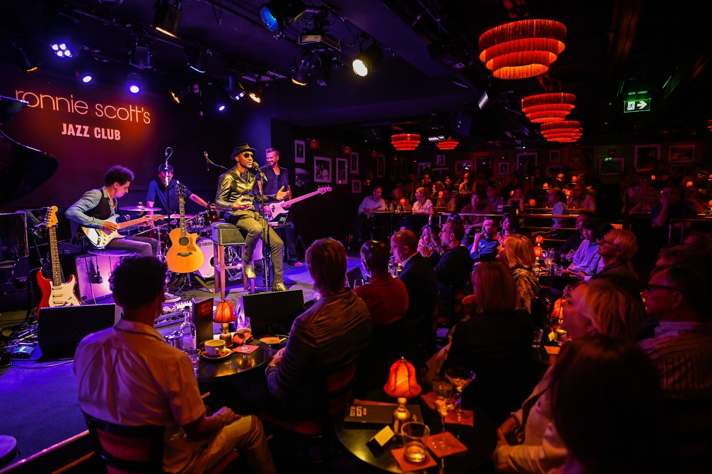

*Ronnie Scott's.*

It is a listening room. Talking during the music gets a warning and then a request to leave, and photos are not allowed while the band plays. The cheap way into the same room is the **Late Late Show, Wednesday to Saturday from 11.15pm, at £12**; the Monday night jam runs in the same slot. Book the main show weeks ahead for any name you know.

### 606 Club, Chelsea

*££ · Chelsea · 90 Lots Road, SW10 0QD · Nominated, Jazz Venue of the Year, Parliamentary Jazz Awards 2025 · Cited by 14 sources · [times and prices](https://www.606club.co.uk/times-prices/)*

A basement on Lots Road seating about 100, with **two sets every evening by UK-based musicians**: jazz, Latin and soul, from 8pm in the week and 9pm at weekends. It has been on Lots Road since 1988, and was one of the four nominees for Jazz Venue of the Year at the 2025 Parliamentary Jazz Awards.

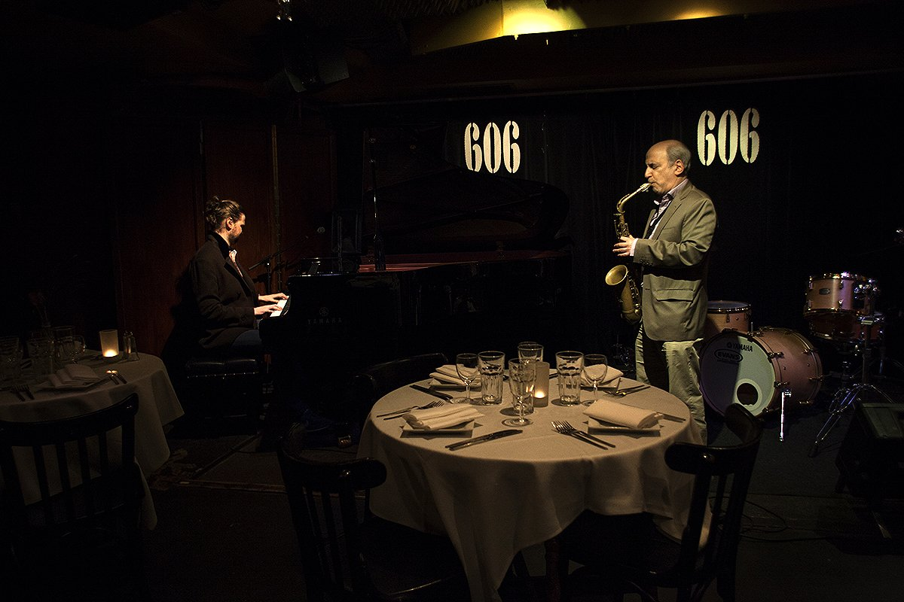

*The 606 Club.*

There is no ticket: a **music charge of £18 a head Sunday to Thursday evenings, £23 on Friday and Saturday, and £16 for Sunday lunch** goes on the bill. The kitchen cooks to order, from grilled sea bream with ratatouille to a rib-eye with chips. **Non-members are welcome, but it is licensed as a restaurant, so you drink only if you eat.** Book by phone and confirm by 3pm on the day.

### PizzaExpress Jazz Club, Soho

*££ · Soho · 10 Dean Street, W1D 3RW · Cited by 11 sources · [listings and tickets](https://www.pizzaexpresslive.com/pizzaexpress-jazz-club-soho)*

A basement under the Dean Street PizzaExpress that has had jazz in it since 1969, with a ticketed act on a small stage and **the full PizzaExpress menu served at your table**. Jazzfuel puts the capacity at 115; the tables are close together and the band is a few feet away.

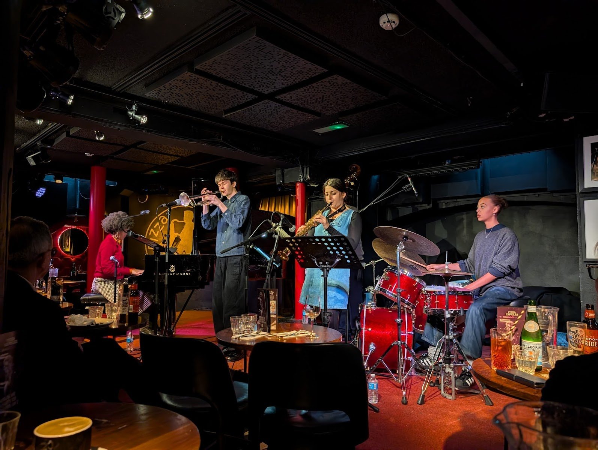

*PizzaExpress Jazz Club.*

**The ticket buys the table**, held from doors-open for the number you booked, and there are no paper tickets: you give your name at the door. Food and drink are on top, and a £2 booking fee is added per ticket. Two sister rooms work the same way: PizzaExpress Live Holborn at 99 High Holborn and The Pheasantry on the King's Road.

### Jazz Cafe, Camden

<!-- evidence: Jazz Cafe Camden -->
*££ · Camden · 5 Parkway, NW1 7PG · Cited by 11 sources · [restaurant tickets](https://thejazzcafe.com/restaurant-bookings/)*

A two-level room in a former bank a minute from Camden Town station, open since 1990, with **live acts every night**. The programme is soul, funk, Afrobeat and hip-hop as often as jazz, and at weekends the room turns into a club after the band.

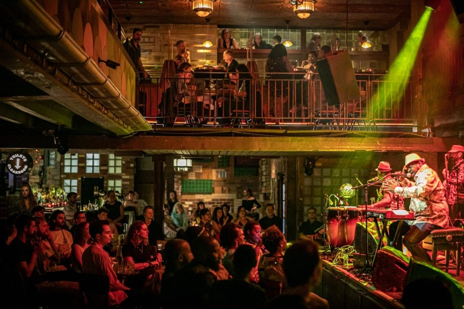

*The Jazz Cafe.*

**The decision is floor or balcony.** Standing on the floor gets you closer; a restaurant ticket gets you a table on the first-floor mezzanine looking down at the stage, with a menu running from a birria taco to a rib-eye with chimichurri. The ticket is the table, so there is no separate booking. **Strictly 18+ with photo ID**, and the restaurant is up 16 steps with no step-free access.

### Vortex, Dalston

<!-- evidence: Vortex -->
*£ · Dalston · 11 Gillett Square, N16 8AZ · Cited by 10 sources · [what's on](https://www.vortexjazz.co.uk/events/)*

A small first-floor room on Gillett Square, part seated and part standing, run as a **not-for-profit by volunteers**. It programmes contemporary, improvised and adventurous jazz, around 400 gigs a year by London x London's count, and ShortList singles out its silent audiences. It has been in Dalston since 2005; the entrance is on Boleyn Road, not Kingsland Road.

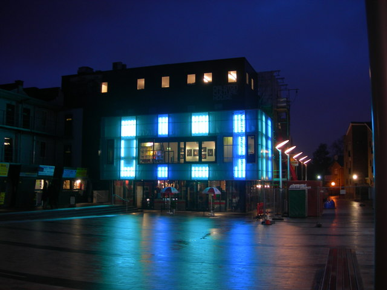

*The Vortex. Photo: [Danny Robinson](https://commons.wikimedia.org/wiki/File:Vortex_Jazz_Club_-_geograph.org.uk_-_343852.jpg), [CC BY-SA 2.0](https://creativecommons.org/licenses/by-sa/2.0/).*

**Most gigs are £15 to £18**, with lower prices for members and students; the **Sunday jam session is £6**, and free to members and the musicians taking part. Doors are usually 7.45pm, Tuesday to Sunday. **Seats are guaranteed only for members**, so arrive early for a named act.

---

## Also strongly backed

### Toulouse Lautrec, Kennington

*££ · Kennington · 140 Newington Butts, SE11 4RN · Cited by 8 sources · [book a table](https://toulouselautrec.co.uk/restaurant/#book)*

A French brasserie with a ticketed jazz club and a piano room upstairs, running jazz and cabaret since 2008: bebop, swing and gypsy jazz, plus jam sessions. Downstairs, a band plays in the dining room **every Thursday, Friday and Saturday from 7pm**, and a music charge goes on the bill at the end: **£5 a head on Thursdays, £7 on Fridays and Saturdays**.

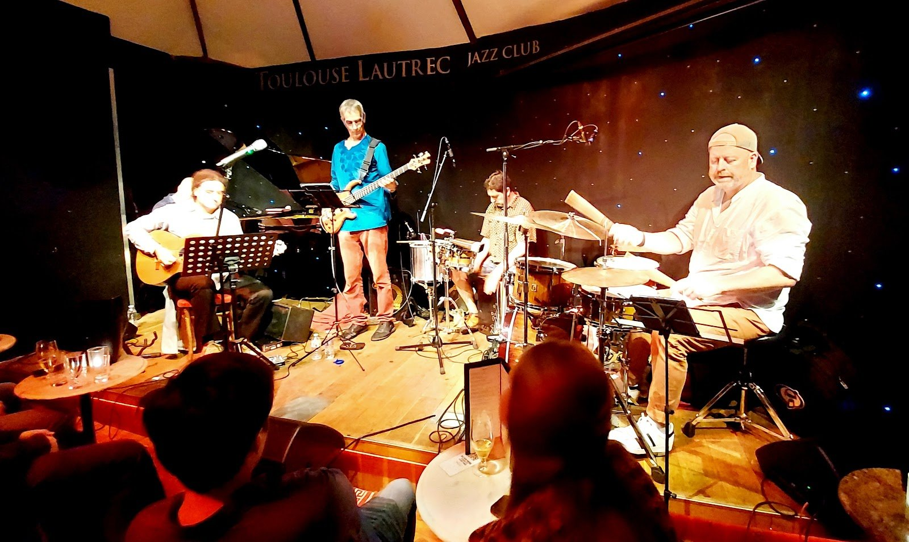

*The jazz club at Toulouse Lautrec.*

The restaurant does cassoulet with confit duck, Toulouse sausage and pork belly, and a 32-day rib-eye. **The upstairs club serves small plates and sharing boards only**, so buy the club ticket separately and eat downstairs 90 minutes before the show. It sits between Kennington and Elephant & Castle stations.

### Cafe OTO, Dalston

*£ · Dalston · 18–22 Ashwin Street, E8 3DL · Nominated, Jazz Venue of the Year, Parliamentary Jazz Awards 2024 · Cited by 7 sources · [programme](https://www.cafeoto.co.uk/)*

A café by day and a room for **free jazz, improvisation and experimental music** in the evening, holding about 150. There is no stage: the chairs come out, the musicians play at floor level, and the audience is there to listen rather than talk. Musicians often play two nights running with different material.

**Door prices run from free to £20**, with lower prices in advance and for members (from £5). It was nominated for Jazz Venue of the Year at the 2024 Parliamentary Jazz Awards. The programme is published months ahead, and the late-November listings had sold-out nights beside £14 ones, so check before you go.

### Nightjar, Old Street

*£££ · Old Street · 129 City Road, EC1V 1JB · Cited by 7 sources · [book a table](https://www.sevenrooms.com/explore/nightjarshoreditch/reservations/create/search/)*

A basement cocktail bar behind a pair of dark wooden doors next to a KFC on City Road, with **live jazz, blues, swing and funk every night from 9pm**. The cocktail list runs by era, pre-Prohibition to modern, at £14 to £18: a Charlie Chaplin at £14, a Singapore Sling at £15.

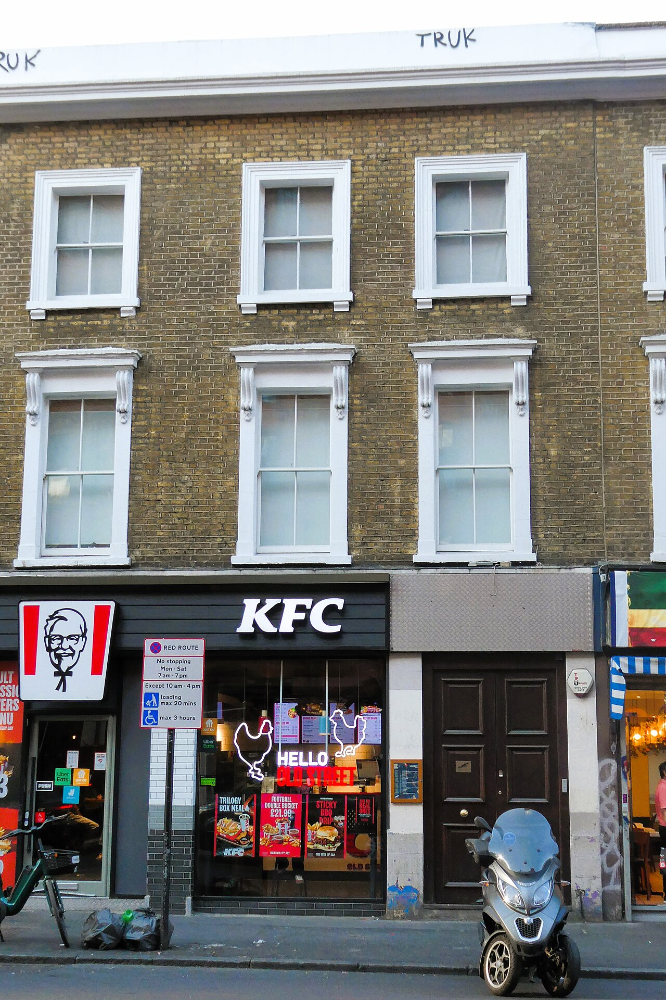

*Nightjar on City Road. Photo: [Ewan-M](https://commons.wikimedia.org/wiki/File:Nightjar,_Shoreditch,_EC1_-_2026-07-12.jpg), [CC BY-SA 4.0](https://creativecommons.org/licenses/by-sa/4.0/).*

There are no tickets: **a cover charge goes on your bill and is paid to the musicians**. Walk-ins are taken, but book for the music and ask for a table near the band. **Over-21s only**, smart casual. The [speakeasy guide](/articles/best-speakeasy-bars-london/) covers its door and drinks in full.

### Dalston Jazz Bar, Dalston

*£ · Dalston · 4 Bradbury Street, N16 8JN · Cited by 6 sources · [its site](https://www.dalstonjazzbar.com)*

A small room open **Thursday, Friday and Saturday nights only** where the band plays among the tables, under a large BEER sign. There is a menu with no prices: a run of seafood (baked and fresh oysters, mussels, prawns, a whole fish) or a vegetarian plate, and **you pay what you think it was worth**. London On The Inside says a £20 donation is the encouraged minimum.

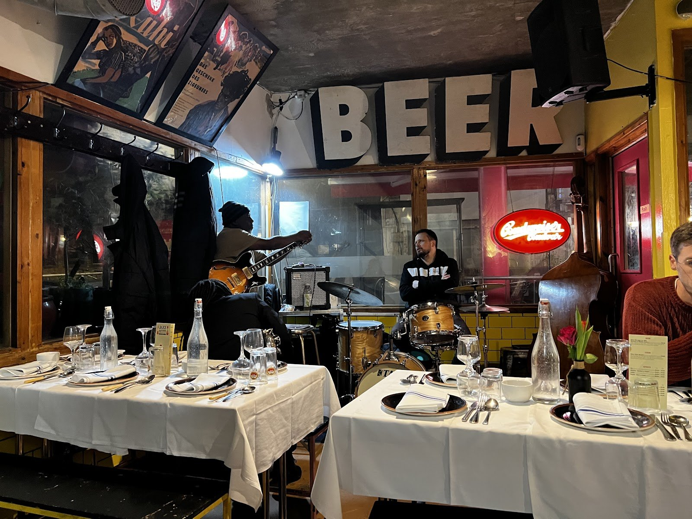

*Dalston Jazz Bar.*

Late in the evening the tables are moved and it turns into a party. It opens from 6pm, until 1am on Thursdays and 3am at weekends. Book through the link on its site.

### Brilliant Corners, Dalston

*££ · Dalston · 470 Kingsland Road, E8 4AE · Cited by 5 sources · [book a table](https://brilliantcorners.superbexperience.com/)*

A Japanese restaurant and bar built around a hi-fi sound system, open since 2013, with **DJs playing vinyl and live jazz** through the week. The izakaya menu runs to sushi, sashimi, hot dishes and set menus. Time Out and The Nudge both name its Played Twice night, where a classic jazz album is played in full and then reinterpreted live by a band.

It opens **every night from 5pm** (4pm on Sundays), to midnight and to 1.30am on Fridays and Saturdays. Tables for up to six book online; walk-ins sit at the bar, in the restaurant or on the big shared table in the side room, space permitting. Mu, its sister restaurant, is a few doors along.

---

## Bars and restaurants with a band

These are bars first. The music is a few metres away and usually costs a cover charge on the bill rather than a ticket.

### Oriole, Covent Garden

*££ · Covent Garden · 7–9 Slingsby Place, St Martin's Courtyard, WC2E · Cited by 3 sources · [book a table](https://www.oriolebar.com/#reservations)*

Jazz, blues and world music **Tuesday to Saturday** in a room off St Martin's Courtyard, usually two sets from 8pm, with a Global Tuesdays slot for Cuban and other bands. It is closed on Sundays and Mondays. The menu leans Latin and Asian: seabream ceviche with peach and leche de tigre, a miso-gochujang pork chop.

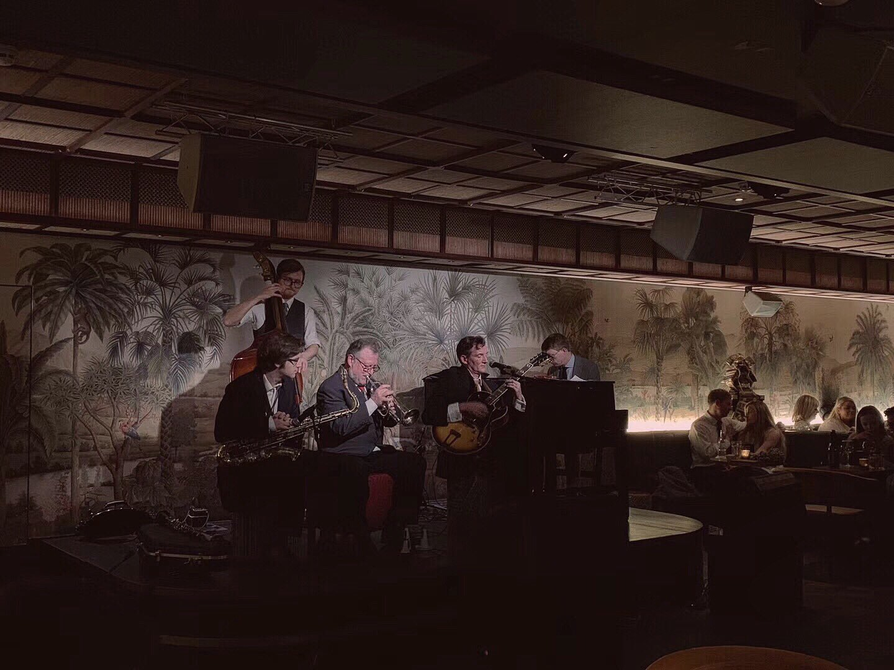

*Oriole.*

A **cover charge of £4 to £12** goes on the bill and is paid to the band; each night's figure is printed in its listings.

### Mu, Dalston

<!-- evidence: Mu -->
*££ · Dalston · 432–434 Kingsland Road, E8 · Cited by 3 sources · [book a table](https://www.sevenrooms.com/explore/mu/reservations/create/search/)*

A Japanese robata restaurant from the Brilliant Corners team with **jazz Wednesday to Sunday** in front of a small stage with a piano and a drum kit. Sets start at 7.30pm and 9pm on Wednesday, Thursday and Sunday, and at 9pm, 10pm and 11pm on Friday and Saturday, when it stays open until 2am. From the grill: seabass with miso garlic butter, black cod, a dry-aged striploin.

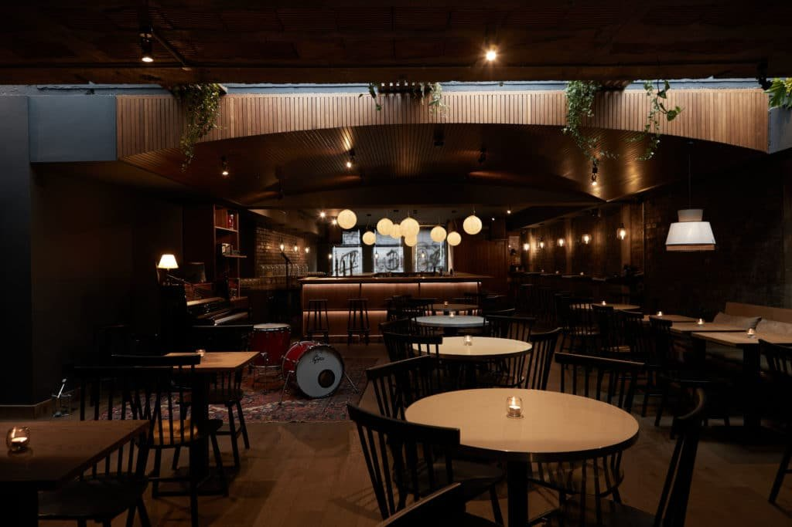

*Mu.*

The **£8 music charge is optional**, paid to the musicians and added only for guests seated during a performance. It is closed on Mondays and Tuesdays.

### The Crazy Coqs, Piccadilly

*££ · Piccadilly · 20 Sherwood Street, W1F 7ED · Cited by 4 sources*

An Art Deco basement room under Brasserie Zédel, seated at small tables with lamps on them and a red curtain behind the piano. The bill changes nearly nightly across jazz, cabaret and musical theatre, with shows at 7pm and a later one at 9.15pm. Its shows in the 2026 London Jazz Festival were £20 to £37.25.

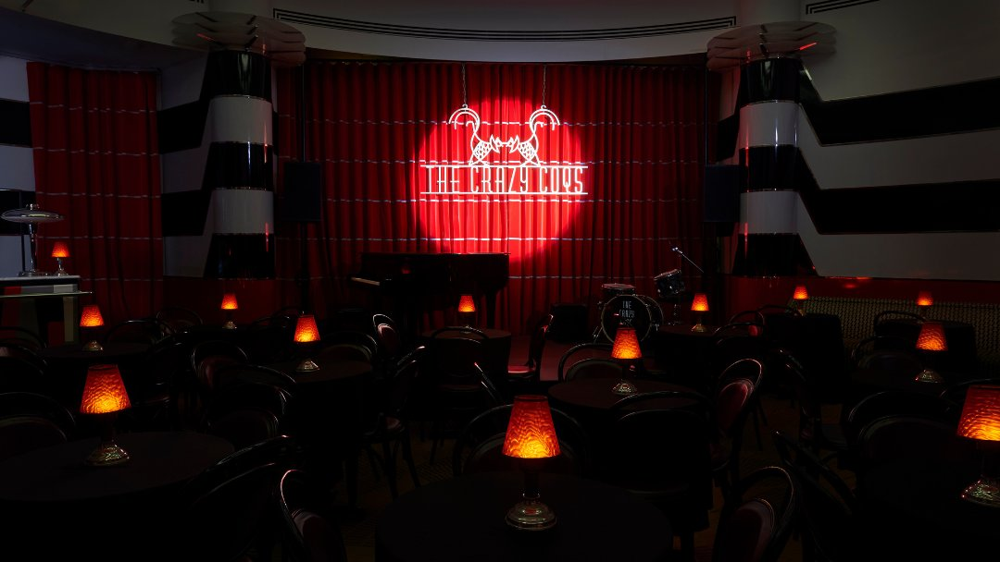

*The Crazy Coqs.*

**There is no dinner in the room**: you eat in the brasserie upstairs before or after, where a house band plays every day and two courses are £16.95. The [cabaret guide](/articles/best-cabaret-london/) has the rest of its programme.

### 28°-50° by Night, Marylebone

*££ · Marylebone · 76 Jason Court, Wigmore Street, W1U · Cited by 2 sources · [its site](https://2850bynight.co.uk)*

A wine bar and kitchen off Wigmore Street that turns into a jazz room **Thursday to Saturday, 8pm to 2am**, playing Dixieland, trad jazz, blues and swing; the rest of the week it is private hire only. The food is bistro: seared tuna with ratatouille and romesco, confit duck leg, a 28-day rib-eye.

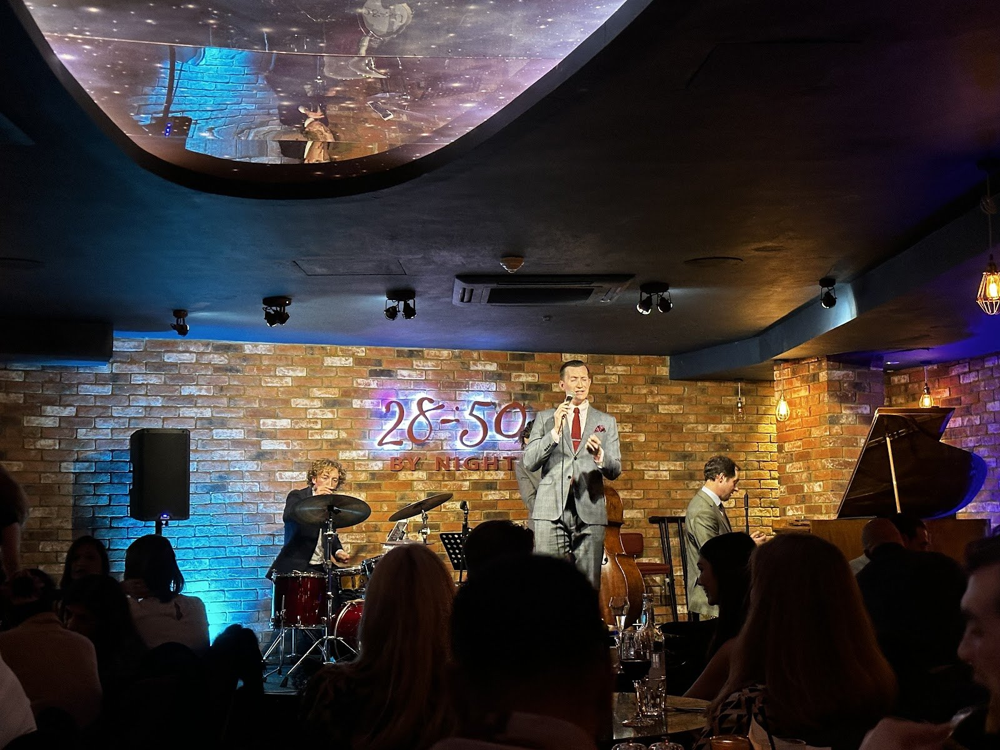

*28°-50° by Night.*

**There is no music charge for a normal table**, and dress is smart casual.

### Boisdale of Canary Wharf

*££ · Canary Wharf · Cabot Square, E14 · Cited by 4 sources · [dinner and show tickets](https://boisdaletickets.co.uk/calendar)*

A Scottish restaurant on Cabot Square whose music is programmed by its patron of music, Jools Holland. Canary Wharf runs **weekend lunch-and-show sittings** and evening shows, mostly tribute and residency nights, booked through one calendar with the Belgravia branch.

**A table in the restaurant does not include the show** unless you buy the ticket. Dinner-and-show packages start from £49 according to The Sybarite, and the menu is Scottish. Evening music is 13+.

### The Blues Kitchen, Camden

*£ · Camden · 111–113 Camden High Street, NW1 · Cited by 5 sources · [book a table](https://theblueskitchen.com/camden/bookings/)*

Not strictly a jazz bar, as London x London and Clink Hostels both point out: an American-style bar and restaurant with **live blues, soul and R&B every night**, a different named night each evening, and a Sunday blues jam. There are branches in Shoreditch and Brixton too.

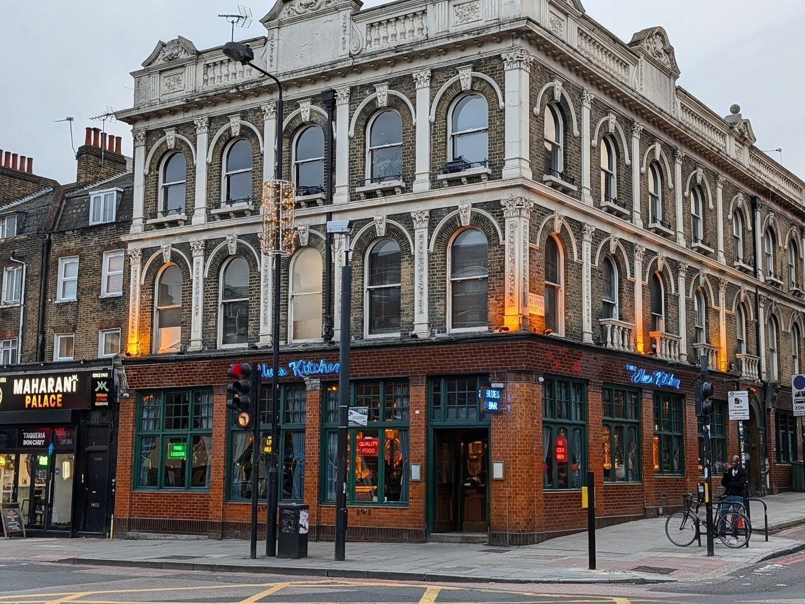

*The Blues Kitchen, Camden.*

**The music is free from 9.45pm.** The menu runs from Korean fried chicken to a dry-aged cheeseburger and a Hereford fillet, and a 12.5% service charge goes on food. Under-18s are not allowed in the bar or stage-side areas.

### Jack Solomons Club, Soho

*££ · Soho · 41 Great Windmill Street, W1D 7NB · Cited by 4 sources · [its site](https://jacksolomons.com)*

A basement bar under a Soho deli serving cocktails and small plates, with a piano in the room. DesignMyNight lists **live music Wednesday, Thursday and Friday**, with tickets from £35 and walk-ins welcome to pay on the door; DJs take over after the sets.

The walk-in kiosk bar upstairs opens from 4pm Wednesday to Saturday, and the club downstairs from 6pm, until 11pm on Wednesdays and 1am Thursday to Saturday. It is closed Sunday to Tuesday.

### Oliver's Jazz Bar, Greenwich

*£ · Greenwich · 9 Nevada Street, SE10 9JL · Cited by 4 sources · [Visit Greenwich listing](https://www.visitgreenwich.org.uk/things-to-do/olivers-jazz-bar-p1369021)*

A small bar behind Greenwich Theatre, on the London jazz circuit since 2003, with **live music every night from 9pm** and three jam sessions a week. The room is red, lit by candles on the tables, with an open fire in winter; Jazzfuel says many gigs turn into jams with London musicians sitting in.

It opens from 4pm daily, until midnight, and to 2am on Fridays and Saturdays. The Sybarite gives a **£10 cover** on every night.

---

## Pubs, cellars and free nights

Free or nearly free, and nothing to book. These are named by fewer sources, so they share a table.

| Pub | Area | When | What it is |
| --- | --- | --- | --- |
| **Royal Albert** | New Cross | Sunday nights | Free jazz in a New Cross Road pub, programmed by Good Evening Arts, on Time Out's list |
| **The Palm Tree** | Bow | Weekend evenings | A pub standing alone in Mile End Park off Grove Road, with a gold bar and flock wallpaper; jazz singers work through the Great American Songbook. Cash only |
| **The Bull's Head** | Barnes | Friday to Sunday | A Young's pub on the Thames with a music room at the back; big band, trios and duos, not every night |
| **Jazzlive at The Crypt** | Camberwell | Friday nights | Jazz in the crypt of St Giles' Church since 1995; tickets on WeGotTickets, tables cannot be reserved |
| **The Spice of Life** | Cambridge Circus | Sundays | A Soho pub with a jazz jam in its basement every Sunday, on DesignMyNight's list |

---

## New jazz and the award-nominated rooms

The Parliamentary Jazz Awards' nominations reach rooms that the listings press rarely covers. Cafe OTO is above; these are two more London rooms from the 2024 and 2026 lists.

| Room | Area | Nominated | What it is |
| --- | --- | --- | --- |
| **Ninety One Living Room** | Brick Lane | Jazz Venue of the Year 2024 | A lounge bar at 91 Brick Lane in the Truman Brewery that hosts Jazz re:freshed nights and a jazz brunch (ShortList). Its two "100 Years Of" nights in the 2026 London Jazz Festival were £5 to £12 |
| **World Heart Beat** | Nine Elms | Jazz Venue of the Year 2026 | A music-education charity's venue at 3 Ponton Road, opened in 2023, with the pianist Julian Joseph in residence (ShortList). It hosted the awards ceremony in 2025 and 2026 |

---

## New openings

### Blue Note London, Covent Garden

*£££ · Covent Garden · 42–49 St Martin's Lane, WC2N 4EJ · Cited by 2 sources · [tickets on Ticketmaster](https://www.ticketmaster.co.uk/blue-note-london-tickets-london/venue/289099)*

The New York club's **first UK venue**, in the basement beneath the St Martins Lane hotel, opened on 23 September 2026, what would have been John Coltrane's 100th birthday. Robert Glasper played the opening sets. The main room runs **two sets a night, at 7pm and 9.30pm**, with food served at the tables, and a smaller room called B-Side takes late sets and emerging artists.

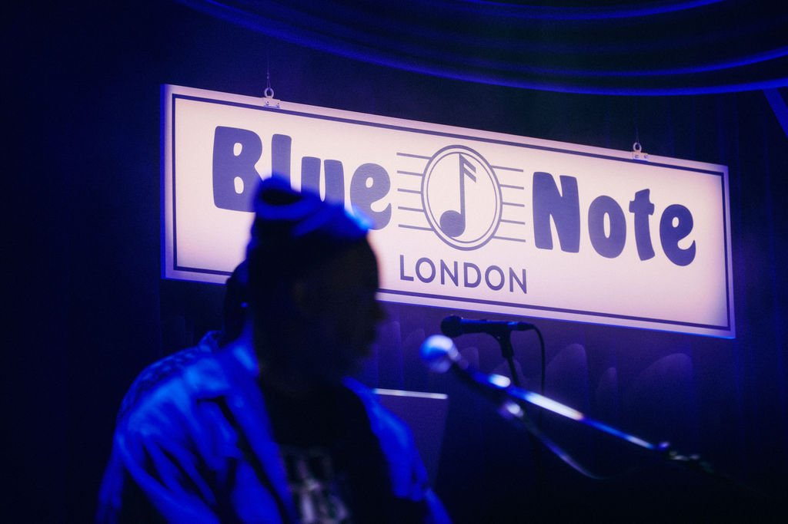

*Blue Note London.*

Ticketmaster issues the club's tickets. It is too new to be on most of the lists behind this guide, which is why it sits here rather than higher up.

### Upstairs at Ronnie's, Soho

*££ · Soho · 47 Frith Street, W1D 4HT · Cited by 2 sources · [what's on](https://www.ronniescotts.co.uk/find-a-show)*

A **140-capacity room above the main club**, reopened in February 2026 after a rebuild with its own kitchen and a Yamaha grand. It runs two shows a night and its own late shows, and ranges wider than jazz into soul, gospel and classical; Joe Stilgoe & The Entertainers have a Tuesday residency into March 2027.

Some of its late shows sell **on the door on the night only**, so check the listing before you book. It is a cheaper way into Ronnie's than the main room.

---

## Cheapest

* **[Royal Albert](#pubs-cellars-and-free-nights)** — free jazz on Sunday nights.
* **[The Blues Kitchen](#the-blues-kitchen-camden)** — free from 9.45pm.
* **[Dalston Jazz Bar](#dalston-jazz-bar-dalston)** — pay what you think, £20 encouraged.
* **[Mu](#mu-dalston)** — an optional £8 music charge.
* **[Cafe OTO](#cafe-oto-dalston)** — free nights in the programme, members from £5.
* **[Ronnie Scott's Late Late Show](#ronnie-scotts-soho)** — £12, Wednesday to Saturday.
* **[Vortex](#vortex-dalston)** — the Sunday jam is £6.

## What to know before you go

* **Keep quiet in the clubs.** Ronnie Scott's, the PizzaExpress room, the Vortex and Cafe OTO are listening rooms. To talk over the music, choose a bar from the section above.
* **Check whether the music is on the bill.** The 606 (£16–£23), Toulouse Lautrec (£5–£7), Oriole (£4–£12), Nightjar and Mu (£8, optional) add it at the end rather than selling a ticket.
* **A dinner booking is not always a show booking.** At Boisdale the music is a separate ticket, and at The Crazy Coqs the show and Brasserie Zédel's dinner are separate.
* **Age limits differ.** The Jazz Cafe is 18+ with photo ID and Nightjar is over-21s only.
* **November is the busiest month.** The [EFG London Jazz Festival](/articles/london-jazz-festival/) takes over most of these rooms for ten days each November, and tickets go faster.

## Continue planning your London trip

- 🎷 **[The best live music venues in London](/articles/best-live-music-venues-london/)** — the big rooms, from the Roundhouse to Brixton Academy, with the jazz clubs alongside.
- 🍽️ **[Dinner and a show in London](/articles/dinner-and-a-show-london/)** — what each jazz supper costs with the food, plus cabaret and drag brunches.
- 🎺 **[EFG London Jazz Festival](/articles/london-jazz-festival/)** — the November festival's venues, free shows and cheapest tickets.
- 🍸 **[The best speakeasy bars in London](/articles/best-speakeasy-bars-london/)** — Nightjar and the other bars you have to find.
- 💃 **[The best cabaret in London](/articles/best-cabaret-london/)** — The Crazy Coqs and the rest of the cabaret rooms.
