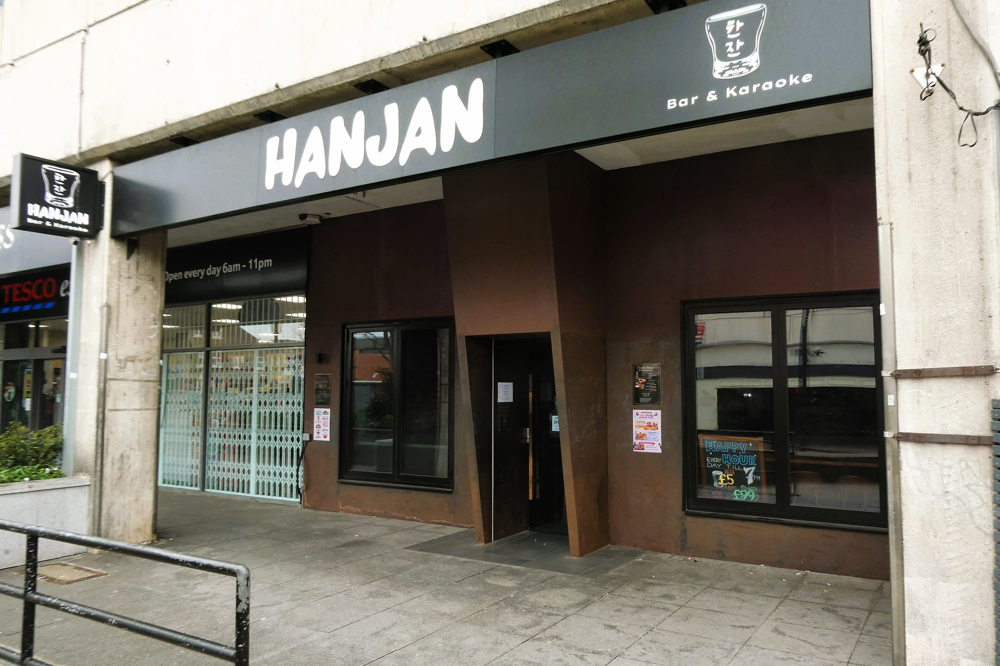
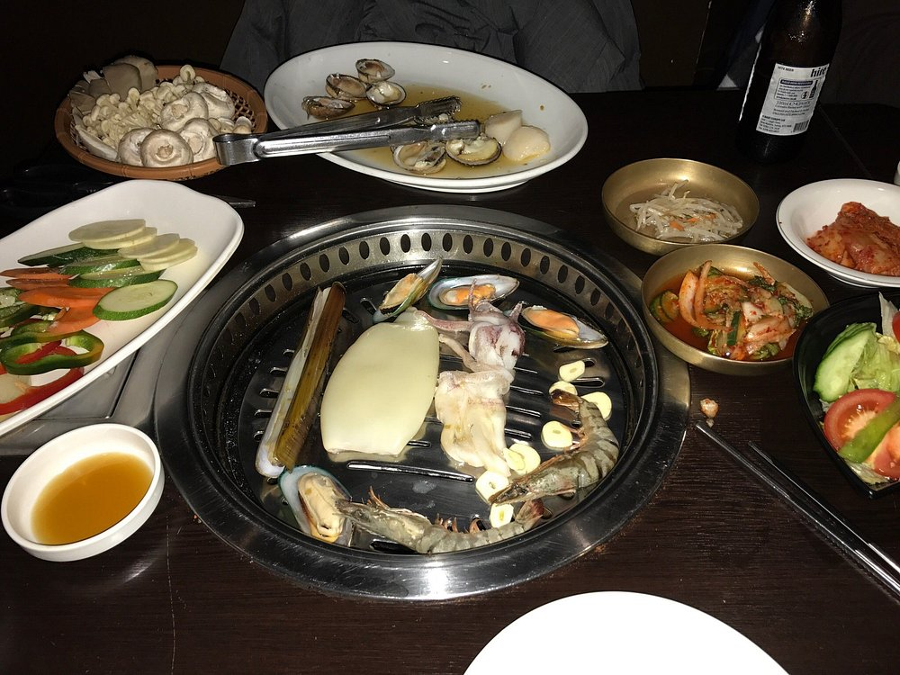
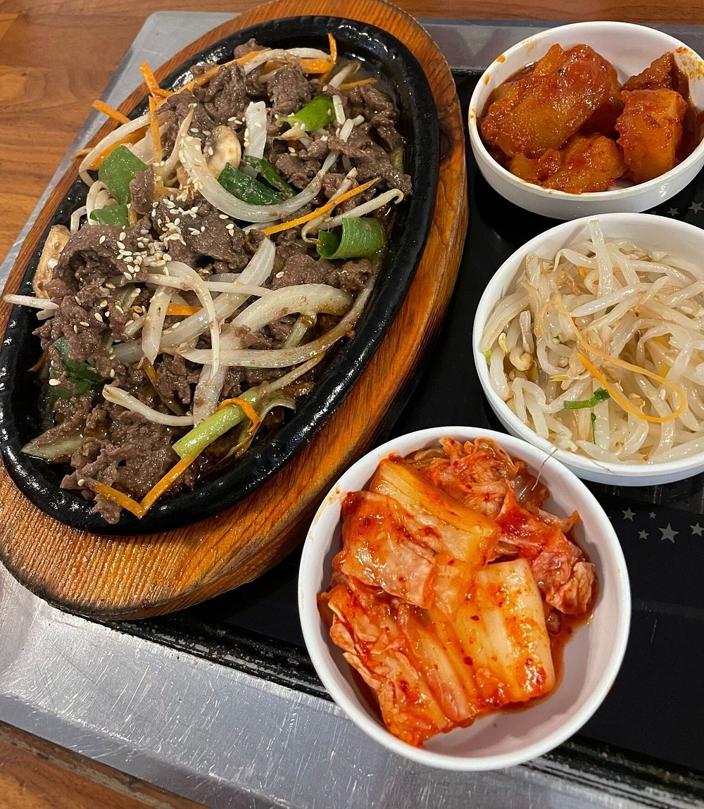
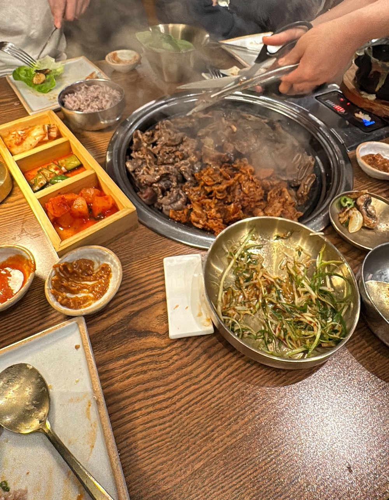
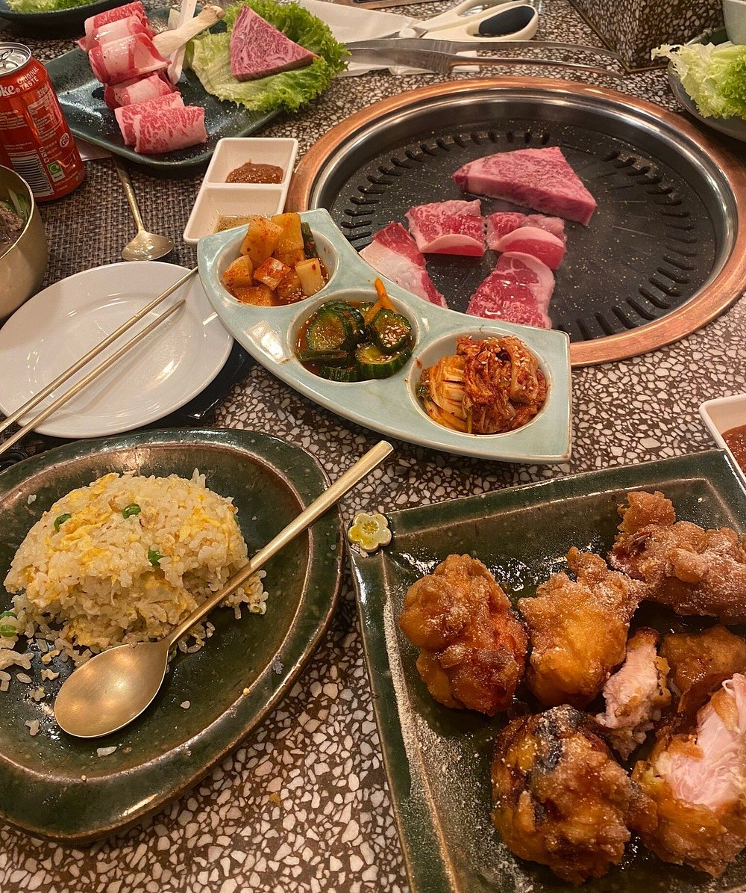
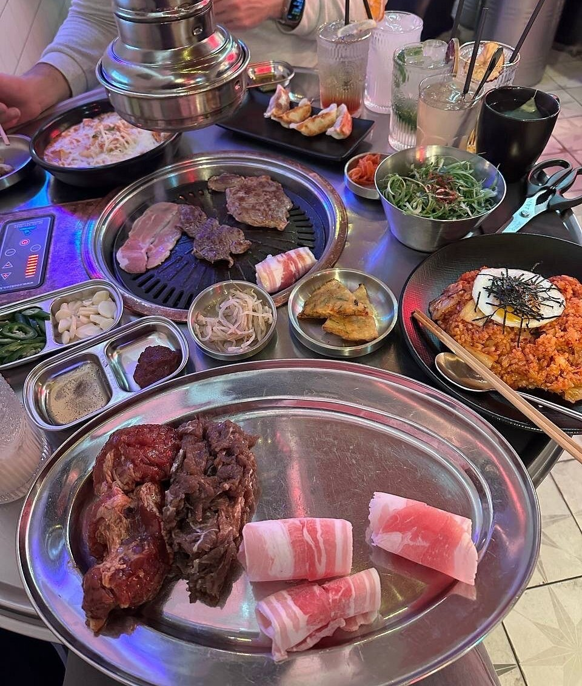
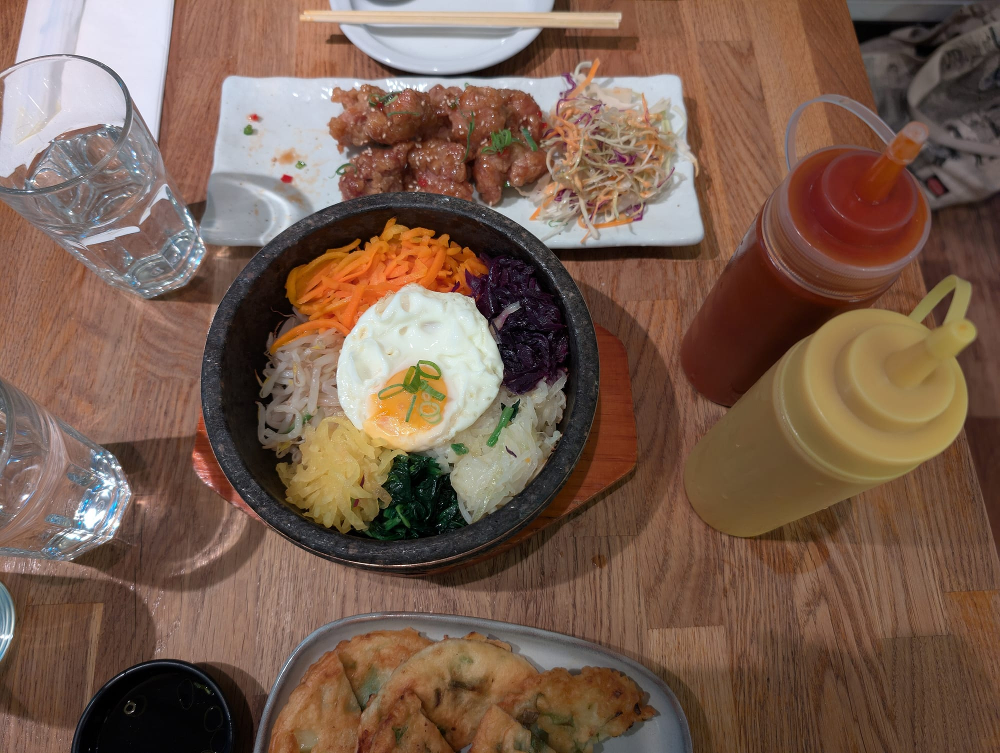

**New Malden has one of the largest Korean communities in Europe**, around 10,000 people in the town itself and up to 20,000 across the surrounding area, and three of its streets have the grills, supermarkets and bakeries to match. It is about thirty minutes from Waterloo. Central London has a growing list too, and Time Out named a Hackney kitchen its best London restaurant of 2025.

> 💡 **The Short Version:** **Jin Go Gae** in New Malden uses real charcoal, which is why purists go. **Imone** is the family-run home cooking. **You Me** has been there since 1988. **Chick and Beers** does the fried chicken. **Seoul Bakery** in Bloomsbury is the cheap central one, and **Mukbap** is fully vegan.

> 📊 **The evidence behind this guide.**
> **9 sources carrying 118 citations** across **74 named restaurants**. **19 restaurants are named by two or more independent sources; 2 hold a Michelin star.**
> **Built on:** the Michelin Guide; The Infatuation, Secret London and DesignMyNight; New Malden local guides.
> *Evidence rebuilt 14 September 2026 · [How we rank →](/how-we-rank/)*

## Where they are

  

    Best Korean restaurants in London map
  

  

    
Loading the interactive map…

  

  

    <i class="restaurant-map-key restaurant-map-key--editorial" aria-hidden="true"></i> Recommended in this guide
  

  <noscript>
    
The interactive map requires JavaScript. Nearest stations and walking times are listed against every entry below.

  </noscript>

| If you are near… | Where to eat |
| --- | --- |
| **New Malden** | Jin Go Gae, Imone, You Me, Cah Chi, Seoul Matjib, Chick and Beers, Tongdak |
| **Bloomsbury** | Seoul Bakery |
| **Shoreditch** | Mukbap |
| **Finsbury Park** | Dotori |
| **Soho & Chinatown** | Olle, Chung'dam, Pochawa Grill |
| **Hackney** | Miga |
| **Canary Wharf** | Sagye |

**Price guide:** **££** £15–£35 · **£££** £40–£70 · **££££** £90+.

---

## New Malden

The restaurants run along **three streets** rather than one: New Malden High Street, Burlington Road and Kingston Road.

*Burlington Road, New Malden. Photo: [Ewan-M](https://commons.wikimedia.org/wiki/File:HanJan,_New_Malden,_KT3.jpg), [CC BY-SA 4.0](https://creativecommons.org/licenses/by-sa/4.0/).*

### Jin Go Gae, Burlington Road

*£££ · charcoal, not gas* · Cited by 4 sources

**Real charcoal rather than gas.** Table barbecue is the format: **galbi** (marinated short rib) and pork belly grilled in front of you, with the **banchan** spread of kimchi, pickles and namul arriving unasked and refilled free. The stews are worth ordering too.

**£££, book a few days ahead** for a weekend table.

*The grill at Jin Go Gae.*

### Imone, New Malden High Street

*££ · family-run* · Cited by 4 sources

*Bulgogi and banchan at Imone.*

**A small family-run room on New Malden High Street**, strong on seafood and with **halal chicken options**.

Order **haemul pajeon**, the seafood and spring onion pancake, cooked crisp at the edges, and the stews built on squid and prawn rather than pork. The banchan changes with what has been made that day.

**££, book a few days ahead.** The room is small.

> Note that **Imone BBQ next door is a separate, newer venue** — a dedicated grill room. Easy to book the wrong one.

### You Me, Burlington Road

*££ · trading since 1988*

A plain room with no English-first menu, serving the Korean community.

Grilled meats at the table and a long list of **jjigae**, the stews that arrive still boiling, with **banchan** refilled without asking. Order the stews rather than the barbecue.

**Walk-in, cheap.** Burlington Road, a few minutes from New Malden station, and busiest at weekends.

### Cah Chi, Kingston Road

*££ · long-standing local favourite* · Cited by 2 sources

*Table grill at Cah Chi.*

One of the **oldest Korean restaurants in New Malden**, family-run and plainer than the newer grills.

Order **sundubu jjigae** (soft tofu stew, arriving still boiling) and **jeon**, the savoury pancakes. The **yukhoe** beef tartare is also on the menu. Barbecue is available but is not the draw.

**Walk-in and cheap.** A short bus or walk from New Malden station.

### Seoul Matjib, Burlington Road

*££ · drinking food* · Cited by 2 sources

**Tteokbokki** is the signature: cylindrical rice cakes in a sweet-hot gochujang sauce. Fried snacks and stews alongside.

**££, walk-in, closed Monday.** Small, plain and quick, a snack shop as much as a restaurant.

### Chick and Beers, Burlington Road

*£ · Korean fried chicken* · Cited by 4 sources

*Korean fried chicken, Chick and Beers.*

**Family-owned Korean fried chicken**, fried, rested, then fried again so the shell stays crisp under sauce. Order it plain and in the **yangnyeom** sweet-hot glaze to compare the two.

**££, walk-in, closed Monday.**

### Tongdak, Kingston Road

*£ · fried chicken* · Cited by 1 source

**A New Malden chicken specialist**, double-fried like its neighbours, in plain, soy-garlic and **yangnyeom** versions, with pickled radish to cut the fat. A takeaway counter more than a dining room.

**££, walk-in.** Order ahead by phone at peak times.

---

Powered by <a target="_blank" rel="sponsored" href="https://www.getyourguide.com/london-l57/">GetYourGuide</a>

## Central

### Olle, Soho

*£££ · 3 min from Leicester Square* · Cited by 3 sources

*Marbled beef at Olle.*

**Table grills in Soho.** Charcoal barbecue at the table: **marinated galbi**, pork belly and brisket cooked in front of you, with **banchan** and lettuce leaves to wrap it in. The kitchen also runs stews and **bibimbap** for anyone not grilling.

**£££, book a few days ahead**, three minutes from Leicester Square.

### Pochawa Grill, Chinatown

*£££ · 3 min from Piccadilly Circus* · Cited by 2 sources

*Pochawa Grill, Chinatown.*

**A neon-pink Korean pub in Chinatown**, a *pojangmacha* (street-tent drinking spot) rebuilt indoors. You grill at the table and eat the drinking food that goes with it: **fried chicken, tteokbokki** and stews, alongside soju and beer. Loud, bright and busy until late.

**£££, book a few days ahead** at weekends. Best as a group.

### Chung'dam, Soho

*££££ · 2 min from Leicester Square* · Cited by 2 sources

**The upmarket option**, named for Seoul's Cheongdam-dong district. Order the **pyeonbaek steam box**: a three-tiered wooden steamer of prawns, mussels and brisket cooked over hot stones and opened in front of you. Table barbecue and a wine and soju list behind it.

**££££, closed Sunday, and it books weeks ahead.**

---

## Elsewhere

### Miga, Hackney

*£££ · 4 min from Cambridge Heath* · Cited by 2 sources

A family-run kitchen that **moved from New Malden to Hackney in 2024** and was named Time Out's best London restaurant of 2025.

The dish to order is the **yukhwe beef tartare with crisp Asian pear**: raw beef, sesame and egg yolk. Behind it come the family's stews, pancakes and banchan.

**£££, closed Monday, and it books months ahead.** Small room.

### Sagye, Canary Wharf

*£££ · 13 min from Mudchute*

**Korean cooking on the Isle of Dogs**, a mile south of the Canary Wharf towers.

**Kimchi jjigae** is the order, served for a big table and portioned between bowls. Grills and banchan around it.

**£££, book a few days ahead.**

---

### Seoul Bakery, Bloomsbury

*£ · 14 Great Russell Street · cash-friendly* · Cited by 2 sources

Tiny, graffiti-covered and plastered in K-pop memorabilia, with **cheap Korean food** for the students from the university buildings around it. Order kimchi fried rice and seafood pancake.

*Dolsot bibimbap. Photo: [Andy Li](https://commons.wikimedia.org/wiki/File:Dol_sot_bibimbap_with_white_rice_-_Bibimbap_Soho_2025-09-18.jpg), CC0.*

### Mukbap, Shoreditch

*££ · 91 Worship Street · walk-in only* · Cited by 2 sources

**Entirely vegan Korean cooking.** The menu is **kimchi made without shrimp paste**, jjigae stews, japchae glass noodles and **bibimbap**, plus mock-meat versions of the barbecue dishes.

**££, closed Monday, book a few days ahead.** The only place in this guide where a vegan can order across the whole menu.

### Dotori, Finsbury Park

*£ · 3 Stroud Green Road · cash only · walk-in only* · Cited by 2 sources

A tiny Finsbury Park room serving **Korean and Japanese food side by side**.

On the Korean side: **bibimbap** in a hot stone bowl, where the rice crisps against the bowl, **japchae**, and kimchi jjigae. On the Japanese: katsu, udon and donburi.

**££, and tiny, with a queue at most hours.** No bookings for small tables; go early or late.

### Assa, Soho

*££ · 23 Romilly Street* · Cited by 2 sources

**The budae jjigae, or army stew, is the order.** It dates from after the Korean War and still contains **spam, hot dogs, instant noodles and processed cheese** in a gochujang broth. Grills and stews alongside.

**££, walk-in.** St Giles rather than Soho proper, and plain inside. Share the army stew.

---

Powered by <a target="_blank" rel="sponsored" href="https://www.getyourguide.com/london-l57/">GetYourGuide</a>

## Best value

#### The cheapest good meals

* **Seoul Bakery**, Bloomsbury, a tiny room with cheap Korean food.
* **Dotori**, Finsbury Park: cash only and walk-in only.
* **Chick and Beers** or **Tongdak**, New Malden: fried chicken feeds two for the price of one barbecue cover. Our [fried chicken guide](/articles/best-fried-chicken-london/) sets the Korean double-fry against the other fried chicken in London.
* **Stews and rice dishes**: kimchi jjigae, sundubu and bibimbap run roughly £12–£16 almost everywhere, including at the barbecue restaurants.

#### Supermarkets and food halls

* **The New Malden Korean supermarkets**: H Mart and the smaller independents along the High Street sell prepared banchan, kimbap and marinated meat to take away, at a fraction of restaurant prices.
* **Seven Dials Market** and **Arcade Food Hall** in central London both carry Korean counters if you want a single dish without committing to a full table.

#### General rules

* **New Malden is cheaper than central London** across the board, by more than the train fare.
* **Lunch sets** at the central restaurants are cheaper than dinner.

---

## What to know

* **Barbecue is £30–£45 a head** with drinks. The stews are half that.
* **Charcoal** is smokier than gas, and only a handful of London grills still use it.
* **Banchan are free and refillable** — the small side dishes that arrive unasked. Ask for more of the ones you like.
* **Soju is stronger than it tastes** and is usually ordered by the bottle for the table.
* **New Malden is Zone 4**, about 30 minutes from Waterloo.

---

## Continue planning your London trip

- 🔀 **[The Best Fusion Restaurants in London](/articles/best-fusion-restaurants-london/)** — Sollip, Cálong and the other kitchens cooking Korean with a second cuisine
- 🎤 **[The Best Karaoke in London](/articles/best-karaoke-london/)** — Jihwaja's noraebang rooms in Vauxhall and the other KTV rooms
- 🥟 **[Best Chinese and East Asian Restaurants](/articles/best-chinese-east-asian-restaurants-london/)**
- 🇯🇵 **[Best Japanese Restaurants in London](/articles/best-japanese-restaurants-london/)**
- 🌶️ **[Best Thai Restaurants in London](/articles/best-thai-restaurants-london/)**
- 💷 **[Cheap Eats in London](/articles/cheap-eats-london/)**
- 🍜 **[Soho Area Guide](/articles/soho-area-guide/)**
- 🎨 **[Hackney Area Guide](/articles/hackney-area-guide/)**
