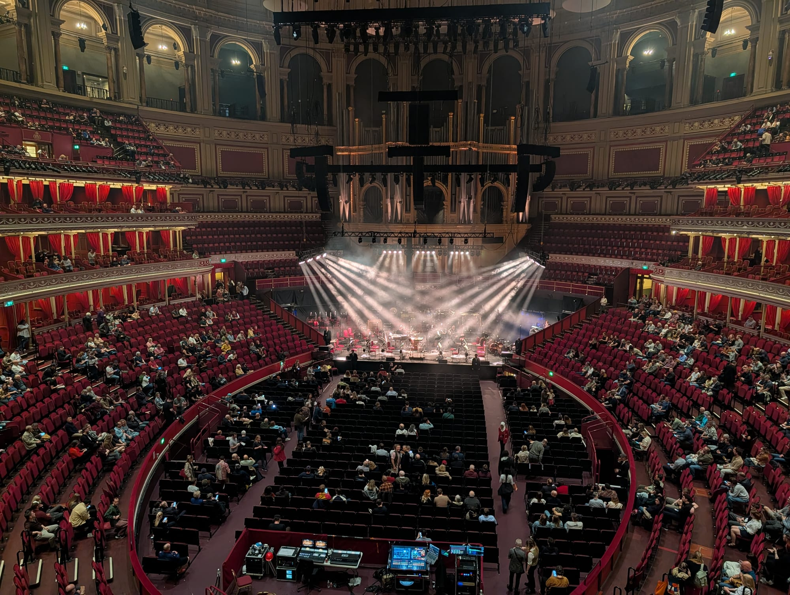
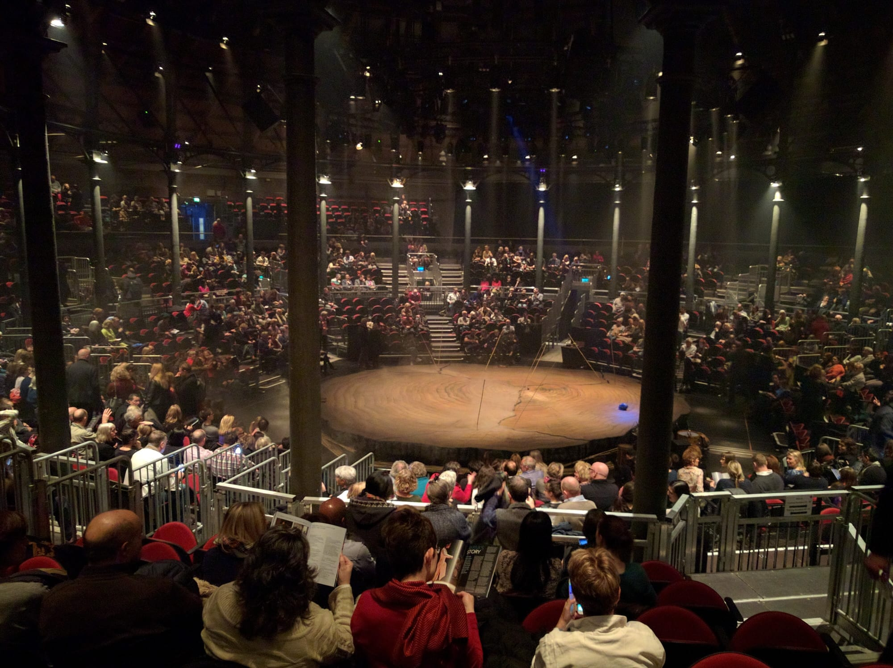
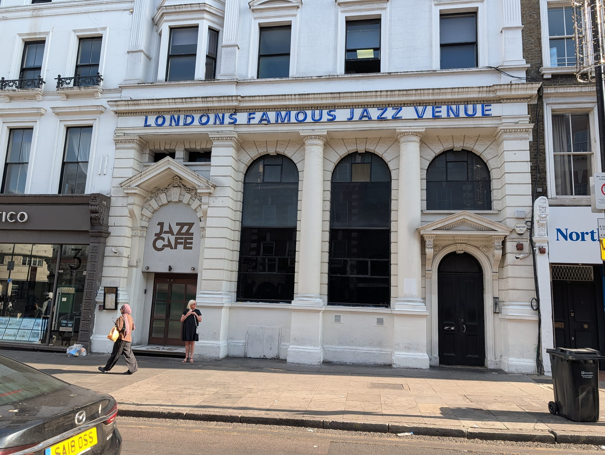

London's music rooms are mostly buildings that were something else first — a railway turning shed, a Victorian theatre, a church, a veterans' social club. This guide covers the rooms rather than the listings, arranged by size, because a 20,000-seat arena and a back room behind a Dalston pub are different nights out.

> 💡 **The Short Version:** **O2 Academy Brixton** has the sloping floor bands rave about. **The Roundhouse** is a Victorian railway shed. **Union Chapel** is a working church that hosts around 250 gigs a year. **Cafe OTO** is Time Out's pick for the most consistently committed small room. And **MOTH Club** has a gold tinsel curtain and is still a members' social club.

> 📘 **How we choose these (editorial note).**
> No paid placements. These are drawn from a wide spread of sources - the food and travel press, the big listings sites, independent blogs and specialists, video, and what Londoners recommend themselves - and cross-referenced against each other. Capacities are approximate and change with the layout of a given show.

## Where they are

| If you are near… | Where to go |
| --- | --- |
| **Camden & Chalk Farm** | The Roundhouse, KOKO, Jazz Cafe |
| **Soho & Oxford Street** | Ronnie Scott's, the 100 Club, Below Stone Nest |
| **Shoreditch** | Village Underground |
| **Wood Green** | Alexandra Palace |
| **Islington** | Union Chapel |
| **The City** | Barbican Hall |
| **Dalston & Hackney** | Cafe OTO, EartH, Shacklewell Arms, MOTH Club |
| **Brixton** | O2 Academy Brixton |
| **Greenwich** | The O2 |
| **Covent Garden** | Stereo, Blue Note London |
| **Chelsea** | The 606 Club |
| **Notting Hill** | Notting Hill Arts Club |
| **Barnes & west** | The Bull's Head, Eventim Apollo |

---

## The big rooms

### O2 Academy Brixton

*around 5,000 · Brixton*

**The floor slopes down towards the stage**, so everyone can see, and the back is as good as the front. A **Grade II\* listed art deco former cinema.**

The venue lost its licence after a fatal crush at a show in December 2022 in which two people died. Lambeth ruled in September 2023 that it could reopen once **77 new safety conditions** were met, including reinforced doors, a rebuilt crowd management system and new ticketing. It ran test events at half capacity in April 2024, has been trading normally since, and is booking well into 2027.

### The O2, Greenwich

*20,000 · North Greenwich*

An arena inside the old Millennium Dome. The sound is competent rather than special, the upper tiers are a long way from the stage, and the seated blocks at the very back are worth avoiding if the tour matters to you. It is where you see the acts that cannot play anywhere smaller.

**Getting out is the part to plan.** Twenty thousand people leave at once into one Jubilee line station; wait twenty minutes in the bars rather than joining it, or walk to the Thames Clipper pier. **Up at The O2** lets you climb over the roof on a walkway, sold separately from any gig. More on getting there and away in our [O2 travel guide](/articles/the-o2-travel-guide/).

### Eventim Apollo, Hammersmith

*around 5,000 · Hammersmith*

**A 1932 art deco cinema, Grade II\* listed**, where many bands too big for Shepherd's Bush and too small for an arena end up, alongside Brixton.

The barrel-vaulted auditorium keeps most of its original Robert Cromie fittings and a Compton organ. It works **either seated or standing**, depending on the show, so check before you buy: the same act is a very different night in each. **The balcony is good here.** Hammersmith station is directly opposite, so the exit is easier than the capacity suggests.

### Royal Albert Hall, South Kensington

*5,272 · High Street Kensington or South Kensington*

A vast oval under a glazed dome, with tiers of red and gold boxes running all the way round, open since 1871 and home to the Proms every summer. Almost every seat has a clear view of the stage, and the boxes give a private vantage.

**Book by seat, not by price band.** The gallery at the very top is the cheapest and the acoustics up there are still good, but the standing arena at Proms concerts is the bargain: **Promming tickets are a few pounds on the day.**

*The Royal Albert Hall.*

### Alexandra Palace, Wood Green

*up to around 10,400 · N22*

**A Victorian palace of 1873 on a hill with a view over north London**, whose Great Hall takes upwards of ten thousand for a concert. It also has a theatre, an ice rink and hosts the World Darts Championship.

The Great Hall is largely undivided, so it behaves more like a festival tent than a concert hall: the sound at the back is noticeably worse than the front and there is no raked floor, which makes height an advantage. The restored **Alexandra Palace Theatre** next door, about 1,300 seats, is a better room for anything acoustic.

**The hill and the terrace view over the city are free.** Getting home is slow: Alexandra Palace station is a fifteen-minute walk downhill, Wood Green Tube is twenty, and ten thousand people leave at once.

### Barbican Hall, City of London

*1,900 · Barbican*

**Home of the London Symphony Orchestra**, a 1,900-seat room at the centre of the Barbican's brutalist estate.

Classical, jazz, contemporary composition, film scores played live and touring international artists share the same season, so the audience changes week to week. Sightlines are good from almost everywhere because the hall is wide and shallow. The full programme, the booking fee and where to eat nearby are in [what's on at the Barbican](/articles/barbican-centre-guide/).

**Allow ten minutes to find it.** The estate is hard to navigate, and the yellow line painted on the ground from the Tube exists for that reason. There are bars and a restaurant on site, and the conservatory upstairs is free on the selected dates it opens, though it needs a timed ticket booked that morning.

---

### British Airways ARC, Olympia

*3,800 · Kensington (Olympia)*

Opened on **16 June 2026** above the west exhibition hall at Olympia and run by AEG Presents. Self Esteem played the opening two nights.

At 3,800 it sits **between the Apollo and Brixton at one end and the arenas at the other**. Olympia's redevelopment also brought a rooftop canopy of bars and restaurants, a food hall and two hotels within weeks of it, and a theatre follows in 2027. **Kensington (Olympia) station is at the door**, though its off-peak service is thin for a venue this size, so check your route home before the encore.

---

Powered by <a target="_blank" rel="sponsored" href="https://www.getyourguide.com/london-l57/">GetYourGuide</a>

## Historic buildings

### The Roundhouse, Chalk Farm

*around 1,700 · Chalk Farm*

**A circular Victorian railway turning shed, built in 1847 to turn locomotives around.** The iron columns that held the roof up are still there, and because the space is round the crowd wraps the stage rather than facing it in a block. There is no deep floor, so it feels more intimate than 1,700 suggests. The gallery running round the upper level is the seated option.

It is a charity, and a large share of what it makes goes into studios, rehearsal space and creative programmes for 11-to-25-year-olds in the building. Chalk Farm station is two minutes away and easier than Camden Town after a show.

*The Roundhouse, Chalk Farm.*

### KOKO, Camden Town

*around 1,400 · Mornington Crescent*

**A Victorian theatre of 1900 with three tiers of horseshoe balconies.** It has been the Camden Palace, the Music Machine and a BBC theatre; Charlie Chaplin, the Goons and Madonna's first UK show all happened here.

A fire tore through the roof during restoration in 2020. It reopened in 2022 after a rebuild that added a tower, a recording studio and several members' floors above the auditorium, but **the main room came back intact**, gold leaf and all.

**Get on a balcony if you can.** The floor is small and fills fast, and the view down onto the stage from the second tier is the draw.

### The 100 Club, Oxford Street

*around 350 · since 1942*

A basement under Oxford Street that has had **live music in it continuously since 1942**, when it opened as the Feldman Jazz Club. It has traded as the 100 Club since 1964 and claims to be **the oldest independent music venue in the world**.

It hosted the **1976 Punk Festival**, with the Sex Pistols, The Clash and Siouxsie and the Banshees on the same small stage, and Oasis, The Rolling Stones and Metallica have all played it since. Tickets are usually **£10–£25**.

The stage is at floor level with pillars in the way.

### Union Chapel, Islington

*around 900 · Grade I listed*

A **working Congregational church**, built 1874–77, that runs around 250 gigs a year between Sunday services.

**The seating is unreserved**, first-come-first-served on the original wooden pews, so arrive early and expect a queue. **There is a bar** on the first floor, but alcohol has to stay in the bar area and cannot come into the chapel; soft drinks and snacks can. The building runs the **Margins Project**, a homelessness charity with a twice-weekly drop-in, showers, laundry and a winter night shelter, funded partly by the gigs.

It is fully accessible by ramp, with a platform lift up to the bar, and it houses an 1877 Henry Willis organ.

### Village Underground, Shoreditch

*around 700 · Shoreditch High Street*

**A Victorian warehouse with four disused Jubilee line tube carriages on the roof**, converted into artists' studios.

The main space below is a brick-and-steel hall with a high ceiling, hosting electronic bookings, club nights and touring bands. There are no seats and no sightline problems because the floor is flat and the stage is high. **The rooftop has opened to the public.** Shoreditch High Street station is three minutes away.

### EartH, Dalston

*1,200 standing · 680 seated · Dalston Kingsland*

**The former Savoy art deco cinema of 1937**, shut for decades and reopened in 2018 as two venues in one building (the name stands for Evolutionary Arts Hackney).

**EartH Hall** is a stripped-back standing space downstairs for touring bands and club bookings. **EartH Theatre** upstairs is the original tiered auditorium with **680 seats and the decay deliberately left visible**: peeling plaster, exposed brick, a half-ruined proscenium. It hosts seated shows, film and spoken word as well as music.

**Check which of the two your ticket is for**, because people turn up expecting the theatre and find themselves standing downstairs. Dalston Kingsland is a few minutes' walk.

### MOTH Club, Hackney

*around 200*

**A Memorable Order of Tin Hats veterans' club with a gold-tinsel stage curtain**, still run as a members' social club during the day, with bingo and cheap pints, before it becomes a music room at night.

The room takes about 200, the ceiling is low, and the bookings run from guitar bands on the way up to established acts playing deliberately small. Bar prices are closer to a social club than a venue.

**Tickets are cheap and go quickly**, and it is a five-minute walk from Hackney Central. Go on a weeknight if you want to be able to move.

> ⚠️ **Go while you can.** MOTH Club is fighting two planning applications for flats next door and has been since 2025. Hackney Council refused the first in March 2026, citing the developer's failure to show the flats would not restrict the club; **a second application on the adjoining plot is still undecided**. The petition passed 30,000 signatures.

---

Powered by <a target="_blank" rel="sponsored" href="https://www.getyourguide.com/london-l57/">GetYourGuide</a>

## Jazz

Most of these serve food at the table during the set; [Dinner and a Show in London](/articles/dinner-and-a-show-london/) compares the menus and what the music adds to the bill.

### Blue Note, Covent Garden

*Open since 23 September 2026*

The New York club's **first UK venue**, in the basement beneath the St Martins Lane hotel. It opened on 23 September 2026, what would have been **John Coltrane's 100th birthday**. A **300-seat main room runs two sets a night at 7pm and 9.30pm** with food served at the tables, and a second 130-seat room called **B-Side** hosts late sets and emerging artists.

**Robert Glasper** played the sold-out opening sets, with Erykah Badu, Jamie Cullum, Nubya Garcia, Yussef Dayes, KOKOROKO and Hak Baker announced behind him.

The address is **42–49 St Martin's Lane, WC2N 4EJ**. Book on [Ticketmaster](https://www.ticketmaster.co.uk/blue-note-london-tickets-london/venue/289099), which issues the club's tickets.

### Ronnie Scott's, Soho

*since 1959 · 47 Frith Street*

Ronnie Scott and Pete King opened the club on **30 October 1959** in a basement at **39 Gerrard Street**. The Frith Street room is the second one, taken over in **1965**.

Miles Davis, Nina Simone, Ella Fitzgerald, Chet Baker, Jimi Hendrix, Prince and Amy Winehouse have all played it. **Depeche Mode played their first gig under that name here**, in October 1980.

**The programme is four things, and the difference is most of the price:**

* **Main shows** — two every evening, seven nights a week, seated at tables with food and drink served throughout. Usually **£40–£65**.
* **The Late Late Show** — Wednesday to Saturday, on at **11.15pm**, and **£12**. The cheapest way into the main room.
* **The Monday Jazz Jam** — the one night the club shuts at 1am rather than 3am.
* **Afternoon shows** on Saturdays and Sundays, including the Sunday lunch sittings.

> **The Late Late Show is the move.** Same room, same stage, a fifth of the price, and it runs until the club closes at 3am.

### Upstairs at Ronnie's, Soho

*140 capacity · reopened after a rebuild*

A **140-capacity room above the main club**, rebuilt with purpose-built acoustics, a Yamaha S3X grand and its own kitchen. It runs two shows a night, late shows Thursday to Saturday, a vocal jazz jam on Wednesdays and Sunday afternoon shows, and ranges wider than jazz into soul, R&B, gospel, hip hop and classical.

Tickets run around **£20–£30**, roughly half the main room.

> **The Greene Rooms open in 2027** — a members-only backstage lounge above the club.

### The 606 Club, Chelsea

*90 Lots Road, SW10 0QD · two sets a night*

A basement on Lots Road. **Non-members are welcome**; the club says so on every page of its own site.

It charges a **music charge per person** rather than a ticket price: **£18** Monday to Thursday and Sunday evening, **£23** Friday and Saturday, and **£16** for Sunday lunch. Two sets a night in every case, doors from 6.30pm on weeknights and 7pm at weekends, with music from 8pm or 9pm.

Booking is recommended rather than required, and it runs a full kitchen: you eat while the band plays.

### Jazz Cafe, Camden Town

*around 440 · Camden Town*

**Live acts every night of the week**, across soul, funk, hip-hop, Afrobeat, Latin and neo-soul as often as jazz.

The room is small and rectangular with **a balcony you can book a table on and eat from**, looking straight down at the stage. That is the decision: standing on the floor gets you closer, the balcony gets you a seat, a view and dinner.

**Late licence at weekends**, when it turns into a club after the band. Camden Town station is a minute away.

*The Jazz Cafe, Camden Town.*

### The Bull's Head, Barnes

*since 1959 · 373 Lonsdale Road, SW13 9PY*

A jazz venue since 1959, the same year Ronnie Scott's opened. It is a **Young's pub on the Thames** that programmes live music **every week** in a dedicated **Jazz Room** behind the bar.

Five minutes from Barnes Bridge, and the one room on this list where the gig and a Sunday lunch are the same outing.

---

## Small rooms

### Cafe OTO, Dalston

*around 150*

**Time Out's own pick as London's most consistently committed live venue**: free jazz, noise, improvisation and experimental music, most nights of the week, in a room of about 150.

It is a café and bar by day; the chairs come out for the evening, and the audience is expected to listen rather than talk over the set. Musicians from around the world play here, often for two nights running with different material.

**Usually £8 to £20**, with advance and member discounts and some nights free to members. It runs its own record label and record shop next door, and the programme is published months ahead.

### Shacklewell Arms, Dalston

*around 200 · Dalston Kingsland*

**A back room behind an ordinary Dalston pub**, ranked among Time Out's UK top venues.

It has a low ceiling, no raised stage to speak of, and a capacity that keeps you within a few metres of whoever is playing. The front is a working pub with a decent beer list, so you can arrive early without committing to the gig.

**Tickets are usually under £15** and often sell out by word of mouth. Free entry on some club nights after the band.

### Notting Hill Arts Club, Notting Hill

*around 200 · Notting Hill Gate*

**A basement that has run new music and club nights since 1993.** It is a low, dark room under Notting Hill Gate; Adele, Franz Ferdinand and the Libertines all played here early. The programme mixes new bands with long-running club nights, and leans towards DJ nights later in the week.

**Early doors and cheap**: many shows start at 7pm and finish by 11pm, which suits a weeknight.

### Below Stone Nest, Soho

*around 250 · Tottenham Court Road*

**A basement underneath a former Welsh Presbyterian chapel on Shaftesbury Avenue.** The chapel above, Stone Nest, is a Grade II\* listed 1888 building left deliberately unrestored. Below it, the venue takes about 250 for electronic, experimental and club bookings, with a low arched ceiling.

It is ninety seconds from Tottenham Court Road.

### Stereo, Covent Garden

*Covent Garden Piazza*

**Live music, cocktails and dining on the Piazza**, useful when half your party wants a gig and the other half wants dinner.

The bookings lean soul, funk and covers, and the room is a restaurant that hosts music rather than a venue that serves food: you can eat a full meal, sit down, and still hear a band, two minutes from the Tube. **Book a table rather than turning up**, particularly at weekends.

---

Powered by <a target="_blank" rel="sponsored" href="https://www.getyourguide.com/london-l57/">GetYourGuide</a>

## Free and cheap gigs

* **The Windmill**, Brixton — where Black Country, New Road and Squid played early on. Entry is often a few pounds.
* **The Lexington**, Angel — a **200-capacity** indie gig room above a bourbon bar on Pentonville Road, open since 2008.
* **The Shacklewell Arms**, Dalston — several of its club nights are **free entry**, with a heated courtyard.
* **The Late Late Show at Ronnie Scott's** is **£12** for the same room that costs £40–£65 earlier in the evening. It starts at 11.15pm, Wednesday to Saturday, and most tickets are available on the door if the advance ones have gone.
* **Ronnie's concessions:** on Wednesdays and Thursdays, **Musicians' Union members get into the Late Late Show free** on production of a card, and students and other musicians pay **£6**.
* **The Vortex**, Dalston — **not free**, though often listed as though it were. Tickets are usually **£15–£25**, and **Vortex members, students and Universal Credit recipients** pay substantially less, sometimes half. Gigs run Tuesday to Sunday from 7.45pm, and seats are only guaranteed to members.
* **Church and lunchtime concerts.** St Martin-in-the-Fields, St James's Piccadilly and the Southbank Centre all run free or pay-what-you-can lunchtime recitals, usually by conservatoire students.
* **The Southbank Centre foyers** have free live music most days.

> Buy directly from the venue where you can. The resale sites add 20–30% and the grassroots rooms keep more of the money.

---

## What to know

* **Buy direct from the venue.** Every room here sells its own tickets, and resale prices are frequently multiples of face value.
* **Brixton Academy's sloping floor** means the back is fine. Do not pay extra to be near the front.
* **Union Chapel seating is unreserved.** Original wooden pews, first come first served, so arrive early. It is a Victorian church, so dress for the temperature.
* **The grassroots circuit is under pressure.** Thirty UK venues closed permanently between mid-2024 and mid-2025, more than half made no profit, and around 200 are on the Music Venue Trust's red alert list.
* **The late set at Ronnie Scott's costs £12** against £40–£65 for a main show, in the same room.
* **Jazz in London is rarely free.** The 606 charges a music charge, the Vortex charges £15–£25, and Ronnie's late show is £12. Free jazz is in pubs and at lunchtime recitals, not in the clubs. **November is the exception**: the [EFG London Jazz Festival](/articles/london-jazz-festival/) runs 13–22 November 2026 and includes free and family events.
* **Cafe OTO and MOTH Club** rarely sell out weeks ahead, so you can decide on the day.
* **Night Tube runs Friday and Saturday** on the Victoria line for Brixton and the Northern for Camden.

---

## Continue planning your London trip

- 🎷 **[Dinner and a Show in London](/articles/dinner-and-a-show-london/)**
- 🎺 **[EFG London Jazz Festival 2026](/articles/london-jazz-festival/)**
- 🎪 **[London Music Festivals 2027](/articles/london-music-festivals-2027/)**: BST Hyde Park, All Points East, Brockwell Park and the ones a train ride away
- 🎸 **[The Beatles in London](/articles/beatles-london/)**
- 🎭 **[Camden Area Guide](/articles/camden-area-guide/)**
- 🍸 **[The Best Cocktail Bars in London](/articles/best-cocktail-bars-london/)**
- 🌙 **[Late-Night Eating in London](/articles/late-night-eating-london/)**
- 🎪 **[Free Things to Do in London](/free/)**
- 🎨 **[Shoreditch Area Guide](/articles/shoreditch-area-guide/)**
- 🍜 **[Soho Area Guide](/articles/soho-area-guide/)**
