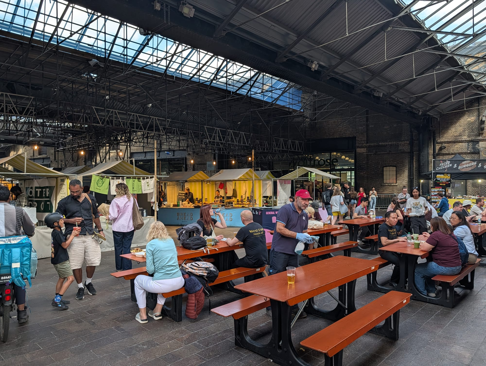
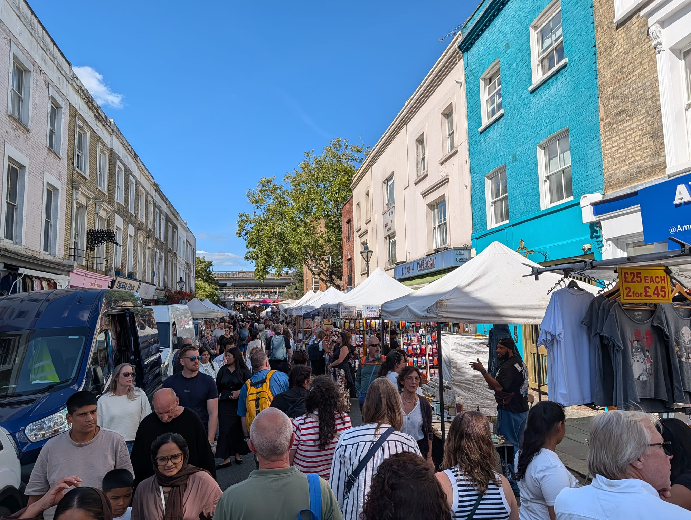
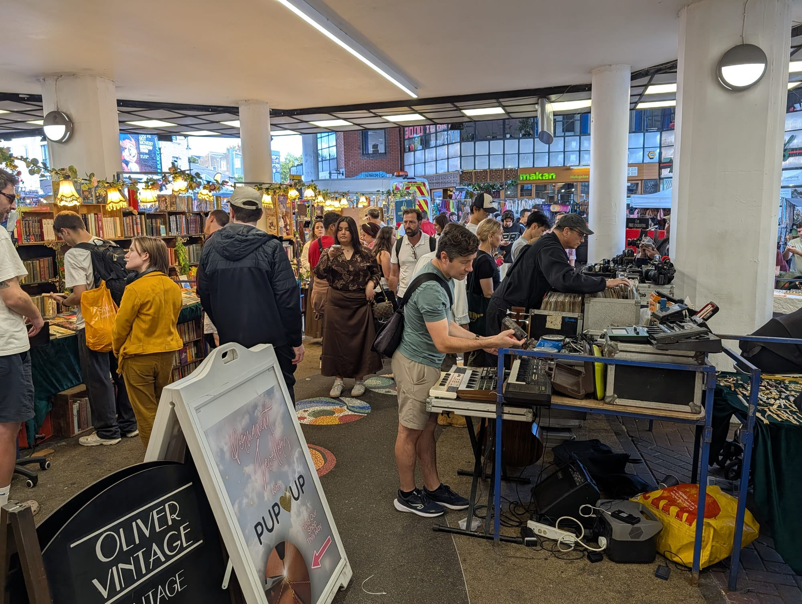
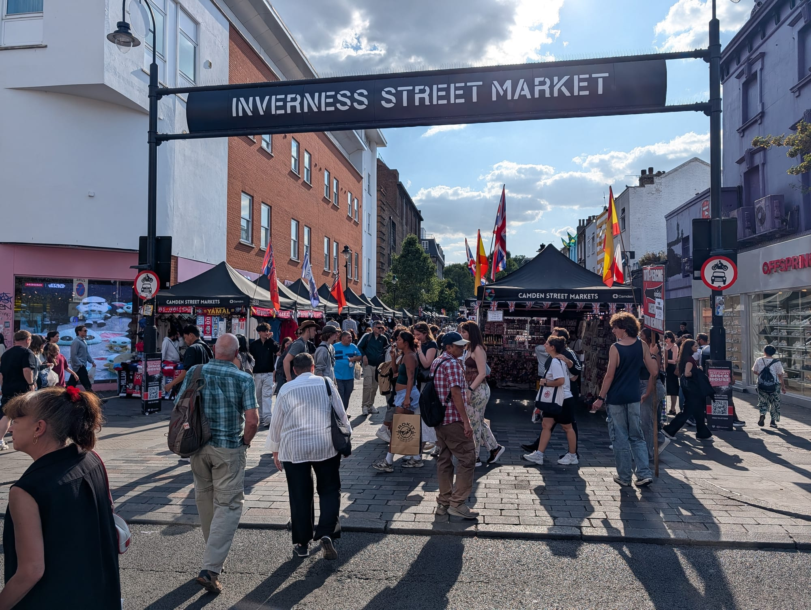
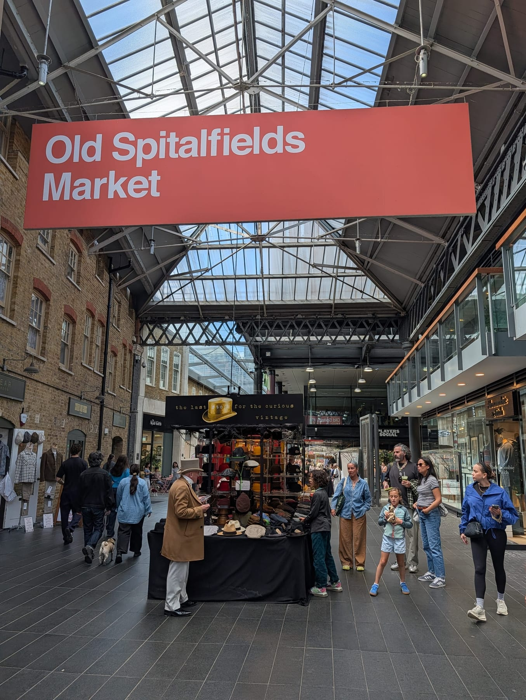
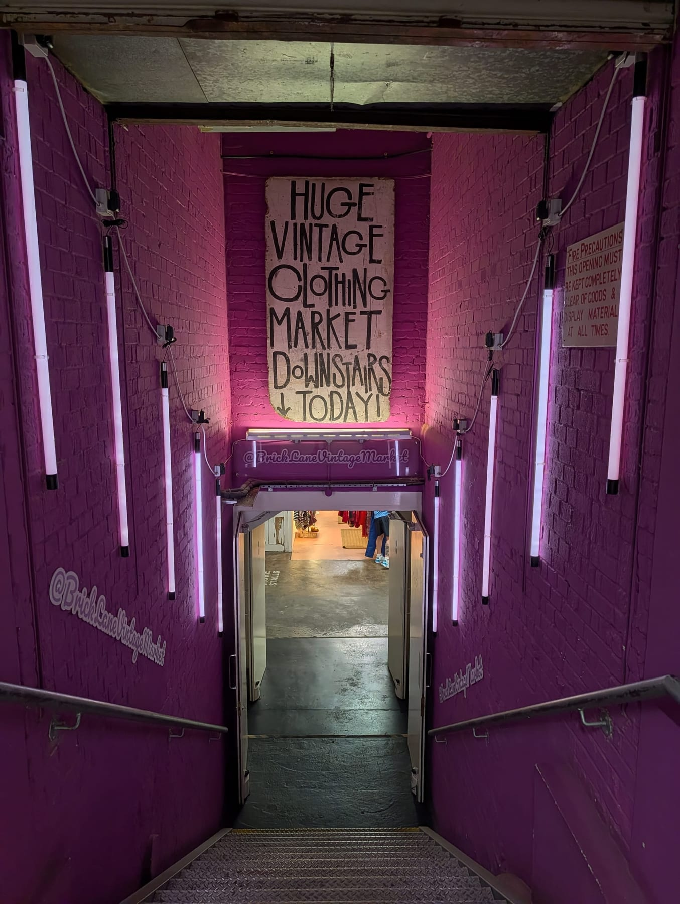
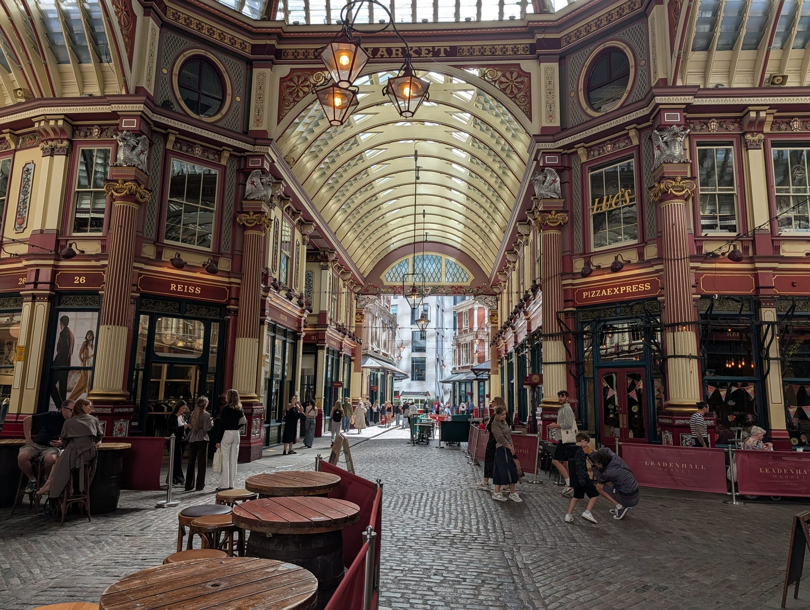

Check which days a market trades before you go. Columbia Road is flower sellers on Sunday and an ordinary road the rest of the week; Broadway Market trades Saturday and Sunday. Our [markets by day](/markets/) page lists trading days, and this guide says what each market is for.

**If you are only here to eat**, our [best street food in London](/articles/best-street-food-london/) guide compares every food hall, market and container yard on traders, variety, seating and trading days. The seasonal chalet markets and maker fairs of November and December are in our [London Christmas markets guide](/articles/christmas-markets-london/).

> 💡 **The Short Version:** **Borough** is the big food market, closed Mondays. **Columbia Road** is Sunday only and worth the alarm. **Maltby Street** is the smaller food market, ten minutes from Borough, open Friday evening to Sunday. And **Billingsgate** trades before dawn and closes at 8:30am.

## Where they are

  

    Map of the best markets in London
  

  

    
Loading the interactive map…

  

  

    <i class="restaurant-map-key restaurant-map-key--editorial" aria-hidden="true"></i> Recommended in this guide
    <i class="restaurant-map-key restaurant-map-key--streetfood" aria-hidden="true"></i> Market stall & food hall
  

  <noscript>
    
The interactive map requires JavaScript. Every entry below lists its area.

  </noscript>

| If you are near… | Which market |
| --- | --- |
| **Borough & Bermondsey** | Borough Market, Maltby Street |
| **Covent Garden** | Apple Market |
| **The City** | Leadenhall Market |
| **Shoreditch & Bethnal Green** | Old Spitalfields, Columbia Road, Brick Lane |
| **Hackney** | Broadway Market |
| **Camden** | Camden Market, Hawley Wharf, Inverness Street |
| **Notting Hill** | Portobello Road |
| **Greenwich** | Greenwich Market |
| **King's Cross** | Canopy Market |
| **Canary Wharf** | Billingsgate Fish Market |

---

## Food markets

### Borough Market, Southwark

*Free to enter · most days*

Produce stalls and hot-food counters under a Victorian iron roof beside Southwark Cathedral.

It is busiest **between 11am and 2pm on Saturday**. **Friday mid-morning** is the better window: everything is stocked and the crush has not started. Tuesday and Wednesday are quiet but several traders are missing.

**Kappacasein's toastie is £8**; Kappacasein trades **Thursday, Friday and Saturday only**. **The Black Pig** does porchetta thirty seconds away, Tuesday to Sunday, £11.50 to £13.50.

Horn OK Please and Gujarati Rasoi both serve vegetarian Indian food.

**8 Southwark Street, SE1 1TL, beside London Bridge station.** Free to enter, and the Borough Market Kitchen section at the back has the seating. **Closed on Mondays**; open Tuesday to Friday 10am to 5pm, Saturday 9am to 5pm and Sunday 10am to 4pm. It is the lunch stop on our [Bankside and Borough walk](/articles/bankside-borough-walk/), between Cross Bones and Southwark Cathedral.

### Maltby Street Market, Bermondsey

*Weekends*

A **narrow ropewalk of food traders under the railway arches** since 2010: oysters, waffles, gin, and about twenty stalls in a corridor. Borough is ten minutes away.

> ⚠️ **Friday evening to Sunday only.** Friday 5.30pm to 9pm, Saturday 10am to 5pm, Sunday 11am to 4pm. The rest of the week Ropewalk is an alley of shuttered arches.

**A few arches do trade midweek**: **40 Maltby Street** is a wine shop and restaurant, open for dinner Wednesday to Saturday and lunch Thursday to Saturday.

**It is tight.** By midday on a Saturday you are shuffling single file, so go at opening. Bermondsey station is about eight minutes' walk, London Bridge ten.

### Canopy Market, King's Cross

*Free to enter · Wednesday to Sunday*

Food traders, producers and designer-makers under the glass roof of the **West Handyside Canopy**, a Victorian goods canopy behind Granary Square. There are long communal benches and a bar.

**It runs on two schedules.** Wednesday and Thursday are street food only: noon to 7pm on Wednesday, noon to 8pm on Thursday. **Friday to Sunday is the full market**, with produce, jewellery, homeware and accessories alongside the food: noon to 8pm on Friday, 11am to 6pm at the weekend and on bank holiday Mondays.

### Billingsgate Fish Market, Canary Wharf

*Free to enter · before dawn*

The **UK's largest inland fish market**, open **Tuesday to Saturday, 4am to 8:30am**, ten minutes' walk from Canary Wharf. **The public can buy**, and you do not need a trade card.

**Children under 12, dogs, flip-flops, open-toed shoes and anything on wheels (trolleys, suitcases, folding carts) are not allowed on the floor.** Wear non-slip closed shoes.

**Bring cash and a cool bag without wheels.** Traders sell in boxes rather than portions, so this suits a group or a freezer, not a dinner for one.

**The market café does a bacon and scallop roll**, with the scallops bought on the floor downstairs.

> ⚠️ **Billingsgate is due to leave Poplar.** Traders stay until at least 2028, then move to a new site at Albert Island in the Royal Docks, subject to a Parliamentary bill. The Poplar site is planned for up to 4,000 homes.

Poplar and Blackwall DLR stations are five minutes' walk and Canary Wharf (Jubilee line) ten. Trains are sparse at 4am, so many people take a taxi or a night bus.

---

Powered by <a target="_blank" rel="sponsored" href="https://www.getyourguide.com/london-l57/">GetYourGuide</a>

## One day a week

### Columbia Road Flower Market, Bethnal Green

*Sunday only*

Flower sellers line a Victorian street, with about sixty independent shops in the terraces behind: a cheesemonger, a perfumer, galleries and cafés.

**Sunday only, roughly 8am to 3pm. It does not exist any other day**, and the shops behind it largely close with it.

**Arrive at 8am** for the best stock and room to move, or **after 2pm**, when sellers cut prices and a bunch that was £15 goes for £5. Between 10am and 1pm the street is too crowded to carry a plant.

**Do not drive or bring a pushchair.** The street is narrow and closed to traffic.

**E2 7RG.** Hoxton is the nearest station at about five minutes; Bethnal Green and Old Street are both around fifteen.

### Broadway Market, Hackney

*Saturday 9am–5pm, Sunday 10am–4pm · 35 Broadway Market E8 4PH*

Food, produce and vintage along a single street running down to the Regent's Canal, with **London Fields at the northern end** to eat what you buy.

**The market runs Saturday 9am to 5pm and Sunday 10am to 4pm**, all year. The permanent shops and cafés along the street trade through the week.

**The stalls are produce, bread and cheese** as much as street food.

**Cambridge Heath is the nearest station**, about eight minutes, and London Fields station is about the same. Bethnal Green on the Central line is a fifteen-minute walk.

---

## Shopping markets

### Portobello Road, Notting Hill

*Antiques Saturday*

Antiques on Saturday, and a different market on the other days of the week.

**Saturday is antiques**, and the road fills end to end. **Friday is a smaller antiques day** and better if you want to buy: room to negotiate and no crowd. The rest of the week the northern end is fruit and veg and general goods.

**It is a mile and a half long.** Antiques are at the Notting Hill Gate end, food in the middle, and vintage and the Westway arches at the northern end towards Ladbroke Grove.

**Walk it north and get the Tube back.** Notting Hill Gate to Ladbroke Grove is the natural direction, with a station at each end.

### Inverness Street Market, Camden

*Most days*

A short street market off Camden High Street: produce, street food and general goods along a single row.

**It is the calm alternative to Camden Market**, five minutes away, with stalls selling vegetables rather than novelty T-shirts.

**It is small.** Twenty minutes covers it, so treat it as one stop on a Camden trip: this, then the canal, then the main market.

**Most days rather than every day**, and it winds down in the afternoon. Camden Town station is two minutes away.

### Old Spitalfields Market, Shoreditch

*Most days*

A covered market hall of 1887 with market stalls and restaurants, and **a different line-up on different days**: antiques on Thursday, when the hall opens early at 8am; **records on the first and third Friday of the month**; makers on Wednesday; and independent traders, art and fashion the rest of the week.

**It is covered**, so it works in the rain, and the food traders around the edge run all week. The daily market is open 10am to 6pm (5pm on Sunday).

**16 Horner Square, E1 6EW.** Liverpool Street is about five minutes and Aldgate East eight, and Brick Lane is directly behind it, so the two combine into one walk.

### Camden Market, Camden Town

*Every day*

**Camden Lock, the Stables and Hawley Wharf** run together into one market of about 1,000 independent traders, open seven days a week. Most traders open 10am to 6pm.

**Weekday lunch is the same food without the crush**: the food traders are there all week, and a Saturday afternoon adds queues rather than choice.

**The Stables**, built as a horse hospital and stables for the canal, holds the antiques and vintage; Camden Lock has the food; Hawley Wharf is the newest section.

**32 Camden Lock Place, NW1 8AL**, five minutes from Camden Town station — which is **exit-only on Sunday afternoons**, so plan to leave from Chalk Farm instead.

### Greenwich Market, Greenwich

*Most days*

A small covered hall of designer-makers, antiques and food stalls, inside the Maritime Greenwich World Heritage Site. The market dates to 1737.

**It is open daily, 10am to 5:30pm**, and closed on Christmas Day and the first six Mondays of the year. **The stalls change by day**: arts and crafts on Mondays, Wednesdays, Fridays and weekends, antiques and collectables on Tuesdays, Thursdays and Fridays.

**It takes half an hour.** The Old Royal Naval College, the Cutty Sark and the park viewpoint are all within ten minutes.

**Cutty Sark DLR is three minutes away.** The market is covered, so it works in the rain.

---

### Brick Lane Market, Shoreditch

*Sundays for the whole stretch · the Vintage Market daily*

On Sundays the whole stretch becomes a patchwork of markets, including **Upmarket, Backyard Market** and the Old Truman Brewery yards, selling vintage clothes, records, antiques and street food.

**The Brick Lane Vintage Market itself runs seven days a week**, in the basement at F Block, 85 Brick Lane: Mon–Fri 11am–6.30pm, Sat 11am–6pm, Sun 10am–6pm. It covers the 1920s to the 1990s, so if you only want the clothes and records, **come on a weekday**.

Go early on a Sunday if you want the vintage, late if you want the food. **[Our Shoreditch and Spitalfields walking route →](/articles/shoreditch-spitalfields-walk/)** strings Columbia Road, Brick Lane, Spitalfields and Petticoat Lane into one numbered walk with the days set out stop by stop.

### Alfies Antique Market, Marylebone

*Tue–Sat · Church Street*

Alfies calls itself **London's largest indoor antiques market**: nearly a hundred dealers over four floors of a former department store on Church Street, with **a rooftop café** at the top.

Mostly twentieth-century design, vintage fashion and jewellery rather than antiques in the auction-house sense. Each dealer keeps their own unit.

**Open Tuesday to Saturday, 10am to 6pm; closed Sunday and Monday.**

**Church Street** has more antiques shops either side.

Edgware Road and Marylebone stations are each about eight minutes.

### Brixton Village and Market Row, Brixton

*Daily · covered arcades*

Two covered arcades off Electric Avenue holding independent restaurants alongside the Caribbean grocers, fishmongers and butchers that were there first.

**Traders include** a Colombian bakery, a record shop and a family greengrocer.

**The restaurants are small**, with units seating around a dozen, so an evening here means eating early or waiting.

**Both arcades are covered and open most days.** Traders keep their own hours, and the restaurants open later than the shops.

**Brixton station is two minutes away**, and Electric Avenue, the street Eddy Grant's song is named after, is directly outside.

### Victoria Park Market, Hackney

*Sundays · east London*

Street food, groceries, fashion and cut flowers on the edge of Victoria Park.

**Sundays only**, 10am to 4pm, on Bonner Gate Plaza at the western edge of the park.

**Combine it with the park.** Buy lunch at the market and walk in; there is a boating lake and a pavilion café inside.

**There is no station close.** Hackney Wick and Bethnal Green are each about fifteen minutes' walk.

---

Powered by <a target="_blank" rel="sponsored" href="https://www.getyourguide.com/london-l57/">GetYourGuide</a>

## Covered and historic

### Leadenhall Market, City of London

*Free · weekdays*

An **1881 covered market in cream, maroon and green wrought iron**, standing on the site of the Roman forum and designed by Horace Jones, who also designed Billingsgate and Tower Bridge. It played the London streets leading to the Leaky Cauldron in the first Harry Potter film, and the blue door used as the Leaky Cauldron entrance, on Bull's Head Passage, is now the Two Eyes Coffee House.

**Day to day it is shops, bars and restaurants under the ironwork**, not stalls.

> ⚠️ **It keeps City hours and is quiet at weekends.** The shops, bars and restaurants trade on weekdays, and around six on a weekday evening is when it is fullest. At weekends, pop-up markets run from noon to 5pm: SoLo Craft Fair on the second Saturday of the month (next on 14 November and 12 December 2026).

**Gracechurch Street EC3V 1LT**, two minutes from Bank or Monument. Free, roofed, and open to walk through at any hour.

### The Apple Market, Covent Garden

*Daily*

Under the glass roof of Charles Fowler's 1830 market building — **antiques on Monday, crafts and general goods the rest of the week**, from about 10am to 6pm daily.

**The antiques dealers appear on Mondays only.**

**The traders are vetted and many make what they sell.** The Jubilee Market hall on the south side is cheaper and closer to a general market.

**The performers in the North Hall are classical musicians**; those pitches are balloted separately. Free to watch; they pass a hat.

**Free to walk through, roofed, and open every day.** Covent Garden station is two minutes, but it is **exit-only at busy times** — Leicester Square is often faster.

---

## Not markets, but sold as them

Check the difference before you plan a morning around one.

* **Battersea Power Station** — 150 shops and restaurants inside Gilbert Scott's power station. A shopping centre.
* **The King's Road**, Chelsea — a shopping street with history rather than a market. Mary Quant opened Bazaar here in 1955.
* **Coal Drops Yard**, King's Cross — Heatherwick's converted coal drops, now retail.

---

Powered by <a target="_blank" rel="sponsored" href="https://www.getyourguide.com/london-l57/">GetYourGuide</a>

## What things cost, and the free part

* **Walking round costs nothing.** Borough, Spitalfields, Columbia Road, Portobello, Camden and Leadenhall are all free to enter.
* **Street food runs roughly £8–£14 a dish** across Borough, Maltby Street and Brick Lane.
* **Go in the last hour for flowers.** Columbia Road traders cut prices.
* **Borough's cheese, charcuterie and oil stalls offer tastings.**
* **Billingsgate is free to walk into** and closes at 8:30am. Bring cash and a cool bag.

---

## What to know

* **Check the day.** Columbia Road is Sunday, Broadway Market is Saturday and Sunday, Leadenhall trades on City hours, so weekdays. See our [markets by day](/markets/) page.
* **Most food markets take cards**, but a few of the smaller antiques dealers still prefer cash.

---

## Continue planning your London trip

- 🗺️ **[Best Areas to Visit in London](/articles/best-areas-to-visit-london/)** — the neighbourhoods compared by what each is best for and the best day to go
- 🇵🇭 **[The Best Filipino Restaurants in London](/articles/best-filipino-restaurants-london/)** — the Filipino counters at Seven Dials and both Boxparks
- 🥥 **[The Best Sri Lankan Restaurants in London](/articles/best-sri-lankan-restaurants-london/)**
- 🛍️ **[Shopping in London](/articles/shopping-in-london/)** — the streets, stores and arcades around the markets
- 🛍️ **[London Markets by Day](/markets/)**
- 💷 **[Cheap Eats in London](/articles/cheap-eats-london/)**
- 🍽️ **[Eat in London: Restaurants, Food Markets & Quick Food Hub](/articles/eat-in-london-guide/)**
- 🎪 **[Free Things to Do in London](/free/)**
- 🎨 **[Shoreditch Area Guide](/articles/shoreditch-area-guide/)**
- 🎭 **[Camden Area Guide](/articles/camden-area-guide/)**
