These are the individual traders, not the markets. Every stall below is ranked by how many independent guides, critics, awards and food channels name it, and every one was trading at the market given when this page was written.

> 💡 **The Short Version:** **[Kappacasein](#kappacasein)** at Borough Market is named by more sources than any other stall in London: a cheese toastie or raclette for £8, **Thursday to Saturday only**. **[JUMA](#juma)**'s Iraqi kubba, also at Borough, is next. The judged prizes went elsewhere: **[Oshpaz](#oshpaz)**'s Uzbek dumplings at Seven Dials took People's Choice at the 2025 British Street Food Awards, and **[Joy & Gladness](#joy--gladness)**'s goat curry at Lower Marsh won it in 2026, though it trades Monday to Wednesday lunchtimes only. None of these stalls takes bookings: go early, or on a weekday.

> 📊 **The evidence behind this guide.**
> **15 sources carrying 139 citations** across **93 named traders**. **Thirty traders are named by two or more independent sources; two carry a judged award.**
> **Built on:** the British Street Food Awards; The Good Food Guide, The Infatuation, Time Out, DesignMyNight and Olive; Visit London, Resy, Secret London, London x London, The Nudge and The Tour Guy; and three YouTube food channels. Only sources published from 2023 onwards are counted, because stall line-ups change faster than restaurant lists. Sit-down restaurants inside market buildings are left to our restaurant guides.
> *Evidence rebuilt 21 November 2026 · [How we rank →](/how-we-rank/)*

> ⏱️ **When to go.**
> **Borough Market is closed on Mondays until 30 November 2026**, when it moves to seven days a week. **Maltby Street trades Friday evening to Sunday only.** Several stalls keep shorter hours than their market, so check the day in each entry. Weekday mornings have the shortest queues everywhere.

---

## The winners

### Kappacasein

*£ · Borough Market, 1 Stoney Street · Thursday to Saturday · Cited by 6 sources · #8 of 12, Time Out · [Borough Market listing](https://boroughmarket.org.uk/traders/kappacasein/)*

A cheese toastie of cheddar, Comté and raclette cheese with leeks and onions, or raclette melted over baby new potatoes with black pepper and cornichons. Both are **£8**, and the London Raclette is Kappacasein's own cheese, made in Bermondsey. It is a stand-up counter on Stoney Street, and The Infatuation calls the toastie "a thing of beauty". **It trades only Thursday and Friday (10am to 5pm) and Saturday (9am to 5pm)**, so a Tuesday visit to Borough finds the shutter down.

### Oshpaz

*£ · Seven Dials Market, Covent Garden, and Mercato Metropolitano, Elephant & Castle · British Street Food Awards 2025: People's Choice and Best Vegetarian · [Seven Dials Market listing](https://www.sevendialsmarket.com/vendors/oshpaz-dumplings/)*

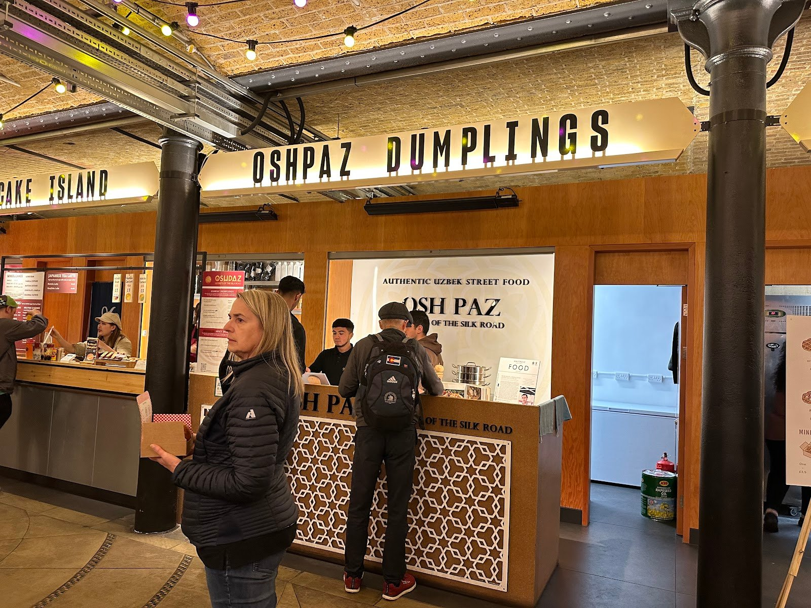

*Oshpaz Dumplings at Seven Dials Market.*

Uzbek cooking from Muzaffar Sadykov: steamed manty dumplings, plov rice bowls and shashlik kebabs. The steamed dumplings won Best Vegetarian at the 2025 British Street Food Awards, and the public vote at the same final put Oshpaz first for People's Choice. At Seven Dials it is a counter inside the converted banana warehouse, among more than 20 food traders. **Mercato Metropolitano at Elephant & Castle closes at the end of 2026**, so Seven Dials is the branch to plan around.

### Joy & Gladness

*£ · Lower Marsh Market, Waterloo · Monday to Wednesday, lunchtime · British Street Food Awards 2026: People's Choice and Spice Award · [Lower Marsh Market listing](https://www.lowermarshmarket.com/current-traders/joy-%26-gladness)*

Jamaican cooking from Chef Bigga, and the stall that won the public vote at the 2026 British Street Food Awards in Sheffield, adding the Spice Award for a slow-cooked, heavily seasoned goat curry. Lower Marsh Market is a weekday lunchtime street market a few minutes' walk from Waterloo station. **Joy & Gladness trades Monday to Wednesday only**, and the market runs from 11am to 3pm and is closed at weekends.

### JUMA

*£ · Borough Market Kitchen · Tuesday to Sunday · Cited by 5 sources · [Borough Market listing](https://boroughmarket.org.uk/traders/kubba/)*

Iraqi street food built around kubba, dumplings of spiced meat in a rice or bulgur shell, served as kubba haleb, alongside potato chap (stuffed potato croquettes), dolma and a mixed grill. Resy calls the mixed grill "a straight-up great order". It cooks in Borough Market Kitchen, the market's hot-food section, where The Infatuation describes a "baying crowd" eating outside it. Open Tuesday to Saturday from 10am to 5pm and Sunday to 4pm.

---

## Borough Market

The densest run of named traders in London. Borough is open Tuesday to Sunday until 30 November 2026, then every day. Arrive before noon: by 1pm on a Saturday the popular stalls queue into the walkways.

### Richard Haward's Oysters

*££ · Stoney Street · Tuesday to Sunday · Cited by 4 sources · [Borough Market listing](https://boroughmarket.org.uk/traders/richard-hawards-oysters/)*

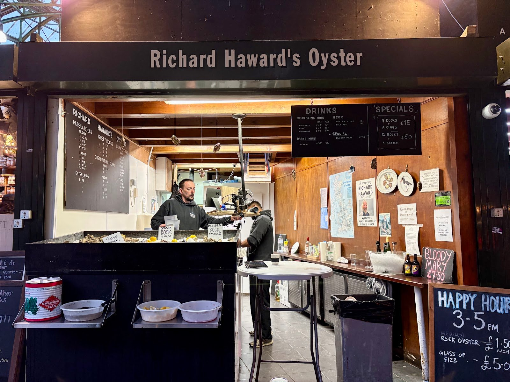

*Richard Haward's Oysters at Borough Market.*

Oysters shucked to order: rocks, Colchester natives and cherrystone clams, picked from the tray at the counter. There are a few seats, and The Infatuation suggests a chilled glass of wine with them. Mark Wiens's June 2026 film spent £41 on a plate of them. **Walk-in only.** Open Tuesday to Friday 10am to 5pm, Saturday from 9am and Sunday to 4pm.

### Bread Ahead

*£ · Cathedral Street and Three Crown Square · Tuesday to Sunday · Cited by 4 sources · [Borough Market listing](https://boroughmarket.org.uk/traders/bread-ahead/)*

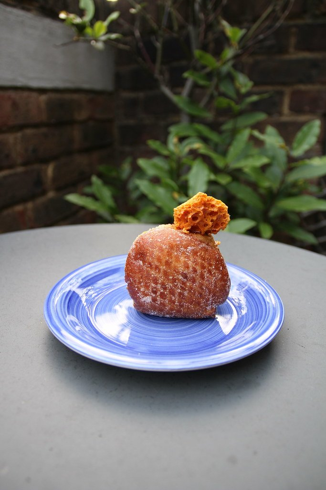

*A honeycomb doughnut from Bread Ahead.*

The doughnuts: crème brûlée (£4.75 in June 2026), and sea-salted caramel with honeycomb, which DesignMyNight picks. The bakery also sells sourdough and focaccia and runs a bakery school. There is a shop on Cathedral Street and a stall in Three Crown Square. The Tour Guy warns the crème brûlée one "might just ruin you". Open Tuesday to Saturday 9am to 5pm and Sunday 10am to 4pm.

### The Black Pig

*££ · Borough Market Kitchen · Tuesday to Sunday · Cited by 3 sources · [Borough Market listing](https://boroughmarket.org.uk/traders/the-black-pig/)*

Slow-roast pork sandwiches in doorstop-sized ciabatta. Mark Wiens orders "The Best One" (£13 in June 2026); The Infatuation's pick is the Salsa Verde. It is a single counter in Borough Market Kitchen that The Infatuation calls "perma-busy", and both YouTube films that cover Borough stop here. Open Tuesday to Friday 10am to 5pm, Saturday from 9am and Sunday 10am to 4pm.

### Gourmet Goat

*£ · 41 Rochester Walk · Tuesday to Sunday · Cited by 3 sources · [gourmetgoat.co.uk](https://www.gourmetgoat.co.uk/menu)*

Cypriot street food made with kid goat and rose veal. The order the sources agree on is the kid goat kofta wrap with chilli salsa, **£10.80**; Visit London prefers the slow-roast rose veal salad bowl at the same price, and halloumi fries are £6.90. Chicken (£9.90), halloumi and vegan wraps are cheaper. It is a counter on Rochester Walk. Open Tuesday to Friday 9am to 4.30pm, Saturday to 5pm and Sunday to 4pm.

### Gujarati Rasoi

*£ · Borough Market, and Broadway Market on Saturdays · Cited by 3 sources · [Borough Market listing](https://boroughmarket.org.uk/traders/gujarati-rasoi/)*

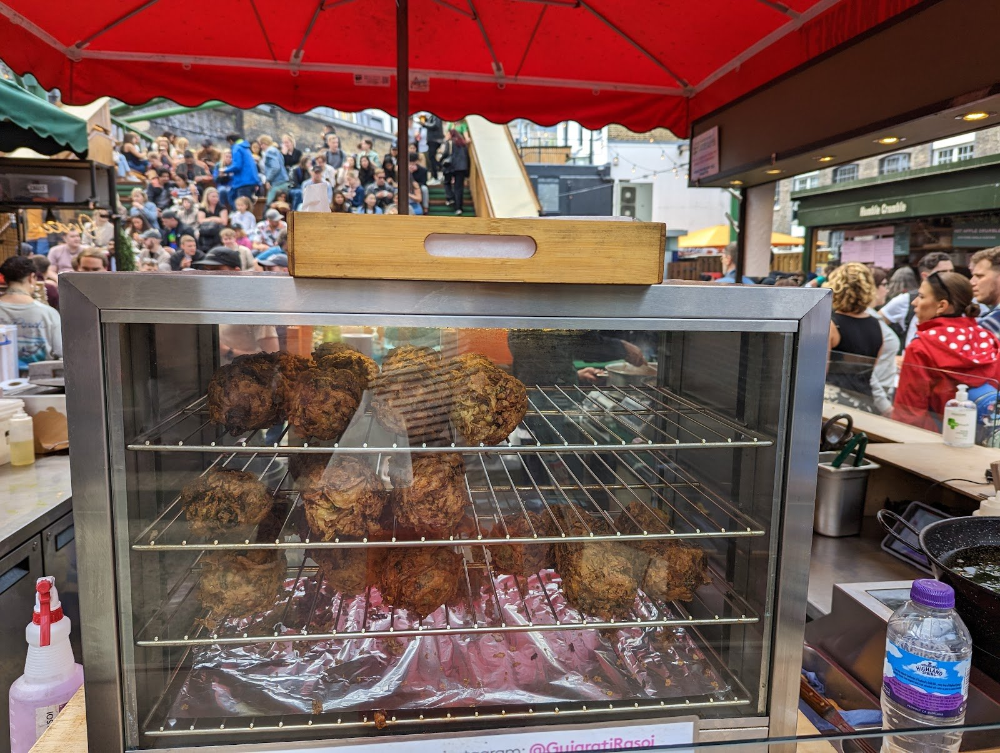

*Gujarati Rasoi.*

Vegetarian food from Gujarat: vegetable samosas, a thali of the day's vegetarian and vegan curries, papdi chaat (crisp wafers under yoghurt, chutney and chickpeas) and pau bhaji, a spiced vegetable mash with buttered rolls. Resy and The Infatuation both send readers to it at Borough, and Secret London lists it among Broadway Market's stalls in Hackney. Broadway Market trades only at weekends, so on a weekday Borough is the place to find it.

### Horn OK Please

*£ · Borough Market Kitchen, and the Southbank Centre Food Market · Cited by 2 sources · [Borough Market listing](https://boroughmarket.org.uk/traders/horn-ok-please/)*

*Horn OK Please.*

Indian vegetarian street food, best known for the moong dal dosa: a crisp lentil pancake served with channa chaat, spiced chickpeas under yoghurt and tamarind. The Good Food Guide calls the dosas "superlative", and The Infatuation names the same order. At Borough it is in Borough Market Kitchen, open Tuesday to Saturday 10am to 5pm and Sunday to 4pm; the Southbank stall trades Friday to Sunday.

### Porteña

*£ · Stoney Street · Tuesday to Sunday · Cited by 2 sources · [Borough Market listing](https://boroughmarket.org.uk/traders/portena/)*

Argentine empanadas: beef, chicken, chorizo, ham and cheese, and a vegetable one. Resy calls the empanada one of the world's best handheld snacks, and The Infatuation calls stopping for a few "essential". It is a walk-up counter on Stoney Street with no seats and no bookings. It keeps the market's longest hours, to 10pm Tuesday to Saturday, so it is one of the few stalls still serving after the market closes; Sunday is 9am to 4pm.

### Shuk

*£ · Borough Market · Cited by 2 sources · [Borough Market listing](https://boroughmarket.org.uk/traders/shuk/)*

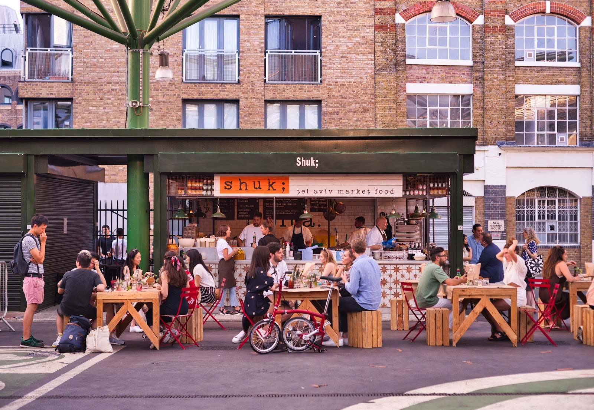

*Shuk at Borough Market.*

Middle Eastern stuffed pitas: chicken shawarma is The Infatuation's order, and The Tour Guy names the lamb sofrito. The Infatuation says the soft, pillowy pitas are worth the wait, and it is a walk-up counter. Like the rest of Borough, it is closed on Mondays until 30 November 2026.

### Mei Mei

*££ · Borough Market · Cited by 2 sources · [Borough Market listing](https://boroughmarket.org.uk/traders/mei-mei/)*

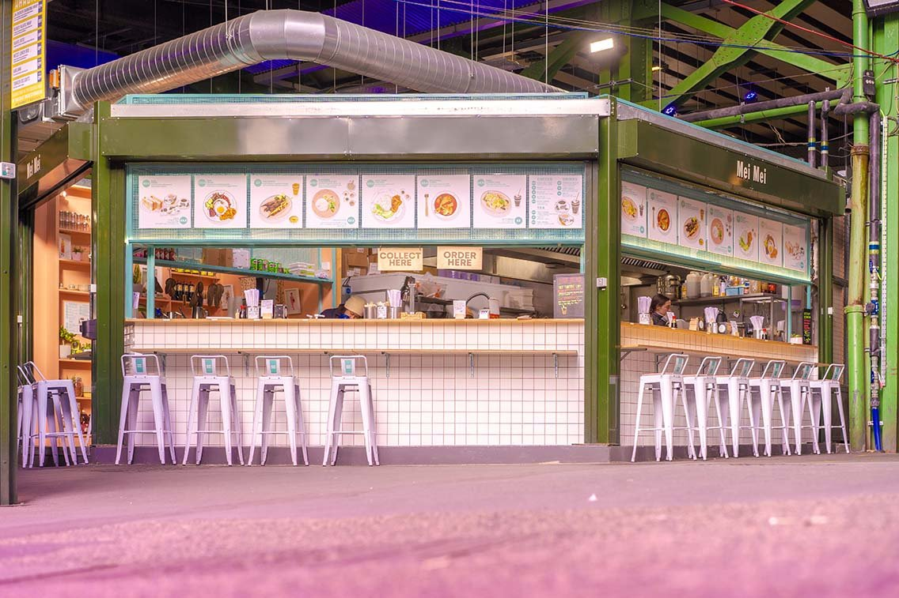

*Mei Mei at Borough Market.*

Singaporean street food inspired by the kopi tiam, Singapore's old coffee shops: nasi lemak (coconut rice with sambal, fried anchovies, peanuts and egg) and an ox cheek rendang curry. At £15.50 for the nasi lemak in June 2026 it is the dearest plate in this guide. Mark Wiens and The Tour Guy both stop here. Like the rest of Borough, it is closed on Mondays until 30 November 2026.

### La Tua Pasta

*£ · Borough Market, and Broadway Market on Saturdays · Cited by 2 sources · [Borough Market listing](https://boroughmarket.org.uk/traders/la-tua-pasta/)*

Hot handmade pasta and gnocchi from a business Francesco and Caroline Boggian started in London in 2006, cooked at the counter while you watch, as Visit London points out. The tortelloni were £11 in Mark Wiens's June 2026 visit. It also sells fresh pasta to take home, and its stall at Broadway Market in Hackney trades at weekends.

### Gelateria 3Bis

*£ · Park Street · open daily · Cited by 2 sources · [Borough Market listing](https://boroughmarket.org.uk/traders/gelateria-3bis/)*

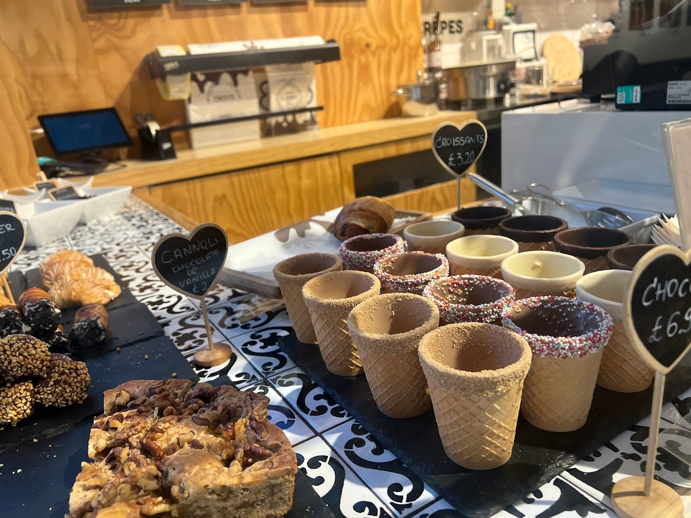

*Gelateria 3Bis at Borough Market.*

Italian gelato and gelato-filled crêpes, from a shop on Park Street rather than a stall. A cup was £6.50 in June 2026. It keeps much later hours than Borough itself: 11am to 10pm on weekdays, 10am to 10pm on Saturdays and to 6pm on Sundays, so it is still open after an evening at the Globe.

### The Ginger Pig

*£ · Three Crown Square · Tuesday to Sunday · Cited by 2 sources · [Borough Market listing](https://boroughmarket.org.uk/traders/ginger-pig/)*

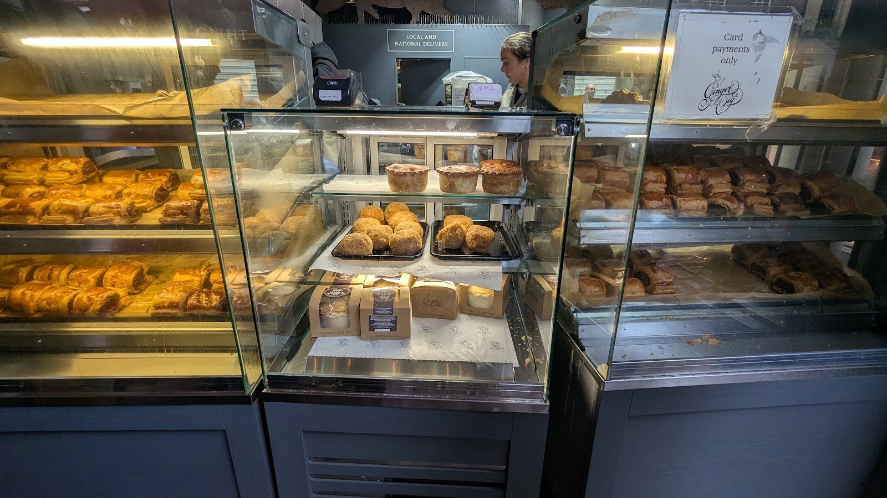

*Sausage rolls and Scotch eggs at The Ginger Pig.*

A butcher's shop whose sausage roll is the thing to eat on the spot (£7 in June 2026). Mark Wiens and Through My Lens both stop for one. It is a butcher's counter, so you queue among people buying meat to cook at home. Open Tuesday to Saturday 9am to 5pm and Sunday 10am to 3pm.

### Coffee at Borough

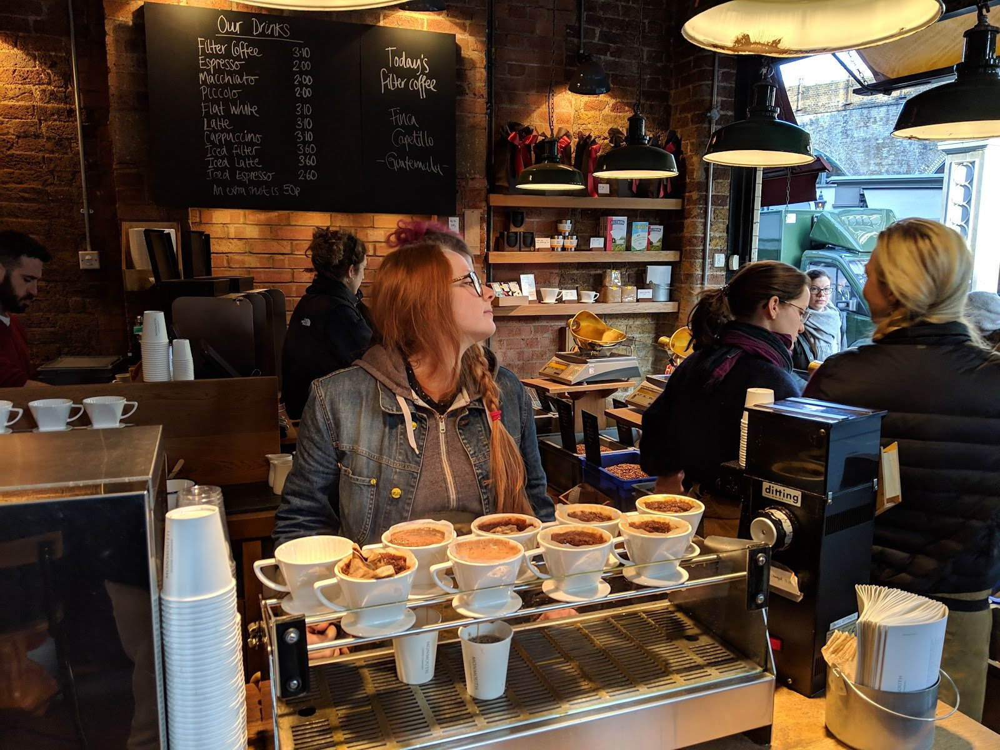

*Filter coffee brewing at Monmouth Coffee, Borough Market.*

| Stall | What to order | Cited by | What it is |
| --- | --- | --- | --- |
| [Monmouth Coffee Company](https://boroughmarket.org.uk/traders/monmouth-coffee-company/) | filter coffee by the cup | 3 sources | A specialist roaster and café; The Good Food Guide says it is "renowned for good reason". |
| [The Colombian Coffee Company](https://boroughmarket.org.uk/traders/the-colombian-coffee-company/) | the hot chocolate | 2 sources | A Colombian coffee stall whose hot chocolate is raw cocoa whisked by hand with a wooden molinillo, which The Good Food Guide singles out. |

---

## Maltby Street Market

Ten minutes' walk east of Borough under the railway arches of Ropewalk, and much smaller: about a dozen traders down one alley. It trades **Friday 5.30pm to 9pm, Saturday 10am to 5pm and Sunday 11am to 4pm** only.

### Duck Frites

*£ · Ropewalk · Friday evening to Sunday · Cited by 2 sources · [Maltby Street traders](https://www.maltbystreetmarket.co.uk/traders)*

Everything here is duck: chips fried in duck fat and finished with melted raclette, duck arancini, and duck wraps. London x London says to make sure you try the arancini. Secret London lists it in both of its Maltby Street guides. It is a stall on the alley, and you eat standing. Come on Friday evening, when the market opens at 5.30pm, to try it before the weekend crowd.

### Amen Ethiopian

*£ · Ropewalk · Friday evening to Sunday · Cited by 2 sources · [Maltby Street traders](https://www.maltbystreetmarket.co.uk/traders)*

Ethiopian stews of sautéed meat, vegetables and lentils, wok-cooked and served on injera or with kocho, a flatbread made from false banana. Secret London's pick is the lentil wat. A plate of several stews together is the order. It is an open stall on the alley, and like everything at Maltby Street it trades only from Friday evening to Sunday afternoon.

### Mooncheese toasties

*£ · Ropewalk · Friday evening to Sunday · Cited by 2 sources · [Maltby Street traders](https://www.maltbystreetmarket.co.uk/traders)*

Toasted sandwiches cooked flat on a plancha in front of you, the ham and cheese being London x London's order. Secret London lists it in its Maltby guide too. It is a single counter on the alley, and it is the Maltby Street toastie for anyone who missed Kappacasein's Thursday-to-Saturday window at Borough.

---

## Camden Market

Camden's food traders sit mainly in West Yard by the lock and along the Stables. The market is open every day, and weekday lunchtimes are the quietest time to go.

### Humble Crumble

*£ · Camden Market and Old Spitalfields Market · Cited by 3 sources · [Old Spitalfields listing](https://oldspitalfieldsmarket.com/food-and-drink/humble-crumble)*

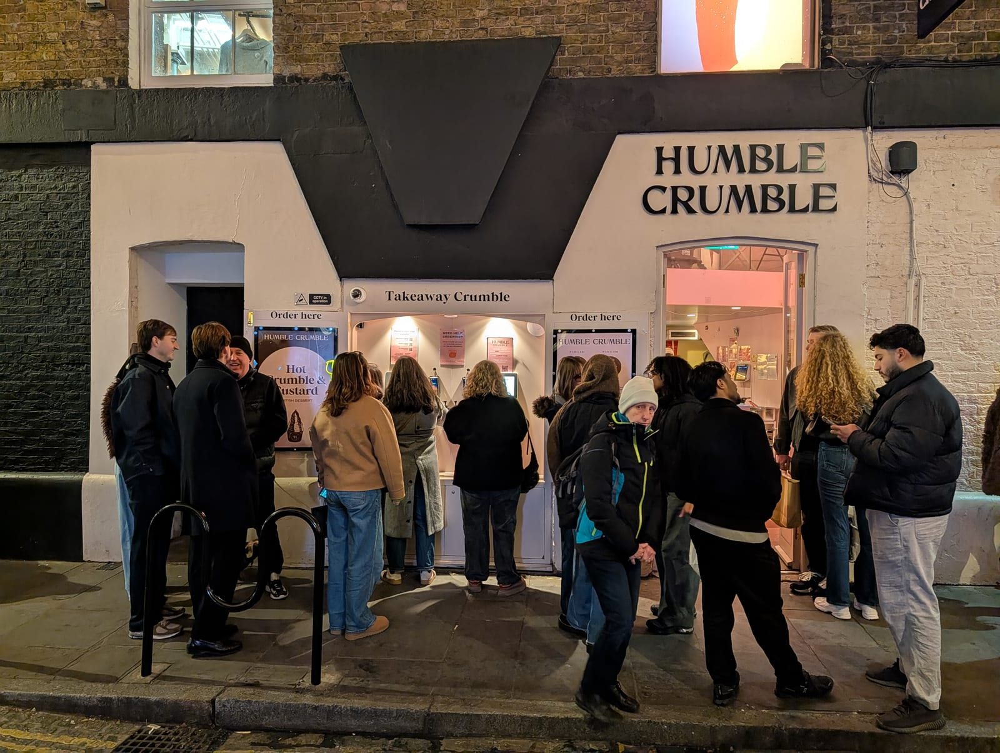

*Humble Crumble.*

Apple crumble with hot custard poured over it. DesignMyNight calls it "a cult destination", and two YouTube food channels, Through My Lens and Only Scrans, queue for it. There are stalls at Camden and at Old Spitalfields, where it is open every day from 10am to nearly 8pm.

### Asador

*££ · West Yard and the Stables · open daily · Cited by 2 sources · [Camden Market listing](https://camdenmarket.com/food-drink/asador)*

Argentinian steak, as steak and chips or in a sandwich. The Infatuation calls it "TikTok-viral" and says both the Argentinian steak and its neighbour's masala fries are "worth the wait". Only Scrans opened its Camden film here. There are two units, in West Yard and on Stables Yard, open daily 10am to 6pm.

### Funky Chips

*£ · Stables Market, units 705–706 · Cited by 2 sources · [Camden Market listing](https://camdenmarket.com/food-drink/funky-chips)*

Fresh-cut chips fried to order in large boxes, then loaded with sauces, spices, cheese, chillies, pickles and crunchy onions. The Infatuation names the masala fries. A box is easily a lunch for one or a side for two. It is a counter in the Stables a few units from Asador; The Infatuation names the two together, steak from one and chips from the other.

### Yorkshire Burrito

*£ · West Yard, and the Buck Street rooftop · open daily · Cited by 2 sources · [Camden Market listing](https://camdenmarket.com/food-drink/yorkshire-burrito)*

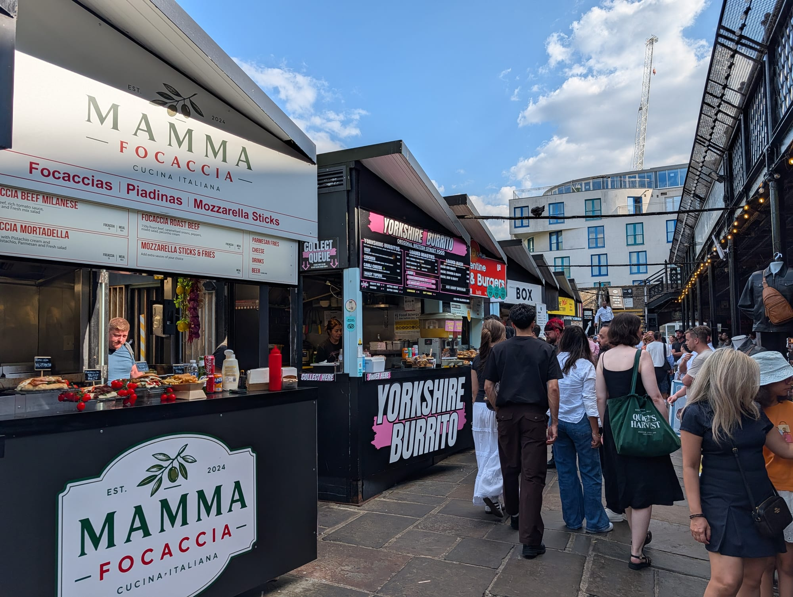

*Yorkshire Burrito, Camden Market.*

A Sunday roast rolled inside a giant Yorkshire pudding: a choice of beef, chicken or cauliflower cheese, with roast potatoes and stuffing, and a pot of gravy on the side. Secret London's verdict is "It's a Yorkshire pudding. Rolled up like a burrito." It is a black-and-pink stall in West Yard, open 11am to 6pm Monday to Thursday and to 7pm Friday to Sunday, with a second stall on the Buck Street rooftop.

### The Mac Factory

*£ · Camden Market · open daily · Cited by 2 sources · [Camden Market listing](https://camdenmarket.com/food-drink/mac-factory)*

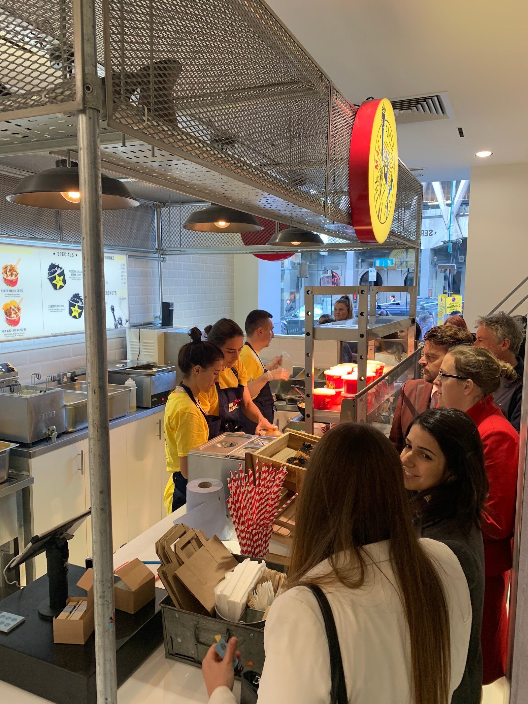

*The Mac Factory.*

Macaroni cheese and nothing else, in six versions including the Nostalgic and a Lobster Mac. Secret London lists it in its Camden guide and Only Scrans closes its Camden food film with it. It is a small walk-up counter, open every day with the rest of Camden's food traders.

---

## Old Spitalfields and Seven Dials

### Dumpling Shack

*£ · Old Spitalfields Market · open daily · Cited by 2 sources · [Old Spitalfields listing](https://oldspitalfieldsmarket.com/food-and-drink/dumpling-shack)*

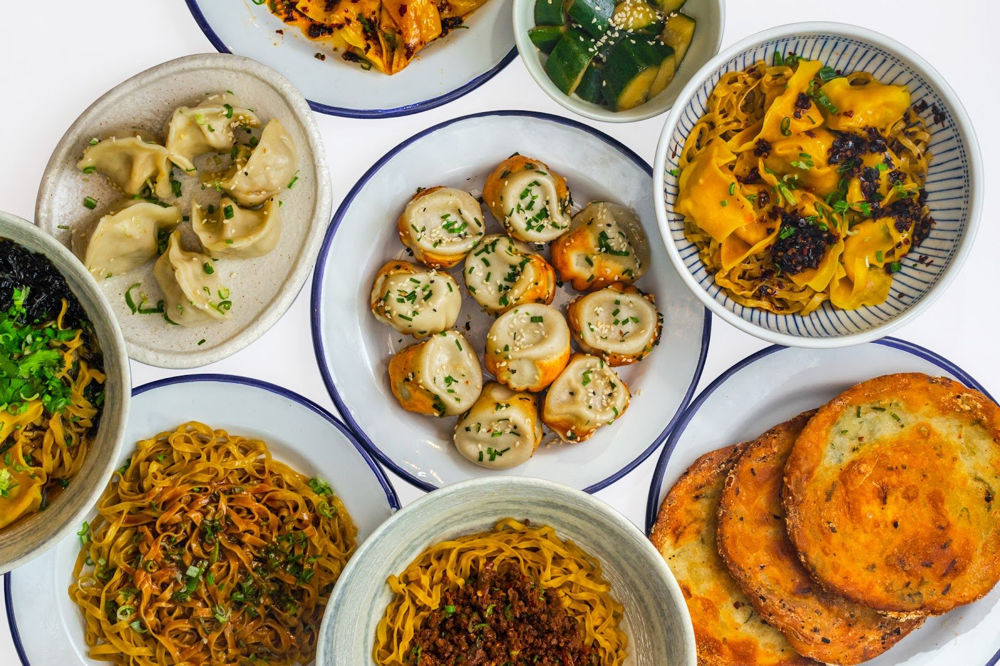

*Shengjianbao and noodles at Dumpling Shack.*

Chinese dumplings, with the prawn wontons in chilli oil the dish DesignMyNight's list names. The Infatuation places it among the market's "top spots", and the same team runs Fen Noodles, a hand-pulled noodle counter, in the same market. It is a stall under the market's covered roof. Open Monday to Friday 11am to 8pm, Saturday to 6pm and Sunday to 5pm, so it suits a weekday evening.

### Stakehaus

*££ · Seven Dials Market, Covent Garden · Cited by 2 sources · #11 of 12, Time Out · [Seven Dials Market listing](https://www.sevendialsmarket.com/vendors/stakehaus/)*

Steak and fries in a buttered sub roll, made with British beef and finished with peppercorn or a "wild cowboy" sauce, plus truffle and cheese fries and macaroni cheese on the side. Time Out ranks it eleventh of London's twelve best street food stops for a bavette it compares to fine dining. It began as a stall at Camden Market, where Secret London listed it, and now cooks in the banana warehouse at Seven Dials, a few minutes from Covent Garden station.

---

## Cheapest

The cheapest full meals here cost about £8 to £11: [Kappacasein](#kappacasein)'s toastie or raclette at £8, [Gourmet Goat](#gourmet-goat)'s wraps from £9.60, [La Tua Pasta](#la-tua-pasta)'s tortelloni at £11, and [Porteña](#porteña)'s empanadas. For a sweet stop under £5, [Bread Ahead](#bread-ahead)'s doughnuts.

## Vegetarian

[Oshpaz](#oshpaz) won Best Vegetarian at the 2025 British Street Food Awards. [Gujarati Rasoi](#gujarati-rasoi) and [Horn OK Please](#horn-ok-please) are entirely vegetarian, and [Amen Ethiopian](#amen-ethiopian) serves lentil and vegetable stews.

## What to know

- **No market stall here takes bookings.** The cost is the queue, and it is shortest before noon on weekdays.
- **Check the stall's own days, not just the market's.** Kappacasein trades Thursday to Saturday, Joy & Gladness Monday to Wednesday, and Maltby Street only from Friday evening.
- **Seven Dials and Old Spitalfields are covered**, so they are the two to pick on a wet day.

---

## Continue planning your London trip

- [The Best Street Food in London](/articles/best-street-food-london/): every market, food hall and container yard compared, with the day-by-day opening table.
- [London's Best Markets](/articles/best-london-markets/): the markets themselves, food, flowers and antiques, by what each sells.
- [Borough Market food tours](/articles/borough-market-tours/): guided tastings if you would rather someone else chose the stalls.
- [Cheap Eats in London](/articles/cheap-eats-london/): sit-down meals under £15 a head.
- [Eat in London](/articles/eat-in-london-guide/): every food guide on the site, by cuisine, budget and occasion.
