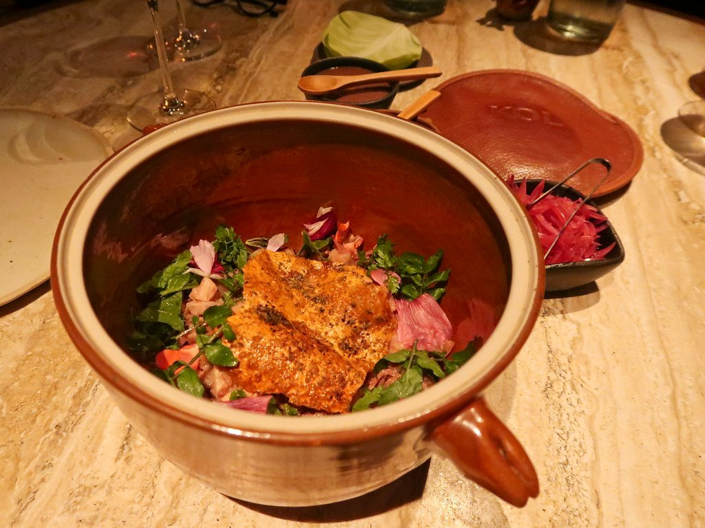
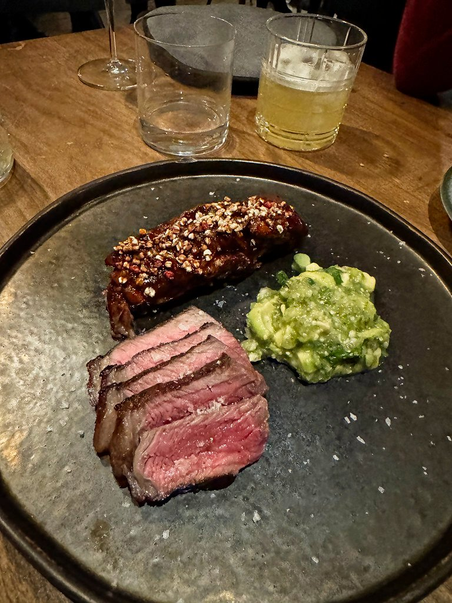
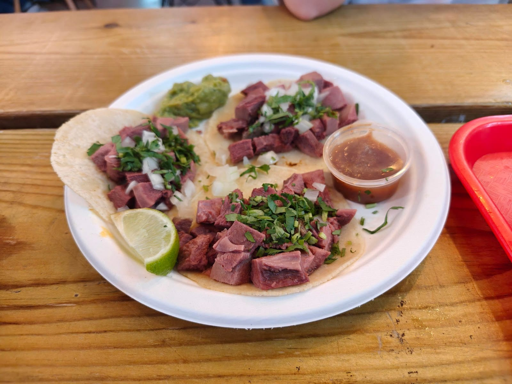
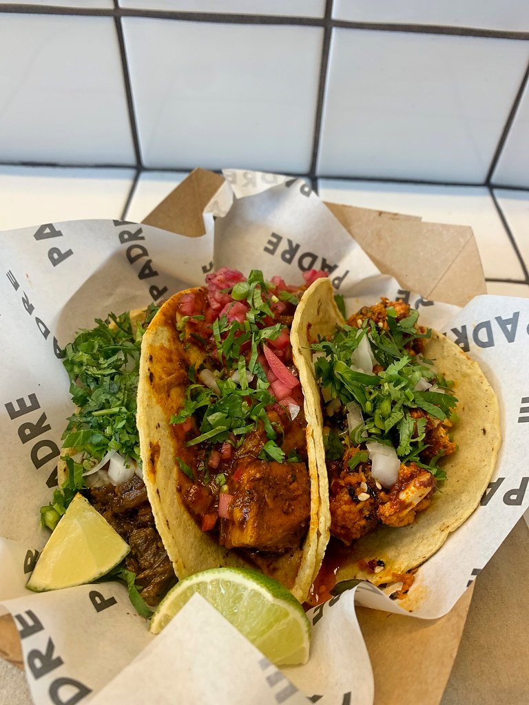

> 💡 **The Short Version:** This guide skips the burrito chains. **Kol** has the Michelin star and uses only British produce. **Cavita** is Time Out's pick. **Santo Remedio** cooks the dishes other London Mexicans avoid. **Comalera** in Walthamstow is a £ stall that presses its own tortillas. And **Mestizo** is where the mezcal is.

> 📊 **The evidence behind this guide.**
> **11 sources carrying 131 citations** across **59 named restaurants**. **22 restaurants are named by two or more independent sources; 1 holds a Michelin star.**
> **Built on:** the Michelin Guide; Time Out, Forbes, The Infatuation and Foodism; taquería specialists.
> *Evidence rebuilt 30 August 2026 · [How we rank →](/how-we-rank/)*

## Where they are

| If you are near… | Where to eat |
| --- | --- |
| **Marylebone** | Kol, Cavita |
| **Fitzrovia** | Cometa, Mestizo |
| **Mayfair & Soho** | Fonda, Club Mexicana (Mercato Mayfair) |
| **Borough & London Bridge** | El Pastor, Tacos Padre |
| **Bermondsey** | Santo Remedio |
| **Chelsea** | Ixchel |
| **Notting Hill** | Los Mochis |
| **Shoreditch** | Zapote |
| **Dalston & Stoke Newington** | Corrochio's, Sonora Taquería |
| **Peckham & south** | Guacamoles, Taquiza, Taca Tacos, La Chingada (Rotherhithe) |
| **East London** | Homies on Donkeys (Leytonstone), Comalera (Walthamstow) |
| **Tooting** | Guacamoles |

**Price guide:** **£** under £15 · **££** £15–£35 · **£££** £40–£70 · **££££** £90+.

---

## The serious end

### Kol, Marylebone

*££££ · Michelin star* · Cited by 9 sources

**Santiago Lastra cooks Mexican technique using British ingredients, with no imported produce at all.** It holds a Michelin star.

Instead of avocados and imported chillies: **Cornish lobster in a chilli butter**, langoustine tacos, and moles built from British produce fermented and dried in-house. The **tortillas are made from corn nixtamalised on site**.

**££££, closed Sunday and Monday, and it books months ahead.** The mezcal bar downstairs takes walk-ins.

*A dish at Kol. Photo: [Bex.Walton](https://www.flickr.com/photos/7831824@N04/51604595625), [CC BY 2.0](https://creativecommons.org/licenses/by/2.0/).*

### Cavita, Marylebone

*££££ · 3 min from Bond Street* · Cited by 5 sources

**Time Out's pick for the best Mexican in London.**

Adriana Cavita worked at Pujol in Mexico City. The menu has **mole** aged for months, **cochinita pibil** cooked in banana leaf, and vegetables over a wood fire. Tortillas are pressed from nixtamalised corn.

**££££, closed Monday, and it books weeks ahead.**

### Santo Remedio, Bermondsey

*£££ · 10 min from London Bridge* · Cited by 8 sources

**Edson and Natalie Diaz-Fuentes cook the dishes most London Mexicans skip.**

**Mole negro**, **soft-shell crab tacos**, and **guacamole topped with grasshoppers** — chapulines, toasted and salted, a Oaxacan garnish. The mole takes days to make.

**£££ and it books weeks ahead.** Bermondsey, over two floors, and the upstairs room is the calmer one.

---

## Specialists

### Cometa, Fitzrovia

*£££ · 5 min from Goodge Street* · Cited by 3 sources

**Mexican seafood**: tostadas, ceviche and aguachile rather than a meat-led menu.

**Aguachile** is the dish to order: raw prawns cured in lime and chilli water, served cold. **Tuna tostadas** and ceviche either side of it.

**£££, closed Sunday and Monday, books weeks ahead.** Small, and the counter is the seat to ask for.

### Los Mochis, Notting Hill

*££££ · Japanese-Mexican* · Cited by 2 sources

**Sashimi and maki on the same menu as ceviche, tiradito and tacos.** Japanese-Mexican cooking has a lineage on Mexico's Pacific coast, where Japanese immigrants settled around Sinaloa; Los Mochis is a city in that state.

Order across the divide: **tuna tostadas**, sashimi dressed with chilli and lime rather than soy, and tacos built with Japanese cures. The Notting Hill room is the original; a City rooftop site followed.

**££££ and it books ahead**, particularly at weekends. Loud, and designed for a night out.

### Mestizo, Fitzrovia

*£££ · 4 min from Euston Square* · Cited by 4 sources

**A mezcaleria and dining room** — sit at the bar for the **tequila and mezcal list** rather than at a table, and it runs to well over a hundred bottles.

The kitchen does **mole poblano**, cochinita pibil and chiles en nogada in season, but people come for the bar. Ask the staff to walk you through the mezcals.

**£££, book a few days ahead** for a table; the bar takes walk-ins. Near Warren Street.

### Ixchel, Chelsea

*£££ · 7 min from Sloane Square* · Cited by 4 sources

**A Chelsea room that leans as hard on mezcal and the bar as on the kitchen**, named for the Maya goddess.

Tacos, ceviche and grilled meats from the kitchen, and a long agave list at the bar. It is busiest late.

**£££ and it books weeks ahead** at weekends. Come for the bar and eat while you are there.

---

Powered by <a target="_blank" rel="sponsored" href="https://www.getyourguide.com/london-l57/">GetYourGuide</a>

## The taquerias

The marker of a good taqueria is simple: **do they make their own tortillas?**

### El Pastor, Borough

*££ · 7A Stoney Street · also Soho, King's Cross and Battersea* · Cited by 7 sources

A **Mexico City taqueria** built around the *trompo*, the vertical spit of marinated pork that gives tacos al pastor their name.

The Stoney Street original served its first taco **on a house-made heirloom corn tortilla**. Four sites now.

### Zapote, Shoreditch

*£££ · 70 Leonard Street* · Cited by 3 sources

Chef Yahir Gonzalez, from Aguascalientes, runs **named heritage varieties** of corn — chalqueño cremoso and cónico rojo from Mexico State, bolita blanco from Oaxaca — with some of it grown on his family's ranch in Jalisco.

The masa is made from scratch daily. The scallop aguachile with Clamato and pomegranate is the dish.

*Tacos at Zapote. Photo: [Bex.Walton](https://www.flickr.com/photos/7831824@N04/53436663110), [CC BY 2.0](https://creativecommons.org/licenses/by/2.0/).*

### Sonora Taquería, Stoke Newington

*££ · 208 Stoke Newington High Street* · Cited by 6 sources

**Northern Mexican cooking**: Michelle Salazar de la Rocha is from Sonora, and the menu is Sonoran.

Sonoran tortillas are **flour, not corn**, made in house from flour, salt, fat and water. Carne asada is the taco to order.

Started as a Netil Market stall and took a permanent room in 2023.

### Corrochio's, Dalston

*££ · 76 Stoke Newington Road* · Cited by 4 sources

**Founder Daniel grew up in Guadalajara and trained in the Yucatán**, so the cooking is regional rather than pan-Mexican, and **the cocktail bar runs long after the kitchen stops.**

Yucatecan and Jaliscan dishes: **cochinita pibil**, tacos with salsas, and a weekend brunch. The bar does agave spirits.

**£££, closed Monday, book a few days ahead.**

### La Chingada, Rotherhithe

*££ · 12 Rotherhithe New Road · also Euston* · Cited by 6 sources

**A small taquería in Rotherhithe.**

The taco list is the menu: **al pastor** carved off the trompo, **suadero**, **carnitas**, chorizo and baja prawn. Al pastor is pork marinated in achiote, stacked on the vertical spit and shaved with pineapple.

**£, walk-in.**

### Fonda, Mayfair

*£££ · 12 Heddon Street* · Cited by 2 sources

A Mayfair *fonda*; the word means a small family eating house, which this is not.

**Tacos on nixtamalised corn tortillas**, ceviche, and grilled meats, with a mezcal and tequila list. The tortillas are pressed on site.

**£££ and it books ahead.**

### Homies on Donkeys, Leytonstone

*££ · 686 High Road · closed Sunday and Monday* · Cited by 5 sources

**A Leytonstone taco counter** with no room to speak of.

Tacos on **hand-pressed tortillas**, with al pastor, birria and baja fish among them, and salsas made in-house. It began as a market stall and the counter format never really changed.

**£, walk-in, closed Sunday and Monday.**

---

## Best value: markets and stalls

### Guacamoles — Peckham, Tooting and Hackney Wick

*£ · three market stalls* · Cited by 4 sources

**Hand-pressed tortillas dipped in birria juice before they hit the griddle**, from a stall that started in Rye Lane Market.

**Birria tacos** are the order: slow-cooked beef, the tortilla stained and crisped in the fat and juices, served with a cup of consommé to dip. Three sites now — Peckham, Tooting and Hackney Wick — all counters.

*Birria tacos at Guacamoles.*

**£, walk-in.** Order the consommé.

### Tacos Padre, Borough Market

*££ · Borough Market Kitchen · closed Mondays*

**Corn nixtamalised on site and tortillas pressed to order** at a Borough Market counter. It is named by five sources.

Nixtamalisation is cooking dried corn in an alkaline solution before grinding it, which gives a tortilla its corn flavour. The taco fillings change daily with what the market has.

**££, walk-in, closed Monday.** Market hours only — it is shut by evening, so this is lunch.

*Tacos at Tacos Padre, Borough Market. Photo: [Bex.Walton](https://www.flickr.com/photos/7831824@N04/50251889493), [CC BY 2.0](https://creativecommons.org/licenses/by/2.0/).*

### Taquiza, Peckham

*£ · Arch 164, 115 Rye Lane · Wednesday to Saturday only* · Cited by 3 sources

A Peckham taquería with **a short taco list**.

Tortillas are pressed to order and fillings rotate: al pastor, carnitas and vegetable options. Salsas are made in-house and set out for you to add yourself.

**£, walk-in.** Busiest in the evening.

### Taca Tacos — Deptford and Peckham

*£ · market yard and sit-down* · Cited by 2 sources

**Six-hour beef birria and crisp baja fish tacos** out of a Deptford railway arch, with margaritas.

The **beef birria taco** is the signature: six hours of slow cooking, the tortilla griddled in the fat, consommé on the side. The **baja fish** taco is the other order — battered, fried and dressed with slaw and chipotle mayo.

**££, walk-in, closed Monday.** Two sites.

### Comalera, Walthamstow

*£ · 2 min from St James Street · walk-in* · Cited by 3 sources

**A Walthamstow stall pressing its own tortillas.**

A *comal* is the flat griddle a tortilla is cooked on: masa is pressed and griddled to order. A short list of fillings and salsas made on site.

**£, walk-in, and open Friday to Sunday only** — closed Monday through Thursday, so check the day before travelling.

### Club Mexicana, Mayfair

*£ · entirely vegan*

**Tacos, nachos and burritos built on jackfruit and vegan chicken**, started as a market stall and now in Kingly Court.

The **jackfruit carnitas** and the vegan **al pastor** are the orders. It is loud and busy.

**££.** Also at **Seven Dials Market and on Commercial Street in Spitalfields** — Kingly Court is the sit-down one, the market sites are counters.

---

Powered by <a target="_blank" rel="sponsored" href="https://www.getyourguide.com/london-l57/">GetYourGuide</a>

## What to know

* **Check the tortilla.** Kitchens that press their own say so.
* **Mezcal is its own spirit, not smoky tequila.** Ask at Mestizo and they will walk you through it.
* **Kol and Cavita need booking** weeks ahead. Everything else here is a few days or walk-in.
* **Service charge** of 12.5% is discretionary and standard.

---

## Continue planning your London trip

- 🇵🇪 **[The Best Peruvian Restaurants in London](/articles/best-peruvian-restaurants-london/)**
- 🌮 **[Cheap Eats in London](/articles/cheap-eats-london/)**
- 🌿 **[Best Vegetarian and Vegan Restaurants](/articles/best-vegetarian-vegan-restaurants-london/)**
- 🍸 **[The Best Cocktail Bars in London](/articles/best-cocktail-bars-london/)**
- 🍽️ **[Eat in London: Restaurants, Food Markets & Quick Food Hub](/articles/eat-in-london-guide/)**
- 🛍️ **[Marylebone Area Guide](/articles/marylebone-area-guide/)**
- 🏙️ **[Bermondsey Area Guide](/articles/bermondsey-area-guide/)**
