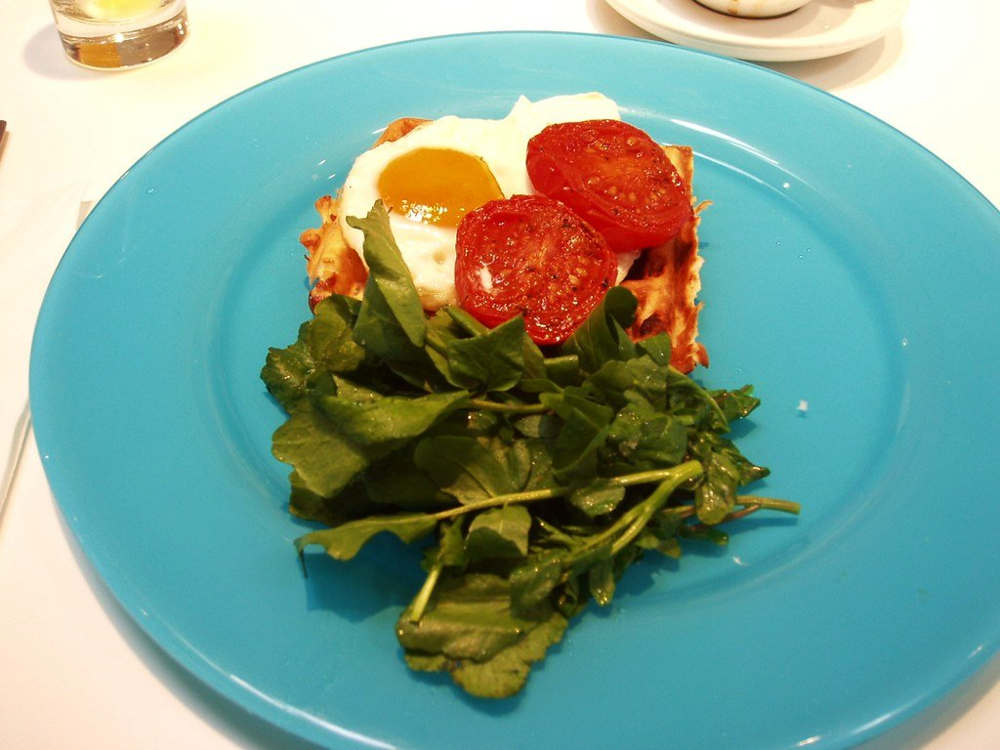

Lebanese mezze, a Turkish charcoal grill in Dalston, Palestinian home cooking in a Notting Hill townhouse and Kuwaiti machboos in Knightsbridge are four different cuisines, arranged here **by tradition**. Greek food has its own page: [**The Best Greek Restaurants in London**](/articles/best-greek-restaurants-london/).

> 💡 **The Short Version:** **Al Waha** is the Lebanese room the most sources name. **The Barbary** seats about twenty around an open grill. **Mangal 2** in Dalston is the most-cited Turkish restaurant. **Akub** cooks Palestinian food at fine-dining level. **Pilpel** does a falafel lunch for about £8 in the City.

> 📊 **The evidence behind this guide.**
> Counted separately for each cuisine: **Middle Eastern — 14 sources, 177 citations across 104 restaurants, 37 named twice or more**; **Turkish — 7 sources, 97 citations across 53 restaurants, 27 named twice or more**.
> **Built on:** The Infatuation, Time Out, Foodism and Luxury London; local guides.
> *Evidence rebuilt 30 August 2026 · [How we rank →](/how-we-rank/)*

## Where they are

| If you are near… | Where to eat |
| --- | --- |
| **Marylebone** | Fairuz, Ishtar |
| **Soho & Covent Garden** | The Barbary, Imad's Syrian Kitchen |
| **Fitzrovia** | Rovi, Lokal |
| **Notting Hill** | Akub, Kinz |
| **Knightsbridge** | Em Sherif, Ishbilia, Freej Swaileh, The Mantl |
| **Shoreditch & Dalston** | Mangal 2, Sohaila, Berber & Q |
| **Borough & London Bridge** | Kismet |
| **Bayswater & west** | Al Waha |
| **Islington & Bloomsbury** | Ottolenghi, Honey & Co |

**Price guide:** **£** under £15 · **££** £15–£35 · **£££** £40–£70 · **££££** £90+.

---

## Levantine

### Al Waha, Bayswater

*£££ · 7 min from Bayswater · the consensus pick* · Cited by 4 sources

**The most-cited Lebanese room in London** across these sources, with white walls, hanging foliage and mezze that is the main event.

Order **hummus, moutabal, tabbouleh and fattoush**, with warm flatbread arriving continuously and *makanek*, small spiced sausages, among the hot dishes. Charcoal-grilled meats follow if you want them, but ten cold plates and nothing else is a legitimate dinner.

**£££, book a few days ahead.** Seven minutes from Bayswater. Quiet and formal.

### The Barbary, Covent Garden

*£££ · Neal's Yard · about twenty seats* · Cited by 1 source

**A horseshoe counter wrapped around an open grill** in Neal's Yard, seating about twenty. You watch every plate being made, and the smoke reaches you.

The cooking follows the old Barbary Coast, from Morocco through to Israel: **naan e barbari**, the blistered flatbread the place is named for, **jerusalem bagel**, octopus and lamb cutlets off the coals, and a **pata negra neck** that regulars order before sitting down.

**Walk-in only and there is always a wait.** Put your name down and drink somewhere in Seven Dials until they call. £££.

### Akub, Notting Hill

*££££ · 3 min from Notting Hill Gate* · Cited by 4 sources

**Fadi Kattan** opened Fawda in Bethlehem before bringing **Palestinian cooking** to a Notting Hill townhouse.

The signature is **bukjet mousakhan**, the sumac-and-onion chicken dish of the West Bank, reworked as a parcel. Around it are dishes built on Palestinian produce, and a weekend brunch of qalayet bandora, zahra fritters and Arabic-coffee French toast.

**££££ and it books weeks ahead.** A small room on a residential street, three minutes from Notting Hill Gate.

### Imad's Syrian Kitchen, Soho

*£££ · Top Floor, Kingly Court · Michelin Bib Gourmand* · Cited by 4 sources

**Imad Alarnab lost his Damascus business to the war**, cooked for the people around him in camps along his route, and ran his first London pop-up on Columbia Road in 2017 before moving to Kingly Court in 2023. The Damascene home cooking holds a **Michelin Bib Gourmand for 2026**.

Start with mezze: **muhammara**, the walnut and red pepper paste, **fattoush** and freekeh. Then the slow-cooked dishes: lamb with yoghurt and stuffed vine leaves.

**£££ and it books weeks ahead.** Ask for the Kingly Court balcony.

### Em Sherif at Harrods, Knightsbridge

*££££ · a set menu in sequence* · Cited by 3 sources

The Beirut group's London outpost inside Harrods serves **a set Lebanese menu in sequence** rather than a mezze free-for-all.

Courses arrive without you ordering: cold mezze, then hot, then grills, then dessert, in the order a Beirut host would send them.

**££££ and it books weeks ahead.** There is no à la carte; you agree to the whole sequence when you sit down.

### Freej Swaileh, Knightsbridge

*£££ · Kuwaiti* · Cited by 2 sources

**A Kuwaiti kitchen**, so Gulf cooking rather than the Levantine mezze everywhere else on this page.

**Machboos** is the dish to order: spiced rice cooked with meat or fish, closer to a biryani than to anything Lebanese, soured with loomi (dried lime). **Kabsa** comes alongside it, with Kuwaiti breads.

**£££, book a few days ahead.** Order the machboos and share it.

---

## Turkish

Turkish cooking has its own page, [**The Best Turkish Restaurants in London**](/articles/best-turkish-restaurants-london/), and most of it is on or near **Green Lanes**, where nine of the most-cited sit on a single road.

The short version: **Mangal II** in Dalston is the most-cited; **Antepliler** and **Gökyüzü** are the Green Lanes benchmarks; **Kismet** in Borough is the meyhane (a Turkish tavern of small plates and raki) for a night out; and **Ishtar** in Marylebone is the central room for a table that does not want to travel.

---

Powered by <a target="_blank" rel="sponsored" href="https://www.getyourguide.com/london-l57/">GetYourGuide</a>

## Greek

Greek and Greek-Cypriot cooking is not Middle Eastern, and has its own page: [**The Best Greek Restaurants in London**](/articles/best-greek-restaurants-london/).

The short version: **Oma** in Borough Market holds London's only Greek Michelin star, **Agora** below it is the walk-in souvla bar, **Tsiakkos & Charcoal** in Maida Vale tops Time Out's ranked list, and **Palmers Green** in north London is where the Cypriot community eats.

---

## Vegetable-led

Mezze is vegetable-led by tradition, so this is the easiest cuisine on the site to eat well in without meat.

### Rovi, Fitzrovia

*£££ · Ottolenghi group* · Cited by 1 source

The Ottolenghi group's **fermentation-and-fire** room, where **vegetables go on the grill and get the treatment meat usually gets**.

Everything passes through fire or a ferment: charred cabbage, koji-aged vegetables, and a menu where the meat dishes are the minority. The pickling programme is visible from the room.

**£££ and it books weeks ahead.**

### Bubala, Spitalfields

*£££ · entirely vegetarian* · Cited by 5 sources

**Entirely vegetarian**, and named by five independent sources.

Middle Eastern small plates off charcoal: **halloumi with black seed honey**, **confit potato latkes**, oyster mushroom skewers and hummus. The grill does the work meat would normally do.

**£££ and it books weeks ahead.** Small and loud.

### Ottolenghi, Islington

*£££ · 12 min from Angel*

**The window display of salads and cakes** is the original Ottolenghi counter.

The counters are stacked with **salads built on grains, roasted vegetables and herbs**, with a cake display behind them. There are communal tables to eat at, a deli counter to take from, and a menu that changes with what has been roasted that morning.

**£££, counter service and communal seating.** It suits one person with a book better than four wanting a conversation. Book a few days ahead for a table.

*A counter tart at Ottolenghi. Photo: [Ewan-M](https://www.flickr.com/photos/55935853@N00/2466885795), [CC BY-SA 2.0](https://creativecommons.org/licenses/by-sa/2.0/).*

### Berber & Q, Haggerston

*£££ · a railway arch* · Cited by 2 sources

**A railway arch built around charcoal and smoke**, with lamb shawarma and cauliflower off the same grill, in a room that gets very loud.

The **whole roast cauliflower** is the signature: charred whole over coals, dressed and brought to the table intact. Beside it are the **lamb shawarma** carved off the spit, short rib and mezze.

**£££ and it books weeks ahead.** Go as a group.

---

Powered by <a target="_blank" rel="sponsored" href="https://www.getyourguide.com/london-l57/">GetYourGuide</a>

## By country, not "Middle Eastern"

"Middle Eastern" covers a dozen cuisines that share a mezze format and little else. These kitchens each cook somewhere specific.

**Syrian:** [Imad's Syrian Kitchen](#imads-syrian-kitchen-soho), above.

### Berenjak, Soho — Persian

*££ · 27 Romilly Street · also Borough Market* · Cited by 3 sources

**A Tehran kabab house rebuilt in Soho**, from Kian Samyani and the JKS group, with counter seating and charcoal.

Order the **mahi** (saffron-marinated fish) and **jujeh** (chicken) kababs off the coals, with **torshi**, the sharp Persian pickles, and taftoon bread baked in the room. The **kashke bademjan**, aubergine with whey and fried onion, is the starter to have.

**£££ and it books weeks ahead.** 27 Romilly Street, with a second counter at Borough Market that is easier to get into.

### Nandine, Camberwell — Kurdish

*££ · 82 Vestry Road · also Camberwell Church Street* · Cited by 3 sources

**A Kurdish kitchen.** Pary Baban came to the UK as a refugee from Kurdistan and cooks the food she grew up with, a cuisine that most menus fold into Turkish or Persian.

Expect **kubba**, bulgur dumplings stuffed with spiced meat, flatbreads baked to order, slow-cooked stews with dried lime and pomegranate, and vegetable dishes. Breakfast and brunch are the busiest services.

**££, walk-in.** Two sites: 82 Vestry Road and Camberwell Church Street. Go for brunch at the weekend.

### The Palomar, Soho — Jerusalem

*£££ · 34 Rupert Street · Bib Gourmand since 2014* · Cited by 3 sources

A Soho room for **modern Jerusalem cooking**, holding a **Bib Gourmand since 2014**. **Sit at the zinc counter, not the tables**: the cooking happens a foot from your plate.

The **kubaneh**, a pull-apart Yemeni bread served with tahini and grated tomato, is the dish to order first. Behind it are polenta Jerusalem-style, octopus, and a short menu that changes often.

**£££. Counter seats are held back for walk-ins**, tables book weeks ahead. 34 Rupert Street.

### Palmyra's Kitchen, Finsbury Park — Syrian and Lebanese

*££ · 5–7 Wells Terrace · open to midnight* · Cited by 2 sources

**Round the back of Finsbury Park station**, next to the bus stands, and named for Palmyra to put Syrian cooking in the foreground rather than filing it under Lebanese.

**Mezze platters** are the format: hummus, moutabal, fattoush and warm bread, with **shawarma** and charcoal grills behind them. Portions are large and prices are well below central London.

**££, open to midnight.** Walk-in; 5–7 Wells Terrace.

### Maramia Cafe, Golborne Road — Palestinian

*££ · 48 Golborne Road · closed Mondays* · Cited by 2 sources

**Palestinian and Arabic home cooking on Golborne Road since 2005.**

All-day cooking rather than a fixed menu: **maqluba**, the upside-down rice and vegetable dish, **musakhan**, mezze and grills, with **set-menu nights and live music** that regulars book for.

**££, closed Mondays.** 48 Golborne Road, a few minutes from Portobello. Ask what is on before you order from the menu.

### Meza, Tooting — Lebanese

*££ · 34 Trinity Road* · Cited by 3 sources

**A tiny Tooting room** where the mezze arrives faster than the table can clear it, at prices that explain the permanent queue.

The **mezze** is the proposition: hummus, moutabal, halloumi, sujuk, kibbeh and warm flatbread, ordered by the handful. Grills are on the menu but secondary.

**££, tiny, and no bookings.** Put your name down and wait on Trinity Road. Cash-friendly.

---

## Bakeries and counters

The cheapest Middle Eastern food in London is sold across a counter, not at a table.

### Al-Jabal Bakery, Park Royal

*£ · manakeesh £2–£3 · 8am–4pm*

A Lebanese bakery of **more than twenty years** in an Acton business centre, with **no dining room**. You order at the counter and eat standing or take it away.

**Mana'eesh from about £2**, made to order: **spinach, cheese, or lahem beajin**, the minced-lamb flatbread, baked while you wait, plus trays of **baklawa** sold by weight.

**The weekend queue is drawn from across west London.** Walk-in, cash-friendly.

### Ta'mini Lebanese Bakery, Fulham, Bloomsbury and Kensington

*£ · ka'ak £3.00 · za'atar manakish £3.95*

Lebanese bakers **Ali from north Lebanon and Nermin from Beirut** opened in the first lockdown and now have three London counters.

**Za'atar manakish £3.95**, **ka'ak with za'atar or sumac £3.00**, falafel wrap £8.95, and **fatayer**, the folded spinach or cheese pastries, through the day. Everything is baked to order and handed over hot.

**Counter service, walk-in, all day.**

### Common Breads, Belgravia

*£ · ka'ak from £2.50 · manouche from £4.50 · 8am–6pm*

**A Beirut bakery counter opposite Victoria station**, from three childhood friends from Lebanon.

**Flatbreads and manakish straight out of the oven**, and purse-shaped **ka'ak from £2.50**, the sesame-crusted bread sold from carts across Beirut, filled here with cheese or za'atar. Manouche flatbreads are baked to order.

**Walk-in and quick.** Open 8am to 6pm daily.

### Mr Falafel, Shepherd's Bush Market

*£ · Palestinian · market stall*

**Palestinian falafel** from a Shepherd's Bush Market stall run for more than twenty years, with the whole menu on a board above the hatch.

Falafel **wraps in two sizes**, wholemeal available, fried to order so they arrive hot with a crisp shell and a green centre. Pickles, tahini and chilli sauce are added at the counter.

**Walk-in, cash-friendly, market hours.** It closes by late afternoon.

### Green Valley, Edgware Road

*£ · grocery and hot counter · 8am to midnight*

**A Lebanese supermarket with a food counter attached** on Edgware Road.

The counter runs **shawarma carved off the spit**, mana'eesh from the oven, and trays of mezze sold by weight, with a **patisserie counter** of baklawa and knafeh at the front. The supermarket behind it stocks what the restaurants on this page cook with.

**Open late, walk-in, and cheap.**

---

Powered by <a target="_blank" rel="sponsored" href="https://www.getyourguide.com/london-l57/">GetYourGuide</a>

## Best value

Falafel is the cheapest option, and all of these are entirely vegetarian.

* **Pilpel**, Spitalfields: falafel lunch for about £8, with several sites.
* **Hoxton Beach Falafel**, Shoreditch: market-stall origins, still under £10.
* **Magic Falafel**, Camden Town: under £10.
* **Hiba Express**, Holborn: a lunch counter with a queue of Holborn office workers.
* **Zeit & Za'atar**, Ealing: wood-fired manakish.

---

## The two streets

**Edgware Road** is the Arab Middle Eastern quarter (Lebanese, Syrian, Egyptian and Iraqi), running north from Marble Arch. Green Valley is the anchor grocer, and **Ranoush Juice** (shawarma to 3am) and the tiny Persian grill **Patogh** are the other names locals give.

**Green Lanes** in Harringay is **Turkish and Turkish-Kurdish**, not Arab: **Gökyüzü**, **Antepliler** for Gaziantep kebabs and baklava, and **Yaşar Halim** for the bakery-supermarket. Do not go looking for Lebanese mezze there.

---

## What to know

* **Mezze is ordered across the table** in waves, not as a starter. Most kitchens will steer you away from over-ordering.
* **Ocakbaşı grills in Dalston and on Green Lanes** run very late and are cheap for the quality.
* **Turkish, Greek and Persian are separate cuisines** and we file them that way. Greek has [its own guide](/articles/best-greek-restaurants-london/).
* **Vegetarians do well here** without anything being adapted for them.
* **Service charge** of 12.5% is discretionary and standard.

---

## Continue planning your London trip

- 🍽️ **[Eat in London: Restaurants, Food Markets & Quick Food Hub](/articles/eat-in-london-guide/)**
- 🌿 **[Best Vegetarian and Vegan Restaurants](/articles/best-vegetarian-vegan-restaurants-london/)**
- 💷 **[Cheap Eats in London](/articles/cheap-eats-london/)**
- 🍛 **[The Best Indian Restaurants in London](/articles/best-indian-restaurants-london/)**
- 🎨 **[Shoreditch Area Guide](/articles/shoreditch-area-guide/)**
- 🛍️ **[Notting Hill Area Guide](/articles/notting-hill-area-guide/)**
