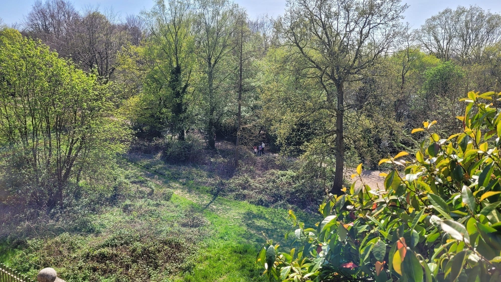
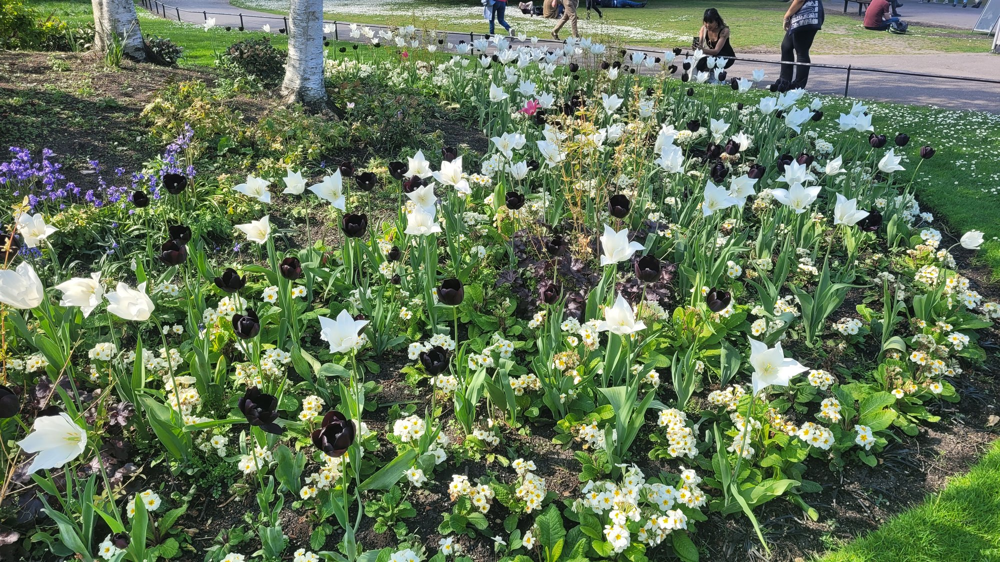
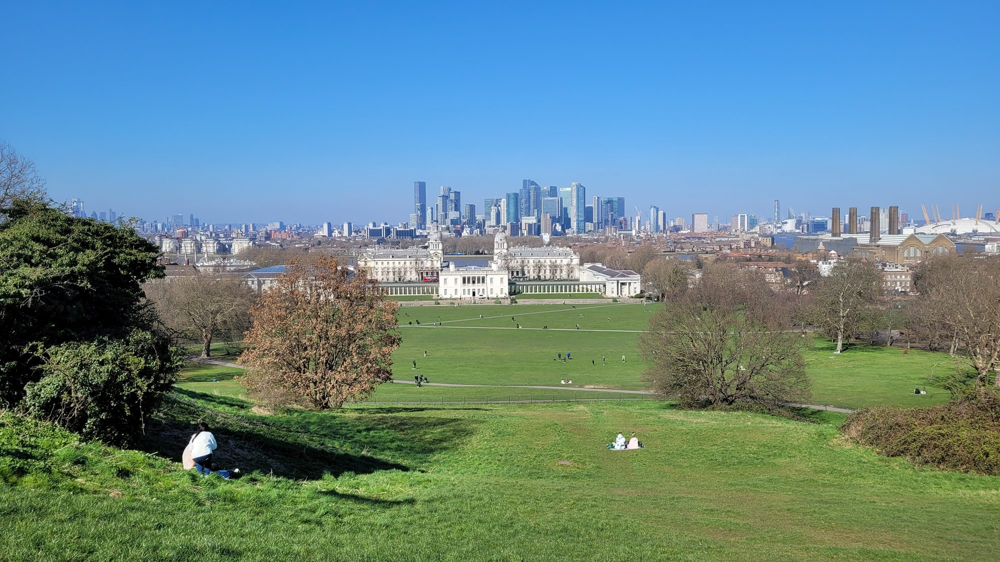
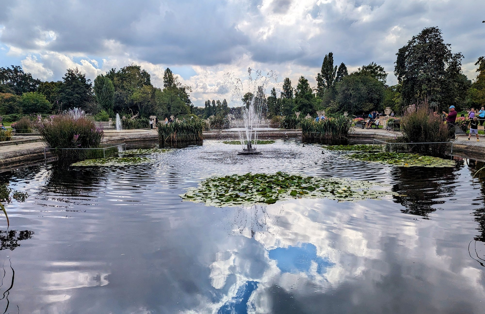
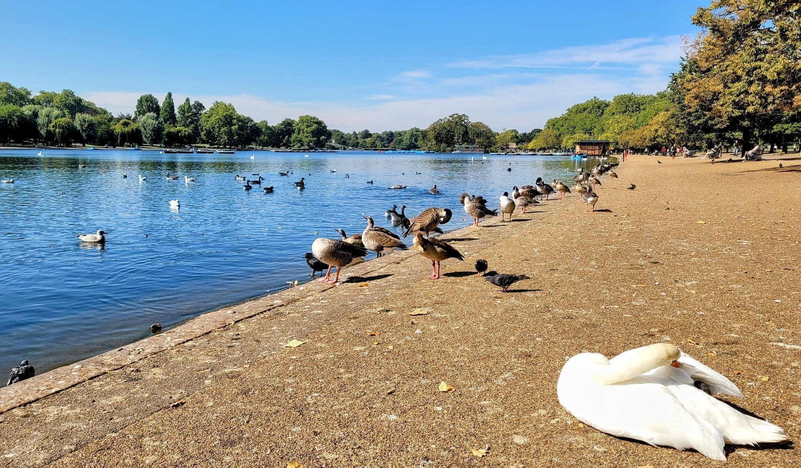
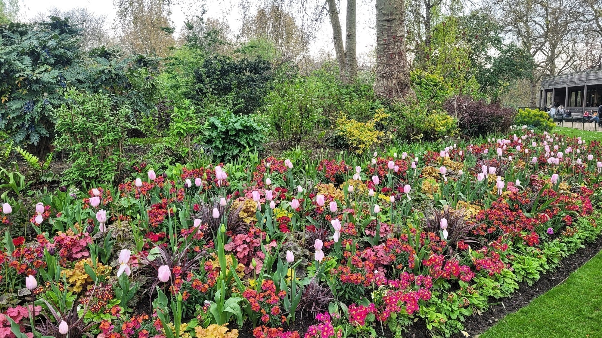
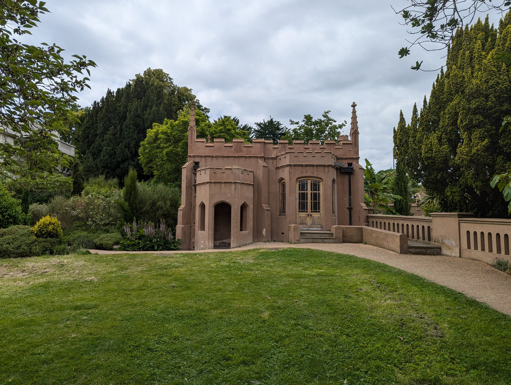
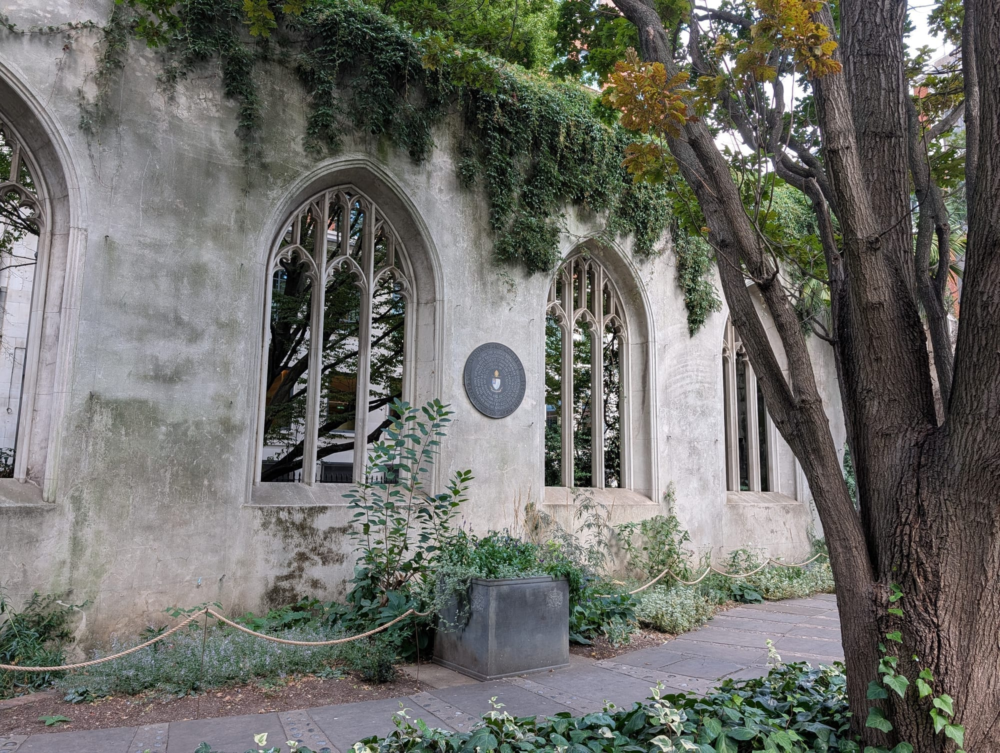
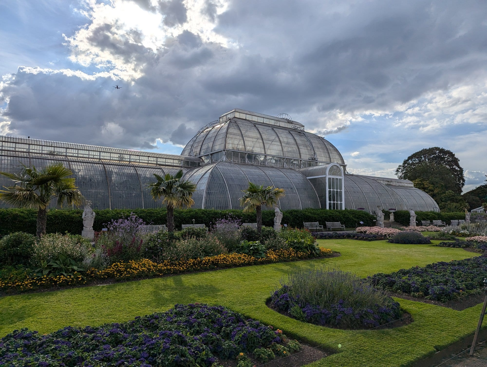
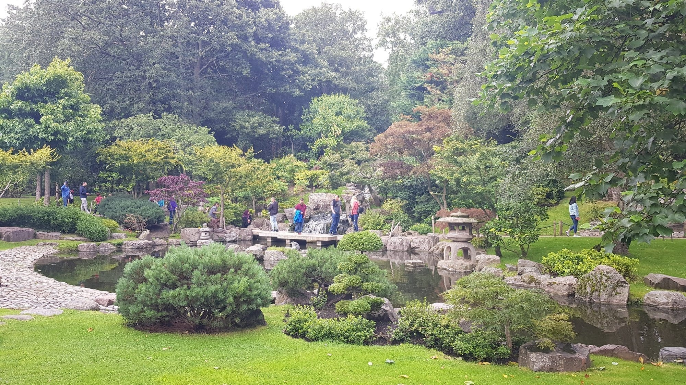

London is nearly half green space. Beyond the famous parks are a bombed Wren church filled with climbing plants, a tropical conservatory inside a brutalist fly tower and a set of dinosaur sculptures from 1854. Almost all of it is free.

> 💡 **The Short Version:** **Richmond Park** for the deer and the scale. **Hampstead Heath** for swimming and the Parliament Hill view. **St Dunstan in the East** for a ruined Wren church turned garden, free. **The Barbican Conservatory** for 1,500 plant species under glass, free, on selected dates only. And **the Crystal Palace Dinosaurs**, sculpted in 1854.

## Where they are

| If you are near… | Where to go |
| --- | --- |
| **The City** | St Dunstan in the East, Postman's Park, Barbican Conservatory |
| **Central** | Regent's Park, Hyde Park, St James's Park, Green Park |
| **Chelsea & Battersea** | Chelsea Physic Garden, Battersea Park |
| **Hampstead & north** | Hampstead Heath, Primrose Hill, Kenwood |
| **Richmond & west** | Richmond Park, Kew Gardens, Isabella Plantation, WWT London Wetland Centre, Gunnersbury Park |
| **East** | Victoria Park, Queen Elizabeth Olympic Park, Camley Street Natural Park |
| **South** | Crystal Palace Dinosaurs, Dulwich Park, Brockwell Park |

---

## The big ones

### Richmond Park

*Free · 2,500 acres · free-roaming deer*

The largest of the Royal Parks, with around 600 **free-roaming red and fallow deer**.

The Isabella Plantation, a woodland garden inside the park, peaks with the azaleas in late April and May.

**It is big enough to need a plan.** Pick a gate near what you want: Pembroke Lodge for the protected view to St Paul's, Isabella for the planting.

> ⚠️ **Keep 50 metres from the deer**, especially in the September–November rut and the May–July birthing season.

### Hampstead Heath

*Free · swimming ponds £5*

Eight hundred acres of wild-feeling ground, with **three bathing ponds** (men's, women's and mixed), a lido and the protected Parliament Hill view south over the City.

**Kenwood House** at the north end is free and holds a Rembrandt and a Vermeer.

The ponds cost £5 for an adult (£3 concessions), cashless. The men's and women's ponds stay open through winter; the mixed pond closes for it.

*The Hill Garden and Pergola, Hampstead Heath.*

### Regent's Park

*Free*

Formal gardens, the Open Air Theatre, London Zoo and, at the north end, Primrose Hill for the skyline.

**Queen Mary's Gardens** holds London's largest rose collection, in 85 beds, and peaks in early June.

For a walk through it, our [Regent's Park and Marylebone walking route](/articles/regents-park-marylebone-walk/) crosses from Baker Street past the rose garden and the Nash terraces to Bond Street.

**Primrose Hill**, just north of the park and five minutes' walk from the top of it, has a protected view south over the city. **It is locked from 10pm to 6am every night from 30 October to 9 November 2026.**

*Tulips in Regent's Park.*

### Battersea Park

*Free · 200 acres*

A boating lake, a children's zoo, a **Japanese Peace Pagoda** on the Thames path and a bandstand.

The park is free, but **the children's zoo is ticketed**.

---

### Greenwich Park

*Free · London's oldest enclosed royal park*

**183 acres and the oldest enclosed royal park in London**, rising steeply from the Old Royal Naval College to the Observatory on the hill, with a deer herd in The Wilderness.

The view from the General Wolfe statue is free and sits outside the Royal Observatory, which closes for refurbishment on 2 November 2026.

*The view from Greenwich Park.*

### Kensington Gardens

*Free · beside Hyde Park*

Quieter and more formal than Hyde Park next door. The **Italian Gardens** are at the Lancaster Gate end, with the Serpentine Galleries, the Albert Memorial and, at the western edge, Kensington Palace.

*The Italian Gardens, Kensington Gardens.*

*The Serpentine, Kensington Gardens.*

The Round Pond and the Diana Memorial Playground are the family draws.

### St James's Park

*Free · the pelicans*

Runs from Buckingham Palace to Horse Guards, with a lake of waterfowl and **a resident colony of pelicans**.

*Flowerbeds in St James's Park.*

The bridge over the lake gives the postcard view of Buckingham Palace one way and the Horse Guards rooftops the other. The pelicans are fed at 14:30 by Duck Island Cottage; the [Buckingham Palace, Changing of the Guard and St James's Park guide](/articles/buckingham-palace-changing-of-the-guard-guide/) has the details and the guard's schedule.

### Crystal Palace Park

*Free · the Victorian dinosaurs*

Two hundred acres in south London built around the **Crystal Palace Dinosaurs** — thirty Victorian sculptures from 1854, the first attempt anywhere to model prehistoric animals at full size.

The restored **Crystal Palace Subway** opens to the public on occasional free days.

---

Powered by <a target="_blank" rel="sponsored" href="https://www.getyourguide.com/london-l57/">GetYourGuide</a>

## Small and strange

### Gunnersbury Park, Ealing/Hounslow

*Free*

A 186-acre former Rothschild estate, mostly sports pitches and a boating lake. **Head for the old pleasure gardens around the mansion and museum**, where the Gothic Ruins folly, an orangery and a walled kitchen garden survive.

*The Gothic Ruins, Gunnersbury Park.*

### St Dunstan in the East, City of London

*Free*

A **Wren church gutted in the Blitz and left as a shell**, now filled with climbing plants and trees growing through the windows.

The City of London opened the ruin as a public garden in 1971. The walls and the steeple still stand.

Expect photographers at weekends and in good weather; early morning is quietest. Monument and Tower Hill are both about five minutes away.

*St Dunstan in the East.*

### Postman's Park, City of London

*Free*

A wall of hand-painted ceramic tablets, each recording **an ordinary person who died saving someone else**. It takes ten minutes.

It is the **Watts Memorial to Heroic Self-Sacrifice**, opened in 1900. Each tablet gives the name, the date and what happened in a couple of lines. The park is two minutes from St Paul's.

### Barbican Conservatory, City of London

*Free, but ticketed · selected dates only*

Around **1,500 species of plants and trees**, some rare or endangered in the wild, and a pond of koi and terrapins — grown across 23,000 square feet under a steel and glass roof on Level 3 of the Barbican.

> ⚠️ **It is free, but you still need a ticket, and turning up does not work.** The Conservatory opens on **selected dates only** — it is closed on any date not listed — and **a limited number of day tickets are released online from 9.30am on each open day**, for timed entry slots. Check the Barbican's own listing for the dates, then book.

**Two practical things.** **Large bags, luggage, prams and buggies are not allowed**, and there is nowhere to leave them. And there are **steps in parts of the Conservatory**, so wheelchair access is limited. Guide dogs are welcome; other dogs are not.

### Crystal Palace Dinosaurs

*Free*

Built in **1854, the first dinosaur sculptures ever made anywhere**, before anyone knew what dinosaurs actually looked like.

They were made by **Benjamin Waterhouse Hawkins working with Richard Owen**, the anatomist who coined the word dinosaur, five years before Darwin's *Origin of Species*. The Iguanodon wears its thumb spike on its nose.

Grade I listed, spread across islands in the lake, and free to walk round whenever the park is open. Crystal Palace station sits at the top of the park.

### Camley Street Natural Park, King's Cross

*Free*

Two acres of reedbed, pond and woodland on a former coal yard beside the Regent's Canal, run by the **London Wildlife Trust** and opened in 1985.

There is a visitor centre and a cafe, five minutes from King's Cross station, and the train sheds sit directly behind the reserve.

---

## Ticketed, and worth it

### Kew Gardens

*About £22 · £10 on Tuesdays until 29 December 2026 · a UNESCO World Heritage Site*

Three hundred acres of botanic garden with the Victorian Palm House, the Temperate House and a **treetop walkway eighteen metres up**. Allow a half-day.

*The Palm House, Kew Gardens.*

### Chelsea Physic Garden

*From £13.50*

*Chelsea Physic Garden.*

Founded by the Apothecaries in **1673 to grow medicinal plants**, and still growing 5,000 of them behind a high wall on the Embankment. It is the oldest botanic garden in London.

The walls and the river keep it warm enough for olives, grapefruit and pomegranates to fruit outdoors.

It is small - a couple of hours is plenty - and **opening is seasonal**, so check before travelling.

### WWT London Wetland Centre, Barnes

*£17.10 adult, £18.85 with Gift Aid*

**105 acres built on four disused Victorian reservoirs** — kingfishers, otters and rare wildfowl, twenty minutes from Hammersmith.

---

## Outdoor swimming

* **Hampstead Heath ponds** — three of them, £5 for an adult; the mixed pond closes for the winter.
* **London Fields Lido** — a heated 50-metre outdoor pool, open all year.
* **Brockwell Lido** — a 1937 art deco lido in Herne Hill.
* **Serpentine Lido**, Hyde Park — summer only, in the middle of the park.

---

## Accidental wild places

* **Gunnersbury Triangle**, Chiswick — woodland that grew up **between three railway lines**, saved from development by a public inquiry.
* **Walthamstow Wetlands** — Europe's largest urban wetland reserve, and a working reservoir system.
* **Woodberry Wetlands**, Stoke Newington — reservoirs opened to the public in 2016 after 180 years closed.
* **Sydenham Hill Wood** — the last fragment of the Great North Wood.

---

Powered by <a target="_blank" rel="sponsored" href="https://www.getyourguide.com/london-l57/">GetYourGuide</a>

## All free, with a few exceptions

**Almost every park in this guide is free and open every day.** London was designated the world's first National Park City in 2019.

**The exceptions:**

* **Kew Gardens**, **the Chelsea Physic Garden**, **the WWT London Wetland Centre** and **the Garden Museum** charge.
* **Richmond and Bushy vehicle gates** shut earlier than the pedestrian gates.

**Free things people pay for elsewhere:**

* **The Kyoto Garden** in Holland Park, with the waterfall and the peacocks.

*The Kyoto Garden, Holland Park.*
* **Sky-high views** from Primrose Hill, Parliament Hill and Alexandra Palace, all covered in our views guide, all free.
* **Deckchairs in the royal parks** are hired, not free.

---

## What to know

* **All eight Royal Parks are free, and their hours differ.** Hyde Park, Green Park and St James's Park are open 5am to midnight. Kensington Gardens and Greenwich Park open at 6am and The Regent's Park at 5am, and all three close at dusk. Richmond Park and Bushy Park are open to walkers 24 hours a day, except at night during their deer culls.
* **Primrose Hill is locked from 10pm to 6am every night from 30 October to 9 November 2026.**
* **Bringing a dog?** Our [dog-friendly hotels guide](/articles/dog-friendly-hotels-london/) gives each hotel's fee, weight limit and walk to the nearest park, with the Royal Parks' lead rules.
* **For the trees themselves in autumn colour**, see our guide to [where to see autumn leaves in London](/articles/best-places-autumn-leaves-london/) — which parks, which named trees, and when it peaks.

---

## Continue planning your London trip

- 🗺️ **[Best Areas to Visit in London](/articles/best-areas-to-visit-london/)** — the neighbourhoods compared by what each is best for and the best day to go
- 🎪 **[Free Things to Do in London](/free/)**
- 👀 **[The Best Views in London](/articles/best-views-london/)**
- 🏛️ **[The Best Museums in London](/articles/best-museums-london/)**
- 🦌 **[Richmond Area Guide](/articles/richmond-area-guide/)**
- 🌳 **[Hampstead Area Guide](/articles/hampstead-area-guide/)**
- 🏙️ **[City of London Area Guide](/articles/city-of-london-area-guide/)**
