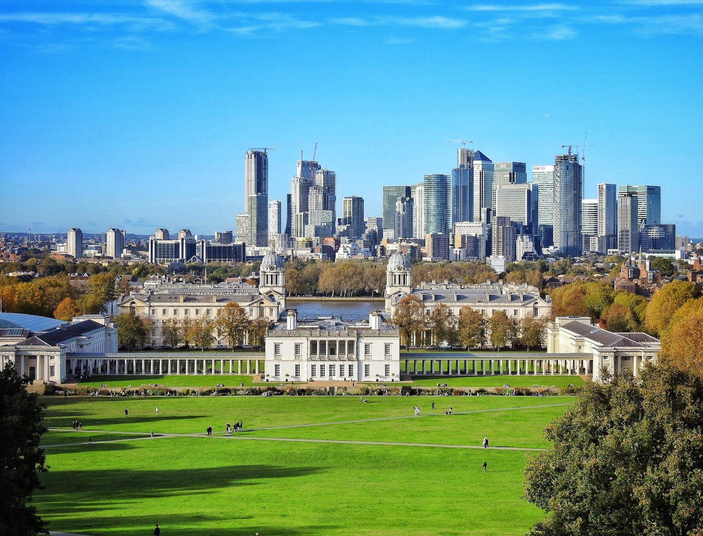
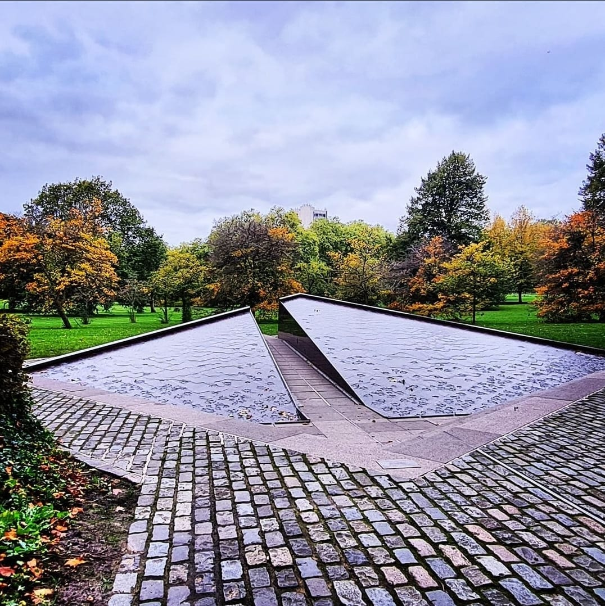
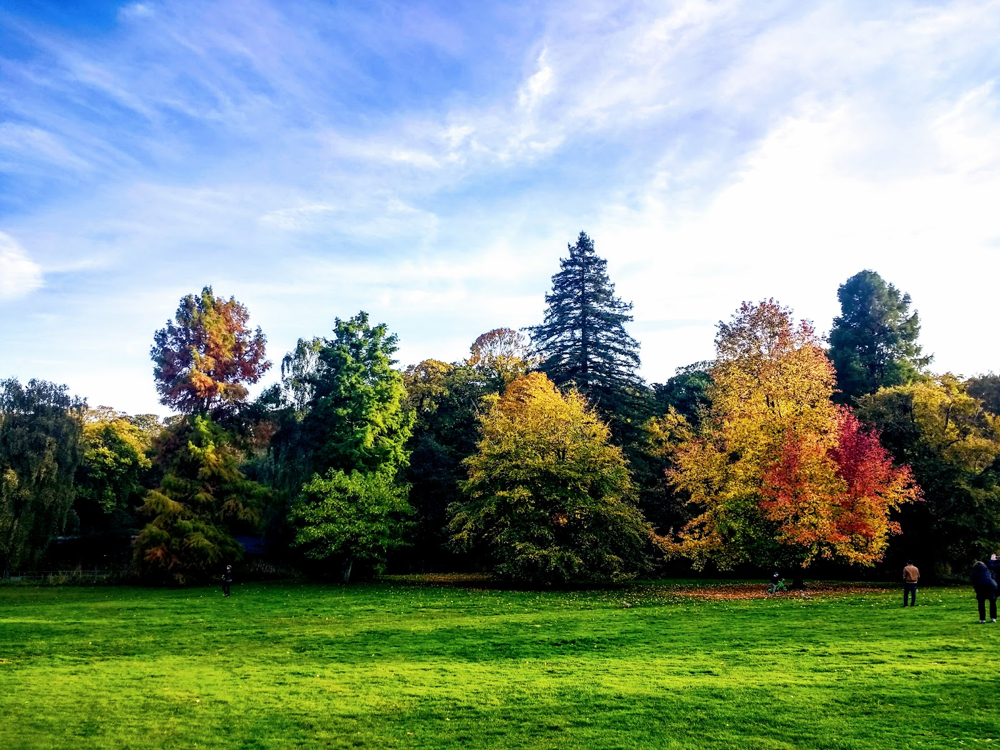
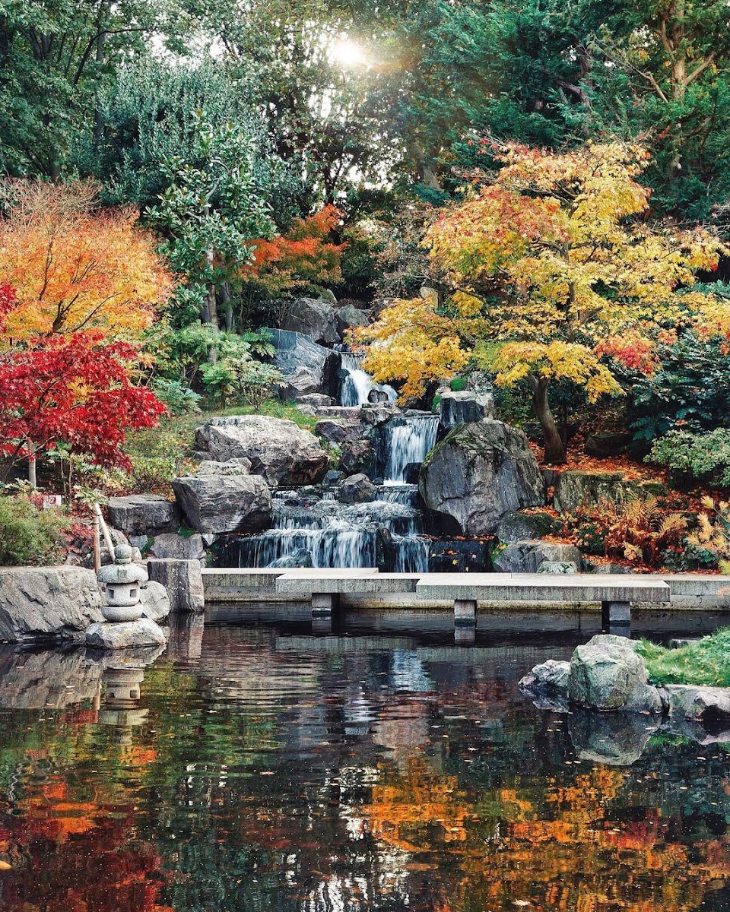
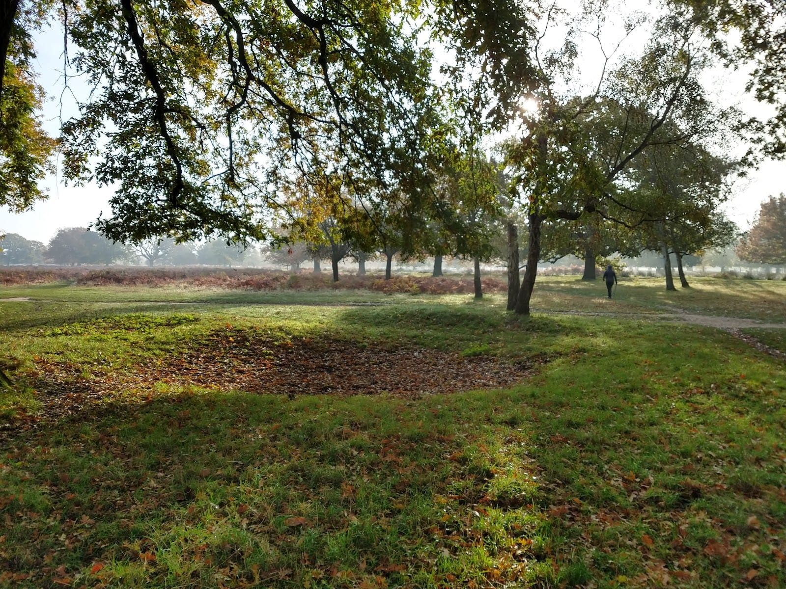
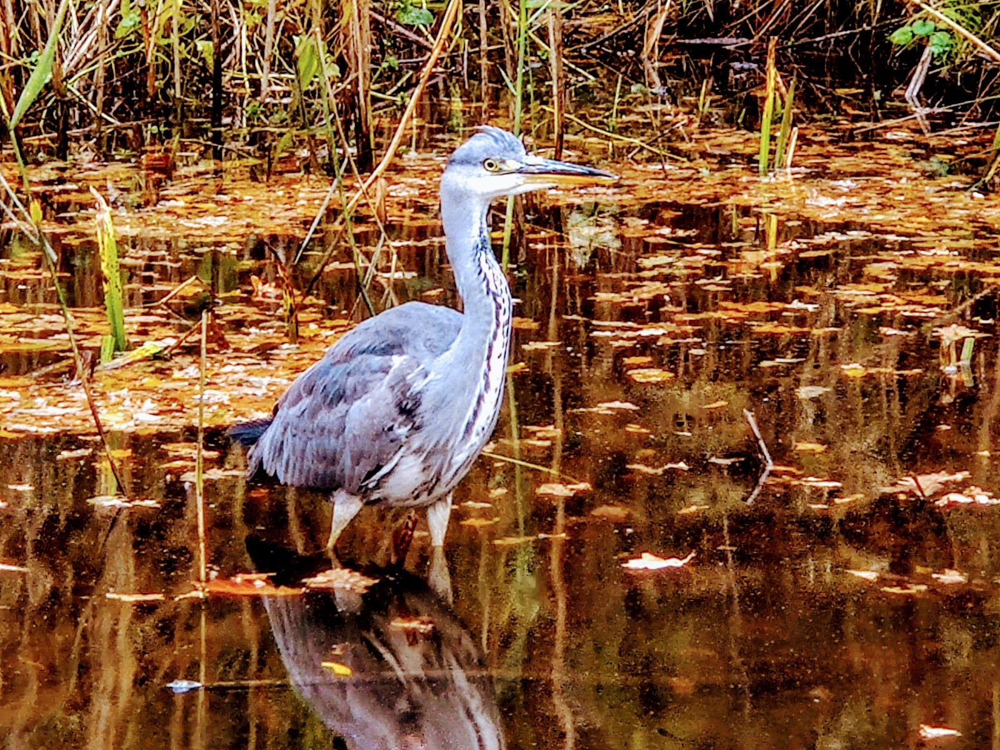
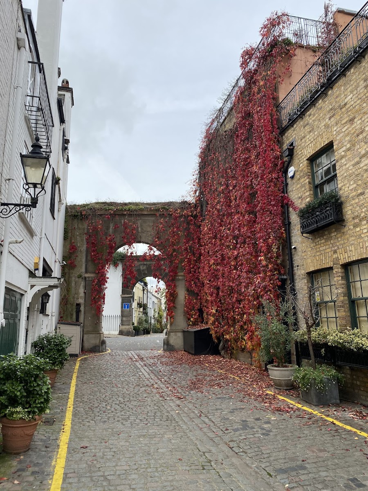

This guide is about autumn colour: which trees, in which named spot inside each place, and when to go. For London's green spaces more broadly, including the swimming ponds and Richmond Park as a deer park, see our [guide to London's best parks and gardens](/articles/best-parks-gardens-london/).

> 💡 **The Short Version:** Seven of the fifteen sources name **Richmond Park**, for the Isabella Plantation's Acer Glade and the deer. **Kew Gardens**, named by six, has the widest range of named trees and is the only entry that charges. Richmond and **Bushy Park** are also where the deer rut runs, from late September to early November — keep 50 metres back. **St James's Park** (five sources) and **Greenwich Park** (four) are the free, central options. In 2026 many trees dropped leaves early after May's 35C heatwave, the Guardian reported on 1 September, so check a park's own update before a special trip.

> 📊 **The evidence behind this guide.**
> **15 independent sources carrying 60 citations** across **28 named places**, of which **11 are named by two or more independent sources.**
> **Built on:** newspapers, magazines, local reporting, blogs and video.
> [How we rank →](/how-we-rank/)

## Where they are

| If you are near… | Where to go |
| --- | --- |
| **Central** | St James's Park, Green Park, Hyde Park, Kensington Gardens, Regent's Park & Primrose Hill |
| **Kensington & Chelsea** | Holland Park & the Kyoto Garden, Kynance Mews, Chelsea Embankment |
| **Westminster** | Victoria Tower Gardens |
| **Richmond & west** | Richmond Park & the Isabella Plantation, Bushy Park, Ham House |
| **Hampstead** | Hampstead Heath, Big Wood (Hampstead Garden Suburb) |
| **Greenwich & south east** | Greenwich Park, Oxleas Wood, Blackheath, Lesnes Abbey Woods, Beckenham Place Park |
| **East** | Victoria Park, Tower Hamlets Cemetery Park, Epping Forest |
| **South** | Brompton Cemetery, Nunhead Cemetery, Battersea Park, Fulham Palace |
| **Further out** | Osterley Park |

---

## Named by four or more sources

### Richmond Park and the Isabella Plantation — the Acer Glade and the deer

*Richmond, then bus or a walk · Cited by 7 sources · Free*

Seven sources name it, each for a different reason: Londonist, Solosophie, The Tab, Metro, BBC News, the Independent and a YouTube walk. Londonist calls it "London's quintessential autumn spot" and Solosophie says it "may well be the best spot of all". Metro highlights the Tamsin Trail, a seven-mile walking and cycling loop around the perimeter with woodpeckers and green parakeets to spot. In the Isabella Plantation, Japanese maples turn "brilliant shades of scarlet, orange and gold" through the Acer Glade, among tupelo, swamp cypress and dawn redwood.

*Richmond Park, Isabella Plantation.*

Autumn is also rutting season; see "Richmond and Bushy: the deer rut," below. Free, open dawn to dusk, and Pembroke Lodge has the park's largest car park.

### Kew Gardens — the widest range of named trees, and the only one that charges

*Kew Gardens, District line and Overground · Cited by 6 sources · £25–£28 peak, £17–£20 off-peak*

Kew's Arboretum holds 11,000 trees, 2,700 of them oaks. The Independent picks out specifics few visitors find alone: the red oak (*Quercus robur*) puts on "a flashy show of crimson along the Riverside Walk," and russet-leaved pin oaks (*Quercus palustris*) grow near the Treetop Walkway. The Evening Standard adds Kew's deciduous conifers — golden larch and fiery orange swamp cypress by the lake — which few free London parks grow at all.

The Guardian reported on 1 September 2026 that Kevin Martin, Kew's head of tree collections, was "really worried" about autumn 2026: after May's 35C heatwave the growing season was under stress, and he expected heat and drought to kill trees at Kew and across the south-east. **Peak pricing runs 2 September to 31 October 2026** — £25 online, £28 at the gate — **then drops to £17 online from 1 November.** Every Tuesday from 8 September to 29 December 2026, entry is £10. Hours shortened when the clocks went back: 10am–6pm, last entry 5pm, through 24 October, then **10am–4pm, last entry 3pm, from the 25th.**

### St James's Park — the view from the Blue Bridge

*St James's Park, District and Circle lines · Cited by 5 sources · Free*

The Evening Standard's own favourite spot: "the Blue Bridge that crosses the lake in St James's Park. The trees reach down to the water, providing a perfect reflection on a still day." Londonist adds that the view from the lake bridge looking east towards Horse Guards "turns technicolour around September/October, with the London Eye and cream coloured government buildings peeking over the tops of clouds of fire-coloured leaves." The bridge is crowded on a clear weekend; a weekday morning is quieter.

*The Blue Bridge, St James's Park.*

Free, open 5am to midnight, and the bridge is a two-minute walk from St James's Park station.

### Greenwich Park — 400-year-old chestnuts and a 750-year-old oak

*Greenwich or Blackheath, DLR and National Rail · Cited by 4 sources · Free*

London's oldest enclosed royal park. Time Out points to avenues of Spanish sweet chestnuts planted around 400 years ago, which drop edible nuts in autumn, and to the Queen Elizabeth Oak, dated at 750 years old. News Shopper's local reporting adds specifics: "rows of Japanese Maple and Sweet Chestnut trees that turn red and orange in autumn, along with its London skyline views and historic buildings like the Observatory and Pavilion Café." Londonist's own pick is Blackheath Avenue, which gets the same "golden tunnel" treatment as Regent's Park's Broad Walk.

*Greenwich Park's avenues.*

Free, open 6am to dusk, and the climb to the Observatory gives the view over all of it. The Royal Observatory itself closes on 2 November 2026 for refurbishment; its Meridian Courtyard reopens in summer 2027, with tickets on sale in January ([project page](https://www.rmg.co.uk/royal-observatory/transformation)).

### Regent's Park and Primrose Hill — a golden tunnel down the Broad Walk

*Baker Street, multiple lines · Cited by 4 sources · Free*

The Broad Walk, the wide north–south avenue through the park, becomes what Londonist calls "a golden tunnel" as its trees turn. Two YouTube walks, filmed a year apart, both chose this park to film in autumn, one calling it "even more beautiful with autumn colours." The travel blogger Brogan Abroad lists it among her top parks for the season too.

Free, open 5am to dusk (later in summer). Frieze Sculpture, a free outdoor art exhibition, runs in the park's English Gardens from 16 September to 1 November 2026.

---

Powered by <a target="_blank" rel="sponsored" href="https://www.getyourguide.com/london-l57/">GetYourGuide</a>

## Named by three sources

### Hyde Park — 4,000 trees along the Serpentine

*Hyde Park Corner, Marble Arch or Lancaster Gate · Cited by 3 sources · Free*

More than 4,000 trees, per Time Out, with the beeches, limes and chestnuts along the Serpentine's avenues turning "buttery yellows and fiery oranges." Solosophie recommends renting a rowboat on the lake to see the colour reflected from the water. Metro's London walking guide routes a loop through here as part of a longer trail linking four of the Royal Parks.

Free, open 5am to midnight.

### Green Park — the corridor between the palaces

*Green Park, Piccadilly or Jubilee lines · Cited by 3 sources · Free*

Named independently by a YouTube walking channel, a travel blogger and Metro's London walking guide, which uses it as the start of a loop through four Royal Parks, on to St James's Park, Buckingham Palace, Hyde Park and Kensington Gardens. It is smaller and plainer than its neighbours, without a lake or a formal garden: a tree-lined cut-through between Piccadilly and the Palace rather than a destination.

*The Canada Memorial, Green Park.*

Free, open 5am to midnight.

### Hampstead Heath — 800 acres of ambers, golds and deep reds

*Hampstead Heath Overground, or Hampstead, Northern line · Cited by 3 sources · Free*

Time Out describes the Heath's "meadows and magical woodland areas, all tinged in ambers, golds and deep, majestic reds," and Condé Nast Traveller calls it the corner of the city that "takes on its best colours in autumn," with its three swimming ponds offering a last cold-water dip before winter. Metro's Hampstead Circular walk takes in "a mix of oak-lined trails and open meadows," starting from Hampstead village and passing the Holly Bush pub before reaching the Heath. A full route through it, taking in Kenwood House and Parliament Hill, is in our [Hampstead Heath to Primrose Hill walk](/articles/hampstead-heath-primrose-hill-walk/).

*Hampstead Heath in autumn.*

Free, open all year, and the ponds stay open through autumn.

### Holland Park and the Kyoto Garden — a Japanese garden fringed in orange

*Holland Park, Central line · Cited by 3 sources · Free*

A 1991 gift from the Chamber of Commerce of Kyoto, with a waterfall, a bridge and koi carp, sitting inside the wider 54-acre Holland Park. Time Out and Solosophie both single it out: its edges turn "fringed with orange leaves" as its Japanese maples change. Brogan Abroad adds that "fiery red ivy" over the houses around the park keeps colour going long after its trees are bare.

*The Kyoto Garden, Holland Park.*

Free, and busiest on a clear weekend afternoon; go early to see the koi pond without a queue.

## Richmond and Bushy: the deer rut, and how to watch it safely

Richmond Park and Bushy Park are London's only two parks with free-roaming deer — red and fallow, over 1,000 of them between the two. BBC News quoted both parks' managers on the rut in 2025: Paul Richards at Richmond said the deer are "wild animals, pumped full of testosterone and can be unpredictable," and Phil Edwards at Bushy said to "keep at least 50 metres away from the deer, and even further if they are active." The rut runs from late September to early November, when stags compete for hinds by roaring and clashing antlers.

The Independent reported a person taken to hospital by London Ambulance Service after being hurt by a deer inside Richmond Park, and Royal Parks said it was "shocked and alarmed" by videos and photos online of visitors approaching deer in nearby Bushy Park. Keep well back, keep dogs on a lead, and never stand between two rutting stags.

### Bushy Park — the quieter deer park, and the start of the Hampton Court Barge Walk

*Hampton Court or Teddington · Cited by 3 sources · Free*

Named alongside Richmond by BBC News and the Independent for its own rutting deer, and by Metro as the starting point for the Hampton Court Barge Walk, a riverside route down to Hampton Court Palace past Ravens Ait and Thames Ditton Island. Bushy Park holds roughly half of the more than 1,000 deer the two parks share, and is generally easier to watch the rut in without Richmond's weekend crowds.

*Bushy Park in autumn.*

Free, open dawn to dusk.

## Cemeteries: quieter, and free

### Brompton Cemetery — a Victorian graveyard turned quiet walk

*West Brompton or Earl's Court · Cited by 1 source · Free*

One of London's "Magnificent Seven" Victorian cemeteries. Londonist describes "autumn leaves settle on the ground among imposing tombs and in front of the iconic domed chapel".

Free, open dawn to dusk, and quietest on a weekday morning.

### Nunhead Cemetery — a hilltop view to St Paul's through the leaves

*Nunhead, Overground · Cited by 1 source · Free*

Another of the Magnificent Seven. Londonist's reason is the view: climb to the top and, as the trees shed their leaves, the skyline opens up towards St Paul's Cathedral. It is a climb rather than a flat stroll, and quieter than Highgate or Brompton on the same weekend.

Free, open every day, and the climb is worth timing for late-afternoon light.

- **Tower Hamlets Cemetery Park**, Mile End — a disused Victorian cemetery turned into the borough's only woodland, 33 acres of wild planting with pumpkin-carving, bat walks and storytelling events through the season, per Time Out. Free. *Cited by 1 source.*

Powered by <a target="_blank" rel="sponsored" href="https://www.getyourguide.com/london-l57/">GetYourGuide</a>

## South east London's ancient woodland

News Shopper's local reporting adds four further sites within a few miles of Greenwich Park, less written up nationally than the big parks.

- **Oxleas Wood**, Shooters Hill — one of London's oldest woodlands, dating back more than 8,000 years, with hornbeam, oak and hazel; the rose garden at Jack Wood and the historic Severndroog Castle terrace sit inside it. Free. *Cited by 1 source.*
- **Blackheath**, next to Greenwich Park — open grassland ringed by Georgian and Victorian houses rather than woodland. Free. *Cited by 1 source.*
- **Lesnes Abbey Woods**, Abbey Wood — 88 hectares of ancient woodland around the ruins of a 12th-century abbey. Free. *Cited by 1 source.*
- **Beckenham Place Park** — ancient woodland, a lake and a historic Georgian manor, with a marked Woodland Wander trail through the trees. Free. *Cited by 1 source.*

## Epping Forest and the wider royal parks

### Epping Forest — ancient beech and hornbeam at the end of the Central line

*Chingford, Overground, or Leytonstone, Snaresbrook and Wanstead, Central line · Cited by 1 source · Free*

Epping Forest runs 13 miles from east London into Essex, and the part inside Greater London is reachable on the network: five minutes on foot from Chingford station to the Visitor Centre and Queen Elizabeth's Hunting Lodge, then on to Connaught Water via the Willow Trail. From Leytonstone or Snaresbrook on the Central line, the Hornbeam Trail and Wanstead Park's Chestnut Trail reach the Forest's ancient hornbeam and oak pollards.

*Epping Forest.*

Free, open all year.

- **Kensington Gardens**, next to Hyde Park — Queen Anne's Alcove, the Italian Gardens fountains and the Diana, Princess of Wales Memorial Playground sit inside it, all part of a longer Royal Parks walking loop Metro maps out from Green Park. Free. *Cited by 1 source.*
- **Victoria Tower Gardens**, Westminster — the line of plane trees beside the Houses of Parliament, best seen from across the river on the Albert Embankment, per the Evening Standard. Free. *Cited by 1 source.*

## Historic houses further out

- **Ham House**, Richmond — a National Trust house on the Thames, a short riverside walk from Richmond Park, where Solosophie calls the gardens' colour "lovely golden hues." Grounds free; house ticketed. *Cited by 1 source.*
- **Osterley Park**, Isleworth — a Georgian estate with more than 350 acres of parkland and rolling lawns, remodelled by Robert Adam, per Time Out's own venue guide. Grounds free; house ticketed. *Cited by 1 source.*

## Also worth the trip

- **Victoria Park**, Bethnal Green/Hackney Wick — the East End's largest park, where Time Out singles out the silver birches, planes, oaks and a rare purple-leaved Norway maple. Free. *Cited by 1 source.*
- **Battersea Park** — a hybrid strawberry tree, red-barked and still fruiting into late autumn, stands out among the more usual oaks and willows, per Time Out. Free. *Cited by 1 source.*
- **Fulham Palace** — flame-coloured leaves around the former Bishop of London's palace, with pumpkins for sale from the walled kitchen garden. Free to the grounds. *Cited by 1 source.*

## Streets and smaller corners

### Kynance Mews — creeper over the arches

*Kensington · Gloucester Road, District, Circle and Piccadilly lines · Cited by 2 sources · Free*

A cobbled mews off Kynance Place, where ivy and Virginia creeper turn into what Londonist calls "a waterfall of vermillion" over its two stone arches. Go early on a weekday: a queue forms for the arch by mid-morning. The creeper turns weeks after the parks do, so save it for the back end of the season.

*Kynance Mews.*

### The rest of the streets
- **Chelsea Embankment** — golden plane trees arching over the riverside path, with sphinx-headed benches to sit on while the leaves come down, per Londonist. Free. *Cited by 1 source.*
- **Big Wood**, Hampstead Garden Suburb — two small ancient-woodland pockets, including a genuine rarity: the wild service tree (*Sorbus torminalis*), which the Evening Standard says turns "a deep copper-orange" this time of year. Free. *Cited by 1 source.*

---

## When to go

Most years the earliest trees turn from September, most of London peaks in October, and by mid-November it is over for everything except a handful of late colourers. **2026 is not most years.** The Guardian reported on 1 September 2026 that many trees across England were losing their leaves early to cope with the heat, after a May heatwave that reached 35C, and that autumn storms linked to El Niño could hit trees already weakened by heat and drought.

| Period | What's happening |
| --- | --- |
| **September** | The most drought-stressed trees dropped leaves early without full colour, a "false autumn" per Kew. Others were recovering, which could mean good colour later if the weeks ahead stayed cool and dry. |
| **Late September–early November** | The deer rut runs in Richmond and Bushy Parks. |
| **October** | Peak month across most of London in a typical year, per Kew's month-by-month guide. At the start of October 2026 Kew reported no clear peak date, because different trees were on very different timetables. |
| **Sunday 25 October** | Clocks went back at 2am. Parks do not close earlier by rule, but daylight does, and Kew's close moved from 6pm to 4pm. |
| **November** | Kew names ginkgo, swamp cypress and American smoke-tree as its latest colourers most years, "at their strongest" in November. |

Powered by <a target="_blank" rel="sponsored" href="https://www.getyourguide.com/london-l57/">GetYourGuide</a>

## Practical tips

- **Check a park's own social media before a special trip in 2026.** With trees on very different timetables, a plan built around "late October" could be a week too late for some species and too early for others.
- **Weekday mornings are quietest everywhere on this list.** St James's Park's Blue Bridge, the Isabella Plantation and Kynance Mews all draw a weekend photography crowd; at 8am on a weekday they are usually empty.
- **Plan afternoon visits for before 3–4pm** now the clocks have gone back; Kew closes at 4pm with last entry at 3pm.

## Just outside London

Three places regularly top national "best autumn colour" lists but sit outside Greater London.

- **Westonbirt, The National Arboretum**, Gloucestershire — run by Forestry England and built around one of the country's biggest Japanese maple collections, with a dedicated Acer Glade. Nearest station Kemble, on the line from Paddington, then a taxi.
- **Wakehurst**, West Sussex — Kew's second garden, with autumn colour through Westwood Valley, Bethlehem Wood and Horsebridge Wood. Nearest station Haywards Heath, on the line from Victoria or London Bridge, then a bus or taxi.
- **Sheffield Park and Garden**, East Sussex — a National Trust garden planted specifically for autumn colour by its early-20th-century owner, Arthur Soames: 25 species and 240 specimens of acer, and the country's largest single-site collection of *Nyssa sylvatica* (tupelo). Grade I listed for the planting alone. Adult entry £19, free for National Trust members; nearest station Haywards Heath or East Grinstead.

## Booking

Only Kew charges or needs booking, and buying online there is cheaper than the gate and the only way to get the Tuesday price. Everywhere else is free, walk-in, any day.

---

## Continue planning your London trip

- 🌳 **[The Best Parks and Gardens in London](/articles/best-parks-gardens-london/)**
- 🍂 **[Things to Do in London in October](/articles/things-to-do-in-london-in-october/)**
- 🚶 **[The Hampstead Heath to Primrose Hill Walk](/articles/hampstead-heath-primrose-hill-walk/)**
- 🦌 **[Richmond Area Guide](/articles/richmond-area-guide/)**
- 👀 **[The Best Views in London](/articles/best-views-london/)**
- 🎃 **[Halloween in London](/articles/halloween-london/)**
- 📅 **[Best Time to Visit London](/articles/best-time-to-visit-london/)** — where autumn sits against the rest of the year
