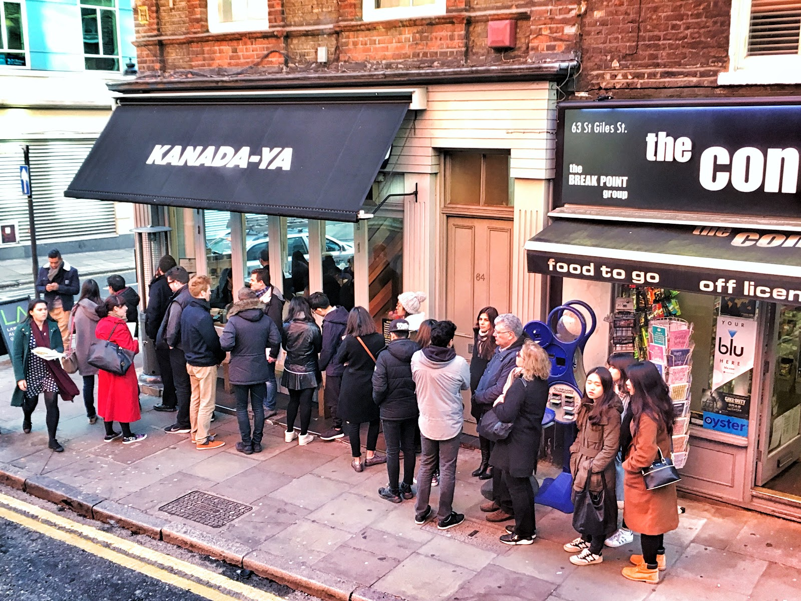
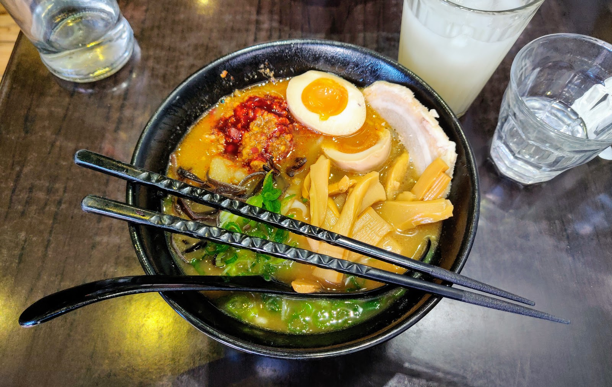
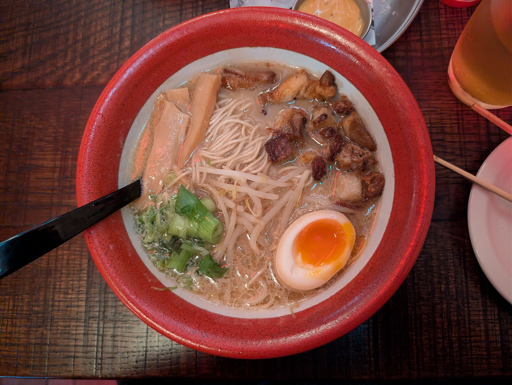

> 💡 **The Short Version:**
> - **Pork-bone tonkotsu:** **Kanada-Ya** (St Giles and Piccadilly; Origin Tonkotsu £16.60) and **Hakata Ramen + Bar** (Bermondsey; £14.95 with an egg). Of the two, only Kanada-Ya's Piccadilly branch takes bookings.
> - **House-made noodles and brothless bowls:** **Monohon Ramen** on Old Street makes its noodles and broth in the kitchen every day. Abura Soba is £16. No reservations, and no weekend lunch.
> - **Chicken broth:** **Ramen Moto** in Fitzrovia (walk-in only, closed Tuesdays) and **Tenmaru** (Fitzrovia and Finsbury Park; Tori Paitan £16.90).
> - **Under £15:** **Koi Ramen Bar** (£9.95 to £12.95 eating in), **Tonkotsu**'s £10.50 weekday lunch, **Taro** in Soho (£14.90) and **Hakata Ramen + Bar** (£14.95).
> - **Halal and vegan:** **Maki & Ramen** in Soho (halal chicken and beef) and **Uzumaki** in Bloomsbury (Halal Naruto Ramen). Vegan bowls at Hakata Ramen + Bar, Taro, Tenmaru, Monohon, Kanada-Ya and Ivan Ramen.

**Tonkotsu** is a broth of pork bones boiled for hours until it turns opaque and creamy, served with thin straight noodles. Around it sit chicken-bone *paitan*, soy-seasoned *shoyu*, sesame-and-chilli *tantanmen*, and *abura soba* or *mazesoba*, where thick noodles are tossed in sauce and oil with no broth at all.

Knowing which of these a shop cooks settles where to go before you join a pavement queue.

*Menus, prices and opening hours as of October 2026.*

---

## How the styles differ, and what a bowl costs

A ramen menu is named for its **broth** (*tonkotsu* is pork bone, *paitan* is cloudy chicken) or its **tare**, the concentrated seasoning ladled into the bowl before the hot soup goes in: *shoyu* is soy sauce, *shio* sea salt and *miso* fermented soybean paste.

| Style | Where to order it | What is in the bowl |
| --- | --- | --- |
| **Tonkotsu** | Kanada-Ya, Hakata Ramen + Bar, Shoryu Ramen, Ippudo, Tonkotsu, Bone Daddies, Koi Ramen Bar, Taro | Opaque pork-bone broth, usually with chashu pork (braised or roast pork belly), wood ear mushrooms (*kikurage*) and spring onion. Hakata Ramen + Bar and Shoryu cook the broth for 12 hours; Ippudo for 18, then matures it for a further day. |
| **Kumamoto tonkotsu** | Hakata Ramen + Bar | Pork broth with burnt garlic oil and fried garlic chips. |
| **Chicken (*paitan*)** | Ramen Moto, Tenmaru, Ivan Ramen, Kanada-Ya | Cloudy chicken-bone broth. Ramen Moto's is a silky, foamy white broth; Tenmaru tops its with sous-vide chicken chashu. |
| **Shoyu, shio and miso** | Monohon Ramen, Ivan Ramen, Hakata Ramen + Bar, Cocoro, Ramen Moto, Koi Ramen Bar | A soy sauce, salt or miso seasoning under a lighter broth. Monohon puts shoyu into a creamy pork soup. |
| **Tantanmen** | Monohon Ramen, Bone Daddies, Shoryu Ramen, Tenmaru, Maki & Ramen | The Japanese take on Sichuan *dan dan* noodles: sesame, chilli and minced meat or soy mince. |
| **Abura soba and mazesoba** | Monohon Ramen, Kanada-Ya, Tenmaru, Koi Ramen Bar | Brothless: noodles tossed in sauce or oil with pork or mince, an egg and chopped toppings. Koi calls its version Naked Ramen. |

Hakata-style shops ask how firm you want your noodles. Kanada-Ya offers *yawa* (soft), *futsuu* (regular), *kata* (firm) and *barikata* (very firm), and its menu recommends barikata. Shoryu's scale runs *futsu*, *katamen*, *barikata*; Monohon uses regular, hard and very hard; Hakata Ramen + Bar serves its noodles hard unless you ask. *Kaedama*, a second portion of noodles for the broth you have left, is £2.95 at Kanada-Ya, Hakata Ramen + Bar and Koi Ramen Bar and £3.50 at Monohon and Shoryu; Tonkotsu charges £2 for extra noodles.

**What a standard bowl costs, eating in.**

| Price | Shop | Bowl |
| --- | --- | --- |
| £12.95 | Koi Ramen Bar | Pure White Tonkotsu |
| £14.50 | Cocoro | Tonkotsu Ramen |
| £14.50 | Maki & Ramen | Tonkotsu |
| £14.90 | Shoryu Ramen | Origin Tonkotsu |
| £14.90 | Taro | Tonkotsu Ramen |
| £14.95 | Hakata Ramen + Bar | Hakata Tonkotsu |
| £15.50 | Monohon Ramen | Shouyu Tonkotsu |
| £15.95 | Tonkotsu | Tonkotsu |
| £16.60 | Kanada-Ya | Origin Tonkotsu |
| £16.90 | Tenmaru | Tori Paitan |
| £17 | Ivan Ramen | Tonkotsu |
| £32.50 | Kinoya | Shio Paitan with chicken |

---

## Where they are

| If you are near… | Where to eat |
| --- | --- |
| **Covent Garden, St Giles & Bloomsbury** | Kanada-Ya (St Giles), Ippudo (Central St Giles), Cocoro, Uzumaki |
| **Soho & Piccadilly** | Kanada-Ya (Piccadilly), Bone Daddies, Tonkotsu, Shoryu Ramen, Maki & Ramen, Taro |
| **Fitzrovia** | Ramen Moto, Tenmaru, Ippudo (Goodge Street) |
| **Strand & Embankment** | Ippudo (Villiers Street) |
| **Clerkenwell, Farringdon & Old Street** | Monohon Ramen, Ivan Ramen |
| **Bermondsey** | Hakata Ramen + Bar |
| **Finsbury Park** | Tenmaru |
| **Brixton, Elephant and Castle & Tooting** | Koi Ramen Bar |
| **Knightsbridge** | Kinoya at Harrods |

**Price guide:** **£** under £15 a bowl · **££** £15–£22 · **£££** £25+.

---

## Counters built around one style

### Kanada-Ya

*££ · Covent Garden · 4 min from Covent Garden*

Kanada-Ya has two central branches: 64 St Giles High Street, WC2H 8DA, and 3 Panton Street, SW1Y 4DL. The group was founded in Yukuhashi, Japan, in 2009, and the menu is built around **tonkotsu**. Orders at St Giles go through a QR code on the table.

*Kanada-Ya on St Giles High Street.*

The **Origin Tonkotsu (£16.60)** is pork bone broth with chashu pork belly, spring onion and wood ear fungus. **Tonkotsu X (£16.50)**, on the London menu only, mixes pork and corn-fed chicken bone broths and finishes with yuzu-shoyu. The **Truffle (£20.95)** adds porcini truffle paste and white truffle oil over pork loin. **Vegan Spicy Yuzu (£16.95)** is the vegan bowl, and the brothless **Tofu Abura Soba (£16.95)** and **Pork Belly Abura Soba (£17.95)** are thick egg noodles in sesame sauce with a very soft poached egg. A marinated egg is £2.50 extra.

**St Giles takes no reservations; Piccadilly takes them through SevenRooms.** Pick *barikata*, the firmest setting, which the menu recommends.

**The venue's site:** [kanada-ya.com](https://www.kanada-ya.com/)

**Book:** [Reserve a table](https://www.sevenrooms.com/explore/kanadayapiccadilly/reservations/create/search/)

### Monohon Ramen

*££ · Shoreditch · 7 min from Old Street · walk-in only*

Ian Wheatley left an office job, worked six months at Ippudo and launched Monohon as a pop-up in the summer of 2015 before taking the shop at 102 Old Street. It seats 32. The noodles are made in the kitchen every day from Japanese flour, and the pork broth is boiled for a whole day with kelp and shiitake.

*A bowl at Monohon Ramen.*

The **Shouyu Tonkotsu (£15.50, £16.50 large)** is soy seasoning in creamy pork soup with pork belly and wood ear mushrooms. The **Abura Soba (£16, £17)** is brothless: thick chewy noodles in a sesame-oil sauce with slow-cooked pork, fried shallots, cayenne and a very soft poached egg. The **Spicy Tonkotsu (£19, £20)** adds spicy miso pork mince, and the **Vegan Tan Tan Men (£18.50, £19.50)** has a creamy sesame soup with spicy miso-fried soy mince. A marinated egg is £2.50 extra on the soup bowls.

**No reservations, and the whole party has to be there before you are seated.** Monohon opens Monday to Friday 12:00 to 14:15 and 17:00 to 21:30, Saturday 17:00 to 21:30 and Sunday 17:00 to 21:00, and is closed on bank holidays. The counter seats nine in a row, and there is one table for four or five, easiest to get if you arrive before the 17:00 opening.

**The venue's site:** [monohonramen.com](https://monohonramen.com/)

### Ramen Moto

*Fitzrovia · 5 min from Goodge Street · walk-in only*

Ramen Moto cooks Sapporo-style ramen at 6 Charlotte Street, with a second branch on the fifth floor of Harvey Nichols in Knightsbridge. Its centrepiece is a chicken white broth worked into a silky, foamy soup. The noodles come from Nishiyama Seimen of Sapporo, which Ramen Moto says it alone is licensed to use in London.

The **Creamy Chicken Ramen** is a chicken and pork broth with soft chicken, smoked pork chashu, a seasoned egg, burdock and black fungus. The rest of the list runs through **Miso**, **Shoyu**, **Shio Yuzu**, **Spicy Tan Tan** and a **Veg Ramen** in kombu and mushroom broth, with deep-fried shrimp rolls, karaage and crispy squid tentacles on the side.

**Walk-in only, and closed on Tuesdays.** Charlotte Street opens 12:00 to 15:00 and 16:30 to 21:30 on Mondays and Wednesdays to Fridays, and from 12:00 to 21:30 at weekends. Ramen Moto says it cannot guarantee a halal option.

**The venue's site:** [ramenmoto.uk](https://www.ramenmoto.uk/)

### Ivan Ramen

*££ · Clerkenwell · 9 min from Farringdon · walk-in only*

Ivan Orkin, a New Yorker, opened his first ramen shop in Tokyo's Setagaya ward in 2007 and later Ivan Ramen in New York. The London shop at 98 Farringdon Road opened in late 2025.

The bowls are **Shoyu (£17)** with shoyu-braised pork chashu and roasted tomato, **Tonkotsu (£17)**, **Tori Paitan (£18)** with minced chicken and crispy togarashi chicken, **Spicy Miso Red Chilli (£18)**, **Roasted Garlic Tonkotsu (£18)** and a vegan **Truffled Veggie (£16)**. **Cold Sesame Noodles (£17)** come in a chilled sesame broth with pulled chilli chicken. Small plates include chicken gyoza and buttermilk karaage, and there are pastrami and fried chicken buns.

**Walk-in only, and the weekday lunch is £15.** From 12:00 to 15:00, Monday to Friday, the Shoyu, Tonkotsu and Truffled Veggie bowls drop to £15; adding three chicken gyoza is £1.95, and upgrading to the Tori Paitan or the Spicy Miso Red Chilli is £1. It opens 12:00 to 21:00 on Monday and Tuesday, 12:00 to 22:00 Wednesday to Saturday and 12:00 to 20:00 on Sunday.

**The venue's site:** [ivanramen.co.uk](https://www.ivanramen.co.uk/)

### Hakata Ramen + Bar

*£ · Bermondsey · 16 min from Borough · walk-in only*

Hakata Ramen + Bar at 177 Bermondsey Street has communal and bar-style seating only, and an izakaya bar (a Japanese pub that serves small plates) in the basement where waiting guests can have a drink.

Every ramen is **£14.95** and comes with a soft-boiled egg, menma (bamboo shoots), beansprouts, spring onion and nori. **Hakata Tonkotsu** and **Kumamoto** use a 12-hour pork broth, Kumamoto with chashu, wood ear mushrooms, garlic chips and burnt garlic oil. **Shoyu**, **Miso** and **Spicy Miso** use a shiitake mushroom broth with a choice of pork, chicken or mushrooms. Each of the five has a vegan version. Noodles arrive hard unless you ask for soft or very hard. A **Pork Katsu Sando** is £8.95.

**No reservations.** It opens Monday and Tuesday 17:00 to 22:00, Wednesday to Friday 12:00 to 15:00 and 17:00 to 22:00, and Saturday and Sunday 12:00 to 22:00. The basement bar runs Wednesday to Saturday, 17:00 to 22:00.

**The venue's site:** [hakata.co.uk](https://www.hakata.co.uk/)

---

Powered by <a target="_blank" rel="sponsored" href="https://www.getyourguide.com/london-l57/">GetYourGuide</a>

## Everyday bowls and neighbourhood counters

### Tenmaru

*££ · Fitzrovia · 2 min from Oxford Circus · walk-in only*

Tenmaru opened in Finsbury Park in November 2019, at 8 Clifton Terrace, and added 50 Margaret Street, by Oxford Circus, in January 2023. It styles itself on a lively Japanese izakaya, and its ramen menu is built on a chicken broth, with four vegan bowls and a brothless mazesoba.

The **Tori Paitan (£16.90)** is topped with sous-vide chicken chashu, a seasoned egg, black fungus, bamboo shoots and spring onion. The **Lemon Ramen (£17.50)** adds fresh lemon. The **Mazesoba (£17.90)** is soup-less ramen with miso pork mince, chives, garlic, nori and a raw egg yolk, and the **Tan Tan Men (£18.90)** has pork mince, sesame and red chilli. The vegan bowls are **Vegan Tonkotsu-flavour (£16.90)**, **Vegan Lemon (£17.50)**, **Vegan Spicy (£17.90)** and **Basil Ramen (£18.90)**. **Yamitsuki Cabbage (£4.90)**, with salted kelp and ponzu, is the side.

**Walk-in only at both branches.** On weekdays both close from 15:00, reopening at 17:00 in Finsbury Park and 17:30 on Margaret Street, and Finsbury Park is closed on Mondays.

**The venue's site:** [tenmaru.co.uk](https://www.tenmaru.co.uk/)

### Koi Ramen Bar

*£ · Brixton · 1 min from Brixton*

Koi has five sites: Brixton Station Road, Sayer Street in Elephant and Castle, Tooting Market, Herne Hill and Aldgate East. The menu is one page of four ramens.

Eating in, the **Pure White Tonkotsu** is £12.95, the **Mellow Miso** £12.50, the **Old Skool Shoyu** £11.95 and the soup-less **Naked Ramen** £9.95; takeaway prices are £1 lower. Miso, Shoyu and Naked Ramen can be ordered with pork, chicken, tofu or prawn. A whole marinated egg is £2.25, and **kaedama** is £2.95.

**Open from 11:30 daily,** closing at 22:00, or 22:30 on Fridays and Saturdays, at Brixton, Elephant and Castle and Tooting.

**The venue's site:** [koiramenbar.co.uk](https://www.koiramenbar.co.uk/)

### Taro

*£ · Soho · 2 min from Piccadilly Circus*

Mr Taro opened Taro at 61 Brewer Street in 1999 as an everyday Japanese dining room, a *taishu shokudo*. It seats 50 and its menu runs across ramen, udon, sushi and bento, so it suits a table where only some people want noodles. There are further branches in Finchley Central, Kennington, Balham, Pimlico and Walthamstow.

The **Tonkotsu Ramen (£14.90)** is a thick, milky pork-bone soup with roast pork, a boiled egg, seaweed, red ginger and beansprouts. The **Taro Vegan Ramen (£14.90)** is red and white miso broth with vegan noodles, fried tofu, grilled tomato, broccoli and wakame. There are also Chicken, Pork, Beef, Kimchi and Seafood ramens, and plainer Shoyu, Spicy and Moyashi bowls, from £12.90.

**Open seven days, and it takes reservations,** booked at least three hours ahead on its website or by phone. An optional 10% service charge is added.

**The venue's site:** [tarorestaurants.uk](https://tarorestaurants.uk/location/soho/)

**Book:** [Reserve a table](https://tarorestaurants.uk/locations/soho/reservation/)

### Cocoro

*£ · Bloomsbury · 5 min from Holborn*

Cocoro at 25 Coptic Street is the Bloomsbury branch of a group with sites in Marylebone, Highgate and Bayswater, and describes its Bloomsbury dining as casual and izakaya-style. The menu runs from sushi and donburi to six ramens.

The **Tonkotsu Ramen** (pork broth) and **Miso Tonkotsu Ramen** are £14.50, and the **Shoyu**, **Vegetable**, **Miso** and **Shio** ramens are £14. Each takes a main topping of char siu pork, kara-age fried chicken or tofu katsu. A **Ramen Salad** with chilled ramen noodles, tomato and sesame dressing is £10.

**Bookings are made on its own website, and Bloomsbury can seat groups of up to 50.**

**Booking:** [cocorobloomsbury.co.uk](https://www.cocorobloomsbury.co.uk/) — book through their site

---

Powered by <a target="_blank" rel="sponsored" href="https://www.getyourguide.com/london-l57/">GetYourGuide</a>

## The chains, halal ramen and a luxury bowl

### Tonkotsu

*££ · Soho · 5 min from Leicester Square*

Tonkotsu opened at 63 Dean Street in 2012, after a pop-up the year before, and now has restaurants across London. Noodles, broths, gyoza and katsu curries are made from scratch, and the noodles are cooked for 32 seconds. Soho has two floors, a few seats outside and beer on tap.

The namesake **Tonkotsu (£15.95)** is pork broth with lardo, roast pork belly, bamboo shoots, beansprouts and burnt garlic oil. **Geki Kara (£16.95)** is the extra-hot one, with scotch bonnet mash. **Chilli Chicken (£15.95)** and **Kakugiri (£13.95)** are chicken-broth bowls, and the vegan **Japanese Mushroom Miso (£13.95)** uses a konbu and shiitake broth. Every ramen comes in a small size for 25% off the listed price, and every non-vegan bowl has half a soy-marinated egg.

**Weekday lunch is £10.50, Monday to Friday until 17:00, excluding bank holidays:** a lunch-sized ramen or hiyashi (chilled noodle) salad plus a lunch-sized side. Soho takes bookings and leaves space for walk-ins.

**The venue's site:** [tonkotsu.co.uk](https://tonkotsu.co.uk/locations/soho/)

**Book:** [Reserve a table](https://app.walkup.co/create_booking/vendor/restaurant_000000Bo6urTUyCADsYOiM7Vi1SCO)

### Ippudo

*Covent Garden · walk-in only*

Ippudo opened in Fukuoka in 1985 and runs four London shops: Central St Giles, Villiers Street, Goodge Street and Canary Wharf. Its UK menu says the pork broth is cooked for 18 hours and then matured for a further day. The brand's design uses wooden signs, hand-dyed fabric dividers and jazz, with staff in samue robes.

**Shiromaru Classic** is the original creamy tonkotsu with thin straight noodles, pork belly chashu, kikurage, bean sprouts and bamboo shoots. **Akamaru Modern** adds a blended miso paste and garlic oil, and **Karaka-Men** adds a spicy miso paste, roasted cashew nuts and sansho pepper. **Tori Shoyu**, a lighter chicken bowl, is at Central St Giles only, and **Hakata Niku Ton**, with simmered sweet and spicy pork, is at Villiers Street only. There is also a **Veggie Ramen** with fried tofu.

**It takes no reservations.**

**The venue's site:** [ippudo.co.uk](https://www.ippudo.co.uk/)

### Bone Daddies

*Soho · 3 min from Leicester Square*

Bone Daddies opened on Peter Street, Soho, in 2012 and has restaurants at Old Compton Street, Bermondsey, Bond Street, High Street Kensington, Leicester Square, Old Street and Victoria. Old Compton Street, at 14A, seats 80 across counter seats, low tables and group booths, with exposed brick, red neon and a classic-rock soundtrack.

*Yuzu Tonkotsu at Bone Daddies. Photo: [Andy Li](https://commons.wikimedia.org/wiki/File:Yuzu_Tonkotsu_Ramen_-_Bone_Daddies_2026-03-24.jpg), [CC0 1.0](https://creativecommons.org/publicdomain/zero/1.0/).*

The pork bowls are **Tonkotsu [The OG]** with chashu pork belly and burnt garlic, **Yuzu Tonkotsu** with fried chashu pork belly, **Pork Pork Chilli** and the hot **Spicy Miso Tonkotsu**. The chicken bowls are **Tokyo Cock Cock**, with fried chicken, "cock scratchings" and yuzu, **T22** and **Tantanmen**. A new ramen is added every month, and a **Breakfast Ramen** of Cumberland sausage mince, hash browns and HP tonkatsu sauce is on the menu.

**Takes bookings for lunch and dinner, and walk-ins are welcome.** Soho and Old Compton Street open 10:00 to 22:00 Sunday to Wednesday and 10:00 to 23:00 Thursday to Saturday.

**The venue's site:** [bonedaddies.com](https://bonedaddies.com/)

**Book:** [Reserve a table](https://www.opentable.co.uk/r/bone-daddies-old-compton-street-reservations-london?restref=121113&lang=en-GB)

### Shoryu Ramen

*££ · Soho · 1 min from Piccadilly Circus*

Tak Tokumine and Kanji Furukawa opened the first Shoryu in 2012. The West End branches are Soho (3 Denman Street), Regent Street, Covent Garden (Great Queen Street) and Carnaby (Kingly Court), with more in Shoreditch and Westfield Stratford City. The ramen is a 12-hour pork broth seasoned with a soy stock called *motodare*, and the noodles are made daily.

On the Soho menu the **Origin Tonkotsu (£14.90)** has three classic toppings and the **Shoryu Ganso Tonkotsu (£15.90)** adds a gooey orange-yolk egg, red ginger and nori. **Kotteri Hakata Tonkotsu (£17.50)** is the thicker, richer broth with a double egg, and **Karamiso Tonkotsu (£17.50)** is spicy miso. **Vegan White Natural (£15.90)** uses a tonyu soy milk broth. Braised pork belly buns are £6.95 each.

**Takes bookings, each for 90 minutes, and keeps tables for walk-ins.** Parties are seated only when complete. The Soho branch opens 11:00 to 23:00 on Mondays to Wednesdays, 23:30 on Thursdays and Fridays, midnight on Saturdays and 22:00 on Sundays. A 12.5% service charge is optional.

**The venue's site:** [shoryuramen.com](https://www.shoryuramen.com/stores/11-soho)

**Book:** [Reserve a table](https://www.shoryuramen.com/bookings)

### Maki & Ramen

*£ · Soho · 3 min from Leicester Square*

Teddy Lee opened the first Maki & Ramen in Edinburgh in 2015, and the Soho branch is at 9 Old Compton Street. All its chicken and beef is halal-certified, chicken gyoza excepted; the pork bowls are not, so say which you want.

The tonkotsu broth is cooked for eight hours. The **Tonkotsu (£14.50)** has chashu, wakame and a half egg, the **Hell Ramen (£14.90)** is a chilli-infused tonkotsu with chashu, and the **Black Garlic Tonkotsu** and **Tantan** are also £14.90. The halal-marked bowls include the **Chicken ramen (£14.50)**, a lightly spiced miso broth with chicken karaage, and the **Seafood Hell (£17.50)**. The vegan bowls are £14.50 to £14.90.

**Open until midnight on Fridays and Saturdays** (11:30 to 22:00 Sunday to Thursday), and it takes bookings on its website.

**The venue's site:** [makiramen.com](https://www.makiramen.com/our-venues/soho/)

**Book:** [Reserve a table](https://web.dojo.app/create_booking/vendor/oJzsg1WJou2r34ZeC68FjmdRmjuPmG_VzG35Y9J0dZ8_restaurant)

### Uzumaki

*££ · Bloomsbury · 2 min from Tottenham Court Road*

Uzumaki at 107 Great Russell Street is an anime-themed Japanese restaurant, and its ramens are named for anime references.

The **Naruto Ramen (£21.95)** is tonkotsu broth with four slices of chashu pork, a whole marinated egg, naruto fishcake, menma and nori. The **Halal Naruto Ramen (£21.95)** swaps the pork for chashu chicken. The **Bankai! Beef Ramen (£18.95)** has glazed beef and charred corn, the **Karai Goma Ramen (£17.95)** is shiitake miso with spicy sesame paste and chicken chashu, and the **Kakiage Udon (£16.95)** is topped with vegetable kakiage tempura. Selected dishes are available halal.

**Closed on Mondays, and it takes bookings through SevenRooms.** It opens 11:30 to 21:30 Tuesday to Thursday and Sunday, and 11:30 to 22:00 on Fridays and Saturdays. A 12.5% service charge is added to the bill.

**The venue's site:** [uzumakilondon.com](https://www.uzumakilondon.com/)

**Book:** [Reserve a table](https://www.sevenrooms.com/explore/uzumaki/reservations/create/search/)

### Kinoya

*£££ · Knightsbridge · 6 min from Knightsbridge*

Kinoya at Harrods, on the ground floor at 87–135 Brompton Road, is the London branch of a Dubai ramen izakaya founded by Neha Mishra, whose flagship holds a Michelin Bib Gourmand. The London menu concentrates on ramen and sushi.

The **Shio Paitan Ramen** is a slow-cooked chicken broth with dashi, seared chicken and mayu (black garlic oil), £32.50 with chicken and £32.95 with pork. The **Spicy Miso** is the same price in a creamy chicken broth. The **Shoyu** is £36 with beef and £49.50 with A5 wagyu, the **Duck** is £36 and the **Vegetarian** £29.90.

**Harrods adds a compulsory £1 cover charge per person, and a 12.5% service charge is discretionary.** Kinoya takes bookings, and opens 11:30 to 21:00 on Mondays, 22:30 Tuesday to Saturday and 18:00 on Sundays.

**The venue's site:** [kinoya.com](https://www.kinoya.com/Kinoya-London.html)

**Book:** [Reserve a table](https://www.sevenrooms.com/reservations/kinoyaramenbar)

---

## What to know

* **Monohon and Shoryu seat only complete parties.** Monohon asks the whole group to be there before it seats anyone, and Shoryu does not seat incomplete parties.
* **Check the closed days.** Monohon is dinner only on Saturdays and Sundays, Hakata Ramen + Bar is dinner only on Mondays and Tuesdays, Ramen Moto is closed on Tuesdays, Uzumaki is closed on Mondays and Tenmaru's Finsbury Park shop is closed on Mondays.
* **Halal and vegetarian diners should ask about the broth.** A chicken bowl can still sit on pork: Kanada-Ya's Tonkotsu X blends pork and chicken bone broths, and Ramen Moto's Creamy Chicken Ramen is a chicken and pork broth.
* **Service charges differ.** Monohon and Taro add an optional 10%; Shoryu, Hakata Ramen + Bar, Uzumaki and Kinoya 12.5%, and Kanada-Ya 12.5% for parties of six or more. Harrods adds its £1 cover charge at Kinoya.

---

## Continue planning your London trip

- 🇯🇵 **[The Best Japanese Restaurants in London: Omakase to Ramen](/articles/best-japanese-restaurants-london/)**
- 🍲 **[The Best Hot Pot in London, and How to Order One](/articles/best-hot-pot-london/)**
- 🥟 **[The Best Dim Sum in London](/articles/best-dim-sum-london/)**
- 🥢 **[The Best Chinese and East Asian Restaurants in London](/articles/best-chinese-east-asian-restaurants-london/)**
- 🇰🇷 **[The Best Korean Restaurants in London and New Malden](/articles/best-korean-restaurants-london/)**
- 💷 **[Cheap Eats in London: Places to Eat Well Under £15](/articles/cheap-eats-london/)**
- 🌙 **[Late-Night Eating in London: Where to Eat After Midnight](/articles/late-night-eating-london/)**
- 🍽️ **[Eat in London: Restaurants, Food Markets & Quick Bites](/articles/eat-in-london-guide/)**
