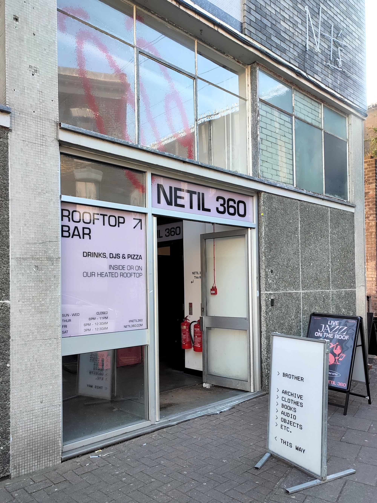
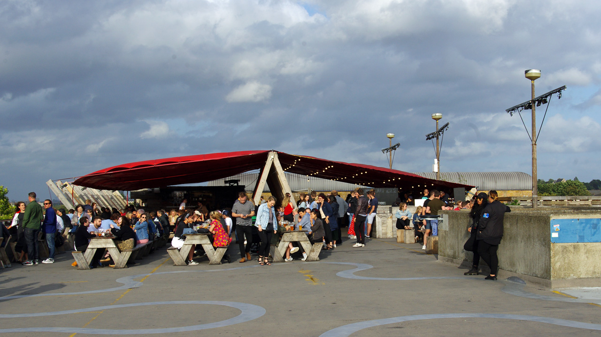
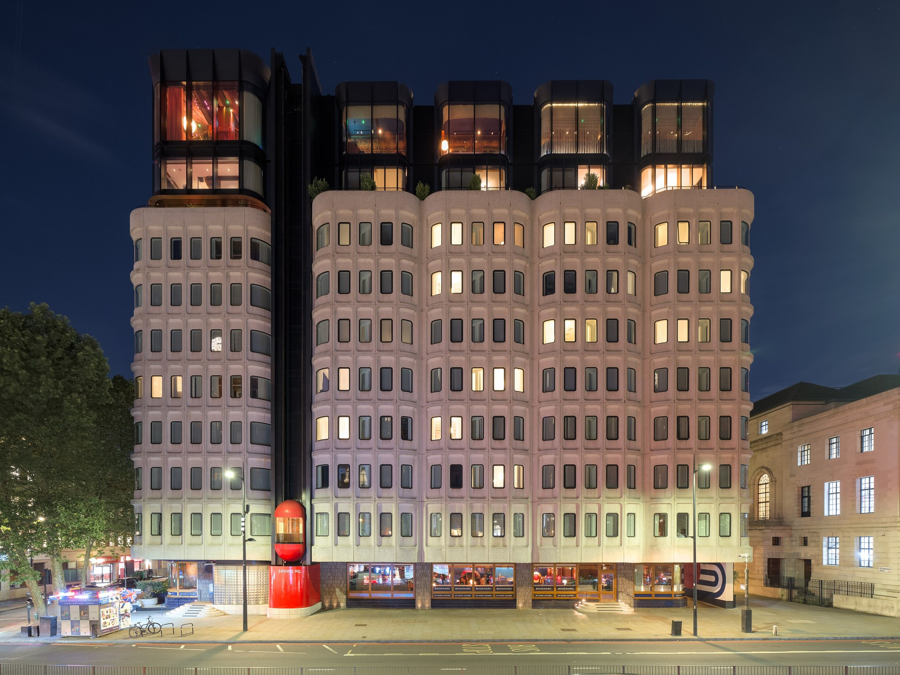
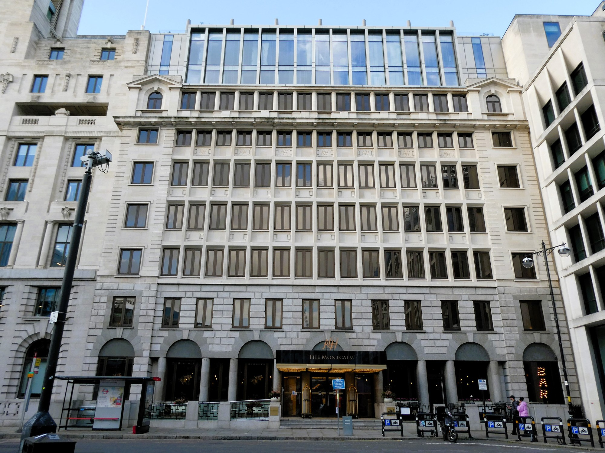
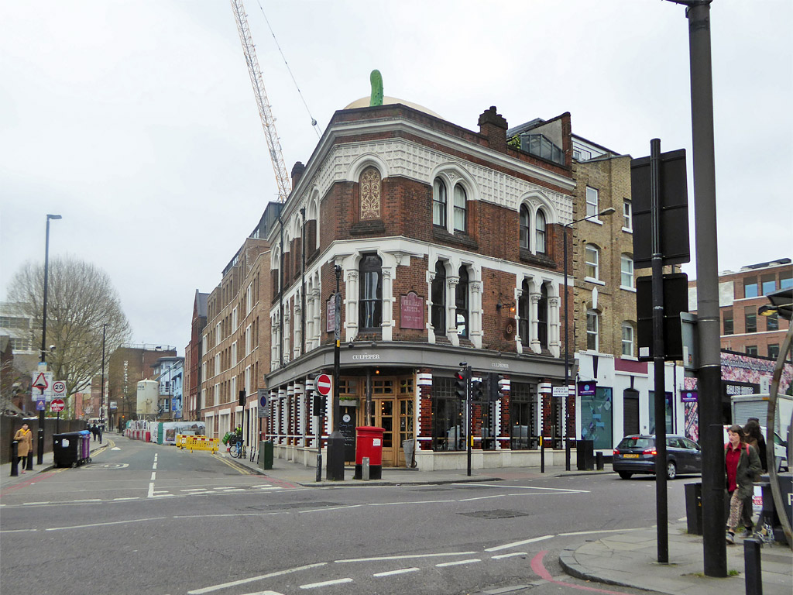
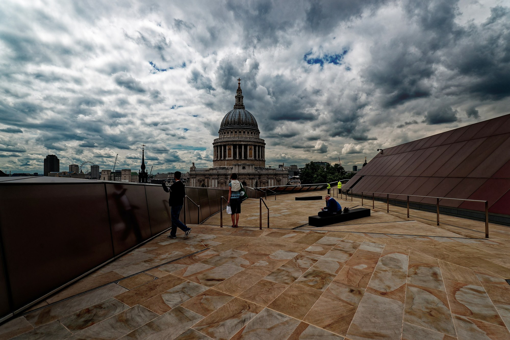
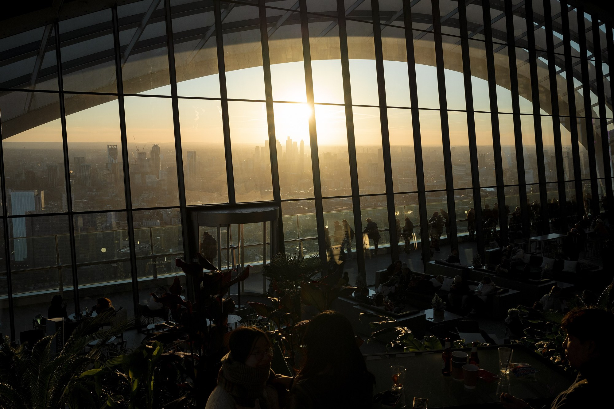

**The most-named rooftop bars in London are Netil 360 in Hackney, Frank's Cafe in Peckham, Sabine by St Paul's and 12th Knot on the South Bank. Frank's is summer only; the other three are open in winter 2026–27.**

This guide counts how many independent lists name each bar. For a roof where the food is the main reason to go, see the [rooftop and riverside restaurants guide](/articles/best-rooftop-restaurants-london/); for the views themselves, free and paid, see [the best views in London](/articles/best-views-london/).

> 💡 **The Short Version:** **Netil 360**, **Frank's Cafe**, **Sabine** and **12th Knot** are named by ten sources each. In winter, go to **Sabine** (retractable roofs, heated) or **Radio Rooftop** (heated patios); **Frank's**, Time Out's number one the **Queen Elizabeth Hall Roof Garden**, **The Culpeper**, **Bussey** and **Roof East** are shut until spring 2027. The **Sky Garden** is free with a booked ticket. Many of these bars are 21 and over in the evening.

> 📊 **The evidence behind this guide.**
> **20 independent sources carrying 420 citations** across **126 named bars**. **76 are named by two or more sources.**
> **Built on:** Time Out's ranked 15, Condé Nast Traveller, the Evening Standard, SquareMeal, BBC Good Food and eight more mastheads; the rooftop specialists The Rooftop Guide and Where's The Rooftop?; independent London blogs; and three YouTube channels, including Ugo Arinzeh's ranked ten.
> *Evidence built 16 November 2026 · [How we rank →](/how-we-rank/)*

## Open in winter 2026–27, and what keeps the rain off

| Bar | Area | Cover |
| --- | --- | --- |
| **Sabine** | St Paul's | Retractable roofs over a heated terrace |
| **Radio Rooftop** | Strand | Heated outdoor patios beside an indoor bar |
| **Los Mochis** | Liverpool Street | 3,000 sq ft terrace that can be fully enclosed and heated |
| **Stanley's** | Mayfair | Retractable roof, heaters and blankets |
| **London Bridge Rooftop** | London Bridge | Every table under cover, heaters, blankets |
| **Netil 360** | Hackney | Covered, heated areas and a winter tent |
| **Queen of Hoxton** | Shoreditch | A heated yurt with fire pits on the roof |
| **Jin Bo Law** | Aldgate | Partly covered with heaters, plus an indoor bar |
| **Florattica** | Aldgate | Heated igloos on the 11th-floor terrace |
| **1864** | Oxford Street | Heated igloos and huts on the John Lewis roof |
| **The Sky Garden** | City | Glass-roofed and indoors, but naturally ventilated, so dress for the weather |

**Closed until spring 2027:** Frank's Cafe, the Queen Elizabeth Hall Roof Garden, The Culpeper's roof, Bussey Rooftop Bar and Roof East. **Closed for the season:** The Rooftop at The Standard (Sweeties, the floor below, is open) and JOIA's roof, which opens only for ticketed Christmas film nights.

## Booking

| How far ahead | Bars |
| --- | --- |
| **Two weeks or more** | Sabine (14 days for Wednesday to Saturday), Stanley's (no walk-ins; tables released four weeks ahead), The Berkeley Rooftop Cabins |
| **Bookable, worth doing on a Friday** | Flute, Radio Rooftop, Florattica, Forza Wine, Boundary, Coq d'Argent, Jin Bo Law, Queen of Hoxton, London Bridge Rooftop, Savage Garden |
| **Walk-in only, or for part of the venue** | 12th Knot's terrace, SUSHISAMBA's Tree Terrace, Savage Garden's terrace, Bōkan's 39th-floor terrace, Madison for drinks under ten people, The Nest Thursday to Saturday after 5pm for groups of up to five |
| **Dining only** | Seabird takes table bookings for dining; drinks bookings start at 9.30pm |

---

## The four most-named

### Netil 360 — pizza and DJs on a Hackney warehouse roof

*Hackney · top floor of Netil House · Cited by 10 sources · #12 of 15, Time Out · [book a table](https://www.sevenrooms.com/reservations/netil360)*

*The entrance on Westgate Street. Photo: [Ewan-M](https://commons.wikimedia.org/wiki/File:Netil360,_Hackney,_E8.jpg), [CC BY-SA 4.0](https://creativecommons.org/licenses/by-sa/4.0/).*

The roof of Netil House, a block of studios off Mare Street, a few minutes from London Fields. The food is 12-inch Neapolitan pizza from dough fermented for 48 hours, ordered at the counter; drinks are local beer, natural wine and cocktails. Most tables seat up to ten and are shared, with no time limit. DJs play soul, hip-hop, house and disco on Fridays and Saturdays, and there is jazz on Thursdays. In winter the covered areas have heaters and a covered tent goes up for bigger groups. **Over-18s only, closed Sunday to Tuesday, and there is no lift**: the operator says the roof is not wheelchair accessible. Entry is free and bookings are limited.

### Frank's Cafe — the Peckham car park, summer only

*Peckham · top of the multi-storey car park · Cited by 10 sources · #2 of 15, Time Out · [venue's site](https://boldtendencies.com/franks-cafe/)*

*Frank's Cafe on the car park roof. Photo: [Ian Taylor](https://commons.wikimedia.org/wiki/File:Frank's_Caf%C3%A9,_Peckham_-_geograph.org.uk_-_6238619.jpg), [CC BY-SA 2.0](https://creativecommons.org/licenses/by-sa/2.0/).*

A red canvas canopy on timber A-frames, built in 2009 by Practice Architecture on the top deck of the Peckham multi-storey on Rye Lane, as part of the Bold Tendencies summer art programme. Cocktails were £10 in 2026: a South East Negroni, a spicy mango margarita, a frozen piña colada. Seating is picnic benches on bare concrete with the City and the Shard on the horizon. **It is a summer bar: the 2026 season ran from 15 May to 12 September**, and 2027 dates are not yet out. No reservations, card only, and Peckham Rye station has no step-free access.

### Sabine — St Paul's under a retractable roof

*St Paul's · 7th floor, Leonardo Royal Hotel · Cited by 10 sources · #7 of 10, Ugo Arinzeh · [book a table](https://www.sevenrooms.com/explore/sabinelondon/reservations/create/search/?venues=sabinestpauls)*

A seventh-floor terrace on Carter Lane looking straight at the dome of St Paul's, with **retractable roofs and heating**, so it runs all year. The signature cocktail, Ascent, is £18; Velvet Bloom (Tanqueray, lychee, rose and Champagne) is £16.50. Two rules decide a visit: **after 4pm it is strictly 21 and over**, and every booking from 4pm carries a **£50 a head minimum spend** for two hours, which walk-ins avoid. The operator asks for bookings at least 14 days ahead for Wednesday to Saturday. Winter hours: Monday to Wednesday from 4pm, Thursday to Saturday from noon, closed Sundays, and closed from 24 December until 5 January 2027.

### 12th Knot — the South Bank, first come on the terrace

*South Bank · top of Sea Containers London · Cited by 10 sources · [book a table](https://www.sevenrooms.com/explore/12thknot/reservations/create/search)*

The bar at the top of the Sea Containers hotel by Blackfriars Bridge, with the Thames and the City in front. Inside is a bright, open-plan bar with DJs on Fridays and Saturdays playing afrobeats, house and R&B; outside is an **open-air terrace that cannot be booked** and closes at 10pm. The Golden Hour cocktail (Laurent-Perrier, Grey Goose, strawberry, basil) is £23; the Kiya Fizz £18. Indoor tables can be booked for up to 15. Open Tuesday to Saturday from 5pm, over-18s. **It is closed for private events on 17, 18, 19 and 24 November 2026.**

## Named by nine sources

Time Out's number one is the **Queen Elizabeth Hall Roof Garden**, which Ugo Arinzeh puts tenth. Her number one is **Brooklands**, the two-Michelin-star dining room at the Peninsula, which Time Out's bar list leaves out; it is in the [rooftop restaurants guide](/articles/best-rooftop-restaurants-london/).

### Flute — Soho, phones away

*Soho · roof of Broadwick Soho · Cited by 9 sources · #11 of 15, Time Out · [book a table](https://www.sevenrooms.com/reservations/flute)*

The bar on top of the Broadwick Soho hotel: animal-print upholstery, cork walls, mirrored ceilings and a palm-frond carpet inside, a landscaped wraparound terrace outside. Cocktails run £19 to £24 (Life on Mars?, with pisco and Midori, is £19; Back to Black, a Hennessy VSOP sour with coconut and saffron, £24). **The menu asks guests not to use their phones.** Open daily from noon to midnight, 12.30am at weekends; tables can be booked up to 60 days ahead, and seven or more go through reservations.

### Coq d'Argent — the Bank roof, until February 2027

*Bank · roof of No. 1 Poultry · Cited by 9 sources · [venue's site](https://coqdargent.co.uk/)*

Landscaped terraces and gardens across the roof of No. 1 Poultry, looking over the Bank of England, beside a Conran-designed restaurant. Cloud Nine (Belvedere, St-Germain, lychee, Prosecco) is £17.50; the White Gold Martini £18. In winter 2026–27 two private rooftop chalets, the Lodge d'Argent, take up to eight for £350 with Champagne, cocktails and alpine sharing plates. **Closed on Sundays, card only, and this is its final winter here**: it moves to One Millennium Bridge in February 2027. Booking is through the widget on its site.

### Boundary Shoreditch — Redchurch Street

*Shoreditch · roof of the Boundary hotel · Cited by 9 sources · [book a table](https://www.sevenrooms.com/reservations/boundaryrooftop)*

A large terrace on top of the Boundary hotel, entered from Redchurch Street, with a glass Orangery restaurant beside it and views over Shoreditch and the City. The building holds 17 bedrooms, two restaurants and several bars. The roof has its own menu and wine list. **It is open Tuesday to Saturday, noon to 11pm, on what the operator calls seasonal hours**, closed Sunday and Monday. Over-18s, cashless, no dogs on the roof. The Orangery is the place to sit when the weather turns.

### Wagtail — art deco eaves by Monument

*Monument · 9th and 10th floors, 68 King William Street · Cited by 9 sources · [venue's site](https://etmcollection.co.uk/venue/wagtail-rooftop-bar-restaurant/)*

A restaurant, bar and two terraces in the eaves of an art deco building by London Bridge, with Tower Bridge, St Paul's, the Shard, the Gherkin and the Walkie Talkie all in view; the ninth-floor terraces look down on the Thames. In winter 2026–27 it has a Grey Goose winter cocktail list, and on 12 December 2026 the La Folie Douce après-ski party takes over the roof (£20). **The tenth floor has no lift**; the ninth is accessible. Under-18s until 5pm with an adult. Bookings for up to twelve through the widget on its page.

### The Rooftop at The Standard — closed for the season; Sweeties is open

*King's Cross · 11th floor · Cited by 9 sources · #5 of 15, Time Out · [book Sweeties](https://www.sevenrooms.com/reservations/sweeties)*

*The Standard on Euston Road; the roof bars sit in the glass boxes on top. Photo: [Daniel Lu](https://commons.wikimedia.org/wiki/File:The_Standard_London_Camden_Town_Hall_Annexe_facade_at_night_2025_dllu.jpg), [CC BY-SA 4.0](https://creativecommons.org/licenses/by-sa/4.0/).*

An open-air roof eleven floors above King's Cross, on the former Camden Town Hall annexe opposite St Pancras. **The roof is closed for the season.** One floor down, **Sweeties** is open: a cocktail bar and discotheque with floor-to-ceiling windows and DJs, Wednesday 5pm to 11pm and Thursday to Saturday 5pm to 1am, over-18s, with wine by the glass from £14. Sweeties is closed 20 to 30 December and 1 to 5 January.

### Radio Rooftop — Strand, heated patios, 21 and over

*Strand · 10th floor, ME London · Cited by 9 sources · #3 of 10, Ugo Arinzeh · [book a table](https://radiorooftop.com/reservation/)*

The roof of the ME London hotel on the corner of the Strand and Aldwych, with an indoor dining room and **heated outdoor patios**, open every day. The cocktails lean on sous-vide infusions: Far East Side (sake, tequila, St-Germain) is £19, The Two Fridas £20, and there is a Yuzu Negroni. DJs play South African, Afro and deep house Thursday to Saturday, when it stays open to 1.30am. **From 5pm it is strictly 21 and over, and sportswear is turned away.** Happy hour Monday to Wednesday, 4pm to 7pm.

### Aviary — Finsbury Square

*Moorgate · 10th floor, Montcalm Royal London House · Cited by 9 sources · #5 of 10, Ugo Arinzeh · [venue's site](https://etmcollection.co.uk/venue/aviary-rooftop-restaurant-terrace-bar/)*

*Royal London House on Finsbury Square; Aviary is in the glass storey on top. Photo: [Ewan-M](https://commons.wikimedia.org/wiki/File:Montcalm_Royal_London_House,_Shoreditch,_EC2.jpg), [CC BY-SA 4.0](https://creativecommons.org/licenses/by-sa/4.0/).*

A restaurant and bar in the glass top storey of a hotel on Finsbury Square, with an open-air terrace looking over the City towers. It opens at breakfast and runs to midnight every day, so it is one of the few roofs where a weekday afternoon drink is easy. At weekends the Birdsong Brunch comes with DJs. In winter 2026–27 it has a Grey Goose winter cocktail list and a Winter Lodge event on the terrace. Booking is through the widget on its page or on 020 3873 4060.

### The Culpeper — Spitalfields, roof shut until spring

*Spitalfields · roof garden · Cited by 9 sources · [venue's site](https://www.theculpeper.com/rooftop/)*

*The Culpeper on Commercial Street. Photo: [Robin Webster](https://commons.wikimedia.org/wiki/File:The_Culpeper,_Commercial_Street,_E1_-_geograph.org.uk_-_6116871.jpg), [CC BY-SA 2.0](https://creativecommons.org/licenses/by-sa/2.0/).*

A pub on Commercial Street with a 1,400 sq ft garden on the roof, about 500 sq ft of it used to grow salad and cocktail garnishes for the kitchen. **The roof is closed until spring 2027**; the pub downstairs is open every day and walk-in for drinks. The rooftop greenhouse can be hired all year for groups of six or more. The [rooftop restaurants guide](/articles/best-rooftop-restaurants-london/) covers its cooking.

## Named by seven or eight sources

### Madison — St Paul's from One New Change

*St Paul's · roof of One New Change · Cited by 8 sources · #15 of 15, Time Out · [venue's site](https://madisonlondon.net/)*

*The roof terrace of One New Change, which Madison shares. Photo: [Txllxt TxllxT](https://commons.wikimedia.org/wiki/File:London_-_New_Change_-_One_New_Change_2010_by_Jean_Nouvel_-_View_West_on_St_Paul's_Cathedral_1697_by_Sir_Christopher_Wren_III.jpg), [CC BY-SA 4.0](https://creativecommons.org/licenses/by-sa/4.0/).*

A New York-styled restaurant and bar on the roof of the One New Change shopping centre, with the dome of St Paul's in the middle of the view and a lift to every floor. The terrace has umbrellas and heaters but the operator says it is not fully weatherproof. Of the cocktails, a spiced pineapple daiquiri is £16 and an Old Fashioned twist with Dalmore 12 £19. **It is 21 and over, takes no drinks bookings for fewer than ten, and a £20 entry fee may apply at peak times.** Closed earlier on Sundays, at 10pm.

### Seabird — oysters on the 14th floor

*Southwark · 14th floor, The Hoxton · Cited by 8 sources · #4 of 10, Ugo Arinzeh · [book a table](https://www.sevenrooms.com/reservations/rooftophoxton)*

A seafood restaurant with a marble raw bar at the top of The Hoxton on Blackfriars Road, with Spanish and Portuguese cooking and an oyster happy hour from 3pm to 6pm every day. The Bergamot Martini is £19. **It takes bookings for dining only; drinks bookings start at 9.30pm**, and terrace tables cannot be guaranteed. On Sundays until 6 December 2026, Ronnie Scott's runs live music from 5pm. Closed Mondays, card only. More on the food in the [rooftop restaurants guide](/articles/best-rooftop-restaurants-london/).

### Queen of Hoxton — a heated yurt on a Shoreditch roof

*Shoreditch · roof of the Queen of Hoxton · Cited by 7 sources · #7 of 15, Time Out · [book a table](https://queenofhoxton.com/bookings/)*

A bar and club on Curtain Road whose roof is re-themed every season. In winter 2026–27 it is a **heated yurt with fire pits and fairy lights**, a Gingerbread Old Fashioned and a Banana Bread Daiquiri, Bajan food from BARBS, and outdoor DJ sessions; a pint of San Miguel is £7.20. The roof opens Wednesday to Friday from 5pm and Saturday from 2pm until 10pm, **weather permitting; the operator asks you to call ahead.** Tables for up to 30 can be booked up to 14 days ahead with a £5 a head card hold, and plenty of room is kept for walk-ins. Over-18s.

### The Sky Garden — free, behind glass

*City · level 35, 20 Fenchurch Street · Cited by 7 sources · [free tickets](https://skygarden.london/booking/book-a-free-ticket/) · [book a bar table](https://www.sevenrooms.com/reservations/skygardenbars)*

*The Sky Garden at sunset. Photo: [Andrei Nicolae](https://commons.wikimedia.org/wiki/File:20_Fenchurch_Street_Sky_Garden,_Golden_hour_2025-01-03.jpg), [CC BY 2.0](https://creativecommons.org/licenses/by/2.0/).*

A landscaped garden under the glass roof at the top of the Walkie Talkie, with the Sky Pod bar and the City Garden bar among the planting. **Entry is free with a ticket booked online**, released weekly up to three weeks ahead; walk-ins are let in at the door when there is room. The bars are naturally ventilated, so the temperature is close to outside. From 16 November 2026 there is a Christmas programme with ticketed music nights. A Winter Spice Espresso Martini is £15.50, an Aperol Spritz £15. Our [Sky Garden guide](/articles/sky-garden-guide/) covers tickets in detail.

### Forza Wine, Peckham — natural wine above Rye Lane

*Peckham · roof of 133A Rye Lane · Cited by 7 sources · #8 of 15, Time Out · [book a table](https://www.sevenrooms.com/explore/forzawine/reservations/create/search/)*

A roof bar and kitchen above Rye Lane with a view back across London, serving natural and low-intervention wine and short cocktails: a Frozen Picante with scotch bonnet is £13, a Plum Negroni £12, spritzes £11. **It is open all year**, with mulled wine and hot toddies at £8 in winter 2026–27 and a £50 a head Christmas sharing menu for tables of four or more from 16 November to 23 December 2026. Open Monday to Saturday from noon to midnight and Sunday to 8pm. Card only.

### Jin Bo Law Skybar — Aldgate, 14 floors up

*Aldgate · 14th floor, Leonardo Hotel London Aldgate · Cited by 7 sources · [venue's site](https://jinbolaw.co.uk/)*

A terrace bar on top of the hotel at 9 Aldgate High Street, looking at Tower Bridge, the Shard, the Walkie Talkie and the Gherkin. **The terrace is partly covered with outdoor heaters**, and there is an indoor bar. The draw is a cocktail menu built on unusual ingredients, and DJs at weekends; in winter 2026–27 there is a Winter Ball on 28 November and a Christmas party on 19 December 2026. Booking is through the widget on its site, and walk-in tables go first come, first served. **Over-18s with photo ID, and bookings of six or more must be mixed groups.**

### 1864 Rooftop Bar and Kitchen — igloos on John Lewis

*Oxford Street · 6th floor, John Lewis · Cited by 7 sources · [venue's site](https://1864rooftopbar.co.uk/)*

A terrace on the sixth floor of John Lewis on Oxford Street, planted with wildflowers that give the cocktail list its theme. For the festive season it has three **heated igloos** for four to eight, heated huts for up to five and a garden cabin; igloo packages start at £65 a head with a glass of English sparkling wine. A Red Winter Sour with Johnnie Walker is £14, a Negroni £15. It closes early: 9pm on Mondays, 10pm Tuesday to Saturday and 7pm on Sundays. Cashless. Book through the widget on its site.

### Queen Elizabeth Hall Roof Garden — Time Out's number one, closed until spring

*South Bank · roof of the Queen Elizabeth Hall · Cited by 7 sources · #1 of 15, Time Out · #10 of 10, Ugo Arinzeh · [venue's site](https://www.southbankcentre.co.uk/food-and-drink/roof-garden-bar-kitchen/)*

A roof garden on the Southbank Centre, reached by the yellow stairs, with trees, flowers and a barbecue bar serving summer drinks under festoon lights and an awning. **The Southbank Centre lists it as closed, reopening in spring 2027.**

### Bussey Rooftop Bar and JOIA — closed in winter 2026–27

*Bussey Rooftop Bar · Peckham · Cited by 7 sources · #9 of 15, Time Out · [venue's site](https://busseyrooftopbar.com/)*

*JOIA · Battersea · Cited by 7 sources · [Christmas film nights](https://www.designmynight.com/london/bars/battersea/joia/joia-rooftop-christmas-movie-pop-up-dinner-at-artotel-london-battersea-power-station-2?t=tickets)*

**Bussey** is a tropical-themed roof on the Bussey Building next to Peckham Rye station, with pizza and an open shelter over the seats; it is **closed until spring 2027**, and it is not wheelchair accessible. **JOIA** is the roof of the art'otel at Battersea Power Station, looking at the chimneys. Its bar is closed for the season, but from 19 November to 24 December 2026 it runs Christmas film nights on the roof after dinner in the 15th-floor restaurant, at £75 to £95 a head. Henrique Sá Pessoa's Portuguese cooking in JOIA and the Perola cocktail bar stay open.

## Named by five or six sources

### Los Mochis London City — the enclosable terrace

*Liverpool Street · 9th floor, 100 Liverpool Street · Cited by 6 sources · [venue's site](https://www.losmochis.co.uk/lc/rooftop-terrace)*

A Mexican-Japanese restaurant, sushi bar and agave lounge on the ninth floor above Broadgate Circle, with a 3,000 sq ft terrace that **can be fully enclosed and heated**, and a line of sight to the dome of St Paul's. The Los Mochis Tommy's, on Patrón Reposado, is £19; the lychee wasabi margarita £21. It opens at 7.30am on weekdays and stays open to 3am Thursday to Saturday, with Tulum Nights every Friday from 9pm. Reservations through the widget on its page.

### SUSHISAMBA Heron Tower — glass lifts to the 39th floor

*Bishopsgate · 38th and 39th floors, Heron Tower · Cited by 6 sources · [book a table](https://www.sevenrooms.com/explore/sushisambalondon/reservations/create/search/)*

Two glass lifts run up the outside of Heron Tower to the restaurant on 38 and the Samba Room bar on 39, with 360-degree views of the City and open-air terraces. **The Tree Terrace, around an orange-tree sculpture, takes no reservations**; walk in. Cocktails run £16 to £19 (a Samba Sour is £17). The Samba Room is open from 5pm, to 3am at weekends, with DJs on Friday nights. The restaurant books up to two months ahead with a deposit. Card only.

### Florattica — igloos above Aldgate

*Aldgate · 11th floor, Canopy by Hilton London City · Cited by 6 sources · [book a table](https://www.sevenrooms.com/reservations/florattica)*

A bar on the 11th floor of the Canopy by Hilton on Minories, decorated after the Spitalfields silk weavers. In winter 2026–27 its terrace has the **Winter Buds: heated private igloos** with their own music and a bell for the waiter, two for up to six and one for ten, running since 1 November 2026. A cocktail afternoon tea is served in them on weekdays from 4pm at £60 a head. Apothecary (vermouth, elderflower vodka, liquorice) is £18. DJs on Friday and Saturday.

### London Bridge Rooftop — 98 steps, every table covered

*London Bridge · six storeys up, Colechurch House · Cited by 6 sources · #8 of 10, Ugo Arinzeh · [venue's site](https://www.londonbridgerooftop.com/)*

A roof beside London Bridge station with the Shard overhead. **There is no lift: it is 98 steps up.** Every table is under cover, with heaters and blankets, and in winter 2026–27 there are Christmas trees, mulled wine at £5 on Sundays, and an indoor heated darts room. A Mount 75 is £15, an Aperol Spritz £11.50. DJs play house, disco and garage through the week. **It is 18 and over even with an adult**, and bookings are online only.

### Savage Garden — Tower Hill, terrace weather permitting

*Tower Hill · 12th floor, DoubleTree Tower of London · Cited by 6 sources · [book a table](https://www.sevenrooms.com/reservations/savagegarden)*

A bar on the 12th floor of the DoubleTree on Pepys Street, with the Shard and the Tower of London in view and a resident DJ on Fridays and Saturdays. Inside is scored reflective surfaces, velvet and marble floors. **The outdoor terrace is first come, first served and closes in bad weather**, so in winter this is mostly an indoor bar with a view. Bookings for up to ten carry a £15 a head card guarantee; over-18s after 6pm. Saturday brunch, and a cocktails-and-waffles offer. Cashless.

### Bōkan — Canary Wharf, indoors in winter

*Canary Wharf · 37th to 39th floors, Novotel · Cited by 6 sources · [venue's site](https://bokanlondon.co.uk/roof-terrace/)*

Three floors at the top of the Novotel on Marsh Wall: a restaurant on 37, a cocktail bar on 38 and a rooftop bar and terrace on 39, looking over Canary Wharf. **The terrace is not served in the winter months**; the 39th-floor bar stays open inside. Cocktails are around £16 (Peach & Quiet is £17). The 38th-floor bar and 37th-floor restaurant take bookings; the roof does not. Open from 4pm on weekdays and noon at weekends.

### The Nest at Treehouse London — Oxford Circus

*Oxford Circus · roof of Treehouse London · Cited by 6 sources · [book a table](https://www.sevenrooms.com/explore/thenestlondon/reservations/create/search)*

A music-led cocktail bar on top of the Treehouse hotel on Langham Place, by Oxford Circus, with indoor and outdoor seating given out according to the weather. The Truffle Martini is £18 and a sharing cocktail, the Canopy Breeze, £26. Local DJs play Thursday to Saturday from 8pm. **From 5pm on Thursday to Saturday, groups of one to five are walk-in only, and it is 21 and over from 5pm.** Dogs are welcome on Sundays from noon to 3pm.

### Stanley's Rooftop Bar — Mayfair, bookings only

*Mayfair · roof of The Chesterfield · Cited by 5 sources · [venue's site](https://www.chesterfieldmayfair.com/dining-and-drinks/stanleys)*

The roof of The Chesterfield hotel on Charles Street, named after the Red Carnation group's founder, with a **retractable roof, heaters and blankets**, and live music on some winter evenings. The bar menu runs to a native lobster roll, chicken satay and a Neal's Yard cheddar toastie. **It takes no walk-ins**: tables are released four weeks ahead online or on 020 7491 2622. Open from 4pm on Monday and Tuesday and from 11am the rest of the week.

### The Berkeley Rooftop — cabins for the winter

*Knightsbridge · roof of The Berkeley · Cited by 5 sources · [book a cabin](https://www.maybourne.com/en/hotels/the-berkeley/booking/restaurants-bars?noOfGuests=2&venue=berkeleyrooftopcabins&category=DINNER)*

From 13 November 2026 the roof of The Berkeley is given over to **Alpine-style cabins for up to six**, reached by lift from the lobby, with a £90 a head sharing menu: mulled wine on arrival, raclette, truffle dauphinoise and chocolate fondue. Each cabin has a bell to ring for Champagne. A Honey Ginger French 75 is £28, mulled wine £16. In winter this is a booked sitting rather than a drop-in bar; sittings start at noon, 3pm, 6pm and 9pm.

### Mercer Roof Terrace — St Paul's to the Shard

*Mansion House · roof of Vintry & Mercer · Cited by 5 sources · [venue's site](https://www.vintryandmercer.com/dining-in-the-city/mercer-roof-terrace/)*

The roof of the Vintry & Mercer hotel on Garlick Hill, between Mansion House and the river, where a warm indoor room opens through floor-to-ceiling glass doors onto a terrace bar with views from St Paul's to the Shard. A Lychee Bloom (gin, lychee, Cocchi Americano, jasmine tea foam) is £15. Drinks Monday to Saturday from noon to 11pm and to 10.30pm on Sunday. Book online through the hotel or on 020 3908 8099. No smoking anywhere on the property.

## Also named

- **[Forza Wine at the National Theatre](https://www.sevenrooms.com/reservations/forzawinenationaltheatre)**, South Bank — a wraparound terrace on the theatre with a £5 Negroni from noon to 5pm, Monday to Thursday. *Cited by 4 sources.*
- **[The Fire Garden at Ham Yard Hotel](https://ticketing.designmynight.com/events/652bf821e0d2e74a88399e7b/tickets/selection?item-ids=652bf821e0d2e74a88399e7b)**, Soho — a heated roof terrace with a fire pit, 12 November to 23 December 2026; the £19 ticket includes a Smoky Gimlet and s'mores. *Cited by 4 sources.*
- **[Roof East](https://www.roofeast.com/)**, Stratford — bars, bowls, batting cages and a cinema on floors 7 and 8 of a car park, free to enter; closed until spring 2027. *Cited by 6 sources.*

## Cheapest

- **[The Sky Garden](https://skygarden.london/booking/book-a-free-ticket/)** — free with a booked ticket. *Cited by 7 sources.*
- **[Frank's Cafe](https://boldtendencies.com/franks-cafe/)** — free entry and £10 cocktails, summer only. *Cited by 10 sources.*
- **[London Bridge Rooftop](https://www.londonbridgerooftop.com/)** — £5 mulled wine on Sundays in winter 2026–27. *Cited by 6 sources.*
- **[Forza Wine, Peckham](https://www.sevenrooms.com/explore/forzawine/reservations/create/search/)** — cocktails from £11, mulled wine £8. *Cited by 7 sources.*

## Winter pop-ups on a roof

- **[The Berkeley Rooftop](https://www.maybourne.com/en/hotels/the-berkeley/the-berkeley-rooftop-cabins)** — cabins from 13 November 2026, £90 a head. *Cited by 5 sources.*
- **[Coq d'Argent](https://coqdargent.co.uk/)** — two Lodge d'Argent chalets, £350 for up to eight. *Cited by 9 sources.*
- **[1864 Rooftop Bar and Kitchen](https://1864rooftopbar.co.uk/)** — igloos from £65 a head. *Cited by 7 sources.*
- **[Florattica](https://www.sevenrooms.com/reservations/florattica)** — the Winter Buds igloos. *Cited by 6 sources.*

---

## Continue planning your London trip

- 🌇 **[The Best Rooftop and Riverside Restaurants in London](/articles/best-rooftop-restaurants-london/)** — the same roofs judged on the food
- 🍺 **[The Best Beer Gardens in London](/articles/best-beer-gardens-london/)** — drinking outside at ground level, and which gardens are heated
- 🍸 **[The Best Cocktail Bars in London](/articles/best-cocktail-bars-london/)**
- 🌆 **[The Best Views in London](/articles/best-views-london/)** — the free viewpoints and the ticketed ones
- 🌿 **[Sky Garden Guide](/articles/sky-garden-guide/)** — how the free tickets work
- 🪑 **[The Best Places to Eat Outside in London](/articles/eat-outside-london/)**
- 🎄 **[Christmas in London](/articles/christmas-in-london/)** and **[things to do in December](/articles/things-to-do-in-london-in-december/)**
- 🍽️ **[Eat in London: Restaurants, Food Markets & Quick Food Hub](/articles/eat-in-london-guide/)**
- 🛍️ **[Shoreditch Area Guide](/articles/shoreditch-area-guide/)**, **[Peckham Area Guide](/articles/peckham-area-guide/)** and **[City of London Area Guide](/articles/city-of-london-area-guide/)**
