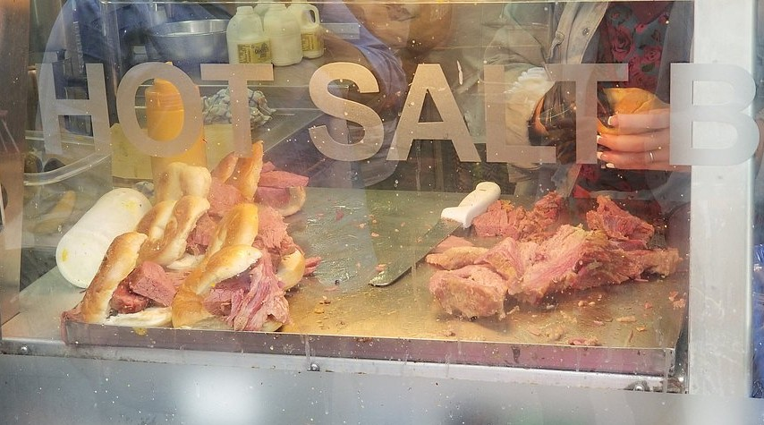
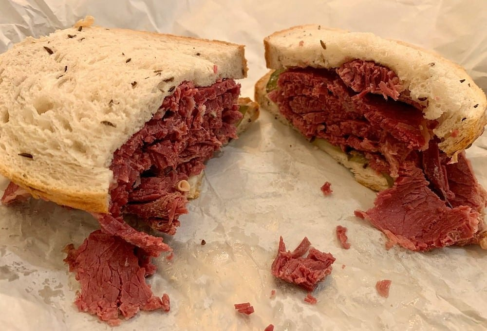
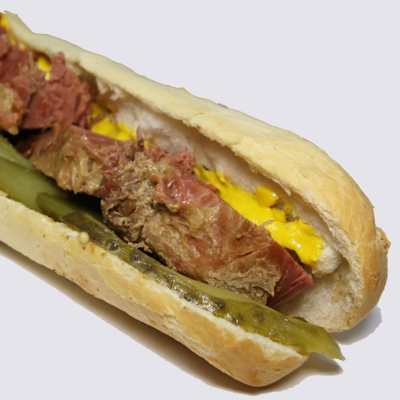
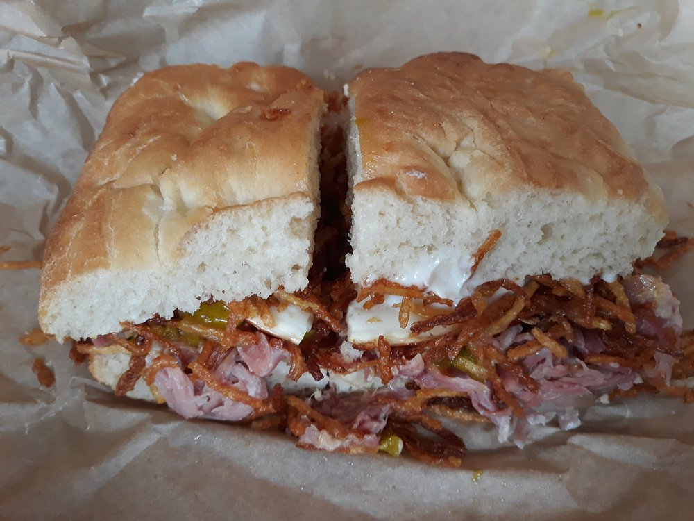
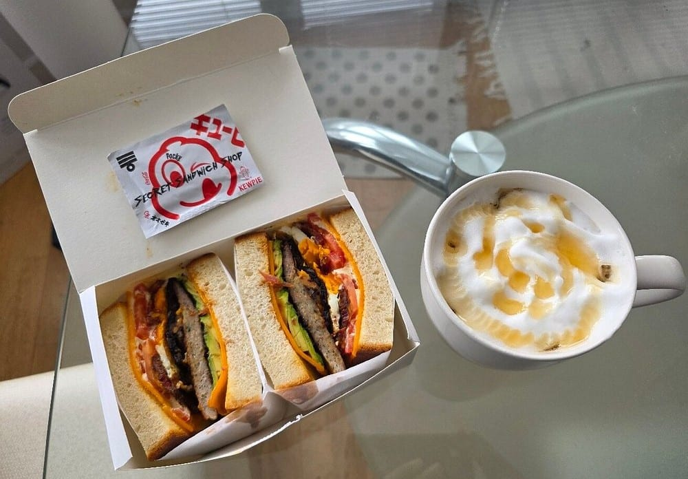
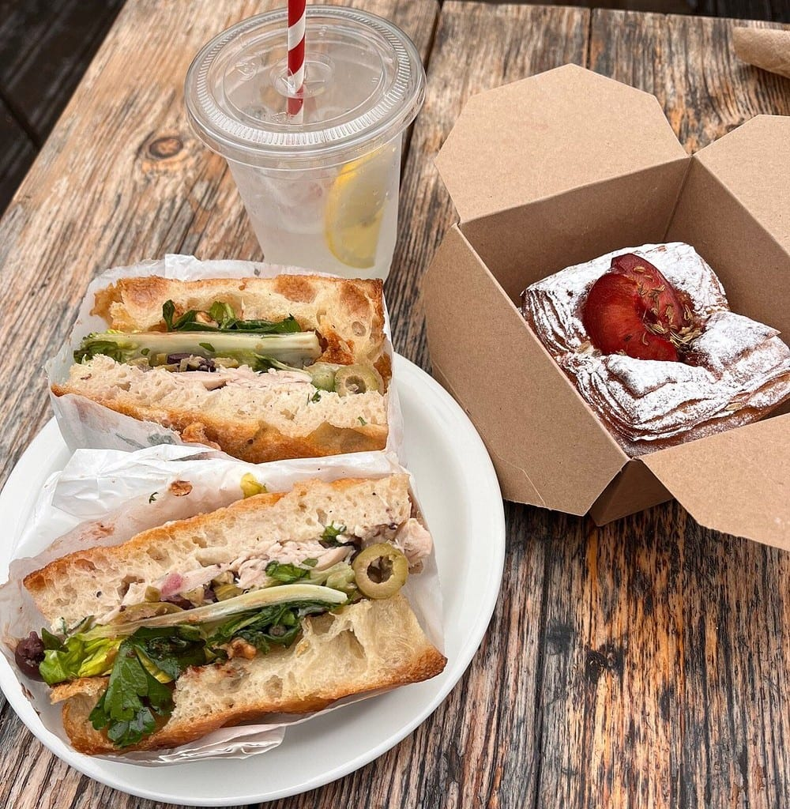
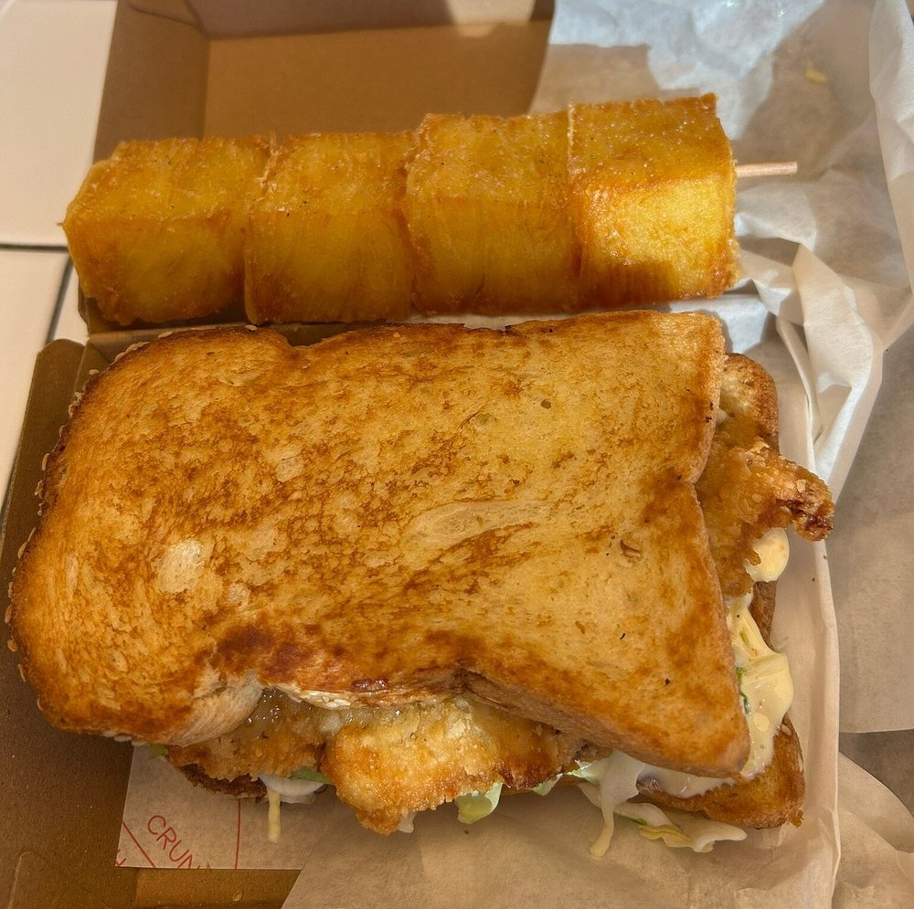
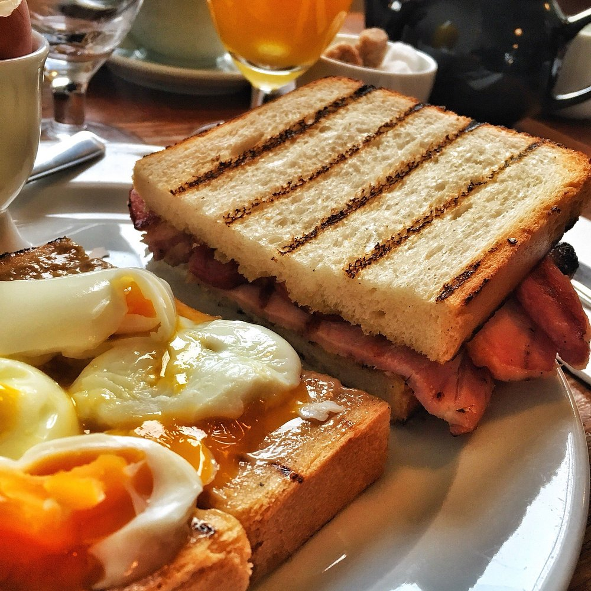
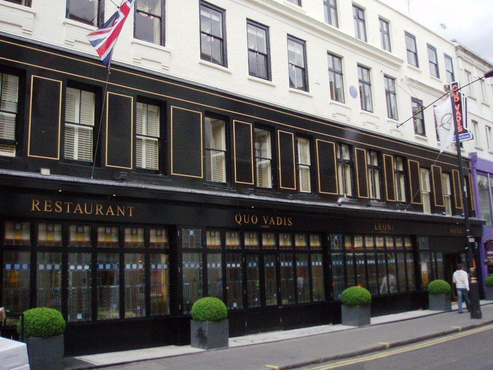
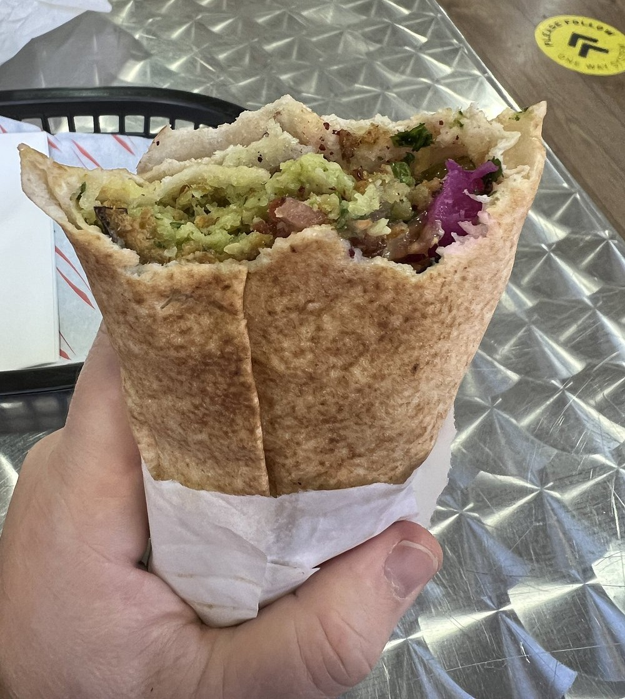

The classic is a **salt beef beigel on Brick Lane**, sold at four in the morning from a shop that opened in 1974. The modern sandwich shops, the toastie stalls, the caffs and the market stalls are below.

> 💡 **The Short Version:** **Beigel Bake** on Brick Lane for salt beef, open 24 hours. **Max's Sandwich Shop** for the Ham, Egg 'n' Chips. **Paul Rothe & Son** has been cutting sandwiches into triangles since 1900. **Kappacasein** does the toastie, three days a week only. And **Quo Vadis** in Soho does the smoked eel sandwich.

> 📘 **How we choose these (editorial note).**
> No paid placements. These are drawn from a wide spread of sources - the food and travel press, the big listings sites, independent blogs and specialists, video, and what Londoners recommend themselves - and cross-referenced against each other. Several shops are weekday-only or pre-order-only, so check hours before making a special trip.

## Where they are

| If you are near… | Where to eat |
| --- | --- |
| **Brick Lane & Spitalfields** | Beigel Bake, The Beigel Shop, St John Bread and Wine |
| **Soho** | Quo Vadis, Crunch, I Camisa & Son, Lina Stores |
| **Spitalfields** | St John Bread and Wine, Crunch |
| **Marylebone** | Paul Rothe & Son |
| **Borough Market** | Kappacasein, The Black Pig |
| **Farringdon & Clerkenwell** | The Three Compasses, Scotti's Snack Bar, Tongue & Brisket |
| **The City** | Porterford Butchers |
| **Notting Hill** | Secret Sandwich Shop |
| **Dalston & Hackney** | The Dusty Knuckle, Bánh |
| **Stroud Green** | Max's Sandwich Shop |
| **Westminster & Southwark** | Regency Café, Terry's Café |
| **Shepherd's Bush** | Sam Sandwiches, Mr Falafel |
| **South London** | Chatsworth Bakehouse, Milk (Balham) |

---

## Salt beef, and the Brick Lane rivalry

### Beigel Bake, Brick Lane

*£7.50 salt beef beigel · open 24 hours, every day*

**The white shopfront.** Opened in 1974 by Asher Cohen after a falling-out with his brother, whose family still runs the shop a few doors down.

The **salt beef beigel is £7.50**, with mustard and a gherkin, and the salt beef sandwich £8.50. Smoked salmon and cream cheese is £4.50.

Open **twenty-four hours a day, every day of the year**.

*Salt beef, carved to order.*

### The Beigel Shop, Brick Lane

*Open 24 hours, every day*

**The yellow shopfront**, which claims beigels have been sold at this address since **1855**.

It closed in February 2024 and **reopened that June**, now run by the next generation. It sells rainbow beigels and **bacon** beigels.

> **Which one?** Go by the colour, not the street number. White is Beigel Bake and strictly traditional; yellow is the Beigel Shop and sells bacon on a beigel.

### Tongue & Brisket, Leather Lane

*£8 salt beef sandwich · also Goodge Street and Wardour Street*

Home-cured salt beef carved to order. **Classic salt beef £8**, or £10 large; the **Reuben is £9.50**; ox tongue the same price as the beef.

**Leather Lane runs Monday to Friday 7.30am–4pm and Saturday 10am–3pm, closed Sunday**, at 24–26 Leather Lane, EC1N 7SU. **Wardour Street** (199 Wardour Street, W1F 8JP) goes to 8pm and is **the only branch open on a Sunday**, 11am–6.30pm. There is a third at **23 Goodge Street, W1T 2PL**, open to 6.30pm on Thursdays and Fridays.

Leather Lane is the original, Wardour Street suits a Sunday or after 4pm, and Goodge Street is for north of Oxford Street.

*Tongue & Brisket, Leather Lane.*

### Porterford Butchers, the City

*Weekdays only · hot food 7am–2pm*

A butcher's counter that describes itself as **the last butcher left in the City of London**, trading since 1983, with a salt beef baguette and pickles.

**Monday to Friday only**, and the hot counter stops at 2pm; the butcher's counter itself runs 6am to 6pm. The baguette is **£8.50 regular, £10.50 large**, and mustard is 20p extra.

**There is a queue after midday.** Online ordering for collection through porterfordshotfood.co.uk skips it, but carries a **£20 minimum**, so it only works for a group.

At **72 Watling Street, EC4M 9BJ**, two minutes from Mansion House.

*Porterford Butchers' salt beef baguette.*

---

Powered by <a target="_blank" rel="sponsored" href="https://www.getyourguide.com/london-l57/">GetYourGuide</a>

## The modern sandwich shops

### Max's Sandwich Shop, Stroud Green

*19 Crouch Hill N4 4AP · £15.50–£16.50 · closed Mon–Tue*

*The Ham, Egg 'n' Chips.*

**"Ham, Egg 'n' Chips"** is slow-cooked ham hock, piccalilli, a fried egg, shoestring fries and malt vinegar mayo, **£15.95**. Other sandwiches are **This Is How We Spring Roll** at £15.50, **The Korean Gangster** at £16.50 and **Et Tu, Brute?** at £15.95.

> ⚠️ **Closed Monday and Tuesday.** Open Wednesday to Friday noon–3pm and 6pm–11pm, Saturday 11am–3.30pm and 5pm–11pm, and Sunday 11am–6pm. It shuts for three weeks at Christmas and two weeks in August, and does not take reservations.

### Paul Rothe & Son, Marylebone

*35 Marylebone Lane · trading since 1900*

A fourth-generation family delicatessen that has been on Marylebone Lane **since 1900**, cutting sandwiches into triangles.

**Egg mayonnaise with anchovy** is the order. The pastrami, cheese and pickle on rye and the roast beef with mango chutney are the alternatives.

### Secret Sandwich Shop, Notting Hill

*103 Talbot Road W11 2AT · around £8.80 · shuts at 3pm*

Japanese-style **sando** on white Tokyo milk bread — soft, crustless, and cut to show the filling. The **egg salad** is the signature: egg front and centre, watercress, dijon and Kewpie mayo, about **£8.80**. **Crispy Greens** is green beans, avocado, pickles, cucumber, jalapeños and salt-and-vinegar McCoy's.

**It closes at 3pm, seven days a week.** Ladbroke Grove or Westbourne Park, five minutes either way.

*Secret Sandwich Shop, Notting Hill.*

### The Dusty Knuckle, Dalston

*Abbot Street Car Park E8 3DP · £7.60 · daily 8am–3.30pm*

A bakery first and a sandwich shop second. Order the **Egg, Chilli & Cheese**: pickled green chillies, spring onions and coriander on focaccia, **£7.60**, or £9.80 with bacon added.

**It opens every day, 8am to 3.30pm.** The Dalston site is in a car park off Abbot Street. The other lunch options are a sweet potato and tofu sarnie, a fennel sausage and greens sarnie, a gorgonzola, cavolo and walnut sarnie, and a cheese toastie.

Three sites: Dalston, **Harringay at 429 Green Lanes N4 1HA**, and a van at Highbury Fields. It is also a social enterprise that trains young people at risk.

*The Dusty Knuckle's focaccia.*

### Crunch, Soho and Spitalfields

*60 Dean Street, W1D 6AW · Old Spitalfields Market, E1 6EW*

*Crunch's chicken katsu, on brioche.*

Everything is built on a **golden brioche loaf** rather than bread: rich, sweet and closer to a bun than a sandwich. Order the **chicken katsu**: deep-fried breast, tonkatsu sauce and Japanese apple jam, the cheapest thing on the board at **£12**. The **lobster roll** is **£19**. Soho has ten seats and fast turnover; Spitalfields is a market counter.

**Spitalfields opened in July 2022 and Soho in April 2025.** Soho runs Mon–Sat 11.30am–9pm and Sunday 11am–8pm; Spitalfields 11am–8pm. Both are walk-in only, and both deliver.

### Chatsworth Bakehouse, Crystal Palace

*116 and 120a Anerley Road SE19 2AN · Wed–Sat only*

Weekly limited-edition focaccia, run out of two units on Anerley Road that do different jobs.

**120a is the pre-order collection point.** You order online, you collect between **12.30pm and 4pm, Wednesday to Friday**, and on Saturdays it serves fresh slices straight from the oven **from 1pm**.

**116 is the walk-in bakery**, two doors down from 120a, open **Wednesday to Friday 12.30–4pm and Saturday 11am–4pm.**

**Closed Monday and Tuesday** either way. Crystal Palace or Anerley station, both about ten minutes.

---

## Toasties

### Kappacasein, Borough Market

*£8 · Thursday to Saturday only*

**A mix of cheeses, mostly Montgomery's cheddar**, with onions and leeks between two slices of Poilâne sourdough, for **£8**. Bill Oglethorpe started the stall in 2008 and makes the raclette himself in Bermondsey.

**The raclette is a separate dish, not part of the toastie**: Ogleshield or London Raclette melted over potatoes, also £8.

> ⚠️ **Thursday and Friday 10am–5pm, Saturday 9am–5pm, and nothing the rest of the week.** Closed Sunday through Wednesday. At 1 Stoney Street, SE1 9AA. Expect a queue.

### The Black Pig, Borough Market

*Borough Market Kitchen · £11.50–£13.50 · closed Monday*

Thirty seconds from Kappacasein, with three sandwiches:

* **"The best one"**, £13.50 — slow-roast free-range pork with honey truffle parm mayo, fennel and apple slaw, peperoncini sott'olio, salsa verde and 30-month aged parmesan.
* **Honey Truffle Parm**, £12.50.
* **"The veggie one"**, £11.50 — smoked pulled oyster mushroom.

**Tuesday to Saturday 10am–5pm, Sunday 10am–4pm, closed Monday.** At Borough Market Kitchen, Winchester Walk, SE1 9AG.

---

Powered by <a target="_blank" rel="sponsored" href="https://www.getyourguide.com/london-l57/">GetYourGuide</a>

## Bacon, sausage and the caff

### St John Bread and Wine, Spitalfields

*94–96 Commercial Street E1 6LZ · lunch from noon, daily*

Fergus Henderson's **bacon sandwich** on soft white bread.

*The St John bacon sandwich.*

> ⚠️ **There is no breakfast service.** The earliest seating is **noon**, every day: lunch runs to 3pm, a bar menu fills 3pm to 5pm, and supper starts at 5.30pm on weekdays and 6pm at weekends. The menu changes daily, so check the bacon sandwich is on before making a special trip.

### Regency Café, Westminster

*17–19 Regency Street · Mon–Sat, closed Sundays*

The 1946 black-tiled frontage, the order shouted across the room, and a **set breakfast at £9.99** — one egg, two bacon, sausage, beans or tomatoes, toast or bread, and tea or coffee. It has appeared in *Layer Cake* and *Pride* among others.

**Monday to Saturday 7am to 3.30pm, closed Sunday.** There is usually a queue out of the door by nine on a Saturday, but it moves. The café has been run by **Fevzi and Zafer Gungor** since late 2024.

17–19 Regency Street, SW1P 4BY, ten minutes from Westminster or Pimlico.

### Terry's Café, Southwark

*156–158 Great Suffolk Street SE1 1PE · daily 7.30am–3pm*

Family-run since 1982, founded by Terry and now run by his son **Austin**. Go for the bacon and sausage sandwiches; there is also a Terry's Breakfast Burger.

**The kitchen stops at 2.30pm even though the room stays open until 3.**

Bread is from **St John Bakery**, coffee from **Monmouth**, and produce from Davies Bakery in Bermondsey. It trades as Terry's Bar & Grill in the evening, bookable through OpenTable. Borough or Southwark, five minutes.

### Scotti's Snack Bar, Clerkenwell

*Clerkenwell Green · open since 1967*

Known for a **chicken escalope sandwich** thick enough to need two hands, and egg and bacon rolls.

**It has been on Clerkenwell Green since 1967** and is a regular stop for London's black-cab drivers. Farringdon is five minutes away.

---

## Fish

### Quo Vadis, Soho

*26–29 Dean Street · closed Sundays*

**The smoked eel sandwich** — toasted bread, horseradish cream, pickled onion — is **£18.50**, made in Jeremy Lee's restaurant kitchen.

**Lunch is noon to 2.30pm and dinner 5pm to 10pm, Monday to Saturday, closed Sunday.** The bar is the cheap way in: you can have the sandwich there without booking a table. 26–29 Dean Street, W1D 3LL.

*Quo Vadis, Dean Street. Photo: [Ewan-M](https://www.flickr.com/photos/55935853@N00/2588280146), [CC BY-SA 2.0](https://creativecommons.org/licenses/by-sa/2.0/).*

### Milk, Balham

*18–20 Bedford Hill SW12 9RG · £16.50 · walk-in only*

The **fish sando** — panko-fried fish on shokupan with house tonkatsu sauce, Japanese mayo, fukujinzuke daikon and togarashi, **£16.50** — at an Antipodean café open since 2012.

**The fish changes**, so ask; red snapper is one option.

**No bookings**, first come first served, and the host tells you the wait when you arrive. **Card only.** Balham station is five minutes.

### Billingsgate Market Café, Poplar

*Trafalgar Way · very early morning only · closing by 2028*

A **bacon and scallop roll** in a market traders' café, where the scallops come off the floor downstairs. Go before the fish market shuts for the day.

> ⚠️ **Billingsgate is due to leave Poplar.** Traders stay until at least 2028, then move to Albert Island in the Royal Docks, subject to a Parliamentary bill. The London Fish Merchants Association says around 90% of traders intend to carry on somewhere else.

---

## Market sandwiches worth the trip

### Sam Sandwiches, Shepherd's Bush

*9 Shepherd's Bush Market*

**"Sam's Special"** — an Algerian street sandwich with merguez, kofte, egg, salad and **chips inside it**. Halal and enormous.

### Mr Falafel, Shepherd's Bush

*Units T4/T5, New Shepherd's Bush Market W12 8LH · £8–£9.75*

*Mr Falafel, Shepherd's Bush Market.*

Palestinian falafel wraps roughly the size of your forearm, in something close to a dozen builds. The **classic** is hummus, griddled aubergine and pickled vegetables with tahini; there are also fried cauliflower and fried potato versions.

**Prices:** the Falafel and Feta Cheese Wrap is **£8.75**, the Deluxe **£9.00**, the Supreme and the Falafel with Spicy Potatoes **£9.75**, and the Vegetable Cocktail Wrap, which has no falafel in it at all, **£8.00**.

You can order ahead through Deliveroo rather than queue. A few minutes from Sam Sandwiches, so do both in one trip.

### Bánh, Dalston

*Kingsland Road*

Six **bánh mì** on the menu — char siu pork, pâté, pork belly — on the stretch of Kingsland Road that has been London's Vietnamese quarter for decades.

### Shree Krishna Vada Pav, Harrow

*57 Station Road, Harrow HA1 2TY · 100% vegetarian*

**Vada pav**: a spiced potato filling fried in gram-flour batter, served in a bap with a fried green chilli and three chutneys, from Maharashtra.

**Everything is vegetarian.** It has grown from one Harrow shop into a chain of fifteen-plus branches, including Wembley, Tooting, Croydon, Southall, Ilford, Vauxhall and Eastcastle Street in central London. The Harrow original is the one worth the trip.

**Monday to Thursday 10am–9pm, Friday and Saturday 9am–9.30pm, Sunday 9am–9pm.** Harrow-on-the-Hill is five minutes' walk.

---

Powered by <a target="_blank" rel="sponsored" href="https://www.getyourguide.com/london-l57/">GetYourGuide</a>

## Best value

* **Beigel Bake**, Brick Lane — **smoked salmon and cream cheese at £4.50**, salt beef at £7.50, twenty-four hours a day.
* **Tongue & Brisket** — **£8** for home-cured salt beef.
* **Kappacasein**, Borough Market — **£8** for the toastie, Thursday to Saturday.
* **The caffs.** Regency Café's set breakfast is **£9.99**; Terry's and Scotti's are cheaper still for a bacon roll. These are full meals, not snacks.
* **Markets.** **Borough Market**, **Shepherd's Bush Market** (Sam Sandwiches and Mr Falafel, both enormous and both cheap) and **Old Spitalfields** are where the value is concentrated.
* **Go at the right time.** Porterford's hot counter stops at 2pm and Secret Sandwich Shop closes at 3pm.

---

## Where this sits in the rest of London's food

For the rest, our [complete guide to eating in London](/articles/eat-in-london-guide/) sorts every guide by cuisine, budget and occasion — and [cheap eats](/articles/cheap-eats-london/) covers the same price bracket sitting down.

## What to know

* **Check the trading days before you travel.** Kappacasein is Thursday to Saturday. Secret Sandwich Shop closes at 3pm. Chatsworth Bakehouse is open Wednesday to Saturday only, with pre-orders collected from 120a. Porterford is weekdays only and Regency is closed on Sunday.
* **Cash is still a thing here.** The beigel shops and several of the caffs are cash-friendly in a way the rest of London stopped being. Carry some.
