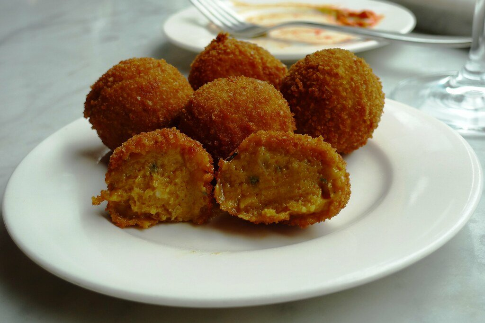
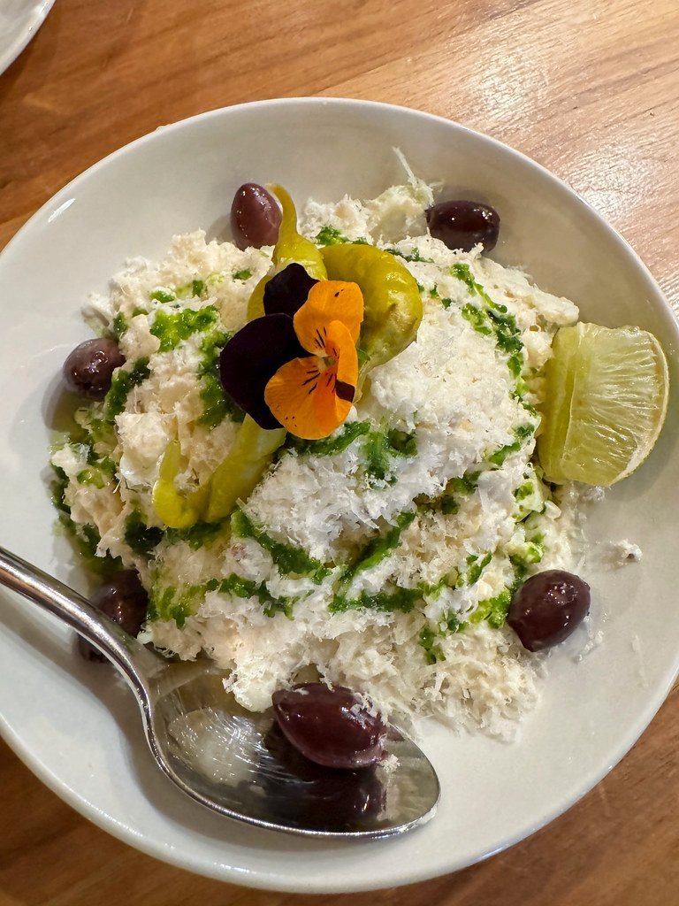
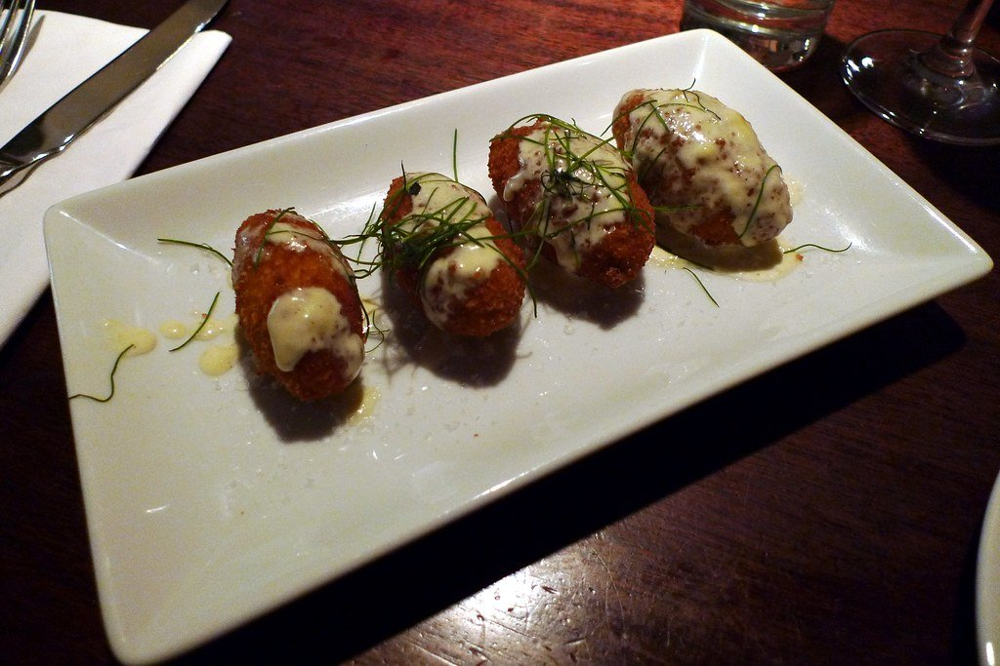
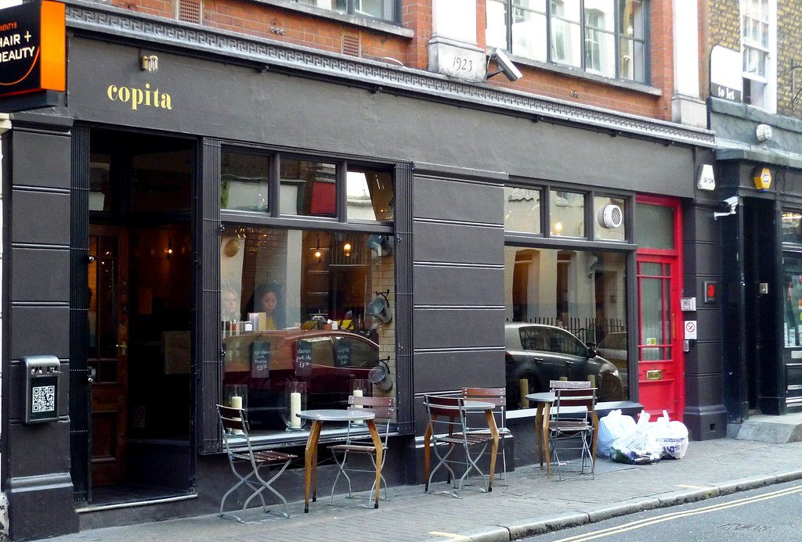
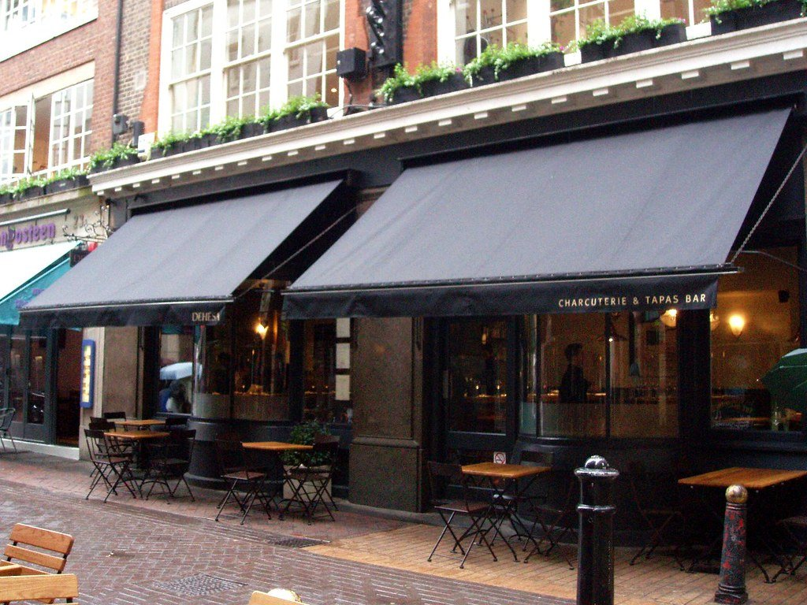

Spanish food in London splits into two things: **tapas counters** where you stand and eat with your hands, and **Basque asadors** built around a coal fire and a single enormous piece of beef.

> 💡 **The Short Version:** **Sabor** ranks first, and the suckling pig is upstairs. **Lurra** and **Ibai** do Basque asador beef. **José** is standing-room with no bookings. **Pizarro** is the same chef with tables. And **Barrafina** is a counter you can book.

> 📊 **The evidence behind this guide.**
> **9 sources carrying 102 citations** across **49 named restaurants**. **20 restaurants are named by two or more independent sources; 3 hold a Michelin star.**
> **Built on:** the Michelin Guide; Time Out, The Nudge, Foodism and Wallpaper; tapas specialists.
> *Evidence rebuilt 30 August 2026 · [How we rank →](/how-we-rank/)*

## Where they are

| If you are near… | Where to eat |
| --- | --- |
| **Mayfair & Soho** | Sabor, The Counter at Sabor, Barrafina, Lobos, Dehesa |
| **Marylebone** | Lurra, ALTA (Soho) |
| **Farringdon & Clerkenwell** | Ibai, Bar Kroketa |
| **Exmouth Market** | Morito |
| **Shoreditch** | Legado, Ember Yard |
| **Bermondsey** | José, Pizarro |
| **Fitzrovia** | Salt Yard |
| **Covent Garden & King's Cross** | Copita, Parrillan |
| **Borough & south** | Escocesa (Stoke Newington), Maresco |

**Price guide:** **££** £15–£35 · **£££** £40–£70 · **££££** £90+.

---

## The best

### Sabor, Mayfair

*££££ · 6 min from Piccadilly Circus · Michelin star* · Cited by 5 sources

**Nieves Barragán Mohacho cooks her mother's Basque and Galician repertoire downstairs and roasts suckling pig in a wood oven upstairs.** They are two restaurants in one building, so check which you have booked.

Downstairs is a counter and a tapas menu; **upstairs is El Asador**, where the **suckling pig** comes out of the wood oven alongside Galician octopus. Climb the stairs for the pig.

**££££, closed Sunday, books weeks ahead — and the upstairs asador books separately.** One of three Spanish restaurants in London holding a Michelin star.

### Legado, Shoreditch

*££££ · 2 min from Shoreditch High Street · Michelin star* · Cited by 3 sources

**Nieves Barragán Mohacho's second restaurant after Sabor**, and it **took a Michelin star within two years**.

The menu works through Extremadura, Asturias and the Canaries. Expect **suckling lamb**, unfamiliar cuts cooked over fire, and vegetable dishes given the same weight as the meat.

**££££, closed Monday, and it books weeks ahead.**

---

## Basque asador

A grill house built around a coal fire and aged beef.

### Lurra, Marylebone

*££££ · 3 min from Marble Arch* · Cited by 2 sources

**Aged Galician beef and whole turbot over coals**, from the Donostia team, in the Basque **asador** format: the fire does the cooking and the kitchen does little else.

The **txuleta** is the order: aged Galician beef, cooked over embers, rested and carved at the table, and priced by weight. Whole **turbot** grilled in a basket is the other.

**££££ and it books weeks ahead.** Order the beef for two.

### Ibai, Farringdon

*££££ · 4 min from Barbican* · Cited by 3 sources

**Fire-led Basque cooking** from the team behind Donostia, after the original Ibai in San Sebastián. The grill is the kitchen.

Aged beef over coals, whole fish, and vegetables given the same treatment, such as leeks and peppers charred through. The menu is short.

**££££, closed Sunday, and it books weeks ahead.** Small room; the counter seats look straight at the grill.

---

## Counters and tapas

### Barrafina

*£££ · counter seating, bookable* · Cited by 5 sources

**A counter and nothing else**: no tables, and you eat facing the chefs. The format comes from Barcelona's Cal Pep.

Order from the specials board rather than the printed menu: **prawns, razor clams, tortilla**, and whatever came in that morning, cooked a foot in front of you. The **jamón** is carved to order.

**You can book** through its own site, and walk-ins are taken if there is space at the counter. Five London sites: Dean Street, Adelaide Street, Drury Lane, Coal Drops Yard and Borough Yards.

### José, Bermondsey

*£££ · standing room · no bookings* · Cited by 4 sources

**José Pizarro's standing-room sherry bar on Bermondsey Street**: a handful of stools, jamón, and **no bookings**.

The format is Andalucian: **sherry by the copita** and small plates to go with it, ordered a couple at a time as you drink. **Jamón ibérico** carved to order, tortilla, prawns and croquetas. It holds about twenty people.

**£££, walk-in only, and full from six.** Go early or late and expect to stand.

*José, Bermondsey. Photo: [Ewan-M](https://www.flickr.com/photos/55935853@N00/8722630539), [CC BY-SA 2.0](https://creativecommons.org/licenses/by-sa/2.0/).*

### Pizarro, Bermondsey

*£££ · a few doors up* · Cited by 3 sources

**The sit-down sibling to José a few doors up** — same chef, tables instead of stools, and **you can book**.

Larger plates than the bar: **suckling pig, whole fish, slow-cooked lamb**, with the tapas menu still available if you want it.

**£££, book a few days ahead.** Choose this one if you want a chair, José if you want the bar.

*Pizarro, Bermondsey. Photo: [Bex.Walton](https://www.flickr.com/photos/7831824@N04/53936325626), [CC BY 2.0](https://creativecommons.org/licenses/by/2.0/).*

### Salt Yard, Fitzrovia

*£££ · Spanish-Italian* · Cited by 2 sources

**Spanish and Italian small plates in Fitzrovia**, with the dish it became known for.

**Courgette flowers stuffed with goat's cheese and drizzled with honey** is the signature and has been on the menu since the beginning. The rest of the menu runs Spanish and Italian charcuterie side by side.

**£££, book a few days ahead.**

*Salt Yard, Fitzrovia. Photo: [Ewan-M](https://www.flickr.com/photos/55935853@N00/4094273174), [CC BY-SA 2.0](https://creativecommons.org/licenses/by-sa/2.0/).*

---

Powered by <a target="_blank" rel="sponsored" href="https://www.getyourguide.com/london-l57/">GetYourGuide</a>

## The new wave

### ALTA, Soho

*£££ · Kingly Court* · Cited by 3 sources

**Basque live-fire cooking in Soho — everything routed through the grill, including the vegetables.**

Expect **txuleta**, whole fish and charred greens, plus pintxos at the bar if you are not eating a full meal.

**£££ and it books weeks ahead.** The bar takes walk-ins when the tables are gone.

### Bar Kroketa, Clerkenwell

*££ · croquettes and little else* · Cited by 3 sources

**A single-dish bar built around the croqueta.**

**Croquetas** in a rotating list of fillings: jamón, mushroom, salt cod, whatever is on that week, with sherry and vermouth to go with them.

**££, walk-in.**

### Morito, Exmouth Market

*££ · a counter, no bookings for small tables* · Cited by 4 sources

**The small offshoot of Moro next door** — a dozen seats at the counter and a menu that changes constantly.

Spanish and North African small plates: **crispy aubergine with honey**, beetroot borani, grilled quail. Order six or seven between two. The counter is the seat to want.

**££, walk-in only.** Exmouth Market, and busy early in the evening. There is a second site in Hackney with the same kitchen.

### Copita, Soho

*££ · d'Arblay Street* · Cited by 3 sources

**A narrow Soho bar built for standing**, small plates, and sherry **by the copita** — the small tulip glass it is named after.

The menu is a blackboard that changes daily: **jamón, tortilla, croquetas, whatever fish came in**, ordered a plate at a time. High stools and a narrow ledge rather than tables.

**££, walk-in, closed Sunday.** Go at six before it fills, or after nine when the first wave has gone.

*Copita, Soho. Photo: [Ewan-M](https://www.flickr.com/photos/55935853@N00/6435938511), [CC BY-SA 2.0](https://creativecommons.org/licenses/by-sa/2.0/).*

### Dehesa, Soho

*££ · Carnaby Street* · Cited by 3 sources

**A corner site off Carnaby Street running Spanish and Italian small plates side by side.**

From the Salt Yard group, so the **courgette flowers with goat's cheese and honey** are here too, alongside Spanish charcuterie and Italian pasta on the same menu. **Ibérico pork** is the dish the name points at — a dehesa is the oak pasture the pigs forage in.

**Book a few days ahead.** Corner windows onto two streets, and a counter for solo diners.

*Dehesa, Soho. Photo: [Ewan-M](https://www.flickr.com/photos/55935853@N00/2512459014), [CC BY-SA 2.0](https://creativecommons.org/licenses/by-sa/2.0/).*

### Parrillan, King's Cross

*£££ · Coal Drops Yard · grill at the table* · Cited by 2 sources

**You get your own small charcoal grill at the table and cook the skewers yourself.**

Skewers arrive raw and you grill them over the coals in front of you: **prawns, ibérico pork, vegetables**, cooked to your own timing. Sides and pintxos come from the kitchen. From the Barrafina family.

**£££, closed Sunday and Monday, and it books weeks ahead.** Coal Drops Yard, on a terrace — the better tables are outside.

### Lobos, Soho and Borough

*££ · under a railway arch at Borough* · Cited by 3 sources

**A tapas bar built around meat**, tucked under the railway arches at Borough and on a narrow Soho site. The name means wolves.

**Ibérico presa and pluma** off the grill are the orders, along with jamón carved to order and the **beef rib** that most tables share.

**Book ahead** at Borough, particularly at weekends. Upstairs seating at both is tight; ask for a downstairs table if you want room.

### Escocesa, Stoke Newington

*££ · seafood tapas* · Cited by 2 sources

**Scottish seafood cooked the Spanish way in Stoke Newington.**

Shellfish from Scottish waters treated with Spanish technique: **grilled langoustines, octopus, razor clams**, and whatever came down from the coast that week, with sherry and Spanish wine alongside. Short menu, changing constantly.

**Book a few days ahead.** Small room on Stoke Newington Church Street.

---

Powered by <a target="_blank" rel="sponsored" href="https://www.getyourguide.com/london-l57/">GetYourGuide</a>

## Best value

#### Markets and food halls

* **Borough Market** — the **Brindisa** stall's chorizo roll, with rocket and piquillo peppers, is around a fiver.
* **Mercado Metropolitano**, Elephant & Castle — a food hall with several Iberian counters, selling jamón and pan con tomate.
* **Seven Dials Market** and **Arcade Food Hall** both carry Spanish counters if you want one dish rather than a table.

#### Counters rather than tables

* **José**, Bermondsey — standing room, no bookings, and jamón, sherry and a few plates come in well under £25.
* **Barrafina at the counter** — the counter is the only seating, so you are not paying for a table.
* **Bar Kroketa** — a plate of croquettes and a glass of fino is a cheap meal.

#### How to order

* **Order tapas in waves** rather than all at once, which keeps the bill down.
* **A copita of fino** usually costs less than a glass of house white and goes with jamón.

---

## What to know

* **José takes no bookings.** Go early or expect to wait.
* **Basque txuleta is aged dairy-cow beef.** Order it rare and sliced for the table.
* **Ask for sherry recommendations.**
* **Service charge** of 12.5% is discretionary and standard.

---

## Continue planning your London trip

- 🇮🇹 **[Best Italian Restaurants in London](/articles/best-italian-restaurants-london/)**
- 🥘 **[Best Middle Eastern Restaurants](/articles/best-middle-eastern-restaurants-london/)**
- 🍽️ **[Eat in London: Restaurants, Food Markets & Quick Food Hub](/articles/eat-in-london-guide/)**
- ⭐ **[Special Occasion Restaurants in London](/articles/special-occasion-restaurants-london/)**
- 🏙️ **[Bermondsey Area Guide](/articles/bermondsey-area-guide/)**
- 🛍️ **[Mayfair Area Guide](/articles/mayfair-area-guide/)**
