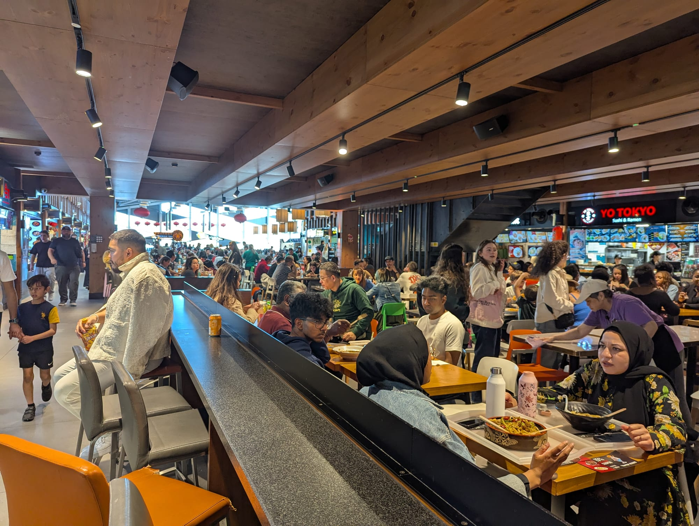
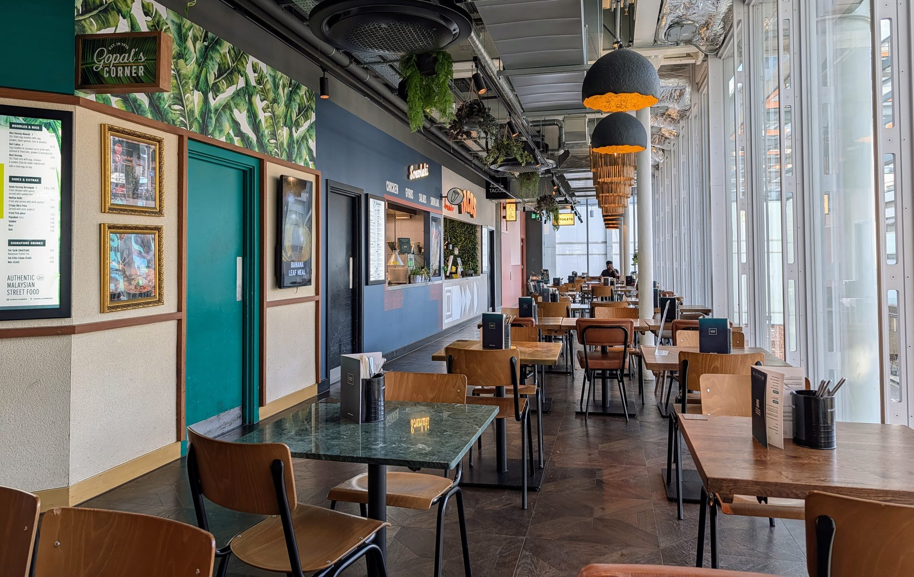
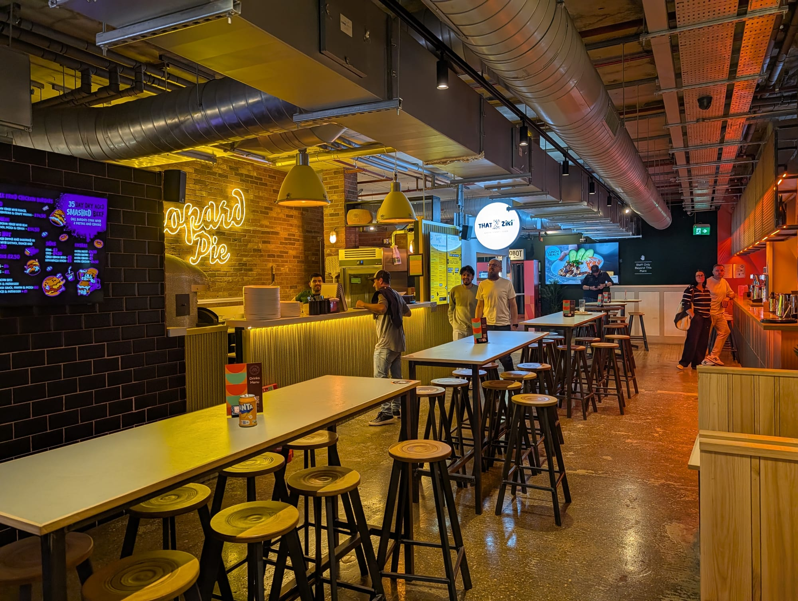
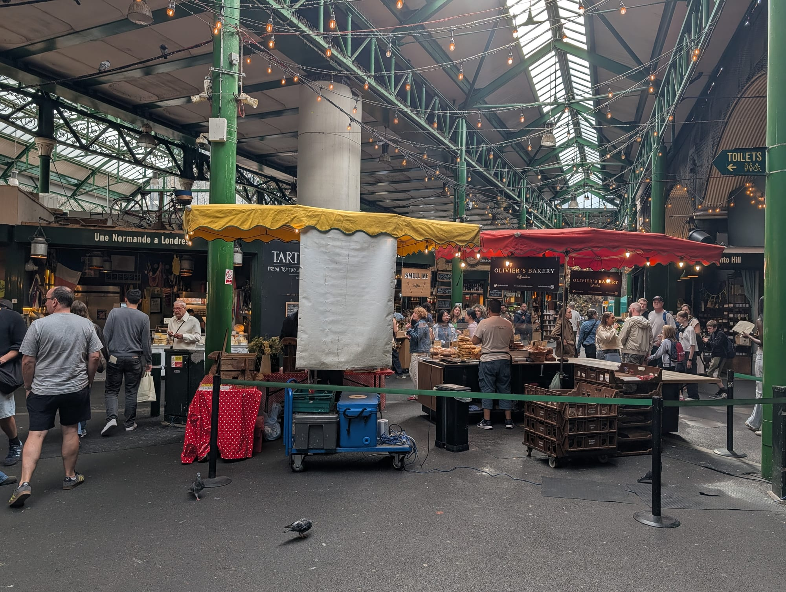
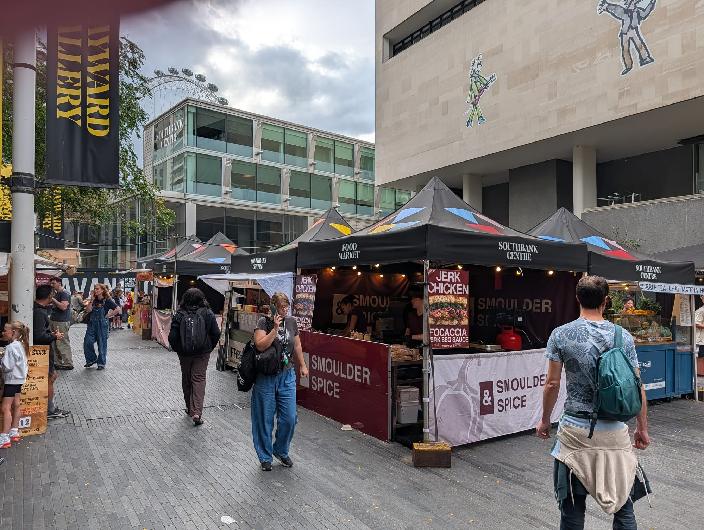
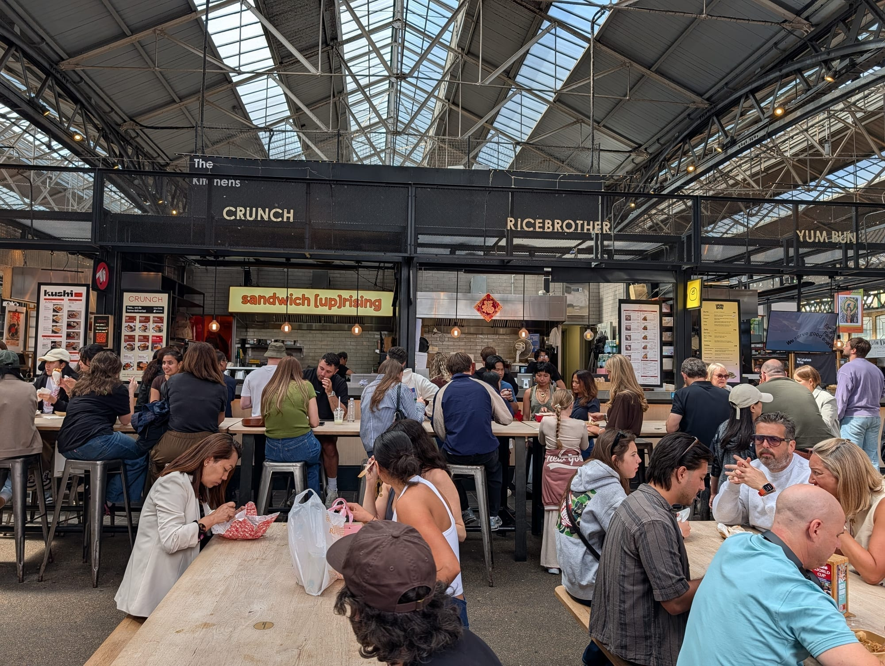
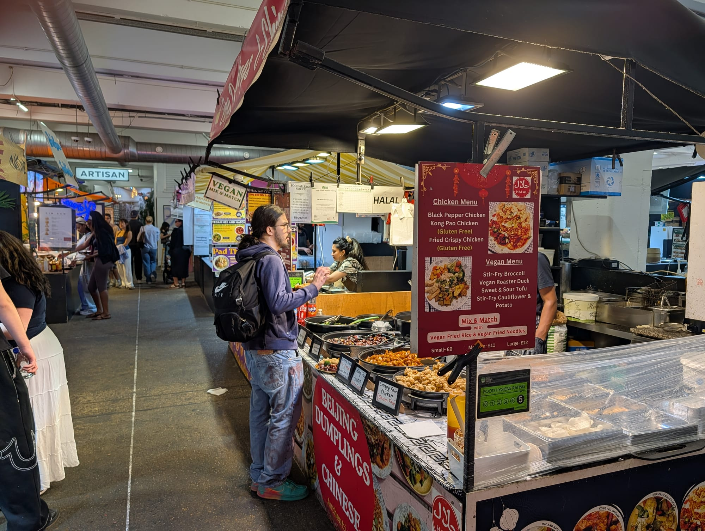
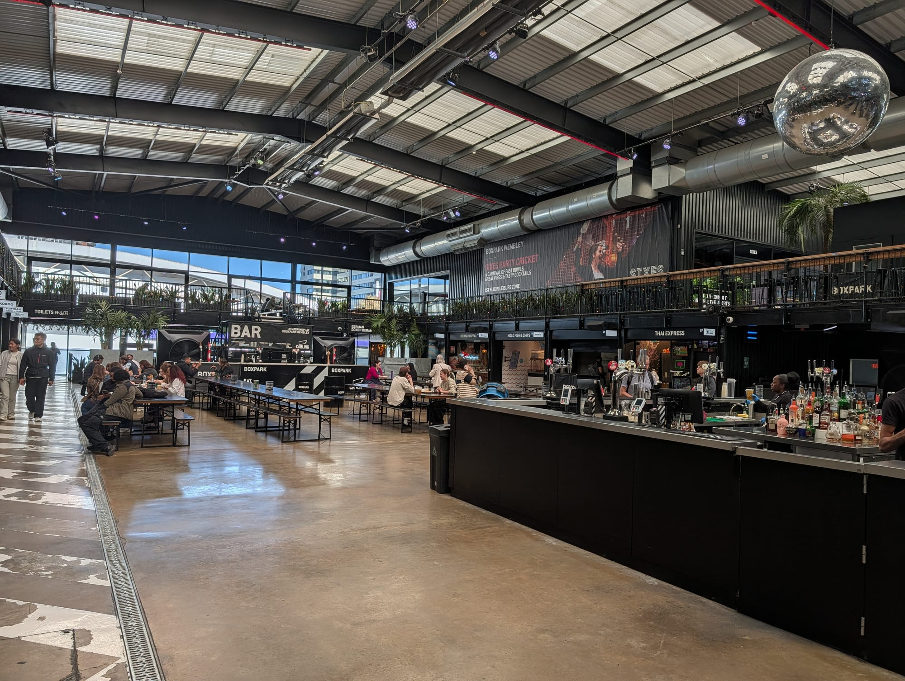
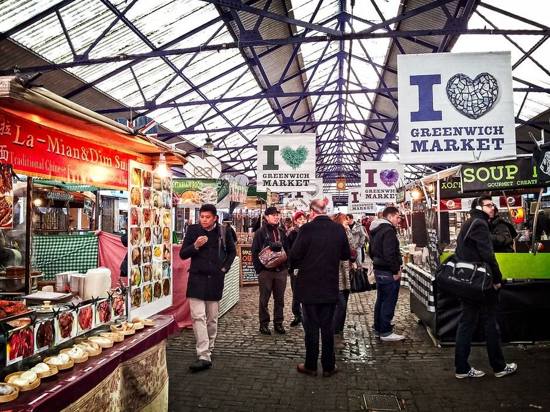

**Covered food halls** — Seven Dials, the Arcades, Market Halls, Boxpark — trade most days, have seating and work in the rain. **Outdoor markets** — Maltby Street, Broadway Market, the Southbank Centre — have better atmosphere and worse seating, and several of them only trade two or three days a week. Turning up on the wrong day wastes a morning, so this guide is built around days.

> 💡 **The Short Version:** **Borough** is the biggest market, with 100+ stalls, and it is **closed Mondays**. **Seven Dials Market** is a covered hall in the centre with 21 traders. **Bang Bang Oriental** in Colindale has 25+ pan-Asian kiosks and is a proper trek. **Maltby Street** is Friday evening to Sunday only. And **Mercato Metropolitano at Elephant & Castle closes at the end of 2026** — go while you can.

> 📊 **How this guide is put together.**
> Street food has no judged award and only a handful of editorial rankings, so this is **not** a consensus ranking in the way our restaurant guides are. Three independent lists — Time Out, Hot Dinners and DesignMyNight — establish which venues the press agrees are worth naming.
> **Prices are not listed.** Assume roughly £9–16 for a main plate almost everywhere, less at the weekday street markets.
> *[How we rank →](/how-we-rank/)*

---

## Where they are

  

    Map of London's street food markets and food halls
  

  

    
Loading the interactive map…

  

  

    <i class="restaurant-map-key restaurant-map-key--editorial" aria-hidden="true"></i> Covered food hall
    <i class="restaurant-map-key restaurant-map-key--streetfood" aria-hidden="true"></i> Market, yard or street market
  

  <noscript>
    
The interactive map requires JavaScript. Every venue below lists its area and nearest station.

  </noscript>

**The pattern the map shows:** the covered food halls cluster in the centre and in the places people commute through, while the outdoor markets sit in a ring around them — Hackney, Bermondsey, Peckham, Brixton, Greenwich.

---

## The comparison

**Plan by the days column, not the hours.** Hours shift seasonally and by trader.

| Venue | Area | Type | Traders | Variety | Seating | Days |
| --- | --- | --- | --- | --- | --- | --- |
| **Borough Market** | London Bridge | Market | 100+ stalls and shops | Everything | Scarce | **Closed Mon**, Tue–Sun |
| **Seven Dials Market** | Covent Garden | Food hall | 21 | Pan-global | Plenty | Daily |
| **Arcade Food Hall** | Tottenham Court Rd | Food hall | 7 chef-led | Thai, Levantine, Mexican | Plenty | Daily |
| **Arcade Food Hall** | Covent Garden | Food hall | 7 chef-led | Greek Cypriot, Thai, Indian, tacos | Plenty | Daily |
| **Arcade Food Hall** | Battersea | Food hall | 13 | The widest spread of the three | Plenty | Daily |
| **Bang Bang Oriental** | Colindale | Food hall | 25+ | Pan-Asian | Plenty, 450 covers | Daily |
| **Market Halls Victoria** | Victoria | Food hall | 9 + 3 bars | Burgers, Thai, Malaysian, kebabs | Plenty, 3 floors + roof | Daily |
| **Market Halls Oxford Street** | Oxford Circus | Food hall | 9 + 2 bars | Malaysian, Thai, BBQ, pizza | Plenty | Daily |
| **Market Halls Canary Wharf** | Canary Wharf | Food hall | 11 + 3 bars | Caribbean, Thai, Malaysian | Plenty | Daily, breakfast to late |
| **Market Halls Paddington** | Paddington | Food hall | 8 | Argentine grill, Malaysian, Greek, tacos | Plenty | Daily |
| **Tower Bridge Collective** | Shad Thames | Food hall | 13 | Korean, Thai, Ethiopian, Palestinian | Plenty, 2 floors | Daily from 8am |
| **Mercato Metropolitano** | Elephant & Castle | Food hall | 40+ | Global | Plenty | Daily · **closing end of 2026** |
| **Mercato Mayfair** | Mayfair | Food hall | 19 | Italian-led, in a Grade I church | Plenty | Daily |
| **Boxhall** | Liverpool Street | Food hall | 14 | Sri Lankan, Singaporean, bao | Plenty, Edwardian arcade | Daily |
| **Boxpark Shoreditch** | Shoreditch | Container | ~15 food | Greek, Caribbean, pizza, burgers | Plenty | Daily |
| **Boxpark Camden** | Camden | Container | ~15 food | Birria, Nepali, Vietnamese, Greek | Plenty | Daily |
| **Boxpark Wembley** | Wembley Park | Container | 22–24 | Greek, Korean, Brazilian BBQ | Plenty | Daily · **event days differ** |
| **Boxpark Croydon** | East Croydon | Container | 22–24 | Afghan, Taiwanese, West African | Plenty | Daily |
| **Market Place** | Leicester Sq, St Paul's, Vauxhall, Peckham, Harrow | Food hall | 9–16 per site | Argentine, Filipino, Greek, Thai | Plenty | Daily · **St Paul's closed Sun** |
| **Old Spitalfields Market** | Spitalfields | Market | 45 food businesses | Global, plus restaurants | Some, covered | Daily · **Thu is antiques, opens 8am** |
| **Upmarket, Brick Lane** | Brick Lane | Market hall | 40+ | Pan-global | Scarce | Daily, **11am–6pm only** |
| **Camden Market** | Camden | Market | Not published | As broad as it gets | Some, canalside | Daily · **Thu night market to 9pm** |
| **Greenwich Market** | Greenwich | Market | 120 shops and stalls | Global | Scarce | Daily · **street food market Fri–Sun** |
| **Brixton Village** | Brixton | Arcades | Not published | Caribbean, Colombian, Japanese | Plenty | **Closed many Mondays** |
| **Maltby Street** | Bermondsey | Market | ~11 + arches | French, Ethiopian, Cuban, Greek | Scarce | **Fri 5.30–9pm, Sat, Sun only** |
| **Broadway Market** | Hackney | Market | Not published | Global, plus produce | Scarce | **Sat and Sun only** |
| **Netil Market** | London Fields | Market | 7 | Burgers, noodles, bagels | Some | Daily, later Wed–Sat |
| **Southbank Centre Food Market** | Waterloo | Market | 30–40 | Dosas, Afghan, Vietnamese | Scarce | **Fri–Sun only** |
| **Canopy Market** | King's Cross | Market | ~20 | Spanish, Greek, Thai, oysters | Some, covered | **Wed–Sun only** |
| **Hackney Bridge** | Hackney Wick | Container | 8 | Filipino, pizza, tacos, sushi | Plenty, canalside | **Closed Mon** |
| **Vinegar Yard** | London Bridge | Yard | Not published | Indian, pan-Asian, burgers | Plenty | **Closed Mon, opens late afternoon** |
| **Flat Iron Square** | Southwark | Yard | 5 | Greek, fried chicken, pizza | Plenty | Daily, more beer garden than market |
| **Corner Corner** | Canada Water | Food hall | 4–5 | Fried chicken, tacos, bao | Plenty, huge | Daily, kitchens from midday |
| **Canteen** | North Greenwich | Food hall | 6 | Jamaican, ramen, Greek, congee | Plenty | Daily, **traders from 11.30am** |
| **Pop Brixton** | Brixton | Container | 9 | Trinidadian, Greek, West African | Plenty, outdoor | **Closed Mon · closing for good** |
| **Peckham Levels** | Peckham | Container | Reduced | Varies | Plenty, Level 6 view | **Closed Mon and Tue** |
| **Whitecross Street** | Old Street | Street market | Not published | Kurdish, Korean, Ethiopian | Standing only | **Weekday lunchtimes only** |
| **Leather Lane** | Farringdon | Street market | 103 pitches | Thai, Lebanese, Indian | Standing only | **Mon–Fri, ~10am–4pm** |
| **Broadway Market Tooting** | Tooting | Arcade | 28 | Ramen, Basque, Jamaican, Filipino | Plenty | **Many units closed Mon, evenings only midweek** |
| **Food Hall @ 17&Central** | Walthamstow | Food hall | 8 + bar | Mexican, Neapolitan pizza, South Asian, wok | Plenty, plus soft play | Daily from 9am |

---

Powered by <a target="_blank" rel="sponsored" href="https://www.getyourguide.com/london-l57/">GetYourGuide</a>

## Covered food halls

Trade most days, have seating and work in the rain; they suit groups who want different things.

### Seven Dials Market, Covent Garden

*21 traders · daily · Cited by 3 sources*

A covered food hall in a former banana-ripening warehouse off Earlham Street. Twenty-one traders over two floors with two bars, run by KERB.

**Bleecker** does dry-aged smash cheeseburgers and **Pick & Cheese** a conveyor belt of British cheese matched to condiments, with pizza, dumplings and a long run of pan-global counters. Communal benches downstairs, a mezzanine above.

**Plenty of seating, walk-in only, and it is rammed between 7pm and 9pm on Friday and Saturday.** Weekday lunch is quieter. Two minutes from Covent Garden station.

*Seven Dials Market.*

### Arcade Food Hall, Tottenham Court Road, Covent Garden and Battersea

*7–13 kitchens per site · daily · Cited by 3 sources*

**Chef-led**: closer to restaurants sharing a room than a street food market.

Tottenham Court Road has seven kitchens including **Plaza Khao Gaeng** for Southern Thai curries. Covent Garden has seven more. Battersea has thirteen and the widest cuisine spread of the three, including **BAO** and Indonesian duck at **Bebek! Bebek!**

**Plenty of seating, indoors, walk-in.** The Tottenham Court Road site is inside Centre Point, straight up from the Tube.

### Bang Bang Oriental, Colindale

*25+ kiosks · daily · Cited by 3 sources*

*Bang Bang Oriental.*

A pan-Asian food hall and the successor to Oriental City — Chinese, Korean, Japanese, Vietnamese, Malaysian, Singaporean and Taiwanese counters around 450 covers.

It is strip-lit and functional; the draw is regional cooking. Expect **hand-pulled noodles, Hong Kong roast duck and char siu over rice, Malaysian nasi goreng and laksa, Korean fried chicken, Taiwanese bao and bubble tea, Vietnamese pho** and a proper dim sum counter, with a large Asian supermarket attached.

**Allow for the journey.** Colindale is a 45-minute Tube ride from the centre on the Northern line. **Walk-in only, no reservations.**

### Market Halls, Victoria, Oxford Street, Canary Wharf and Paddington

*8–11 kitchens per site · daily · Cited by 3 sources*

**Four sites**, each with between eight and eleven kitchens plus bars.

Recurring names worth ordering from: **Le Bab** for gourmet kebabs, **Gopal's Corner** for Malaysian roti canai from the founder of Roti King, and **Black Bear Burger**, a former National Burger Awards winner. Victoria has three floors and a roof terrace; Paddington is seconds from the station.

**Plenty of seating, walk-in, and most sites open from 8am** for breakfast. Mid-afternoon is the easiest time to find a table at Paddington.

*Market Halls Paddington.*

### Food Hall @ 17&Central, Walthamstow

*8 traders plus a bar · daily from 9am*

Inside the 17&Central centre a minute from Walthamstow Central, with a **soft play area** built into it.

Eight kitchens and a cocktail bar: **Carne** for Mexico City and Tijuana street food, **Grano Fresco** for Neapolitan pizza, **Rice N Spice** for South Asian grills and kebabs, **Hi Wok**, **Condito**, **Monkey Bite**, **Naked Chips** for loaded fries, and **Perky Blenders**, the east London roaster, for coffee. **The Drift** does the cocktails.

**Open 9am to 9pm Monday to Thursday, 9pm on Friday and Saturday, and 10am to 7pm on Sunday.**

There are two event spaces and a programme of classes, supper clubs and workshops. **45 Selborne Walk, E17 7JR**, and the Victoria line puts you at the door.

### Tower Bridge Collective, Shad Thames

*13 kitchens · daily from 8am*

Open since October 2025 in a converted office block a minute from the southern end of Tower Bridge. Thirteen independent kitchens over two floors — no chains.

Korean fried chicken from **Clapping Seoul**, Palestinian **musakhan** from Baity, Greek gyros from Thatziki, Eritrean and Ethiopian stews from **House of Habesha**, Neapolitan pizza from Leopard Pie.

**Open 8am to 10.30pm every day**, with a children's play area and sandpit.

*Tower Bridge Collective.*

### Mercato Metropolitano, Elephant & Castle

*40+ traders · daily · **closing at the end of 2026** · Cited by 2 sources*

Southwark approved the Borough Triangle redevelopment in March 2026 and the site trades only until the end of the year.

Forty-plus independents across 17,000 square feet: Nigerian **jollof rice and suya**, **Uzbek plov** cooked in a kazan, Syrian **shawarma and fatteh**, Korean fried chicken, Sri Lankan **kottu roti**, Jamaican **jerk chicken**, Argentine **empanadas and choripán**, Nepali **momo**, and a large Italian contingent doing pizza, pasta and salumi. Indoor and outdoor seating, and a bar that stays open late.

**Go before it closes.** Its sibling at Wood Wharf is smaller and calmer, with a riverside terrace and garden igloos, and is not closing.

---

Powered by <a target="_blank" rel="sponsored" href="https://www.getyourguide.com/london-l57/">GetYourGuide</a>

## Markets built around the food

### Borough Market, London Bridge

*100+ stalls · **closed Mondays** · Cited by 2 sources*

A wholesale market since at least the 12th century, now produce traders and hot food side by side under the railway.

**Borough Market Kitchen** is the dedicated street food section. Elsewhere it is cheese, fish, charcuterie and produce, plus **Bao Borough** for Taiwanese bao and **Arabica** for shawarma. Horn OK Please and Gujarati Rasoi are vegetarian Indian stalls.

**Closed Mondays.** Tuesday to Friday 10am–5pm, Saturday 9am–5pm, Sunday 10am–4pm, and seven days a week from 30 November, apart from 25–27 December and 1 January. Saturday is heaving; **Tuesday or Wednesday morning has room to move.** Seating is scarce.

*Borough Market, on a weekday morning.*

### Maltby Street Market, Bermondsey

*~11 traders plus arch businesses · **Friday evening to Sunday only***

A cramped railway alley called the Ropewalk, ten minutes from Borough.

French, Ethiopian, Vietnamese, Cuban sandwiches, Chinese dumplings, Argentine empanadas and duck frites, plus permanent arch businesses doing gin, cheese and wine.

**Friday 5.30–9pm, Saturday 10am–5pm, Sunday 11am–4pm — and nothing the rest of the week.** Seating is scarce and largely uncovered.

### Southbank Centre Food Market, Waterloo

*30–40 traders · **Friday to Sunday only***

Indian dosas from **Horn OK Please**, Afghan, Vietnamese, Polish, Levantine, French crêpes and Sicilian cannoli.

**Friday 12pm–9pm, Saturday and Sunday 11am–9pm, plus bank holiday Mondays 12pm–6pm.** **It is on the Belvedere Road side, behind the Royal Festival Hall — not on the river.** Seating is picnic benches and the wall. **Closed from around 21 December to 30 January**, when the Winter Market takes the space.

*The Southbank Centre Food Market.*

### Broadway Market, Hackney

*Saturday and Sunday only*

Global street food alongside produce, bakery and cheese, on a street of shops.

The food runs to **salt beef bagels, Ghanaian and Nigerian plates, dumplings, paella, raclette and toasties**, alongside produce stalls, a cheesemonger and bakeries.

**Saturday 9am–5pm and Sunday 10am–4pm.** There is no seating; take food into London Fields. **Netil Market** is two minutes away, smaller and open more days.

### Old Spitalfields Market, Spitalfields

*45 food and drink businesses · daily · Cited by 1 source*

A retail market with food, under a Victorian roof between Liverpool Street and Brick Lane.

**The Kitchens** is the food section — a dozen counters around long communal tables. There is a KERB sports bar and a run of sit-down restaurants around the edge.

**Open daily, but Thursday is the antiques day and starts at 8am.** Covered, so it works in the rain, with reasonable seating.

*The Kitchens at Old Spitalfields.*

### Upmarket, Brick Lane

*40+ traders · daily, 11am–6pm*

Pan-global stalls in the Old Truman Brewery — Ethiopian injera, Korean skewers and more.

It is open **daily, not weekends only**: the food hall trades every day, but the surrounding retail markets only expand at weekends, and **everything shuts at 6pm.**

Seating is scarce. Weekday lunchtimes are quieter than weekends.

*A stall at Upmarket, Brick Lane.*

### Canopy Market, King's Cross

*~20 food traders · **Wednesday to Sunday only***

Under the West Handyside Canopy, a Victorian goods canopy behind Granary Square.

Spanish tapas and paella, Greek gyros, Thai curries, Indian chaat and fresh Italian pasta, plus **Rocks Oysters** shucking to order and **Bread Ahead** doughnuts. There is a bar.

**Closed Monday and Tuesday.** Covered but open-sided — sheltered from rain, not from cold.

---

## Container yards and regeneration sites

Outdoor and drink-led.

*Boxpark Shoreditch. Photo: [JasonParis](https://www.flickr.com/photos/94064020@N00/8063833095), [CC BY 2.0](https://creativecommons.org/licenses/by/2.0/).*

* **Boxpark Shoreditch** — the original; it survived a closure notice in 2024. Around fifteen food units plus shops and a bar, daily.
* **Boxpark Camden** — on the old Buck Street Market site by the station, 10am–11pm daily. Birria tacos, Nepali momo, Vietnamese pho and Black Bear Burger.
* **Boxpark Wembley and Croydon** — 22 to 24 units each. **Wembley's hours change for stadium events.**

*Inside Boxpark Wembley.*
* **Hackney Bridge**, Hackney Wick — eight kitchens plus a canalside garden, **closed Mondays**.
* **Vinegar Yard**, London Bridge — scrap-metal dinosaurs, a weekend flea market and a handful of traders. **Closed Mondays and it does not open until late afternoon midweek.**
* **Flat Iron Square**, Southwark — five food traders, two bars and a taproom in railway arches. More beer garden than food market.
* **Corner Corner**, Canada Water — enormous, with free live music and an indoor vertical farm, but only four or five kitchens. **Kitchens run from midday**; the café opens earlier.
* **Peckham Levels** — **closed Monday and Tuesday**, and the food offer has shrunk since the site changed hands. The Level 6 view is free.

---

## Weekday lunch markets

Standing only, with a two-to-four hour window.

* **Leather Lane**, Farringdon — **Monday to Friday, roughly 10am–4pm**, busiest 12–2. Thai, Lebanese and Indian counters among 103 pitches.
* **Whitecross Street**, Old Street — **weekday lunchtimes only**. Kurdish, Korean, Ethiopian, Mexican and a hog roast.
* **Strutton Ground**, Westminster — a small lunch market, weekdays.
* **Exmouth Market**, Farringdon — stalls at weekday lunchtimes on a pedestrianised street.
* **Berwick Street**, Soho — **much diminished**, down from around fifty stalls two decades ago to as few as a dozen on a slow day.

---

## Further out, and worth the journey

* **Broadway Market Tooting** — 28 restaurants and bars in a covered arcade. **Many units close Monday and open only from late afternoon midweek**; weekends are the reliable time.
* **Brixton Village and Market Row** — covered arcades of small independent restaurants rather than stalls, so everybody seats their own. **Many close Mondays.**
* **Greenwich Market** — the covered Georgian hall trades daily; the **Cutty Sark street food market alongside it is Friday to Sunday only.**

*Greenwich Market.*
* **Kingston Ancient Market** — a market square with hot food, seven days a week.
* **Deptford Market Yard** — railway arches with a fortnightly Saturday market.

---

Powered by <a target="_blank" rel="sponsored" href="https://www.getyourguide.com/london-l57/">GetYourGuide</a>

## Seasonal, and once a year

* **Southbank Centre Winter Market** — Alpine chalets on the Queen's Walk, **2 November 2026 to 3 January 2027**, daily; the [London Christmas markets guide](/articles/christmas-markets-london/) has the details. It displaces the regular food market for those weeks.
* **Hyde Park Winter Wonderland** — **19 November 2026 to 3 January 2027**, with many food stalls; entry needs a timed ticket.
* **Wembley Park Market** — **weekend dates that move month to month**, and shift around stadium events.
* **Alexandra Palace Farmers' Market** — every **Sunday 10am–3pm**, though the location alternates between the park and Campsbourne School.
* **Brockley Market** — **Saturdays only, 10am–2pm.** A four-hour window with hot breakfast stalls.
* **Herne Hill Market** — **Sundays only, 10am–4pm.**
* **Victoria Park Market** — **Sundays**, in Victoria Park.

---

## Going, or already gone

* **Mercato Metropolitano, Elephant & Castle** — trading only **until the end of 2026**. A 892-home redevelopment was approved in March 2026.
* **Pop Brixton** — in administration since 2024, lease extended to winter 2026, and a 288-home scheme for the site has been approved. Expect closure.
* **Street Feast's four sites** — Dinerama, Hawker House, Giant Robot and Model Market are **all closed**. The operating company was liquidated in 2020.
* **Buck Street Market**, Camden — now Boxpark Camden.
* **Market Halls Fulham** — closed in 2021. The four remaining sites all trade.
* **The Boiler House**, Brick Lane — no longer listed by the Old Truman Brewery.

---

## What to know

* **Check the day, not the hours.** Maltby Street, Broadway Market, the Southbank Centre, Canopy Market and the Cutty Sark market are all part-week only.
* **Borough is closed on Mondays**, and so are Hackney Bridge, Vinegar Yard and many Brixton Village units.
* **Seating.** Borough, Maltby Street, Broadway Market and the Southbank Centre are standing-and-walking. Every food hall on this page has seating.
* **Take a card.** The Southbank Centre is cash-free across the whole site and most hall traders are card-only.

---

## Continue planning your London trip

- 🇳🇬 **[The Best West African Restaurants in London](/articles/best-west-african-restaurants-london/)** — the Peckham stalls
- 🥥 **[The Best Sri Lankan Restaurants in London](/articles/best-sri-lankan-restaurants-london/)** — the market counters
- 🇵🇭 **[The Best Filipino Restaurants in London](/articles/best-filipino-restaurants-london/)** — Bongbongs at Seven Dials and Spoon & Rice at both Boxparks
- 🇵🇪 **[The Best Peruvian Restaurants in London](/articles/best-peruvian-restaurants-london/)** — the Rye Lane and Market Row stalls
- 🛒 **[London's Best Markets](/articles/best-london-markets/)** — including the flower, antiques and shopping markets
- 💷 **[Cheap Eats in London](/articles/cheap-eats-london/)** — places to eat well under £15
- 🍔 **[The Best Burgers in London](/articles/best-burgers-london/)**
- 🗺️ **[Eat in London: the full food handbook](/articles/eat-in-london-guide/)**

---

*Trading days change: confirm before travelling for a specific market.*
