London's street lists come in three kinds: pretty residential streets, shopping streets and famous roads. This guide counts all three and ranks each street by how many independent sources name it. Our guides to [London's markets](/articles/best-london-markets/) and [Oxford Street](/articles/oxford-street-guide/) cover those two subjects in full; this page is for the streets themselves, with the day to go and the station.

> 💡 **The Short Version:** **Portobello Road** is named by more sources than any other street, 18, and **Saturday** is the day. **Carnaby Street** and **Neal's Yard** follow with 13 each, then **Kynance Mews** and **Oxford Street** with 12. **Columbia Road** is a flower market on Sunday morning and an ordinary street the rest of the week. **Oxford Street** has been traffic-free between Orchard Street and Great Portland Street since 26 October 2026.

> 📊 **The evidence behind this guide.**
> **28 independent sources carrying 392 citations** across **124 named streets**. **69 are named by two or more sources; 3 carry a dated ranking.**
> **Built on:** Time Out's Coolest Streets in the World and Condé Nast Traveler's list of the world's most beautiful streets; London guides from Secret London, Visit London, A Lady in London and TripSavvy; independent London blogs; three YouTube creators.
> *Evidence built 22 November 2026 · [How we rank →](/how-we-rank/)*

A count measures how often a street is written about, and the three kinds of list pull in different directions. A mews appears on every pretty-street list and no shopping list, so Kynance Mews reaches 12. Oxford Street appears on shopping and famous-road lists and no pretty-street list, and also reaches 12. Portobello Road is on all three.

## Where they are

| If you are near… | Which streets |
| --- | --- |
| **Notting Hill** | Portobello Road, Golborne Road, Lancaster Road, Elgin Crescent, St Luke's Mews |
| **Soho & Covent Garden** | Carnaby Street, Neal's Yard, Goodwin's Court, Shaftesbury Avenue |
| **Oxford Street & Mayfair** | Oxford Street, Regent Street, Bond Street, Savile Row, Jermyn Street |
| **Marylebone** | Marylebone High Street, Baker Street |
| **Chelsea & South Kensington** | King's Road, Bywater Street, Kynance Mews |
| **Shoreditch & Spitalfields** | Brick Lane, Columbia Road, Fournier Street |
| **Hackney** | Broadway Market |
| **Islington & Farringdon** | Camden Passage, Upper Street, Exmouth Market |
| **Primrose Hill & Camden** | Chalcot Crescent, Camden High Street |
| **The City & Bermondsey** | Leadenhall Market, Bermondsey Street, Shad Thames |
| **Westminster** | Downing Street, The Mall |

## Which day each street works

| Street | Trades on | Nearest station | Notes |
| --- | --- | --- | --- |
| **Columbia Road** | Sunday, 8am to about 3pm | Hoxton | Flower sellers only on Sunday; the street is ordinary on other days |
| **Broadway Market** | Saturday 9am to 5pm, Sunday 10am to 4pm | Cambridge Heath | The shops and cafés on the street trade through the week |
| **Portobello Road** | Saturday for the full market | Notting Hill Gate or Ladbroke Grove | The antique arcades open on Saturdays only |
| **Brick Lane** | Sunday for the whole stretch | Aldgate East or Shoreditch High Street | The Vintage Market at 85 Brick Lane is open seven days |
| **Camden Passage** | Saturday, Sunday and Wednesday | Angel | Shops open most days |
| **Golborne Road** | Friday and Saturday for bric-a-brac | Westbourne Park | Fruit and veg and hot food stalls Monday to Thursday |
| **Marylebone** | Sunday, 10am to 2pm | Baker Street or Bond Street | The farmers' market is on the side streets, not the High Street |
| **Leadenhall Market** | Shops on weekdays | Bank or Monument | The market is open to walk through at any hour |

> ⚠️ **Columbia Road is a Sunday street.** The flower sellers pack up by about 3pm, and the shops behind them largely close with them. On any other day there is nothing to see.

---

## The ten streets most sources name

### Portobello Road — antiques on Saturday

*Notting Hill · Cited by 18 sources · The only London street in Condé Nast Traveler's 71 most beautiful streets in the world, 2024 · Notting Hill Gate or Ladbroke Grove*

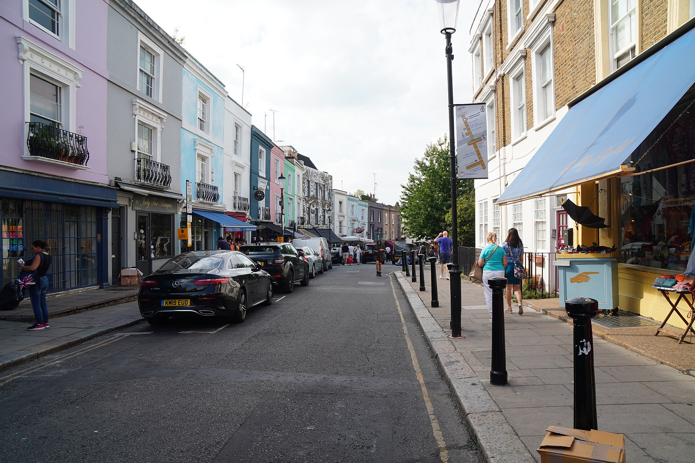

*Antique shops and painted terraces on Portobello Road. Photo: [David](https://commons.wikimedia.org/wiki/File:Portobello_Road,_Notting_Hill,_London_2022-08-18.jpg), [CC BY 2.0](https://creativecommons.org/licenses/by/2.0/), via Wikimedia Commons.*

The road changes as you walk north. Antiques are at the Notting Hill Gate end, food and fruit and veg in the middle, and vintage clothes and records under the Westway flyover at the northern end. **Saturday is the full market and the only day the antique arcades open**, and the road fills from end to end. **Friday** is quieter and better if you want to buy, with room to negotiate.

Condé Nast Traveler describes it as a 19th-century country lane that joined Portobello Farm to Kensal Green. The pastel houses in the photographs are mostly on the streets either side, not on the road itself: our [guide to Notting Hill's colourful houses](/articles/notting-hill-colourful-houses/) says where. Walk it north and take the Tube back from Ladbroke Grove. Our [markets guide](/articles/best-london-markets/) covers the stalls and the [Notting Hill guide](/articles/notting-hill-area-guide/) the area.

### Carnaby Street — a pedestrianised shopping street

*Soho · Cited by 13 sources · Oxford Circus*

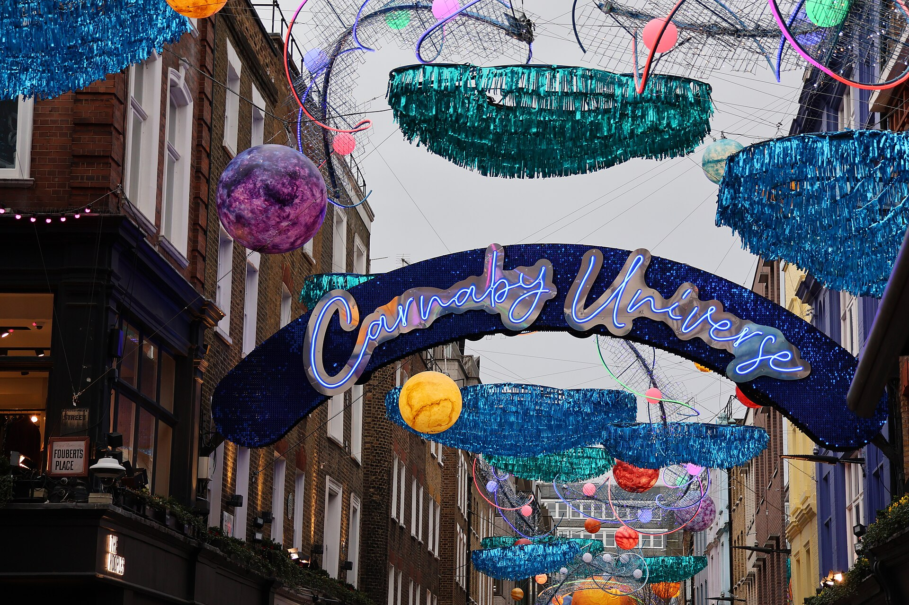

*Christmas lights hung across Carnaby Street. Photo: [DiscoA340](https://commons.wikimedia.org/wiki/File:Carnaby_Street,_London_(January_2024)_04.jpg), [CC BY-SA 4.0](https://creativecommons.org/licenses/by-sa/4.0/), via Wikimedia Commons.*

Fashion flagships and boutiques on a pedestrianised street, which Carnaby's own site pitches as respite from the rest of the West End. Visit London files it under trend-led fashion and colourful streets. It is shops and cafés rather than sights, so the quieter streets that run off it are where to browse: Carnaby's site lists Newburgh Street, which it calls one of Soho's best cobbled shopping streets, and Beak Street and Broadwick Street.

The draw in winter is the lights hung across the street. Carnaby's were switched on on 4 November 2026, with a 90s theme; our [Christmas lights walk](/articles/christmas-lights-walk-london/) has the dates for the rest of the West End. For the area around it, see the [Soho guide](/articles/soho-area-guide/).

### Neal's Yard and Seven Dials — a courtyard behind Monmouth Street

*Covent Garden · Cited by 13 sources, counting Seven Dials · Leicester Square or Holborn*

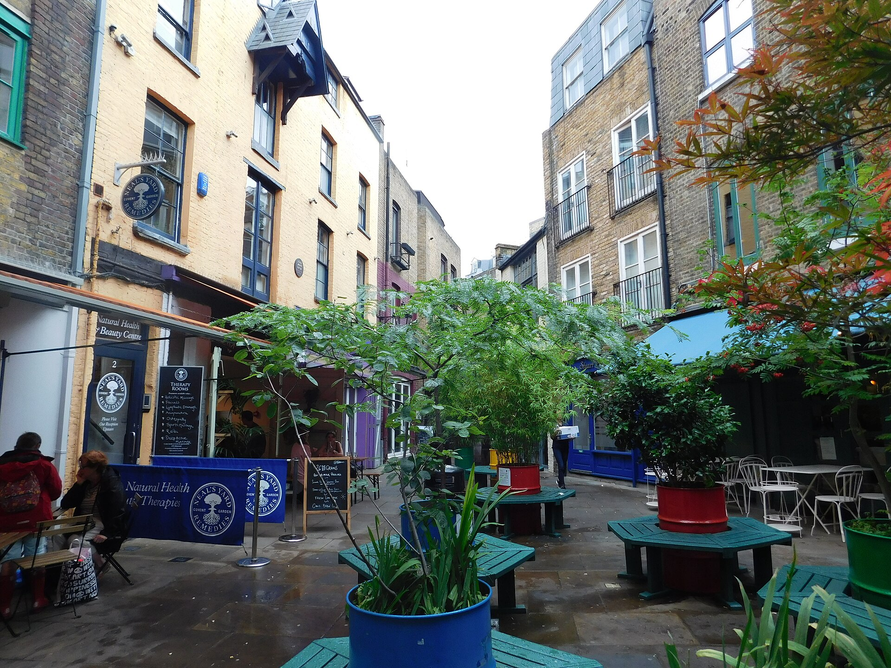

*The courtyard at Neal's Yard, Covent Garden. Photo: [Bryn Holmes](https://commons.wikimedia.org/wiki/File:Neal%27s_Yard,_Covent_Garden_-_geograph.org.uk_-_7395246.jpg), [CC BY-SA 2.0](https://creativecommons.org/licenses/by-sa/2.0/), via Wikimedia Commons.*

Seven cobbled streets meet at a sundial monument, and an alley off Short's Gardens opens into Neal's Yard, a small courtyard of painted facades and organic cafés. Monmouth Street and Neal Street are the independent shopping streets running up from the Piazza. Seven Dials Market, a food hall in a former fruit-market warehouse, is free to walk into and open daily, with its own site listing hours from 11am or noon.

**Use Leicester Square or Holborn, not Covent Garden station**, which has no escalators, only lifts and a 193-step spiral staircase. More in our [Covent Garden guide](/articles/covent-garden-area-guide/) and [walking route](/articles/covent-garden-walk/).

### Kynance Mews — the arch in South Kensington

*South Kensington · Cited by 12 sources · Gloucester Road*

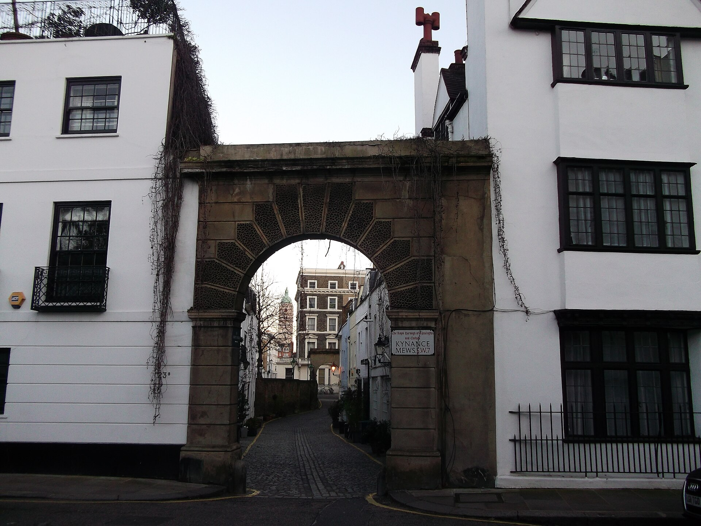

*One of the arches into Kynance Mews, South Kensington. Photo: [David Anstiss](https://commons.wikimedia.org/wiki/File:Kynance_Mews,_East_Arch,_South_Kensington-geograph-2737088-by-David-Anstiss.jpg), [CC BY-SA 2.0](https://creativecommons.org/licenses/by-sa/2.0/), via Wikimedia Commons.*

A cobbled mews of 33 houses, built between 1862 and 1879 as stabling for the houses on Cornwall Gardens, and entered through three stone arches that Historic England lists at Grade II. Virginia creeper turns red over the arches in October and the wisteria flowers in April, which is why it is in our [autumn leaves guide](/articles/best-places-autumn-leaves-london/).

**Go on a weekday before 10am.** By mid-morning there is a queue for a clear shot of the arch. The houses are private homes, so photograph from the cobbles and keep moving.

### Oxford Street — traffic-free between Orchard Street and Great Portland Street

*Marble Arch to Tottenham Court Road · Cited by 12 sources · Bond Street, Oxford Circus or Tottenham Court Road*

The street the shopping lists start with. Since **26 October 2026** no cars, buses, taxis, bicycles, e-scooters or pedicabs are allowed on the stretch from Orchard Street, beside Selfridges, to Great Portland Street, just east of Oxford Circus. Oxford Street's own advice is that weekday mornings are quietest.

Which end to use, what to buy, where to eat and which side streets to turn into are all in our [Oxford Street guide](/articles/oxford-street-guide/).

### Brick Lane — curry at one end, vintage at the other

*Shoreditch · Cited by 11 sources · Aldgate East or Shoreditch High Street*

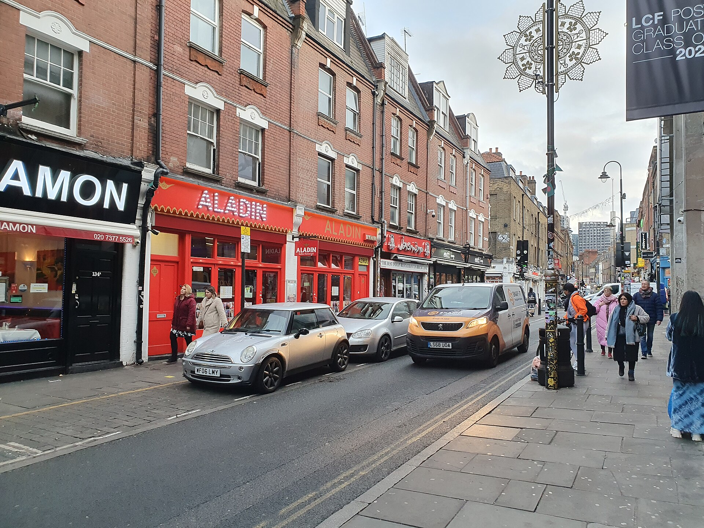

*Restaurants on Brick Lane. Photo: [Gazamp](https://commons.wikimedia.org/wiki/File:Brick_Lane,_London,_February_2023_(3).jpg), [CC BY-SA 4.0](https://creativecommons.org/licenses/by-sa/4.0/), via Wikimedia Commons.*

Bangladeshi restaurants at the south end, vintage shops and street food around the Truman Brewery in the middle, and two rival bagel bakeries at the north, one of which never closes. **On Sunday the whole stretch becomes a market**, including Upmarket, Backyard Market and the brewery yards.

The Brick Lane Vintage Market runs seven days a week in the basement at 85 Brick Lane, with clothes from the 1920s to the 1990s, so come on a weekday if the clothes are the point. The street art is on the side streets, including Hanbury Street and Chance Street: see our [street art guide](/articles/london-street-art/), the [Shoreditch guide](/articles/shoreditch-area-guide/) and the [Shoreditch and Spitalfields walk](/articles/shoreditch-spitalfields-walk/).

### Bond Street — luxury, best on a weekday

*Mayfair · Cited by 10 sources · Bond Street*

Luxury fashion and jewellery, with Visit London filing it under designer boutiques. It is a street to window-shop on a weekday; Bond Street station is on the Elizabeth line, the Central line and the Jubilee line, and is step-free. The streets around it, including Savile Row and Jermyn Street, are below. See our [shopping in London guide](/articles/shopping-in-london/) and the [Mayfair guide](/articles/mayfair-area-guide/).

### King's Road — Chelsea's long shopping street

*Chelsea · Cited by 10 sources · Sloane Square*

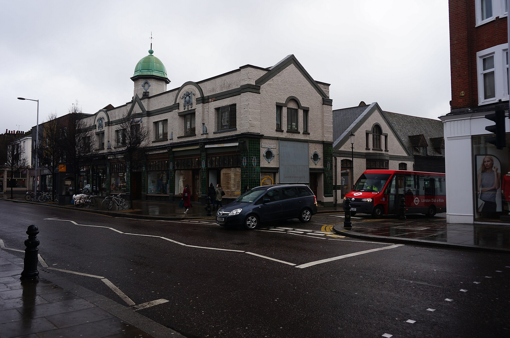

*A corner of King's Road at Flood Street, Chelsea. Photo: [Peter Barr](https://commons.wikimedia.org/wiki/File:King%27s_Road,_Chelsea_-_geograph.org.uk_-_4368057.jpg), [CC BY-SA 2.0](https://creativecommons.org/licenses/by-sa/2.0/), via Wikimedia Commons.*

Boutiques and homeware running west from Sloane Square; Visit London lists it for stylish boutiques and fashionable homeware. Saturdays are busy and weekday afternoons are calmer. **Bywater Street's pastel cottages are a short detour off it.** The [Chelsea guide](/articles/chelsea-area-guide/) covers the rest of the area, including the Physic Garden.

### Regent Street — Nash's curve from Oxford Circus to Piccadilly Circus

*Mayfair and Soho · Cited by 10 sources · Oxford Circus or Piccadilly Circus*

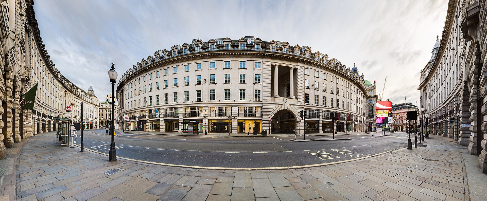

*The Quadrant, the curve at the Piccadilly Circus end of Regent Street. Photo: [Benh LIEU SONG](https://commons.wikimedia.org/wiki/File:Panorama_of_the_Quadrant_on_Regent_Street.jpg), [CC BY-SA 4.0](https://creativecommons.org/licenses/by-sa/4.0/), via Wikimedia Commons.*

Regent Street curves from Piccadilly Circus to Oxford Circus in one continuous sweep designed by John Nash, and the Crown Estate owns the whole street. The shops are mid-to-premium rather than luxury: Hamleys is toys over seven floors, and **Liberty**, just off it on Great Marlborough Street, is a mock-Tudor building made from the timbers of two ships. Visit London lists it for elegant shopping and iconic architecture. Details in our [shopping guide](/articles/shopping-in-london/).

### Columbia Road — Sunday only

*Bethnal Green · Cited by 9 sources · Hoxton*

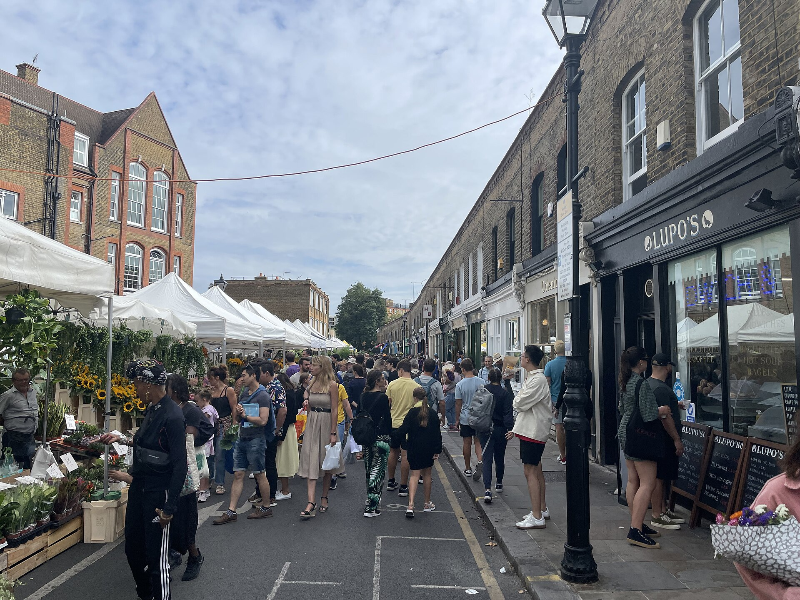

*Columbia Road on a market Sunday. Photo: [SunDawn](https://commons.wikimedia.org/wiki/File:Columbia_Road_Flower_Market_2022.jpg), [CC BY-SA 4.0](https://creativecommons.org/licenses/by-sa/4.0/), via Wikimedia Commons.*

Flower sellers line a Victorian street, with more than 60 independent shops, cafés and galleries in the terraces behind. The market runs **every Sunday, 8am to about 3pm**, according to the street's own site. Arrive at 8am for the best stock and room to move, or after 2pm when sellers cut prices. Between 10am and 1pm the street is too crowded to carry a plant.

Do not bring a pushchair. The shops open late on four Wednesdays before Christmas, 5pm to 9pm, with mulled wine: 25 November and 2, 9 and 16 December 2026. See the [markets guide](/articles/best-london-markets/) and [Shoreditch and Spitalfields walk](/articles/shoreditch-spitalfields-walk/).

---

## Pretty streets and mews

The mews are former stable lanes behind big houses, now small private homes. The lists that name them overlap heavily, which is why they cluster in the counts.

### Bywater Street — pastel cottages off King's Road

*Chelsea · Cited by 8 sources · Sloane Square*

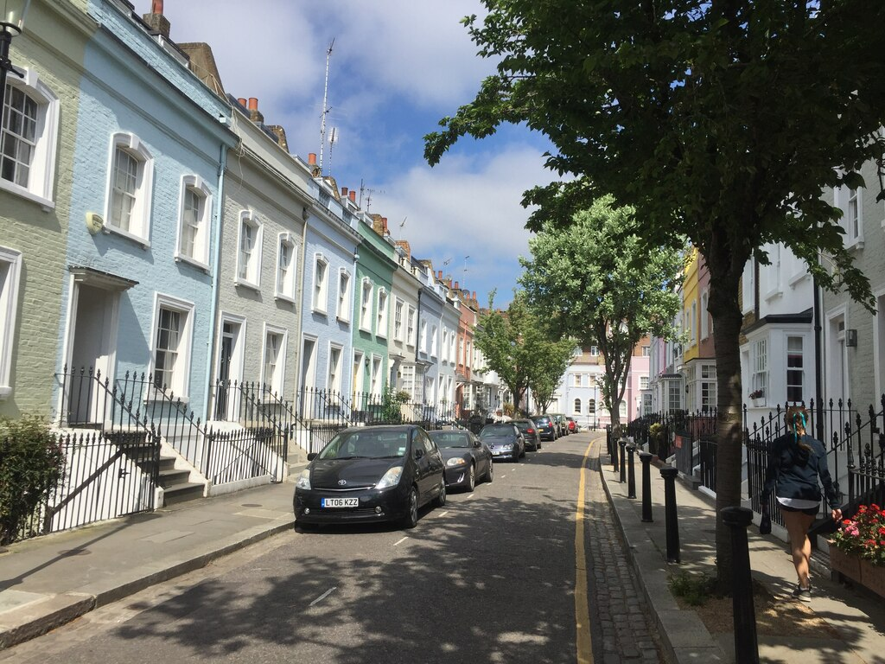

*Painted terraced cottages on Bywater Street. Photo: [Darren Haddock](https://commons.wikimedia.org/wiki/File:Bywater_Street_-_geograph.org.uk_-_8305112.jpg), [CC BY-SA 2.0](https://creativecommons.org/licenses/by-sa/2.0/), via Wikimedia Commons.*

A short cul-de-sac of pastel terraced cottages off the King's Road, an easy detour from Sloane Square. Despite the name there is no water near it. The cottages are private homes, so photograph from the pavement and keep the noise down. Five minutes covers it: pair it with the King's Road and the Chelsea Physic Garden in our [Chelsea guide](/articles/chelsea-area-guide/).

### Chalcot Crescent — the Paddington house in Primrose Hill

*Primrose Hill · Cited by 8 sources · Chalk Farm*

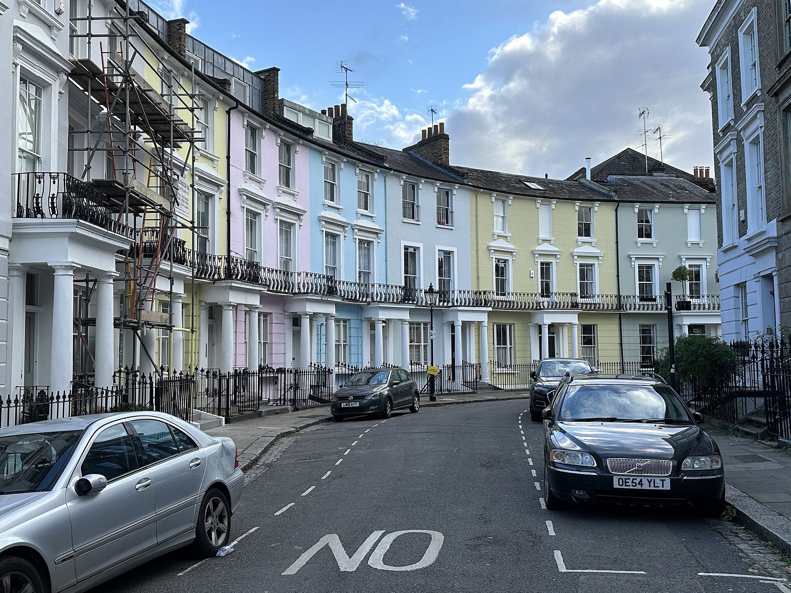

*Painted stucco terraces on Chalcot Crescent, Primrose Hill. Photo: [Matt Brown](https://commons.wikimedia.org/wiki/File:Chalcot_Crescent_2024-11-22.jpg), [CC BY 2.0](https://creativecommons.org/licenses/by/2.0/), via Wikimedia Commons.*

A bending crescent laid out between 1849 and 1860, with three-storey stucco fronts in pink, blue and yellow, and cast-iron railings. It was the Browns' house in the *Paddington* films, though the address in the books, 32 Windsor Gardens, is fictional. About fifteen minutes north-west of Camden Lock. Chalcot Square, named by 4 sources, is round the corner. See our [Primrose Hill walk](/articles/hampstead-heath-primrose-hill-walk/) and [Camden guide](/articles/camden-area-guide/).

### Lancaster Road — the rainbow row in Notting Hill

*Notting Hill · Cited by 6 sources · Ladbroke Grove*

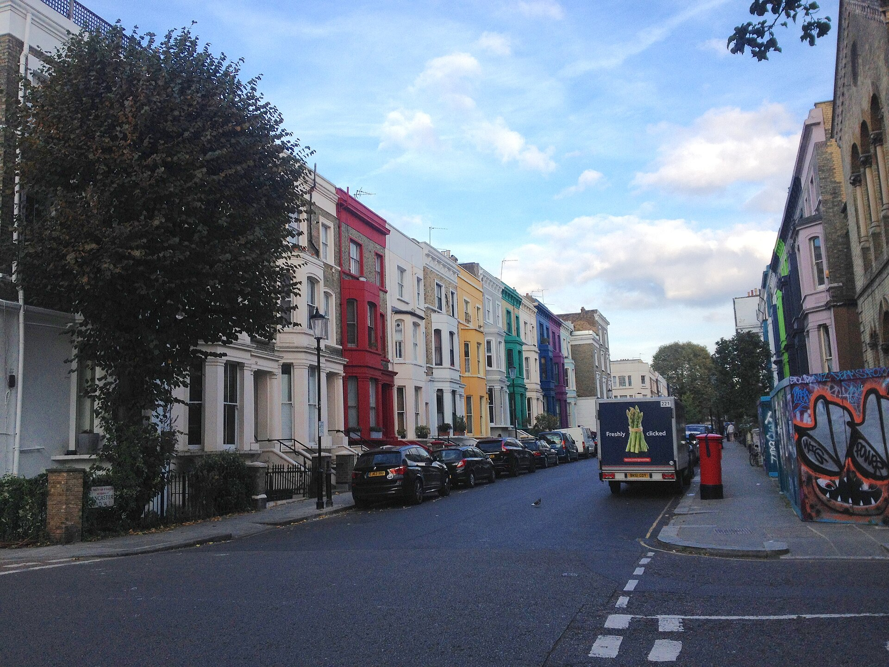

*Brightly painted houses on Lancaster Road. Photo: [Chris Whippet](https://commons.wikimedia.org/wiki/File:Lancaster_Road,_Notting_Hill_-_geograph.org.uk_-_5188672.jpg), [CC BY-SA 2.0](https://creativecommons.org/licenses/by-sa/2.0/), via Wikimedia Commons.*

The road people mean when they say the rainbow houses of Notting Hill: purple, blue, green, yellow and red, running east from Ladbroke Grove. It has the strongest colours of the Notting Hill streets and the most photographers. **Hillgate Place** is two minutes from Notting Hill Gate station and far quieter; our [colourful houses guide](/articles/notting-hill-colourful-houses/) ranks all eleven.

### The rest of the mews and crescents

- **[Bathurst Mews](/articles/paddington-area-guide/), Paddington** — built around 1840 on the Hyde Park Estate, and one of the few London mews still used for horses; Hyde Park Stables run riding lessons from it. *Cited by 7 sources.*
- **St Luke's Mews, Notting Hill** — a cobbled mews a short walk from Portobello Road, where No. 27, the pink house, is Mark's door in *Love Actually*. *Cited by 7 sources.*
- **Conduit Mews, Paddington** — between Spring Street and Westbourne Terrace, a few minutes from Paddington station. *Cited by 5 sources.*
- **Ennismore Gardens Mews, Knightsbridge** — an L-shaped cobbled mews behind Holy Trinity Brompton, entered through a mid-19th-century stone arch with paired Ionic columns. *Cited by 5 sources.*
- **Holland Park Mews** — on five of the pretty-street lists. *Cited by 5 sources.*
- **Warren Mews** — a quieter mews, in Fitzrovia. *Cited by 4 sources.*
- **Elgin Crescent, Notting Hill** — a curving crescent of pale yellow and powder-blue stucco, which our [colourful houses guide](/articles/notting-hill-colourful-houses/) calls the best of the grand streets there. *Cited by 3 sources.*

---

## Famous roads

### Abbey Road — the crossing, not the studio

*St John's Wood · Cited by 7 sources · St John's Wood*

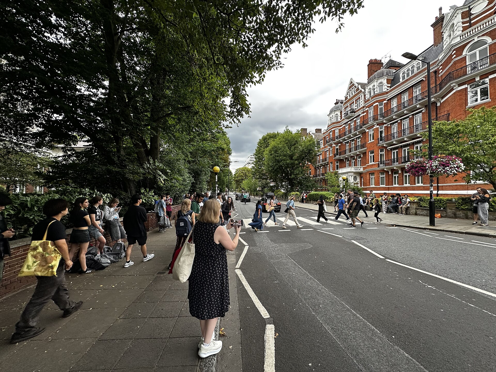

*Visitors photographing the zebra crossing on Abbey Road. Photo: [Steve Bowbrick](https://commons.wikimedia.org/wiki/File:Abbey_Road_zebra_crossing_-_2025-07-22.jpg), [CC BY 4.0](https://creativecommons.org/licenses/by/4.0/), via Wikimedia Commons.*

The crossing is free and needs no ticket. **Abbey Road Studios is a working recording studio, so you cannot go inside**; what you can see is the crossing, the graffiti-covered wall and a live webcam trained on the crossing. The studio's shop is open Monday to Saturday 9.30am to 5.30pm and Sunday 10am to 5pm. Cars use the road, so wait for a gap. The rest of the Beatles trail is in our [Beatles guide](/articles/beatles-london/).

- **Baker Street** — 221b is signed on the Sherlock Holmes Museum, but the building sits between numbers 237 and 241; the museum opens every day 9:30am to 6pm. See our [Sherlock Holmes guide](/articles/sherlock-holmes-london/). *Cited by 7 sources.*
- **Downing Street** — gated since 1989, so you see the black iron gate, armed police and a slice of the street from Whitehall in about ninety seconds. It is stop 5 of our [Westminster walk](/articles/westminster-walk/). *Cited by 7 sources.*
- **Piccadilly** — runs west from Piccadilly Circus; the Burlington and Piccadilly arcades are on or beside it, and both are on our [Fitzrovia to Mayfair walk](/articles/fitzrovia-mayfair-walk/). *Cited by 7 sources.*
- **Camden High Street** — from the Tube station north: chain shops, tattoo studios and the oversized shop-front sculptures, a painted dragon and a boot. See the [Camden guide](/articles/camden-area-guide/). *Cited by 6 sources.*
- **Shaftesbury Avenue** — most West End theatres sit around it, the Strand and Drury Lane: see our [London theatre guide](/articles/london-theatre-guide/). *Cited by 6 sources.*
- **The Mall** — free at any hour, the avenue from Buckingham Palace to Trafalgar Square. *Cited by 6 sources.*
- **The Strand** — joins Trafalgar Square to the City, with theatres along it. *Cited by 5 sources.*

---

## Shopping and market streets

### Marylebone High Street — a village street one back from Oxford Street

*Marylebone · Cited by 5 sources · Baker Street or Bond Street*

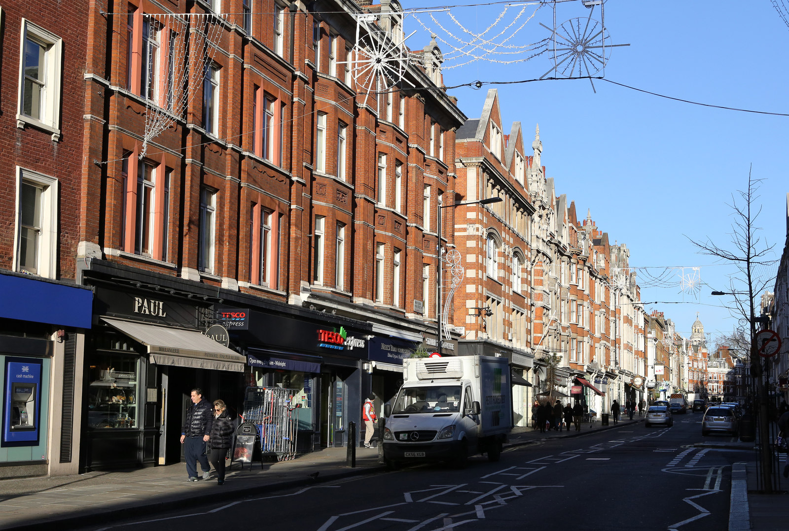

*Shopfronts and mansion blocks on Marylebone High Street. Photo: [Martin Addison](https://commons.wikimedia.org/wiki/File:Marylebone_High_Street_-_geograph.org.uk_-_3793099.jpg), [CC BY-SA 2.0](https://creativecommons.org/licenses/by-sa/2.0/), via Wikimedia Commons.*

Low-rise, largely independent and calm, a few minutes north of Oxford Street: delis, a cheesemonger, cafés with pavement tables and **Daunt Books**, an Edwardian bookshop with oak galleries and a long stained-glass window whose main room is arranged by country. The Wallace Collection, free, is round the corner.

**On Sunday the farmers' market runs 10am to 2pm**, producers only, on St Vincent Street, Aybrook Street and the top of Moxon Street, just west of the High Street. See the [Marylebone guide](/articles/marylebone-area-guide/) and our [Regent's Park and Marylebone walk](/articles/regents-park-marylebone-walk/).

### Savile Row — bespoke tailoring, on weekdays

*Mayfair · Cited by 5 sources · Piccadilly Circus or Oxford Circus*

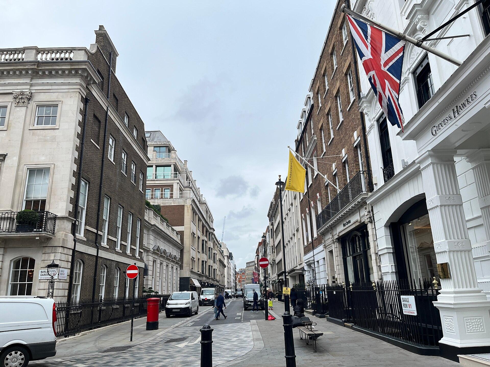

*Gieves & Hawkes at No. 1 Savile Row. Photo: [Sjenghai](https://commons.wikimedia.org/wiki/File:London_-_City_of_Westminster_-_Mayfair_-_Savile_Row_-_2026-09-02.jpg), [CC BY-SA 4.0](https://creativecommons.org/licenses/by-sa/4.0/), via Wikimedia Commons.*

The street of bespoke tailoring: Huntsman is at No. 11 and Gieves & Hawkes at No. 1, where it has been since 1912. You can look at the windows any day, but **two of the three tailors on our Fitzrovia to Mayfair walk are shut at weekends**, and Henry Poole opens on weekdays only. The Beatles' rooftop concert on 30 January 1969 was at No. 3, which is a private building. See the [Fitzrovia to Mayfair walk](/articles/fitzrovia-mayfair-walk/).

### Jermyn Street — the shirt street

*St James's · Cited by 5 sources · Piccadilly Circus or Green Park*

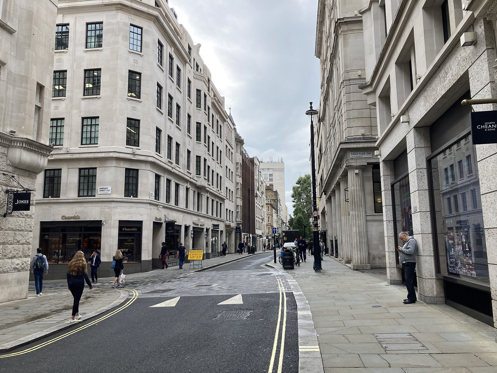

*Jermyn Street looking west, with Church's on the corner of Babmaes Street. Photo: [Nick-D](https://commons.wikimedia.org/wiki/File:Looking_west_along_Jermyn_Street_September_2022.jpg), [CC BY-SA 4.0](https://creativecommons.org/licenses/by-sa/4.0/), via Wikimedia Commons.*

One street south of Piccadilly, for a British shirt or shoe: Turnbull & Asser, New & Lingwood and Bates the hatter. **Piccadilly Arcade**, a covered passage off it, is open daily. It sits on the same walk as Savile Row.

### Broadway Market — Saturday or Sunday

*Hackney · Cited by 3 sources · Cambridge Heath or London Fields*

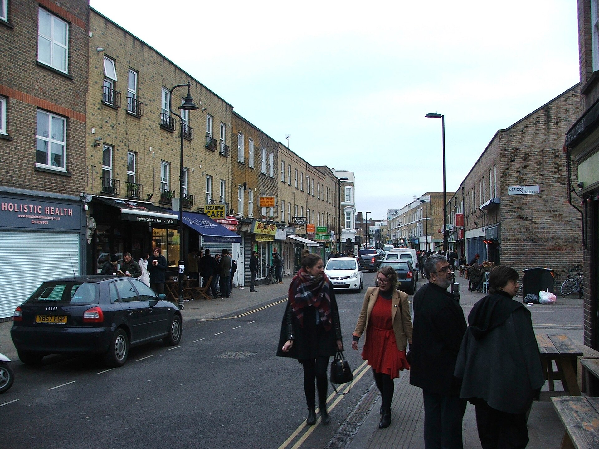

*Cafés and shops on Broadway Market, Hackney. Photo: [Chris Whippet](https://commons.wikimedia.org/wiki/File:Broadway_Market,_Hackney_-_geograph.org.uk_-_4325644.jpg), [CC BY-SA 2.0](https://creativecommons.org/licenses/by-sa/2.0/), via Wikimedia Commons.*

A working Victorian street market running down to the Regent's Canal, with **London Fields at the northern end** to eat what you buy. The market trades **Saturday 9am to 5pm and Sunday 10am to 4pm**, all year; the permanent shops and cafés trade through the week. American Express and GlobalData ranked it sixth in their 2025 list of Britain's top independent high streets, as the Evening Standard reported. See the [Hackney guide](/articles/hackney-area-guide/).

### Camden Passage — antiques, Saturday, Sunday and Wednesday

*Islington · Cited by 3 sources · Angel*

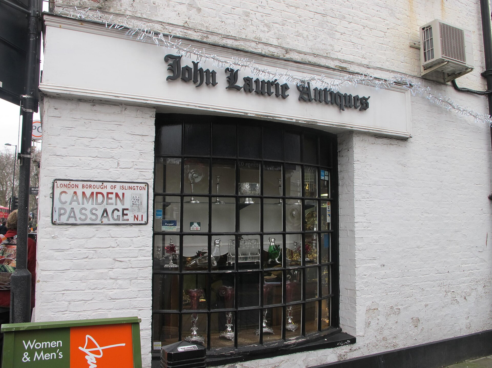

*John Laurie Antiques at the corner of Camden Passage. Photo: [Maggie Jones](https://commons.wikimedia.org/wiki/File:Camden_Passage_N1_and_John_Laurie_Antiques._(23811334633).jpg), public domain, via Wikimedia Commons.*

A car-free lane off Upper Street lined with antique, vintage and contemporary shops, outdoor markets and cafés. **Its main market days are Saturday, Sunday and Wednesday**, with other markets on other days; the street's own site says to check before going, since weather can affect openings. See the [Islington guide](/articles/islington-area-guide/).

### Golborne Road — Time Out's second-coolest street in the world

*Notting Hill · Cited by 3 sources · #2 of 28 in Time Out's coolest streets in the world, 2026 · Westbourne Park*

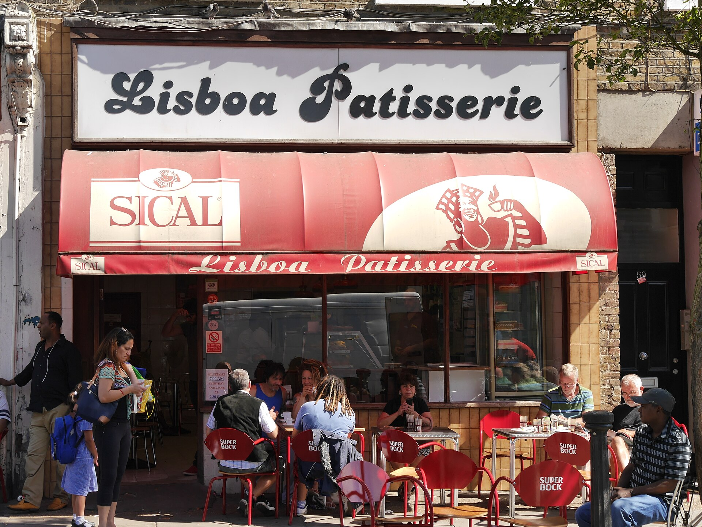

*Lisboa Patisserie on Golborne Road. Photo: [Edwardx](https://commons.wikimedia.org/wiki/File:Patisserie_Lisboa,_Golborne_Road,_London_04.JPG), [CC BY-SA 4.0](https://creativecommons.org/licenses/by-sa/4.0/), via Wikimedia Commons.*

The short stretch between Portobello Road and Kensal Road. One end is Portuguese, Moroccan and Middle Eastern places to eat, including Café O'Porto, Lisboa Patisserie, Falafel King and the Palestinian Maramia Cafe; the other has the boutiques and a brutalist landmark, Time Out says. **Fruit and veg and hot food stalls trade Monday to Thursday; the bric-a-brac and furniture stalls run Friday and Saturday, and Friday is the busiest day.** In 2025 Time Out ranked Blackstock Road, in north London, 23rd.

### Exmouth Market — a pedestrianised street at lunchtime

*Clerkenwell · Cited by 1 source · Farringdon*

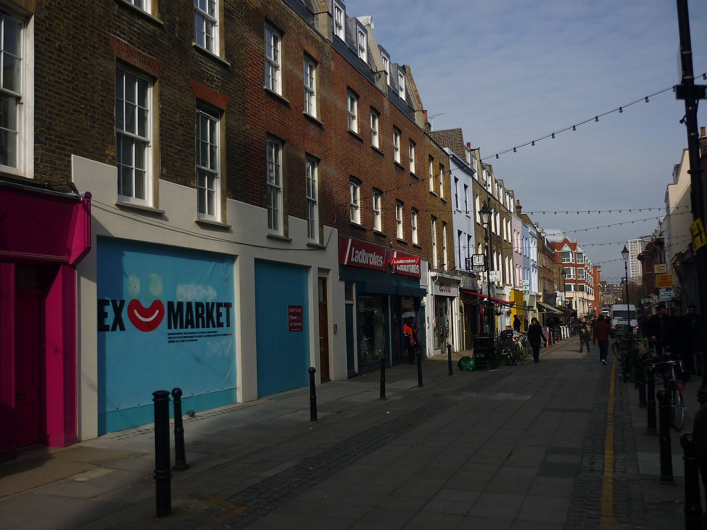

*Shops and cafés along Exmouth Market, Clerkenwell. Photo: [Julian Osley](https://commons.wikimedia.org/wiki/File:Exmouth_Market,_Clerkenwell,_London_EC1_-_geograph.org.uk_-_1737702.jpg), [CC BY-SA 2.0](https://creativecommons.org/licenses/by-sa/2.0/), via Wikimedia Commons.*

Stalls at weekday lunchtimes on a pedestrianised street, with cafés and independent shops on either side. It is ten minutes from Farringdon and about the same from Angel; see our [best street food guide](/articles/best-street-food-london/) for the traders.

### Three more

- **Bermondsey Street** — Georgian houses and painted shopfronts with the Shard behind; White Cube Bermondsey is free, and the Fashion and Textile Museum is ticketed and open Tuesday to Saturday, 11am to 6pm. London Bridge is the station. *Cited by 2 sources.*
- **Upper Street, Islington** — a mile of restaurants and bars from Angel to Highbury Corner, with no landmarks; it is a street for an evening. *Cited by 1 source.*
- **Charlotte Street, Fitzrovia** — restaurants of a dozen cuisines, two minutes from Goodge Street. See the [Fitzrovia guide](/articles/fitzrovia-area-guide/). *Cited by 1 source.*

---

## Streets with a past

### Shad Thames — iron walkways in Bermondsey

*Bermondsey · Cited by 4 sources · Tower Hill or London Bridge*

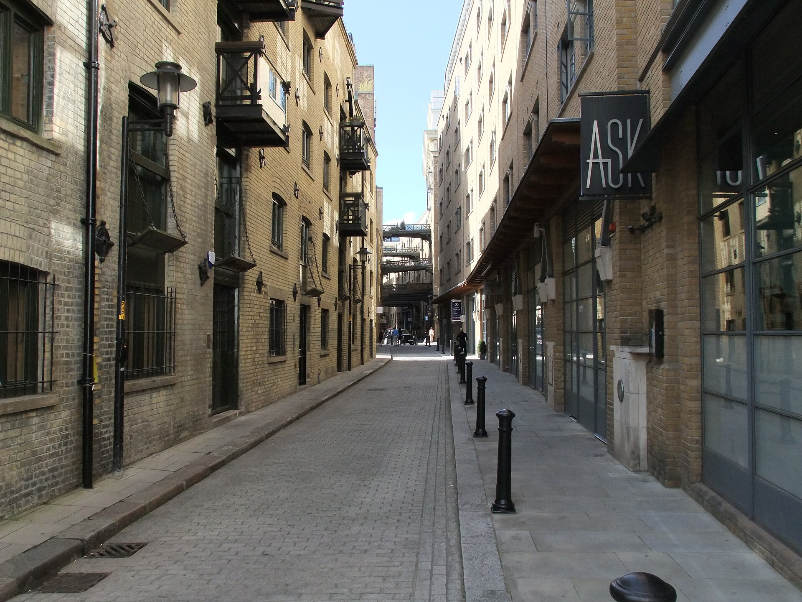

*Cobbles and warehouse walls on Shad Thames. Photo: [Paul Farmer](https://commons.wikimedia.org/wiki/File:Shad_Thames_-_geograph.org.uk_-_2596503.jpg), [CC BY-SA 2.0](https://creativecommons.org/licenses/by-sa/2.0/), via Wikimedia Commons.*

A riverside street with cobbles underfoot and iron walkways overhead, most of them linking Butler's Wharf on one side to the Cardamom Building on the other. The warehouse complex was the largest in London in Victorian times, storing spices, tea and coffee unloaded nearby. It is a few minutes from Tower Bridge on the Bermondsey side. Our [Bermondsey guide](/articles/bermondsey-area-guide/) has the rest.

### Leadenhall Market — a covered street in the City

*The City · Cited by 2 sources · Bank or Monument*

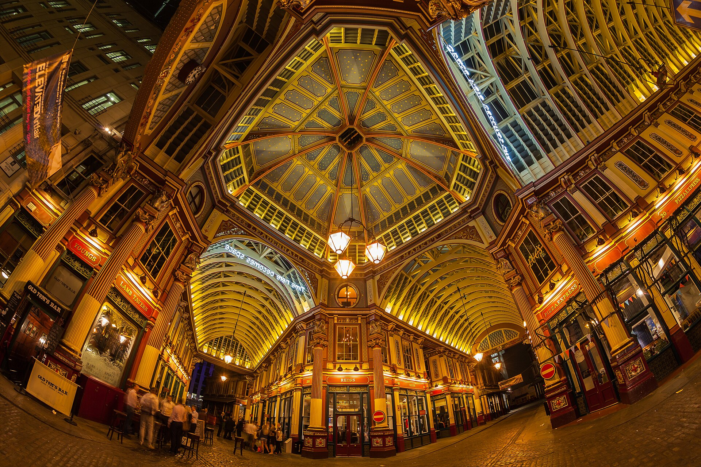

*The covered arcade of Leadenhall Market, City of London. Photo: [Diego Delso](https://commons.wikimedia.org/wiki/File:Mercado_Leadenhall,_Londres,_Inglaterra,_2014-08-07,_DD_048.JPG), [CC BY-SA 4.0](https://creativecommons.org/licenses/by-sa/4.0/), via Wikimedia Commons.*

An 1881 covered market in cream, maroon and green ironwork on the site of the Roman forum, designed by Horace Jones. The blue door on Bull's Head Passage that stood in for the Leaky Cauldron in the first *Harry Potter* film is now a coffee shop. **The public areas are open at any hour, but the shops, bars and restaurants keep City hours**, so it is quiet at weekends and fullest around six on a weekday evening. It sits on the [City of London walk](/articles/city-of-london-walk/) and is covered in full in our [markets guide](/articles/best-london-markets/).

- **Fournier Street, Spitalfields** — built in the early 1700s for the Huguenot silk weavers, who used the houses as homes and workshops; the silk for Queen Victoria's coronation gown was woven at No. 14. Dennis Severs' House is nearby. *Cited by 2 sources.*
- **Little Green Street, Kentish Town** — eight cottages that make up one of the best-preserved Georgian strips in London, and the backdrop for the Kinks' video for *Dead End Street*. *Cited by 2 sources.*
- **Cheyne Walk, Chelsea** — a riverside street of Jacobean and Queen Anne houses where JMW Turner spent his last years, at No. 119. *Cited by 3 sources.*
- **Lombard Street, the City** — hanging signs put up for Edward VII's coronation in 1902 recall the businesses that once traded here. *Cited by 2 sources.*
- **Roupell Street, Waterloo** — two-storey terraces left as 19th-century London looked, minutes from Waterloo station; walk Theed Street beside it. *Cited by 1 source.*
- **Goodwin's Court and Cecil Court, Covent Garden** — a narrow lane of Victorian street lamps and bow windows, and a street of small shops around the corner from it, according to the creator Suitcase Monkey. *Cited by 3 and 2 sources.*

---

## Streets that go together

- **Columbia Road, Brick Lane and Spitalfields**, in one morning on a Sunday: our [Shoreditch and Spitalfields walk](/articles/shoreditch-spitalfields-walk/).
- **Carnaby Street, Neal's Yard and Seven Dials**, through Soho: the [Soho and Chinatown walk](/articles/soho-chinatown-walk/) and the [Covent Garden walk](/articles/covent-garden-walk/).
- **Savile Row and Jermyn Street**, with Piccadilly's arcades: the [Fitzrovia to Mayfair walk](/articles/fitzrovia-mayfair-walk/).
- **Marylebone High Street** and Baker Street: the [Regent's Park and Marylebone walk](/articles/regents-park-marylebone-walk/).
- **Downing Street and The Mall**: the [Westminster walk](/articles/westminster-walk/).
- **Leadenhall Market**: the [City of London walk](/articles/city-of-london-walk/).
- **Which area is best for what**: [best areas to visit in London](/articles/best-areas-to-visit-london/).
