A Sunday roast is a joint of meat with a Yorkshire pudding, roast potatoes and gravy, served in pubs for about five hours on Sundays. The good ones sell out and most want booking by Thursday. Every pub below is placed by how many independent awards, critics and reviewers name it, and by where it finished when a ranking exists.

> 💡 **The Short Version:** **The Devonshire** is the most-cited roast in London and the UK's number one gastropub. **The Red Lion & Sun** is #3 in the country and the roast guides mostly miss it. **Canton Arms** is the best-placed pub that still takes walk-ins. **The Harwood Arms** is the only Michelin-starred pub. **Blacklock** and **Hawksmoor** are the group answer. **The Tamil Crown** serves masala-spiced gravy and potatoes.

> 📊 **The evidence behind this guide.**
> **20 sources carrying 120 citations** across **82 named pubs and restaurants**. **24 are named by two or more independent sources; 25 carry a dated ranking.**
> **Built on:** the [Estrella Damm Top 50 Gastropubs](https://www.top50gastropubs.com/list/1-50) and the [National Pub & Bar Awards](https://www.nationalpubandbarawards.co.uk/the-regions-2026); eight independent publications; twelve creators.
> *Evidence rebuilt 21 September 2026 · [How we rank →](/how-we-rank/)*

---

## Where they are

  

    Map of the best Sunday roasts in London
  

  

    
Loading the interactive map…

  

  <noscript>
    
The interactive map requires JavaScript. Every entry below lists its area.

  </noscript>

Nine of the sixteen ranked entries sit wholly outside Zone 1. Of the seven that are central, four — Blacklock, Hawksmoor, The Quality Chop House and Fallow — are restaurants, not pubs.

---

## The most-cited roasts in London

### The Devonshire, Soho

*££ · Piccadilly Circus · Cited by 6 sources · #1, Estrella Damm Top 50 Gastropubs 2026 · #1, Industry's Choice 2026*

The most-cited roast in this guide and the top-ranked gastropub in the UK.

It also took the National Pub & Bar Awards' **[Industry's Choice Award](https://www.nationalpubandbarawards.co.uk/industrys-choice) for the second year running** in 2026, a top ten voted by 400 people who run pubs.

The ground floor is a Guinness pub and a good share of the queue is there for the pour, not the food. The roast is upstairs. Three video reviewers who filmed here in 2026 all describe the same problem: getting in.

**The venue's site:** [devonshiresoho.co.uk](https://www.devonshiresoho.co.uk/) · **two minutes from Blacklock**

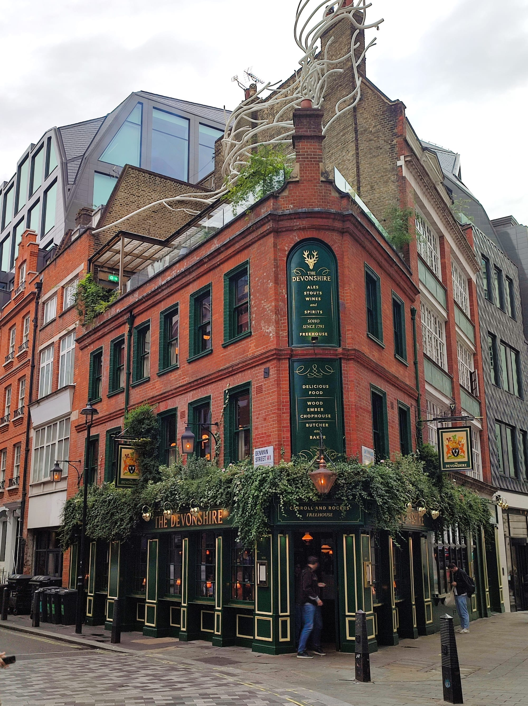

*The Devonshire, Soho. Photo: [Ewan-M](https://commons.wikimedia.org/wiki/File:Devonshire,_Soho,_W1.jpg), [CC BY-SA 4.0](https://creativecommons.org/licenses/by-sa/4.0/).*

### The Red Lion & Sun, Highgate

*££ · Highgate · Cited by 3 sources · #3, Estrella Damm Top 50 Gastropubs 2026 · #4, Industry's Choice 2026 · London Pub of the Year 2025*

Third in the UK, named London's pub of the year at the 2025 National Pub & Bar Awards and fourth in the trade's own 2026 vote, yet the editorial roast lists barely mention it: three sources here against The Camberwell Arms' four.

**Beef cooked pink, dripping-roasted potatoes, a tall Yorkshire and a jug of gravy**, in a Highgate pub with a garden. It is also the roast **Oisin Rogers of The Devonshire sends people to**.

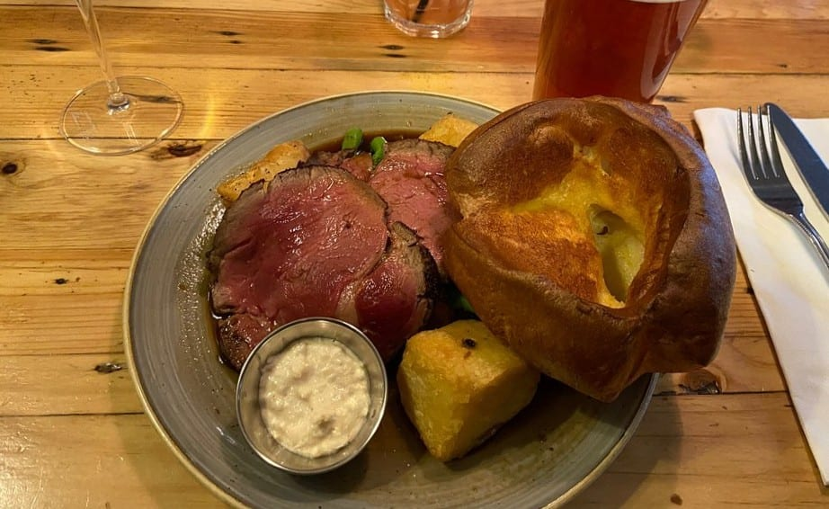

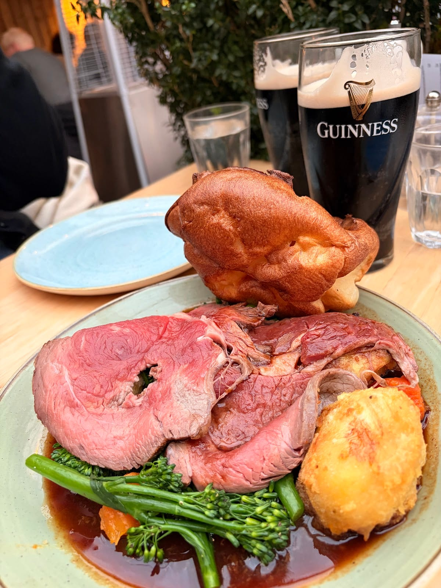

*The roast at The Red Lion & Sun.*

**Book:** [a table on ResDiary](https://booking.resdiary.com/widget/Standard/TheRedLionandSun/15205) · **four minutes from The Bull**

### Canton Arms, Stockwell

*££ · Stockwell · Cited by 2 sources · #11, Estrella Damm Top 50 Gastropubs 2026 · #19, Time Out*

A South Lambeth Road pub ranked eleventh in the country, at pub prices. It is the only pub near the top of this list that holds back space for walk-ins.

**Book:** [cantonarms.com](https://cantonarms.com/bookings/)

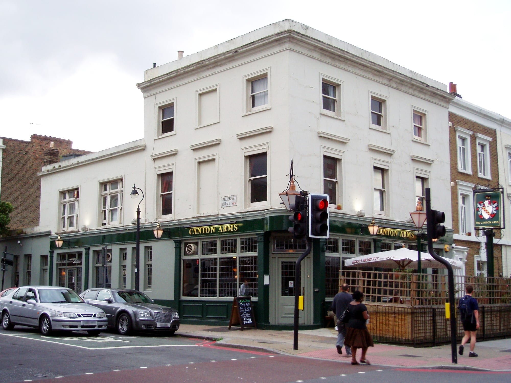

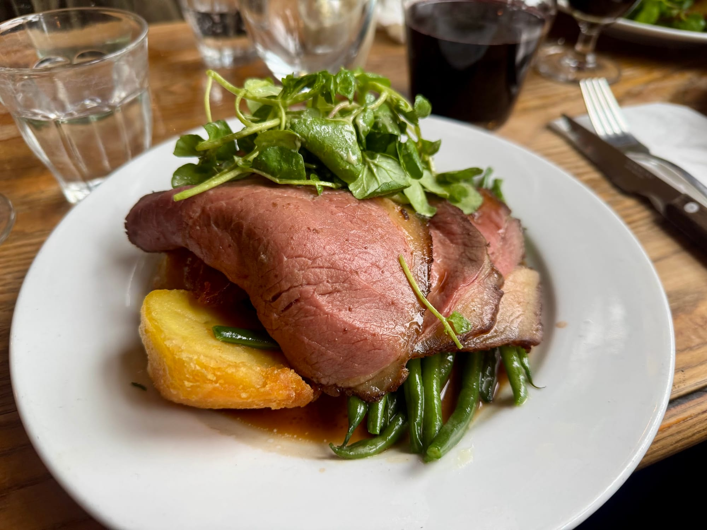

*Canton Arms, Stockwell. Photo: [Ewan Munro](https://commons.wikimedia.org/wiki/File:Canton_Arms,_South_Lambeth,_SW8_(3838932573).jpg), [CC BY-SA 2.0](https://creativecommons.org/licenses/by-sa/2.0/).*

### The Baring, Islington

*££ · Angel · Cited by 2 sources · #17, Estrella Damm Top 50 Gastropubs 2026*

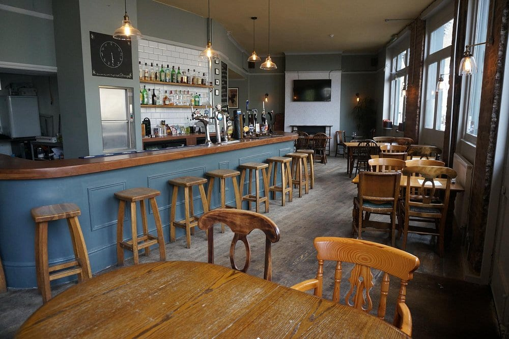

**Seventeenth in the country in the 2026 Estrella Damm Top 50**, and in The Infatuation's description more a sit-down restaurant than a pub you can drink in.

A plated roast, not a pub carvery: **beef with a Yorkshire pudding**, roast potatoes in beef fat and greens. Gravy comes in a jug and is refillable.

**££, closed Monday, and it books weeks ahead for Sunday.** [Book](https://www.sevenrooms.com/explore/thebaring/reservations/create/search/) the moment you decide.

### The Marksman, Hackney

*££ · Bethnal Green · Cited by 2 sources · #23, Estrella Damm Top 50 Gastropubs 2026*

**Downstairs is a pub; upstairs is the dining room that won Michelin's Pub of the Year.**

The Sunday roast is served in the upstairs room. The pudding to order is the **brown butter and honey tart**, on the menu since the beginning.

**££, closed Monday.** The upstairs room [books on OpenTable](https://www.opentable.co.uk/r/the-marksman-hackney-reservations-london?lang=en-GB&ot_source=website&restref=208518). Drink downstairs first.

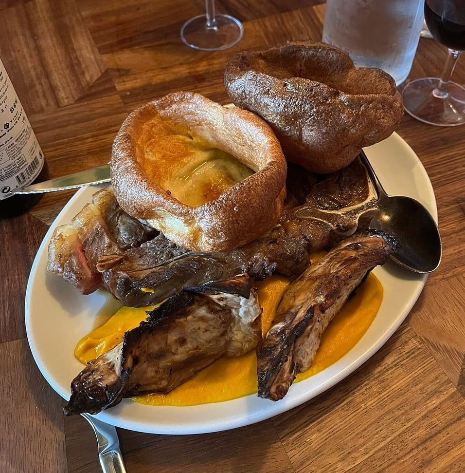

*The Sunday roast at The Marksman.*

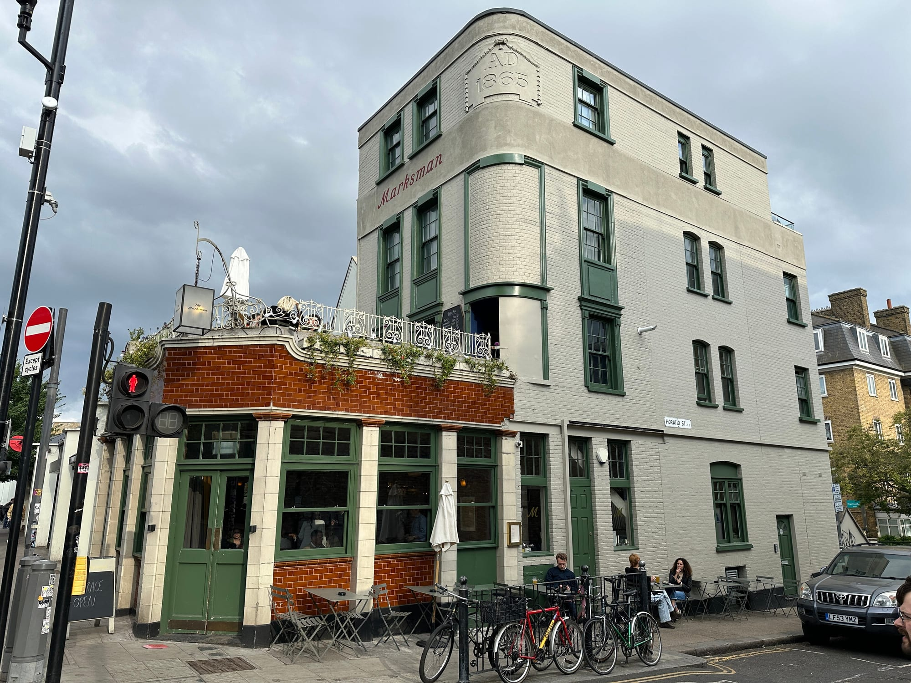
*The Marksman, Hackney Road. Photo: [Matt Brown](https://commons.wikimedia.org/wiki/File:The_Marksman_pub_254_Hackney_Road_2025-05-08.jpg), [CC BY 2.0](https://creativecommons.org/licenses/by/2.0/).*

### The Waterman's Arms, Barnes

*££ · Barnes Bridge · Cited by 2 sources · #33, Estrella Damm Top 50 Gastropubs 2026*

**A Barnes riverside pub, picked out for the setting as much as the roast.**

Beef or chicken with **roast potatoes, Yorkshire pudding and gravy**, in a low-ceilinged pub by the Thames.

**££, closed Monday.** [Book for Sunday](https://www.watermansarms.co.uk/reservations) and ask for a table by the window or outside.

### The Tamil Crown, Islington

*££ · Angel · Cited by 3 sources · #35, Estrella Damm Top 50 Gastropubs 2026*

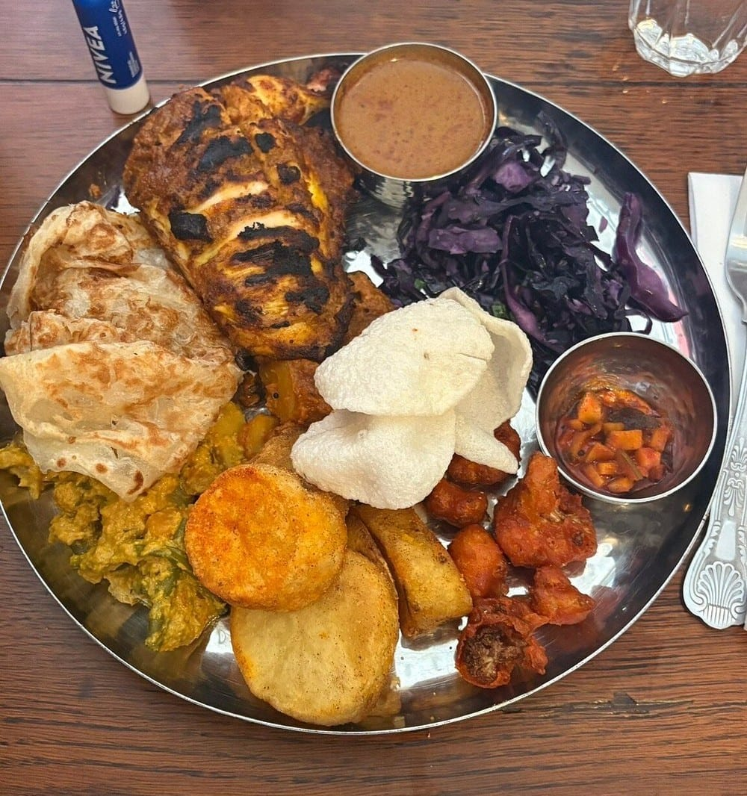

**The second pub from The Tamil Prince team**, with a Tamil kitchen in a Victorian pub.

The roast comes with the usual trimmings plus **masala-spiced gravy and potatoes**. The rest of the menu is Tamil cooking.

**££. Sibling to The Tamil Prince, also in Islington; two separate pubs.** [Book for Sunday](https://www.sevenrooms.com/explore/thetamilcrown/reservations/create/search?venues=thetamilcrown%2Cthetamilprince%2Ctamilasoho%2Ctamilaclapham%2Ctamilakingscross).

### The Harwood Arms, Fulham

*£££ · Fulham Broadway · Cited by 3 sources · #36, Estrella Damm Top 50 Gastropubs 2026*

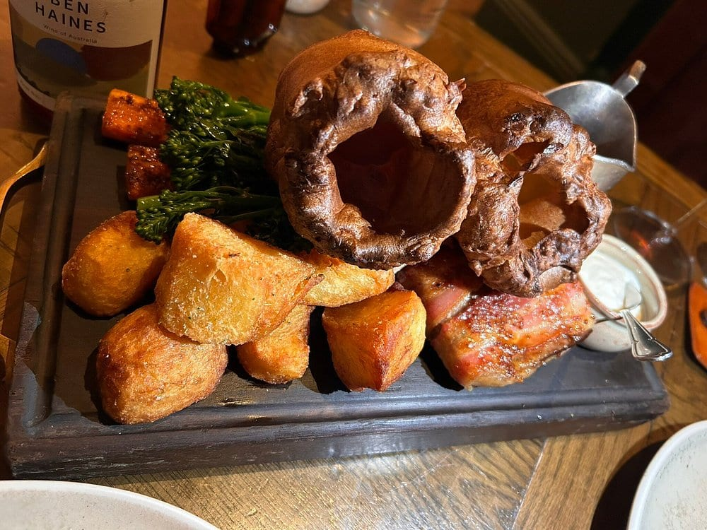

**London's only Michelin-starred pub**; **the venison comes from the owners' own stalking**.

The **venison scotch egg** is the signature: a soft-yolked egg in coarse venison sausagemeat, fried, with a sharp relish. The Sunday roast is built on the same game and British produce.

**£££ and it books weeks ahead**; plan a month out. Book through [the venue's site](https://harwoodarms.com/).

### The Bull & Last, Highgate

*££ · Tufnell Park · Cited by 2 sources · #39, Estrella Damm Top 50 Gastropubs 2026*

**A Highgate Road pub on the edge of Hampstead Heath, 39th in the UK gastropub rankings**, and a natural end to a Heath walk.

**Beef cooked pink**, dripping-roasted potatoes, a large Yorkshire and the trimmings. The rest of the week it runs a gastropub menu with charcuterie made in-house.

**££. NOT the same pub as The Bull, which is also in Highgate and also on this list**: different sites, different owners. [Book for Sunday](https://www.sevenrooms.com/reservations/thebullandlast).

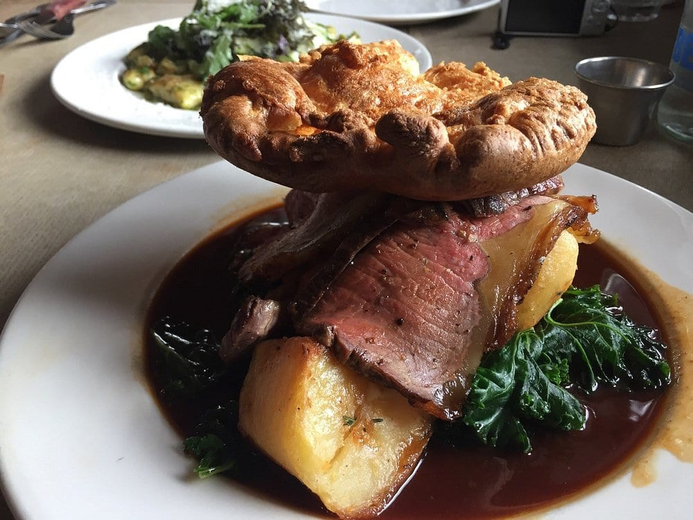

*The roast at The Bull & Last.*

### The Camberwell Arms, Camberwell

*££ · Denmark Hill · Cited by 4 sources · #60, Estrella Damm extended list (51–100) · #13, Time Out*

The most-cited pub roast in south London — four independent sources, more than any pub above it here except The Devonshire.

Its ranking is more modest than its press: **#60, on the extended 51–100 list, not the Top 50 itself.** Every source agrees on the portion size.

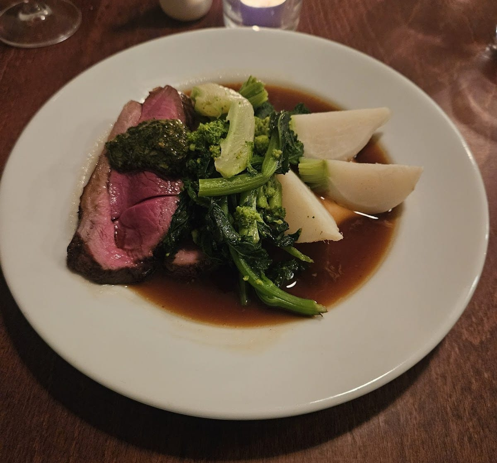

*The roast at The Camberwell Arms.*

**The venue's site:** [thecamberwellarms.co.uk](https://thecamberwellarms.co.uk/)

### The Parakeet, Kentish Town

*££ · Kentish Town · Cited by 2 sources · #61, Estrella Damm extended list (51–100) · #20, Time Out*

**A Kentish Town pub rebuilt around an open fire** in the middle of the kitchen, which does most of the cooking.

The Sunday roast comes off that fire: **meat cooked over wood**, not in an oven. Midweek the menu is fire-led small and large plates.

**££ and it books well ahead for Sunday**, through [the venue's site](https://theparakeetpub.com/). The bar takes walk-ins if the dining tables have gone.

### The Drapers Arms, Islington

*££ · Highbury & Islington · Cited by 2 sources · #67, Estrella Damm extended list (51–100)*

**A Barnsbury pub named by both the extended gastropub ranking and The Infatuation.**

Beef, pork or a vegetarian option with **roast potatoes, Yorkshire pudding, seasonal greens and a jug of gravy**. The pub has high ceilings and a garden at the back.

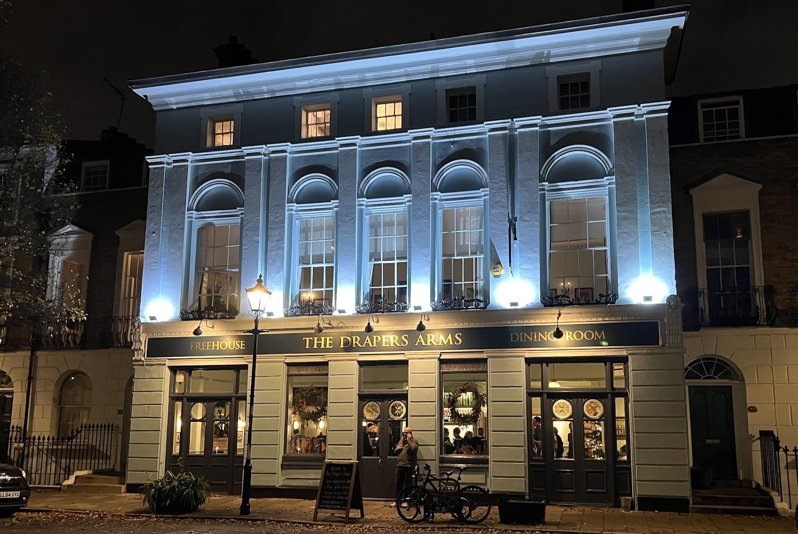

*The Drapers Arms, Islington.*

**££, and it [books](https://www.opentable.co.uk/the-drapers-arms-reservations-london?rid=53308&restref=53308) a few days ahead, not weeks.**

---

Powered by <a target="_blank" rel="sponsored" href="https://www.getyourguide.com/london-l57/">GetYourGuide</a>

## What the rankings do and do not tell you

Two judged, dated rankings reach this topic. The **[Estrella Damm Top 50 Gastropubs](https://www.top50gastropubs.com/list/1-50)** is the deeper of the two, with 23 London pubs across its ranked 100. The **[National Pub & Bar Awards](https://www.nationalpubandbarawards.co.uk/industrys-choice)** names a winner for each region and county, and runs an Industry's Choice top ten voted by 400 people who run pubs for a living — four of its 2026 top ten are London. The two rankings agree at the top — The Devonshire is first on both — and diverge below it: the trade puts The French House third where Estrella Damm has it 47th.

Neither is a roast award: both rank the pub across everything it does, every day of the week. Nobody scored the Sunday plate.

| Rank | Pub | Where | Price |
| --- | --- | --- | --- |
| **#1** | The Devonshire | Soho | ££ |
| **#3** | The Red Lion & Sun | Highgate | ££ |
| **#11** | Canton Arms | Stockwell | ££ |
| **#17** | The Baring | Islington | ££ |
| **#23** | The Marksman | Hackney | ££ |
| **#24** | The Hero of Maida | Maida Vale | ££ |
| **#25** | The Kerfield Arms | Camberwell | ££ |
| **#33** | The Waterman's Arms | Barnes | ££ |
| **#35** | The Tamil Crown | Islington | ££ |
| **#36** | The Harwood Arms | Fulham | £££ |
| **#39** | The Bull & Last | Highgate | ££ |
| **#43** | The Knave of Clubs | Shoreditch | ££ |
| **#47** | The French House | Soho | £££ |

Thirteen London pubs in the Top 50. A further ten appear on the extended 51–100 list — The Camberwell Arms (#60), The Parakeet (#61), Anchor & Hope (#64), The Pelican (#65), The Drapers Arms (#67), The Fat Badger (#75), The Eagle (#77), The Lady Mildmay (#83), The Blue Stoops (#88) and Parlour (#91).

An extended-list place is often reported as a Top 50 place; three of the best-known London roast pubs sit on the wrong side of that line.

---

## Time Out disagrees with everyone

Time Out's ranked 28 London Sunday lunches and the Estrella Damm Top 50 share almost no names.

Time Out's number one is **The Golden Tooth** on Green Lanes, the Papi team's pub. It appears in neither ranking, and only one source here names it. Its #2 is a northern Thai residency at a Peckham pub and its #3 is Sessions Arts Club, in a Grade II-listed former Clerkenwell courthouse. The Devonshire, Blacklock, Hawksmoor and The Harwood Arms are not on its list.

| Time Out rank | Pub | Also cited by |
| --- | --- | --- |
| **#1** | The Golden Tooth, Green Lanes | — |
| **#2** | Rice Paddy at The White Horse, Peckham | — |
| **#3** | Sessions Arts Club, Clerkenwell | — |
| **#4** | The Macbeth, Hoxton | The Infatuation |
| **#12** | The Quality Chop House, Clerkenwell | Mark Wiens (video) |
| **#13** | The Camberwell Arms, Camberwell | Estrella Damm #60, The Infatuation, Sphere |
| **#19** | Canton Arms, Stockwell | Estrella Damm #11 |
| **#20** | The Parakeet, Kentish Town | Estrella Damm #61 |
| **#22** | The Chalk Freehouse, Chelsea | — |
| **#28** | Clapton Country Club, Clapton | one video source |

---

Powered by <a target="_blank" rel="sponsored" href="https://www.getyourguide.com/london-l57/">GetYourGuide</a>

## The roasts that are not in a pub

Four of the best-supported roasts in London are served in restaurants: no bar to wait in, no walking in for a pint and deciding to eat, and usually no dogs.

### Blacklock, Soho

*££ · Piccadilly Circus · Cited by 5 sources, all video*

The second most-cited roast in this guide, behind The Devonshire. **All five Sunday roast citations are video**: no award, no masthead roast list.

The "All In" is a run of every cut on the menu, priced per head; one 2026 review put the Shoreditch site at £28 a head. It suits groups, and with several London sites a full Sunday at one branch does not mean a full Sunday everywhere.

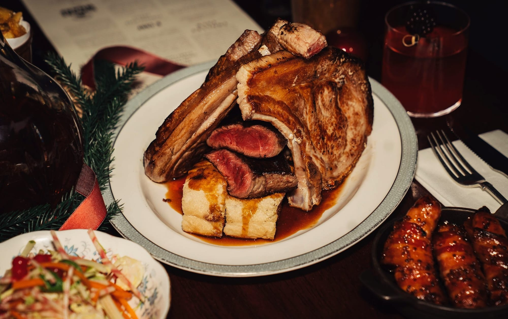

*Blacklock's bone-in chop.*

**The venue's site:** [theblacklock.com](https://theblacklock.com/restaurants/blacklock-soho/) · **two minutes from The Devonshire**

### Hawksmoor, Spitalfields

*££££ · Shoreditch High Street · Cited by 2 sources*

**British beef dry-aged and grilled over charcoal.** Spitalfields was the original.

The Sunday roast is a **rib of beef with bone-marrow gravy**, dripping-cooked potatoes and a Yorkshire pudding.

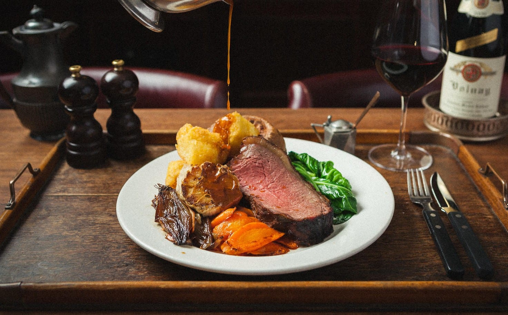

*The Sunday roast at Hawksmoor.*

**££££ and it [books](https://www.opentable.com/booking/experiences-availability?rid=11335&restref=11335&experienceId=682033) weeks ahead for Sunday.** Several London sites; the roast is served at all of them.

### The Quality Chop House, Clerkenwell

*£££ · Farringdon · Cited by 2 sources · #12, Time Out*

**The 1869 room is Grade II listed, with wooden booths that are deliberately uncomfortable**; the sign outside still reads "Progressive Working Class Caterer".

The **confit potatoes** are the signature: thin-sliced, pressed into a block, confited and fried until the layers separate. The Sunday roast is built around beef and those potatoes.

**£££ and it [books](https://www.opentable.co.uk/the-quality-chop-house-reservations-london?restref=96150&lang=en-GB&ot_source=Restaurant%20website) weeks ahead.**

### Fallow, Piccadilly

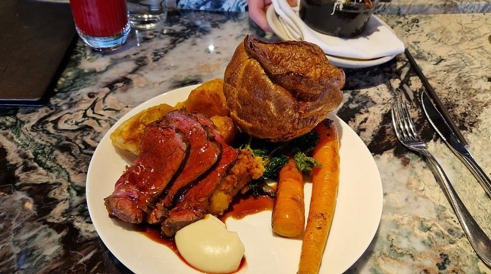

*£££ · Piccadilly Circus · Cited by 2 sources, both video*

**Whole-animal and root-to-stem cooking**: offcuts, byproducts and discarded species are the menu.

The Sunday roast follows the same thinking, using cuts most kitchens would grind. The à la carte is known for a **smoked cod's head** and **corn ribs with kombu**.

**£££ and it [books](https://www.sevenrooms.com/explore/fallowstjames/reservations/create/search?venues=roe%2Cfallowstjames%2Cfowl) weeks ahead.** 52 Haymarket, minutes from Piccadilly Circus.

---

## What a roast costs, and where the value is

**The three tiers, roughly:**

* **£14–£18** — neighbourhood pubs doing a proper roast with no chef's name attached. Most good local pubs south and east sit here.
* **£17–£24** — the mid-range, where most of the pubs in this guide live.
* **£28–£71** — the top end. Hawksmoor was reviewed at £29.50 in 2026 and The Harwood Arms at £71.

**How to spend less:**

* **Go to a neighbourhood pub rather than a destination one.**
* **Blacklock's All In is priced per head** and the meat keeps coming, which suits a group.
* **Share the sides.** Almost every pub here charges separately for cauliflower cheese and extra potatoes, and one between two is plenty.
* **Book early in the sitting.** The 12pm and 1pm slots are easier to get.

---

Powered by <a target="_blank" rel="sponsored" href="https://www.getyourguide.com/london-l57/">GetYourGuide</a>

## More pubs and rooms

Venues the sources back that did not earn a full entry. Names link to a booking screen where there is one.

| Venue | Where | Price | Sources | What it is |
| --- | --- | --- | --- | --- |
| **[The Macbeth](https://the-macbeth.co.uk/)** | Hoxton | ££ | 2 · Time Out #4 | A revamped Hoxton boozer doing what Time Out calls a rowdy Portuguese luncheon |
| **The George** | Fitzrovia | ££ | 3 · London Pub of the Year 2026 | London's regional winner at the 2026 National Pub & Bar Awards. Boozy downstairs, dining room upstairs; both serve the roast. Not The George Inn in Borough |
| **[The Audley](https://theaudleypublichouse.com/)** | Mayfair | £££ | 2 · Time Out #25 · London Pub of the Year 2024 | A Thomas Verity pub of 1888 on Mount Street with a Phyllida Barlow ceiling, beef and lamb off the owners' Somerset farm, and no reservations at all — walk in or do not go |
| **[The Golden Tooth](https://www.goldentooth.co.uk/)** | Green Lanes | ££ | 1 · Time Out #1 | Time Out's number one, from the Papi team; named by nothing else here |
| **[Roe](https://www.sevenrooms.com/explore/roe/reservations/create/search?venues=roe%2Cfallowstjames%2Cfowl)** | Canary Wharf | £££ | 2 · both video | Roe by Fallow, at Wood Wharf; creator-backed, not critic-backed |
| **[The Clarence Tavern](https://www.sevenrooms.com/reservations/theclarencetavern)** | Stoke Newington | ££ | 2 | A gastropub that works equally as a slap-up meal or a few pints |
| **[Clapton Country Club](https://www.claptoncountryclub.co.uk/)** | Clapton | ££ | 2 · Time Out #28 | Sunday lunch with live jazz, in an old tram shed |
| **CUT at 45 Park Lane** | Mayfair | ££££ | 2 | The Wolfgang Puck room in the Dorchester group |
| **[The Hero of Maida](https://www.sevenrooms.com/explore/thehero/reservations/create/search/?venues=thehero%2Cthepelicanw11%2Cthehartuk%2Cthefatbadger)** | Maida Vale | ££ | Estrella Damm #24 | Ranked but not covered by any roast list here |
| **[The Kerfield Arms](https://www.sevenrooms.com/explore/thekerfieldarms/reservations/create/search/)** | Camberwell | ££ | Estrella Damm #25 | The higher-ranked Camberwell pub, and the less famous one |
| **[The Knave of Clubs](https://www.sevenrooms.com/explore/theknaveofclubs/reservations/create/search)** | Shoreditch | ££ | Estrella Damm #43 | Ranked but not covered by any roast list here |
| **[The French House](https://www.sevenrooms.com/explore/thefrenchhouse/reservations/)** | Soho | £££ | 2 · Estrella Damm #47 · #3, Industry's Choice 2026 | Third in the trade's own 2026 vote of 400 industry judges, and a tiny Soho dining room above the bar |
| **[Anchor & Hope](https://www.anchorandhopepub.co.uk/)** | Waterloo | ££ | Estrella Damm #64 | On The Cut by the Young Vic; long-running and rarely bookable |
| **The Pelican** | Notting Hill | ££ | Estrella Damm #65 | All Saints Road, and one of the pricier neighbourhood roasts |
| **[The Eagle](https://theeaglefarringdon.co.uk/)** | Clerkenwell | ££ | Estrella Damm #77 | The Farringdon Road pub generally credited with inventing the gastropub, in 1991 |

---

## What to know

* **Roasts run roughly 12pm to 5pm** and stop when the meat runs out. Arrive by 3pm at the latest.
* **Book several weeks ahead** for The Devonshire, The Harwood Arms and Hawksmoor; two to three weeks for the neighbourhood pubs. **Canton Arms** is the realistic walk-in.
* **Check whether it is a pub or a restaurant.** Blacklock, Hawksmoor, The Quality Chop House and Fallow are restaurants, and The Baring is closer to one than not.
* **Vegetarian roasts are now standard** but vary; ask before booking if you want one.

---

## Continue planning your London trip

- 🇬🇧 **[Classic British Food in London](/articles/classic-british-food-london/)** — Scotch eggs, pie and mash, sausage rolls and proper puddings, dish by dish.
- 🍽️ **[The Best Gastropubs in London](/articles/best-gastropubs-london/)** — the same pubs judged on the whole week's cooking, not just Sunday.
- 🥩 **[The Best Steak in London](/articles/best-steak-restaurants-london/)**
- 🐟 **[The Best Seafood Restaurants in London](/articles/best-seafood-restaurants-london/)**
- 🍺 **[London's Historic Pubs and Dining Rooms](/articles/historic-pubs-dining-rooms-london/)**
- 🍳 **[The Best Breakfast and Brunch in London](/articles/best-breakfast-brunch-london/)**
- 🍽️ **[Eat in London: Restaurants, Food Markets & Quick Food Hub](/articles/eat-in-london-guide/)**
