A Sunday roast is a joint of meat with a Yorkshire pudding, roast potatoes and gravy, served in pubs from about midday on Sundays. In London's ranked pubs a meat roast costs £24 to £33, and the best-known tables go weeks ahead. Every pub below is placed by how many independent awards, critics and reviewers name it, and by where it finished when a ranking exists.

> 💡 **The Short Version:** **The Devonshire** in Soho is the most-cited roast in London and the UK's number one gastropub: rib of beef, £33, with tables released three weeks ahead every Thursday. **The Red Lion & Sun** in Highgate is #3 in the country and does a £15 children's roast. **Canton Arms** in Stockwell keeps tables back for walk-ins. **The Harwood Arms** is London's only Michelin-starred pub, at £64 for two courses. **Blacklock** is the group answer, at £28 a head for beef, lamb and pork together. For a deal, **Smith's Bar & Grill** in Paddington runs a bottomless roast for £42 a head.

> 📊 **The evidence behind this guide.**
> **20 sources carrying 106 citations** across **69 named pubs and restaurants**. **22 are named by two or more independent sources; 26 carry a dated ranking.**
> **Built on:** the [Estrella Damm Top 50 Gastropubs](https://www.top50gastropubs.com/list/1-50) and the [National Pub & Bar Awards](https://www.nationalpubandbarawards.co.uk/the-regions-2026); five publications, led by Time Out's ranked list; twelve video creators; and r/london.
> *Evidence rebuilt 3 November 2026 · [How we rank →](/how-we-rank/)*

> 📅 **How far ahead to book.**
> **Three weeks, on the dot:** The Devonshire opens its Sunday tables every Thursday at 10.30am. **Up to 90 days:** The Harwood Arms. **Two to three weeks:** The Camberwell Arms, The Kerfield Arms and The Knave of Clubs. **Walk in:** Canton Arms, The Waterman's Arms, the bar at The Blue Stoops and Blacklock keep tables back, ROAST takes walk-ins every day, and The Audley takes no bookings at all.

---

## Where they are

  

    Map of the best Sunday roasts in London
  

  

    
Loading the interactive map…

  

  <noscript>
    
The interactive map requires JavaScript. Every entry below lists its area.

  </noscript>

The ranked pubs are mostly a Tube ride out, in Highgate, Islington, Stockwell, Hackney, Camberwell, Fulham and Barnes. In the centre, the roasts are mostly restaurants: Blacklock, Hawksmoor, The Quality Chop House and Fallow. The Devonshire in Soho is the exception.

---

## The most-cited roasts in London

### The Devonshire, Soho

*££ · Piccadilly Circus · Cited by 6 sources · #1, Estrella Damm Top 50 Gastropubs 2026 · #1, Industry's Choice 2026*

The most-cited roast in this guide and the top-ranked gastropub in the UK. It also took the National Pub & Bar Awards' **[Industry's Choice Award](https://www.nationalpubandbarawards.co.uk/industrys-choice) for the second year running** in 2026, a top ten voted by 400 people who run pubs.

There is one roast: **rib of beef at £33**, with roast potatoes, creamed leeks, peas with onion and bacon, a Yorkshire pudding and gravy, served upstairs from 12pm to 4pm. The ground floor is a walk-in Guinness pub, with no children at weekends.

Three video reviewers who filmed here in 2026 all describe the same problem: getting in. **Tables are released every Thursday at 10.30am, for three weeks ahead.**

**The venue's site:** [devonshiresoho.co.uk](https://www.devonshiresoho.co.uk/) · **two minutes from Blacklock**

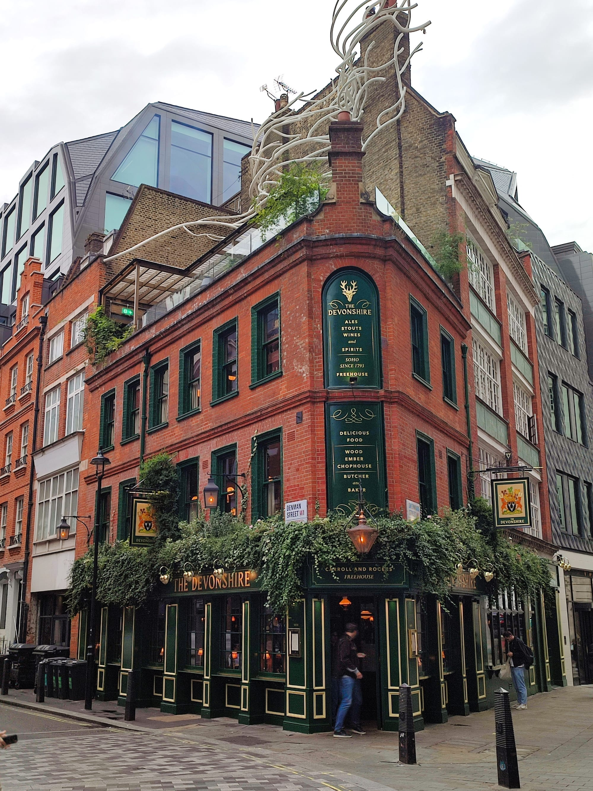

*The Devonshire, Soho. Photo: [Ewan-M](https://commons.wikimedia.org/wiki/File:Devonshire,_Soho,_W1.jpg), [CC BY-SA 4.0](https://creativecommons.org/licenses/by-sa/4.0/).*

### The Red Lion & Sun, Highgate

*££ · Highgate · Cited by 3 sources · #3, Estrella Damm Top 50 Gastropubs 2026 · #4, Industry's Choice 2026 · London Pub of the Year 2025*

Third in the UK, named London's pub of the year at the 2025 National Pub & Bar Awards and fourth in the trade's own 2026 vote, yet the editorial roast lists barely mention it: three sources here against The Camberwell Arms' four. It is also the roast **Oisin Rogers of The Devonshire sends people to**.

Order the **roast rib of beef (£32)**, or a côte de boeuf for two or three (£95); lamb shank, chicken, pork belly and a vegetable and chestnut roast fill out the menu, all with a Yorkshire pudding and red wine jus. Children get their own roast beef for £15.

The pub has two beer gardens in Highgate Village. Garden tables are booked by phone, 48 hours ahead and weather permitting.

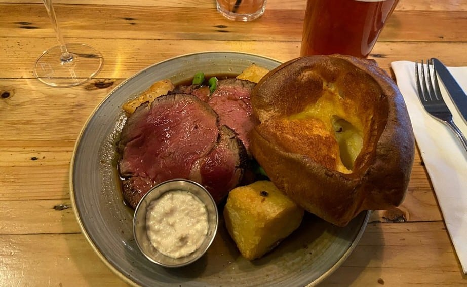

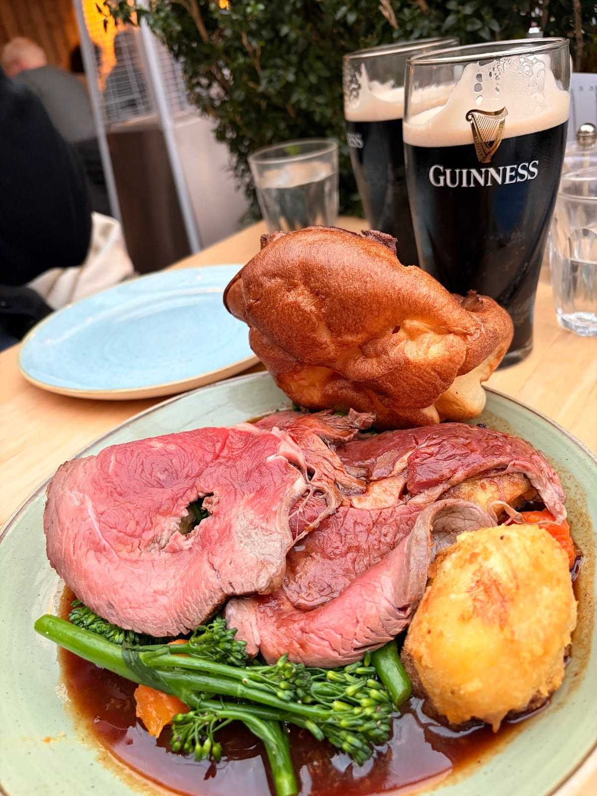

*The roast at The Red Lion & Sun.*

**Book:** [a table on ResDiary](https://booking.resdiary.com/widget/Standard/TheRedLionandSun/15205) · **four minutes from The Bull**

### Canton Arms, Stockwell

*££ · Stockwell · Cited by 2 sources · #11, Estrella Damm Top 50 Gastropubs 2026 · #19, Time Out*

**Eleventh in the country, and it still keeps tables back for anyone who turns up.** The South Lambeth Road pub takes bookings up to four weeks ahead, then seats walk-ins in what is left.

The menu is written each day around meat for the table. The showpiece is a **lamb shoulder for five**, £145 in Time Out's October 2026 list, which puts single mains from £24. Dogs are welcome; book a bar-area table if you bring one.

**Sunday lunch stops at 3.45pm and there is no Sunday dinner.** The kitchen is closed on Mondays.

**Book:** [cantonarms.com](https://cantonarms.com/bookings/)

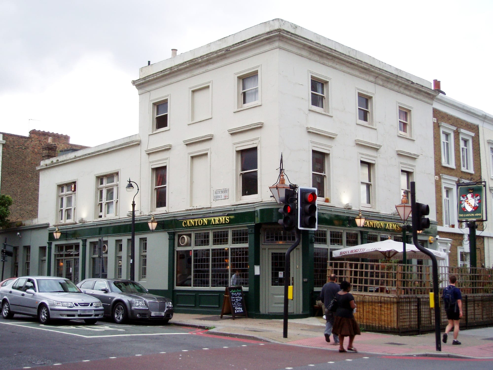

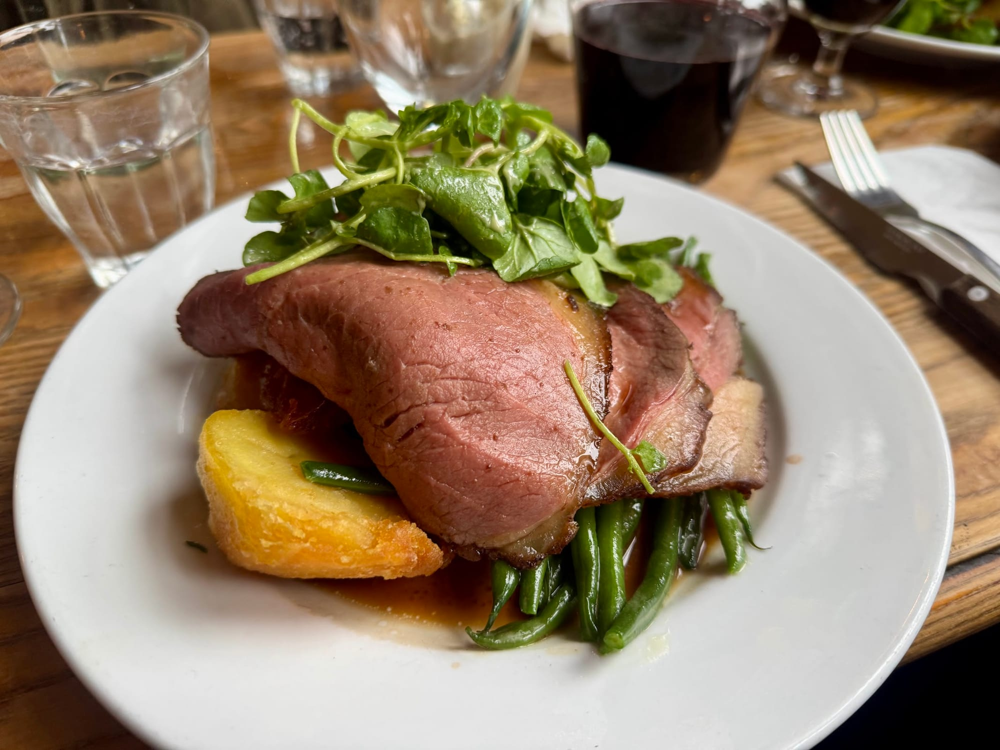

*Canton Arms, Stockwell. Photo: [Ewan Munro](https://commons.wikimedia.org/wiki/File:Canton_Arms,_South_Lambeth,_SW8_(3838932573).jpg), [CC BY-SA 2.0](https://creativecommons.org/licenses/by-sa/2.0/).*

### The Baring, Islington

*££ · Angel · Cited by 2 sources · #17, Estrella Damm Top 50 Gastropubs 2026*

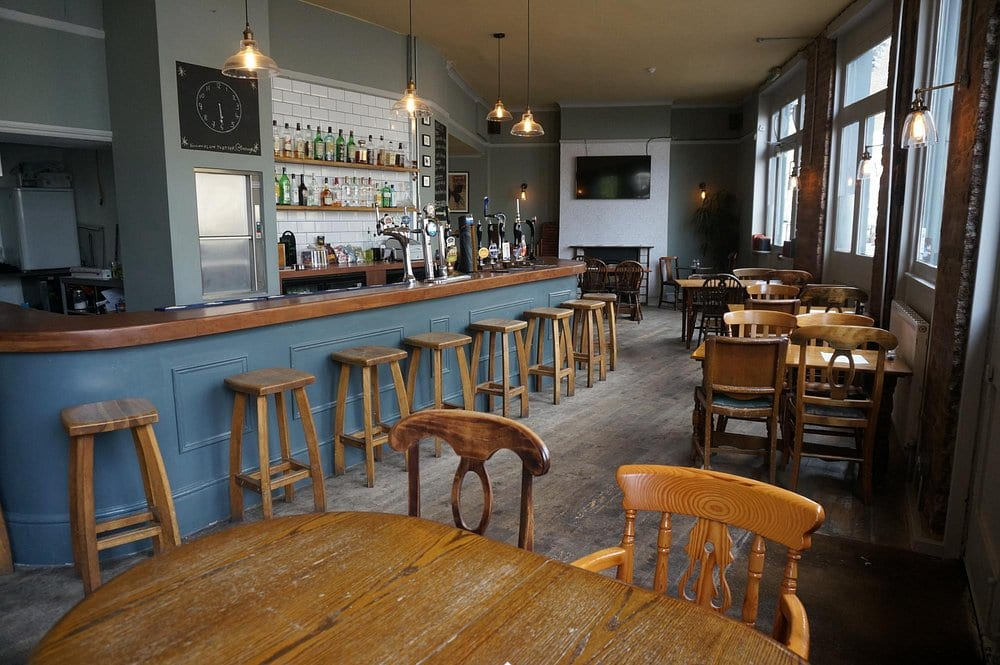

**Seventeenth in the country in the 2026 Estrella Damm Top 50**, and in The Infatuation's description more a sit-down restaurant than a pub you can drink in.

Three plated roasts with roast potatoes, hispi cabbage and gravy: **dry-aged Highland beef rump with Yorkshire pudding and horseradish (£29)**, Swaledale pork shoulder with apple ketchup (£28), or chicken with bread sauce (£27). A Highland sirloin for two is £78. There is no vegetarian roast.

**Food is served 12pm to 4pm on Sundays, and The Baring is closed on Mondays.** [Book on SevenRooms](https://www.sevenrooms.com/explore/thebaring/reservations/create/search/).

### The Marksman, Hackney

*££ · Bethnal Green · Cited by 2 sources · #23, Estrella Damm Top 50 Gastropubs 2026*

**Downstairs is a pub; upstairs is a dining room designed by Martino Gamper.** The Marksman was the first pub in London to be named Michelin's Pub of the Year.

Sunday is a set menu: **£42 for two courses or £48 for three.** The roast is Hereford beef rump with Yorkshire pudding and horseradish cream, or roast chicken; a Hereford wing rib for two costs £25 extra. The pudding to order is the **brown butter and honey tart**. Parties of nine or more can have it served family-style.

The kitchen is open on Sundays from 12pm to 4pm and again from 6pm to 9pm. [Book on OpenTable](https://www.opentable.co.uk/r/the-marksman-hackney-reservations-london?lang=en-GB&ot_source=website&restref=208518), and drink downstairs first.

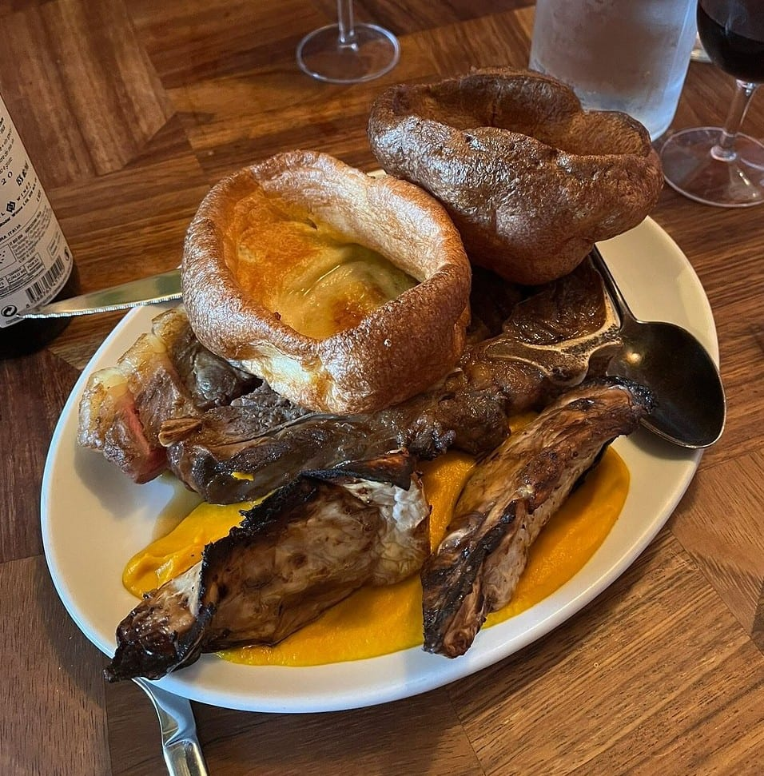

*The Sunday roast at The Marksman.*

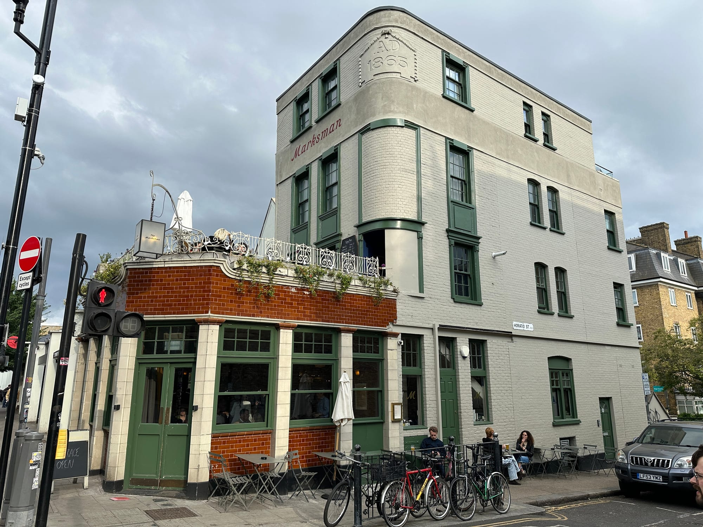
*The Marksman, Hackney Road. Photo: [Matt Brown](https://commons.wikimedia.org/wiki/File:The_Marksman_pub_254_Hackney_Road_2025-05-08.jpg), [CC BY 2.0](https://creativecommons.org/licenses/by/2.0/).*

### The Waterman's Arms, Barnes

*££ · Barnes Bridge · Cited by 2 sources · #33, Estrella Damm Top 50 Gastropubs 2026*

**A Barnes pub on the Thames where Sunday lunch is cooked for two.** The sample Sunday menu is built on sharing plates: **piri-piri spit-roast chicken (£50)**, porchetta (£50) or lamb shoulder (£52), with roast potatoes as a £6.50 side and a £30 bavette for one. There is no Yorkshire pudding on it.

The balcony has six tables for two, first come, first served, and the pub keeps tables back for walk-ins.

**The kitchen stops at 4.45pm on Sundays, and it is closed on Mondays.** [Book on SevenRooms](https://www.watermansarms.co.uk/reservations).

### The Tamil Crown, Islington

*££ · Angel · Cited by 3 sources · #35, Estrella Damm Top 50 Gastropubs 2026*

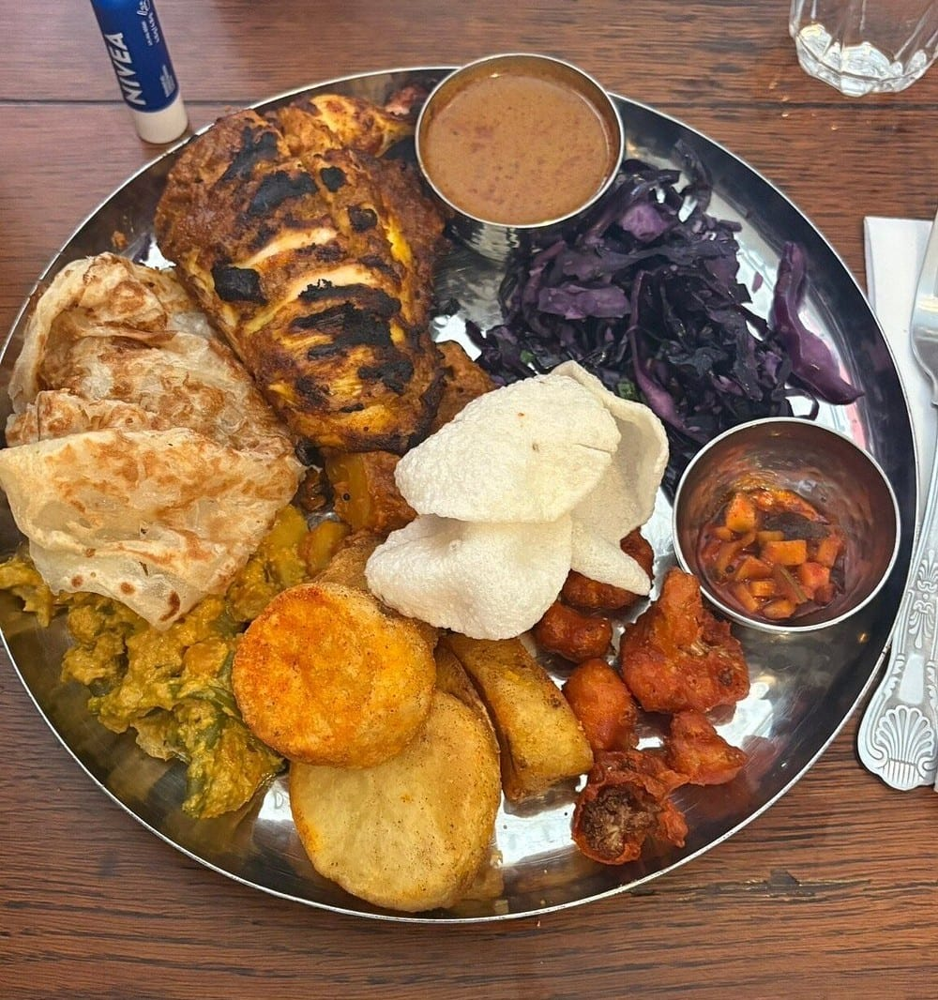

**The second pub from The Tamil Prince team, serving South Indian sharing plates in a restored pub on Elia Street.**

The Sunday roast arrives as a thali. **Roasted masala chicken (£42)**, masala lamb shank (£45) or sea bream (£42) comes with roast potatoes and gravy beside avial (vegetables in coconut and yoghurt), gobi 65 (fried spiced cauliflower), potato and pea masala, mango pickle and roti. The vegetarian version (£42) brings sambar and rice. There is no beef.

**It is served all day Sunday, 11am to 9.30pm.** Sibling to The Tamil Prince, also in Islington; two separate pubs. [Book for Sunday](https://www.sevenrooms.com/explore/thetamilcrown/reservations/create/search).

### The Harwood Arms, Fulham

*£££ · Fulham Broadway · Cited by 3 sources · #36, Estrella Damm Top 50 Gastropubs 2026*

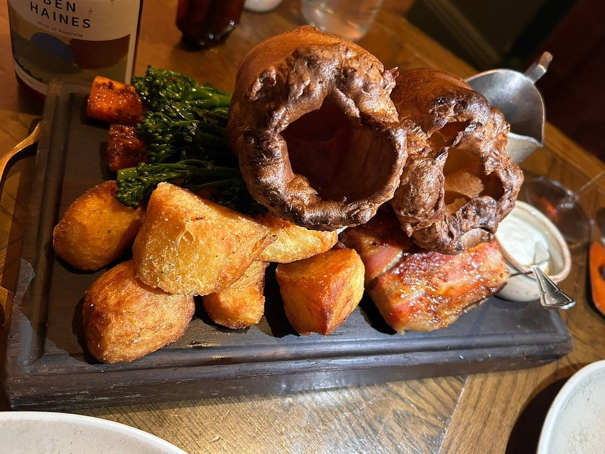

**London's only Michelin-starred pub**, on Walham Grove. Two of its directors supply the kitchen: Mike Robinson's Deer Box sends wild venison from the 60,000 acres of deer land he oversees, and Brett Graham's Capability Graham sends Jersey beef and Iberian pork.

Sunday is **£64 for two courses or £79 for three**, and the roast is carved for two: Jersey beef sirloin (£7.50 a head extra), bacon-wrapped deer shoulder, Cumbrian pork belly or Cornish cod, with Yorkshire puddings and cauliflower cheese. Start with the £12 **venison scotch egg**, a soft-yolked egg fried in venison sausagemeat.

**Roasts run all day Sunday until 8.15pm.** Tables open 90 days ahead, and a no-show costs £50 a head. Book through [the venue's site](https://harwoodarms.com/).

### The Bull & Last, Highgate

*££ · Tufnell Park · Cited by 2 sources · #39, Estrella Damm Top 50 Gastropubs 2026*

**A Highgate Road pub a few minutes from Hampstead Heath, 39th in the UK gastropub rankings**, and a natural end to a Heath walk.

The menu changes daily. A late-October Sunday had **roast sirloin of native Shorthorn beef with Yorkshire pudding** and Old Spot porchetta at £33 each, an aubergine parmigiana wellington at £28, and Shorthorn prime rib for two at £98. Extra gravy is £4.

**Not The Bull, a separate Highgate pub with different owners.** [Book for Sunday](https://www.sevenrooms.com/reservations/thebullandlast); groups of seven or more book by email or phone.

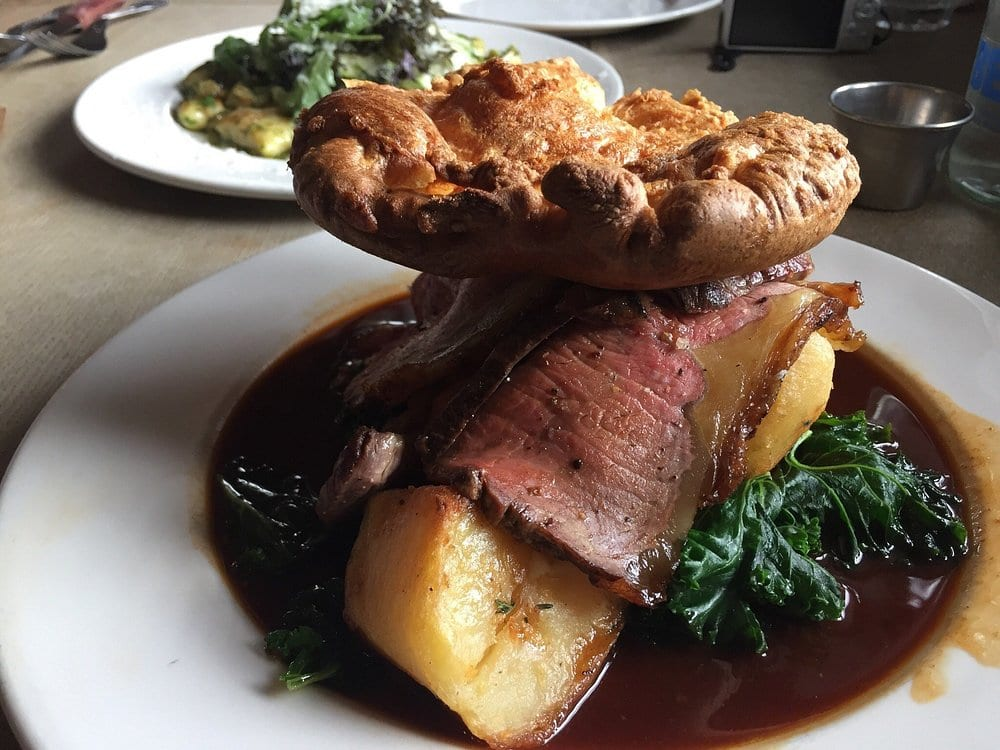

*The roast at The Bull & Last.*

### The Camberwell Arms, Camberwell

*££ · Denmark Hill · Cited by 4 sources · #60, Estrella Damm extended list (51–100) · #13, Time Out*

The most-cited pub roast in south London — four independent sources, more than any pub above it here except The Devonshire. Its ranking is more modest than its press: **#60, on the extended 51–100 list, not the Top 50 itself.**

**Everything on the Sunday menu is served to share**, with roast potatoes: Saddleback porchetta, half a Sladesdown Farm chicken, a beef, ale and bone marrow pie, slow-cooked Romney lamb, or dry-aged Hereford onglet with horseradish crème fraîche. Plates for the table run £45 to £60, and every source agrees on the portion size.

**Sunday tables go two to three weeks out.** [Book on SevenRooms](https://www.sevenrooms.com/reservations/thecamberwellarms).

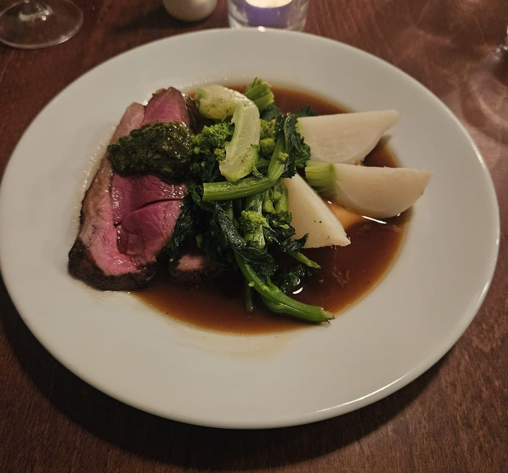

*The roast at The Camberwell Arms.*

**The venue's site:** [thecamberwellarms.co.uk](https://thecamberwellarms.co.uk/)

### The Drapers Arms, Islington

*££ · Highbury & Islington · Cited by 2 sources · #67, Estrella Damm extended list (51–100)*

**A Barnsbury pub named by both the extended gastropub ranking and The Infatuation.**

Two plated roasts, **rare 48-day-aged sirloin with Yorkshire pudding (£28.50)** and pork belly (£24), and a longer sharing list: a whole chicken for two or three (£55), seven-hour lamb shoulder for two (£62), beef fillet (£75) and côte de boeuf (£100). The menu asks you to order the sharing joints when you book, because they sell out.

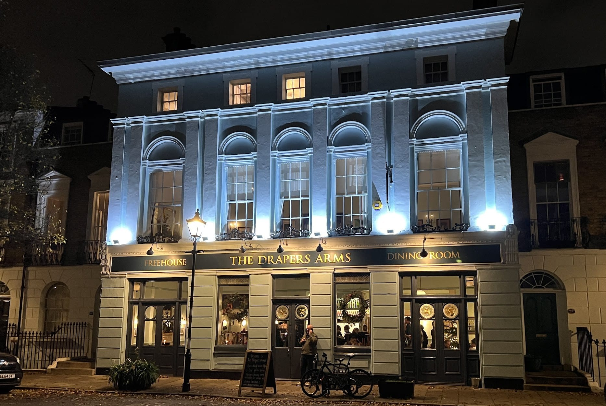

*The Drapers Arms, Islington.*

**The kitchen serves until 8.30pm on Sundays.** [Book on OpenTable](https://www.opentable.co.uk/the-drapers-arms-reservations-london?rid=53308&restref=53308); garden tables are by phone only, on 020 7619 0348.

---

Powered by <a target="_blank" rel="sponsored" href="https://www.getyourguide.com/london-l57/">GetYourGuide</a>

## What the rankings do and do not tell you

Two judged, dated rankings reach this topic. The **[Estrella Damm Top 50 Gastropubs](https://www.top50gastropubs.com/list/1-50)** is the deeper of the two, with 24 London pubs across its ranked 100. The **[National Pub & Bar Awards](https://www.nationalpubandbarawards.co.uk/industrys-choice)** names a winner for each region and county, and runs an Industry's Choice top ten voted by 400 people who run pubs for a living — four of its 2026 top ten are London. The two rankings agree at the top — The Devonshire is first on both — and diverge below it: the trade puts The French House third where Estrella Damm has it 47th.

Neither is a roast award: both rank the pub across everything it does, every day of the week. Nobody scored the Sunday plate, and The French House's dining room does not open on Sundays at all.

| Rank | Pub | Where | Price |
| --- | --- | --- | --- |
| **#1** | The Devonshire | Soho | ££ |
| **#3** | The Red Lion & Sun | Highgate | ££ |
| **#11** | Canton Arms | Stockwell | ££ |
| **#17** | The Baring | Islington | ££ |
| **#23** | The Marksman | Hackney | ££ |
| **#24** | The Hero of Maida | Maida Vale | ££ |
| **#25** | The Kerfield Arms | Camberwell | ££ |
| **#33** | The Waterman's Arms | Barnes | ££ |
| **#35** | The Tamil Crown | Islington | ££ |
| **#36** | The Harwood Arms | Fulham | £££ |
| **#39** | The Bull & Last | Highgate | ££ |
| **#43** | The Knave of Clubs | Shoreditch | ££ |
| **#47** | The French House | Soho | £££ |

Thirteen London pubs in the Top 50. A further eleven appear on the extended 51–100 list — The Camberwell Arms (#60), The Parakeet (#61), Anchor & Hope (#64), The Pelican (#65), The Drapers Arms (#67), The Fat Badger (#75), The Eagle (#77), The Clarence Tavern (#78), The Lady Mildmay (#83), The Blue Stoops (#88) and Parlour (#91).

An extended-list place is often reported as a Top 50 place; three of the best-known London roast pubs sit on the wrong side of that line.

---

## Time Out disagrees with everyone

Time Out's ranked 20 London Sunday roasts, last updated on 26 October 2026, shares three names with the whole Estrella Damm 100: The Camberwell Arms, Canton Arms and The Blue Stoops. The Devonshire, Blacklock, Hawksmoor and The Harwood Arms are not on it.

Its number one is **[Elm at The Montpelier](https://themontpelier.net/food/)**, the kitchen at a Peckham pub, which Time Out credits to Mike Bagnall of Auguste in London Fields. The Sunday menu is short: aged beef rump £24, Iron Age pork loin £22, and a quarter of a Somerset Saxon chicken or a wild mushroom and celeriac pithivier at £20, all with a Yorkshire pudding. Lunch runs 12pm to 5pm, with live jazz in the bar from 7.30pm, and [booking](https://bookings.designmynight.com/book?venue_id=51bed1410df690c03800027d) holds £25 a table on a card. No other source here names it.

Its #2 is **Ling Ling's**, a Cantonese residency at Godet, a natural wine pub on Essex Road; Time Out describes sesame-studded Yorkshires and miso gravy with five-spice sea bass or pork belly. It [books online](https://www.sevenrooms.com/explore/godet/reservations/create/search/) for roast sittings from 1pm to 4pm.

| Time Out rank | Pub | Also cited by |
| --- | --- | --- |
| **#1** | Elm at The Montpelier, Peckham | — |
| **#2** | Ling Ling's at Godet, Islington | — |
| **#3** | Old Nun's Head, Nunhead | — |
| **#6** | The Blue Stoops, Kensington | Estrella Damm #88 |
| **#8** | The Golden Tooth, Green Lanes | — |
| **#12** | The Quality Chop House, Clerkenwell | Sphere |
| **#13** | The Camberwell Arms, Camberwell | Estrella Damm #60, The Infatuation, Sphere |
| **#14** | Sessions Arts Club, Clerkenwell | — |
| **#15** | The Macbeth, Hoxton | The Infatuation |
| **#18** | The Chalk Freehouse, Chelsea | — |
| **#19** | Canton Arms, Stockwell | Estrella Damm #11 |

---

Powered by <a target="_blank" rel="sponsored" href="https://www.getyourguide.com/london-l57/">GetYourGuide</a>

## The roasts that are not in a pub

Four of the best-supported roasts in London are served in restaurants: no bar to wait in, no walking in for a pint and deciding to eat, and usually no dogs.

### Blacklock, Soho

*££ · Piccadilly Circus · Cited by 5 sources, all video*

The second most-cited roast in this guide, behind The Devonshire. **All five Sunday roast citations are video**: no award, no masthead roast list.

The order for a table is the **All In: beef, lamb and pork together for £28 a head**, for two or more. Single plates are beef rump (£27), lamb leg (£26), pork loin (£25) or a barbecued cauliflower chop (£18), each with a beef-dripping Yorkshire, duck-fat potatoes and **unlimited gravy**.

The same menu runs at all five London sites (Soho, the City, Shoreditch, Covent Garden and Canary Wharf), all day, with the last table at 8pm and some kept back for walk-ins. Soho is a basement with no lift.

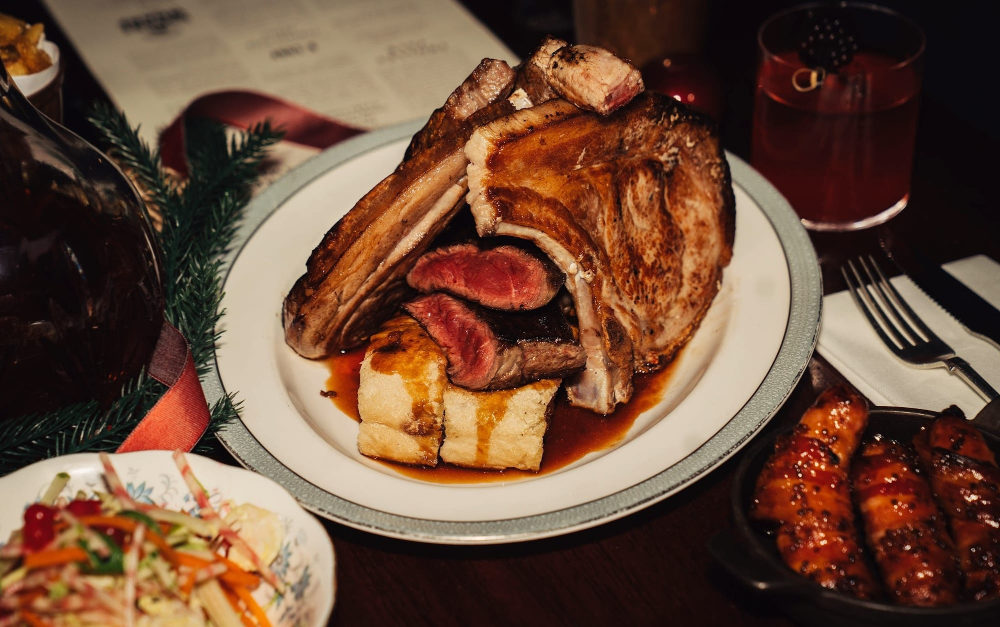

*Blacklock's bone-in chop.*

**Book:** [the Soho site](https://theblacklock.com/soho-reservations/) · **two minutes from The Devonshire**

### Hawksmoor, Spitalfields

*££££ · Shoreditch High Street · Cited by 2 sources*

**British beef dry-aged and grilled over charcoal.** Spitalfields was the first Hawksmoor; there are now eight in London, and every one serves the same Sunday roast.

That roast is **dry-aged rump (£29.50) or sirloin (£35)** with beef-dripping potatoes, a Yorkshire pudding, roasted garlic and bone-marrow and onion gravy. For two or more, Sunday Feasting brings a sharing cut from the blackboard, with the trimmings at £9.50 a head. Mention children when you book and the kitchen does them a smaller roast.

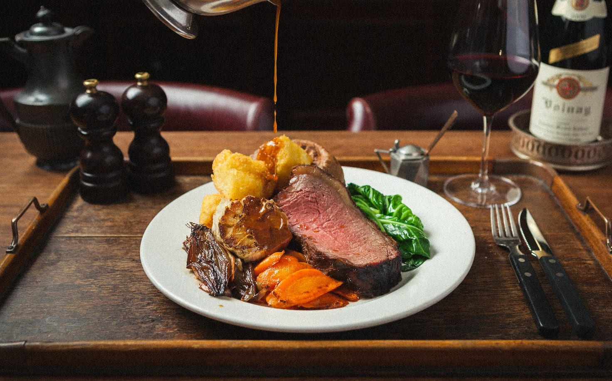

*The Sunday roast at Hawksmoor.*

**The roast is guaranteed only until 5pm.** [Book Spitalfields](https://thehawksmoor.com/book-a-table/?location=11335) for groups of up to 14.

### The Quality Chop House, Clerkenwell

*£££ · Farringdon · Cited by 2 sources · #12, Time Out*

**The dining room on Farringdon Road dates from 1869, and its wooden booths are Grade II listed.**

Sunday is a set lunch: **£49 for two courses or £59 for three.** On 1 November 2026 the roasts were Aberdeen Angus rump with smoked brisket, Middle White pork loin, Yorkshire pheasant, monkfish, celeriac, and a chicken for two. The house **confit potatoes**, thin slices pressed into a block and fried until the layers separate, are an £11 side.

**Lunch only, 12pm to 3.30pm, with no Sunday dinner; card only, and 13.5% service.** [Book on OpenTable](https://www.opentable.co.uk/the-quality-chop-house-reservations-london?restref=96150&lang=en-GB&ot_source=Restaurant%20website).

### Fallow, Piccadilly

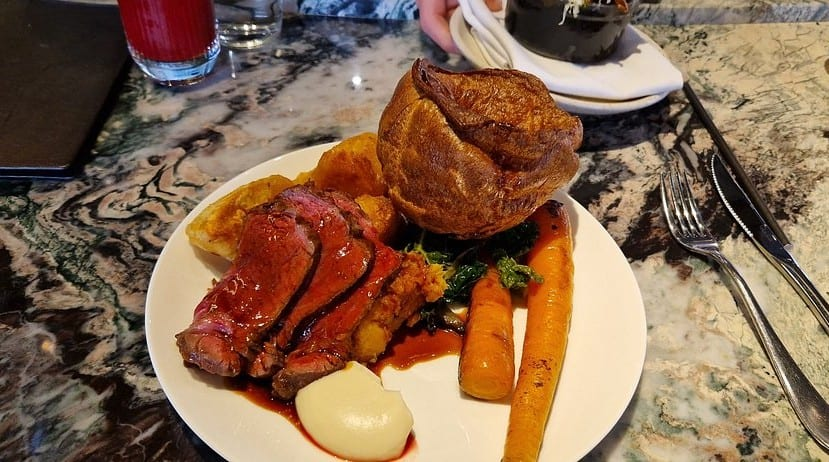

*£££ · Piccadilly Circus · Cited by 2 sources, both video*

**A Haymarket restaurant named for underused resources**, whose à la carte is known for a **smoked cod's head** and **corn ribs with kombu seasoning**.

The Sunday roasts are **all £32**: dairy cow rump, roast chicken, rolled pork belly or a maitake mushroom for vegans, each with a Yorkshire pudding and roast potatoes. Service is 15%, plus a £2 charity donation.

**The roast runs all day, with the last table at 9pm.** [Book on SevenRooms](https://www.sevenrooms.com/reservations/fallowstjames); cancelling within 48 hours costs £50 a head, and large groups are sent to its sister restaurant, Roe.

---

## New Sunday roasts

The strongest of Hot Dinners' September 2026 round-up of new Sunday lunches, and two launches since.

- **[The Victory](https://victoryrestaurant-bar.co.uk/), East Dulwich.** A Lordship Lane pub with a French lean: 38-day-aged Hereford sirloin (£33), Blythburgh pork loin (£29) or half a poulet jaune (£30), with duck-fat potatoes, crushed swede, buttered savoy and gravy, and a cauliflower cheese for the table (£12). Lunch only, 12pm to 5pm. [Book the downstairs dining room](https://www.sevenrooms.com/explore/thevictory/reservations/create/search/).
- **[Teal by Sally Abé](https://www.tealbysallyabe.com/book), Hackney.** A small Wilton Way restaurant from the chef who ran the kitchens at The Pem and The Harwood Arms. The Sunday roast is 35-day-aged Hereford rump (£34), Cumberland-stuffed pork belly (£30), or an 800g bone-in wing rib to share (£92). Served 12pm to 5pm, last booking 3.30pm; tables of six at most, and no children under 14.
- **[Island at the George & Dragon](https://georgeanddragonlondon.com/sunday-menu-island/), Clerkenwell.** Tom Brown and Brad Carter's surf-and-turf dining room, above a St John Street pub. Get the family-style roast, **£40 a head** for two or more: beef rump and cheek, Tamworth porchetta and roast chicken. Children's roasts are £18. The pub downstairs does the same roasts on a plate for £27 to £28. [Book Island](https://www.sevenrooms.com/explore/island/reservations/create/search/).
- **[Maison François](https://www.maisonfrancois.london/), St James's.** The Duke Street brasserie's new **Le Grand Roast, £55 a head** for two or more, is suckling pig collar, aged beef rump and stuffed rabbit saddle together, with escargots, a Yorkshire pudding, pommes paillasson and a condiment trolley. Single roasts are £35. Last Sunday booking is 9pm. [Book on SevenRooms](https://www.sevenrooms.com/explore/maisonfrancois/reservations/create/search).
- **[ROAST, Shoreditch](https://roast-restaurant.com/locations/shoreditch/).** The restaurant above Borough Market opened a second site in October, in the Virgin Hotel on Curtain Road. 42-day-aged roast beef is £39 and pork belly with pigs in blankets £31, and there is a separate halal Sunday menu. It takes walk-ins every day; a £2-a-head cover charge sits inside the 15% service. [Reservations](https://roast-restaurant.com/reservations/).
- **[The Knave of Clubs](https://www.theknaveofclubs.co.uk/food-and-drink/), Shoreditch.** Ranked #43 in the country, it moved its Sunday lunch onto the rotisserie on 4 October: chermoula chicken or rosemary and sage porchetta (£26), 28-day sirloin (£28), or all three for £28 a head. Food until 6pm, and walk-ins welcome.

---

## What a roast costs: cheap, bottomless and children's roasts

A meat roast at a ranked London pub costs **£24 to £33**, and most of these kitchens add 12.5% service on top.

**Under £25 a plate.**

* **[Smith's Bar & Grill](https://www.smithsbarandgrill.co.uk/whats-on/sunday-roast), Paddington** — individual roasts **from £18**, served beside the Grand Union Canal at Sheldon Square, every Sunday from 12pm to 9pm.
* **Blacklock** — the cauliflower chop roast is **£18** and the pork loin £25, at all five sites.
* **Elm at The Montpelier, Peckham** — a quarter chicken or the pithivier at **£20**, the beef at £24.
* **Vegetarian roasts at ranked pubs** — The Parakeet's squash and mushroom wellington is £21, and The Red Lion & Sun's vegetable and chestnut roast and The Knave of Clubs' nut roast are both £22.

**Bottomless.**

* **Smith's Bar & Grill** — **£42 a head** for 90 minutes of unlimited small plates, roasts and puddings; bottomless drinks add £18 a head. Every Sunday, 12pm to 9pm, and the whole table has to take the same package.

**One price for the table.**

* **Every cut on one plate, two or more** — Blacklock's All In and The Knave of Clubs' three roasts are both **£28 a head**; Island's family-style roast is £40 and Maison François' Le Grand Roast £55.
* **[Roe](https://roerestaurant.co.uk/menu/sunday-feast-of-roe/), Canary Wharf** — the Sunday Feast, a roast platter to share, for **£60 a head**, two or more.
* **The Devonshire** — the feasting menu for **£60 a head**, tables of eight to fourteen.
* **Set lunches** — The Marksman £42 or £48, The Quality Chop House £49 or £59, The Harwood Arms £64 or £79.

**Children.**

* **The Red Lion & Sun** — a children's roast beef for **£15**.
* **[The George](https://thegeorge.london/), Fitzrovia** — a children's roast beef or chicken for **£15**, Sundays.
* **[Clapton Country Club](https://www.claptoncountryclub.co.uk/sunday-roast-bookings)** — a child's portion of any roast for **£12**.
* **Island at the George & Dragon** — children's roasts at **£18**.
* **[Humble Grape](https://www.humblegrape.co.uk/family-friendly-dining)** — three courses for **£12** at weekends at its Battersea, Canary Wharf and Islington wine bars, with a roast dinner as the Sunday main.
* **Hawksmoor** — a smaller roast for children on request when you book; no set price.
* **Leave the children at home for** Teal (no under-14s), Sessions Arts Club (adults only) and the ground-floor pub at The Devonshire (no children at weekends).

---

Powered by <a target="_blank" rel="sponsored" href="https://www.getyourguide.com/london-l57/">GetYourGuide</a>

## More pubs and rooms

Venues the sources back that did not earn a full entry. Names link to a booking screen where there is one.

| Venue | Where | Price | Sources | What it is |
| --- | --- | --- | --- | --- |
| **[The George](https://www.sevenrooms.com/explore/thegeorgepub/reservations/create/search)** | Fitzrovia | ££ | 3 · London Pub of the Year 2026 | London's 2026 regional winner at the National Pub & Bar Awards, on Great Portland Street: rump of beef £35, served in the bar or the dining room until 9pm. Not The George Inn in Borough |
| **[The Clarence Tavern](https://www.sevenrooms.com/explore/theclarencetavern/reservations/create/search)** | Stoke Newington | ££ | 3 · Estrella Damm #78 | A Church Street pub whose Sunday lunch is short rib, a chicken, leek and bacon pie or slow-cooked lamb to share, rather than a plated roast. Kitchen until 5pm |
| **[The Blue Stoops](https://www.sevenrooms.com/explore/thebluestoops/reservations/create/search)** | Kensington | ££ | 2 · Time Out #6 · Estrella Damm #88 | Allsopp's brewery pub on Kensington Church Street: Longhorn beef rump £30, Saxon chicken £29, Old Spot porchetta £28. Last booking 6.30pm, and a few bar tables kept for walk-ins |
| **[The Macbeth](https://the-macbeth.co.uk/)** | Hoxton | ££ | 2 · Time Out #15 | A revamped Hoxton Street boozer with a Portuguese and northern Spanish kitchen, which Time Out calls a rowdy Portuguese luncheon. Sunday kitchen 1pm to 5pm |
| **[Roe](https://www.sevenrooms.com/explore/roe/reservations/create/search?venues=roe%2Cfallowstjames%2Cfowl)** | Canary Wharf | £££ | 2 · both video | Roe by Fallow, at Wood Wharf, with a £60-a-head Sunday Feast. Creator-backed, not critic-backed |
| **[CUT at 45 Park Lane](https://www.sevenrooms.com/explore/cut45parklane/reservations/create/search)** | Mayfair | ££££ | 2 | Wolfgang Puck's first restaurant in Europe, in the Dorchester Collection's Park Lane hotel, with a Sunday roast sitting from 12pm |
| **[The Audley](https://theaudleypublichouse.com/)** | Mayfair | £££ | 1 · London Pub of the Year 2024 | A Thomas Verity pub of 1888 on Mount Street with a Phyllida Barlow ceiling and meat from the owners' Somerset farm: sirloin £36, half chicken £30. No reservations at all; roasts until 5pm |
| **[The Golden Tooth](https://www.goldentooth.co.uk/)** | Green Lanes | ££ | 1 · Time Out #8 | From the team behind Papi: Dexter picanha, pork loin, hogget belly or poussin, with the kitchen open until 7pm on Sundays |
| **[Clapton Country Club](https://www.claptoncountryclub.co.uk/sunday-roast-bookings)** | Clapton | ££ | 1 | Sunday lunch with live jazz in an old tram shed: chicken £26.80, rib-eye £30.80. A £46 festive menu replaces it on 6, 13 and 20 December |
| **[The Parakeet](https://theparakeetpub.com/the-dining-room/)** | Kentish Town | ££ | Estrella Damm #61 | A Kentish Town Road pub that cooks over flame: hay-smoked chicken £26.50, roast beef £28.50, in the dining room until 7pm |
| **[The Hero of Maida](https://www.sevenrooms.com/explore/thehero/reservations/create/search/?venues=thehero%2Cthepelicanw11%2Cthehartuk%2Cthefatbadger)** | Maida Vale | ££ | Estrella Damm #24 | Ranked but not covered by any roast list here |
| **[The Kerfield Arms](https://www.sevenrooms.com/explore/thekerfieldarms/reservations/create/search/)** | Camberwell | ££ | Estrella Damm #25 | The higher-ranked Camberwell pub, and the less famous one: grilled Highland rump with Yorkshire pudding £29, Highland sirloin for two £78. Kitchen 12pm to 4pm |
| **[The Knave of Clubs](https://www.sevenrooms.com/explore/theknaveofclubs/reservations/create/search)** | Shoreditch | ££ | Estrella Damm #43 | A Bethnal Green Road pub with a rotisserie Sunday lunch since October; see the new openings above |
| **[Anchor & Hope](https://www.sevenrooms.com/explore/theanchorandhope/reservations/create/search)** | Waterloo | ££ | Estrella Damm #64 | On The Cut by the Young Vic since 2003. Sunday lunch is joints to share, such as lamb shoulder for two (£80), until 3.15pm. Closed from 20 December after lunch until 4 January |
| **[The Pelican](https://www.sevenrooms.com/explore/thepelicanw11/reservations/create/search/)** | Notting Hill | ££ | Estrella Damm #65 | An All Saints Road pub; ranked but not covered by any roast list here |
| **[The Eagle](https://theeaglefarringdon.co.uk/)** | Farringdon | ££ | Estrella Damm #77 | The Farringdon Road pub that opened in 1991 as Britain's first gastropub. Menu chalked up twice a day, kitchen until 3pm on Sundays, and no bookings under five |

---

## What to know

* **Kitchen times vary more than you would think.** The Quality Chop House stops at 3.30pm, Canton Arms at 3.45pm, and The Devonshire and The Baring at 4pm; Hawksmoor guarantees its roast only until 5pm. For a late lunch, Blacklock seats until 8pm, The Harwood Arms serves until 8.15pm and The Tamil Crown until 9.30pm.
* **Check whether it is a pub or a restaurant.** Blacklock, Hawksmoor, The Quality Chop House and Fallow are restaurants, and The Baring is closer to one than not.
* **Vegetarian roasts are not universal.** The Devonshire and The Baring list none, and The Drapers Arms' vegetarian main is a risotto. Hawksmoor, Fallow, Blacklock, The Red Lion & Sun, The Bull & Last and The Tamil Crown all have one.
* **Budget for service.** Most kitchens here add 12.5%; The Quality Chop House, Teal and The Blue Stoops add 13.5%, and ROAST and Fallow 15%. The Quality Chop House and The Audley take cards only.

---

## Continue planning your London trip

- 🇬🇧 **[Classic British Food in London](/articles/classic-british-food-london/)** — Scotch eggs, pie and mash, sausage rolls and proper puddings, dish by dish.
- 🍽️ **[The Best Gastropubs in London](/articles/best-gastropubs-london/)** — the same pubs judged on the whole week's cooking, not just Sunday.
- 🥩 **[The Best Steak in London](/articles/best-steak-restaurants-london/)**
- 🐟 **[The Best Seafood Restaurants in London](/articles/best-seafood-restaurants-london/)**
- 🍺 **[London's Historic Pubs and Dining Rooms](/articles/historic-pubs-dining-rooms-london/)**
- 🍳 **[The Best Breakfast and Brunch in London](/articles/best-breakfast-brunch-london/)**
- 🍽️ **[Eat in London: Restaurants, Food Markets & Quick Food Hub](/articles/eat-in-london-guide/)**
