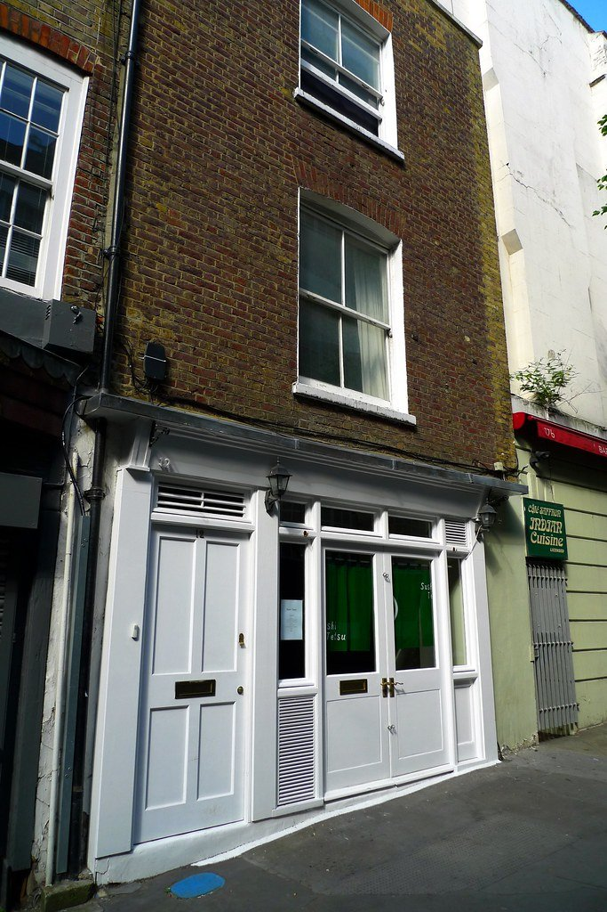

**Sushi in London is five different meals.** At one end is a seven-seat counter where a chef serves every piece of nigiri to you in turn; at the other is a plate off a conveyor belt for £3. This guide is sorted by how the meal is served, because that settles the price, the booking and the mood before you look at a menu.

It covers restaurants where sushi, sashimi or handrolls are what the kitchen is known for. A Japanese room with a sushi counter among a much longer menu is in a short section near the end, and the [Japanese restaurants guide](/articles/best-japanese-restaurants-london/) covers ramen, izakaya, yakitori and kaiseki.

> 💡 **The Short Version:** **Sushi Tetsu** in Clerkenwell is number one on Time Out's list of London's 20 best sushi restaurants, and **Sushi Kanesaka** in Mayfair is the only Michelin star among the kitchens Michelin files under sushi. **Sumi** in Notting Hill is the most-named à la carte room. For an omakase without the four-figure bill, **Sushi Kyu** in Soho is £51.80 at lunch and **Cubé** in Mayfair £89.70. **Temaki** and **Miokuru** do handrolls, **Kulu Kulu** is the conveyor belt, and **Sushi Show**, **Atari-Ya** and **Eat Tokyo** are the cheap end.

> 📊 **The evidence behind this guide.**
> **29 independent sources carrying 369 citations** across **140 named restaurants**. **79 restaurants are named by two or more independent sources.**
> **Built on:** Michelin, the Good Food Guide and Harden's; lists from Time Out, The Infatuation, Condé Nast Traveller, Hot Dinners and others; YouTube and Reddit.
> *Evidence built 17 October 2026 · [How we rank →](/how-we-rank/)*

## Booking at a glance

* **Weeks ahead:** Sushi Tetsu (tables released at 12pm every Monday for the following week), Takahashi (a month opens on the 1st), ENDO in Chelsea (booked through December), Sushi Kanesaka, The Araki, Maru, Juno and Luna (£230 pre-paid).
* **A few days:** Sushi Atelier, Sushi Kyu, Cubé, Mayha, Dinings, Himi, Sasa, Sumi and Kioku.
* **Book, but walk-ins are taken:** Eel Sushi, Sushi Atelier and Mayha at lunch.
* **Walk-in counters:** Kulu Kulu and Sushi Show.
* **By phone:** Eat Tokyo's Soho branch. Ikeda takes no phone bookings, only ResDiary.
* **Shut Sundays:** Kulu Kulu, Moshi Moshi (shut at weekends), Sushi Atelier, Sushi Kanesaka, Ikeda and Dinings Marylebone.

## Where they are

| If you are near… | Where to eat |
| --- | --- |
| **Mayfair & St James's** | Sushi Kanesaka, The Araki, Maru, Sushi Amamoto, Cubé, Tobi Masa, Chisou, Ikeda, NIJŪ, Temaki |
| **Soho & Carnaby** | Sushi Kyu, Himi, Nanahoshi, Kumori, Miokuru, Kulu Kulu, Eat Tokyo |
| **Fitzrovia & Marylebone** | Sushi Atelier, Kikuchi, Mayha, Dinings Marylebone |
| **Covent Garden** | Ukiyo |
| **Clerkenwell & Angel** | Sushi Tetsu, Sasa, Sushi Show, Zen Mondo |
| **The City** | Luna, Pham Sushi, Moshi Moshi |
| **Notting Hill** | Sumi, Eel Sushi, Juno |
| **Kensington, Chelsea & Belgravia** | Dinings SW3, Yashin Sushi, Yashin Ocean House, Chisou, Sachi, The Fuji Grill, ENDO |
| **Westminster** | Kioku by Endo |
| **Battersea** | Kibou |
| **South London** | Kurisu Omakase (Brixton), Takahashi (South Wimbledon) |
| **North & west London** | Atari-Ya (Golders Green, Swiss Cottage), Hase-Ya (Ealing), Kampai Kensington |

**Price guide:** **£** under £20 · **££** £20–£50 · **£££** £50–£100 · **££££** £100+, food only.

---

## The winners

Two sources crown different counters. **Time Out's ranked list of 20 puts Sushi Tetsu first and Sushi Kanesaka tenth; Michelin gives a star to Sushi Kanesaka and does not list Sushi Tetsu at all.** Neither is cheap and neither is easy: one is a seven-seat room that releases its tables once a week, the other a 13-seat counter above Park Lane.

### Sushi Tetsu, Clerkenwell — number one on Time Out's list

*££££ · 12 Jerusalem Passage, EC1V 4JP · Cited by 9 sources · #1 of 20, Time Out · [book a table](https://www.sevenrooms.com/reservations/sushitetsu)*

Toru Takahashi cuts every piece and his wife Harumi runs the room, at a counter of seven seats in a Clerkenwell alley. Time Out gives it five stars and puts it first in its 2026 list; it is named in 5 of the 15 Reddit threads read for this guide, and one reply calls it "imho the best available in London".

*Sushi Tetsu in Jerusalem Passage. Photo: [Ewan-M](https://www.flickr.com/photos/55935853@N00/7670311580), [CC BY-SA 2.0](https://creativecommons.org/licenses/by-sa/2.0/).*

It is omakase only, at **£187 a head** (£167 at Saturday lunch), and the Good Food Guide notes a no-photo rule. The Infatuation describes the lone chef nipping, pressing and folding each piece in front of you, a three-hour sitting of marbled tuna and king crab.

**Tables go on sale at 12pm sharp every Monday for the following week, with a waiting list.** Time Out's tip is a midweek solo booking, which is always easier to get. It serves lunch on Tuesday and Wednesday and dinner Tuesday to Saturday.

### Sushi Kanesaka, Mayfair — the Michelin star

*££££ · 45 Park Lane, W1K 1PN · One Michelin star, 2026 guide · Cited by 13 sources · #10 of 20, Time Out · [book a table](https://www.dorchestercollection.com/london/45-park-lane/dining/sushi-kanesaka)*

**Named by more sources than any other restaurant here**, from Michelin and the Good Food Guide to eight mastheads and a YouTube creator. It is on Michelin's own 'Sushi' filter with one star, and the counter is cut from a single piece of hinoki cypress.

The omakase is around 18 pieces of nigiri interspersed with steamed abalone or grilled Kobe beef, much of the fish from European waters, at **£420 a head** plus 15% service. Harrison Webb's video set it against £34 of sushi from Japan Centre, and the Good Food Guide's inspectors found the chef skill "even more refined" than at Taku.

**It is open for dinner Tuesday to Saturday**, with 13 counter seats and a private room of four. The Good Food Guide notes the room has a no-perfume rule.

---

## Also strongly backed

### Sumi, Notting Hill — Endo's à la carte room

*£££ · 157 Westbourne Grove, W11 2RS · Cited by 10 sources · [book a table](https://www.sevenrooms.com/reservations/sumi)*

Named by ten sources, from the Good Food Guide and Stylist to Reddit, where one reply pairs it with Eel Sushi. It is the cheaper sibling of Endo Kazutoshi's counters, ordered à la carte, in a lively room with a young crowd and a terrace.

Order **toro-taku temaki** and **chef's sashimi** (three types £28), then nigiri by the pair: **akami £12, chutoro £15, otoro £18**. The Infatuation's advice is to stay with raw fish and skip the mains if you want lunch under £100.

**Service is 12.5%, and Monday opens at 5.30pm. A second SUMI opened at 26–27 Devonshire Street, Marylebone, in November 2026.**

### Maru, Mayfair — twenty courses for ten

*££££ · 18 Shepherd Market, W1J 7QH · Cited by 9 sources · [book a table](https://www.marulondon.com/book-online)*

Michelin files it under 'Sushi' and describes an omakase of around 20 servings, largely British seafood including Cornish, with two dinner sittings. Taiji Maruyama, a third-generation sushi chef who was executive chef at Nobu, cooks for ten guests a night, and Condé Nast Traveller's writer calls it her favourite omakase in London.

The fish is dry-aged, the technique the team first showed at Taka, and the menu changes daily. The entrance is easy to miss.

**You pay when you book, and arrive on time: there are two sittings and each is served together.**

### Eel Sushi, Notting Hill — walk-ins, from £4 a piece

*£££ · 118 Talbot Road, W11 1JR · Cited by 7 sources · [book a table](https://www.sevenrooms.com/reservations/eelsushi)*

Condé Nast Traveller calls it "the coolest restaurant in West London", and the Evening Standard gave it five stars in June 2025. A boxy room clad in Swiss pine across the road from Dorian, with two six-person counters and a window.

Order by the piece: **akami £4, chutoro £6, toro £8, eel £7, scallop £9, lobster £12**, or the **chef's ten-piece nigiri at £60**. Michelin notes the tuna comes from Spain.

**Open noon to 10pm every day; the Evening Standard found a queue forming from noon.** Walk in, or book on SevenRooms.

### Sushi Atelier, Fitzrovia — the one the Londoners recommend

*£££ · 114 Great Portland Street, W1W 6PH · Cited by 7 sources · #14 of 20, Time Out · [book a table](https://booking.resdiary.com/widget/Standard/SushiAtelier/1265)*

**Named in 7 of the 15 Reddit threads, as many as Eat Tokyo and more than any other restaurant**, for sushi that is good, affordable and unintimidating; a poster notes it uses real wasabi root. The Infatuation calls it "the holy grail of sushi: high-quality, affordable, and exciting", and it is the sister of Chisou.

Sets start at **£28 for 13 pieces**, and Time Out lists a **15-piece premium omakase at £62**. A counter faces the chefs and a lower room has banquettes; a one-hour, piece-by-piece counter omakase runs at 6pm Tuesday to Friday.

**Closed Sunday and Monday**; Tuesday to Friday noon to 3pm and 5.30 to 10pm, Saturday noon to 10pm. Walk-ins are welcome.

### Sushi Kyu, Soho — ten seats, from £51.80

*££ · 30 Brewer Street, W1F 0SS · Cited by 7 sources · #9 of 20, Time Out · [book a table](https://www.opentable.co.uk/r/sushi-kyu-reservations-london?restref=347577)*

Opened in 2024 by Takamasa Mogi, who founded Cubé, with chefs he trained, and the Good Food Guide's inspectors list it as a go-to for an omakase that is not £400. Ten counter seats around a plain wooden counter.

The **omakase is £89**: two appetisers, nine pieces of nigiri, a temaki and dessert. The **lunch omakase is £51.80** (seven pieces) and a **pre-theatre omakase is £59**, served from the early afternoon to the early evening.

**Open daily, noon to 3pm and from 5.30pm.** A Reddit reply says "only 10 seats at the counter", so book.

### Tobi Masa, Mayfair — Masa Takayama's London counter

*££££ · The Chancery Rosewood, 30 Grosvenor Square, W1K 6AN · Cited by 7 sources · [book a table](https://www.rosewoodhotels.com/en/the-chancery-london/dining/tobi-masa)*

Masayoshi Takayama's first London restaurant, in the former American embassy, with seven counter seats for omakase and tables for a wider menu. The Week ranks it first on its list of Japanese restaurants.

The omakase is **£295 a guest** on the operator's sample menu: toro tartare with caviar, kampachi sashimi and a fried oyster before a run of nigiri that includes kinmedai, hotate and negi toro. Country & Town House points to the "Masa Pasta" made entirely from fish.

**The counter is dinner only, 5.30 to 9.30pm per Luxury London.** The tables take the long à la carte.

### Temaki, Mayfair — handrolls, daily

*££ · 11 Maddox Street, W1S 2QF · Cited by 7 sources · [book a table](https://temaki.co.uk/)*

A handroll bar that began in Brixton Village and now sits on Maddox Street; Londoners on Reddit confirm the Brixton site has gone. The Good Food Guide's inspector singled out the **signature roll of fatty otoro and lean akami with tobiko**, and Wallpaper* the one with white and brown crabmeat, egg yolk and white soy.

The rice is "generally excellent", and rolls arrive one at a time across a central counter. Set menus of handrolls ran from £24 in 2024.

**Open every day, noon to 3pm and 5pm to 11pm, with the last seating at 10pm.**

### Atari-Ya, Golders Green and Swiss Cottage — a fish wholesaler's cafés

*££ · 626 Finchley Road, NW11 7RR, and 75 Fairfax Road, NW6 4EE · Cited by 6 sources · #12 of 20, Time Out · [the restaurant's site](https://atariya.co.uk/restaurants/)*

**A wholesale fish supplier that sells to restaurants, with cafés and shops of its own.** Jonathan Nunn's Vittles column calls the early branches the place he first tried good sushi, eaten on the shop floor among sacks of rice. The Golders Green restaurant trades as Atariya Café Japan; Hot Dinners rates the West Acton shop at 7 Station Parade for takeaway.

Time Out puts nigiri at **£2 to £4** and handrolls at £3.80 to £7.35, and names the **negitoro** handroll.

**Café Japan in Golders Green is closed Monday and Tuesday, and serves dinner only on Wednesday and Thursday**, and Reddit names it in 3 of its 15 threads for value. The Golders Green restaurant books through ResDiary.

---

## Omakase counters

Omakase means "I leave it up to you": you sit at a counter, the chef chooses, and the pieces arrive one at a time. Lunch menus are cheaper and shorter. Maru, Sushi Kyu and Tobi Masa are described above.

### The Araki, Mayfair — one menu, £310

*££££ · Unit 4, 12 New Burlington Street, W1S 3BF · Cited by 5 sources · [the restaurant's site](https://the-araki.co.uk/)*

Mitsuhiro Araki closed his Ginza restaurant, which held three Michelin stars, in 2014 and brought his Edomae sushi, the Tokyo style of cured and aged fish, to London; Marty Lau, who trained under him, now runs it. Hot Dinners counts nine counter seats and a private room for six, and the Observer says two bookings a day.

There is **one menu only, £310 a head** including VAT, with no meat and no alternatives, so tell it about dietary restrictions before you book. The London restaurant lost its three stars in 2019, according to The i Paper, and one Reddit reply says it has sunk since while another calls it "the best experience ever".

**Lunch is offered only to parties of four.**

### Sushi Amamoto, Mayfair — formerly Taku

*££££ · 36 Albemarle Street, W1S 4JE · Cited by 6 sources · [book a table](https://www.sevenrooms.com/reservations/amamotolondon)*

Michelin files it under 'Sushi' and says Jongho Park, head chef when the room was Taku, still runs the kitchen, with a Fukuoka-style sushi and Spanish tuna a highlight. Shogo Amamoto, whose Taipei omakase has a year-long waitlist, is chef-patron, and the room has 16 seats.

The **tasting omakase is £180 over 17 courses at lunch**, and the **prestige omakase £380 over about 22 courses**; a sommelier's pairing is £320.

**Three sittings, Wednesday to Saturday: 12.30pm, 6pm and 8.30pm.**

### Kurisu Omakase, Brixton — eight seats, from £150

*£££ · 58D Atlantic Road, SW9 8PY · Cited by 5 sources*

Chris Restrepo's Thai-Colombian background runs through 18 courses at a counter of eight seats, with torched fish, a crab curry croquette on nam jim and caviar-topped otoro. The Infatuation rates it 9.4, the highest score on its list, and gives the price as from £150.

Reddit splits: "as good as anywhere in London", and "very average if you exclude the entertainment factor".

**Reddit posters say tables and cancellations are released on its Instagram**, and a booking within a week is possible if you are flexible.

### Takahashi, South Wimbledon — eight guests a night

*£££ · 228 Merton Road, SW19 1EQ · Cited by 5 sources · [book a table](https://www.takahashi-restaurant.co.uk/rsvp)*

Nobuhisa Takahashi, previously at Nobu, and his wife Yuko opened in the winter of 2015 and take **a maximum of eight guests a day**. Michelin describes small otsumami dishes first, then nigiri one piece at a time: chutoro, otoro, hamachi, scallop.

The **autumn omakase is £170**, plus 12.5% service, with a sake pairing at £95. It cannot cater for allergies or intolerances.

**Bookings go through a request form only, not phone, email or Instagram. January 2027 opens at noon on Tuesday 1 December.** It opens Wednesday to Sunday at 7.30pm.

### Cubé, Mayfair — omakase at a counter or a table

*£££ · 4 Blenheim Street, W1S 1LB · Cited by 4 sources · [book a table](https://www.opentable.co.uk/restaurant/profile/143934/reserve?rid=143934&restref=143934)*

Chef Masa has led it since 2017, and it sits off Bond Street with a ground-floor counter, tables, a basement bar counter and a private room for seven. It is the original of Sushi Kyu, and in Reddit's September 2026 thread one reply puts the omakase at about £100 a head without drinks.

The **lunch omakase is £89.70** and the **dinner omakase £125**: two appetisers, ten kinds of nigiri and a temaki roll. At a table the nigiri arrives as a plate of ten, not piece by piece.

**Sit at the counter for the piece-by-piece service.**

### Juno, Notting Hill — six seats at the back of a Mexican restaurant

*££££ · 2–4 Farmer Street, W8 7SN · Cited by 6 sources · [book a table](https://www.juno-omakase.com/reservations)*

Hidden in a former store room of Los Mochis, with six seats around a counter and Mexican touches in a Japanese menu. Executive chef Leonard Tanyag serves **15 courses** of omakase, built daily, with a wine and sake pairing offered.

**£230, paid in full when you book and including service.** Tuesday to Friday at 6pm and 8.30pm, and on Saturday at 1pm, 6pm and 8.30pm; guests must be 14 or over, and the menu is free of gluten, nuts and celery.

### Mayha, Marylebone — eleven seats, with a lunch you can walk into

*£££ · 43 Chiltern Street, W1U 6LS · Cited by 4 sources · [book a table](https://www.sevenrooms.com/reservations/mayha)*

A restaurant that moved from Beirut, with a curved wooden counter of eleven seats and the nigiri at the core of the omakase, according to Michelin. **Lunch is £100**, with two starters, a salad, nigiri, a bowl and dessert, from noon to 2.30pm.

**Dinner is £200, Tuesday to Saturday, at 6pm and 8.30pm. Walk-ins are welcome at lunchtime.** On Reddit one diner left hungry after the dinner menu; another calls it a special spot.

### Luna Omakase, the City — twelve seats on the ninth floor

*££££ · 9th floor, 100 Liverpool Street, EC2M 2AT · Cited by 3 sources · [book a table](https://www.luna-omakase.com/reservations)*

The second omakase from the team behind Juno, hidden inside Los Mochis above Liverpool Street, with 12 seats and a 12-course menu in a Sosaku style, meaning classic Edomae technique with unexpected ingredients. The Nudge picks it for the skyline.

**£230, paid in advance, with service included.** Tuesday and Wednesday at 7pm and Thursday and Saturday at 6pm and 8.30pm; guests must be 14 or over, and service begins promptly for everyone at once.

### Kikuchi, Fitzrovia — a sushi bar since 1998

*£££ · Hanway Street, Fitzrovia · Cited by 3 sources*

The Good Food Guide rated it Very Good in December 2025 and called it an "off-the-radar sushi bar" down Hanway Street: a reader's tip-off led inspectors to a room that opened in 1998 and still looks 1980s, mostly filled with Japanese diners. Sit at the counter in front of chef Masayuki Kikuchi.

The guide gives the **omakase at £130** and a full carte with sushi selections from £50 to £70.

**A Reddit reply says to "clear it with your bank manager first".**

### Kioku by Endo, Whitehall — nigiri on a rooftop

*££££ · 6th floor, Raffles London at The OWO, 2 Whitehall Place, SW1A 2BD · Cited by 6 sources · [book a table](https://www.sevenrooms.com/reservations/kiokurestaurant)*

On the roof of the Old War Office with a terrace facing Big Ben, and menus built on Endo Kazutoshi's memories: nigiri and sashimi by the piece alongside robata dishes and tartare. Hot Dinners calls it easier to get into than Endo's other restaurants.

Order the **akami and chutoro tartare** (£30) and nigiri from the **Chef Endo's tradition** list: **toro, chutoro and akami** among them. The **chef's table is £175 a head** on its sample menu.

**Ask for the terrace in good weather.**

---

## À la carte sushi rooms

You order nigiri by the piece or by the set, at a counter or a table. Sumi, Eel Sushi and Sushi Atelier are described above.

### Dinings SW3, Chelsea — a mews with a garden

*£££ · Walton House, Lennox Gardens Mews, SW3 2JH · Cited by 6 sources · #15 of 20, Time Out · [book a table](https://www.sevenrooms.com/reservations/diningssw3)*

Masaki Sugisaki's room uses fish from Cornish day boats and Hampshire wasabi, and The Infatuation says "you can count on" it for a close-to-flawless meal. There is a counter, banquettes, an upstairs lounge and a garden terrace.

Start with the **sushi-mori omakase (£37)** or the **Shun-no omakase of five pieces (£52)**, or order **akami (£9)** and **chutoro (£11)** by the piece. Time Out lists the no-corkage days: Sunday and Monday.

**Cards only. Lunch Wednesday to Sunday, dinner every day from 4.45pm.**

### Dinings Marylebone — a different Dinings, with a counter in a hallway

*£££ · 22 Harcourt Street, W1H 4HH · Cited by 2 sources · [book a table](https://booking.resdiary.com/widget/FixedSize/Dinings/656)*

**The sister restaurant, not the Chelsea room.** The Infatuation says its counter is "shoehorned into what was once a hallway" and rates it 7.7; Reddit's favourite here is the fish: "great fresh fish, well crafted classics".

The omakase is **£120, £160 or £200 a head** for two or more, and nigiri is by the piece, **akami £5.50**, **chutoro £6.80**, **otoro £9.20**, plus 15% service.

**Closed Sunday and Monday; books one month ahead, with a £30 charge for a late cancellation.**

### Himi, Soho — an izakaya with serious nigiri

*£££ · 4 Newburgh Street, W1F 7RF · Cited by 4 sources · [book a table](https://booking.resdiary.com/widget/Standard/HIMI/57222)*

From the couple behind Roji, Tamas Naszai and Tomoko Hasegawa, in a counter-and-tables room that Michelin calls a tie-loosening after-work spot. It is an izakaya, a Japanese pub, with tempura scallop and robata-grilled red shrimp, but The Infatuation rates it 9.2 and says the nigiri is "top-tier"; Hot Dinners says to go for the chef's choice of nigiri.

The **lunch taster is £65, Tuesday to Friday**. On Reddit it is about £80 a head for dinner.

**Closed Sunday and Monday, with a £50 a head charge for late cancellation.**

### Chisou, Mayfair and Knightsbridge — sushi bar in the middle of the room

*£££ · 22–23 Woodstock Street, W1C 2AR, and 31 Beauchamp Place, SW3 1NU · Cited by 5 sources · [book Mayfair](https://booking.resdiary.com/widget/Standard/Chisou/68284) · [book Knightsbridge](https://booking.resdiary.com/widget/Standard/ChisouJapaneseRestaurant/68339)*

The elder sister of Sushi Atelier. The Mayfair room puts a sushi bar in the middle of the floor; Knightsbridge is dark wood and mostly tables. The Infatuation rates the Knightsbridge branch 8.4 and recommends inside-out rolls and the soft shell crab.

Order **omakase sushi, nine pieces at £32.40**, or the **sashimi for two at £63.40**.

**Mayfair is open Monday to Saturday for lunch and dinner, and Sunday from 1pm.** A Reddit poster in Knightsbridge says it is decent regular sushi rather than the best available.

### Sasa, Angel — family-run, from £24

*££ · 370 St John Street, EC1V 4NN · Cited by 3 sources · [book a table](https://www.sasasushi.co.uk/book-a-table)*

A family-run restaurant since 2007, now in bigger premises further down St John Street. It is named in 5 of the 15 Reddit threads, one saying "the best value sushi I've had in London" and another that it served brown tuna sashimi. The Infatuation rates it 7.9.

Order the **nigiri omakase: 8 pieces for £24 or 14 pieces for £39**, or the **tuna sanshoku** of akami, chutoro and otoro.

**Open every day, from 5pm on Monday and 1pm on Sunday; there is a £10 a head charge for no-shows.**

### Yashin Sushi, Kensington — nigiri with no soy sauce

*£££ · 1A Argyll Road, W8 7DB · Cited by 3 sources · [book a table](https://www.sevenrooms.com/reservations/yashinsushibar)*

Founded in 2010 by two chefs who trained at Nobu, and The Infatuation says nothing comes with classic soy: ponzu jelly sits on soft toro and burrata miso on sea bass. The counter seats are the draw.

The **dinner omakase is £25 for five pieces, £35 for eight or £45 for eleven**, and the counter-only **"One by One Ten" is £92**. Lunch sets run £16 to £45.

**Open daily, noon to 3pm and 6pm to 11pm.**

### Yashin Ocean House, South Kensington — head-to-tail fish

*£££ · 117–119 Old Brompton Road, SW7 3RN · Cited by 4 sources · #19 of 20, Time Out · [book a table](https://www.sevenrooms.com/reservations/yashinoceanhouse)*

Yashin Sushi's sister, in an Edwardian building, serving unusual cuts of fish head to tail. Time Out calls the omakase sushi "astonishingly reasonable" for the setting.

The **omakase is £30 for eight pieces, £40 for ten or £50 for twelve**, and there is a five-piece plate of otoro at £45. Sunday has a brunch from noon to 4.30pm.

**Open Monday to Saturday for lunch and dinner.**

### Ikeda, Mayfair — old-school, since 1973

*£££ · 30 Brook Street, W1K 5DJ · Cited by 4 sources · [book a table](https://booking.resdiary.com/widget/Standard/Ikedarestaurant/3858)*

A family-run Mayfair room open since 1973, with counter seats in front of the chef. The Infatuation notes a note from Paul Simon by the toilets and "supreme assortments" of tuna, yellowtail and octopus.

Pieces cost **£8.40 for salmon, £9 for tuna and £11.25 for yellowtail**, and the **Sushi Ikeda is ten pieces for £69**.

**Closed Saturday and Sunday and no phone bookings, only ResDiary. Do not wear perfume.**

### Nanahoshi, Soho — twenty seats, a £30 minimum

*£££ · 3 Winnett Street, W1D 6JY · Cited by 6 sources*

Formerly Jugemu, a quirky hole-in-the-wall with 20 seats where chef Yuya Kikuchi runs his own idiosyncratic service. The Good Food Guide lists it among its inspectors' go-tos; Hot Dinners warns of as many negative reviews of the service as positive ones of the sushi.

The **multi-course omakase is £120**, with à la carte at less, and there are izakaya dishes such as jellyfish salad. Wallpaper* describes the medium fatty salmon belly served without soy or wasabi.

**There is a minimum spend of £30 a head, and walk-ins have been known.**

### Sachi, Belgravia — the second floor of the Pantechnicon

*£££ · 19 Motcomb Street, SW1X 8LB · Cited by 3 sources · [book a table](https://www.sevenrooms.com/reservations/sachilondon)*

The Infatuation says it can feel serious at first but is "a very cool, low-key sushi spot": beautifully plated tuna usuzukuri followed by salmon sashimi. The rooftop has a shorter menu.

Order **nigiri by the pair: akami £11, chutoro £13, otoro £15**, or the **six-piece nigiri platter at £25**.

**Open Monday to Saturday from noon to 11.30pm, and Sunday noon to 6pm.**

### Kibou, Battersea — families and bottomless sushi

*££ · 175 Northcote Road, SW11 6QF · Cited by 4 sources · #20 of 20, Time Out · [the restaurant's site](https://kibou.co.uk/)*

The London branch of a Cheltenham restaurant, with graffiti and pop art on the walls. Time Out says it is "great for groups and people with young, fussy children", and Hot Dinners that it caters well for vegetarians and vegans.

Order the **volcano roll** (salmon, avocado and tobiko) or the **surf-and-turf nigiri** of seared salmon with wagyu and truffle mayonnaise. A weekend bottomless sushi deal started at £34 in Time Out's list.

**Open daily; Time Out says the rolls are not the most authentic.**

### NIJŪ, Mayfair — a sushi counter among sharing plates

*£££ · 20 Berkeley Street, W1J 8EE · Cited by 5 sources*

Endo Kazutoshi designed the menus here: Japanese sharing dishes in the home-cooking style, a sushi selection and Japanese beef cooked over charcoal, with a small sushi counter in one of the two rooms. Michelin has it in the 2026 guide.

On Reddit two replies recommend it, and one found the tuna flavourless and a £28 futomaki poor.

**A Reddit reply says the counter seats cannot be booked.**

---

## Handroll bars

A handroll is a cone of nori filled and handed over to eat within seconds, so the rice stays warm and the seaweed crisp. Temaki is described above.

### Ukiyo Handroll Bar, Covent Garden

*££ · 8 Slingsby Place, WC2E 9AB · Cited by 3 sources · [book a table](https://www.opentable.co.uk/r/ukiyo-hand-roll-bar-london)*

An all-counter bar down Slingsby Place in The Yards. The Infatuation likes the **salmon and avocado crisp temaki** and the **seared salmon nigiri**, and OpenTable diners praise the tasting menu and the chefs.

Sets or the tasting menu are the best way to go, per Hot Dinners, with hand rolls alongside tartares, cut rolls and nigiri.

**Open Monday to Saturday noon to 10pm and Sunday noon to 9pm.**

### Kumori, Soho — a spa-calm handroll bar

*££ · 26 Denman Street, W1D 7HX · Cited by 2 sources · #7 of 20, Time Out*

Time Out says it feels more like an expensive spa than a restaurant: handrolls in a set of three to five or à la carte, plus some torched nigiri, and no omakase. Its tip is the **crispy rice with tuna** and the torched salmon belly and fatty tuna nigiri.

A **set of three handrolls was £24**, and à la carte rolls £9 to £16 in July 2026.

**Time Out lists Monday as evenings only.**

### Miokuru, Soho — British fish in a cone

*££ · 7–8 Warwick Street, W1B 5LU · Cited by 3 sources · [book a table](https://miokuru.co.uk/reservations/)*

A 20-seat handroll bar, "British born, Japanese inspired" in its own words. House & Garden praises fillings of **Cornish white crab** and **Swaledale beef**, and the **seabass abenaki** starter; Country & Town House says it transforms British seafood with Japanese techniques.

A Reddit poster rates the handrolls 10/10 and says they were there with Jay Rayner, who reviewed it in October 2026.

**Counter seating faces the chefs; order two or three starters between two before the handrolls.**

---

## Conveyor belt

### Kulu Kulu, Soho — the belt since 1995

*£ · 76 Brewer Street, W1F 9TX · Cited by 3 sources · #4 of 20, Time Out*

A Soho staple since 1995. You pick plates off the belt, the colour of each marking its price, and Time Out says plates run **£3 to £5.20**, with a **45-minute dining policy**. It is "not one for big groups".

A Reddit reply says it is good if not amazing sushi, decent value and with a good range beyond raw fish, and "about the only place you can enter, eat a decent meal, and leave" quickly.

**Closed on Sundays; Monday to Thursday it opens 12 to 2.30pm and 5 to 9.30pm, and Friday and Saturday until 10pm.**

### Moshi Moshi, Liverpool Street station

*££ · Unit 24, Liverpool Street Station, EC2M 7QH, above platform 1 · Cited by 1 source*

Its own site says the founder, Caroline Bennett, started "the kaiten-sushi revolution" in 1994 and buys fish with the Slow Fish campaign in mind. A Reddit reply in November 2025 called it "always the best in the area" for reasonable value near Broadgate.

**Monday to Friday only, 11.30am to 10pm; at weekends it is booked for private hire.** Closed on bank holidays and between Christmas and New Year.

---

## Cheap and quick

### Sushi Show, Angel and Shoreditch — a fish supplier's counter

*£ · 28 Camden Passage, N1 8ED, and 136 Bethnal Green Road, E2 6DG · Cited by 4 sources · #2 of 20, Time Out · [the restaurant's site](https://sushishowlondon.com/)*

Run by Kaz Tateishi, who has more than 25 years at Billingsgate fish market, and The Infatuation says there is nowhere to sit save a few stalls and tables on Camden Passage. A Reddit poster says it is "always full of Japanese customers".

Order fresh rather than the pre-made trays: **maki £6 to £10**, **sashimi cut in front of you**, and the **natto hosomaki**. The Infatuation says a piece of fatty tuna nigiri "tastes as good" as a Mayfair restaurant's for less.

**Walk-in only; open Tuesday to Saturday noon to 9pm and Sunday noon to 7pm.** Time Out says sushi is marked down at closing.

### Eat Tokyo, six branches across London

*££ · 16 Old Compton Street, W1D 4TL, and five others · Cited by 5 sources · [the restaurant's site](https://www.eattokyo.co.uk/)*

**Named in 7 of the 15 Reddit threads.** Japanese-owned for 40 years, with six sushi branches in London, plus a shabu-shabu restaurant and a ramen shop; Standard's advice for first-timers is the Soho branch, the Infatuation's writers prefer Notting Hill Gate, and a Reddit poster has been to Hammersmith 50 times.

The menu runs from sushi, sashimi and nigiri to chirashi, unagi and bento boxes. Soho is **open until 11.30pm, or 10.30pm on Sunday**, with a break from 4pm to 6pm Monday to Thursday.

**Soho takes bookings by phone on 020 7439 9887, and the last order is an hour before closing.**

### Also named for cheap sushi

* **Hase-Ya**, 10 South Ealing Road, W5 4QA — chef Susumu Hasegawa began on a street food stall and built a loyal following; Hot Dinners lists it among its takeaway picks and says to aim for the donburi bowls and nigiri sets. It is next to the Tetote Factory bakery. *Cited by 3 sources*
* **Pham Sushi**, The Heron, 5 Moor Lane, EC2Y 9AP — The Infatuation says "around £20 for a 12-piece set" with good nigiri, at the foot of the Heron tower with plenty of red leather; add the ebi tempura. The Evening Standard found bento boxes and sets under £20. *Cited by 3 sources*
* **Japan Centre**, Panton Street — Harrison Webb began his cheap-versus-expensive sushi video here, spending £34 on sushi, sashimi and other bits. A Reddit reply says reductions start after 8pm. *Cited by 2 sources*
* **Sushinoen**, 2 White Church Lane, E1 7QR — Londoners on Reddit call it "quality" and "great and budget friendly", worth the trip to Whitechapel. Open Monday to Saturday noon to 11pm and Sunday noon to 10.30pm. *Cited by 2 sources*
* **Zen Mondo**, 326 Upper Street, N1 2XQ — Japanese owner and chefs and a room with handmade ceramics, between an estate agent and a hair salon; The Infatuation says the temaki and chirashi are particularly good. Closed Monday and Tuesday; Wednesday to Friday evenings, and from 11am at weekends. *Cited by 2 sources*
* **Kampai Kensington**, 127A Hammersmith Road, W14 0QL — a bamboo-walled Japanese-owned room usually full of families, with a sushi bar for solo diners; The Infatuation calls the scallop nigiri "top-tier" and a Reddit reply names the crispy rice with tuna tartare. A second branch is on Archway Road, Highgate. *Cited by 3 sources*

---

## Chains

Sources name these rather than rank them, and no operator page is read for them.

* **Sticks'n'Sushi** — named by Secret London and by Reddit, where a reply says it is pricey but worth it for a treat and another that the starters beat the sushi. *Cited by 2 sources*
* **YO! Sushi** — named in 4 of the 15 Reddit threads, and "not terrible but it's not good" is the polite verdict; a reply says the belt has stopped at many branches. *Cited by 1 source*
* **Itsu** — divides Reddit, from "fabulous" to "not even at half price". *Cited by 1 source*
* **Wasabi** — a Japanese YouTuber revisited the chain in 2024, after seven years in Japan. *Cited by 1 source*
* **Sushi Tachi** — a New Oxford Street branch of a chain new to the UK, filmed by Explore with Chrissy in August 2026 and recommended on Reddit for takeaway. *Cited by 2 sources*
* **Sushi Shop** — a French chain with branches in Battersea, Hampstead, Marylebone, Notting Hill and South Kensington, per Hot Dinners. *Cited by 1 source*

---

## Japanese rooms with a sushi counter

These are not sushi restaurants first, but sources name their sushi.

* **[The Fuji Grill](https://www.opentable.co.uk/r/the-fuji-grille-london)**, Beaverbrook Town House, 115 Sloane Street, SW1X 9PJ — a 12-course sushi omakase at £100 (6 to 9pm) and counter nigiri; Michelin calls it "something of a hidden gem". *Cited by 5 sources*
* **[Umu](https://www.sevenrooms.com/reservations/umulondon)**, 14–16 Bruton Place, W1J 6LX — starred by Michelin, with Kyoto-style kaiseki at £260, with a sushi table and a 10-piece chef's nigiri at £75 at lunch. *Cited by 4 sources*
* **[The Aubrey](https://www.sevenrooms.com/reservations/theaubreymolon)**, Mandarin Oriental, 66 Knightsbridge, SW1X 7LA — an izakaya with a ten-seat omakase bar; a seven-course omakase is £175 a head for two or more. *Cited by 5 sources*
* **[SUSHISAMBA](https://www.sevenrooms.com/explore/sushisambalondon/reservations/create/search/?venues=sushisambalondon)**, Heron Tower and Covent Garden — Japanese, Brazilian and Peruvian on the 38th and 39th floors, with a seven-piece nigiri omakase at £35; cards only. *Cited by 5 sources*
* **[Nobu Old Park Lane](https://www.sevenrooms.com/reservations/nobuoldparklane)**, 19 Old Park Lane, W1K 1LB — tuna nigiri £8.50 and a sushi selection £54; Reddit splits between "excellent quality" and "terrible". *Cited by 7 sources*
* **[Zuma](https://www.sevenrooms.com/reservations/zumalondon)**, 5 Raphael Street, SW7 1DL — a sushi counter beside the robata, with nigiri from £15 a pair. *Cited by 3 sources*
* **[Roka](https://www.sevenrooms.com/reservations/rokachar)**, 37 Charlotte Street, W1T 1RR — a six-nigiri selection at £23.50 in a robata-led room. *Cited by 3 sources*

---

## New openings

### ENDO Chelsea — ten seats, a waiting list

*££££ · 8–9 Blacklands Terrace, SW3 2SP · Cited by 1 source · [the waiting list](https://www.endo-chelsea.com/waiting-list/)*

Endo Kazutoshi's restaurant after the fire that closed Endo at the Rotunda in September 2025, with **ten seats** where he cooks in front of guests. House & Garden's writer called the raw scallop possibly the best thing she had eaten.

**Fully booked until the end of November and December, with a waitlist for cancellations.** MOGA, a listening bar, sits upstairs.

---

## What to know

* **Lunch is the cheap omakase.** Sushi Kyu is £51.80, Cubé £89.70 and Mayha £100, against £125 to £200 at dinner.
* **Counter seats are the point.** At Cubé the omakase at a table arrives as a plate of ten pieces; at the counter it is served one at a time.
* **Service charge runs 12.5% to 15%.** Takahashi and Sumi add 12.5%, Kanesaka and Dinings Marylebone 15%.
* **Pre-payment is common.** Juno and Luna take £230 up front, and Maru takes payment when you book.
* **Closed days differ.** Sushi Atelier and Dinings Marylebone shut Sunday and Monday, Ikeda Saturday and Sunday, and Takahashi opens Wednesday to Sunday only.

---

## Continue planning your London trip

- 🇯🇵 **[The Best Japanese Restaurants in London](/articles/best-japanese-restaurants-london/)** — ramen, izakaya, yakitori and kaiseki, by format
- 🍜 **[The Best Ramen in London](/articles/best-ramen-london/)** — tonkotsu, chicken broth and brothless bowls, with prices and which shops take bookings
- 🔀 **[The Best Fusion Restaurants in London](/articles/best-fusion-restaurants-london/)** — Nikkei and Mexican-Japanese rooms such as Chotto Matte and Los Mochis
- 🇵🇪 **[The Best Peruvian Restaurants in London](/articles/best-peruvian-restaurants-london/)** — the Nikkei side of the menu
- 🍽️ **[Eat in London: Restaurants, Food Markets & Quick Food Hub](/articles/eat-in-london-guide/)**
- 💷 **[Cheap Eats in London](/articles/cheap-eats-london/)**
- 🏙️ **[Mayfair Area Guide](/articles/mayfair-area-guide/)** · **[Soho Area Guide](/articles/soho-area-guide/)** · **[Fitzrovia Area Guide](/articles/fitzrovia-area-guide/)** · **[Notting Hill Area Guide](/articles/notting-hill-area-guide/)**
