Thai food in London is now regional, and the regions differ: Isaan food from the north-east is sour, fermented and built on dried chilli, while Southern Thai is coconut-rich and hotter again. This guide is arranged by **what each kitchen actually cooks**.

> 💡 **The Short Version:** **AngloThai** is the only Michelin-starred Thai restaurant in the UK. **Kiln** in Soho cooks everything over wood and charcoal — sit at the counter. **Singburi** moved to Shoreditch in 2025 and holds a Bib Gourmand for 2026. **Esarn Kheaw** has cooked Isaan on the Uxbridge Road since 1992. And **Plaza Khao Gaeng** does Southern curry-over-rice at three sites.

> 📊 **The evidence behind this guide.**
> **13 sources carrying 126 citations** across **63 named restaurants**. **18 restaurants are named by two or more independent sources; 1 holds a Michelin star.**
> **Built on:** the Michelin Guide; The Infatuation, Time Out and Foodism; World of Mouth.
> *Evidence rebuilt 30 August 2026 · [How we rank →](/how-we-rank/)*

## Where they are

  

    Best Thai restaurants in London map
  

  

    
Loading the interactive map…

  

  

    <i class="restaurant-map-key restaurant-map-key--editorial" aria-hidden="true"></i> Recommended in this guide
    <i class="restaurant-map-key restaurant-map-key--streetfood" aria-hidden="true"></i> Counter and pub residency
  

  <noscript>
    
The interactive map requires JavaScript. Nearest stations and walking times are listed against every entry below.

  </noscript>

| If you are near… | Where to eat |
| --- | --- |
| **Soho & Chinatown** | Kiln, Speedboat Bar |
| **Notting Hill** | Speedboat Bar at The Electric |
| **Fitzrovia & Bloomsbury** | Khao So-i, Plaza Khao Gaeng (Centre Point) |
| **Marylebone** | AngloThai, Nipa Thai (Bayswater) |
| **Shoreditch & Spitalfields** | Singburi, Som Saa, Smoking Goat |
| **Borough & London Bridge** | Kolae, Plaza Khao Gaeng (Borough Yards) |
| **Covent Garden** | Plaza Khao Gaeng |
| **King's Cross** | Paolina |
| **North London** | Farang (Highbury) |
| **Peckham & south** | Kruk, The Begging Bowl |
| **Hammersmith & west** | Esarn Kheaw, 101 Thai Kitchen, Khun Pakin, Chet's |
| **Wimbledon** | Flavour Hubb |

**Price guide:** **£** under £15 · **££** £15–£35 · **£££** £40–£70 · **££££** £90+.

---

## Isaan: the north-east

Sour, salty and hot, from the region bordering Laos. Som tam papaya salad, larb, grilled meat and sticky rice, built on fermented fish sauce and dried chilli, not coconut milk.

### Esarn Kheaw, Shepherd's Bush

*££ · 314 Uxbridge Road · evenings only* · Cited by 2 sources

**Open since 1992 and still run by the Puntar family**, Esarn Kheaw bills itself as London's first Isaan restaurant. It cooks Ubon dishes in a green-fronted room on Uxbridge Road.

**Som tam with sticky rice** is the order — green papaya pounded with lime, fish sauce and chilli — with **larb** and grilled meats alongside. Ask for Thai heat if you mean it.

**Book a few days ahead.**

> ⚠️ It opens **evenings only, Monday to Saturday**, with no Sunday and no lunch.

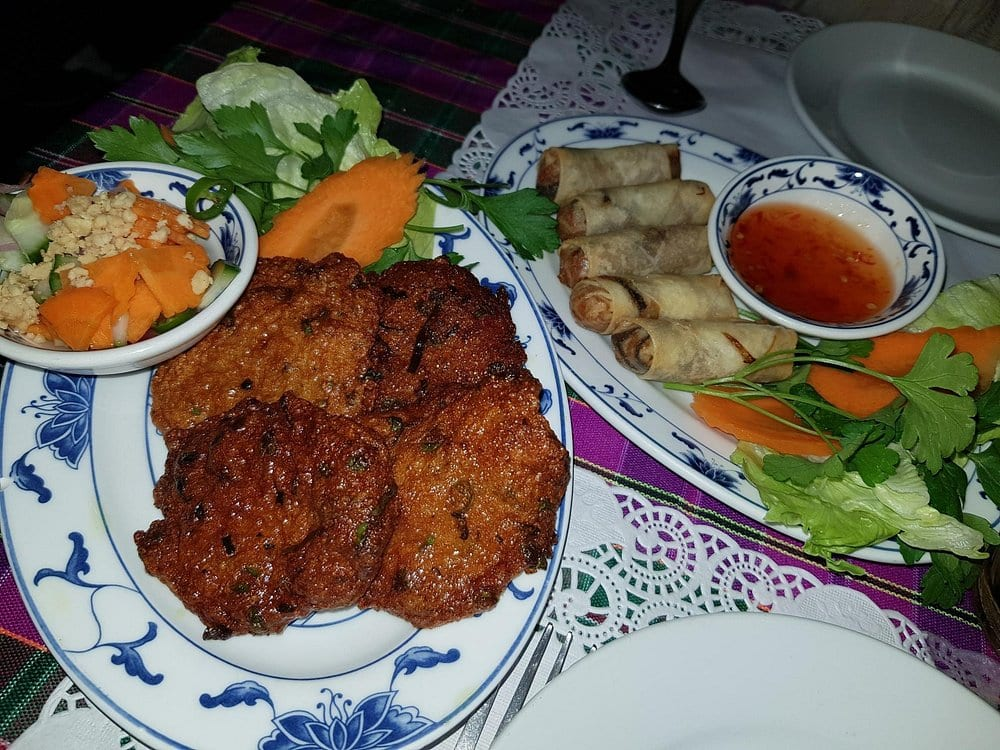

*Starters at Esarn Kheaw.*

### Som Saa, Spitalfields

*£££ · 43a Commercial Street · book ahead* · Cited by 5 sources

Andy Oliver and Mark Dobbie both trained under David Thompson at Nahm. The **deep-fried whole seabass** with herbs has stayed on the menu through every change since it opened.

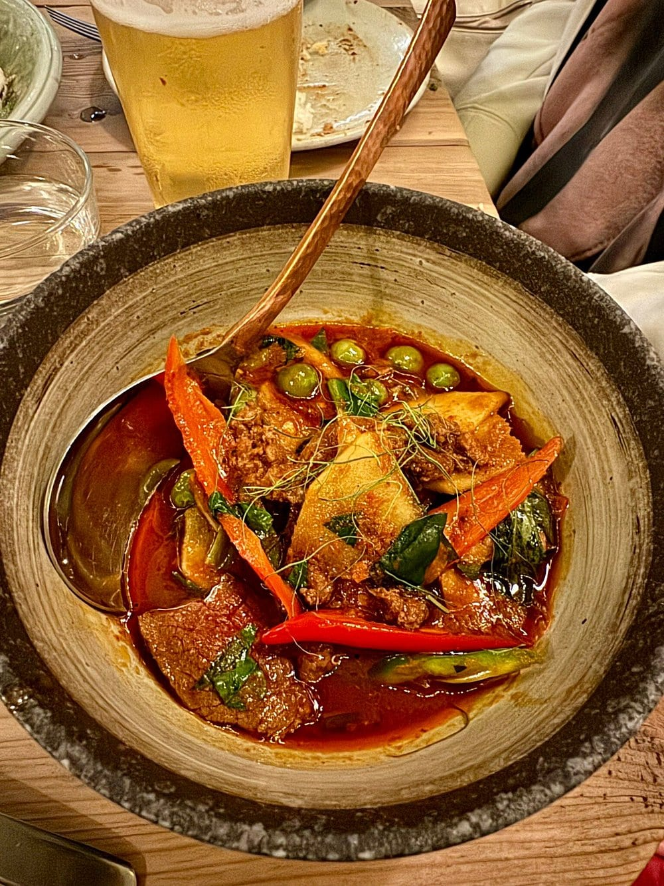

*A red curry at Som Saa.*

### Khun Pakin Thai, Hammersmith

*££ · inside The Salutation, 154 King Street* · Cited by 2 sources

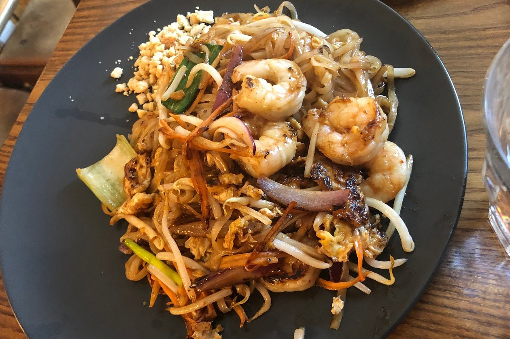
*Khun Pakin, inside The Salutation.*

Isaan cooking from a pub kitchen: **som tam, larb and grilled pork neck** off the charcoal, seasoned as they would be in Ubon rather than moderated for a pub audience. The heat is real and the kitchen will not soften it unless you ask.

**Walk-in.** Two hundred metres from 101 Thai Kitchen.

### 101 Thai Kitchen, Hammersmith

*££ · 352 King Street · closed Mondays* · Cited by 2 sources

**Isaan and Southern dishes from one kitchen**, two hundred metres from Khun Pakin. Order across the sour-hot **Isaan** dishes — som tam, larb, grilled meats — and the coconut-heavy **Southern** curries to see the difference.

Plain room, long menu; ask about the Thai-language specials.

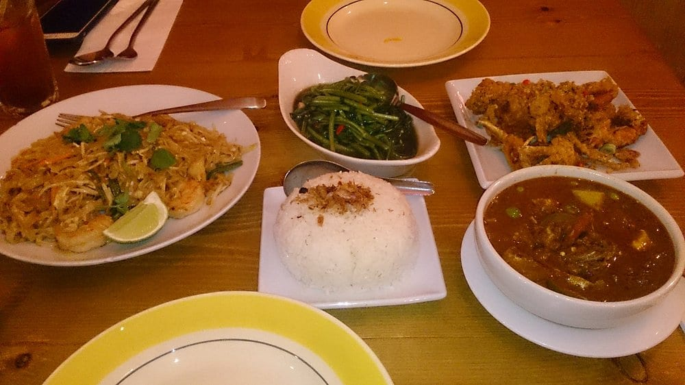

*A shared table at 101 Thai Kitchen.*

---

Powered by <a target="_blank" rel="sponsored" href="https://www.getyourguide.com/london-l57/">GetYourGuide</a>

## Southern: coconut, curry and heat

Richer and hotter than the north-east, with more coconut, turmeric and seafood, and a border blur into Malaysia.

### Plaza Khao Gaeng

*££ · Centre Point, Borough Yards and Covent Garden* · Cited by 5 sources

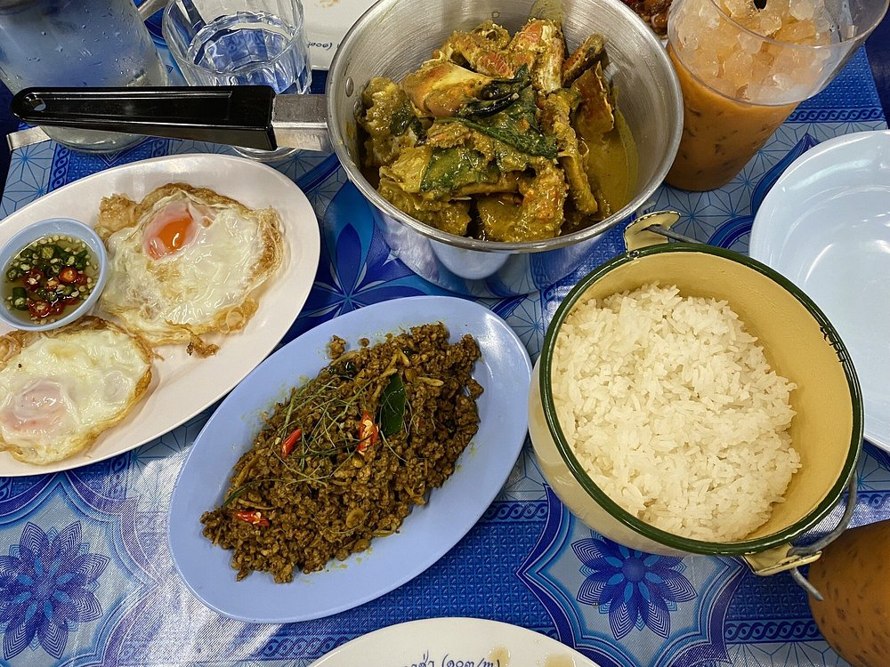
*A raan khao gaeng at Plaza Khao Gaeng.*

The format is a *raan khao gaeng*, a curry-over-rice shop: you choose from what is already cooked rather than ordering à la carte. The cooking is Southern Thailand's, and the restaurant holds a **Michelin Bib Gourmand for 2026**.

There are three sites: the Arcade Food Hall at Centre Point, a Borough Yards railway arch (opened November 2025) and Covent Garden.

### Singburi, Shoreditch

*££ · Unit 7, Montacute Yards · walk-ins welcome · closed Mondays* · Cited by 7 sources

It moved from Leytonstone to a Shoreditch railway arch in 2025, with second-generation chef Sirichai Kularbwong taking over from his retiring parents, joined by Nick Molyviatis from Kiln and Alexander Gkikas.

The cooking is Southern-leaning but not strictly Southern, with northern larb on the menu too. Order the **tiger prawn and cucumber curry**, raw beef larb with sawtooth coriander, or smoked pork belly nam tok.

A **Bib Gourmand for 2026**, and it takes walk-ins.

### Flavour Hubb, Wimbledon

*££ · inside Wimbledon Racquets and Fitness Club* · Cited by 2 sources

**Southern Thai cooked inside a badminton club.** Chef Supanno Yingviriya has roots in Surat Thani and trained in Phuket, and the menu is named **Hala Bala** after the forest on the Thailand–Malaysia border. Order crab curry noodles, house-made roti, and *khao yum*, the herb-and-rice salad that is really nasi kerabu.

---

## The live-fire kitchens

Restaurants built around wood and charcoal.

### Kiln, Soho

*£££ · 3 min from Piccadilly Circus · counter is walk-in* · Cited by 5 sources

**Everything is cooked over wood and charcoal along a single counter.** Sit at the bar and watch your food cooked a foot away.

The signature is the **short rib curry**, slow-cooked over embers and served with rice. Around it are clay-pot noodles, grilled langoustines and the northern Thai cooking Ben Chapman built the place on.

**Counter seats are walk-in only and the wait is real; tables can be booked.** Lunch is materially cheaper than dinner for the same counter.

### Smoking Goat, Shoreditch

*£££ · 1 min from Shoreditch High Street* · Cited by 4 sources

**Thai drinking food and live-fire cooking in a loud room that works like a bar**, the sibling to Kiln.

The dish to order is the **fish sauce wings**: deep-fried and glazed in fish sauce and palm sugar. Beyond them are lardo and langoustine over charcoal, and curries for sharing.

**It books weeks ahead.**

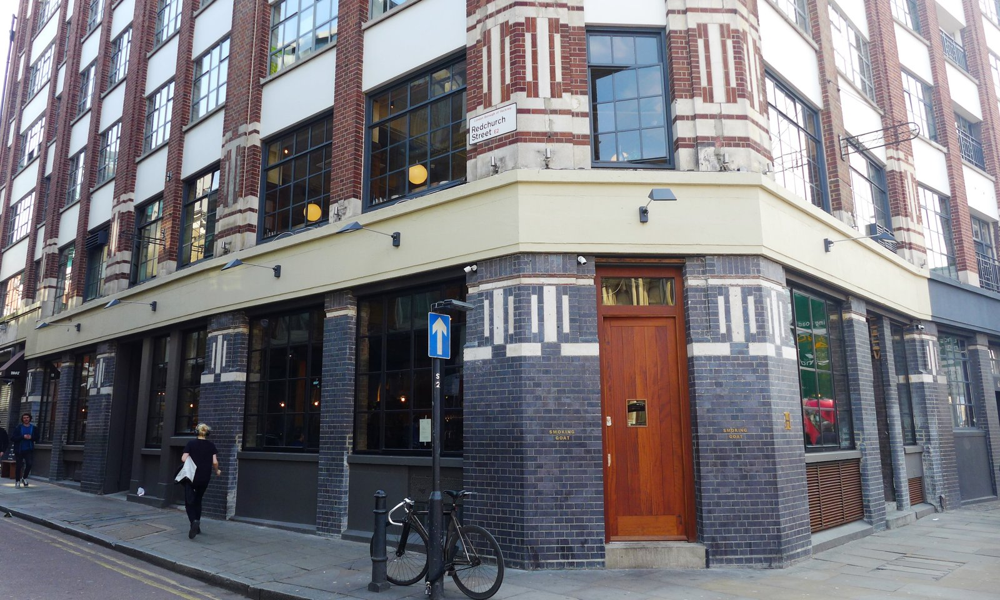
*Smoking Goat, Shoreditch. Photo: [Ewan-M](https://commons.wikimedia.org/w/index.php?curid=174581316), [CC BY-SA 2.0](https://creativecommons.org/licenses/by-sa/2.0/).*

### Kolae, Borough

*£££ · 3 min from London Bridge* · Cited by 4 sources

**Southern Thai grilling from the Kiln team.** The signature is **kolae chicken**, the dish the restaurant is named after: butterflied, basted repeatedly in coconut and turmeric, and grilled over charcoal until the glaze caramelises into a crust. Southern curries come around it.

**It books weeks ahead.** Sit at the counter if you can, where you can see the grill.

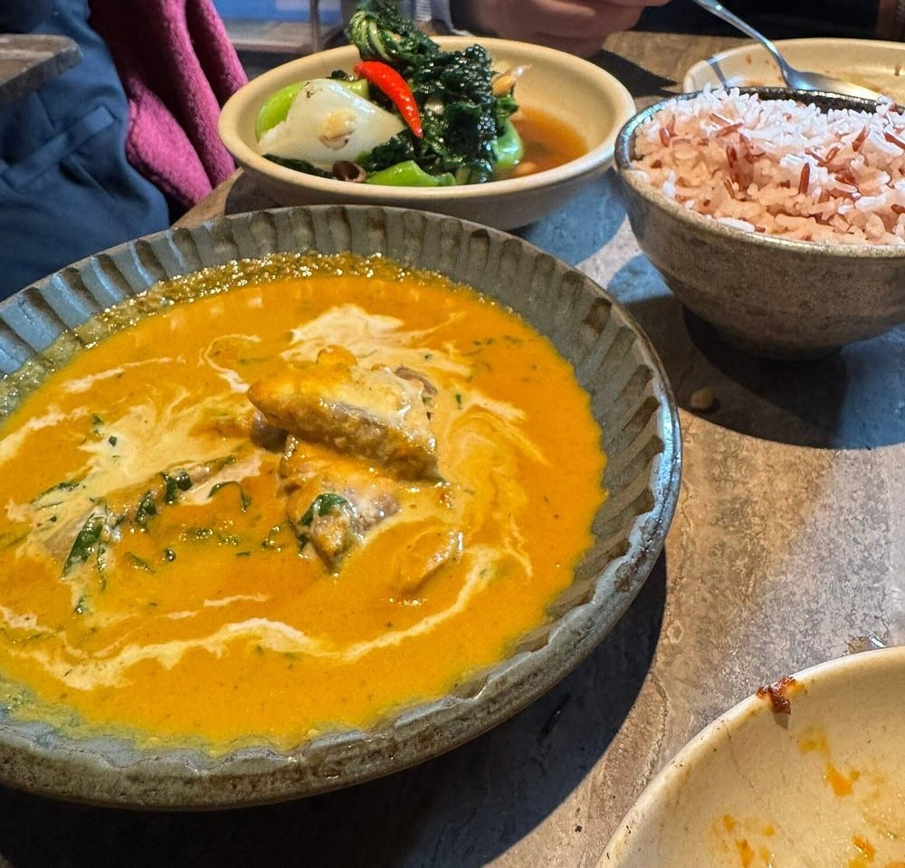

*Not the kolae chicken — the curry beside it.*

### Speedboat Bar, Chinatown and Notting Hill

*££ · pool tables* · Cited by 4 sources

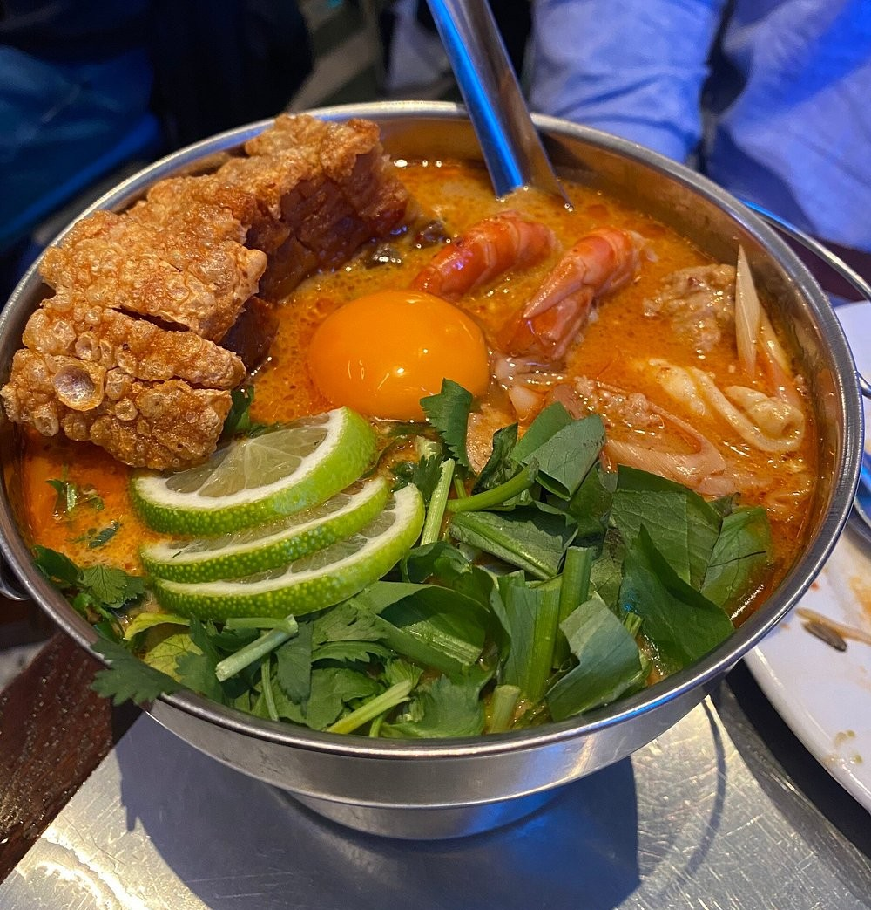
*A dish at Speedboat Bar.*

Styled as a **late-night Bangkok Chinatown canteen**, with strip lights, football on the screens and **pool tables**.

The cooking is Thai-Chinese from Bangkok's Yaowarat district: **dry-aged noodle dishes**, wok-charred seafood and curries with real heat, built to be eaten with beer. **It books weeks ahead.** Three minutes from Piccadilly Circus. Go as a group and order across the whole menu.

**There are now two.** A second Speedboat Bar opened in July 2025 at **191 Portobello Road** in Notting Hill, inside Soho House's Electric House, with the same Luke Farrell menu. It runs Sunday to Thursday noon to 11pm (last food 9.45pm) and Friday and Saturday noon to 1am (last food 12.15am). Pavement tables are first come, first served.

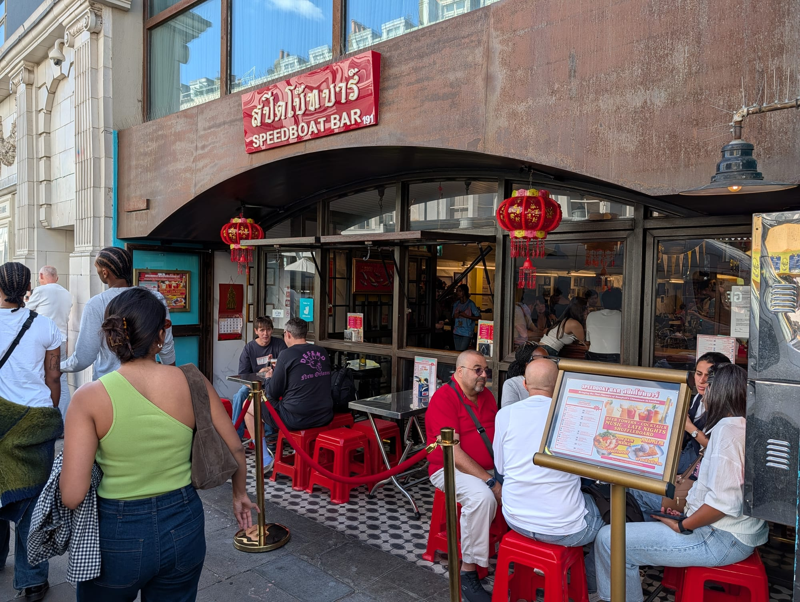

*Speedboat Bar, at The Electric.*

**You do not need to be a Soho House member.** Electric House is a members' club, but Speedboat takes public bookings and walk-ins through its own site.

---

Powered by <a target="_blank" rel="sponsored" href="https://www.getyourguide.com/london-l57/">GetYourGuide</a>

## The one with a star

### AngloThai, Marylebone

*££££ · 22 Seymour Place · tasting menus · book well ahead* · Cited by 6 sources

**The only Michelin-starred Thai restaurant in the UK.** John Chantarasak won the star within three months of opening, in the 2025 Great Britain and Ireland guide.

The cooking is Thai, built on **British seasonal produce** rather than imported substitutes. Run by Chantarasak with his wife Desiree.

Lunch, weekend and dinner tasting menus. Book well ahead.

---

## The new generation

### Kruk, Peckham

*££ · 213 Blenheim Grove · closed Mondays and Tuesdays* · Cited by 3 sources

Kruk **does not pick a region**. Khao soi from the north, moo hong from Phuket in the south, som tam from Isaan and a red jungle curry from the centre share one short menu.

Rob Willcox and Josh Lyons met at Farang and opened in **August 2025** in the Peckham railway arch that used to be Bar Story. They took a **Bib Gourmand within months**. Order the fried chicken with prickly ash and fish sauce glaze, and the red jungle curry with chalk stream trout.

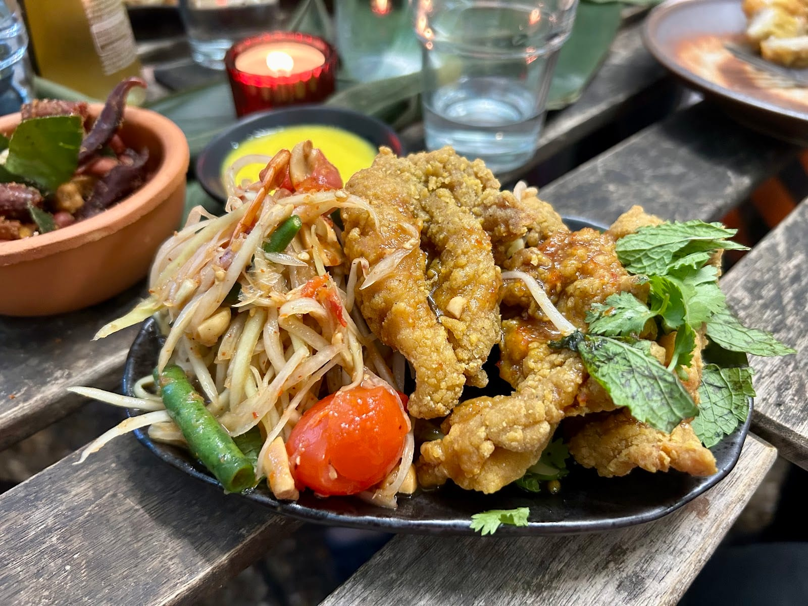

*The fried chicken at Kruk.*

### Khao So-i, Fitzrovia

*£££ · 9 Market Place* · Cited by 3 sources

Named for the northern Thai coconut curry noodle it is built around.

**Khao soi** is the dish: egg noodles in a coconut and curry broth, topped with a nest of the same noodles fried crisp, with pickled mustard greens, shallot and lime to add yourself. The rest of the menu is northern Thai.

**It books weeks ahead.** The room is small and the queue for walk-ins builds early.

### Farang, Highbury

*£££ · 11 min from Arsenal* · Cited by 5 sources

Modern Thai in Highbury, with the heat and sourness left up. The menu changes constantly and leans northern: **grilled meats, jungle curry, whole fish**. Set menus are how most tables order.

**It books weeks ahead. Open Wednesday to Saturday only** — closed Sunday, Monday and Tuesday.

### The Begging Bowl, Peckham

*£££ · 168 Bellenden Road* · Cited by 5 sources

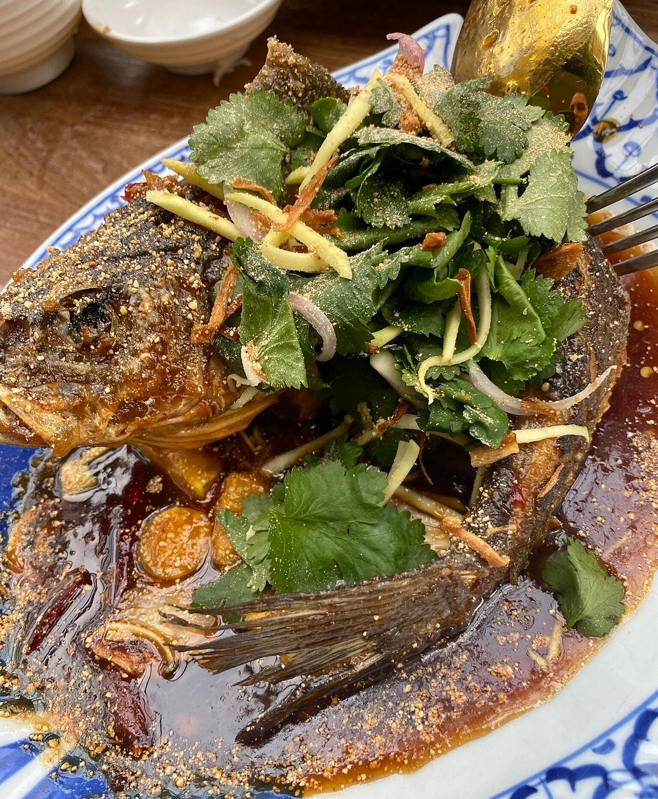
*A dish at The Begging Bowl.*

**Jane Alty trained under David Thompson and cooks northern Thai in Peckham**, in small plates meant to be ordered across the table: **curries, salads, grilled meats and relishes**, changing with the season. A table orders six or seven and shares everything.

**Closed Monday, and it books weeks ahead.**

### Chet's, Shepherd's Bush

*£££ · an American diner* · Cited by 1 source

**Thai flavours in an LA-inspired American diner** inside The Hoxton. The menu is a Thai-American crossover: **fried chicken with Thai seasoning**, larb-spiced burgers and noodles, alongside a cocktail list.

**Book a few days ahead.** Open later than most of this guide.

### Nipa Thai, Bayswater

*£££ · 1 min from Lancaster Gate* · Cited by 2 sources

Royal Thai cooking in a teak-panelled dining room overlooking Hyde Park, inside the Royal Lancaster on Bayswater Road. Expect **refined curries, carved fruit and delicate presentation** from a Thai kitchen brigade.

**Book a few days ahead.**

---

Powered by <a target="_blank" rel="sponsored" href="https://www.getyourguide.com/london-l57/">GetYourGuide</a>

## Best value

### Paolina, King's Cross

*£ · 181 King's Cross Road · from £5.95 · BYO · closed Sundays* · Cited by 2 sources

**Dishes from £5.95**, bring your own bottle, family-run: central Thai canteen classics with no regional focus.

The repertoire is Bangkok-standard: **pad thai, green and red curry, pad krapow** with a fried egg on rice, and tom yum.

**Thai pub kitchens are another cheap option.** An ordinary pub lets a Thai family run its kitchen, and Khun Pakin at The Salutation is one. Otherwise, **Kiln's lunch** is materially cheaper than dinner for the same counter.

---

## What to know

* **Pick the region before the price.** Isaan and Southern cooking are different meals, not different price brackets. If you only try one thing, make it som tam and sticky rice at Esarn Kheaw or the curry-over-rice at Plaza Khao Gaeng.
* **Sit at the counter at Kiln.** Tables can be booked; the counter is walk-in.
* **Check the closed days.** Kruk shuts Mondays and Tuesdays, Singburi and 101 Thai Kitchen shut Mondays, Paolina shuts Sundays, and Esarn Kheaw serves evenings only.
* **Heat is negotiable** at every restaurant here — say what you want and they will cook to it. At Kruk and Khun Pakin, the default is hot.
* **Order across the table.** A dish each misses the balance of sour, hot, salty and sweet.

---

## Continue planning your London trip

- 🥟 **[Best Chinese and East Asian Restaurants](/articles/best-chinese-east-asian-restaurants-london/)**
- 🇯🇵 **[Best Japanese Restaurants in London](/articles/best-japanese-restaurants-london/)**
- 💷 **[Cheap Eats in London](/articles/cheap-eats-london/)**
- 🍽️ **[Eat in London: Restaurants, Food Markets & Quick Food Hub](/articles/eat-in-london-guide/)**
- 🍜 **[Soho Area Guide](/articles/soho-area-guide/)**
- 🎨 **[Shoreditch Area Guide](/articles/shoreditch-area-guide/)**
